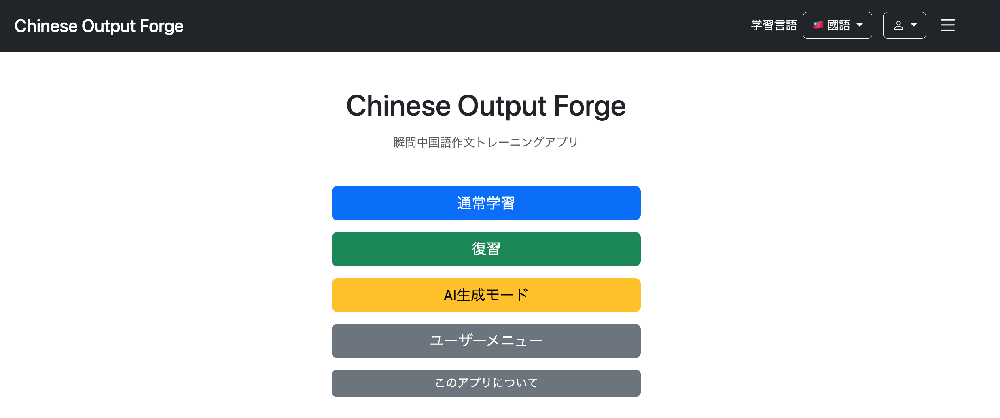
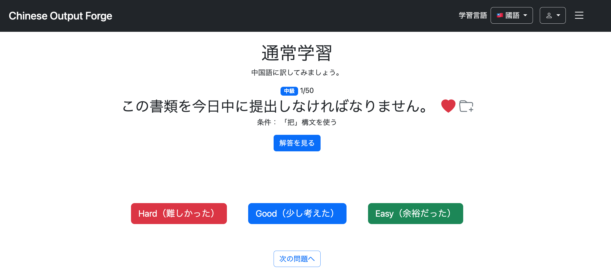
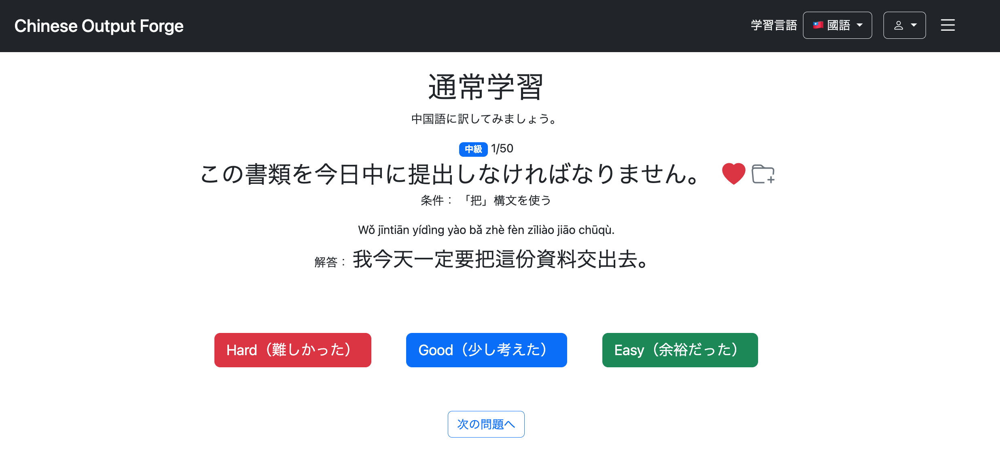
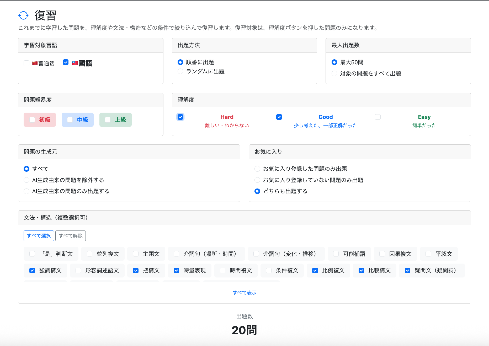
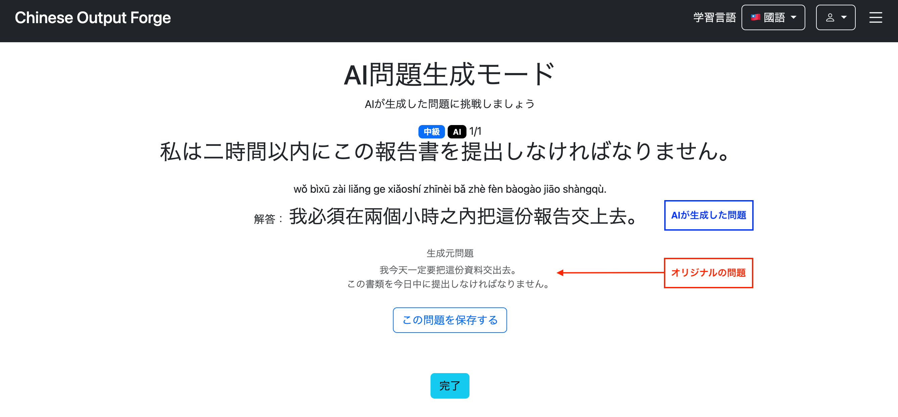
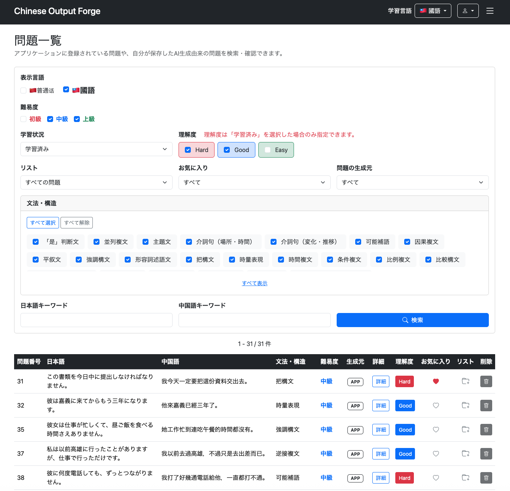
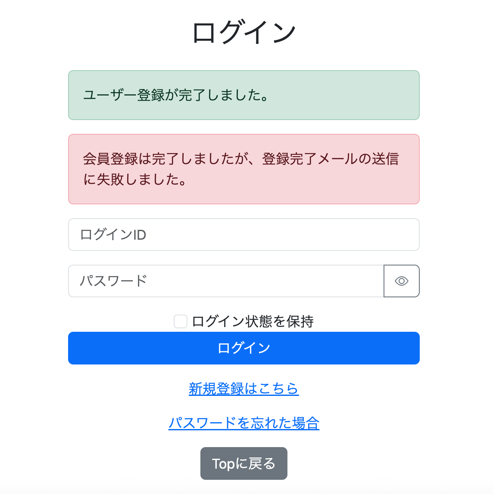
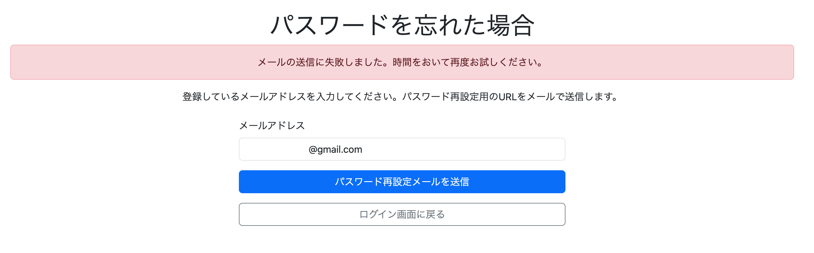
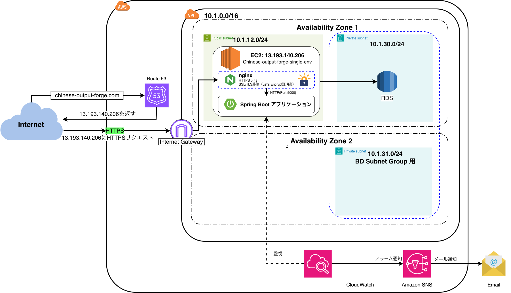

# Chinese Output Forge

**日本語から中国語への瞬間作文練習を通じて、学んだ文法・語彙を実際に使えるようにするWebアプリケーションです。** 中国大陸の普通話と台湾華語に対応しています。

[公開アプリ](https://chinese-output-forge.com) · [要件定義](docs/requirements/requirements/requirements.md) · [開発ログ](docs/development-log/implements/) · [学習ログ](docs/learning-log/implement/)

## プロジェクト概要

Chinese Output Forgeは、日本語の問題文を見て、対応する中国語を瞬時に組み立て、口頭で発話する「瞬間口頭作文」を中心とした中国語学習アプリです。瞬間英作文と同様に、頭の中で中国語の文章を組み立てるプロセスを繰り返すことで、実際の会話でも反射的に中国語を話せるようになることを目指しています。

難易度や文法構文による問題選択、苦手な問題の復習、お気に入り登録、AIによる問題のバリエーション生成に対応しています。

固定された問題を繰り返すだけでは、中国語を瞬時に組み立てる力ではなく、解答そのものを暗記してしまう可能性があります。そこで、既存の問題とその構文を基にAIが類題を生成する機能を実装しました。また、中国大陸の普通話と台湾の台湾華語を、単なる簡体字・繁体字の変換ではなく、異なる学習対象として扱っています。

## 主な機能

- **通常学習：** 日本語から中国語への作文練習。難易度・構文などを条件に問題を選択
- **復習：** 学習時の評価、文法構文、お気に入りなどを条件に問題を抽出
- **AI問題生成：** 対象となる既存問題から類題を生成し、ユーザー専用の問題として保存
- **言語・発音設定：** 中国大陸の普通話／台湾華語、ピンイン／注音符号／発音表示なしを選択
- **多言語UI：** 日本語、英語、簡体字中国語、繁体字中国語
- **ユーザー管理：** 会員登録、ログイン、プロフィール管理、メールによるパスワード再設定
- **管理機能：** 問題、文法構文、ユーザーの管理

## 公開環境の制限事項（Amazon SES）

現在、Amazon SESの本番アクセスを申請中のため、メール送信はサンドボックス環境の制限を受けています。

パスワード再設定メールの送信機能は実装・検証済みですが、**送信先はAmazon SESで検証済みのメールアドレスに限られます。**

そのため、公開サイトでは、一般ユーザーが自身のメールアドレス宛てにパスワード再設定メールを受信する操作を確認できません。

本番アクセスの承認後に、この制限事項を更新する予定です。

## 画面紹介

### トップページ



通常学習・復習・AI生成モードなど、主要な機能へアクセスできます。

### 通常学習

| 解答表示前 | 解答表示後 |
| --- | --- |
|  |  |

日本語の出題文を中国語に訳し、解答を確認した後、**Hard／Good／Easy**で理解度を記録します。解答には中国語文と発音表記が表示されます。

### 復習



言語、難易度、過去の理解度、問題の生成元、お気に入り、文法・構文などを組み合わせて、復習対象を絞り込めます。

### AI問題生成



既存の問題を基に生成された類題へ挑戦できます。生成元の問題を確認し、生成された問題を保存することもできます。

### 問題一覧



言語・難易度・学習状況・文法構文・キーワードなどを指定して、登録済みの問題や保存したAI生成問題を検索・確認できます。

### メール送信エラーへの対応

| 会員登録時 | パスワード再設定時 |
| --- | --- |
|  |  |

Amazon SESによるメール送信に失敗した場合でも、例外を処理して適切なエラーメッセージを表示します。会員登録時は登録処理の成功とメール送信の失敗を区別し、パスワード再設定時は入力内容を保持して再試行できるようにしています。

## 使用技術

主要な技術をShields.ioのバッジで示しています。詳細なライブラリとバージョンは`chinese-output-forge/pom.xml`を参照してください。

**バックエンド**

   

**フロントエンド**

    

**データベース・AI**

  

**AWS・インフラ**

       

  

## AWS構成

### 現在の構成：低コスト版



現在は、Elastic Beanstalkの**Single Instance構成**で運用しています。Route 53からEC2のパブリックIPアドレスへ名前解決し、nginxでHTTPS通信を終端した後、ポート5000のSpring Bootアプリケーションへ転送します。データベースはプライベートサブネット上のRDS（**Single-AZ**）を使用しています。

CloudWatchとSNSで監視・アラーム通知を行い、アプリケーションからの会員向けメール送信にはAmazon SESを使用しています。

### 移行前の構成：高可用性版


最初に、Application Load Balancer、2つのAvailability ZoneにまたがるEC2 Auto Scaling、NAT Gateway、Multi-AZ RDSを使用した高可用性構成を構築しました。動作を検証した後、個人開発アプリの運用コストを抑えるため、現在の低コスト構成へ移行しました。

**2つの図は移行前後の構成を示したものであり、同時に稼働している環境ではありません。**

詳しい構築手順と検証内容は、[高可用性版の開発ログ](docs/development-log/implements/031aws-deployment-high-availability.md)、[低コスト版の開発ログ](docs/development-log/implements/032aws-low-cost-deployment-development-log.md)、[Amazon SES導入の開発ログ](docs/development-log/implements/033amazon-ses-spring-boot-development-log.md)に記録しています。

## 設計・実装上の工夫

- **AI生成範囲の制御：** 無制限に問題を生成するのではなく、既存問題と構文を基に類題を作成
- **中国大陸・台湾の言語差への対応：** `language_variant`で学習対象を区別
- **ユーザー別の学習データ管理：** お気に入り、学習評価、AI生成問題をユーザーごとに管理
- **認証・認可：** Spring Securityを利用してログインが必要な機能や管理機能へのアクセスを制御
- **AWSとの連携：** EC2のIAMロールとAWS SDKによるSESメール送信、独自ドメインのDNS・メール認証設定

データベースの詳細は[ER図](docs/requirements/design/database/er-diagram.md)と[テーブル定義](docs/requirements/design/database/table-definition.md)を参照してください。

## ディレクトリ構成

```text
ChineseOutputTrainerApplication/
├── chinese-output-forge/
│   ├── src/main/java/          # Controller、Service、Entity、Repository、設定クラス
│   ├── src/main/resources/     # Thymeleaf、静的ファイル、アプリケーション設定
│   ├── src/test/               # テスト
│   ├── .platform/nginx/        # Elastic Beanstalk用のnginx設定
│   ├── pom.xml
│   └── mvnw
└── docs/
    ├── requirements/          # 要件定義、画面設計、ER図など
    ├── development-log/       # 開発・実装記録
    ├── learning-log/          # 学習記録
    ├── research/              # 技術調査
    └── images/                # 画面・AWS構成図
```

## ローカル開発環境の構築

本アプリケーションはAWS上にデプロイされており、[公開サイト](https://chinese-output-forge.com)から実際の機能を確認できます。

ローカル環境で実行する場合は、PostgreSQLの構築、環境変数の設定、外部APIの認証情報の準備などが必要です。また、GitHubのリポジトリには本番データベースの問題データが含まれていないため、別途データを用意する必要があります。

そのため、**アプリケーションの動作確認を目的とする場合は、ローカル環境を構築するよりも公開サイトの利用を推奨します。**

以下は、ソースコードを取得してローカル環境で開発・実行する場合の参考情報です。

### 必要な環境

- JDK 21
- PostgreSQL
- AI機能を使用する場合は各AIプロバイダーのAPIキー
- AWS連携機能を使用する場合は、適切なAWS認証情報と設定

Maven Wrapperを使用しているため、Mavenの個別インストールは不要です。

### 環境変数・設定

`chinese-output-forge/src/main/resources/application.yml`には、DB接続設定や旧SMTP方式の設定が含まれています。AIクライアントも設定値からAPIキーを取得します。**認証情報や本番環境の秘密情報をGitにコミットしないでください。**

| 設定項目 | 用途 |
| --- | --- |
| `DB_URL` | PostgreSQLのJDBC URL（デフォルト：`jdbc:postgresql://localhost:5432/chinese_output_forge`） |
| `DB_USERNAME` | DBユーザー名（`application.yml`にローカル用デフォルト値あり） |
| `DB_PASSWORD` | DBパスワード |
| `OPENAI_API_KEY` | OpenAI APIの認証情報 |
| `GOOGLE_API_KEY` | Google Gen AIの認証情報 |
| `MAIL_USERNAME`、`MAIL_PASSWORD` | `application.yml`に残っている旧SMTP方式の設定 |
| AWS認証情報・リージョン | SESやParameter Storeなど、AWS連携機能を使用する際の設定 |

**注意：** プロジェクトにはSpring Cloud AWS Parameter Store Starterが含まれているため、ローカル起動時にも追加のAWS設定が必要になる可能性があります。現在のSES連携はAWS SDKによる認証を使用し、旧Gmail SMTPの認証情報は使用しません。上記は設定項目の整理であり、すべての外部連携が追加設定なしでローカル動作することを保証するものではありません。

### リポジトリのクローン

以下のコマンドでGitHubからリポジトリを取得します。

```bash
git clone https://github.com/mawsonlakes790913/ChineseOutputTrainerApplication.git
cd ChineseOutputTrainerApplication
```

### 起動・ビルドコマンド

Spring Bootアプリケーションのディレクトリへ移動します。

```bash
cd chinese-output-forge
```

必要な環境変数やデータベースを設定したうえで、以下のコマンドを実行します。

```bash
./mvnw spring-boot:run
```

起動後、`http://localhost:8080`にアクセスします（ローカル環境で8080番ポートを使用する場合）。

ビルドとテスト：

```bash
./mvnw clean package
./mvnw test
```

Windowsの場合は`./mvnw`の代わりに`mvnw.cmd`を使用します。

## トラブルシューティング

| 症状 | 確認すること |
| --- | --- |
| DB接続エラー | PostgreSQLの起動状態、JDBC URL、ユーザー名・パスワード、DB名 |
| AI問題生成エラー | APIキー、利用するAIプロバイダーの設定・稼働状況 |
| AWS設定・メール送信エラー | AWS認証情報、リージョン、IAM権限、SESドメイン検証、サンドボックス制限 |
| デプロイ後のHTTPS接続エラー | `.platform/nginx/conf.d/https.conf`がJARの**外側**に含まれているか、EC2に証明書ファイルがあるか |

詳しい原因調査や修正過程は[開発ログ](docs/development-log/implements/)に記録しています。

## 開発ドキュメント

- [要件定義・設計資料](docs/requirements/)
- [開発ログ](docs/development-log/implements/)
- [学習ログ](docs/learning-log/implement/)
- [AI問題生成の実現可能性調査](docs/research/ai-question-generation-feasibility-study.md)

各ドキュメントには、実装時の判断、トラブルシューティング、AWS構成の変更、開発を通じて学んだ内容を記録しています。

## 今後の開発予定

- [ ] **TTS（Text-to-Speech）による中国語音声の自動生成・再生機能**
  - 問題の登録・生成時にTTS APIと連携し、中国語の解答文から音声ファイルを自動生成する。
  - 生成した音声ファイルをAmazon S3に保存し、各問題と関連付けて管理する。
  - 学習画面から音声を再生できるようにし、中国語の発音確認やリスニング学習にも対応する。