# 003 言語設定機能の実装

サイトの表示言語と、問題の学習対象言語を別々に設定できるようにする。

| 設定 | 選択肢 | 用途 |
| --- | --- | --- |
| サイト表示言語 | 日本語 / English / 简体中文 / 繁體中文（初期実装時） | メニューや説明文の表示 |
| 学習対象言語 | `MAINLAND` / `TAIWAN` | 大陸普通話と台湾華語（國語）の切り替え |

このログは当初の実装と、その後の追加・修正を時系列で記録している。途中のコードは後続の変更によって置き換えられている場合がある。

**補足：英語表示は初期段階で導入したが、その後採用を取りやめた。** 以下の`messages_en.properties`や英語切り替え用UIは、初期実装の記録として掲載しているものであり、現在の採用機能を示すものではない。

## 1. サイト表示言語の切り替えを追加

**Commit:** `feat: add multilingual display language switching`

### 1.1 メッセージファイルの準備

画面の固定文言をHTMLから分離し、言語別の`messages*.properties`で管理する。デフォルトは日本語とし、英語・簡体字・繁体字のファイルを追加した。アプリ名「中文造句工坊」はブランド名として共通表示のままとする。

対象ファイル：`messages.properties`、`messages_en.properties`、`messages_zh_CN.properties`、`messages_zh_TW.properties`。

日本語のメッセージは以下のとおり。

```properties
# home.html
home.title=瞬間中国語作文
home.welcome=中国語トレーニングアプリへようこそ
home.about=このアプリについて

# about.html
about.title=このアプリについて
about.backToTop=Topへ戻る

# header.html
header.greeting.guest=こんにちは、ゲストさん
```

`home.html`では、タイトル・説明文・リンク文字列をメッセージキーから取得する。`about.html`と`header.html`も同様に変更した。

```html
<h1 class="mb-3"
    th:text="#{home.title}">
    瞬間中国語作文
</h1>

<p class="text-muted"
   th:text="#{home.welcome}">
    中国語トレーニングアプリへようこそ
</p>

<div class="d-grid gap-3 col-md-3 mx-auto mt-5">

    <a th:href="@{/about}"
       class="btn btn-secondary"
       th:text="#{home.about}">
        このアプリについて
    </a>

</div>
```

**英語のメッセージ（後に廃止した初期実装）**

```properties
# home.html
home.title=Instant Chinese Sentence Production
home.welcome=Welcome to the Chinese Training App
home.about=About This App

# about.html
about.title=About This App
about.backToTop=Back to Top

# header.html
header.greeting.guest=Hello, Guest
```

**簡体字中国語のメッセージ**

```properties
# home.html
home.title=中文快速造句
home.welcome=欢迎来到中文练习App
home.about=关于本App

# about.html
about.title=关于本App
about.backToTop=返回首页

# header.html
header.greeting.guest=你好，Guest
```

**繁体字中国語のメッセージ**

```properties
# home.html
home.title=中文快速造句
home.welcome=歡迎來到中文練習App
home.about=關於本App

# about.html
about.title=關於本App
about.backToTop=返回首頁

# header.html
header.greeting.guest=你好，Guest
```

### 1.2 Localeの設定

`LocaleConfig`で`SessionLocaleResolver`と`LocaleChangeInterceptor`を設定する。表示言語はSessionに保持し、URLの`lang`パラメータによって切り替える。未指定時の表示言語は日本語とした。

```java
@Configuration
public class LocaleConfig implements WebMvcConfigurer {

    @Bean
    LocaleResolver localeResolver() {

        SessionLocaleResolver resolver = new SessionLocaleResolver();

        // デフォルトは日本語
        resolver.setDefaultLocale(Locale.JAPANESE);

        return resolver;
    }

    @Bean
    LocaleChangeInterceptor localeChangeInterceptor() {

        LocaleChangeInterceptor interceptor =
                new LocaleChangeInterceptor();

        // ?lang=ja などの lang を監視
        interceptor.setParamName("lang");

        return interceptor;
    }

    @Override
    public void addInterceptors(InterceptorRegistry registry) {
        registry.addInterceptor(localeChangeInterceptor());
    }
}
```

表示言語の切り替えUIは当初`header.html`のドロップダウンに配置した。現在のLocaleに合わせて選択中の言語名を表示する。中国語は`zh_CN`と`zh_TW`を区別する。

```html
<div class="dropdown">

    <button class="btn btn-outline-light dropdown-toggle"
            type="button"
            data-bs-toggle="dropdown"
            aria-expanded="false">

        <span th:if="${#locale.language == 'ja'}">日本語</span>
        <span th:if="${#locale.language == 'en'}">English</span>
        <span th:if="${#locale.toString() == 'zh_CN'}">简体中文</span>
        <span th:if="${#locale.toString() == 'zh_TW'}">繁體中文</span>
    </button>

    <ul class="dropdown-menu dropdown-menu-end">

        <li>
            <a class="dropdown-item"
               th:href="@{?lang=ja}">
                日本語
            </a>
        </li>

        <li>
            <a class="dropdown-item"
               th:href="@{?lang=en}">
                English
            </a>
        </li>

        <li>
            <a class="dropdown-item"
               th:href="@{?lang=zh_CN}">
                简体中文
            </a>
        </li>

        <li>
            <a class="dropdown-item"
               th:href="@{?lang=zh_TW}">
                繁體中文
            </a>
        </li>

    </ul>
</div>
```

### 1.3 動作確認

`?lang=en`、`?lang=zh_CN`、`?lang=zh_TW`でそれぞれの表示言語に切り替わることを確認した。

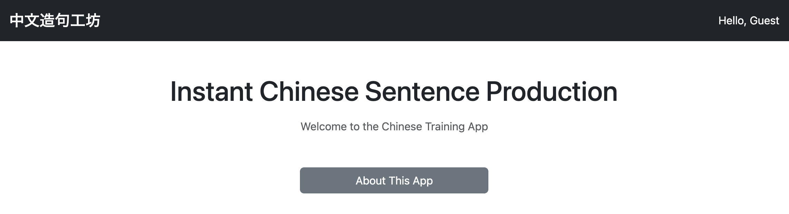

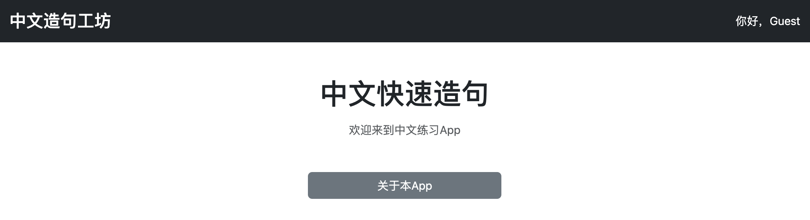

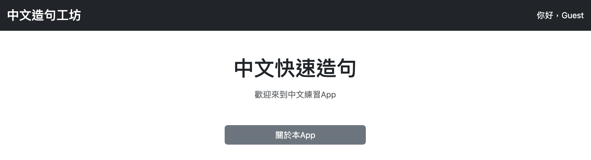

日本語表示の確認にあたり、システムLocaleへのフォールバックを無効化する設定を`application.yml`に追加した。

```yaml
spring:
  messages:
    fallback-to-system-locale: false
```

`?lang=ja`で日本語表示を確認した。

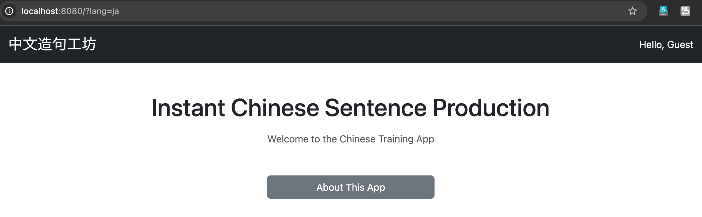

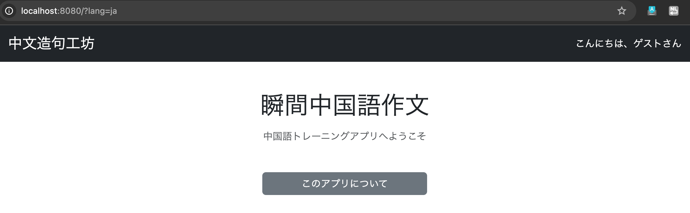

## 2. 学習対象言語の切り替えを追加

**Commit:** `feat: add study language switching`

### 2.1 言語種別とController

学習対象言語は表示言語と独立させ、`LanguageVariant`で`MAINLAND`（大陸普通話）と`TAIWAN`（台湾華語）を管理する。

```java
public enum LanguageVariant {
    MAINLAND,
    TAIWAN
}
```

初期実装の`LanguageVariantController`は、選択された値をSessionの`languageVariant`へ保存し、Home画面に戻す構成とした。同じ言語を選択した場合は更新しない。**このGET方式は後の修正でPOST方式に変更している。**

```java
@Controller
public class LanguageVariantController {

    @GetMapping("/language-variant")
    public String changeLanguageVariant(
            @RequestParam LanguageVariant languageVariant,
            HttpSession session) {

        LanguageVariant current =
                (LanguageVariant) session.getAttribute("languageVariant");

        // 同じ言語なら変更処理をしない
        if (languageVariant == current) {
            return "redirect:/";
        }

        // 学習対象言語をSessionに保存
        session.setAttribute("languageVariant", languageVariant);

        return "redirect:/";
    }
}
```

### 2.2 ヘッダーの切り替えUI

`header.html`に学習対象言語のドロップダウンを追加する。選択中の言語はチェック付きで表示し、再選択できないようにした。Session未設定時は普通話を表示する。

```html
<div class="d-flex align-items-center gap-2">

    <span th:text="#{header.studyLanguage}">
        学習言語
    </span>

    <div class="dropdown">

        <button class="btn btn-outline-light dropdown-toggle"
                type="button"
                data-bs-toggle="dropdown"
                aria-expanded="false">

            <span th:if="${session.languageVariant == null
                         || session.languageVariant.name() == 'MAINLAND'}">
                🇨🇳 普通话
            </span>

            <span th:if="${session.languageVariant != null
                         && session.languageVariant.name() == 'TAIWAN'}">
                🇹🇼 國語
            </span>

        </button>

        <ul class="dropdown-menu dropdown-menu-end">

            <!-- MAINLAND -->
            <li>

                <span th:if="${session.languageVariant == null
                             || session.languageVariant.name() == 'MAINLAND'}"
                      class="dropdown-item disabled">
                    ✓ 🇨🇳 普通话
                </span>

                <a th:if="${session.languageVariant != null
                          && session.languageVariant.name() != 'MAINLAND'}"
                   class="dropdown-item language-variant-link"
                   th:href="@{/language-variant(languageVariant='MAINLAND')}"
                   th:data-confirm-message="#{header.studyLanguage.confirmMainland}">
                    🇨🇳 普通话
                </a>

            </li>

            <!-- TAIWAN -->
            <li>

                <span th:if="${session.languageVariant != null
                             && session.languageVariant.name() == 'TAIWAN'}"
                      class="dropdown-item disabled">
                    ✓ 🇹🇼 國語
                </span>

                <a th:if="${session.languageVariant == null
                          || session.languageVariant.name() != 'TAIWAN'}"
                   class="dropdown-item language-variant-link"
                   th:href="@{/language-variant(languageVariant='TAIWAN')}"
                   th:data-confirm-message="#{header.studyLanguage.confirmTaiwan}">
                    🇹🇼 國語
                </a>

            </li>

        </ul>

    </div>
</div>
```

言語変更前には確認ダイアログを表示する。確認文言をHTMLの`data-confirm-message`へ格納し、`header.js`でクリック時に読み取る。キャンセルされた場合は画面遷移を中止する。

```javascript
document.querySelectorAll('.language-variant-link').forEach(link => {
    link.addEventListener('click', function(event) {

        const message = this.dataset.confirmMessage;

        if (!confirm(message)) {
            event.preventDefault();
        }
    });
});
```

`layout.html`でJavaScriptを読み込む。

```html
<script th:src="@{/js/header.js}"></script>
```

確認メッセージも4言語に対応させた。

**日本語**

```properties
header.studyLanguage=学習言語
header.studyLanguage.confirmMainland=学習言語を普通話に切り替えますか？\n切り替えると、現在のトレーニングは終了し、ホーム画面に戻ります。
header.studyLanguage.confirmTaiwan=学習言語を國語に切り替えますか？\n切り替えると、現在のトレーニングは終了し、ホーム画面に戻ります。
```

**英語**

```properties
header.studyLanguage=Study Language
header.studyLanguage.confirmMainland=Switch the study language to Mandarin?\nYour current training session will end, and you will return to the Home page.
header.studyLanguage.confirmTaiwan=Switch the study language to Taiwanese Mandarin?\nYour current training session will end, and you will return to the Home page.
```

**簡体字**

```properties
header.studyLanguage=学习语言
header.studyLanguage.confirmMainland=要将学习语言切换为普通话吗？\n切换后，当前训练将结束，并返回首页。
header.studyLanguage.confirmTaiwan=要将学习语言切换为国语吗？\n切换后，当前训练将结束，并返回首页。
```

**繁体字**

```properties
header.studyLanguage=學習語言
header.studyLanguage.confirmMainland=要將學習語言切換為普通話嗎？\n切換後，目前的練習將結束，並返回首頁。
header.studyLanguage.confirmTaiwan=要將學習語言切換為國語嗎？\n切換後，目前的練習將結束，並返回首頁。
```

### 2.3 動作確認

普通話と國語を切り替え、ヘッダーの表示が更新されることを確認した。

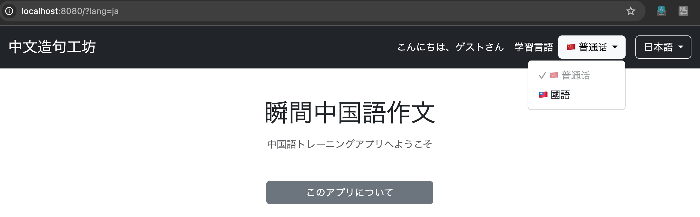

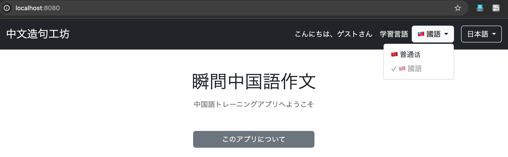

## 3. ヘッダーUIの再構成

**Commit:** `refactor: reorganize header UI`

表示言語と学習対象言語を追加したため、ヘッダーを「アプリ名 / 学習言語 / ユーザーアイコン / ハンバーガーメニュー」の構成に変更する。表示言語の切り替えはハンバーガーメニュー内へ移動した。

### 3.1 Bootstrap Iconsの導入

ユーザーアイコンとメニューアイコンの表示にBootstrap Iconsを使用するため、`pom.xml`へ依存関係を追加した。

```xml
<dependency>
    <groupId>org.webjars.npm</groupId>
    <artifactId>bootstrap-icons</artifactId>
    <version>1.11.3</version>
</dependency>
```

共通レイアウトからアイコン用CSSを読み込む。

```html
<!-- Bootstrap Icons -->
<link rel="stylesheet"
      th:href="@{/webjars/bootstrap-icons/font/bootstrap-icons.css}">
```

### 3.2 ユーザーアイコンとメニュー

暫定表示の「こんにちは、ゲストさん」をユーザーアイコンに置き換える。認証機能は未実装のため、この時点では見た目のみを用意した。

```html
<!-- ユーザーアイコン -->
<button type="button"
        class="btn p-0 text-white border-0"
        aria-label="ユーザー">
    <i class="bi bi-person-circle fs-4"></i>
</button>
```

ハンバーガーメニューには「このアプリについて」と4言語の表示切り替えを配置する。選択中の言語にはチェックを付ける。

```html
<!-- ハンバーガーアイコン -->
<div class="dropdown">

    <button type="button"
            class="btn p-0 text-white border-0"
            data-bs-toggle="dropdown"
            aria-expanded="false"
            aria-label="メニュー">
        <i class="bi bi-list fs-3"></i>
    </button>

    <ul class="dropdown-menu dropdown-menu-end">

        <li>
            <a class="dropdown-item"
               th:href="@{/about}"
               th:text="#{home.about}">
                このアプリについて
            </a>
        </li>

        <li>
            <hr class="dropdown-divider">
        </li>

        <li>
            <span class="dropdown-header">
                表示言語
            </span>
        </li>

        <li>
            <a class="dropdown-item"
               th:href="@{?lang=ja}">
                <span th:if="${#locale.language == 'ja'}">✓ </span>
                日本語
            </a>
        </li>

        <li>
            <a class="dropdown-item"
               th:href="@{?lang=en}">
                <span th:if="${#locale.language == 'en'}">✓ </span>
                English
            </a>
        </li>

        <li>
            <a class="dropdown-item"
               th:href="@{?lang=zh_CN}">
                <span th:if="${#locale.toString() == 'zh_CN'}">✓ </span>
                简体中文
            </a>
        </li>

        <li>
            <a class="dropdown-item"
               th:href="@{?lang=zh_TW}">
                <span th:if="${#locale.toString() == 'zh_TW'}">✓ </span>
                繁體中文
            </a>
        </li>

    </ul>
</div>
```

### 3.3 動作確認

Home画面で新しいヘッダー構成を確認した。

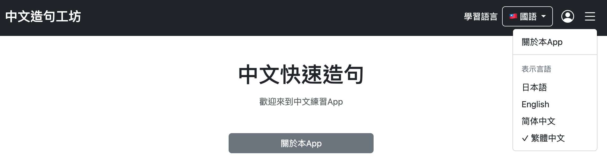

## 4. 追加修正（2026年9月19日）：表示言語変更時のクエリパラメータを維持

**Commit:** `fix: preserve query parameters when switching display language`

### 4.1 発生した問題

初期実装の表示言語リンクは`th:href="@{?lang=ja}"`のように`lang`のみを指定していた。その後、ページ番号・検索条件・パスワードリセット用トークンをURLで扱う画面が増え、言語変更時に既存パラメータが失われる不具合が発生した。

**問題ページ：** 5問目から言語を変更すると1問目に戻る。

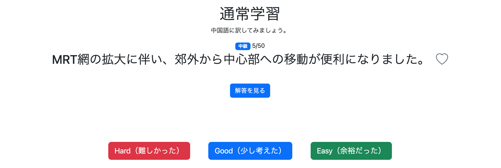

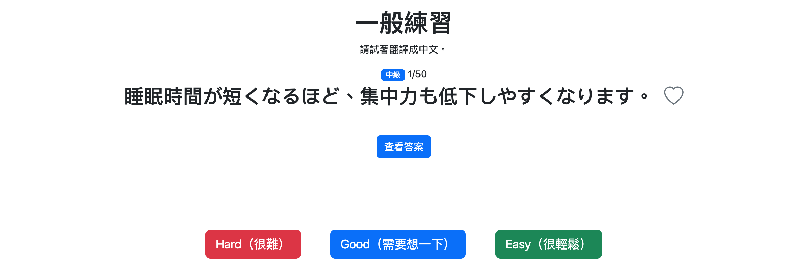

**問題一覧ページ：** 検索条件が失われ、全件表示へ戻る。

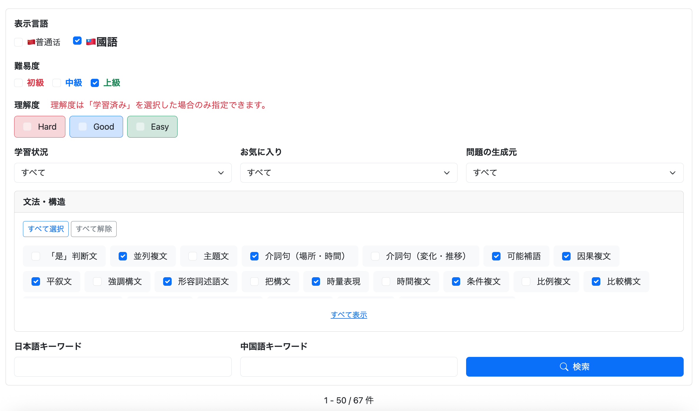

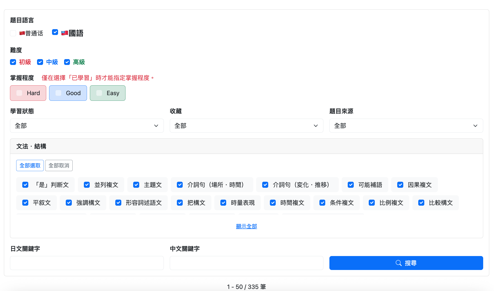

パスワードリセットページでも`token`が失われ、`400 Bad Request`が発生していた。

例えば、`/review/question?page=5&difficulty=HARD`で日本語に切り替えると、従来は`/review/question?lang=ja`となっていた。修正後は`/review/question?page=5&difficulty=HARD&lang=ja`とし、既存の条件を維持する。

### 4.2 修正方針

各ページが使用するパラメータを`header.html`に列挙すると、機能追加のたびに共通ヘッダーの修正が必要になる。そこで、JavaScriptで現在のURLを取得し、既存のクエリパラメータを維持したまま`lang`だけを書き換える方式を採用した。

### 4.3 `header.html`の変更

表示言語リンクに`display-language-link`クラスと切り替え先を示す`data-lang`属性を付ける。ほかの言語も同じ形式とした。

```html
<li>
    <a class="dropdown-item display-language-link"
       href="#"
       data-lang="ja">
        <span th:if="${#locale.language == 'ja'}">✓ </span>日本語
    </a>
</li>
```

### 4.4 `header.js`の変更

クリックされたリンクから`data-lang`を取得し、`URL.searchParams.set()`で現在のURLの`lang`を追加・更新する。`window.location.href`への代入によって変更後のURLへ移動する。

```javascript
document.querySelectorAll(".display-language-link").forEach(link => {

    link.addEventListener("click", function(event) {

        event.preventDefault();

        // 現在のURLを取得
        const url = new URL(window.location.href);

        // langを追加・変更
        url.searchParams.set("lang", this.dataset.lang);

        // 変更後のURLへ遷移
        window.location.href = url.toString();
    });
});
```

`layout.html`では、HTML解析後にイベントを登録できるよう`defer`付きで`header.js`を読み込む。

```html
<script th:src="@{/js/layout/header.js}" defer></script>
```

### 4.5 動作確認

**問題画面：** 日本語から繁體中文へ切り替えても、5問目の表示を維持できた。


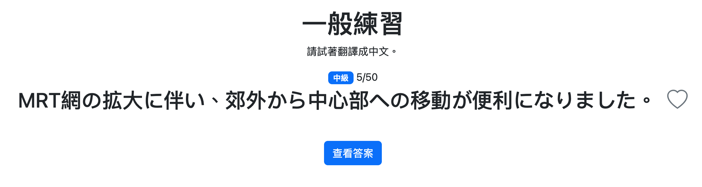

**問題一覧ページ：** 表示言語を変更しても、検索結果80件と指定条件を維持できた。

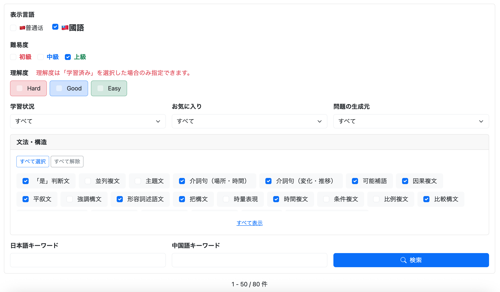

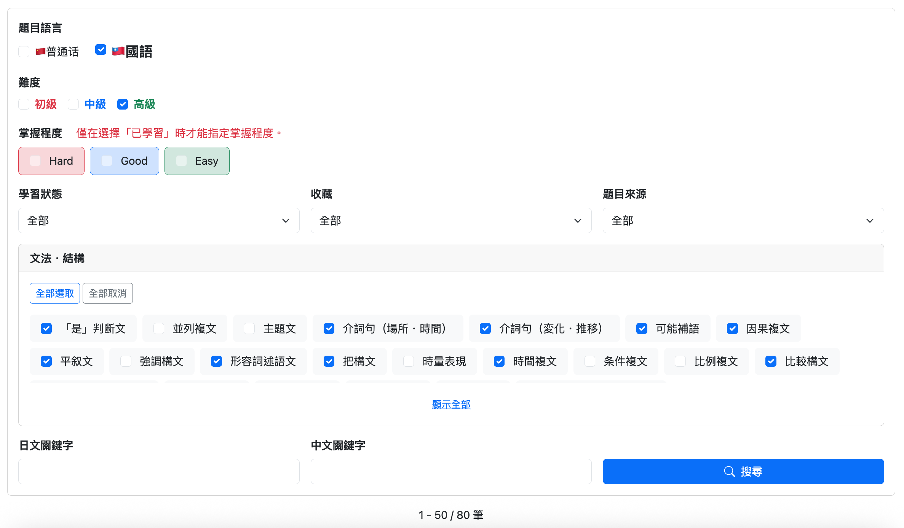

**パスワードリセット画面：** `token`を維持でき、言語変更後も画面を表示できた。

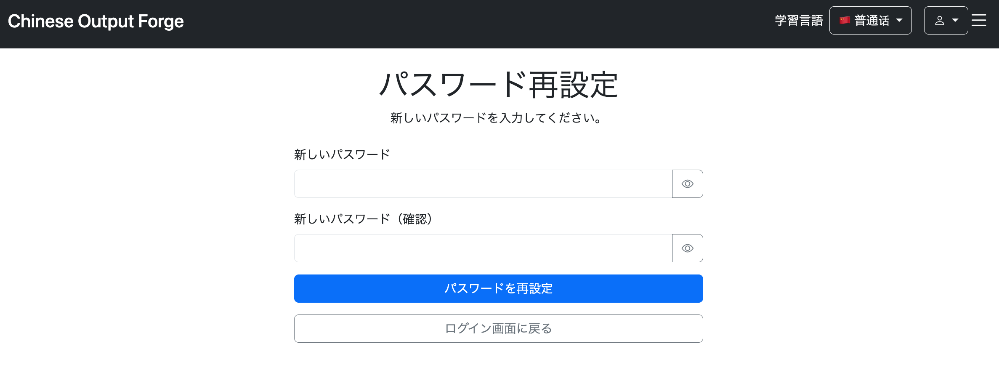

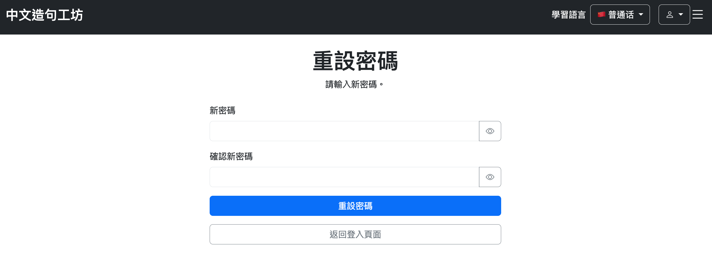

**対象外：** `@ResponseBody`で取得した件数など、URLに含まれない画面上の状態は引き継がれない。これらの維持には別の状態管理が必要となるため、今回の修正範囲には含めない。

## 5. 追加修正：学習対象言語切り替え時の405エラーに対応

**Commit:** `fix: use POST requests for language variant switching`

### 5.1 発生した問題と原因

ヘッダーで学習対象言語を切り替えると`405 Method Not Allowed`が発生した。ヘッダーの`<a>`リンクがGETリクエストを送信する一方、後に変更されたControllerは`@PostMapping("/language-variant")`でPOSTのみを受け付けていたため、HTTPメソッドが一致していなかった。

```text
Securing GET /language-variant?languageVariant=MAINLAND&redirect=

Resolved [org.springframework.web.HttpRequestMethodNotSupportedException:
Request method 'GET' is not supported]
```

### 5.2 修正方針

この段階の学習対象言語の切り替えは、ログインユーザーのDB設定更新、学習Sessionの破棄、言語設定の更新を伴う。状態変更の操作であるため、ControllerのPOST方式を維持し、画面側をフォーム送信に変更する。

### 5.3 `header.html`の変更

普通話・國語それぞれのリンクをPOSTフォームへ置き換え、変更先の`languageVariant`と戻り先の`redirect`をhiddenフィールドで送る。確認メッセージは送信ボタンの`data-confirm-message`へ移した。

**普通話への切り替え**

```html
<form th:if="${session.languageVariant != null
              && session.languageVariant.name() != 'MAINLAND'}"
      th:action="@{/language-variant}"
      method="post"
      class="language-variant-form">

    <input type="hidden"
           name="languageVariant"
           value="MAINLAND">

    <input type="hidden"
           name="redirect"
           th:value="${languageVariantRedirect}">

    <button type="submit"
            class="dropdown-item"
            th:data-confirm-message="#{header.studyLanguage.confirmMainland}">
        🇨🇳 普通话
    </button>
</form>
```

**國語への切り替え**

```html
<form th:if="${session.languageVariant == null
              || session.languageVariant.name() != 'TAIWAN'}"
      th:action="@{/language-variant}"
      method="post"
      class="language-variant-form">

    <input type="hidden"
           name="languageVariant"
           value="TAIWAN">

    <input type="hidden"
           name="redirect"
           th:value="${languageVariantRedirect}">

    <button type="submit"
            class="dropdown-item"
            th:data-confirm-message="#{header.studyLanguage.confirmTaiwan}">
        🇹🇼 國語
    </button>
</form>
```

### 5.4 `header.js`の変更

従来のリンククリック監視から、`.language-variant-form`の`submit`イベント監視へ変更する。確認ダイアログでキャンセルされた場合のみフォーム送信を中止する。

```javascript
document.querySelectorAll('.language-variant-form').forEach(form => {
    form.addEventListener('submit', function(event) {

        const message = this.querySelector('button').dataset.confirmMessage;

        if (!confirm(message)) {
            event.preventDefault();
        }
    });
});
```

### 5.5 `LanguageVariantController`の戻り先判定

`redirect`が未指定の場合だけでなく、空文字列や空白のみの場合もトップ画面へ戻す。`null`判定だけでは空文字列を有効な戻り先として扱ってしまうため、`isBlank()`を追加した。

```java
if (redirect != null && !redirect.isBlank()) {
    return "redirect:" + redirect;
}

return "redirect:/";
```

同じ学習対象言語を選択した場合にも、同じ判定を適用した。

```java
if (languageVariant == currentLanguageVariant) {
    return redirect != null && !redirect.isBlank()
            ? "redirect:" + redirect
            : "redirect:/";
}
```

### 5.6 確認状況

GETとPOSTの不一致を解消するための実装修正を記録した。**元のログには修正後の実機動作確認結果が記載されていないため、確認済みとは扱わない。**

## 6. 英語表示の採用取りやめ

初期実装では英語をサイト表示言語の一つとして追加し、`messages_en.properties`とヘッダーの切り替え項目を用意した。しかし、開発途中で英語表示を採用しない方針に変更した。

この章に掲載した英語のメッセージ定義や`English`の選択肢は、**当時実装した内容を示す履歴**であり、現在も英語表示を提供しているという意味ではない。

## 7. 次にやること

学習対象言語の設定を通常学習機能の問題取得・表示へ組み込む。
