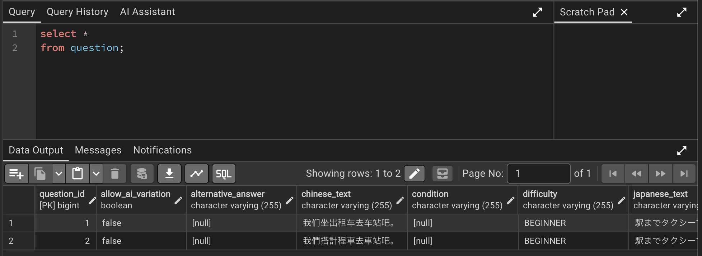
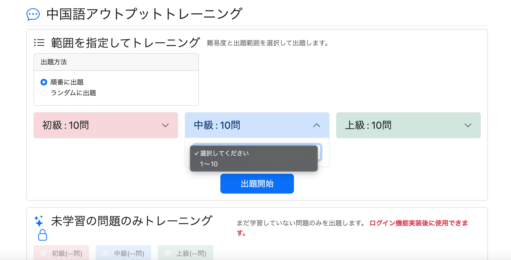
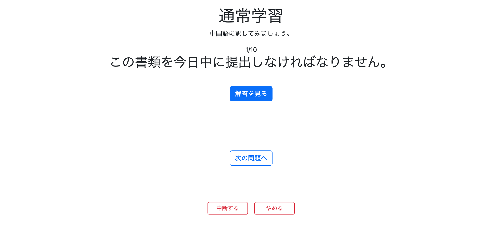
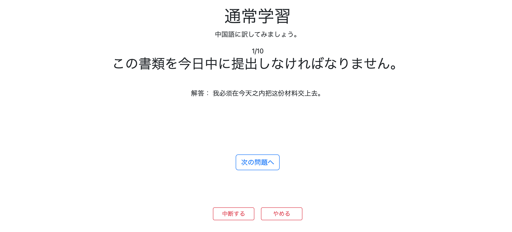
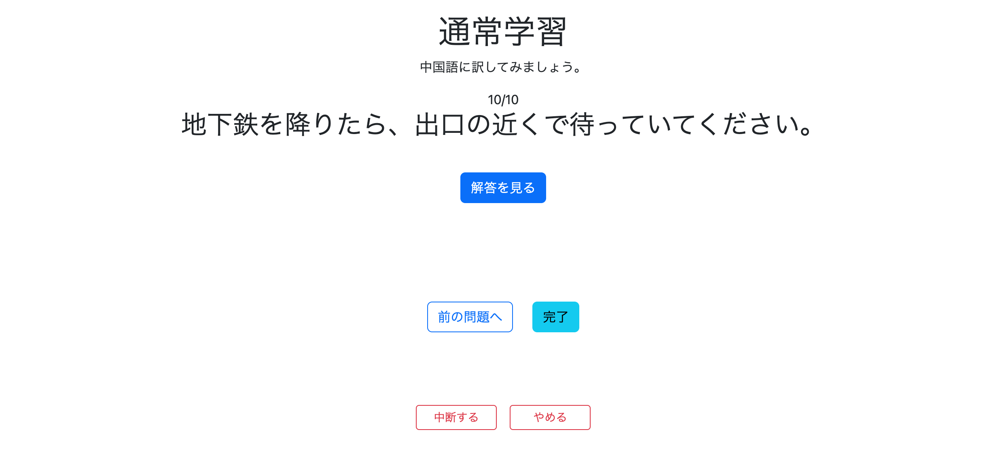
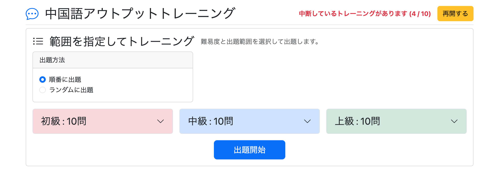
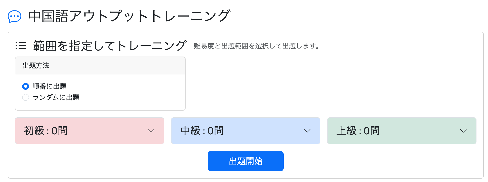

# 004 通常学習の実装 その1

> このログは実装・変更を時系列で記録したものです。途中のコードや仕様は、その後の開発によって変更されている場合があります。現在の実装はソースコードを参照してください。

## 概要

English Output Trainerの仕組みを参考に、PostgreSQLに登録した問題を使う中国語の通常学習機能を実装した。

- 学習対象言語：普通話（`MAINLAND`）／國語（`TAIWAN`）
- 難易度：初級・中級・上級
- 出題範囲の選択と順番／ランダム出題
- 日本語の問題文・条件・中国語の解答・別解の表示
- 前後の問題への移動、学習の中断・再開・終了・完了

当初はログイン機能が未実装だったため、非ログイン状態で利用できる範囲を対象とした。

---

## 1. 通常学習の基本機能を実装

**関連コミット：** `feat: set up question data for practice`、`feat: add question set retrieval for practice`、`feat: add question range retrieval for practice`、`feat: add practice flow controller`、`feat: add practice completion controller`、`feat: add practice menu`、`feat: add practice question page`、`feat: add practice completion page`

### 1.1 目的

DBから学習対象の問題を抽出し、学習メニューから問題の表示、移動、中断・再開、完了までを操作できるようにする。

### 1.2 追加・変更内容

| 対象 | 内容 |
| --- | --- |
| `application.yml` | `DataSourceAutoConfiguration`の除外を解除し、開発用に`spring.jpa.hibernate.ddl-auto: update`を設定 |
| `Question` | 問題文、解答、難易度、言語種別、条件、別解などを保持するEntityを追加 |
| Enum | `Difficulty`を追加 |
| `QuestionRepository` | 問題セット抽出と難易度別件数取得のメソッドを追加 |
| `PracticeService` | 問題抽出、ランダム化、問題数・出題範囲の生成を実装 |
| `PracticeMenuDto`、`Range` | メニュー表示用の問題数と出題範囲を保持 |
| `PracticeController` | メニュー、開始、問題表示、中断、再開、終了、完了を制御 |
| `QuestionModelUtil` | 問題画面に必要なModel属性を設定 |
| `CompleteController` | 完了画面への遷移を実装 |
| Thymeleaf・JavaScript | 学習メニュー、問題画面、完了画面、解答表示を実装 |
| `messages*.properties` | 通常学習画面の表示文言を多言語化 |

### 1.3 実装内容・設計上の判断

#### DB・問題データ

- `Question`に`languageVariant`、`japaneseText`、`chineseText`、`alternativeAnswer`、`condition`、`difficulty`、`allowAiVariation`、`template`などを定義した。
- 開発中のテーブル更新を容易にするため、当時は`ddl-auto: update`を採用した。
- 普通話と國語を各1問登録し、DBへの保存とJPAからの取得を確認した。
- その後、各言語について初級・中級・上級を各10問、合計60問の動作確認用データを登録した。

初期データの確認：



**主要コード：DB設定・Entity・Enum**

従来はDB接続の自動設定を除外していたため、この設定を削除してPostgreSQLを利用できるようにした。以下は削除対象の設定。

```yaml
spring:
  autoconfigure:
    exclude:
      - org.springframework.boot.autoconfigure.jdbc.DataSourceAutoConfiguration
```

開発段階ではEntityの変更をテーブルへ反映するため、`ddl-auto`を`update`に設定した。

```yaml
spring:
  jpa:
    hibernate:
      ddl-auto: update
```

問題データを扱うEntityと、採用した分類用Enumを以下に示す。初期案に含まれていた未採用のフィールドは、読みやすさのため省略している。

```text
io.github.mawsonlakes790913.chineseoutputforge
├── entity
│   └── Question.java
│
└── constant
    ├── LanguageVariant.java
    └── Difficulty.java
```

難易度は`BEGINNER`・`INTERMEDIATE`・`ADVANCED`の3段階とし、問題の分類とメニューでの選択条件に共通して使用する。

```java
public enum Difficulty {

    BEGINNER,
    INTERMEDIATE,
    ADVANCED
}
```

`Question`は、DBの`question`テーブルと対応するEntityである。問題文と模範解答を中心に、言語種別、難易度、別解、解答条件など、通常学習で参照するデータを一つのレコードとして管理する。

```java
@Getter
@Setter
@Entity
@Table(name = "question")
public class Question {

    @Id
    @GeneratedValue(strategy = GenerationType.IDENTITY)
    @Column(name = "question_id")
    private Long questionId;

    @Column(name = "language_variant", nullable = false)
    @Enumerated(EnumType.STRING)
    private LanguageVariant languageVariant;

    @Column(name = "japanese_text", nullable = false)
    private String japaneseText;

    @Column(name = "chinese_text", nullable = false)
    private String chineseText;

    @Column(name = "alternative_answer")
    private String alternativeAnswer;

    @Column(name = "condition")
    private String condition;

    @Column(name = "difficulty", nullable = false)
    @Enumerated(EnumType.STRING)
    private Difficulty difficulty;

    @Column(name = "allow_ai_variation", nullable = false)
    private Boolean allowAiVariation;

    @Column(name = "template")
    private String template;
}
```

**登録・取得確認用SQLとRepository**

まず普通話と國語を1問ずつ登録し、文字データと分類値が保存できることを確かめた。

```sql
INSERT INTO question (
    language_variant,
    japanese_text,
    chinese_text,
    difficulty,
    allow_ai_variation
)
VALUES
(
    'MAINLAND',
    '駅までタクシーで行きましょう。',
    '我们坐出租车去车站吧。',
    'BEGINNER',
    false
),
(
    'TAIWAN',
    '駅までタクシーで行こう。',
    '我們搭計程車去車站吧。',
    'BEGINNER',
    false
);
```

登録したレコードをpgAdminから取得し、内容を確認した。

```sql
SELECT * FROM question;
```

DBに登録した問題をJava側から扱う入口として、`QuestionRepository`を用意する。この時点では基本的なCRUD操作を利用できる構成とし、出題条件に応じた検索は後続の実装で追加する。

```java
public interface QuestionRepository extends JpaRepository<Question, Long> {

}
```

Repository経由で取得した結果にも、両言語の問題が含まれていることを確認した。

```text
1 / MAINLAND / 我们坐出租车去车站吧。
2 / TAIWAN / 我們搭計程車去車站吧。
```

#### 問題セットの抽出

`PracticeService#getPracticeQuestions()`で、学習対象言語・難易度・開始位置・ランダム指定を受け取り、`QuestionRepository#findQuestionsByLanguageVariantAndDifficulty()`から問題を取得するようにした。

当初のRepository検索条件は次のとおり。

問題セットは言語と難易度で絞り込み、ID順に最大100件を取得するSQLを使用した。

```sql
SELECT *
FROM question
WHERE language_variant = :languageVariant
  AND difficulty = :difficulty
ORDER BY question_id
LIMIT 100 OFFSET :offset
```

ランダム出題が指定された場合は、取得後のリストに`Collections.shuffle()`を適用した。

**主要コード：問題セット取得**

出題条件の解釈は`PracticeService#getPracticeQuestions()`が担当する。開始番号をSQL用のオフセットへ変換して問題を取得し、ランダム出題が選ばれた場合に限り取得結果の順序を入れ替える。

```java
public List<Question> getPracticeQuestions(
        LanguageVariant languageVariant,
        Difficulty difficulty,
        int start,
        boolean random) {

    int offset = start - 1;

    List<Question> extractedQuestions =
            questionRepository.findQuestionsByLanguageVariantAndDifficulty(
                    languageVariant.name(),
                    difficulty.name(),
                    offset
            );

    if (random) {
        Collections.shuffle(extractedQuestions);
    }

    return extractedQuestions;
}
```

実際の抽出条件は`QuestionRepository`のネイティブSQLにまとめた。`language_variant`と`difficulty`で対象を絞り込み、`question_id`順に並べたうえで`LIMIT`と`OFFSET`を適用する。

```java
@Query(value = """
        SELECT *
        FROM question
        WHERE language_variant = :languageVariant
        AND difficulty = :difficulty
        ORDER BY question_id
        LIMIT 100 OFFSET :offset
        """, nativeQuery = true)
List<Question> findQuestionsByLanguageVariantAndDifficulty(
        @Param("languageVariant") String languageVariant,
        @Param("difficulty") String difficulty,
        @Param("offset") int offset
);
```

#### 学習メニューの問題数と出題範囲

`PracticeService#countPracticeQuestions()`で難易度別の件数を取得し、`createRanges()`で**50問単位**の範囲を生成した。

例：125問の場合は「1～50」「51～100」「101～125」とする。

`PracticeMenuDto`に各難易度の問題数と`List<Range>`を格納し、`practice/menu.html`に渡した。

> **当時の実装上の注意：** 問題セット抽出SQLの`LIMIT 100`と、メニューの50問単位の区切りは元ログ上で一致していない。ここでは当時の記録をそのまま残し、現在の仕様とは区別する。

**主要コード：問題数・範囲の生成**

学習メニューへ渡す値をばらばらのModel属性にせず、`PracticeMenuDto`に集約する。初級・中級・上級それぞれについて、登録件数と選択可能な範囲の一覧を持たせた。

```java
@Data
public class PracticeMenuDto {

    private long beginnerCount;
    private List<Range> beginnerRanges;

    private long intermediateCount;
    private List<Range> intermediateRanges;

    private long advancedCount;
    private List<Range> advancedRanges;
}
```

`countPracticeQuestions()`は、選択中の言語について3段階の難易度ごとに問題数を集計する。続く`createRanges()`では、件数に応じて「1～50」「51～100」のような選択肢を作り、最後の範囲は実際の最終問題番号で終わるようにした。

```java
public PracticeMenuDto countPracticeQuestions(
        LanguageVariant languageVariant) {

    PracticeMenuDto count = new PracticeMenuDto();

    // 初級
    long beginnerCount =
            questionRepository.countByLanguageVariantAndDifficulty(
                    languageVariant,
                    Difficulty.BEGINNER
            );

    count.setBeginnerCount(beginnerCount);
    count.setBeginnerRanges(createRanges(beginnerCount));

    // 中級
    long intermediateCount =
            questionRepository.countByLanguageVariantAndDifficulty(
                    languageVariant,
                    Difficulty.INTERMEDIATE
            );

    count.setIntermediateCount(intermediateCount);
    count.setIntermediateRanges(createRanges(intermediateCount));

    // 上級
    long advancedCount =
            questionRepository.countByLanguageVariantAndDifficulty(
                    languageVariant,
                    Difficulty.ADVANCED
            );

    count.setAdvancedCount(advancedCount);
    count.setAdvancedRanges(createRanges(advancedCount));

    return count;
}

private List<Range> createRanges(long count) {

    List<Range> ranges = new ArrayList<>();

    for (long start = 1; start <= count; start += 50) {

        if (start + 49 <= count) {
            ranges.add(new Range(start, start + 49));
        } else {
            ranges.add(new Range(start, count));
        }
    }

    return ranges;
}
```

範囲の開始・終了番号を組にして扱うため、`Range`クラスを設けた。`getDisplayText()`は、Thymeleafの選択肢にそのまま使える表示文字列を返す。

```java
public class Range {

    private long start;
    private long end;

    public Range(long start, long end) {
        this.start = start;
        this.end = end;
    }

    public long getStart() {
        return start;
    }

    public long getEnd() {
        return end;
    }

    public String getDisplayText() {
        return start + "～" + end;
    }
}
```

件数の取得はRepository側の`countByLanguageVariantAndDifficulty()`に任せる。Serviceは集計結果を受け取り、画面に必要なRangeの生成に集中できる構成とした。

```java
long countByLanguageVariantAndDifficulty(
        LanguageVariant languageVariant,
        Difficulty difficulty
);
```

#### Controllerと画面遷移

| パス | 処理 |
| --- | --- |
| `/practice/menu` | 問題数・範囲・再開可能状態を表示 |
| `/practice/start` | 難易度と範囲を検証し、問題セットをSessionに保存 |
| `/practice/question?page=...` | 指定位置の問題を表示 |
| `/practice/suspend` | 現在位置を保存して中断 |
| `/practice/resume` | 保存した位置から再開 |
| `/practice/quit` | 通常学習のSession情報を破棄して終了 |
| `/practice/complete` | 通常学習のSession情報を破棄して完了画面へ遷移 |
| `/complete` | 完了画面を表示 |

Sessionでは`practiceQuestions`と`practiceCurrentPage`を使用した。問題画面では`QuestionModelUtil#setQuestionModel()`により、現在の問題、前後の移動可否、総問題数などをModelに設定した。

`practice/menu.html`には難易度別件数、範囲選択、順番／ランダム選択、再開ボタンを配置した。`practice/question.html`には問題文、条件、解答・別解、前後移動、中断・終了・完了ボタンを配置した。

「解答を見る」では`practice.js`の`showAnswer()`を呼び出し、解答ボタンを非表示にして解答領域を表示するようにした。

**主要コード：Controller・Model設定**

メニュー表示時には、難易度別の問題数・範囲に加えて、再開可能な学習があるかを判定する。Session内に問題セットと現在位置が両方存在する場合だけ、再開位置と総問題数をModelへ渡す。

```java
@GetMapping("/practice/menu")
public String getPracticeMenu(
        HttpSession session,
        Model model) {

    PracticeMenuDto menu =
            practiceService.countPracticeQuestions(
                    (LanguageVariant)
                            session.getAttribute("languageVariant")
            );

    model.addAttribute("practiceMenu", menu);

    List<Question> questions =
            (List<Question>)
                    session.getAttribute("practiceQuestions");

    Integer currentPage =
            (Integer)
                    session.getAttribute("practiceCurrentPage");

    boolean canResume =
            questions != null && currentPage != null;

    model.addAttribute("canResume", canResume);

    if (canResume) {
        model.addAttribute("currentPage", currentPage);
        model.addAttribute("totalCount", questions.size());
    }

    return "practice/menu";
}
```

新規開始では、3つの難易度のうち出題範囲がちょうど1つ選択されていることを確認する。選択内容から問題セットを取得した後、以前の学習状態をクリアしてSessionへ保存し、先頭の問題に遷移させる。

```java
@GetMapping("/practice/start")
public String getPracticeStart(
        HttpSession session,
        @RequestParam(required = false) Integer beginnerRange,
        @RequestParam(required = false) Integer intermediateRange,
        @RequestParam(required = false) Integer advancedRange,
        @RequestParam(name = "random") boolean random,
        RedirectAttributes redirectAttributes) {

    int selectedCount = 0;

    if (beginnerRange != null) selectedCount++;
    if (intermediateRange != null) selectedCount++;
    if (advancedRange != null) selectedCount++;

    if (selectedCount != 1) {
        redirectAttributes.addFlashAttribute(
                "errorMessage",
                "出題範囲を1つ選択してください。"
        );

        return "redirect:/practice/menu";
    }

    Difficulty difficulty;
    int start;

    if (beginnerRange != null) {
        difficulty = Difficulty.BEGINNER;
        start = beginnerRange;

    } else if (intermediateRange != null) {
        difficulty = Difficulty.INTERMEDIATE;
        start = intermediateRange;

    } else if (advancedRange != null) {
        difficulty = Difficulty.ADVANCED;
        start = advancedRange;

    } else {
        return "redirect:/study/menu";
    }

    clearPracticeSession(session);

    List<Question> questions =
            practiceService.getPracticeQuestions(
                    (LanguageVariant)
                            session.getAttribute("languageVariant"),
                    difficulty,
                    start,
                    random
            );

    if (questions.isEmpty()) {
        return "redirect:/practice/menu";
    }

    session.setAttribute("practiceQuestions", questions);
    session.setAttribute("practiceCurrentPage", 0);

    return "redirect:/practice/question?page=0";
}
```

問題画面は、Sessionに保存された問題セットをもとに表示する。問題セットが存在しない場合や、指定ページが範囲外の場合はメニューへ戻し、有効な場合だけ画面用データを設定する。

```java
@GetMapping("/practice/question")
public String getPracticeQuestion(
        Model model,
        HttpSession session,
        @RequestParam(defaultValue = "0") int page) {

    List<Question> questions =
            (List<Question>)
                    session.getAttribute("practiceQuestions");

    if (questions == null) {
        return "redirect:/practice/menu";
    }

    if (page < 0 || page >= questions.size()) {
        return "redirect:/practice/menu";
    }

    questionModelUtil.setQuestionModel(
            model,
            questions,
            page
    );

    return "practice/question";
}
```

問題表示に必要なModel属性の設定は`QuestionModelUtil`へ切り出した。Controllerからページ番号と問題一覧を渡すことで、現在の問題と前後の移動可否を一括して設定できる。

```java
@Component
public class QuestionModelUtil {

    public void setQuestionModel(
            Model model,
            List<Question> questions,
            int page) {

        Question question = questions.get(page);

        model.addAttribute("question", question);
        model.addAttribute("nextPageIndex", page + 1);
        model.addAttribute("totalPages", questions.size());
        model.addAttribute("hasPrevious", page > 0);
        model.addAttribute(
                "hasNext",
                page < questions.size() - 1
        );
    }
}
```

`/practice/resume`では保存済みのページ番号を読み取り、その位置の出題画面へ戻す。

```java
@GetMapping("/practice/resume")
public String getPracticeResume(
        Model model,
        HttpSession session) {

    if (session.getAttribute("practiceQuestions") == null) {
        return "redirect:/practice/menu";
    }

    Integer page =
            (Integer)
                    session.getAttribute("practiceCurrentPage");

    return "redirect:/practice/question?page=" + page;
}
```

`/practice/complete`では通常学習のSession情報を破棄して完了画面へ移動する。

```java
@GetMapping("/practice/complete")
public String getPracticeComplete(HttpSession session) {

    clearPracticeSession(session);

    return "redirect:/complete";
}
```

`/practice/suspend`では現在のページ番号をSessionに保存し、トップ画面へ戻る。

```java
@GetMapping("/practice/suspend")
public String getPracticeSuspend(
        @RequestParam int page,
        HttpSession session) {

    session.setAttribute(
            "practiceCurrentPage",
            page
    );

    return "redirect:/";
}
```

`/practice/quit`では再開用のSession情報を破棄し、学習を終了する。

```java
@GetMapping("/practice/quit")
public String getPracticeQuit(HttpSession session) {

    clearPracticeSession(session);

    return "redirect:/";
}
```

ここまでのController関連の変更は次のコミットで記録した。

```text
feat: add practice flow controller
```

**完了画面Controller**

問題セットを完了した後は、通常学習のControllerから共通の完了画面へ遷移する。その表示先を受け持つのが`CompleteController`である。

```java
@Controller
public class CompleteController {

    @GetMapping("/complete")
    public String getComplete() {
        return "complete";
    }
}
```

**画面テンプレートとJavaScript**

`menu.html`の難易度別セレクトボックスには、`PracticeMenuDto`が保持するRangeを展開する。選択肢の値には開始番号を、画面に見せる文字列には`Range#getDisplayText()`を使用した。

```html
<span th:text="#{practice.menu.difficulty.beginner(${practiceMenu.beginnerCount})}">
</span>

<select id="beginnerRange"
        class="form-select"
        name="beginnerRange">

    <option value=""
            th:text="#{practice.menu.range.select}">
    </option>

    <option th:each="range : ${practiceMenu.beginnerRanges}"
            th:value="${range.start}"
            th:text="${range.displayText}">
    </option>

</select>
```

再開用の領域は、Controllerから渡された`canResume`が真のときだけ表示する。学習者には「現在位置／総問題数」を示し、`/practice/resume`へ進めるようにした。

```html
<div th:if="${canResume}"
     class="d-flex align-items-center gap-3">

    <span class="text-danger fw-bold">

        <span th:text="#{practice.menu.resume.message}"></span>

        (<span th:text="${currentPage + 1}"></span>
        /
        <span th:text="${totalCount}"></span>)

    </span>

    <a th:href="@{/practice/resume}"
       class="btn btn-warning"
       th:text="#{practice.menu.resume.button}">
    </a>

</div>
```

`question.html`では日本語の問題文を先に見せ、模範解答は初期状態で隠す。解答条件と別解はデータが存在する場合だけ表示し、問題によって画面構成を変えられるようにした。

```html
<span th:text="${nextPageIndex + '/' + totalPages}">
    1/10
</span>

<h2 class="mb-0"
    th:text="${question.japaneseText}">
    日本語問題
</h2>

<div style="min-height:40px;">

    <p th:if="${question.condition != null}">

        <span th:text="#{practice.question.condition}">
            条件：
        </span>

        <span th:text="${question.condition}">
            条件
        </span>

    </p>

</div>

<div style="min-height:100px;">

    <button id="answerButton"
            type="button"
            class="btn btn-primary"
            onclick="showAnswer()"
            th:text="#{practice.question.showAnswer}">
        解答を見る
    </button>

    <div id="answerArea"
         style="display:none;">

        <p class="mb-2">

            <span th:text="#{practice.question.answer}">
                解答：
            </span>

            <span th:text="${question.chineseText}">
                Chinese Answer
            </span>

        </p>

        <p th:if="${question.alternativeAnswer != null}"
           class="mb-0">

            <span th:text="#{practice.question.alternativeAnswer}">
                別解：
            </span>

            <span th:text="${question.alternativeAnswer}">
                Alternative Answer
            </span>

        </p>

    </div>

</div>
```

ページ移動は`hasPrevious`と`hasNext`で制御する。先頭では「前へ」を出さず、最後の問題では「次へ」の代わりに完了画面へ進むリンクを表示する。

```html
<a th:if="${hasPrevious}"
   th:href="@{/practice/question(page=${nextPageIndex - 2})}"
   class="btn btn-outline-primary"
   th:text="#{practice.question.previous}">
    前の問題へ
</a>

<a th:if="${hasNext}"
   th:href="@{/practice/question(page=${nextPageIndex})}"
   class="btn btn-outline-primary"
   th:text="#{practice.question.next}">
    次の問題へ
</a>

<a th:if="${!hasNext}"
   th:href="@{/practice/complete}"
   class="btn btn-info"
   th:text="#{practice.question.complete}">
    完了
</a>
```

学習を一時的に止める操作と、問題セットを破棄する操作を分けた。中断リンクは現在のページ番号を渡し、終了リンクは再開を前提としない。

```html
<a th:href="@{/practice/suspend(page=${nextPageIndex - 1})}"
   th:attr="onclick=|return confirm('#{practice.question.suspend.confirm}');|"
   class="btn btn-outline-danger btn-sm"
   th:text="#{practice.question.suspend}">
    中断する
</a>

<a th:href="@{/practice/quit}"
   th:attr="onclick=|return confirm('#{practice.question.quit.confirm}');|"
   class="btn btn-outline-danger btn-sm"
   th:text="#{practice.question.quit}">
    やめる
</a>
```

解答の表示切り替えは、サーバーへの再リクエストを行わずJavaScriptで処理する。`showAnswer()`はボタンを隠して解答領域を表示し、学習者が答えを確認できるようにする。

```javascript
function showAnswer() {

    const answerButton =
            document.getElementById("answerButton");

    const answerArea =
            document.getElementById("answerArea");

    answerButton.style.display = "none";
    answerArea.style.display = "block";
}
```

`complete.html`は学習終了後の遷移先となる。完了メッセージとともに、トップへ戻る操作と次の問題セットを選ぶ操作を用意した。

```html
<div class="text-center"
     layout:fragment="content">

    <h1 th:text="#{complete.title}">
        お疲れさまでした！
    </h1>

    <p th:text="#{complete.message}">
        この調子でトレーニングを続けていきましょう。
    </p>

    <div class="d-flex flex-column align-items-center gap-2 mt-3">

        <a th:href="@{/}"
           class="btn btn-secondary"
           th:text="#{common.backToTop}">
            Topに戻る
        </a>

        <a th:href="@{/practice/menu}"
           class="btn btn-primary"
           th:text="#{complete.backToPractice}">
            通常学習メニューに戻る
        </a>

    </div>

</div>
```

#### 多言語対応

通常学習の表示文言を以下のファイルに追加した。

表示文言の管理対象として、基本設定と各言語用のプロパティファイルを用意した。

```text
messages.properties
messages_ja.properties
messages_en.properties
messages_zh_CN.properties
messages_zh_TW.properties
```

**多言語メッセージの設定例**

画面に直接記述していた文言は、言語ごとのプロパティファイルから参照する構成にした。通常学習の画面で使うキーを各ファイルで対応させる。

```text
messages.properties
messages_ja.properties
messages_en.properties
messages_zh_CN.properties
messages_zh_TW.properties
```

以下は日本語メッセージの一部である。難易度ごとの問題数には`{0}`を使用し、Controllerから渡した件数を文言に組み込めるようにした。

```properties
practice.menu.pageTitle=通常学習 | Chinese Output Forge
practice.menu.title=中国語アウトプットトレーニング

practice.menu.resume.message=中断しているトレーニングがあります
practice.menu.resume.button=再開する

practice.menu.range.title=範囲を指定してトレーニング
practice.menu.range.description=難易度と出題範囲を選択して出題します。
practice.menu.range.select=選択してください

practice.menu.order.title=出題方法
practice.menu.order.sequential=順番に出題
practice.menu.order.random=ランダムに出題

practice.menu.difficulty.beginner=初級 : {0}問
practice.menu.difficulty.intermediate=中級 : {0}問
practice.menu.difficulty.advanced=上級 : {0}問

practice.menu.start=出題開始
```

### 1.4 動作確認

**通常学習メニューが表示される。**



**難易度・範囲・出題方法を選んで開始すると、最初の問題へ遷移する。**



**「解答を見る」で中国語の解答が表示される。**



**最終問題では「完了」ボタンが表示される。**



**完了後は完了画面へ遷移する。**


**中断後、メニューに再開可能な学習が表示される。**



**再開すると中断した位置の問題へ戻る。**


---

## 2. 学習対象言語未設定時の問題数取得を修正（2026-08-16）

### 2.1 目的

アプリケーション再起動後など、新しいSessionで`/practice/menu`にアクセスすると、各難易度の問題数が0問と表示される問題を修正する。

### 2.2 変更内容

- `PracticeController#getPracticeMenu()`で`languageVariant`の未設定を判定するようにした。
- 未設定時は`LanguageVariant.MAINLAND`を問題数取得用のデフォルト値として使用した。

### 2.3 原因・対応

新しいSessionでは`languageVariant`がまだ設定されておらず、その値を問題数取得処理へ渡していた。

新しいSessionでは学習対象言語が未設定となるため、メニュー表示時に`MAINLAND`を初期値として補う処理を追加した。

```java
LanguageVariant languageVariant =
        (LanguageVariant) session.getAttribute("languageVariant");

if (languageVariant == null) {
    languageVariant = LanguageVariant.MAINLAND;
}

PracticeMenuDto menu =
        practiceService.countPracticeQuestions(languageVariant);
```

**変更したコード**


### 2.4 動作確認

修正前は各難易度の件数が0問になっていた。



修正後は、言語未設定でも普通話の問題数を取得できるようになった。

---

## 3. 学習対象言語変更時のSession不整合を修正

**関連コミット：** `fix: clear practice session on language change`

### 3.1 目的

普通話の問題セットを中断した後に学習対象言語を國語へ変更すると、選択言語と中断中の問題セットが一致しなくなる問題を解消する。

### 3.2 変更内容

- `LanguageVariantController`で、学習対象言語が変わる際に`practiceQuestions`と`practiceCurrentPage`を削除するようにした。
- 同じ言語を選択した場合は変更処理を行わないようにした。
- 学習メニューから言語を切り替えた場合は、ホームではなく`/practice/menu`へ戻すようにした。
- `PracticeController`と`header.html`で、言語変更後の戻り先を渡すようにした。

### 3.3 原因・対応

変更前は、`languageVariant = TAIWAN`であるにもかかわらず、`practiceQuestions`に普通話の問題セットが残ることがあった。

言語変更時に以下のSession属性を削除することで対応した。

言語変更時には以前の問題セットとページ番号をSessionから削除する。

```java
session.removeAttribute("practiceQuestions");
session.removeAttribute("practiceCurrentPage");
session.setAttribute("languageVariant", languageVariant);
```

**変更したコード**

`LanguageVariantController`で言語の変更を受け付け、異なる言語への切り替え時だけ学習状態を破棄する。

```java
@GetMapping("/language-variant")
public String changeLanguageVariant(
        @RequestParam LanguageVariant languageVariant,
        @RequestParam(required = false) String redirect,
        HttpSession session) {

    LanguageVariant current =
            (LanguageVariant)
                    session.getAttribute("languageVariant");

    // 同じ言語なら変更処理をしない
    if (languageVariant == current) {
        return redirect != null
                ? "redirect:" + redirect
                : "redirect:/";
    }

    // 中断中の通常学習データを破棄
    session.removeAttribute("practiceQuestions");
    session.removeAttribute("practiceCurrentPage");

    // 学習対象言語を変更
    session.setAttribute(
            "languageVariant",
            languageVariant
    );

    // Practiceメニューから変更した場合
    if ("/practice/menu".equals(redirect)) {
        return "redirect:/practice/menu";
    }

    return "redirect:/";
}
```

`PracticeController`からは、言語変更後の戻り先として通常学習メニューを渡す。

```java
@GetMapping("/practice/menu")
public String getPracticeMenu(
        HttpSession session,
        Model model) {

    // 言語切替後の戻り先
    model.addAttribute(
            "languageVariantRedirect",
            "/practice/menu"
    );

    // 以下省略
}
```

ヘッダーの言語切り替えリンクにも戻り先を指定した。

```html
<a class="dropdown-item language-variant-link"
   th:href="@{/language-variant(
       languageVariant='MAINLAND',
       redirect=${languageVariantRedirect}
   )}">
    🇨🇳 普通话
</a>
```

### 3.4 動作確認

元ログでは、修正後に次の動作となったことを記録している。

- 言語変更時に古い問題セットを破棄する。
- 学習メニューから変更した場合は同じメニューへ戻る。
- 変更後の言語で問題数・出題範囲を再取得する。

---

## 4. `Question`に`structure`を追加（2026-08-23）

**関連コミット：** `feat: add structure field to question`

### 4.1 目的

問題を中国語文の文法・構造によって分類できるようにする。

### 4.2 追加・変更内容

- `Question`に`structure`フィールドを追加した。
- 当初は既存データに値がないためNULLを許可した。
- 既存問題の模範解答を確認し、`structure`を設定した。
- 必要な問題については`condition`も見直した。

### 4.3 実装内容・設計上の判断

`structure`は分類項目が今後増える可能性を考慮し、当時はEnumではなく`String`で保持した。

後から文法・構文による問題分類が必要になったため、`Question`へ`structure`を追加する。分類値は今後増える可能性があることから、この段階ではEnumではなく文字列で保持した。

```java
@Column(name = "structure")
private String structure;
```

- `structure`：中国語の模範解答の根幹となる文法・構造。全問題に設定する方針。
- `condition`：特定の文法・語彙・言い回しを指定する出題条件。必要な問題だけに設定する方針。

例：

`structure`は、問題文で指定する条件ではなく、模範解答の文法的な骨組みを表す。例えば動態助詞「着」や可能補語などを、問題ごとの分類として記録する。

```text
他笑着跟我说话。       → structure：動態助詞（着）
这么多菜，我们吃不完。 → structure：可能補語
```

既存データを更新した後、次のSQLで未設定の問題が残っていないか確認した。

既存データの更新前に、`structure`が未設定の問題を確認した。

```sql
SELECT *
FROM question
WHERE structure IS NULL;
```

**追加したEntityフィールドとデータ更新SQL**

`condition`は学習者に提示する解答条件、`structure`は模範解答の文法・構文分類であり、用途が異なる。既存の条件欄は残したまま、両者を独立したカラムとして管理する。

```java
@Column(name = "condition")
private String condition;

@Column(name = "structure")
private String structure;

@Column(name = "difficulty", nullable = false)
@Enumerated(EnumType.STRING)
private Difficulty difficulty;
```

既存データには、問題ごとの文法・構文分類を追加する。解答条件の見直しも必要なレコードについては、`structure`と`condition`を同時に更新する。

```sql
UPDATE question
SET
    structure = '...',
    condition = '...'
WHERE question_id = ...;
```

一方、解答に特別な指定がない問題の`condition`はNULLのままとし、`structure`だけを設定する。

```sql
UPDATE question
SET structure = '...'
WHERE question_id = ...;
```

更新後は`structure IS NULL`の件数を調べ、未設定の問題が残っていないことを確認した。

```sql
SELECT *
FROM question
WHERE structure IS NULL;
```

### 4.4 動作確認

- アプリケーション起動後、`question`テーブルへの`structure`カラム追加を確認した。
- 既存問題に分類を設定し、NULLの残存がないことを確認した。
- その後、`structure`を必須項目として扱う方針とした。

---

## 5. 当時の未実装項目

このログの作成時点では、以下は後続の実装対象だった。

- 拼音・注音の表示
- ログイン機能
- 理解度（HARD／GOOD／EASY）の記録
- 学習済み・未学習の管理と未学習問題の抽出
- ユーザーごとの学習履歴

> これは当時の課題一覧であり、現在も未実装であることを意味しない。

## 6. 関連技術記事

- [学習メニューの実装](https://mawsonlakes790913.com/2026/10/22/%e3%80%90java-spring-boot%e3%80%91%e4%b8%ad%e5%9b%bd%e8%aa%9e%e5%ad%a6%e7%bf%92%e3%82%a2%e3%83%97%e3%83%aa%e3%82%92%e4%bd%9c%e3%82%8b%ef%bd%9c%e5%ad%a6%e7%bf%92%e3%83%a1%e3%83%8b%e3%83%a5%e3%83%bc/)
- [難易度・出題範囲の実装](https://mawsonlakes790913.com/2026/10/22/%e3%80%90java-spring-boot%e3%80%91%e4%b8%ad%e5%9b%bd%e8%aa%9e%e5%ad%a6%e7%bf%92%e3%82%a2%e3%83%97%e3%83%aa%e3%82%92%e4%bd%9c%e3%82%8b%ef%bd%9c%e9%9b%a3%e6%98%93%e5%ba%a6%e3%83%bb%e5%87%ba%e9%a1%8c/)
- [問題抽出の実装](https://mawsonlakes790913.com/2026/10/22/%e3%80%90java-spring-boot%e3%80%91%e4%b8%ad%e5%9b%bd%e8%aa%9e%e5%ad%a6%e7%bf%92%e3%82%a2%e3%83%97%e3%83%aa%e3%82%92%e4%bd%9c%e3%82%8b%ef%bd%9c%e4%bb%96%e3%81%ae%e6%96%b9%e6%b3%95%e3%81%a7%e5%95%8f/)
- [問題ページの実装](https://mawsonlakes790913.com/2026/10/22/%e3%80%90java-spring-boot-thymeleaf%e3%80%91%e4%b8%ad%e5%9b%bd%e8%aa%9e%e5%ad%a6%e7%bf%92%e3%82%a2%e3%83%97%e3%83%aa%e3%82%92%e4%bd%9c%e3%82%8b%ef%bd%9c%e5%95%8f%e9%a1%8c%e3%83%9a%e3%83%bc/)