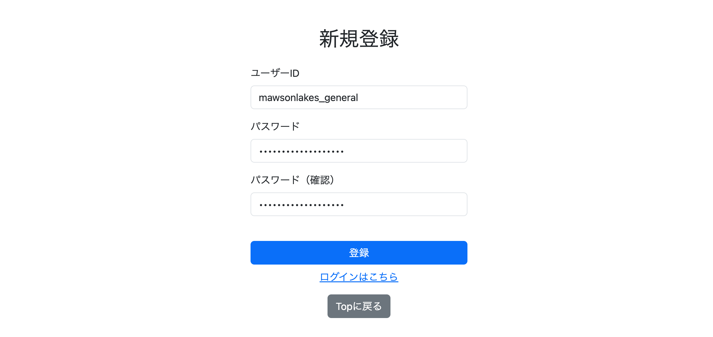
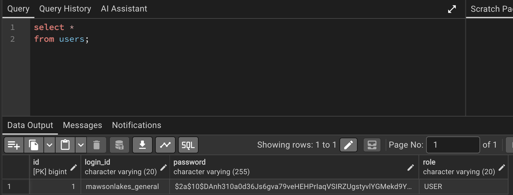
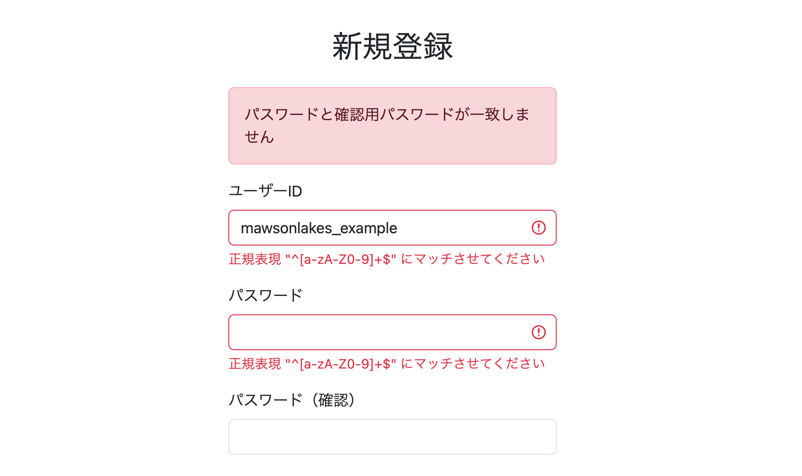
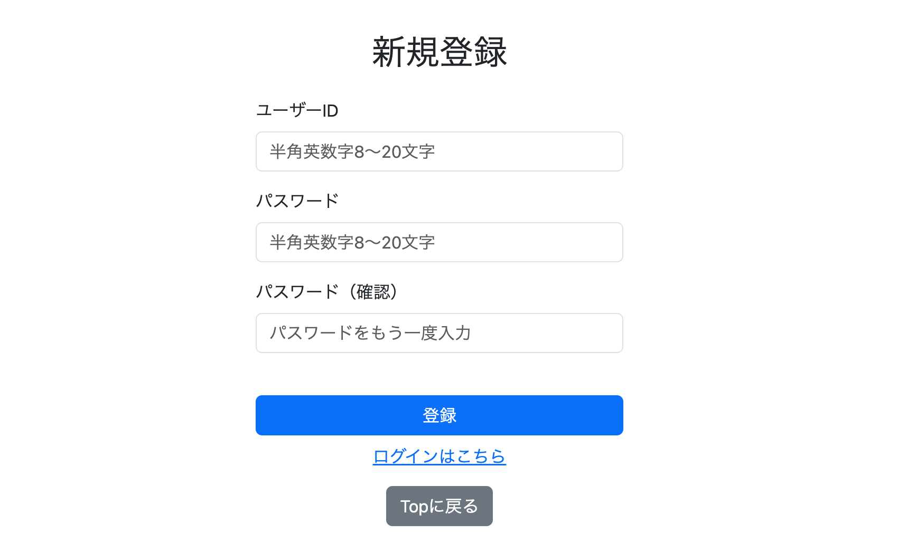

# 006 サインアップ機能の実装

## 1. サインアップ機能の実装

> このログは実装当時の変更履歴を記録したものです。初期段階のコードは、その後の章で変更・拡張されています。

ユーザーがログインIDとパスワードを入力し、新規ユーザーとして登録できるサインアップ機能を実装する。

処理は以下の流れで行う。

```text
signup.html
    ↓
SignupForm
    ↓
SignupController
    ↓
SignupService
    ↓
UserRepository
    ↓
usersテーブル
```

### ファイル構成

```text
config
└── SecurityConfig.java

constant
└── Role.java

controller
└── SignupController.java

entity
└── Users.java

form
└── SignupForm.java

repository
└── UserRepository.java

service
└── SignupService.java

templates
└── signup
    └── signup.html
```

### Users.java

ユーザー情報を管理するEntityを作成する。

```java
@Data
@Entity
@Table(name = "users")
public class Users {

    @Id
    @GeneratedValue(strategy = GenerationType.IDENTITY)
    private Long id;

    @Column(name = "login_id", nullable = false, unique = true, length = 20)
    private String loginId;

    @Column(nullable = false, length = 255)
    private String password;

    @Enumerated(EnumType.STRING)
    @Column(nullable = false, length = 20)
    private Role role;
}
```

`loginId`には一意制約を設け、同じログインIDを持つユーザーを登録できないようにする。`password`には平文ではなくハッシュ化後の値を保存し、`role`は`EnumType.STRING`によってEnum名を文字列として保持する。

### Role.java

一般ユーザーと管理者を区別するためのRoleを定義する。

```java
public enum Role {

    USER,
    ADMIN
}
```

サインアップから登録するユーザーには `Role.USER` を設定する。

### SignupForm.java

サインアップ画面から入力されたログインID、パスワード、確認用パスワードを受け取るFormを作成する。

```java
@Data
public class SignupForm {
	
    @NotBlank
    @Length(min = 8, max = 20)
    @Pattern(regexp = "^[a-zA-Z0-9]+$")
    private String loginId;
	
    @NotBlank
    @Length(min = 8, max = 20)
    @Pattern(regexp = "^[a-zA-Z0-9]+$")
    private String password;
	
    @NotBlank
    private String passwordConfirm;
}
```

この段階の`SignupForm`には入力条件を定義したが、Controllerではまだバリデーションを実行していない。また、ログインID・パスワードを半角英数字のみに制限する正規表現は初期仕様であり、第5章で見直す。

### UserRepository.java

ユーザー情報を操作するRepositoryを作成する。

```java
public interface UserRepository extends JpaRepository<Users, Long> {
	
    Optional<Users> findByLoginId(String loginId);
	
    boolean existsByLoginId(String loginId);

    void deleteByLoginId(String loginId);
}
```

サインアップでは `existsByLoginId()` を使用して、入力されたログインIDがすでに存在するか確認する。

### SecurityConfig.java

パスワードをハッシュ化するため、`PasswordEncoder` をBean登録する。

```java
@Configuration
public class SecurityConfig {

    @Bean
    PasswordEncoder passwordEncoder() {
        return new BCryptPasswordEncoder();
    }
}
```

登録された `PasswordEncoder` は `SignupService` からDIして使用する。

### SignupService.java

サインアップ時のユーザー登録処理を実装する。

- ログインIDの重複を確認
- 新規ユーザーに `Role.USER` を設定
- パスワードをハッシュ化
- ユーザー情報をDBへ保存

```java
@Service
@RequiredArgsConstructor
@Slf4j
public class SignupService {
	
    private final UserRepository userRepository;
    private final PasswordEncoder passwordEncoder;
	
    public void signup(Users user) {

        boolean isExists =
                userRepository.existsByLoginId(user.getLoginId());

        if (isExists) {
            throw new DuplicateKeyException("既に存在するユーザーです");
        }

        user.setRole(Role.USER);
        
        String rawPassword = user.getPassword();
        user.setPassword(passwordEncoder.encode(rawPassword));
        
        Users savedUser = userRepository.save(user);

        log.info("ユーザー登録完了 userId={}",
                 savedUser.getLoginId());
    }
}
```

`existsByLoginId()`で重複を事前確認し、該当する場合は`DuplicateKeyException`を送出する。登録可能な場合は一般ユーザーの権限を設定し、BCryptでパスワードをハッシュ化して保存する。なお、事前の存在確認だけでは同時登録による競合を完全には防げないため、DB側の一意制約も必要となる。

### SignupController.java

サインアップ画面の表示と登録処理を実装する。画面表示用の`GET /signup`と登録用の`POST /signup`は同じパスだが、HTTPメソッドによって処理が分かれる。

以下は006実装時点の構成であり、後の開発で登録処理や例外処理は変更されている。

```java
@Controller
@Slf4j
@RequiredArgsConstructor
public class SignupController {
	
    private final SignupService signupService;
	
    @GetMapping("/signup")
    public String getSignup(
            @ModelAttribute SignupForm form) {

        return "signup/signup";
    }
	
    @PostMapping("/signup")
    public String postSignup(
            @ModelAttribute SignupForm form,
            BindingResult bindingResult,
            RedirectAttributes redirectAttributes) {

        try {
            log.debug("ユーザー登録開始 userId={}",
                      form.getLoginId());
	    	
            Users user = new Users();

            user.setLoginId(form.getLoginId());
            user.setPassword(form.getPassword());
	    	
            signupService.signup(user);

        } catch (DuplicateKeyException e) {

            bindingResult.rejectValue(
                    "loginId",
                    "duplicate",
                    e.getMessage());

            return getSignup(form);
        }
	    
        redirectAttributes.addFlashAttribute(
                "signupSuccess",
                "ユーザー登録が完了しました");

        return "redirect:/";
    }
}
```

POSTされた `SignupForm` の値を `Users` へ設定して `SignupService` に渡す。

ログインIDが重複している場合は `BindingResult.rejectValue()` で `loginId` のフィールドエラーとして登録し、サインアップ画面へ差し戻す。

登録成功後はFlash Attributeに完了メッセージを設定し、Home画面へリダイレクトする。

### signup.html

サインアップ画面を作成する。

```html
<form method="post"
      th:action="@{/signup}"
      th:object="${signupForm}">

    <h2 class="text-center mb-4"
        th:text="#{signup.title}">
        新規登録
    </h2>

    <!-- ユーザーID -->
    <div class="mb-3">
        <label for="loginId"
               class="form-label"
               th:text="#{signup.loginId}">
            ユーザーID
        </label>

        <input type="text"
               id="loginId"
               class="form-control"
               th:field="*{loginId}"
               th:errorclass="is-invalid">

        <div class="invalid-feedback"
             th:errors="*{loginId}">
        </div>
    </div>

    <!-- パスワード -->
    <div class="mb-3">
        <label for="password"
               class="form-label"
               th:text="#{signup.password}">
            パスワード
        </label>

        <input type="password"
               id="password"
               class="form-control"
               th:field="*{password}"
               th:errorclass="is-invalid">

        <div class="invalid-feedback"
             th:errors="*{password}">
        </div>
    </div>

    <!-- パスワード確認 -->
    <div class="mb-3">
        <label for="passwordConfirm"
               class="form-label"
               th:text="#{signup.passwordConfirm}">
            パスワード（確認）
        </label>

        <input type="password"
               id="passwordConfirm"
               class="form-control"
               th:field="*{passwordConfirm}"
               th:errorclass="is-invalid">

        <div class="invalid-feedback"
             th:errors="*{passwordConfirm}">
        </div>
    </div>

    <!-- 登録ボタン -->
    <input type="submit"
           th:value="#{signup.button}"
           class="btn btn-primary w-100 mt-4">

    <div class="text-center mt-2">
        <a th:href="@{/login}"
           th:text="#{signup.loginLink}">
            ログインはこちら
        </a>
    </div>

    <div class="text-center mt-3 mb-3">
        <a th:href="@{/}"
           class="btn btn-secondary"
           th:text="#{common.backToTop}">
            Topに戻る
        </a>
    </div>

</form>
```

`th:object="${signupForm}"` と `th:field` で `SignupForm` の各フィールドを入力欄に対応させる。

画面上のテキストは `th:text` を使用し、各 `messages.properties` で管理する。

### 実行確認

`http://localhost:8080/signup`へアクセスし、サインアップ画面が表示されることを確認した。画面表示には`GET /signup`、登録処理には`POST /signup`を使用する。



ユーザーを登録すると、登録完了ログが出力される。


DBにもユーザー情報が保存される。



**Commit**

```text
feat: implement user signup
```

---

## 2. サインアップ時のバリデーション実装

`SignupForm` に設定したバリデーションをサインアップ時に実行する。

また、パスワードと確認用パスワードの一致チェックは独自Validatorとして実装する。

### ファイル構成

```text
validator
├── PasswordMatch.java
└── PasswordMatchValidator.java
```

### PasswordMatch.java

パスワードと確認用パスワードの一致を検証するため、独自バリデーションアノテーション `@PasswordMatch` を作成する。

```java
@Documented
@Constraint(validatedBy = { PasswordMatchValidator.class })
@Target(ElementType.TYPE)
@Retention(RetentionPolicy.RUNTIME)
public @interface PasswordMatch {

    String message() default "{password.match.message}";
	
    Class<?>[] groups() default {};

    Class<? extends Payload>[] payload() default {};
    
    String passwordFieldName() default "";
    String passwordConfirmFieldName() default "";
}
```

`@Constraint` で、実際の検証処理を `PasswordMatchValidator` が担当するように設定する。

```java
@Constraint(validatedBy = { PasswordMatchValidator.class })
```

今回は1つのフィールドではなく、パスワードと確認用パスワードという2つのフィールドを比較するため、クラス単位のバリデーションとして定義する。

```java
@Target(ElementType.TYPE)
```

比較するフィールド名は、アノテーションを使用する側から指定できるようにする。

```java
String passwordFieldName() default "";
String passwordConfirmFieldName() default "";
```

`SignupForm` では以下のように指定する。

```java
@PasswordMatch(
    passwordFieldName = "password",
    passwordConfirmFieldName = "passwordConfirm"
)
public class SignupForm {
    ...
}
```

---

### PasswordMatchValidator.java

`@PasswordMatch` の実際の検証処理を実装する。

```java
public class PasswordMatchValidator
        implements ConstraintValidator<PasswordMatch, Object> {
	
    private String passwordFieldName;
    private String passwordConfirmFieldName;
	
    @Override
    public void initialize(PasswordMatch passwordMatch) {

        this.passwordFieldName =
                passwordMatch.passwordFieldName();

        this.passwordConfirmFieldName =
                passwordMatch.passwordConfirmFieldName();
    }
	
    @Override
    public boolean isValid(
            Object value,
            ConstraintValidatorContext context) {

        BeanWrapper beanWrapper =
                new BeanWrapperImpl(value);

        String password =
                (String) beanWrapper.getPropertyValue(
                        this.passwordFieldName);
		
        String passwordConfirm =
                (String) beanWrapper.getPropertyValue(
                        this.passwordConfirmFieldName);
		
        if (password == null || passwordConfirm == null) {
            return true;
        }
        
        if (!passwordConfirm.equals(password)) {
            return false;
        }
        
        return true;
    }
}
```

`ConstraintValidator<PasswordMatch, Object>` を実装し、`@PasswordMatch` が付与されたオブジェクトを検証対象とする。

`initialize()` では、`@PasswordMatch` に指定された比較対象のフィールド名を取得する。

```java
@Override
public void initialize(PasswordMatch passwordMatch) {

    this.passwordFieldName =
            passwordMatch.passwordFieldName();

    this.passwordConfirmFieldName =
            passwordMatch.passwordConfirmFieldName();
}
```

`isValid()` では、検証対象のオブジェクトを `BeanWrapper` でラップし、指定されたフィールド名から値を取得する。

```java
BeanWrapper beanWrapper =
        new BeanWrapperImpl(value);

String password =
        (String) beanWrapper.getPropertyValue(
                this.passwordFieldName);

String passwordConfirm =
        (String) beanWrapper.getPropertyValue(
                this.passwordConfirmFieldName);
```

取得した2つの値を比較し、一致していれば `true`、一致していなければ `false` を返す。

```java
if (!passwordConfirm.equals(password)) {
    return false;
}

return true;
```

どちらかが `null` の場合は、このValidatorではエラーにせず `true` を返す。

```java
if (password == null || passwordConfirm == null) {
    return true;
}
```

未入力に対するチェックは、`SignupForm` の `@NotBlank` で行う。

---

### SignupForm.java

`@PasswordMatch`は2つのプロパティを比較するため、フィールドではなく`SignupForm`クラスに付与する。ここでは比較対象の名前を指定し、既存のフィールド単位の制約と組み合わせる。

```java
@Data
@PasswordMatch(
    passwordFieldName = "password",
    passwordConfirmFieldName = "passwordConfirm"
)
public class SignupForm {
	
    @NotBlank
    @Length(min = 8, max = 20)
    @Pattern(regexp = "^[a-zA-Z0-9]+$")
    private String loginId;
	
    @NotBlank
    @Length(min = 8, max = 20)
    @Pattern(regexp = "^[a-zA-Z0-9]+$")
    private String password;
	
    @NotBlank
    private String passwordConfirm;
}
```

`@NotBlank`などは各フィールドの入力条件を検証し、`@PasswordMatch`は`password`と`passwordConfirm`の一致を検証する。ただし、実際に検証を走らせるにはController側で`@Validated`を指定する必要がある。

### SignupController.java

POST処理の `SignupForm` に `@Validated` を追加し、Serviceを呼び出す前にバリデーションエラーを確認する。

```java
@PostMapping("/signup")
public String postSignup(
        @ModelAttribute @Validated SignupForm form,
        BindingResult bindingResult,
        RedirectAttributes redirectAttributes) {

    if (bindingResult.hasErrors()) {
        return getSignup(form);
    }
	
    try {
        log.debug("ユーザー登録開始 userId={}",
                  form.getLoginId());
	    	
        Users user = new Users();

        user.setLoginId(form.getLoginId());
        user.setPassword(form.getPassword());
	    	
        signupService.signup(user);

    } catch (DuplicateKeyException e) {

        bindingResult.rejectValue(
                "loginId",
                "duplicate",
                e.getMessage());

        return getSignup(form);
    }
	    
    redirectAttributes.addFlashAttribute(
            "signupSuccess",
            "ユーザー登録が完了しました");

    return "redirect:/";
}
```

`@Validated`によって`SignupForm`に設定された制約を検証し、その結果を直後の`BindingResult`で受け取る。入力に問題がある場合はServiceを呼び出さず、フォームへ戻す。

エラーが存在する場合は登録処理を行わず、サインアップ画面へ差し戻す。

### signup.html

`@PasswordMatch` はクラス単位のバリデーションなので、エラーはグローバルエラーとして扱われる。

そのため、グローバルエラーの表示領域を追加する。

```html
<!-- グローバルエラー -->
<div th:if="${#fields.hasGlobalErrors()}"
     class="alert alert-danger">

    <p th:each="error : ${#fields.globalErrors()}"
       th:text="${error}"
       class="mb-0">
    </p>

</div>
```

### messages.properties

パスワード不一致時のメッセージを追加する。

```properties
password.match.message=パスワードと確認用パスワードが一致しません
```

### 実行確認

パスワードと確認用パスワードが一致しない状態で登録すると、サインアップ画面へ差し戻され、エラーメッセージが表示される。



**Commit**

```text
feat: add signup validation
```

---

## 3. バリデーションエラーメッセージの追加

デフォルトのバリデーションメッセージを変更し、ユーザー向けのエラーメッセージを `messages.properties` で管理する。

### SignupForm.java

各バリデーションにメッセージキーを設定する。

```java
@Data
@PasswordMatch(
    passwordFieldName = "password",
    passwordConfirmFieldName = "passwordConfirm"
)
public class SignupForm {
	
    @NotBlank(message = "{signup.loginId.notBlank}")
    @Length(
        min = 8,
        max = 20,
        message = "{signup.loginId.length}"
    )
    @Pattern(
        regexp = "^[a-zA-Z0-9]+$",
        message = "{signup.loginId.pattern}"
    )
    private String loginId;
	
    @NotBlank(message = "{signup.password.notBlank}")
    @Length(
        min = 8,
        max = 20,
        message = "{signup.password.length}"
    )
    @Pattern(
        regexp = "^[a-zA-Z0-9]+$",
        message = "{signup.password.pattern}"
    )
    private String password;
	
    @NotBlank(message = "{signup.passwordConfirm.notBlank}")
    private String passwordConfirm;
}
```

`@PasswordMatch` は `PasswordMatch.java` 側で、

```java
String message() default "{password.match.message}";
```

を設定しているため、そのまま使用する。

### messages.properties

```properties
signup.loginId.notBlank=ユーザーIDを入力してください
signup.loginId.length=ユーザーIDは8文字以上20文字以内で入力してください
signup.loginId.pattern=ユーザーIDは半角英数字のみ使用できます

signup.password.notBlank=パスワードを入力してください
signup.password.length=パスワードは8文字以上20文字以内で入力してください
signup.password.pattern=パスワードは半角英数字のみ使用できます

signup.passwordConfirm.notBlank=確認用パスワードを入力してください

password.match.message=パスワードと確認用パスワードが一致しません
```

同様に、

```text
messages_ja.properties
messages_zh_CN.properties
messages_zh_TW.properties
```

へ各言語のエラーメッセージを追加する。

### 実行確認

入力条件を満たしていない状態で登録すると、設定したエラーメッセージが表示される。


**Commit**

```text
feat: add custom signup validation messages
```

---

## 4. signup.htmlのUI改善

入力前に入力条件を確認できるように、各入力欄へplaceholderを追加する。

### signup.html

ユーザーID：

```html
<input type="text"
       id="loginId"
       class="form-control"
       th:field="*{loginId}"
       th:placeholder="#{signup.loginId.placeholder}"
       th:errorclass="is-invalid">
```

パスワード：

```html
<input type="password"
       id="password"
       class="form-control"
       th:field="*{password}"
       th:placeholder="#{signup.password.placeholder}"
       th:errorclass="is-invalid">
```

確認用パスワード：

```html
<input type="password"
       id="passwordConfirm"
       class="form-control"
       th:field="*{passwordConfirm}"
       th:placeholder="#{signup.passwordConfirm.placeholder}"
       th:errorclass="is-invalid">
```

### messages.properties

placeholderもメッセージファイルで管理する。

```properties
signup.loginId.placeholder=半角英数字8～20文字
signup.password.placeholder=半角英数字8～20文字
signup.passwordConfirm.placeholder=パスワードをもう一度入力
```

同様に各言語の `messages.properties` にplaceholderを追加する。

### 実行確認

サインアップ画面の各入力欄に入力条件が表示される。



**Commit**

```text
feat: add signup form placeholders
```

---

## 5. ユーザーIDとパスワードのバリデーション変更

第1〜4章で使用した「半角英数字のみ」の制約は初期実装であり、この章で最終的に変更した。変更後の許可文字は、ログインIDが半角英数字とアンダースコア、パスワードがASCIIの表示可能文字（空白を除く）となる。

ユーザーIDでは半角英数字に加えてアンダースコアを使用可能にし、パスワードでは半角英数字と半角記号を使用可能にする。

### SignupForm.java

ユーザーIDの正規表現を変更する。

```java
@Pattern(
    regexp = "^[a-zA-Z0-9_]+$",
    message = "{signup.loginId.pattern}"
)
private String loginId;
```

これにより、半角英数字と `_` を使用できる。

パスワードの正規表現は以下へ変更する。

```java
@Pattern(
    regexp = "^[\\x21-\\x7E]+$",
    message = "{signup.password.pattern}"
)
private String password;
```

`[\x21-\x7E]` はASCIIコードの16進数 `21` から `7E` までを対象とする。半角英数字と以下の半角記号を含む一方、半角スペースは含まれない。

```text
! " # $ % & ' ( ) * + , - . /
: ; < = > ? @
[ \ ] ^ _ `
{ | } ~
```

### messages.properties

入力条件の変更に合わせて、エラーメッセージとplaceholderを変更する。

```properties
signup.loginId.notBlank=ユーザーIDを入力してください
signup.loginId.length=ユーザーIDは8文字以上20文字以内で入力してください
signup.loginId.pattern=ユーザーIDは半角英数字・アンダースコア（_）で入力してください
signup.loginId.placeholder=半角英数字および_ 8～20文字

signup.password.notBlank=パスワードを入力してください
signup.password.length=パスワードは8文字以上20文字以内で入力してください
signup.password.pattern=パスワードは半角英数字・半角記号で入力してください
signup.password.placeholder=半角英数字・半角記号 8～20文字
```

同様に、

```text
messages_ja.properties
messages_zh_CN.properties
messages_zh_TW.properties
```

も変更する。

**Commit**

```text
feat: expand allowed characters for signup credentials
```

---

## 実装結果

サインアップ機能として以下を実装した。

- ログインID・パスワード・確認用パスワードの入力
- ログインIDの重複チェック
- `Role.USER` の自動設定
- BCryptによるパスワードのハッシュ化
- ユーザー情報のDB保存
- 登録成功後のHome画面へのリダイレクト
- 登録完了メッセージの表示
- `@Validated` による入力値バリデーション
- 独自 `@PasswordMatch` によるパスワード一致チェック
- バリデーションエラーの画面表示
- エラーメッセージの多言語管理
- 入力条件のplaceholder表示
- ユーザーID・パスワードの使用可能文字の拡張

## 後続の実装との関係

現在の`SignupController`でも画面表示用のマッピングは`@GetMapping("/signup")`である。一方、006当時のControllerで行っていた`Users`への値の詰め替えは、後に`signupService.signup(form, locale)`へ変更された。また、重複登録時の例外は`DuplicateSignupException`、完了メッセージは`MessageSource`による多言語対応となり、登録完了メールの送信と`/login`へのリダイレクトも追加されている。これらは006以降の変更であるため、本ログの当時のコードには混在させない。

---

## 次回の実装

サインアップしたユーザー情報を使用するログイン機能を実装する。