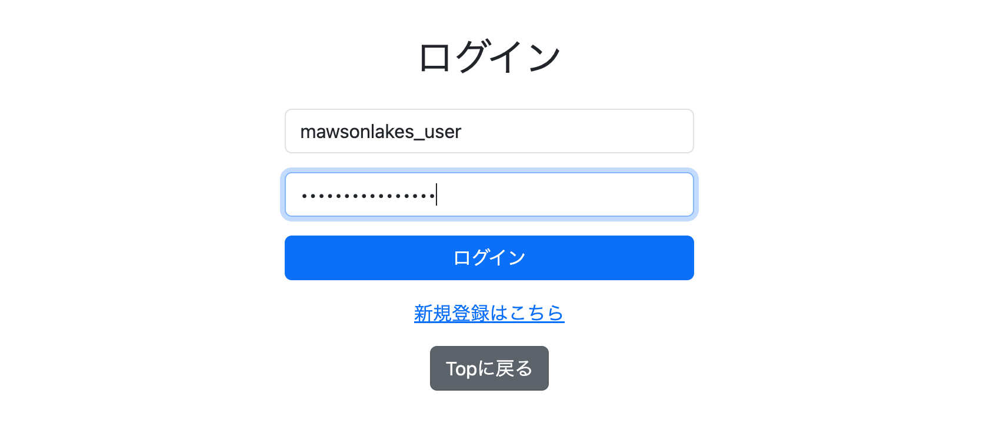
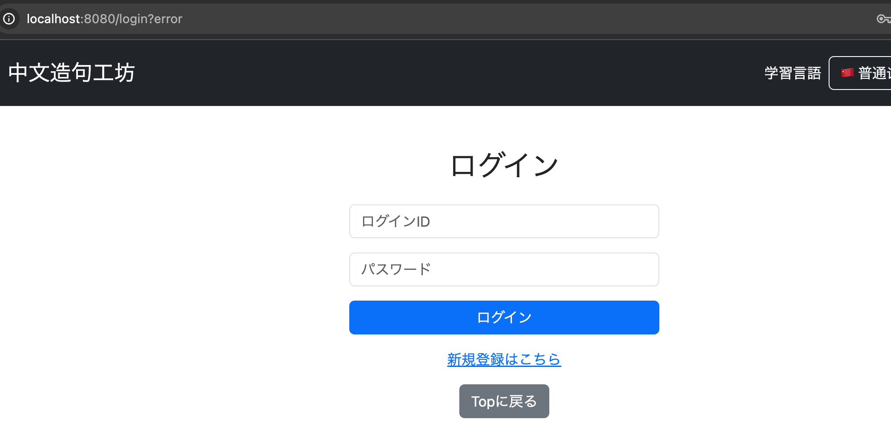
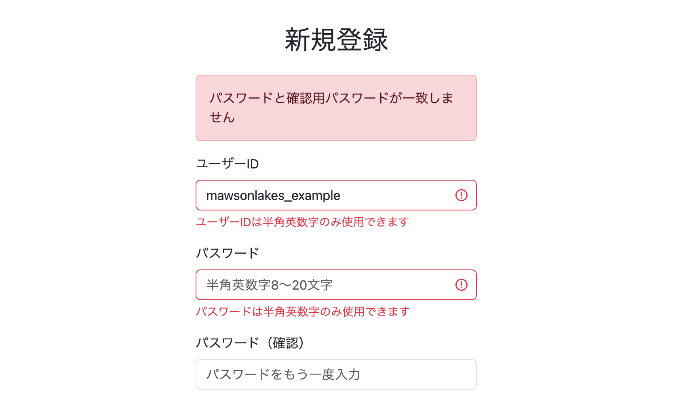
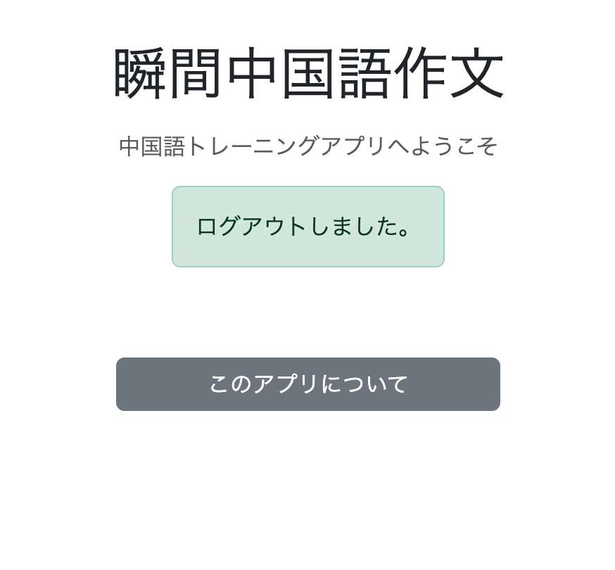
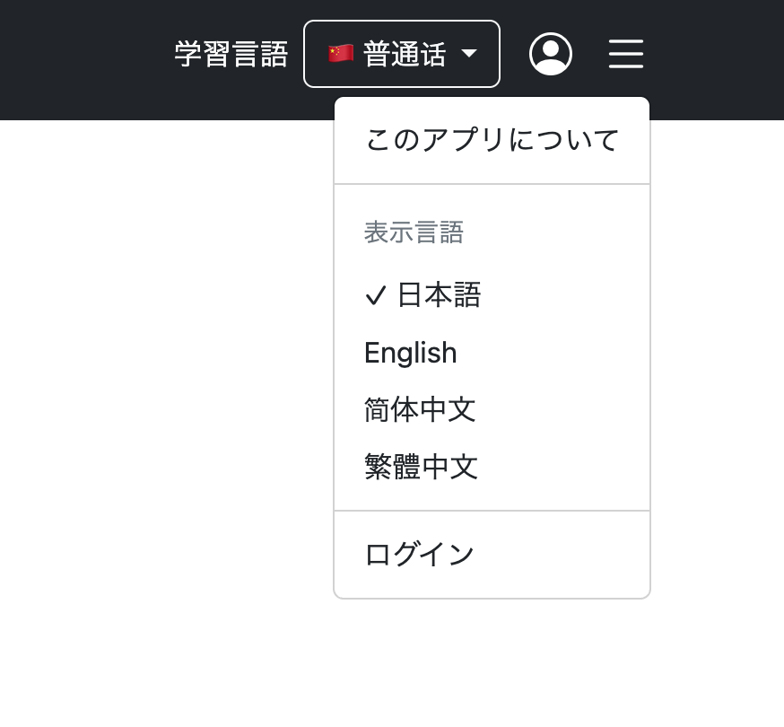
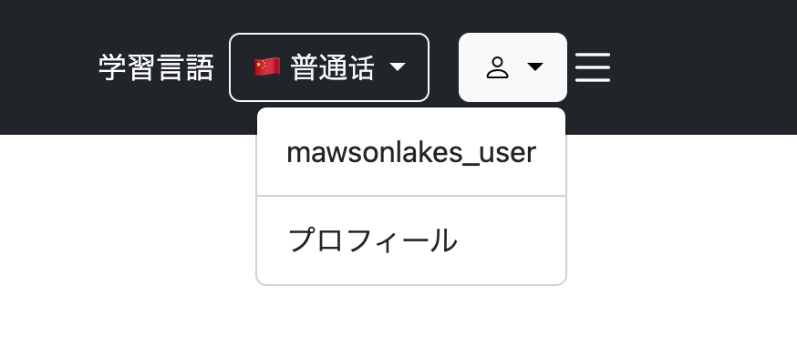
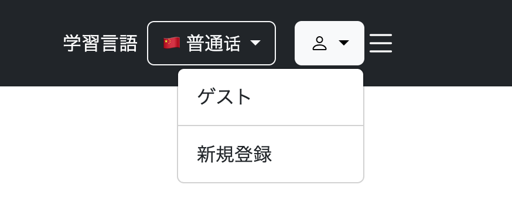
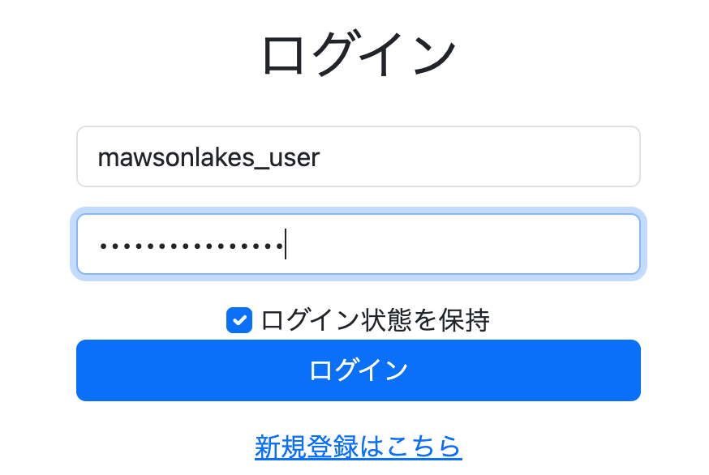
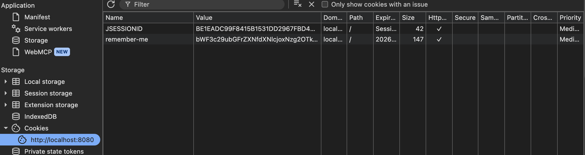

# 007 ログイン機能の実装

> このログは実装・変更を時系列で記録したものです。途中のコードや仕様は、その後の開発によって変更されている場合があります。現在の実装はソースコードを参照してください。

## 概要

Spring Securityを導入し、DBに登録したユーザーによるログイン・ログアウト、認証結果に応じた画面表示、Remember Me、CSRF対策を実装した。後日、Remember Meによる再認証後にユーザー設定が復元されない不具合を修正した。

---

## 1. 基本的なログイン機能の実装

**関連コミット：** `feat: implement basic login authentication`

### 1.1 目的・変更内容

| 対象 | 内容 |
| --- | --- |
| `pom.xml` | `spring-boot-starter-security`と`thymeleaf-extras-springsecurity6`を追加 |
| `application.yml` | `SecurityAutoConfiguration`の除外を解除 |
| `SecurityConfig` | 公開URL、フォームログイン、ログアウトを設定 |
| `UserDetailsServiceImpl` | DBのユーザー情報をSpring Securityの`UserDetails`へ変換 |
| `UserAccountService` | ログインIDによるユーザー検索を追加 |
| `LoginController`・`login.html` | ログイン画面を表示し、認証フォームを送信 |
| `messages*.properties` | 画面文言を多言語化 |

### 1.2 主要コード

**SecurityConfig**

当初は画面・認証処理の動作確認を優先し、CSRF対策を一時的に無効化した。第7章で有効に戻す。

```java
@Bean
SecurityFilterChain securityFilterChain(HttpSecurity http) throws Exception {
    
    // アクセス制御の設定
    http.authorizeHttpRequests(authorize -> authorize
            .requestMatchers(
                    PathRequest.toStaticResources().atCommonLocations()
            ).permitAll()
            .requestMatchers("/").permitAll()
            .requestMatchers("/login").permitAll()
            .requestMatchers("/practice/**").permitAll()
            .requestMatchers("/signup", "/signup/**").permitAll()
            .requestMatchers("/complete").permitAll()
            .anyRequest().authenticated()
        )
        
        // ログインの設定
        .formLogin(login -> login
            .loginPage("/login")
            .usernameParameter("loginId")
            .passwordParameter("password")
            .defaultSuccessUrl("/", false)
            .permitAll()
        )
        
        // ログアウトの設定
        .logout(logout -> logout
            .logoutUrl("/logout")
        );
    
    // CSRFを無効化
    http.csrf(csrf -> csrf.disable());
    
    return http.build();
}
```

`/`、`/login`、`/practice/**`、`/signup`などは未ログインでもアクセス可能とし、それ以外は認証を要求する。ログインフォームのパラメーター名は`loginId`と`password`。`defaultSuccessUrl("/", false)`は、認証前に保存されたリクエストがない場合の基本遷移先を`/`とする。

**UserDetailsServiceImpl**

認証時にログインIDからDBのユーザーを検索し、パスワードハッシュと`ROLE_`付きの権限情報をSpring Securityへ渡す。

```java
@Service
@RequiredArgsConstructor
public class UserDetailsServiceImpl implements UserDetailsService {
    
    private final UserAccountService userAccountService;
    
    @Override
    public UserDetails loadUserByUsername(String loginId)
            throws UsernameNotFoundException {
        
        // ユーザー情報取得
        Users loginUser = userAccountService.getUserOne(loginId);
        
        // ユーザーが存在しない場合
        if (loginUser == null) {
            throw new UsernameNotFoundException("user not found"); 
        }
        
        // ロールList作成
        GrantedAuthority authority =
                new SimpleGrantedAuthority(
                        "ROLE_" + loginUser.getRole().name()
                );

        List<GrantedAuthority> authorities = new ArrayList<>();
        authorities.add(authority);
        
        // UserDetails生成
        UserDetails userDetails = new User(
                loginUser.getLoginId(),
                loginUser.getPassword(),
                authorities
        );

        return userDetails;
    }
}
```

**UserAccountService・LoginController**

DB検索は`UserRepository#findByLoginId()`を利用する。ログイン認証自体はSpring Securityが担当するため、ControllerはGET `/login`の画面表示のみ行う。

```java
@Service
@RequiredArgsConstructor
@Slf4j
public class UserAccountService {
    
    private final UserRepository userRepository;
    
    public Users getUserOne(String loginId) {

        log.debug("ユーザー検索 userId={}", loginId);

        return userRepository.findByLoginId(loginId)
                .orElse(null);
    }
}
```

```java
@Controller
public class LoginController {

    @GetMapping("/login")
    public String getLogin() {
        
        return "/login";
    }
}
```

**login.html（フォームの主要部分）**

`th:action="@{/login}"`でPOSTし、入力欄の`name`をSecurityConfigと一致させる。新規登録・トップへのリンクも設けた。

```html
<form method="post" th:action="@{/login}">
    <input type="text" name="loginId" class="form-control"
           th:placeholder="#{login.loginId}">
    <input type="password" name="password" class="form-control"
           th:placeholder="#{login.password}">
    <button type="submit" th:text="#{login.button}">ログイン</button>
</form>
```

### 1.3 動作確認

既存アカウントで`http://localhost:8080/login`からログインできることを確認。認証に失敗すると、この段階では`/login?error`へ戻る。





---

## 2. ログイン失敗時のメッセージ表示

**関連コミット：** `feat: add login failure handling`

### 2.1 目的・変更内容

認証失敗時に何も表示されない状態を改善する。`AuthenticationFailureHandler`でメッセージキー`login.error`をSessionに保存し、`/login`へリダイレクトする。`LoginController`はそのキーをModelへ渡した後にSessionから削除する。

### 2.2 主要コード

**SecurityConfig**

```java
.failureHandler(new AuthenticationFailureHandler() {
    @Override
    public void onAuthenticationFailure(
            HttpServletRequest request,
            HttpServletResponse response,
            AuthenticationException exception)
            throws IOException {

        HttpSession session = request.getSession(true);

        session.setAttribute(
                "loginErrorMessage",
                "login.error"
        );

        response.sendRedirect("/login");
    }
})
```

**LoginController**

```java
@GetMapping("/login")
public String getLogin(Model model, HttpSession session) {
    
    String loginErrorMessage =
            (String) session.getAttribute("loginErrorMessage");

    if (loginErrorMessage != null) {
        model.addAttribute("loginErrorMessage", loginErrorMessage);
        session.removeAttribute("loginErrorMessage");
    }
    
    return "/login";
}
```

**login.html・messages.properties**

```html
<div class="text-danger mb-3"
     th:if="${loginErrorMessage}"
     th:text="#{__${loginErrorMessage}__}"></div>
```

```properties
login.error=ログインIDまたはパスワードが正しくありません。
```

`__...__`でModelに格納したメッセージキーを先に展開する。多言語版の文言も設定した。

### 2.3 動作確認

ログイン失敗直後にエラーが表示され、F5で再表示すると消えることを確認。



> 画像パスは元ログの記録を維持。`0006-05.png`が007の動作確認画像として正しいかは未確認。

---

## 3. ログアウト成功時のメッセージ表示

**関連コミット：** `feat: add logout success handling`

### 3.1 目的・変更内容

ログアウト後にホームへ戻し、`logout.success`の文言を一度だけ表示する。Spring Securityは通常ログアウト時に従来のSessionを無効化するため、成功Handler内で`getSession(true)`により新しいSessionを取得・作成してメッセージキーを保存する。

### 3.2 主要コード

**SecurityConfig**

```java
.logoutSuccessHandler(new LogoutSuccessHandler() {
    @Override
    public void onLogoutSuccess(
            HttpServletRequest request,
            HttpServletResponse response,
            Authentication authentication)
            throws IOException {

        HttpSession session = request.getSession(true);
        session.setAttribute(
                "logoutMessage",
                "logout.success"
        );

        response.sendRedirect("/");
    }
})
```

**HomeController・home.html**

```java
String logoutMessage =
        (String) session.getAttribute("logoutMessage");

if (logoutMessage != null) {
    model.addAttribute("logoutMessage", logoutMessage);
    session.removeAttribute("logoutMessage");
}
```

```html
<div class="alert alert-success d-inline-block"
     th:if="${logoutMessage}"
     th:text="#{__${logoutMessage}__}"></div>
```

```properties
logout.success=ログアウトしました。
```

### 3.3 動作確認

ログアウト後にホームへ遷移し、成功メッセージが表示されることを確認。



---

## 4. ヘッダーにログイン・ログアウト操作を追加

**関連コミット：** `feat: add login and logout buttons to header`

### 4.1 変更内容

`header.html`にThymeleafのSpring Security拡張名前空間を追加。未ログイン時はログインリンク、ログイン時はログアウト用POSTフォームを表示する。

### 4.2 主要コード

```html
<!-- 未ログイン時 -->
<li sec:authorize="isAnonymous()">
    <a class="dropdown-item"
       th:href="@{/login}"
       th:text="#{header.login}">
        ログイン
    </a>
</li>

<!-- ログイン時 -->
<li sec:authorize="isAuthenticated()">
    <form th:action="@{/logout}" method="post">
        <button type="submit"
                class="dropdown-item"
                th:text="#{header.logout}">
            ログアウト
        </button>
    </form>
</li>
```

`sec:authorize`で認証状態に応じて表示を切り替える。`header.login`と`header.logout`を各言語のメッセージファイルへ追加した。

### 4.3 動作確認

ログイン中：


非ログイン中：



---

## 5. ヘッダーにユーザー情報のドロップダウンを追加

**関連コミット：** `feat: add user dropdown menu to header`

### 5.1 変更内容

ユーザーアイコンからドロップダウンを開き、ログイン時はログインIDとプロフィールリンク、非ログイン時は「ゲスト」と新規登録リンクを表示する。当時の画面表記「ユーザーID」は、その後「ログインID」に変更している。

### 5.2 主要コード

```html
<!-- ユーザーアイコン -->
<button class="btn btn-outline-light dropdown-toggle"
        type="button"
        data-bs-toggle="dropdown"
        aria-expanded="false">
    <i class="bi bi-person"></i>
</button>

<ul class="dropdown-menu dropdown-menu-end">

    <!-- ログイン中：ユーザーID -->
    <li sec:authorize="isAuthenticated()">
        <span class="dropdown-item-text fw-bold"
              sec:authentication="name">
            userId
        </span>
    </li>

    <!-- 未ログイン：ゲスト -->
    <li sec:authorize="isAnonymous()">
        <span class="dropdown-item-text fw-bold"
              th:text="#{header.guest}">
            ゲスト
        </span>
    </li>

    <li><hr class="dropdown-divider"></li>

    <!-- ログイン中：プロフィール -->
    <li sec:authorize="isAuthenticated()">
        <a class="dropdown-item"
           th:href="@{/user/profile}"
           th:text="#{header.profile}">
            プロフィール
        </a>
    </li>

    <!-- 未ログイン：新規登録 -->
    <li sec:authorize="isAnonymous()">
        <a class="dropdown-item"
           th:href="@{/signup}"
           th:text="#{header.signup}">
            新規登録
        </a>
    </li>

</ul>
```

`sec:authentication="name"`で認証中のログインIDを表示する。表示文言は`header.guest`、`header.profile`、`header.signup`を使用。

### 5.3 動作確認

ログイン時：



非ログイン時：



---

## 6. Remember Me認証を追加

**関連コミット：** `feat: add remember-me authentication`

### 6.1 目的・変更内容

Sessionの有効期限が切れても、Remember MeのCookieを使って再認証できるようにする。ログインフォームにチェックボックスを追加し、SecurityConfigにRemember Meを設定した。

**login.html**

```html
<!-- Remember-Me -->
<div class="form-group mt-3 text-center">
    <input class="form-check-input"
           type="checkbox"
           id="remember-me"
           name="remember-me">

    <label class="form-check-label"
           for="remember-me"
           th:text="#{login.rememberMe}">
        ログイン状態を保持
    </label>
</div>
```

**SecurityConfig（当初の設定）**

```java
.rememberMe(remember -> remember
        .rememberMeParameter("remember-me")
        .tokenValiditySeconds(3600)
);
```

当初はCookieの有効期限を1時間としていた。

### 6.2 後日の有効期限変更（9月26日）

**関連コミット：** `fix: set remember-me cookie validity to 7 days`

Remember Meの有効期限を7日間へ延長した。

```java
.rememberMe(remember -> remember
        .rememberMeParameter("remember-me")
        .tokenValiditySeconds(7 * 24 * 60 * 60)
);
```

### 6.3 動作確認

Remember Meにチェックしてログインすると、`JSESSIONID`に加えて`remember-me` Cookieが作成された。Sessionタイムアウト後のページ更新でも、認証済み向けの表示が維持されることを確認した。





---

## 7. CSRF対策を有効化

**関連コミット：** `security: enable CSRF protection`

### 7.1 変更内容

基本機能の動作確認が完了したため、SecurityConfigの`http.csrf(csrf -> csrf.disable())`を無効にし、Spring Security標準のCSRF対策を再び有効にした。

```java
// 削除・コメントアウトした暫定設定
// http.csrf(csrf -> csrf.disable());
```

`signup.html`、`login.html`、`header.html`のPOSTフォームは`th:action`を使用している。Spring SecurityとThymeleafの連携により、対象フォームにはCSRFトークンのhiddenフィールドが自動挿入されるため、今回は手動記述しない。

手動で明示する場合の記法：

```html
<input type="hidden"
       th:name="${_csrf.parameterName}"
       th:value="${_csrf.token}">
```

---

## 次回の実装

ログイン機能の基本実装が完了したため、一旦中断していた学習ページの実装に戻る。次はログインユーザー向けの学習機能を実装する。

---

## 追加修正：Remember Meによる再認証後のセッション情報復元

**関連コミット：** `fix: restore user session preferences after remember-me authentication`

> 以下は007の当初の実装ではなく、後日の動作確認で発見した不具合への追加修正である。

### 1. 発生した問題と原因

通常のフォームログイン時は`LoginSuccessHandler`でDBの`languageVariant`（普通話／國語）と`pronunciationType`（ピンイン／注音符号）をSessionへ保存していた。しかしRemember Meを有効にして30分以上操作せずに更新すると、ログイン状態は維持される一方、学習対象言語が國語から普通話へ戻り、AI生成問題数が0問と表示された。フォームログインし直すと元の設定に戻った。

Remember Meは認証状態を復元するが、期限切れになったHTTPセッションの任意の属性までは復元しない。またRemember Meによる自動認証では、フォームログイン用の`LoginSuccessHandler`は実行されない。このため、アプリ独自のセッション属性が欠落したままになっていた。

なお、AI生成問題数が0問になる直接の原因は個別に確定しておらず、言語設定が変わった影響の可能性がある。

### 2. 対策と設計判断

認証済みユーザーのSessionに`languageVariant`または`pronunciationType`がなければ、DBから設定を取得して復元する`UserSessionRestorationFilter`を追加した。Remember Meだけに限定せず、属性が欠けた認証済みセッション全般を対象とする。既に両属性が存在する場合はDB検索を行わない。

Servlet FilterはControllerより前に共通処理を実行できる。今回は`OncePerRequestFilter`を継承し、`doFilterInternal()`に復元処理を実装した。

```java
package io.github.mawsonlakes790913.chineseoutputforge.security;

import java.io.IOException;

import org.springframework.security.authentication.AnonymousAuthenticationToken;
import org.springframework.security.core.Authentication;
import org.springframework.security.core.context.SecurityContextHolder;
import org.springframework.web.filter.OncePerRequestFilter;

import io.github.mawsonlakes790913.chineseoutputforge.entity.Users;
import io.github.mawsonlakes790913.chineseoutputforge.service.UserAccountService;

import jakarta.servlet.FilterChain;
import jakarta.servlet.ServletException;
import jakarta.servlet.http.HttpServletRequest;
import jakarta.servlet.http.HttpServletResponse;
import jakarta.servlet.http.HttpSession;

import lombok.RequiredArgsConstructor;
import lombok.extern.slf4j.Slf4j;

@Slf4j
@RequiredArgsConstructor
public class UserSessionRestorationFilter extends OncePerRequestFilter {

    private final UserAccountService userAccountService;

    @Override
    protected void doFilterInternal(
            HttpServletRequest request,
            HttpServletResponse response,
            FilterChain filterChain)
            throws ServletException, IOException {

        // 現在の認証情報を取得
        Authentication authentication =
                SecurityContextHolder.getContext().getAuthentication();

        // 認証済みユーザーの場合のみ処理
        if (authentication != null
                && authentication.isAuthenticated()
                && !(authentication instanceof AnonymousAuthenticationToken)) {

            // 既存のHTTPセッションを取得
            HttpSession session = request.getSession(false);

            // セッションまたはユーザー設定が存在しない場合
            if (session == null
                    || session.getAttribute("languageVariant") == null
                    || session.getAttribute("pronunciationType") == null) {

                // DBからユーザー設定を取得
                Users user = userAccountService.getUserOne(
                        authentication.getName());

                // セッションを取得（存在しなければ作成）
                session = request.getSession(true);

                // ユーザー設定を復元
                session.setAttribute(
                        "languageVariant", user.getLanguageVariant());

                session.setAttribute(
                        "pronunciationType", user.getPronunciationType());

                log.info("User session preferences restored: {}",
                        authentication.getName());
            }
        }

        // 後続のFilter・Controllerへ処理を渡す
        filterChain.doFilter(request, response);
    }
}
```

認証情報を`SecurityContextHolder`から取得し、`AnonymousAuthenticationToken`を除外する。`getSession(false)`で既存Sessionを確認し、復元が必要な場合のみ`getSession(true)`でSessionを取得・作成する。最後に`filterChain.doFilter()`で後続処理へ渡す。

**SecurityConfigへの登録**

```java
http.addFilterAfter(
        new UserSessionRestorationFilter(userAccountService),
        AnonymousAuthenticationFilter.class
);
```

標準的なFilter順序では`RememberMeAuthenticationFilter`の後に`AnonymousAuthenticationFilter`があるため、その後へ配置すればRemember Meの認証結果を参照しつつ匿名認証を除外できる。Controllerで属性を参照する前に実行することが目的であり、この配置が唯一の選択肢というわけではない。

`@Component`は付けず、Spring SecurityのFilterチェーンへ明示的に登録した。Servletコンテナ側にも自動登録され、二重実行や意図しない順序になることを避けるためである。

### 3. 動作確認

当時のSessionタイムアウトは30分。14:45にRemember Meを有効にしてログインし、15:20にページを更新した。

| 確認項目 | 結果 |
| --- | --- |
| ログイン状態 | 維持された |
| 学習対象言語 | 國語（TAIWAN）のまま |
| 問題数 | 初級118問・中級116問・上級115問を維持 |
| Filterの実行 | INFOログで確認 |

```text
User session preferences restored: mawsonlakes_admin
```

これにより、Remember Meによる再認証後にもDBのユーザー設定がSessionへ復元されることを確認した。

### 4. セッションタイムアウトを60分に変更

**関連コミット：** `config: extend session timeout to 60 minutes`

学習中は問題を考える間にリクエストが発生しないため、Session切れの頻度を減らす目的でタイムアウトを30分から60分へ延長した。

```yaml
server:
  servlet:
    session:
      timeout: 60m
```

Remember Meの有効期限は引き続き7日間。今回のFilterで復元できるのは指定したユーザー設定であり、通常学習の進行状況などSessionにのみ保存された情報までは復元できない。

### 5. まとめ

認証状態とアプリ独自のSession属性は別物であることを踏まえ、認証後に欠落した設定を復元する処理を追加した。Filterの実行順序を指定することで、Controllerの前に必要な設定を揃えられるようになった。

**参考資料**

- [Spring Security公式：Servlet Architecture](https://docs.spring.io/spring-security/reference/servlet/architecture.html)
- [Spring Framework：OncePerRequestFilter Javadoc](https://docs.spring.io/spring-framework/docs/current/javadoc-api/org/springframework/web/filter/OncePerRequestFilter.html)
- [Spring Security 使い方メモ Remember-Me](https://qiita.com/opengl-8080/items/7c34053c74448d39e8f5)

