# 008 通常学習の実装 その3

> このログは実装・変更を時系列で記録したものです。途中のコードや仕様は、その後の開発によって変更されている場合があります。現在の実装はソースコードを参照してください。

新規登録・ログイン機能の実装後、通常学習にログインユーザー向けの**理解度保存・お気に入り登録・未学習問題の出題**を追加した。未学習かどうかは`study_history`の有無で判定するため、理解度保存を先に実装した。

## 1. 理解度を保存する機能

**関連コミット**：`feat: add evaluation saving to practice`

### 目的とデータ構造

ログインユーザーが各問題に`HARD`・`GOOD`・`EASY`を記録できるようにする。`study_history`は`user_id`と`question_id`の複合主キーで、現在の理解度と更新日時を保持する。

**StudyHistory.java**

```java
@Data
@Entity
@Table(name = "study_history")
public class StudyHistory {

    @EmbeddedId
    private StudyHistoryKey studyHistoryKey;

    @Enumerated(EnumType.STRING)
    @Column(nullable = false)
    private Evaluation evaluation;

    @Column(nullable = false)
    private LocalDateTime evaluationUpdatedAt;
}
```

**StudyHistoryKey.java**

```java
@Embeddable
@Data
public class StudyHistoryKey implements Serializable {

    private Long userId;

    private Long questionId;
}
```

**Evaluation.java**

```java
public enum Evaluation {

    HARD,
    GOOD,
    EASY
}
```

### 保存処理

`StudyHistoryRepository`で既存履歴を取得し、`EvaluationService`で新規ならINSERT、既存ならUPDATEする。どちらも`JpaRepository.save()`を使用し、同じ理解度を選択した場合も更新日時を上書きする。

**EvaluationService.java（保存処理）**

```java
@Service
@RequiredArgsConstructor
@Slf4j
public class EvaluationService {

    private final StudyHistoryRepository studyHistoryRepository;

    public void updateEvaluation(
            Users user,
            Long questionId,
            Evaluation evaluation) {

        StudyHistoryKey key = new StudyHistoryKey();
        key.setUserId(user.getId());
        key.setQuestionId(questionId);

        Optional<StudyHistory> optionalStudyHistory =
                studyHistoryRepository.findByStudyHistoryKey(key);

        if (optionalStudyHistory.isPresent()) {

            StudyHistory studyHistory =
                    optionalStudyHistory.get();

            studyHistory.setEvaluation(evaluation);
            studyHistory.setEvaluationUpdatedAt(LocalDateTime.now());

            studyHistoryRepository.save(studyHistory);

            log.info(
                    "評価更新(UPDATE) userId={}, questionId={}, evaluation={}",
                    user.getId(), questionId, evaluation);

        } else {

            StudyHistory studyHistory = new StudyHistory();

            studyHistory.setStudyHistoryKey(key);
            studyHistory.setEvaluation(evaluation);
            studyHistory.setEvaluationUpdatedAt(LocalDateTime.now());

            studyHistoryRepository.save(studyHistory);

            log.info(
                    "評価更新(INSERT) userId={}, questionId={}, evaluation={}",
                    user.getId(), questionId, evaluation);
        }
    }
}
```

### Controller・画面

`POST /practice/evaluation`で問題ID・理解度・ページ番号を受け取り、保存後に次の問題（最後なら完了画面）へ遷移する。ログインユーザーだけに3つの理解度ボタンを表示し、各フォームから同じエンドポイントへ送信する。

```java
@PostMapping("/practice/evaluation")
public String postEvaluation(
        @AuthenticationPrincipal UserDetails loginUser,
        @RequestParam Long questionId,
        @RequestParam Evaluation evaluation,
        @RequestParam Integer page,
        HttpSession session) {

    Users user = userAccountService.getUserOne(
            loginUser.getUsername());

    evaluationService.updateEvaluation(
            user,
            questionId,
            evaluation);

    List<Question> questions =
            (List<Question>) session.getAttribute("practiceQuestions");

    if (page + 1 >= questions.size()) {
        return "redirect:/practice/complete";
    }

    return "redirect:/practice/question?page=" + (page + 1);
}
```

画面では`sec:authorize="isAuthenticated()"`で表示を制御し、`questionId`、`evaluation`、`page`をhiddenフィールドで送信する。ボタンの文言は`messages.properties`で管理する。

### 動作確認

理解度ボタンの表示と、`study_history`へのINSERTを確認した。

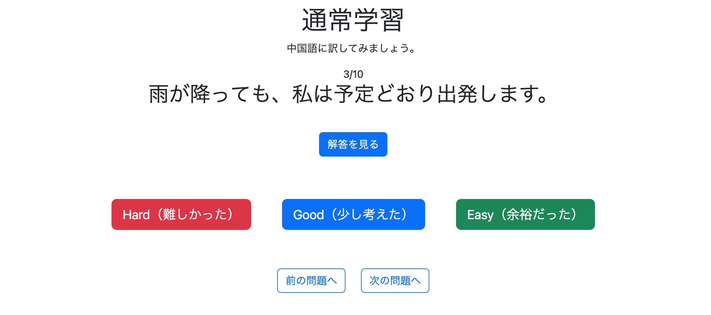

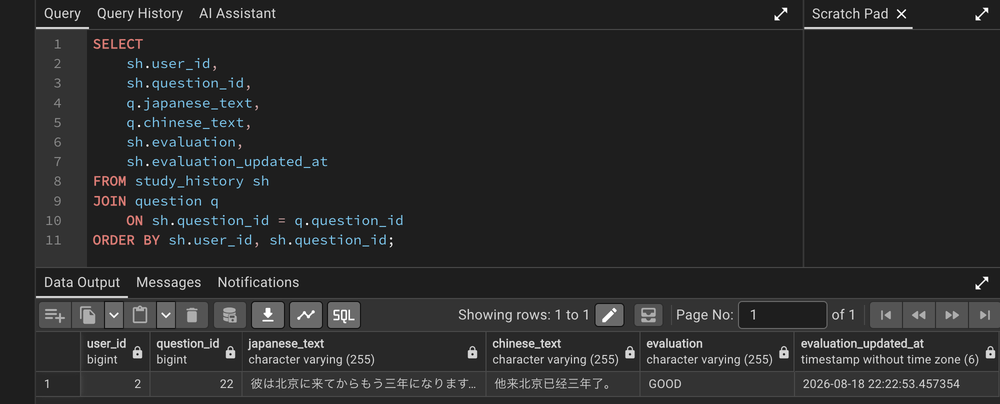

## 2. 解答表示時のレイアウトを修正

**関連コミット**：`fix: prevent layout shift when showing practice answer`

解答の表示・非表示によって下部のボタン位置が変わっていたため、`practice/question.html`の解答領域の最小高さを`100px`から`150px`に変更した。

**修正前**

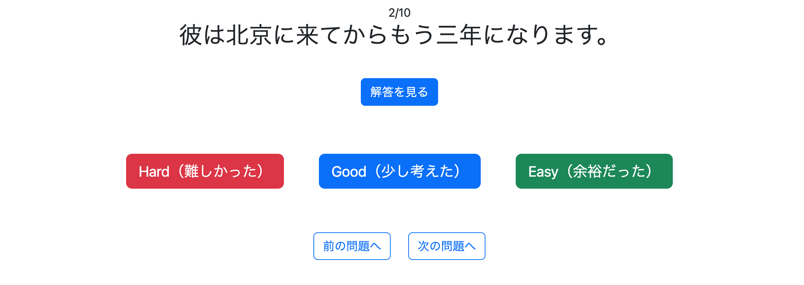

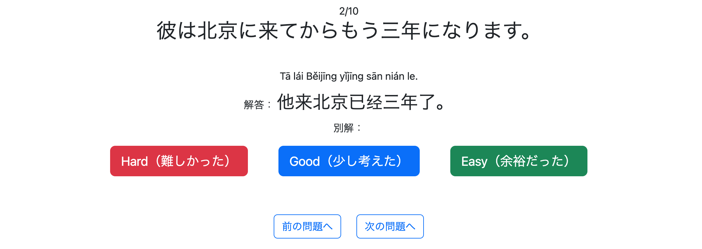

```html
<div style="min-height:150px;">
```

**修正後**：解答の表示状態にかかわらずボタン位置が揃うことを確認した。

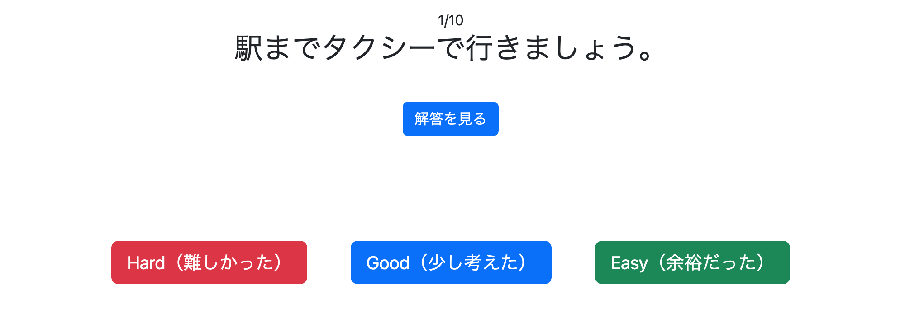

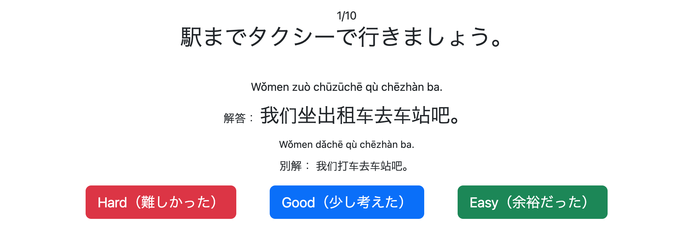

## 3. お気に入り登録・解除機能

**関連コミット**：`feat: implement favorite registration and removal`

ログインユーザーが問題ごとにお気に入りを登録・解除できるようにした。未登録は白いハート、登録済みは赤いハートで表す。`favorite`テーブルは`user_id`と`question_id`を複合主キーとする。

### Entity・Repository

`Favorite`は`@EmbeddedId`で複合主キーを持ち、`@ManyToOne`と`@MapsId`で`Users`・`Question`に関連付ける。

**Favorite.java**

```java
@Data
@Entity
@Table(name = "favorite")
public class Favorite {

    @EmbeddedId
    private FavoriteKey favoriteKey;

    @ManyToOne
    @MapsId("userId")
    @JoinColumn(name = "user_id")
    private Users user;

    @ManyToOne
    @MapsId("questionId")
    @JoinColumn(name = "question_id")
    private Question question;
}
```

**FavoriteKey.java**

```java
@Embeddable
@Data
public class FavoriteKey implements Serializable {

    private Long userId;

    private Long questionId;
}
```

### Service・Controller

`FavoriteService.toggleFavorite()`で登録状態を調べ、未登録なら`getReferenceById(questionId)`で既存問題の参照を取得してINSERT、登録済みならDELETEする。返り値は操作後の状態（`true`＝登録済み、`false`＝未登録）。`isFavorite()`は画面初期表示の判定に使用する。

**FavoriteService.java**

```java
@Transactional
@Service
@RequiredArgsConstructor
@Slf4j
public class FavoriteService {

    private final FavoriteRepository favoriteRepository;
    private final QuestionRepository questionRepository;

    public boolean toggleFavorite(Users user, long questionId) {

        FavoriteKey key = createFavoriteKey(user, questionId);

        Optional<Favorite> optionalFavorite =
                favoriteRepository.findByFavoriteKey(key);

        if (optionalFavorite.isEmpty()) {

            Question question =
                    questionRepository.getReferenceById(questionId);

            Favorite favorite = new Favorite();
            favorite.setFavoriteKey(key);
            favorite.setUser(user);
            favorite.setQuestion(question);

            favoriteRepository.save(favorite);

            log.info(
                    "お気に入り追加 userId={}, questionId={}",
                    user.getId(), questionId);

            return true;

        } else {

            favoriteRepository.deleteById(key);

            log.info(
                    "お気に入り解除 userId={}, questionId={}",
                    user.getId(), questionId);

            return false;
        }
    }

    public boolean isFavorite(Users user, long questionId) {

        FavoriteKey key = createFavoriteKey(user, questionId);

        return favoriteRepository.existsById(key);
    }

    private FavoriteKey createFavoriteKey(
            Users user,
            long questionId) {

        FavoriteKey key = new FavoriteKey();
        key.setUserId(user.getId());
        key.setQuestionId(questionId);

        return key;
    }
}
```

`POST /favorite/toggle`は`@ResponseBody`でbooleanを返す。画面を再読み込みせずJavaScriptから呼び出す。

```java
@Controller
@RequiredArgsConstructor
public class FavoriteController {

    private final FavoriteService favoriteService;
    private final UserAccountService userAccountService;

    @PostMapping("/favorite/toggle")
    @ResponseBody
    public boolean toggleFavorite(
            @RequestParam Long questionId,
            @AuthenticationPrincipal UserDetails loginUser) {

        Users user =
                userAccountService.getUserOne(
                        loginUser.getUsername());

        return favoriteService.toggleFavorite(
                user,
                questionId);
    }
}
```

### 画面・JavaScript

問題画面表示時に`isFavorite`をModelへ渡し、ハートの初期状態を切り替える。非同期POSTにはCSRFトークンをHTTPヘッダーへ設定する。

**ハートボタン（practice/question.html）**

```html
<div sec:authorize="isAuthenticated()">

    <button type="button"
            class="favoriteButton btn p-0 border-0 bg-transparent"
            th:data-question-id="${question.questionId}">

        <i th:class="${isFavorite}
            ? 'bi bi-heart-fill fs-2 text-danger'
            : 'bi bi-heart fs-2 text-secondary'">
        </i>

    </button>

</div>
```

`favorite.js`は`fetch("/favorite/toggle", ...)`で`questionId`を送信し、レスポンスの`true`・`false`に応じて`bi-heart`／`bi-heart-fill`と文字色のクラスを切り替える。CSRFトークンとヘッダー名は`meta`タグから取得する。

### 動作確認

ハートの表示、クリック時の色変更、DBへの登録、再クリック時の解除を確認した。


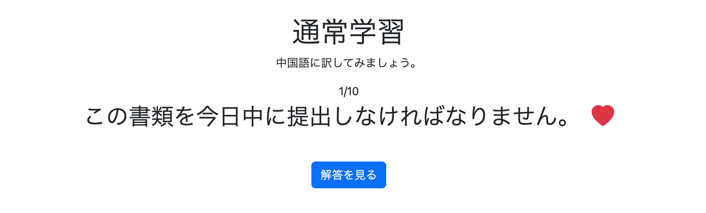

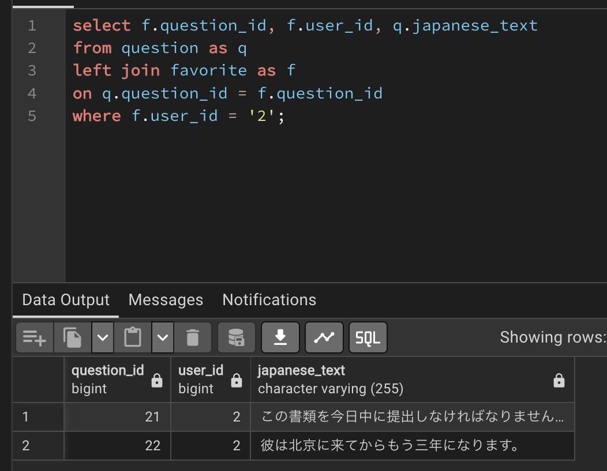

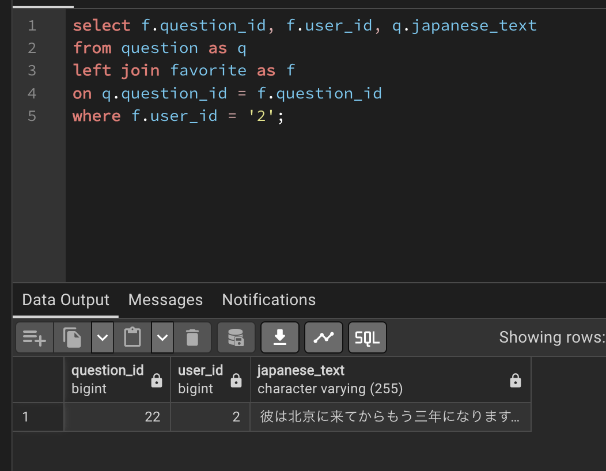

## 4. 未学習問題から出題する機能

**関連コミット**：`feat: add unlearned question practice mode`

対象ユーザーの`study_history`に存在しない問題を未学習問題として抽出する。難易度の複数選択と、難易度別の未学習問題数表示にも対応した。

### Repository

`question`と`study_history`を`user_id`も含めて`LEFT JOIN`し、`sh.question_id IS NULL`で未学習問題だけを取得する。ユーザーIDをJOIN条件に含めることで、他ユーザーの学習履歴に影響されない。

**未学習問題取得**

```java
@Query(value = """
        SELECT q.*
        FROM question q
        LEFT JOIN study_history sh
          ON q.question_id = sh.question_id
         AND sh.user_id = :userId
        WHERE q.difficulty IN (:difficulties)
          AND sh.question_id IS NULL
        """, nativeQuery = true)
List<Question> findUnlearnedQuestionsByUserIdAndDifficulty(
        @Param("userId") Long userId,
        @Param("difficulties") List<String> difficulties);
```

件数取得も同じLEFT JOINの条件を用いる。`countNewQuestions()`では難易度ごとに単一の文字列を渡しているが、元実装の`IN (:difficulties)`を維持した。

```java
@Query(value = """
        SELECT COUNT(*)
        FROM question q
        LEFT JOIN study_history sh
          ON q.question_id = sh.question_id
         AND sh.user_id = :userId
        WHERE q.difficulty IN (:difficulties)
          AND sh.question_id IS NULL
        """, nativeQuery = true)
long countNewQuestions(
        @Param("userId") Long userId,
        @Param("difficulties") String difficulties);
```

### Service・DTO

`PracticeService.getNewQuestions()`で検索条件の難易度を`List<Difficulty>`から`List<String>`へ変換してRepositoryに渡す。未指定時は全難易度を対象とする。`countNewPracticeQuestions()`は初級・中級・上級の件数を取得し、`NewPracticeCountDto`にまとめる。

**SearchConditionConverter.java**

```java
public class SearchConditionConverter {

    public List<String> convertDifficulty(
            List<Difficulty> difficulties) {

        List<String> difficultyList;

        if (difficulties == null || difficulties.isEmpty()) {

            difficultyList = List.of(
                    Difficulty.BEGINNER.name(),
                    Difficulty.INTERMEDIATE.name(),
                    Difficulty.ADVANCED.name());

        } else {

            difficultyList = new ArrayList<>();

            for (Difficulty difficulty : difficulties) {
                difficultyList.add(difficulty.name());
            }
        }

        return difficultyList;
    }
}
```

### Controller・メニュー

`/practice/menu`ではログインユーザーに限って未学習問題数をModelへ渡す。`GET /practice/new/start`で既存の学習セッションをクリアし、抽出した問題一覧と現在ページ（0）をSessionに格納する。問題が0件ならメニューへ戻す。

**未学習問題の開始処理（URL表記を統一）**

```java
@GetMapping("/practice/new/start")
public String getPracticeNewStart(
        HttpSession session,
        @AuthenticationPrincipal UserDetails loginUser,
        @RequestParam(
                name = "difficulties",
                required = false)
        List<Difficulty> difficulty) {

    // 既存の学習状態を破棄
    clearStudySession(session);

    List<Question> questions;

    Users user = getLoginUser(loginUser);
    Long userId = user.getId();

    // 問題セットを取得
    questions =
            practiceService.getNewQuestions(
                    userId,
                    difficulty);

    if (questions.isEmpty()) {
        return "redirect:/practice/menu";
    }

    session.setAttribute(
            "practiceQuestions",
            questions);

    session.setAttribute(
            "practiceCurrentPage",
            0);

    return "redirect:/practice/question?page=0";
}
```

メニューにはログインユーザー専用の難易度チェックボックスと出題開始ボタンを追加する。フォームの送信先は`/practice/new/start`とする（元ログの`/study/new/start`表記を修正）。

### 動作確認

中級の未学習問題14問を選択すると14問が出題された。うち1問に理解度を保存した後、未学習問題数が13問へ減ることを確認した。

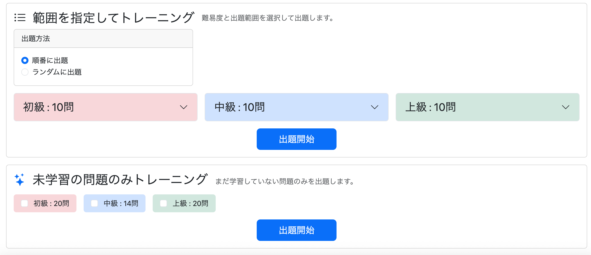

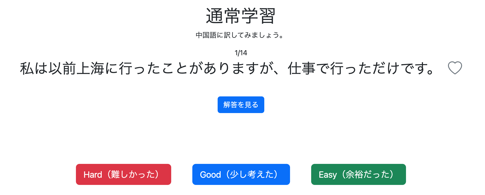

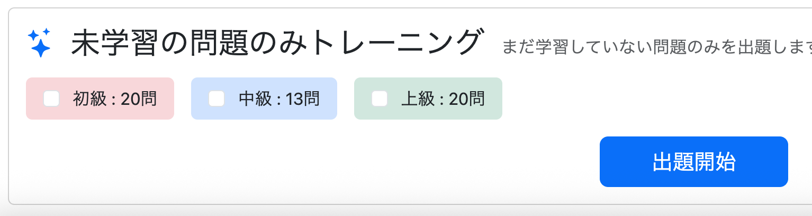

## 5. 別解が存在しない場合の表示を修正

**関連コミット**：`fix: hide alternative answer section when no alternative exists`

別解のない問題でも「別解：」が表示されていた。原因は`<p>`内に別の`<p>`を配置した不正なHTML構造で、ブラウザが外側の段落を自動的に閉じていたこと。外側を`<div th:if="${question.alternativeAnswer != null}">`へ変更し、別解表示全体を条件付きにした。

**修正前**

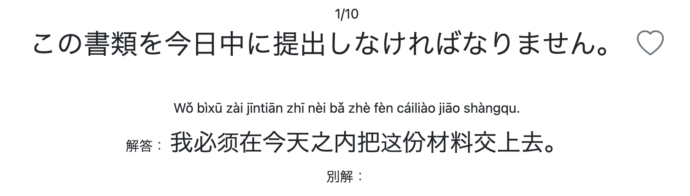

**修正後**：別解がない場合は見出しも表示されなくなった。

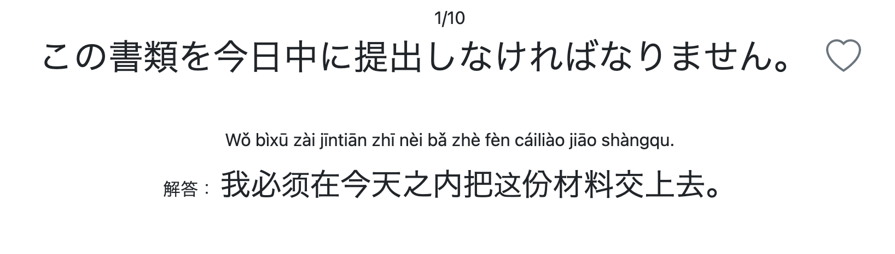

## 6. 問題画面下部の余白を調整

**関連コミット**：`fix: reduce spacing between practice navigation and action buttons`

「次へ・前へ」と「中断・やめる」の間隔が広く、画面全体が収まらなかったため、`practice/question.html`の`margin-top`を`90px`から`40px`へ変更した。

**修正前**

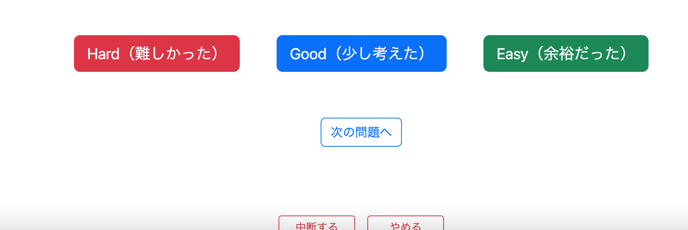

```html
<div class="d-flex justify-content-center gap-3" style="margin-top:40px;">
```

**修正後**：ボタン間の余白が縮まり、問題画面全体が1画面内に収まった。

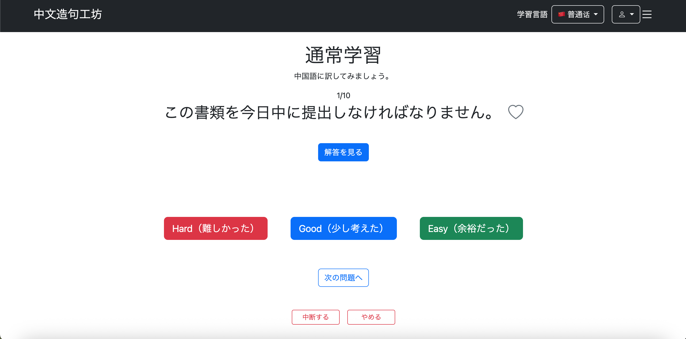

---

## 7. 実装を終えて

今回は、ログインユーザー向けの通常学習機能として、理解度の保存、お気に入り登録・解除、未学習問題のみを出題する機能を実装した。

理解度とお気に入りは、それぞれユーザーIDと問題IDの組み合わせで管理し、ユーザーごとに異なる学習情報を保存できるようにした。

また、`study_history`の保存データを利用して未学習問題を判定することで、学習済みの問題を除外した出題にも対応した。

これにより、通常学習モードは単に問題を解くだけでなく、**ユーザーごとの学習状況を記録し、その情報を次の学習に活用できる構成**となった。

次回は、今回保存できるようになった理解度を利用し、条件を指定して問題を抽出する復習モードの実装に進む。