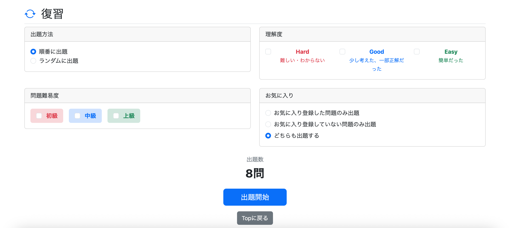
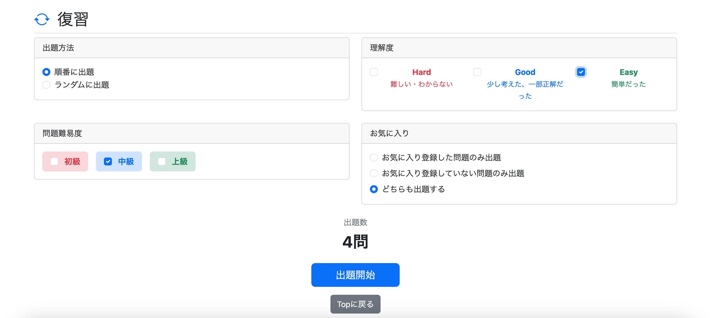

# 009 復習モードの実装 その1｜検索条件と対象問題数の表示

## 概要

`study_history`に学習履歴がある問題を対象に、ログインユーザーが難易度・理解度・お気に入り状態で絞り込み、該当する復習問題数を`/review/menu`で確認できるようにした。

今回は**検索条件の指定と件数表示まで**を実装する。問題の取得・出題開始は「復習モードの実装 その2」で扱う。検索条件の変更時にはJavaScriptから`/review/count`を呼び出し、ページ遷移なしで件数を更新する。

---

## 1. お気に入り検索条件を定義

`FavoriteCondition.java`を追加した。

```java
public enum FavoriteCondition {
    ALL,
    FAVORITED,
    NOT_FAVORITED
}
```

`ALL`はお気に入り状態を問わず、`FAVORITED`は登録済み、`NOT_FAVORITED`は未登録の問題を対象とする。

---

## 2. 復習対象問題数を取得するRepository

`StudyHistoryRepository#countReviewQuestions()`を追加した。学習履歴を起点に`question`と結合し、対象ユーザー・理解度・難易度・お気に入り状態で絞り込む。

```java
@Query(value = """
        SELECT COUNT(*)
        FROM study_history sh
        JOIN question q
          ON sh.question_id = q.question_id
        LEFT JOIN favorite f
          ON sh.user_id = f.user_id
         AND sh.question_id = f.question_id
        WHERE sh.user_id = :userId
          AND sh.evaluation IN (:evaluations)
          AND q.difficulty IN (:difficulties)
          AND (:favoriteCondition = 'ALL'
               OR (:favoriteCondition = 'FAVORITED'
                   AND f.question_id IS NOT NULL)
               OR (:favoriteCondition = 'NOT_FAVORITED'
                   AND f.question_id IS NULL))
        """, nativeQuery = true)
long countReviewQuestions(
        @Param("userId") Long userId,
        @Param("evaluations") List<String> evaluations,
        @Param("difficulties") List<String> difficulties,
        @Param("favoriteCondition") String favoriteCondition);
```

理解度と難易度は複数選択できるため`IN`を使用する。お気に入りは`LEFT JOIN`した`favorite`の有無を`IS NULL` / `IS NOT NULL`で判定する。結合条件には`user_id`と`question_id`の両方を指定し、別ユーザーのお気に入りを参照しないようにした。

---

## 3. 検索条件をRepository向けに変換

既存の`SearchConditionConverter`に、理解度とお気に入り条件の変換を追加した。ネイティブSQLへ渡すEnumは`name()`でDB保存値と同じ文字列にする。

```java
public List<String> convertEvaluation(List<Evaluation> evaluations) {
    if (evaluations == null || evaluations.isEmpty()) {
        return List.of("HARD", "GOOD", "EASY");
    }
    return evaluations.stream().map(Enum::name).toList();
}

public String convertFavoriteCondition(FavoriteCondition favoriteCondition) {
    return favoriteCondition == null
            ? FavoriteCondition.ALL.name()
            : favoriteCondition.name();
}
```

上記は**処理の要約例**。当初の実装では`ArrayList`と`for`文を使用していた。理解度が未指定なら3種類すべて、お気に入り条件が未指定なら`ALL`を指定する。難易度は既存の`convertDifficulty()`を再利用する。

---

## 4. ReviewServiceで条件を受け渡す

`ReviewService#countReviewQuestions()`を追加し、Controllerから受け取った`List<Evaluation>`・`List<Difficulty>`・`FavoriteCondition`を変換してRepositoryへ渡した。

```java
public long countReviewQuestions(
        Long userId,
        List<Evaluation> evaluations,
        List<Difficulty> difficulties,
        FavoriteCondition favoriteCondition) {

    List<String> convertedDifficulties =
            searchConditionConverter.convertDifficulty(difficulties);
    List<String> convertedEvaluations =
            searchConditionConverter.convertEvaluation(evaluations);
    String convertedFavoriteCondition =
            searchConditionConverter.convertFavoriteCondition(favoriteCondition);

    return studyHistoryRepository.countReviewQuestions(
            userId,
            convertedEvaluations,
            convertedDifficulties,
            convertedFavoriteCondition);
}
```

---

## 5. ReviewControllerを実装

`/review/menu`は復習メニューを返す。セッションの`reviewQuestions`と`reviewCurrentPage`が存在する場合は、中断中の復習を再開できるよう、`canResume`・`currentPage`・`totalCount`をModelに設定する。

`/review/count`は検索条件を受け取り、該当する問題数を数値で返す。

```java
@GetMapping("/review/count")
@ResponseBody
public long getReviewCount(
        @AuthenticationPrincipal UserDetails loginUser,
        @RequestParam(name = "evaluations", required = false)
        List<Evaluation> evaluations,
        @RequestParam(name = "difficulties", required = false)
        List<Difficulty> difficulties,
        @RequestParam(name = "favoriteCondition", required = false)
        FavoriteCondition favoriteCondition) {

    Users user = getLoginUser(loginUser);
    return reviewService.countReviewQuestions(
            user.getId(), evaluations, difficulties, favoriteCondition);
}
```

`@ResponseBody`により、画面テンプレートではなく件数をレスポンスとして返す。

---

## 6. 復習メニュー画面を作成

`review/menu.html`に次の項目を用意した。

- 出題順序：順番／ランダム（今回の件数取得条件には含めない）
- 理解度：`HARD`／`GOOD`／`EASY`（複数選択）
- 難易度：`BEGINNER`／`INTERMEDIATE`／`ADVANCED`（複数選択）
- お気に入り：`ALL`／`FAVORITED`／`NOT_FAVORITED`（単一選択、初期値`ALL`）

チェックボックス・ラジオボタンを`label`で囲み、テキスト部分のクリックでも選択できるようにした。件数表示領域には`id="countReviewQuestions"`を設定した。表示文言は`messages.properties`で管理する。

```html
<div class="text-center mb-4">
    <div class="text-secondary mb-2" th:text="#{review.menu.count}">
        出題数
    </div>
    <h2 class="fw-bold" id="countReviewQuestions">-</h2>
</div>
```

---

## 7. JavaScriptで検索条件変更時に件数を更新

`review.js`に`updateCount()`を実装した。チェック済みの理解度・難易度と、お気に入りの選択値を`URLSearchParams`に追加して`/review/count`へGETする。

```javascript
async function updateCount() {
    const params = new URLSearchParams();

    document.querySelectorAll("input[name='evaluations']:checked")
        .forEach(cb => params.append("evaluations", cb.value));

    document.querySelectorAll("input[name='difficulties']:checked")
        .forEach(cb => params.append("difficulties", cb.value));

    params.append(
        "favoriteCondition",
        document.querySelector(
            "input[name='favoriteCondition']:checked").value);

    const response = await fetch("/review/count?" + params);
    const count = await response.text();
    document.getElementById("countReviewQuestions").textContent = count + "問";
}
```

実装では`DOMContentLoaded`時に各検索入力の`change`イベントへ`updateCount`を登録し、初回表示時にも呼び出した。理解度・難易度が未選択なら全種類を対象とするため、初期表示では全復習対象問題数を表示する。

---

## 8. 動作確認

`/review/menu`で初回表示時に全復習対象問題数が表示されることを確認した。



検索条件を変更すると、該当する問題数が更新されることを確認した。



### 今回の実装範囲

```text
/review/menu → review.js → /review/count
             → ReviewController → ReviewService
             → StudyHistoryRepository → 件数を画面へ反映
```

ここまでで、検索条件に一致する問題数の表示を実装した。実際の復習問題取得・出題処理は次の「復習モードの実装 その2」で扱う。

---

> 以下は、復習モードの出題処理が実装された**後日**の修正記録。009の当初の実装範囲とは区別する。

## 9. 後日修正：復習モードの出題順序制御 

```text
git commit -m "fix: correct review question ordering and update development log"
```

### 修正の背景

復習モードでは、出題順序として「順番」と「ランダム」を選択できるが、従来の実装ではRepositoryのSQLに`ORDER BY RANDOM()`が固定で指定されていた。

そのため、`random = false`の場合でも問題がランダムに抽出され、ユーザーが選択した出題順序が正しく反映されていなかった。

また、すべての問題を取得するクエリには`ORDER BY`が指定されておらず、取得順序が保証されていなかった。

### 修正内容

**1. `StudyHistoryRepository.java`の修正**

以下の2つのメソッドに`boolean random`を引数として追加した。

- `findReviewQuestions()`：最大50問を取得するメソッド
- `findAllReviewQuestions()`：条件に一致するすべての問題を取得するメソッド

両メソッドのSQLに、`CASE WHEN`を使用した条件付きの`ORDER BY`を設定した。

```sql
ORDER BY
    CASE WHEN :random = false THEN q.question_id END ASC,
    CASE WHEN :random = true THEN RANDOM() END
```

これにより、`random = false`の場合は問題IDの昇順、`random = true`の場合はランダム順で問題を取得する。

なお、`findReviewQuestions()`の`LIMIT 50`は従来どおり維持した。

**2. `ReviewService.java`の修正**

Repositoryの両メソッドを呼び出す際、引数の末尾に`random`を追加した。

また、並び替えをRepository側で実行するようにしたため、Service内の以下の処理を削除した。

```java
if (random) {
    Collections.shuffle(extractedQuestions);
}
```

これにより、出題順序の制御をRepositoryに集約した。

### 修正後の動作

| 出題数 | 出題順序 | 動作 |
|---|---|---|
| 最大50問 | 順番 | 問題IDの昇順で最大50問取得 |
| 最大50問 | ランダム | ランダムに最大50問取得 |
| すべて | 順番 | 条件に一致するすべての問題を問題IDの昇順で取得 |
| すべて | ランダム | 条件に一致するすべての問題をランダム順で取得 |

### 修正結果

出題数と出題順序の組み合わせに応じて、適切な順序で問題を取得できる構成に変更した。

また、Service側での追加のシャッフル処理が不要となり、**問題の抽出と並び替えをRepository側で一元的に管理する構成**となった。

※ 上記は実装変更の内容をまとめたものであり、動作確認結果については別途記録する。

---

## 10. 後日修正：復習対象言語をセッションに統一

```text
git commit -m "refactor: use session language variant for review questions"
```

### 修正の背景

従来の復習モードでは、復習メニュー上で学習対象言語を複数選択できる構成としていた。

しかし、アプリ全体ではヘッダーから学習対象言語（`MAINLAND`／`TAIWAN`）を切り替え、その選択状態を`HttpSession`の`languageVariant`に保存している。

そのため、復習メニューでも言語を個別に選択できる構成では、**ヘッダーで選択した学習対象言語と、実際に復習する問題の言語が一致しない可能性があった。**

そこで、復習対象言語はヘッダーで選択した言語に統一し、復習メニューから言語選択機能を削除することにした。

### 修正内容

**1. `review/menu.html`の修正**

復習メニューから学習対象言語のチェックボックスを削除した。

これにより、復習メニューでは言語を個別に指定せず、ヘッダーで選択した学習対象言語を使用する構成とした。

**2. `js/review/menu.js`の修正**

復習対象問題数を取得する際の検索条件から、`languageVariants`を削除した。

具体的には、以下の処理を削除した。

- 言語選択チェックボックスの変更監視
- 選択された言語を`URLSearchParams`に追加する処理

これにより、`/review/count`へのリクエストには言語条件を含めず、Controller側でセッションから取得するようにした。

**3. `ReviewController.java`の修正**

`/review/count`と`/review/start`の両メソッドから、複数言語を受け取る`@RequestParam`を削除した。

代わりに、`HttpSession`から現在の学習対象言語を取得する処理を追加した。

```java
private LanguageVariant getReviewLanguageVariant(HttpSession session) {
    LanguageVariant languageVariant =
            (LanguageVariant) session.getAttribute("languageVariant");

    if (languageVariant == null) {
        languageVariant = LanguageVariant.MAINLAND;
    }

    return languageVariant;
}
```

セッションに学習対象言語が保存されていない場合は、`MAINLAND`を使用する。

`/review/count`と`/review/start`では、このメソッドから取得した`LanguageVariant`をServiceへ渡すようにした。

これにより、**復習対象問題数の取得と、実際の復習問題の抽出で同じ学習対象言語を使用する構成**となった。

**4. `ReviewService.java`の修正**

`countReviewQuestions()`と`getQuestion()`で扱う学習対象言語を、複数値の`List<LanguageVariant>`から単一の`LanguageVariant`へ変更した。

Repositoryへ渡す際は、Enumの`name()`を使用して文字列へ変換する。

```java
languageVariant.name()
```

これにより、`MAINLAND`または`TAIWAN`のいずれか一方を検索条件として渡すようにした。

**5. `StudyHistoryRepository.java`の修正**

復習対象問題数の取得と復習問題の抽出に使用するクエリについて、言語条件を複数値から単一値に変更した。

変更前：

```sql
AND q.language_variant IN (:languageVariants)
```

変更後：

```sql
AND q.language_variant = :languageVariant
```

また、Repositoryの引数も次のように変更した。

```java
@Param("languageVariant") String languageVariant
```

これにより、セッションで選択されている単一の学習対象言語に一致する問題だけを検索する構成とした。

### 修正後の処理の流れ

```text
ヘッダーで学習対象言語を選択
    ↓
HttpSession
(languageVariant)
    ↓
/review/menu
    ↓
検索条件を選択
    ↓
/review/count または /review/start
    ↓
ReviewController
（セッションから言語を取得）
    ↓
ReviewService
（LanguageVariantをStringへ変換）
    ↓
StudyHistoryRepository
（q.language_variant = :languageVariant）
    ↓
選択中の言語に一致する復習問題を検索
```

### 修正結果

復習メニューで学習対象言語を個別に選択する必要がなくなり、ヘッダーで選択した言語が復習モードにも適用される構成となった。

また、ControllerからRepositoryまで単一の`LanguageVariant`を扱うように変更したことで、複数言語を前提とした不要な処理を削減した。

**復習対象言語の管理をセッションに統一し、アプリ全体で一貫した言語選択を使用する構成に整理した。**

※ 上記は実装変更の内容をまとめたものであり、動作確認結果については別途記録する。