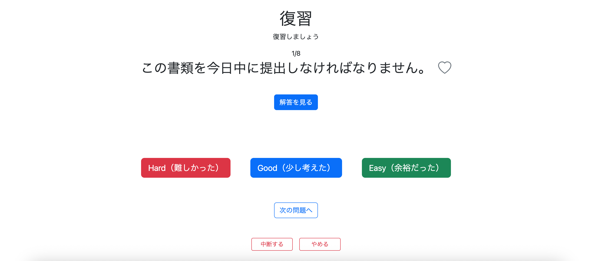
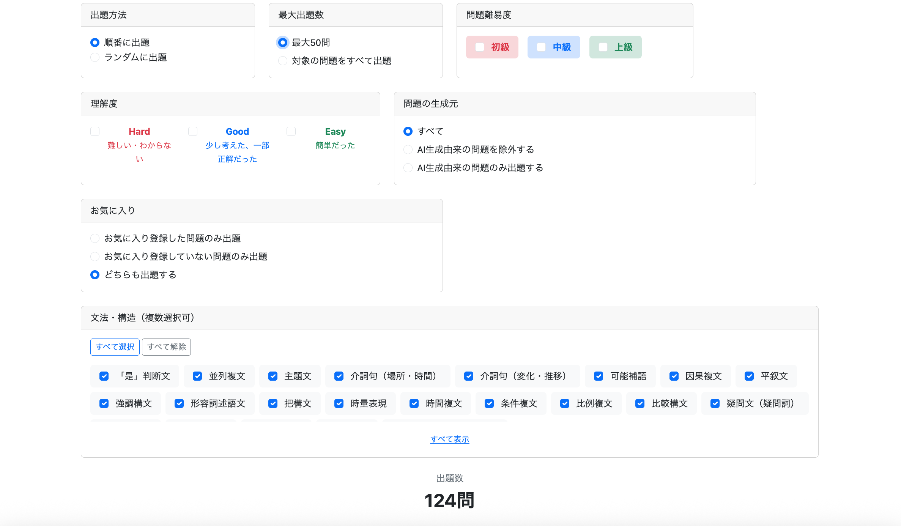
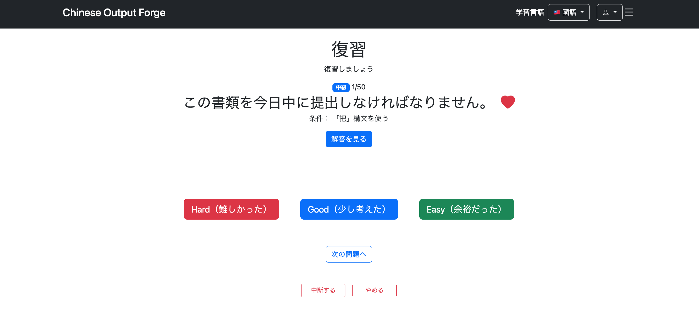
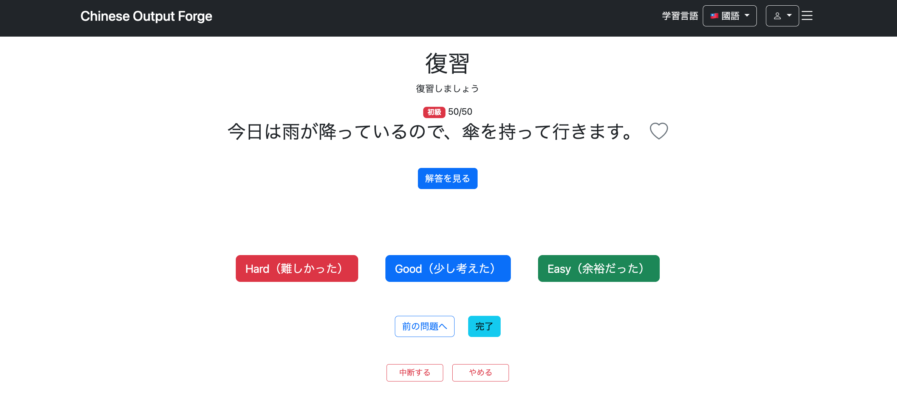
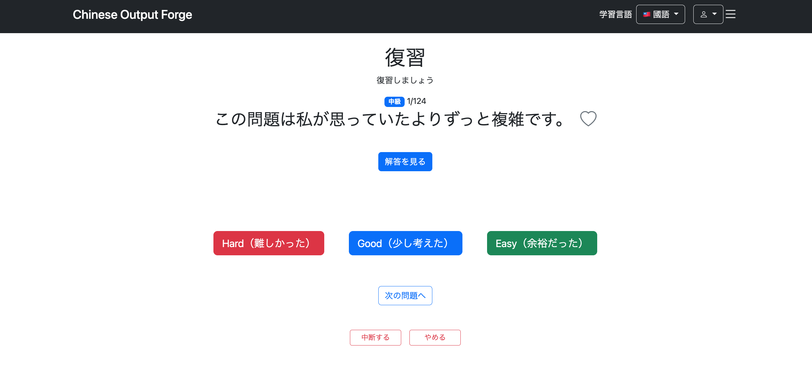

# 010 復習モードの実装 その2 - 出題機能の実装

## 概要

009で作成した検索条件を使い、復習問題の取得、開始・問題表示・理解度更新・中断・再開・終了・完了までを実装した。基本的な画面遷移は通常学習と共通するが、復習問題はログインユーザーの`study_history`を基準に抽出する。

この章では当初の実装を記録し、後日の難易度表示追加（8月31日）と出題数制限（9月21日）は末尾に分けて記録する。

## 1. 復習問題の取得

### `StudyHistoryRepository`

009の件数取得クエリと同じ結合・検索条件を使い、`COUNT(*)`の代わりに`q.*`を取得する。`study_history`に記録のある問題を対象とし、お気に入り未登録の問題も扱えるよう`favorite`を`LEFT JOIN`する。

```java
@Query(value = """
        SELECT q.*
        FROM study_history sh
        JOIN question q
          ON sh.question_id = q.question_id
        LEFT JOIN favorite f
          ON sh.user_id = f.user_id
         AND sh.question_id = f.question_id
        WHERE sh.user_id = :userId
          AND sh.evaluation IN (:evaluations)
          AND q.difficulty IN (:difficulties)
          AND (
              :favoriteCondition = 'ALL'
              OR (
                  :favoriteCondition = 'FAVORITED'
                  AND f.question_id IS NOT NULL
              )
              OR (
                  :favoriteCondition = 'NOT_FAVORITED'
                  AND f.question_id IS NULL
              )
          )
        """, nativeQuery = true)
List<Question> findReviewQuestions(
        @Param("userId") Long userId,
        @Param("evaluations") List<String> evaluations,
        @Param("difficulties") List<String> difficulties,
        @Param("favoriteCondition") String favoriteCondition
);
```

### `ReviewService`

Enumで受け取った理解度・難易度・お気に入り条件を`SearchConditionConverter`でDB用文字列に変換してRepositoryへ渡す。当初はランダム出題を選択した場合、取得後のリストを`Collections.shuffle()`で並べ替えていた。

```java
// 問題取得
public List<Question> getQuestion(
        Long userId,
        List<Evaluation> evaluations,
        List<Difficulty> difficulties,
        FavoriteCondition favoriteCondition,
        boolean random) {

    List<Question> extractedQuestions =
            studyHistoryRepository.findReviewQuestions(
                    userId,
                    searchConditionConverter.convertEvaluation(evaluations),
                    searchConditionConverter.convertDifficulty(difficulties),
                    searchConditionConverter.convertFavoriteCondition(favoriteCondition)
            );

    // シャッフルする
    if (random) {
        Collections.shuffle(extractedQuestions);
    }

    return extractedQuestions;
}
```

## 2. 復習開始処理

`GET /review/start`で既存の復習セッションをクリアし、指定条件に一致する問題を取得する。該当問題が0件ならメニューへ戻し、取得できた場合は`reviewQuestions`と`reviewCurrentPage`を保存して先頭へ遷移する。

```java
@GetMapping("/review/start")
public String getReviewStart(
        HttpSession session,
        @AuthenticationPrincipal UserDetails loginUser,
        @RequestParam(name = "evaluations", required = false)
            List<Evaluation> evaluations,
        @RequestParam(name = "difficulties", required = false)
            List<Difficulty> difficulties,
        @RequestParam(name = "favoriteCondition", required = false)
            FavoriteCondition favoriteCondition,
        @RequestParam(name = "random", required = false)
            boolean random) {

    // 既存の学習状態を破棄
    clearReviewSession(session);

    // 先に宣言
    List<Question> questions;

    // user_id(文字列)からUsersを取得
    Users user = getLoginUser(loginUser);
    Long userId = user.getId();

    // 新しい問題セットを作成
    questions = reviewService.getQuestion(
            userId,
            evaluations,
            difficulties,
            favoriteCondition,
            random
    );

    // 問題が1件もない場合は開始しない
    if (questions.isEmpty()) {
        return "redirect:/review/menu";
    }

    session.setAttribute("reviewQuestions", questions);
    session.setAttribute("reviewCurrentPage", 0);

    return "redirect:/review/question?page=0";
}
```

## 3. 問題表示

`GET /review/question`ではセッション内の問題リストから指定ページを表示する。セッションがない場合やページ番号が範囲外の場合はメニューへ戻す。`QuestionModelUtil`で画面表示用データを設定し、ログインユーザーのお気に入り状態も渡す。

```java
@GetMapping("/review/question")
public String getReviewQuestion(
        Model model,
        HttpSession session,
        @RequestParam(defaultValue = "0") int page,
        @AuthenticationPrincipal UserDetails loginUser) {

    // Sessionからquestions取得
    List<Question> questions =
            (List<Question>) session.getAttribute("reviewQuestions");

    // /questionへの直接アクセスを禁ずる
    if (questions == null) {
        return "redirect:/review/menu";
    }

    // 範囲外のページへのアクセスを禁ずる
    if (page < 0 || page >= questions.size()) {
        return "redirect:/review/menu";
    }

    // 現在表示する問題を取得
    Question question = questions.get(page);

    // 現在ページをSessionへ保存
    session.setAttribute("reviewCurrentPage", page);

    // HTMLが必要な情報をModelへ格納
    questionModelUtil.setQuestionModel(
            model,
            questions,
            page,
            session
    );

    // お気に入り判定
    if (loginUser != null) {
        boolean isFavorite = favoriteService.isFavorite(
                getLoginUser(loginUser),
                question.getQuestionId()
        );

        model.addAttribute("isFavorite", isFavorite);
    }

    return "review/question";
}
```

## 4. 中断・再開・終了・完了

通常学習と同じ考え方で、復習状態を`HttpSession`に保持する。

| 操作 | URL | セッションの扱い |
|---|---|---|
| 再開 | `/review/resume` | `reviewCurrentPage`から再開（問題リストがなければメニューへ） |
| 中断 | `/review/suspend` | 現在ページを保存してトップへ戻る |
| 終了 | `/review/quit` | 問題リストとページを削除してトップへ戻る |
| 完了 | `/review/complete` | 問題リストとページを削除して完了画面へ |

セッション削除処理は`clearReviewSession()`に集約した。

```java
private void clearReviewSession(HttpSession session) {

    session.removeAttribute("reviewQuestions");
    session.removeAttribute("reviewCurrentPage");
}
```

再開処理ではセッションの`reviewQuestions`の存在を確認し、`reviewCurrentPage`を使って`/review/question?page=...`へリダイレクトする。中断はセッションを保持する点で、終了・完了とは異なる。

## 5. 理解度の更新

`POST /review/evaluation`で選択された`HARD`・`GOOD`・`EASY`を、通常学習と共通の`EvaluationService#updateEvaluation()`で保存する。保存後は次の問題へ進み、最終問題であれば`/review/complete`へ遷移する。

```java
@PostMapping("/review/evaluation")
public String postEvaluation(
        @AuthenticationPrincipal UserDetails loginUser,
        @RequestParam Long questionId,
        @RequestParam Evaluation evaluation,
        @RequestParam Integer page,
        HttpSession session) {

    // ユーザー情報を取得
    Users user = userAccountService.getUserOne(
            loginUser.getUsername());

    // 理解度を保存
    evaluationService.updateEvaluation(
            user,
            questionId,
            evaluation);

    // セッションから問題一覧を取得
    List<Question> questions =
            (List<Question>) session.getAttribute("reviewQuestions");

    // 最後の問題の場合
    if (page + 1 >= questions.size()) {
        return "redirect:/review/complete";
    }

    // 次の問題へ
    return "redirect:/review/question?page=" + (page + 1);
}
```

## 6. 復習問題画面の作成

`review/question.html`は`practice/question.html`を参考に作成した。問題番号、日本語問題文、お気に入りボタン、条件（`condition`）、解答・別解、理解度ボタン、前後移動、中断・終了を配置する。

### 問題文とお気に入り

お気に入り登録状態に応じてハートアイコンを切り替える。

```html
<!-- 現在の問題番号 -->
<span th:text="${nextPageIndex + '/' + totalPages}">
    1/10
</span>

<!-- 日本語問題 -->
<div class="d-flex justify-content-center align-items-center gap-3">

    <h2 class="mb-0"
        th:text="${question.japaneseText}">
        日本語問題
    </h2>

    <!-- お気に入りボタン -->
    <div sec:authorize="isAuthenticated()">

        <button id="favoriteButton"
                type="button"
                class="btn p-0 border-0 bg-transparent"
                th:data-question-id="${question.questionId}">

            <i id="favoriteIcon"
               th:class="${isFavorite}
                    ? 'bi bi-heart-fill fs-2 text-danger'
                    : 'bi bi-heart fs-2 text-secondary'">
            </i>

        </button>

    </div>

</div>
```

### `condition`と解答表示

009で検索条件から外した`condition`は、ここでは問題画面の補助情報として表示した。実装時点のHTMLでは`condition`が存在する場合に表示される構成であり、任意の操作でヒントを開く仕組みではない。

```html
<div style="min-height:40px;">

    <p th:if="${question.condition != null}">

        <span th:text="#{review.question.condition}">
            条件：
        </span>

        <span th:text="${question.condition}">
            条件
        </span>

    </p>

</div>
```

解答表示領域は高さを確保して画面のずれを抑え、発音表記・正解・別解を表示する。別解は`alternativeAnswer != null`の場合だけ表示する。

```html
<div style="min-height:150px;">

    <button id="answerButton"
            type="button"
            class="btn btn-primary"
            onclick="showAnswer()"
            th:text="#{review.question.showAnswer}">
        解答を見る
    </button>

    <div id="answerArea"
         style="display:none;">

        <p class="mb-2"
           th:if="${pronunciation != null}">

            <span th:text="${pronunciation}">
                Pronunciation
            </span>

        </p>

        <p class="mb-2">

            <span th:text="#{review.question.answer}">
                解答：
            </span>

            <span class="fs-3"
                  th:text="${question.chineseText}">
                Chinese Answer
            </span>

        </p>

        <!-- 別解 -->
        <div th:if="${question.alternativeAnswer != null}">

            <p class="mb-2"
               th:if="${alternativePronunciation != null}">

                <span class="small"
                      th:text="${alternativePronunciation}">
                    Alternative Pronunciation
                </span>

            </p>

            <p class="mb-0">

                <span th:text="#{review.question.alternativeAnswer}">
                    別解：
                </span>

                <span th:text="${question.alternativeAnswer}">
                    Alternative Answer
                </span>

            </p>

        </div>

    </div>

</div>
```

### 理解度と画面操作

理解度は`/review/evaluation`へのPOSTフォーム3つで送信する。各フォームに`questionId`、`evaluation`、`page`を含める。以下は`HARD`の例で、`GOOD`と`EASY`は`evaluation`の値とボタン表示を変える。

```html
<form th:action="@{/review/evaluation}" method="post">
    <input type="hidden" name="questionId" th:value="${question.questionId}">
    <input type="hidden" name="evaluation" value="HARD">
    <input type="hidden" name="page" th:value="${nextPageIndex - 1}">
    <button type="submit" class="btn btn-danger btn-lg"
            th:text="#{review.question.evaluation.hard}">Hard（難しかった）</button>
</form>
```

前へ・次へ・完了のリンクは`hasPrevious`・`hasNext`で切り替える。中断・終了は確認ダイアログを表示し、それぞれ`/review/suspend`・`/review/quit`へ遷移する。

```html
<a th:if="${hasPrevious}" th:href="@{/review/question(page=${nextPageIndex - 2})}">前の問題へ</a>
<a th:if="${hasNext}" th:href="@{/review/question(page=${nextPageIndex})}">次の問題へ</a>
<a th:if="${!hasNext}" th:href="@{/review/complete}">完了</a>
<a th:href="@{/review/suspend(page=${nextPageIndex - 1})}">中断する</a>
<a th:href="@{/review/quit}">やめる</a>
```

解答表示とお気に入り操作は通常学習で使用していた`practice.js`を共用した。これらの処理は通常学習固有のURLに依存していなかったため、復習画面でも利用できた。

```html
<script th:src="@{/js/practice.js}" defer></script>
```

## 7. 多言語メッセージの追加

`messages.properties`に復習問題画面用のキーを追加した。画面タイトル、条件、解答、別解、理解度、前後移動、完了、中断・終了の確認文言を管理し、繁体字・簡体字のファイルにも同じキーを追加した。

```properties
# ==============================
# 復習 - 問題画面
# ==============================

review.question.pageTitle=復習 | Chinese Output Forge
review.question.title=復習
review.question.message=復習しましょう

# 問題
review.question.condition=条件：
review.question.showAnswer=解答を見る
review.question.answer=解答：
review.question.alternativeAnswer=別解：

# 理解度
review.question.evaluation.hard=Hard（難しかった）
review.question.evaluation.good=Good（少し考えた）
review.question.evaluation.easy=Easy（余裕だった）

# ページ移動
review.question.previous=前の問題へ
review.question.next=次の問題へ
review.question.complete=完了

# 中断
review.question.suspend=中断する
review.question.suspend.confirm=トレーニングを中断しますか？

# 終了
review.question.quit=やめる
review.question.quit.confirm=トレーニングを終了しますか？
```

## 8. `QuestionModelUtil`の重複処理を整理

発音表記を設定する`switch`が二重になっていたため、古い処理を削除した。`PINYIN`・`ZHUYIN`・`NONE`の分岐で`pronunciation`と`alternativePronunciation`を一度に設定する。機能追加ではなく重複処理の整理である。

```text
pronunciation
alternativePronunciation
```

## 9. 出題順序のパラメータを統一

`review/menu.html`の出題方法を`order=SEQUENTIAL`／`order=RANDOM`から、通常学習と同じ`random=false`／`random=true`へ変更した。これによりControllerで`boolean random`として受け取れる。

```html
<label class="form-check">
  <input type="radio" name="random" value="false" checked>
  <span th:text="#{review.menu.order.sequential}">順番に出題</span>
</label>
<label class="form-check">
  <input type="radio" name="random" value="true">
  <span th:text="#{review.menu.order.random}">ランダムに出題</span>
</label>
```

## 10. 実行確認

`/review/menu`から条件を指定し、問題セットが作成されて`/review/question`へ遷移することを確認した。



---

## 11. 追加修正（8月31日）：難易度の表示

```bash
git commit -m "feat: display question difficulty on review page"
```

複数難易度を選択すると異なる難易度の問題が混在するため、現在の問題の難易度を問題文の上に表示するようにした。`question.difficulty`に応じて表示文言とBootstrapの背景色を切り替える。

```html
<!-- 問題の難易度 -->
<span class="badge"
      th:classappend="${question.difficulty.name() == 'BEGINNER'} ? 'bg-danger' :
                      (${question.difficulty.name() == 'INTERMEDIATE'} ? 'bg-primary' : 'bg-success')"
      th:text="${question.difficulty.name() == 'BEGINNER'} ? #{difficulty.beginner} :
               (${question.difficulty.name() == 'INTERMEDIATE'} ? #{difficulty.intermediate} : #{difficulty.advanced})">
    難易度
</span>
```

| 難易度 | 表示 | 背景色 |
|---|---|---|
| `BEGINNER` | 初級 | `bg-danger` |
| `INTERMEDIATE` | 中級 | `bg-primary` |
| `ADVANCED` | 上級 | `bg-success` |

難易度名は`messages.properties`から取得する。表示を確認した。


---

## 12. 追加修正（9月21日）：最大出題数の設定

```bash
git commit -m "feat: add review question limit option"
```

従来は条件に一致する問題をすべて取得していたため、問題数が増えると一度の復習が長くなる。そこで、**最大50問（デフォルト）**と**対象問題をすべて出題**を選べるようにした。

### `StudyHistoryRepository`

既存の`findReviewQuestions()`はランダムに最大50問取得する処理に変更し、すべて取得する`findAllReviewQuestions()`を追加した。両者は検索条件を共通とし、取得件数の制限で区別する。

```sql
-- 最大50問の取得クエリ末尾
ORDER BY RANDOM()
LIMIT 50
```

この時点のSQLには、当初の理解度・難易度・お気に入り条件に加え、言語、問題の出題元、構文による絞り込みも含まれている。以下は追加修正時点のクエリであり、冒頭の当初実装とは検索条件が異なる。

```sql
ORDER BY RANDOM()
LIMIT 50
```

`findAllReviewQuestions()`は同じWHERE条件を使用し、上記の`ORDER BY RANDOM()`と`LIMIT 50`を付けない。

### `ReviewQuestionLimit`と`ReviewService`

出題数を表すEnumを追加した。

```java
public enum ReviewQuestionLimit {
    LIMIT_50,
    ALL
}
```

`ReviewService#getQuestion()`で`questionLimit`が未指定なら`LIMIT_50`を設定し、`ALL`なら`findAllReviewQuestions()`、それ以外は`findReviewQuestions()`を呼び出す。この時点では取得後に`random`がtrueなら`Collections.shuffle()`する処理も残っていた。

```java
if (questionLimit == null) {
    questionLimit = ReviewQuestionLimit.LIMIT_50;
}

List<Question> extractedQuestions;
if (questionLimit == ReviewQuestionLimit.ALL) {
    extractedQuestions = studyHistoryRepository.findAllReviewQuestions(
            userId, convertedLanguageVariants, convertedEvaluations,
            convertedDifficulties, convertedFavoriteCondition,
            sourceCondition.name(), structureIds);
} else {
    extractedQuestions = studyHistoryRepository.findReviewQuestions(
            userId, convertedLanguageVariants, convertedEvaluations,
            convertedDifficulties, convertedFavoriteCondition,
            sourceCondition.name(), structureIds);
}
if (random) {
    Collections.shuffle(extractedQuestions);
}
```

### Controller・メニュー画面

`/review/start`で`ReviewQuestionLimit questionLimit`を受け取り、Serviceに渡す。`review/menu.html`には`questionLimit=LIMIT_50`と`questionLimit=ALL`のラジオボタンを追加し、前者を初期選択とした。`messages.properties`にも表示用のキーを追加した。

```properties
review.menu.questionLimit.title=最大出題数
review.menu.questionLimit.limit50=最大50問
review.menu.questionLimit.all=対象の問題をすべて出題
```

### 実行確認

メニューで最大出題数を選択できることを確認した。



「最大50問」を選択した場合は、問題セットが50問となった。





「対象の問題をすべて出題」を選択した場合は、当時の対象124問が出題された。



**補足：** この追加修正時点の`findReviewQuestions()`は`ORDER BY RANDOM()`を固定しているため、「順番に出題」を選んでも最大50問の抽出自体はランダムになる。後日の出題順序制御の修正については009の実装ログ末尾に別途記録している。

---

## 13. 実装を終えて

009で作成した検索条件と件数取得処理を、実際の復習トレーニングへつなげた。問題の抽出は学習履歴を基準とし、画面表示・理解度保存・中断再開は通常学習の仕組みを再利用できた。

後日の修正では、難易度の可視化と出題数の上限設定を追加した。特に出題数制限では、Repositoryで取得する問題数と出題順序の関係が重要になることが分かり、順序制御の修正へつながった。

