# 012 ユーザーメニューの実装 その1 - 問題一覧・検索機能

ユーザーメニューを設置し、問題一覧・複数条件検索・ページネーション・詳細表示・理解度変更・お気に入り切替を実装する。プロフィールと設定はこの段階ではリンクのみを用意した。本ログは当初の実装と後日の修正を時系列で記録する。

## 1. ユーザーメニュー画面

`git commit -m "feat: add user menu page"`

`GET /user/menu`を設け、問題一覧・プロフィール・設定・管理者専用画面へのリンクを配置した。管理者メニューは`sec:authorize="hasRole('ROLE_ADMIN')"`で表示を制限する。プロフィール・設定の機能は未実装。

```java
@Controller
public class UserMenuController {
	
	@GetMapping("/user/menu")
	public String getUserMenu() {
		return "/user/menu";
	}

}
```

メニュー画面ではThymeleafの`th:href`と`messages.properties`でリンク・表示文言を管理した。管理者向けリンクの表示制御は、URL自体の認可設定の代わりにはならない。

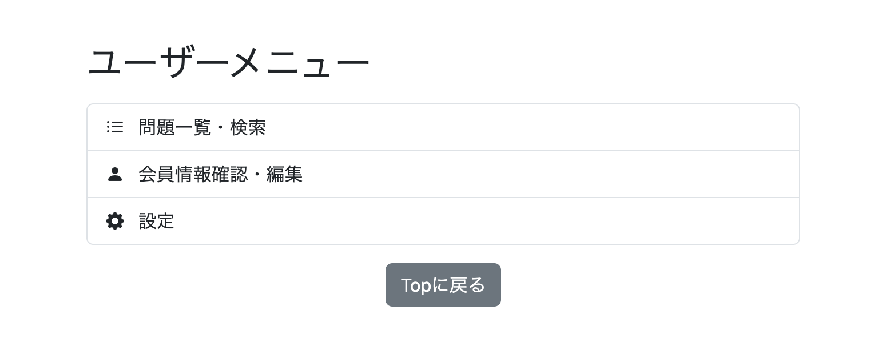

## 2. 問題一覧検索のRepository

ここが一覧機能の中心となる。単に`question`を取得するだけでなく、ログインユーザーごとに異なる理解度・お気に入り状態を同時に取得し、複数条件で検索する必要がある。そのため、SQLを「取得列」「JOIN」「WHERE」「ページング用の件数取得」に分けて読むと理解しやすい。


`git commit -m "feat: add language filtering and pronunciation display to question list"`

`question`と`structure`をJOINし、ユーザーごとの学習履歴とお気に入りは未登録レコードも一覧に残すため`LEFT JOIN`する。JOIN条件に`userId`を含め、他ユーザーの履歴が混ざらないようにする。学習状況（`ALL / LEARNED_ONLY / UNLEARNED_ONLY`）、お気に入り、難易度、理解度、文法、言語、日本語・中国語キーワードで絞り込む。

```java
@Query(value = """

        SELECT
            q.question_id         AS questionId,
            q.japanese_text       AS japaneseText,
            q.chinese_text        AS chineseText,
            q.alternative_answer  AS alternativeAnswer,
            s.name                AS structureName,
            s.description_zh_cn   AS structureDescriptionZhCn,
            s.description_zh_tw   AS structureDescriptionZhTw,
            q.difficulty          AS difficulty,
            sh.evaluation         AS evaluation,

            CASE
                WHEN f.question_id IS NOT NULL THEN TRUE
                ELSE FALSE
            END AS favorite,

            q.pinyin                    AS pinyin,
            q.zhuyin                    AS zhuyin,
            q.alternative_answer_pinyin AS alternativeAnswerPinyin,
            q.alternative_answer_zhuyin AS alternativeAnswerZhuyin

        FROM question q

        JOIN structure s
        ON q.structure_id = s.structure_id

        LEFT JOIN study_history sh
        ON (
            q.question_id = sh.question_id
            AND sh.user_id = :userId
        )

        LEFT JOIN favorite f
        ON (
            q.question_id = f.question_id
            AND f.user_id = :userId
        )

        WHERE q.difficulty IN (:difficulties)

        AND (
            :studyCondition = 'ALL'

            OR (
                :studyCondition = 'LEARNED_ONLY'
                AND sh.question_id IS NOT NULL
                AND sh.evaluation IN (:evaluations)
            )

            OR (
                :studyCondition = 'UNLEARNED_ONLY'
                AND sh.question_id IS NULL
            )
        )

        AND (
            :favoriteCondition = 'ALL'

            OR (
                :favoriteCondition = 'FAVORITED'
                AND f.question_id IS NOT NULL
            )

            OR (
                :favoriteCondition = 'NOT_FAVORITED'
                AND f.question_id IS NULL
            )
        )

        AND q.structure_id IN (:structureIds)
        AND q.language_variant IN (:languageVariants)

        AND (
            :japaneseKeyword = ''
            OR LOWER(q.japanese_text)
                LIKE LOWER(CONCAT('%', :japaneseKeyword, '%'))
        )

        AND (
            :chineseKeyword = ''
            OR LOWER(q.chinese_text)
                LIKE LOWER(CONCAT('%', :chineseKeyword, '%'))
            OR LOWER(q.alternative_answer)
                LIKE LOWER(CONCAT('%', :chineseKeyword, '%'))
        )

        ORDER BY q.question_id ASC

        """,

        countQuery = """

        SELECT COUNT(*)

        FROM question q

        JOIN structure s
        ON q.structure_id = s.structure_id

        LEFT JOIN study_history sh
        ON (
            q.question_id = sh.question_id
            AND sh.user_id = :userId
        )

        LEFT JOIN favorite f
        ON (
            q.question_id = f.question_id
            AND f.user_id = :userId
        )

        WHERE q.difficulty IN (:difficulties)

        AND (
            :studyCondition = 'ALL'

            OR (
                :studyCondition = 'LEARNED_ONLY'
                AND sh.question_id IS NOT NULL
                AND sh.evaluation IN (:evaluations)
            )

            OR (
                :studyCondition = 'UNLEARNED_ONLY'
                AND sh.question_id IS NULL
            )
        )

        AND (
            :favoriteCondition = 'ALL'

            OR (
                :favoriteCondition = 'FAVORITED'
                AND f.question_id IS NOT NULL
            )

            OR (
                :favoriteCondition = 'NOT_FAVORITED'
                AND f.question_id IS NULL
            )
        )

        AND q.structure_id IN (:structureIds)
        AND q.language_variant IN (:languageVariants)

        AND (
            :japaneseKeyword = ''
            OR LOWER(q.japanese_text)
                LIKE LOWER(CONCAT('%', :japaneseKeyword, '%'))
        )

        AND (
            :chineseKeyword = ''
            OR LOWER(q.chinese_text)
                LIKE LOWER(CONCAT('%', :chineseKeyword, '%'))
            OR LOWER(q.alternative_answer)
                LIKE LOWER(CONCAT('%', :chineseKeyword, '%'))
        )

        """,
        nativeQuery = true)

Page<UserQuestionListDto> findFilteredUserQuestionList(

        @Param("userId")
        long userId,

        @Param("difficulties")
        List<String> difficulties,

        @Param("evaluations")
        List<String> evaluations,

        @Param("studyCondition")
        String studyCondition,

        @Param("favoriteCondition")
        String favoriteCondition,

        @Param("structureIds")
        List<Long> structureIds,

        @Param("languageVariants")
        List<String> languageVariants,

        @Param("japaneseKeyword")
        String japaneseKeyword,

        @Param("chineseKeyword")
        String chineseKeyword,

        Pageable pageable
);
```

**取得列（SELECT）**では、`AS questionId`などの別名をProjectionのGetterと対応させる。お気に入りは`favorite`のレコードが存在するかを`CASE`でbooleanに変換している。

**JOIN**では、すべての問題にStructureが紐づくため`JOIN structure`を使用する。一方、未学習の問題には`study_history`が存在しないので`LEFT JOIN`を使用する。`favorite`も同様で、登録していない問題を一覧から消さないために`LEFT JOIN`とする。

**WHERE**では、`studyCondition`が`LEARNED_ONLY`なら履歴がある問題、`UNLEARNED_ONLY`なら履歴がない問題を対象とする。`ALL`ならこの条件による絞り込みを行わない。お気に入りも同じ考え方で、`favorite`の有無を判定する。難易度・Structure・言語は`IN`で複数選択に対応し、キーワードは空文字なら絞り込まず、入力されていれば`LIKE`で部分一致検索する。

**件数取得（countQuery）**はページネーションに必要な検索結果全体の件数を返す。`Page<UserQuestionListDto>`を返すため、メインQueryと同じJOIN・WHERE条件で`SELECT COUNT(*)`する。表示用のSELECT列と`ORDER BY`は不要だが、検索条件がずれるとページ数と実際の一覧が一致しなくなる。

## 3. Projection用DTO

RepositoryのSQLは複数テーブルから必要な列だけを選択しているため、`Question` Entityそのものを返すよりも、画面用のProjectionにまとめた方が扱いやすい。


問題・構文・学習履歴・お気に入りの情報を1行にまとめるインターフェースProjectionを定義した。SQLの列エイリアスとGetter名を対応させる。構文説明はTooltip、拼音・注音は詳細モーダルで使う。

```java
public interface UserQuestionListDto {

    Long getQuestionId();

    String getJapaneseText();

    String getChineseText();

    String getAlternativeAnswer();

    String getStructureName();

    String getStructureDescriptionZhCn();

    String getStructureDescriptionZhTw();

    Difficulty getDifficulty();

    Evaluation getEvaluation();

    boolean isFavorite();

    String getPinyin();

    String getZhuyin();

    String getAlternativeAnswerPinyin();

    String getAlternativeAnswerZhuyin();

}
```

## 4. Serviceで検索条件を整理する

Controllerから届く検索条件は、未選択のチェックボックスなどが`null`や空リストになる場合がある。そのままNative Queryへ渡すのではなく、Serviceで検索時の意味を統一してからRepositoryを呼び出す。


初期実装では、未指定の難易度・理解度をEnumの全値、文法をDB上の全IDに置き換え、学習状況・お気に入りを`ALL`、キーワードを空文字にしてから、EnumをNative Query向け文字列に変換した。**この初期実装は8月29日に一部重複処理を削除している**（後述）。

```java
package io.github.mawsonlakes790913.chineseoutputforge.service;

@Service
@RequiredArgsConstructor
public class UserQuestionService {
	
	private final SearchConditionConverter searchConditionConverter;
	private final QuestionRepository questionRepository;
	private final StructureRepository structureRepository;
	
	public Page<UserQuestionListDto> getFilteredUserQuestionList(
			 long userId,
			 List<Difficulty> difficulties,
			 List<Evaluation> evaluations,
			 StudyCondition studyCondition,
			 FavoriteCondition favoriteCondition,
			 List<Long> structureIds,
			 List<LanguageVariant> languageVariants,
			 String japaneseKeyword,
			 String chineseKeyword,
			 Pageable pageable) {
	
		// 難易度
		if (difficulties == null || difficulties.isEmpty()) {
			difficulties = Arrays.asList(Difficulty.values());
		}
		
		// 理解度
		if (evaluations == null || evaluations.isEmpty()) {
			evaluations = Arrays.asList(Evaluation.values());
		}
		
		// 学習条件
		if (studyCondition == null) {
			studyCondition = StudyCondition.ALL;
		}
		
		// お気に入り条件
		if (favoriteCondition == null) {
			favoriteCondition = FavoriteCondition.ALL;
		}
		
		// 文法・構造
		if (structureIds == null || structureIds.isEmpty()) {
			structureIds =
					structureRepository.findAllStructureIds();
		}
		
		// キーワード
		if (japaneseKeyword == null) {
			japaneseKeyword = "";
		}
		
		if (chineseKeyword == null) {
			chineseKeyword = "";
		}
		
		// ここで変換する
		List<String> convertedDifficulties =
				searchConditionConverter
						.convertDifficulty(difficulties);

		List<String> convertedEvaluations =
				searchConditionConverter
						.convertEvaluation(evaluations);

		String convertedStudyCondition =
				searchConditionConverter
						.convertStudyCondition(studyCondition);

		String convertedFavoriteCondition =
				searchConditionConverter
						.convertFavoriteCondition(favoriteCondition);

		List<String> convertedLanguageVariants =
				searchConditionConverter
						.convertLanguageVariant(languageVariants);
		
		return questionRepository.findFilteredUserQuestionList(
				userId,
				convertedDifficulties,
				convertedEvaluations,
				convertedStudyCondition,
				convertedFavoriteCondition,
				structureIds,
				convertedLanguageVariants,
				japaneseKeyword,
				chineseKeyword,
				pageable);
	}		

}
```

`StudyCondition`は`ALL / LEARNED_ONLY / UNLEARNED_ONLY`のEnumとし、`SearchConditionConverter`で`name()`による文字列変換を追加した。`LanguageVariant`もEnumのリストから文字列リストへ変換する。Structureの全IDはマスタテーブルから取得する。

```java
public enum StudyCondition {

    ALL,
    LEARNED_ONLY,
    UNLEARNED_ONLY

}
```

```java
public String convertStudyCondition(
        StudyCondition studyCondition) {
		
	String convertedStudyCondition;
		
	if (studyCondition == null) {
			
		convertedStudyCondition =
				StudyCondition.ALL.name();
			
	} else {
			
		convertedStudyCondition =
				studyCondition.name();
					
	}
		
	return convertedStudyCondition;
}
```

```java
@Query(value = """
    SELECT DISTINCT structure_id
    FROM structure
    ORDER BY structure_id
    """,
    nativeQuery = true)
List<Long> findAllStructureIds();
```

## 5. Controllerと画面表示データ

Controllerは、ログインユーザーの特定、リクエストパラメータの受け取り、Serviceの呼び出し、Thymeleafへ渡すModelの組み立てを担当する。検索SQLや条件変換はControllerへ書かず、前章のService・Repositoryへ委譲した。


`GET /user/question/list`でログインユーザーを取得し、検索条件をServiceへ渡す。言語が未指定の場合はSessionの`languageVariant`（未設定なら`MAINLAND`）を採用する。ページは50件単位。検索条件をModelへ戻し、フォームの選択状態を保持する。表示範囲の`start/end`と総件数も計算する。

```java
@Controller
@RequiredArgsConstructor
public class UserQuestionController {
	
	private final UserAccountService userAccountService;
	private final UserQuestionService userQuestionService;
	private final PaginationService paginationService;
	private final ReviewService reviewService;
	
	@GetMapping("/user/question/list")
	public String getUserQuestionList(
	        @AuthenticationPrincipal UserDetails loginUser,
	        @PageableDefault(page = 0, size = 50) Pageable pageable,
	        @RequestParam(required = false)
	        List<Difficulty> difficulties,
	        @RequestParam(required = false)
	        List<Evaluation> evaluations,
	        @RequestParam(required = false)
	        StudyCondition studyCondition,
	        @RequestParam(required = false)
	        FavoriteCondition favoriteCondition,
	        @RequestParam(required = false)
	        List<Long> structureIds,
	        @RequestParam(required = false)
	        List<LanguageVariant> languageVariants,
	        @RequestParam(
	                required = false,
	                defaultValue = "")
	        String japaneseKeyword,
	        @RequestParam(
	                required = false,
	                defaultValue = "")
	        String chineseKeyword,
	        HttpSession session,
	        Model model) {

	    Users user =
	            userAccountService.getUserOne(
	                    loginUser.getUsername());

	    Long userId = user.getId();
	    
	    // 学習対象言語が未指定の場合は、
	    // セッションで設定されている学習対象言語を使用
	    if (languageVariants == null
	            || languageVariants.isEmpty()) {

	        LanguageVariant languageVariant =
	                (LanguageVariant)
	                session.getAttribute(
	                        "languageVariant");

	        if (languageVariant == null) {
	            languageVariant =
	                    LanguageVariant.MAINLAND;
	        }

	        languageVariants =
	                Arrays.asList(languageVariant);
	    }

	    model.addAttribute(
	            "selectedLanguageVariants",
	            languageVariants
	    );

	    // 検索
	    // パラメータが未指定ならService側で全件扱い
	    Page<UserQuestionListDto> questionList =
	    		userQuestionService
	    		    .getFilteredUserQuestionList(
	                    userId,
	                    difficulties,
	                    evaluations,
	                    studyCondition,
	                    favoriteCondition,
	                    structureIds,
	                    languageVariants,
	                    japaneseKeyword,
	                    chineseKeyword,
	                    pageable);

	    PaginationDto pagination =
	    		paginationService
	    		    .createPagination(questionList);
	    
		long start =
		        questionList.getNumber()
		        * questionList.getSize() + 1;

		long end =
		        start
		        + questionList
		            .getNumberOfElements() - 1;

		model.addAttribute("start", start);
		model.addAttribute("end", end);
		model.addAttribute(
		        "total",
		        questionList.getTotalElements());

	    // 一覧
	    model.addAttribute(
	            "questionList",
	            questionList.getContent());

	    model.addAttribute(
	            "page",
	            questionList);

	    model.addAttribute(
	            "pagination",
	            pagination);

	    // 選択肢用structureを取得
	    model.addAttribute(
	            "structures",
	            reviewService.findStructures());
	    
	    // 表示する発音記号を取得
	    PronunciationType pronunciationType =
	            (PronunciationType)
	            session.getAttribute(
	                    "pronunciationType");

	    if (pronunciationType == null) {
	        pronunciationType =
	                PronunciationType.PINYIN;
	    }

	    model.addAttribute(
	            "pronunciationType",
	            pronunciationType);

	    // 検索条件を画面へ戻す
	    model.addAttribute(
	            "selectedDifficulties",
	            difficulties);

	    model.addAttribute(
	            "selectedEvaluations",
	            evaluations);

	    model.addAttribute(
	            "selectedStudyCondition",
	            studyCondition);

	    model.addAttribute(
	            "selectedFavoriteCondition",
	            favoriteCondition);

	    model.addAttribute(
	            "selectedStructureIds",
	            structureIds);

	    model.addAttribute(
	            "japaneseKeyword",
	            japaneseKeyword);

	    model.addAttribute(
	            "chineseKeyword",
	            chineseKeyword);

	    return "user/question/list";
	}

}
```

## 6. ページネーション

一覧を50件ずつ表示するため、Spring Dataの`Pageable`と`Page`を使用する。ただし、ページ番号のリンクをどの範囲まで表示するかは別の処理が必要になるため、`PaginationService`と`PaginationDto`を用意した。


`PaginationDto`に現在ページ・表示開始／終了ページ・両端の省略記号表示フラグを保持する。`PaginationService`は現在ページの前後2ページを基本に、先頭・末尾付近では不足分を補う。例：`1 ... 3 4 [5] 6 7 ... 10`。

```java
@Data
public class PaginationDto {

    private int currentPage;

    private int displayStartPage;

    private int displayEndPage;

    private boolean showFirstEllipsis;

    private boolean showLastEllipsis;

}
```

```text
currentPage
→ 現在ページ

displayStartPage
→ 中央部分に表示する最初のページ

displayEndPage
→ 中央部分に表示する最後のページ

showFirstEllipsis
→ 先頭側の「...」を表示するか

showLastEllipsis
→ 末尾側の「...」を表示するか
```

## 7. 問題一覧画面とJavaScript

検索はGETフォームとして実装し、検索条件をURLパラメータで送信する。一方、理解度やお気に入りの変更は一覧全体を再検索せず操作できるよう、JavaScriptから更新リクエストを送る構成とした。**検索と更新で通信方法を分けている**点が、この画面の重要な設計である。


`/user/question/list.html`には検索フォーム、問題テーブル、ページリンク、問題詳細モーダル、理解度変更モーダルを配置した。HTML全文は同様のチェックボックスやページリンクが繰り返されるため、重要な要素を抜粋する。

```html
<!-- 検索フォーム：GETで検索条件を送信 -->
<form th:action="@{/user/question/list}" method="get">
  <input type="checkbox" name="languageVariants" value="MAINLAND"
         th:checked="${selectedLanguageVariants != null and selectedLanguageVariants.![name()].contains('MAINLAND')}">
  <input type="text" name="japaneseKeyword" th:value="${japaneseKeyword}">
  <input type="text" name="chineseKeyword" th:value="${chineseKeyword}">
  <button type="submit">検索</button>
</form>

<!-- 一覧表示はProjectionから取得 -->
<tr th:each="question : ${questionList}">
  <td th:text="${question.questionId}"></td>
  <td th:text="${question.japaneseText}"></td>
  <td th:text="${question.chineseText}"></td>
  <td>
    <button class="evaluationButton" th:data-question-id="${question.questionId}"
            data-bs-toggle="modal" data-bs-target="#evaluationModal">理解度</button>
  </td>
  <td><button class="favoriteButton" th:data-question-id="${question.questionId}">お気に入り</button></td>
</tr>
```

詳細モーダルには日本語・中国語・別解とSession設定に応じた拼音／注音を表示する。`list.js`でStructureの全選択・解除・展開、Tooltip、モーダルへの値設定、理解度・お気に入りのAJAX更新を担当する。POST時にはCSRFトークンとヘッダー名をmeta要素から取得する。

```html
<meta name="_csrf" th:content="${_csrf.token}">
<meta name="_csrf_header" th:content="${_csrf.headerName}">
<button class="detailButton" data-bs-toggle="modal"
        data-bs-target="#questionDetailModal"
        th:data-chinese="${question.chineseText}"
        th:data-pinyin="${question.pinyin}"
        th:data-zhuyin="${question.zhuyin}">詳細</button>
```

## 8. 初回動作確認

検索条件を変えた場合の一覧と件数、詳細モーダルに渡す発音情報、理解度・お気に入りの変更結果をそれぞれ確認する。複数テーブルをJOINする一覧では、未学習・お気に入り未登録の問題も表示されることが重要である。


現在の学習対象言語を初期値にして一覧を表示し、検索、詳細モーダル、拼音・注音、理解度、お気に入りの操作を確認した。

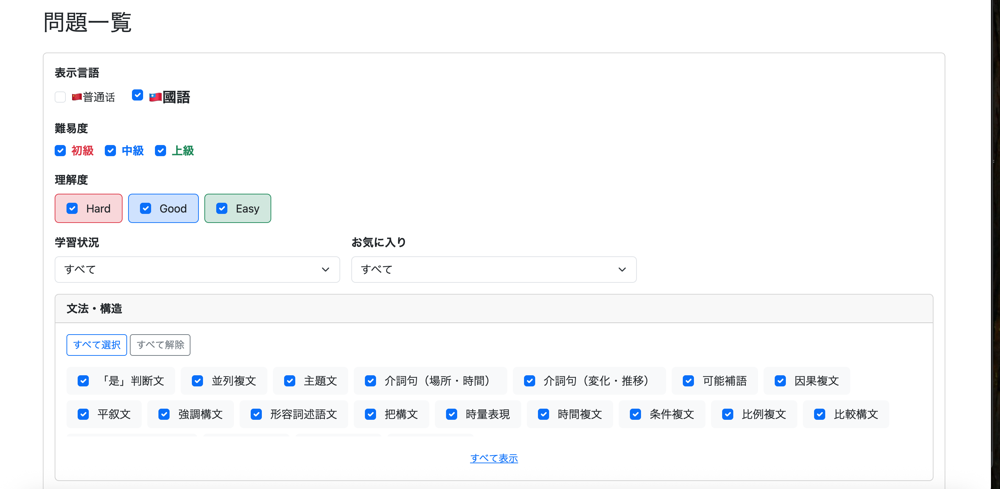
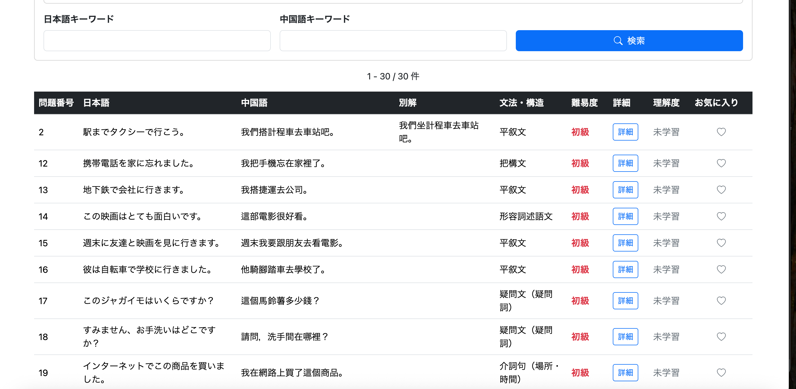
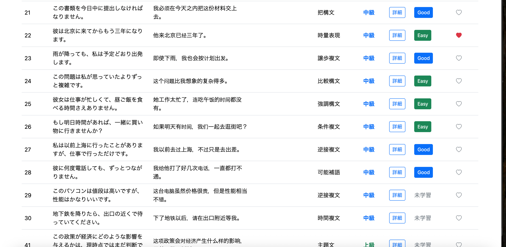
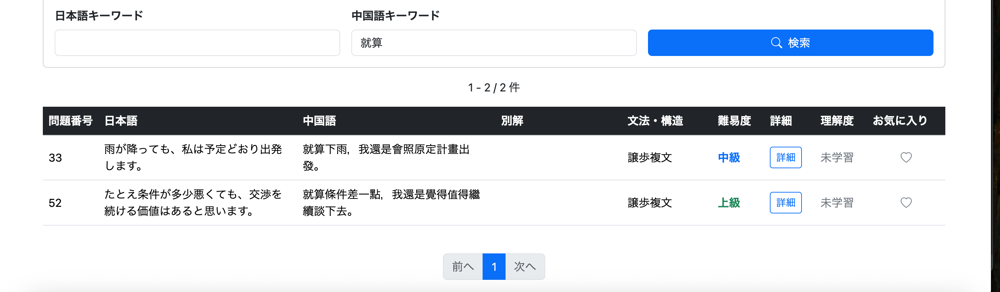
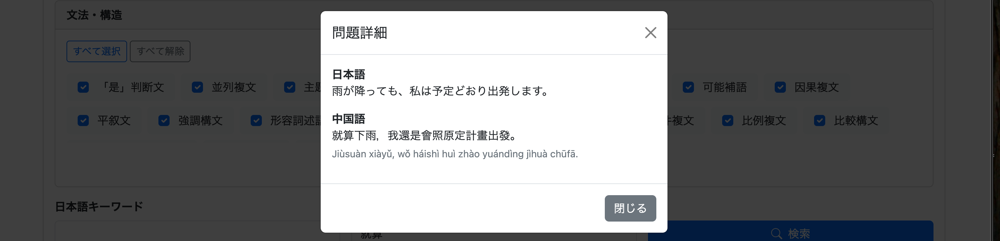
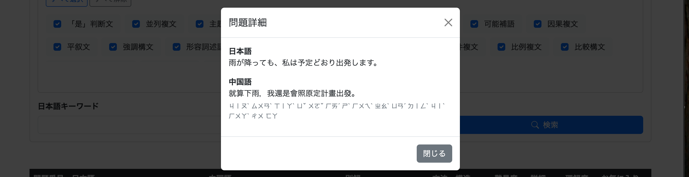
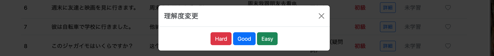
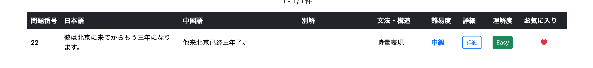


## 9. 追加修正：理解度更新用エンドポイント

画面にボタンやモーダルが存在していても、実際の更新先となるControllerがなければ処理は完結しない。今回はフロントエンド側の操作を先に用意したため、POST先の不足が動作確認で判明した。


`git commit -m "fix: enable evaluation updates from user question list"`

理解度変更モーダルは表示できたが、JavaScriptがPOSTする`/evaluation/toggle`に対応するControllerが未実装だった。`UserQuestionController`に`@PostMapping`を追加して`EvaluationService.updateEvaluation()`を呼び出すよう修正した。

```text
git commit -m "fix: enable evaluation updates from user question list"
```

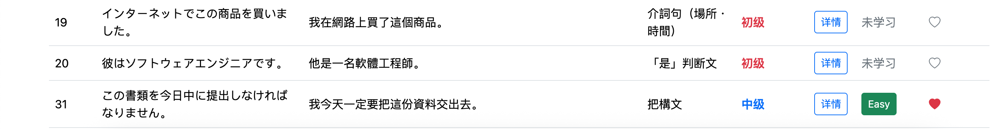
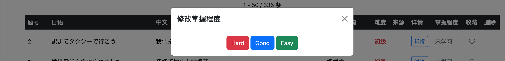
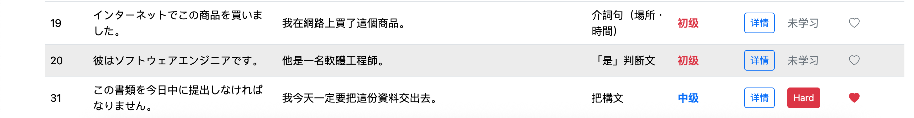

## 10. UIと検索状態の修正

初回実装後、次の不整合を順に修正した。

### 学習状況と理解度の矛盾を解消

`git commit -m "feat: disable evaluation filter based on study status"`

`git commit -m "feat: disable evaluation filter based on study status"` そのため、学習状況が「すべて」または「未学習」の状態で理解度を指定できるのは、検索条件として分かりにくい。 理解度は**学習状況が「学習済み」の場合だけ選択可能**に変更する。       class="text-danger small"

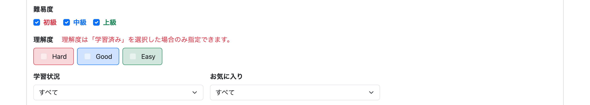

### 検索条件を検索後も維持する

`git commit -m "fix: preserve question list search filters"`

`git commit -m "fix: preserve question list search filters"` 検索ボタンを押した後にフォームの状態が初期化されると、ユーザーが現在どの条件で検索しているのか分からなくなる。 そのため、ControllerからModelへ戻した検索条件を利用して、検索後もフォームの状態を維持する。 <input class="form-check-input"

```html
<input class="form-check-input"
       type="checkbox"
       name="languageVariants"
       value="MAINLAND"
       id="mainland"
       th:checked="${selectedLanguageVariants != null
           and selectedLanguageVariants.![name()].contains('MAINLAND')}">
```

### Bootstrap JavaScriptの二重読み込みを修正

`git commit -m "fix: remove duplicate Bootstrap JavaScript import"`

`git commit -m "fix: remove duplicate Bootstrap JavaScript import"` など、共通ヘッダーにあるBootstrap Dropdownが反応しない問題が発生した。 共通レイアウトの `layout/layout.html` ですでにBootstrap JavaScriptを読み込んでいた。 <script th:src="@{/webjars/bootstrap/js/bootstrap.bundle.min.js}"

```html
<script th:src="@{/webjars/bootstrap/js/bootstrap.bundle.min.js}"
        defer>
</script>
```

### 理解度未選択時のチェック表示を修正

`git commit -m "fix: preserve evaluation filter state when no option is selected"`

`git commit -m "fix: preserve evaluation filter state when no option is selected"` 学習状況を「学習済み」にした状態で、理解度を1つも選択せず検索すると、Service側では、 しかし画面上では、理解度のチェックがすべて外れた状態になっていた。 そこでControllerで、学習状況が `LEARNED_ONLY` かつ理解度が未指定の場合は、画面へ戻す値を全理解度にする。

```java
// 学習済みで理解度が未指定の場合は
// 全選択として表示
if (studyCondition == StudyCondition.LEARNED_ONLY
        && (evaluations == null
        || evaluations.isEmpty())) {

    evaluations =
            Arrays.asList(
                    Evaluation.values());
}

model.addAttribute(
        "selectedEvaluations",
        evaluations);
```

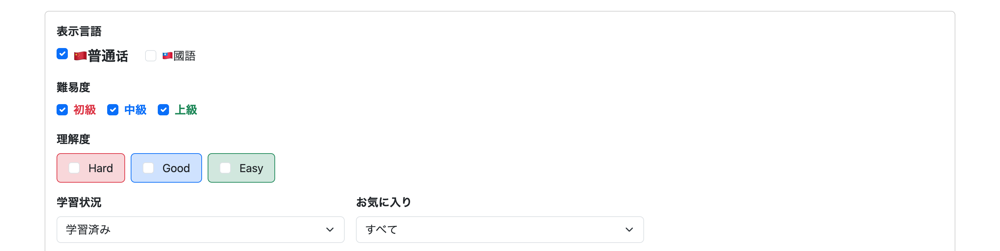
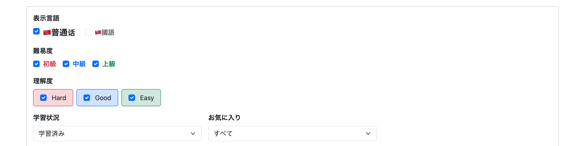

## 11. 8月29日：検索条件のデフォルト処理を整理

`git commit -m "refactor: remove redundant filter defaults from user question service"`

Service内で重複していた検索条件の初期値補完を整理した。初期実装時のコードと修正後のコードを混同しないよう、変更内容を後日のリファクタリングとして記録する。

### 修正後

重複していた以下の処理を削除する。

```java
// 難易度
if (difficulties == null || difficulties.isEmpty()) {
    difficulties = Arrays.asList(Difficulty.values());
}

// 理解度
if (evaluations == null || evaluations.isEmpty()) {
    evaluations = Arrays.asList(Evaluation.values());
}

// 学習条件
if (studyCondition == null) {
    studyCondition = StudyCondition.ALL;
}

// お気に入り条件
if (favoriteCondition == null) {
    favoriteCondition = FavoriteCondition.ALL;
}
```

検索条件が未指定だった場合の処理は、後段の`SearchConditionConverter`に任せる。

一方、文法・構造とキーワードについては`SearchConditionConverter`で未指定時の処理を行っていないため、以下の処理は引き続き`UserQuestionService`に残す。

```java
// 文法・構造
if (structureIds == null || structureIds.isEmpty()) {
    structureIds = structureRepository.findAllStructureIds();
}

// キーワード
if (japaneseKeyword == null) {
    japaneseKeyword = "";
}

if (chineseKeyword == null) {
    chineseKeyword = "";
}
```

これにより、難易度・理解度・学習条件・お気に入り条件について、未指定時の処理を`SearchConditionConverter`に集約し、`UserQuestionService`内の重複した処理を削除できた。

---

## 12. 9月13日：ページ移動時の検索条件を維持

ページ番号のリンクは新たなGETリクエストになるため、`page`だけを送信するとそれまで選択していた絞り込み条件が失われる。検索条件をURLへ引き継ぐ必要があり、後から追加した条件もリンク生成側に反映する。


`git commit -m "fix: preserve search conditions during pagination"`

普通話・國語の両方で検索した結果は221件だったが、ページ移動後に111件へ減少した。原因はページネーションの5種類のリンク（前へ／1ページ目／中央／最終／次へ）から`languageVariants`と`sourceCondition`が欠落していたこと。言語条件が未送信になるとControllerがSessionの言語を初期値として再設定するため、検索対象が國語のみへ変わっていた。`sourceCondition`も同様に失われていた。

```html
<!-- ページ番号リンクの例：検索条件をすべて引き継ぐ -->
th:href="@{/user/question/list(
    page=${i},
    size=${page.size},
    difficulties=${selectedDifficulties},
    evaluations=${selectedEvaluations},
    studyCondition=${selectedStudyCondition},
    favoriteCondition=${selectedFavoriteCondition},
    sourceCondition=${selectedSourceCondition},
    structureIds=${selectedStructureIds},
    languageVariants=${selectedLanguageVariants},
    japaneseKeyword=${japaneseKeyword},
    chineseKeyword=${chineseKeyword}
)}"
```

修正後はページを移動しても言語・生成元・その他の検索条件と総件数が維持されることを確認した。`sourceCondition`は初回実装時の検索項目にはなく、後日の画面状態に基づく修正として扱う。

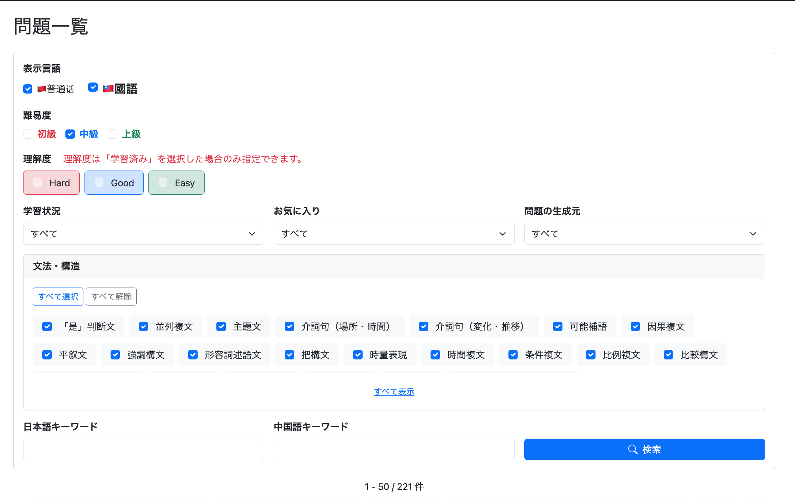
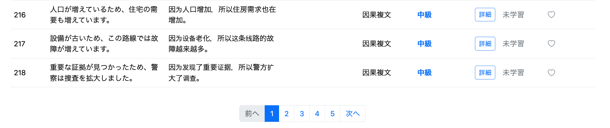
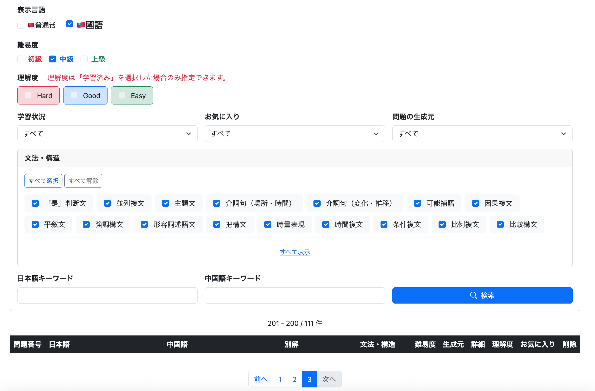
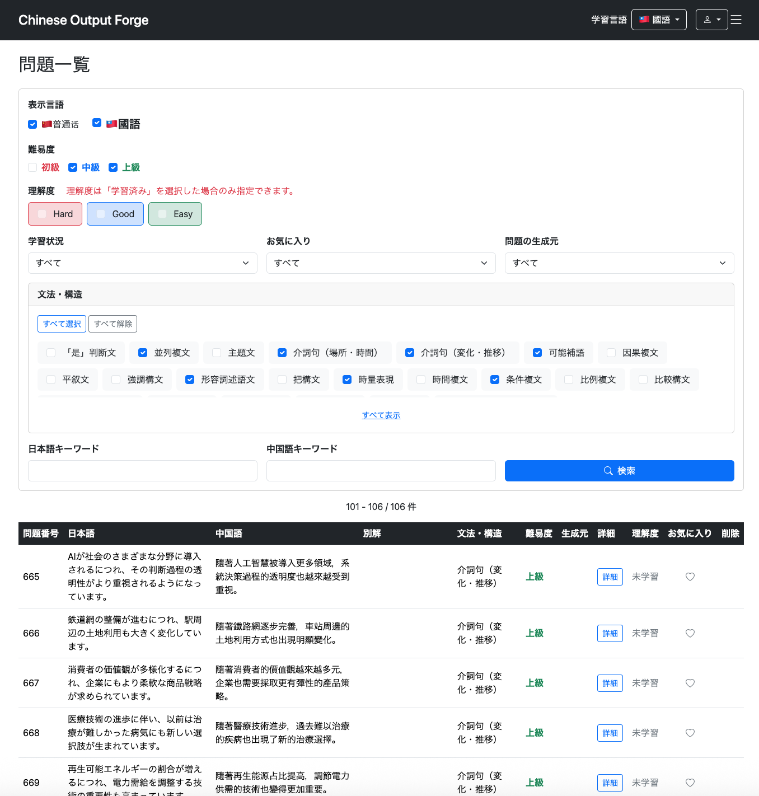

## 13. まとめ

今回の実装では、複数テーブルのProjection検索と件数取得、Controller／Serviceでの検索条件の受け渡し、ページネーション、モーダル・AJAX操作を組み合わせた。後日の修正では、画面で選択した条件を検索後やページ移動後まで一貫して維持すること、フロントエンドとControllerのエンドポイントを対応させることが重要だった。

