# 013 ユーザーメニューの実装 その2 — プロフィール・アカウント管理

> このログは実装・変更を時系列で記録したものです。途中のコードや仕様は、その後の開発によって変更されている場合があります。現在の実装はソースコードを参照してください。

## 概要

ログインユーザー向けに、プロフィール確認、ユーザーID変更、パスワード変更、退会機能を追加した。変更後の再ログイン、入力エラーの表示、退会時の関連データ削除も実装した。

| 対象 | 主な役割 |
| --- | --- |
| `UserProfileController` | プロフィール表示、変更フォーム、退会リクエスト |
| `UserAccountService` | ユーザーID・パスワード更新、関連データを含む退会処理 |
| `EditLoginIdForm`・`EditPasswordForm` | 入力値の検証 |
| `FavoriteRepository`・`StudyHistoryRepository` | 退会時の関連データ削除 |
| `user/profile.html`・`user/edit/*.html`・`user/canceled.html` | アカウント管理画面 |
| `SecurityConfig` | 退会完了ページへの未認証アクセス許可 |

---

## 1. プロフィール画面の作成

**関連コミット：** `feat: add user profile page`

### 1.1 目的・変更内容

`/user/profile`でログイン中のユーザーIDとパスワードのマスク表示を行い、それぞれの編集画面へ移動できるようにした。パスワードの実値やDB上のハッシュ値は表示しない。

### 1.2 主要コード

`@AuthenticationPrincipal`からログインユーザーを特定し、Serviceから取得したEntityをModelに渡す。

```java
@GetMapping("/user/profile")
public String getUserProfile(
        @AuthenticationPrincipal UserDetails loginUser,
        Model model) {

    Users user = userAccountService.getUserOne(loginUser.getUsername());
    model.addAttribute("user", user);
    return "user/profile";
}
```

画面側では、ユーザーIDを表示し、パスワード欄は固定のマスク文字列とした。

```html
<td th:text="${user.loginId}"></td>
<td>************</td>
<a th:href="@{/user/edit/loginId}">編集</a>
<a th:href="@{/user/edit/password}">編集</a>
```

表示文言は`messages*.properties`へ追加した。

### 1.3 動作確認

プロフィール画面が表示され、各編集画面へのリンクが設置された。

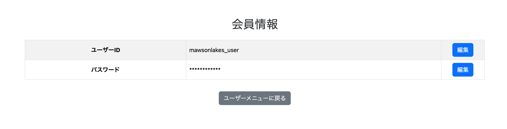

---

## 2. ユーザーID変更機能

**関連コミット：** `feat: implement login ID update`

### 2.1 目的・変更内容

`/user/edit/loginId`で新しいユーザーIDを入力し、重複や入力条件を検証したうえで更新する。更新後は古い認証情報を使い続けないよう、ログイン画面へ戻す。

- `EditLoginIdForm`：新規登録と同じ8〜20文字、英数字・アンダースコアの検証を使用。
- `UserAccountService#updateLoginId()`：同一ID・重複ID・対象ユーザー不在をチェックして更新。
- `UserProfileController`：GETでフォーム表示、POSTで検証・更新・エラー表示・認証情報削除。
- `login.html`：変更完了のFlash Attributeを表示。

### 2.2 主要コード：入力検証と更新

```java
@Data
public class EditLoginIdForm {
    @NotBlank(message = "{signup.loginId.notBlank}")
    @Length(min = 8, max = 20, message = "{signup.loginId.length}")
    @Pattern(regexp = "^[a-zA-Z0-9_]+$", message = "{signup.loginId.pattern}")
    private String loginId;
}
```

Serviceでは**現在と同じIDかどうかを先に確認**する。重複確認を先に行うと、自分の現在のIDも「使用済み」と判定され、意図と異なるエラーになるためである。

```java
@Transactional
public void updateLoginId(String currentLoginId, String newLoginId, Locale locale) {
    if (newLoginId.equals(currentLoginId)) {
        throw new IllegalArgumentException(messageSource.getMessage(
                "user.edit.loginId.error.same", null, locale));
    }
    if (userRepository.existsByLoginId(newLoginId)) {
        throw new DuplicateKeyException(messageSource.getMessage(
                "user.edit.loginId.error.duplicate", null, locale));
    }
    Users user = getUserOne(currentLoginId);
    if (user == null) {
        throw new IllegalArgumentException(messageSource.getMessage(
                "user.edit.loginId.error.notFound", null, locale));
    }
    user.setLoginId(newLoginId);
    userRepository.save(user);
}
```

### 2.3 主要コード：エラー処理と再ログイン

Controllerは`@Validated`と`BindingResult`で入力を検証し、Serviceで発生した例外を`loginId`のフィールドエラーへ変換する。

```java
if (bindingResult.hasErrors()) {
    return getEditLoginId(loginUser, model, form);
}
try {
    userAccountService.updateLoginId(
            loginUser.getUsername(), form.getLoginId(), locale);
} catch (DuplicateKeyException | IllegalArgumentException e) {
    bindingResult.rejectValue("loginId", "invalid", e.getMessage());
    return getEditLoginId(loginUser, model, form);
}
```

上記はエラー処理の要点をまとめた抜粋であり、当時のコードでは例外ごとに`catch`を分けていた。

ユーザーID変更後は、`UserDetails`に古いログインIDが残り得るため、認証情報を削除してログイン画面へリダイレクトする。

```java
SecurityContextHolder.clearContext();
session.removeAttribute(
        HttpSessionSecurityContextRepository.SPRING_SECURITY_CONTEXT_KEY);
redirectAttributes.addFlashAttribute("messageKey", "user.loginId.changed");
return "redirect:/login";
```

当初は`session.invalidate()`を検討したが、`SessionLocaleResolver`で管理している表示言語まで失われる。そこで、この段階ではSession全体ではなく`SPRING_SECURITY_CONTEXT`属性のみを削除する方針とした。**その他のSession情報は残る**点も、この実装の特徴である。

変更完了メッセージはFlash Attributeにメッセージキーを渡し、ログイン画面で現在のLocaleに応じて解決する。

```html
<div class="alert alert-success"
     th:if="${messageKey != null}"
     th:text="#{__${messageKey}__}"></div>
```

### 2.4 動作確認

- 変更フォームの表示：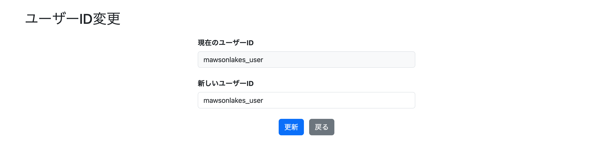
- 正常更新後のログイン画面と完了メッセージ：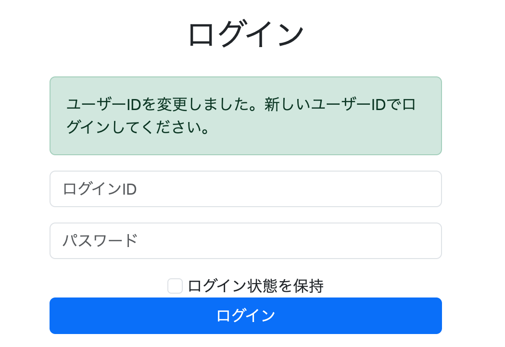
- 変更前と同じIDを入力した場合：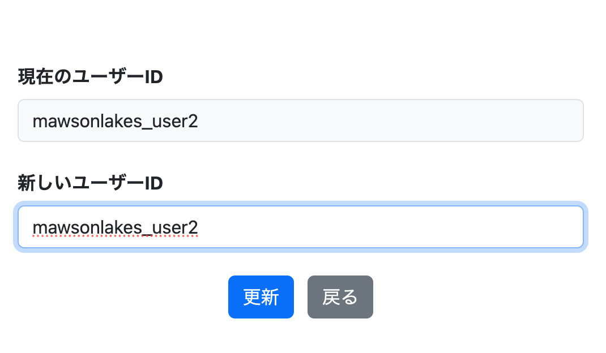
- 同一IDエラー表示：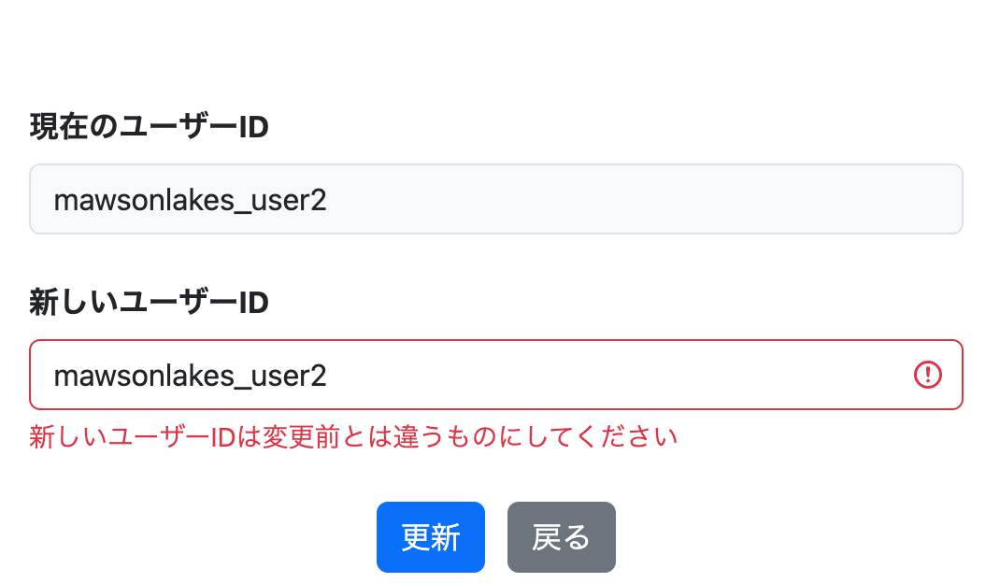
- 他ユーザーのIDを入力した場合：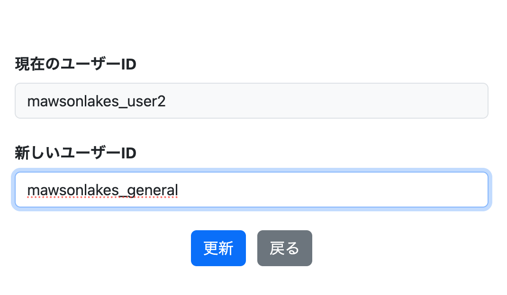
- 重複エラー表示：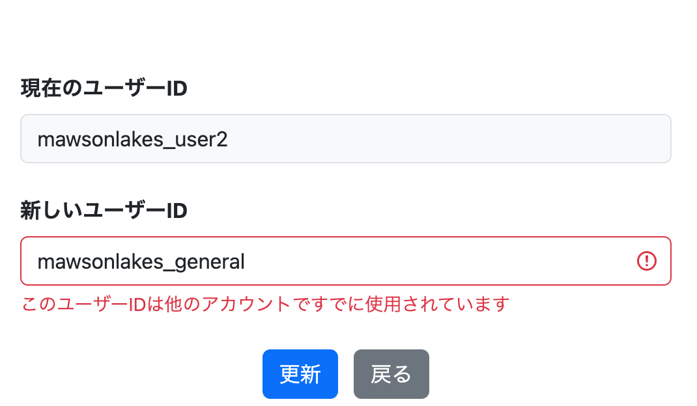

### 2.5 追加修正：バリデーションエラーが表示されない

**関連コミット：** `fix: display validation errors on login ID edit form`

当初の`EditLoginIdForm`ではフィールド名が`LoginId`となっており、Thymeleaf側の`*{loginId}`と一致していなかった。Javaのプロパティ名を`loginId`に統一して修正した。

```java
// 修正前
private String LoginId;

// 修正後
private String loginId;
```

文字数不足などのエラーメッセージが入力欄の下に表示されることを確認した。

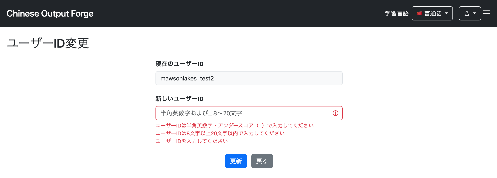

---

## 3. パスワード変更機能

### 3.1 目的・変更内容

`/user/edit/password`で「現在のパスワード」「新しいパスワード」「確認用パスワード」を入力して更新できるようにした。新しいパスワードの形式と確認欄の一致は、新規登録時のバリデーションを再利用する。

### 3.2 主要コード：フォームとService

```java
@PasswordMatch(
    passwordFieldName = "newPassword",
    passwordConfirmFieldName = "newPasswordConfirm"
)
@Data
public class EditPasswordForm {
    @NotBlank
    private String currentPassword;

    @NotBlank(message = "{signup.password.notBlank}")
    @Length(min = 8, max = 20, message = "{signup.password.length}")
    @Pattern(regexp = "^[\\x21-\\x7E]+$", message = "{signup.password.pattern}")
    private String newPassword;

    @NotBlank
    private String newPasswordConfirm;
}
```

Serviceでは、DBに保存したハッシュ値と入力値を`passwordEncoder.matches()`で照合する。**ハッシュ文字列を直接比較しない**ことが重要である。

```java
@Transactional
public void updatePassword(
        String userId, String currentPassword,
        String newPassword, Locale locale) {

    Users user = getUserOne(userId);
    if (user == null) {
        throw new IllegalArgumentException(messageSource.getMessage(
                "user.edit.password.error.notFound", null, locale));
    }
    if (!passwordEncoder.matches(currentPassword, user.getPassword())) {
        throw new CurrentPasswordMismatchException(messageSource.getMessage(
                "user.edit.password.error.currentPassword", null, locale));
    }
    if (passwordEncoder.matches(newPassword, user.getPassword())) {
        throw new PasswordSameException(messageSource.getMessage(
                "user.edit.password.error.same", null, locale));
    }
    user.setPassword(passwordEncoder.encode(newPassword));
    userRepository.save(user);
}
```

### 3.3 エラーの種類と表示先

現在のパスワード不一致と新旧パスワード同一を区別するため、`RuntimeException`を継承した`CurrentPasswordMismatchException`と`PasswordSameException`を追加した。Controllerでは次のようにエラーの表示先を分ける。

```java
catch (CurrentPasswordMismatchException e) {
    bindingResult.rejectValue("currentPassword", "invalid", e.getMessage());
    return getEditPassword(model, form);
}
catch (PasswordSameException e) {
    bindingResult.rejectValue("newPassword", "same", e.getMessage());
    return getEditPassword(model, form);
}
catch (IllegalArgumentException e) {
    bindingResult.reject("userNotFound", e.getMessage());
    return getEditPassword(model, form);
}
```

`rejectValue()`は特定の入力欄、`reject()`はフォーム全体のエラーを登録する。`@PasswordMatch`の不一致もグローバルエラーとして表示する。

```html
<div class="alert alert-danger" th:if="${#fields.hasGlobalErrors()}">
    <div th:each="error : ${#fields.globalErrors()}"
         th:text="${error}"></div>
</div>
```

更新成功時はユーザーID変更と同様に認証情報を削除し、`user.password.changed`をFlash Attributeで渡して`/login`へ遷移する。フォームHTML全文や各言語のメッセージ一覧は省略した。

### 3.4 動作確認

- パスワード変更フォーム：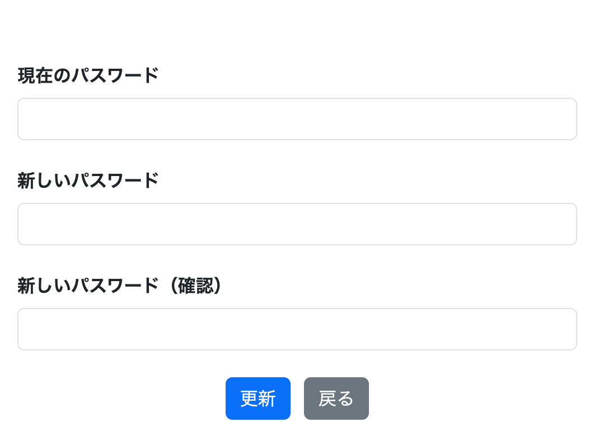
- 正常更新後のログイン画面：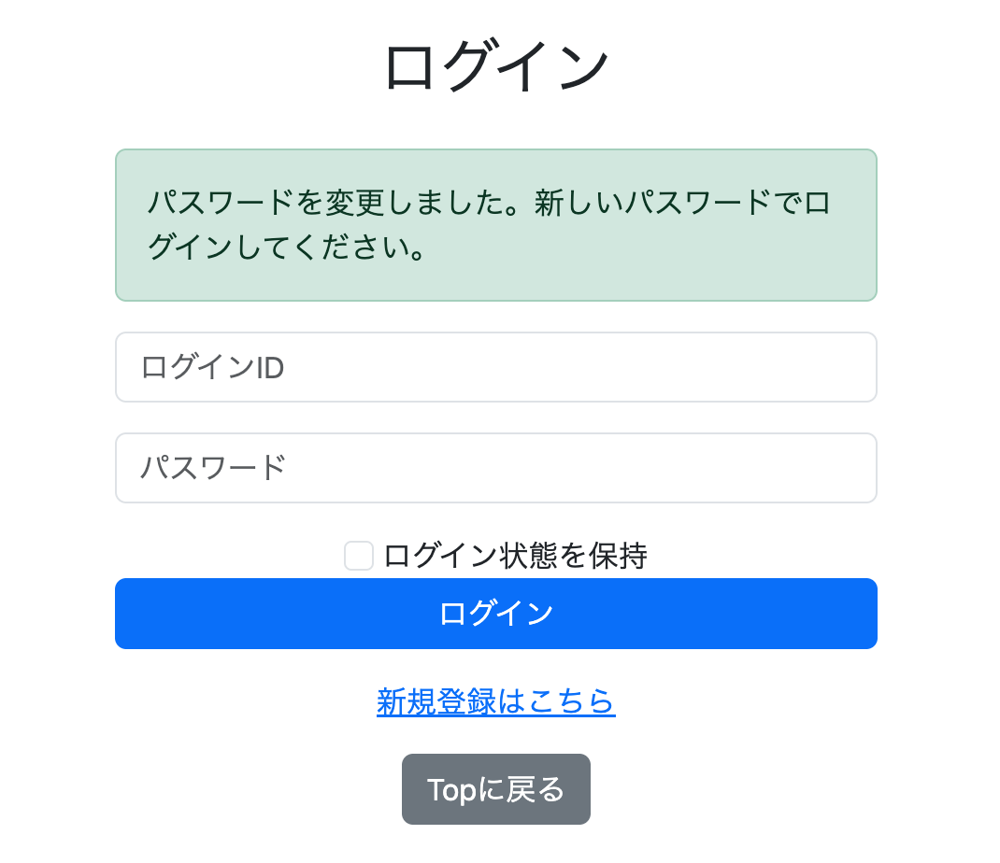
- 現在のパスワード不一致：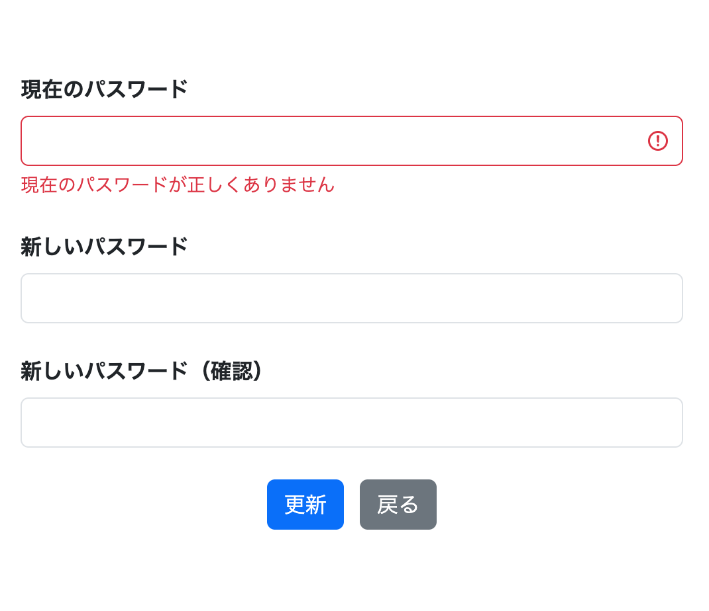
- 新旧パスワード同一：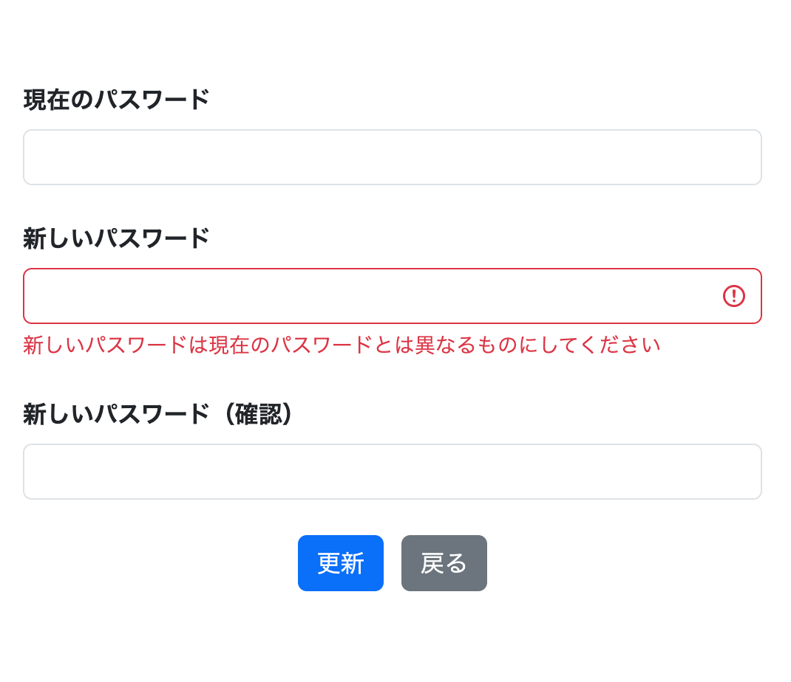
- 新しいパスワードと確認欄の不一致：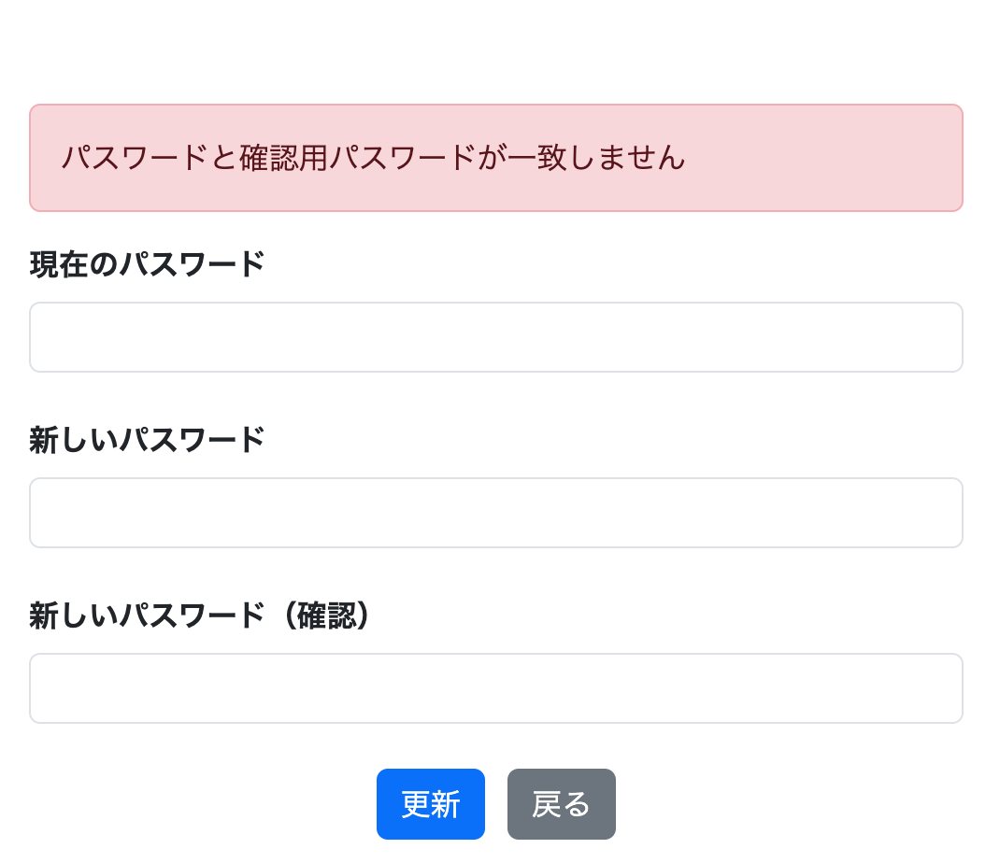

---

## 4. アカウント削除機能

**関連コミット：** `feat: implement account deletion`

### 4.1 目的・変更内容

退会時は`users`だけでなく、ユーザーに紐づく`favorite`と`study_history`も削除する。外部キー制約を考慮し、**お気に入り→学習履歴→ユーザー**の順で処理する。

### 4.2 主要コード：関連データの削除

```java
// FavoriteRepository
void deleteByFavoriteKeyUserId(Long userId);

// StudyHistoryRepository
void deleteByStudyHistoryKeyUserId(Long userId);
```

`@Transactional`で一連の削除をまとめ、途中で例外が発生した場合に部分的な削除が確定しないようにする。

```java
@Transactional
public void cancelMembership(String loginId) {
    Users user = getUserOne(loginId);
    if (user == null) {
        throw new IllegalArgumentException("ユーザーが存在しません");
    }

    Long userId = user.getId();
    favoriteRepository.deleteByFavoriteKeyUserId(userId);
    studyHistoryRepository.deleteByStudyHistoryKeyUserId(userId);
    userRepository.delete(user);
}
```

Controllerからは`loginUser.getUsername()`（ログインID）が渡るため、Serviceで`Users`を取得してDBの主キー`id`に変換している。

### 4.3 退会後のログアウトと完了画面

```java
@PostMapping("/user/delete")
public String cancelMembership(
        @AuthenticationPrincipal UserDetails loginUser,
        HttpServletRequest request) throws ServletException {

    userAccountService.cancelMembership(loginUser.getUsername());
    request.logout();
    return "redirect:/user/canceled";
}

@GetMapping("/user/canceled")
public String getCanceled() {
    return "user/canceled";
}
```

プロフィール画面の退会フォームには`confirm()`による確認を追加した。退会後はログアウト状態で完了画面へ遷移するため、`SecurityConfig`で`/user/canceled`に`permitAll()`を設定した。一方、退会処理の`/user/delete`は認証必須のままとした。

```java
.requestMatchers("/user/canceled").permitAll()
```

### 4.4 動作確認

- 退会確認ダイアログ：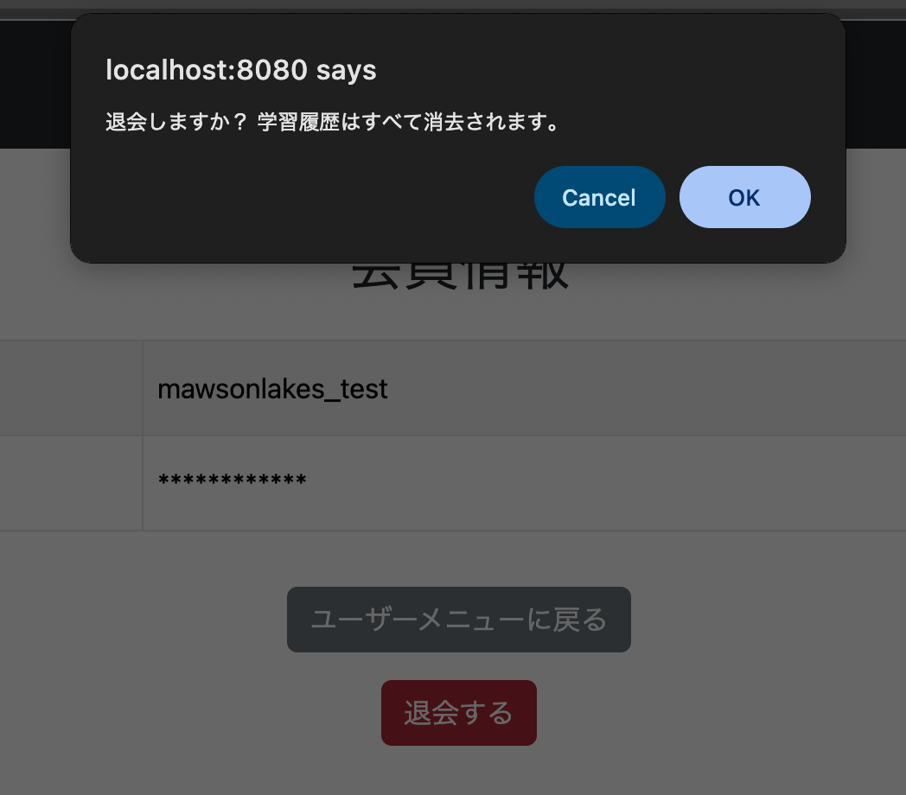
- 関連データ削除・ログアウト後の退会完了画面：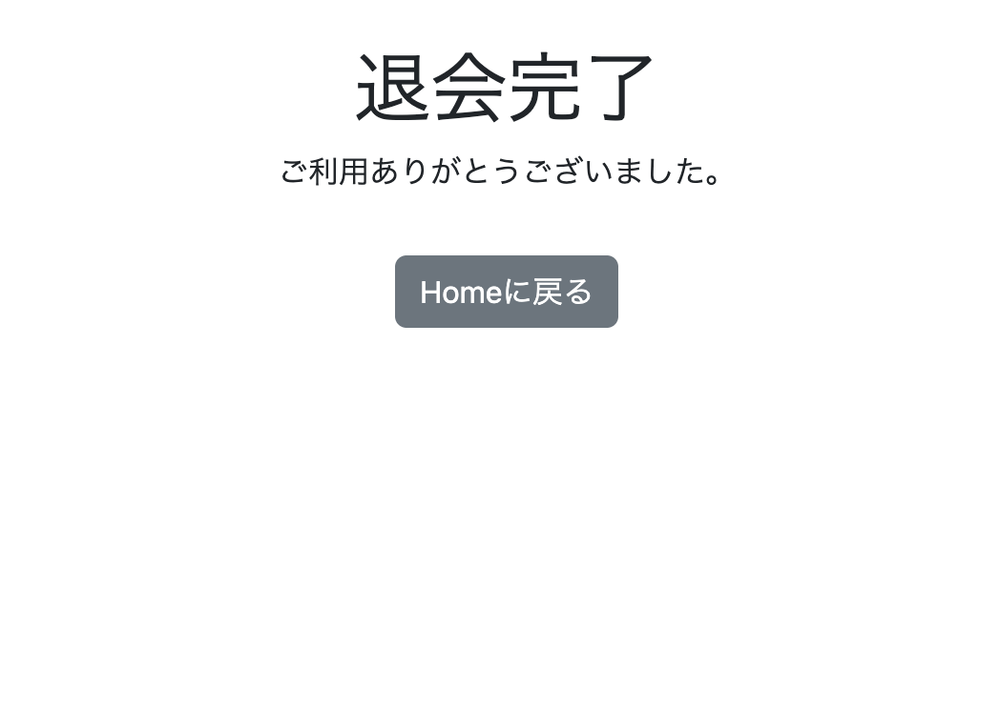

### 4.5 追加修正：ADMINの退会操作を非表示にする

**関連コミット：** `fix: hide account deletion option for admin users`

ServiceにはADMINユーザーの削除を拒否する判定が既にあった。さらに、操作できない退会ボタン自体をADMINには表示しないよう、Thymeleaf側に条件を追加した。

```html
<div sec:authorize="!hasRole('ADMIN')">
    <form th:action="@{/user/delete}" method="post">
        <button type="submit" class="btn btn-danger"
                th:onclick="|return confirm('#{user.delete.confirm}');|">
            退会する
        </button>
    </form>
</div>
```

画面の非表示は操作ミスの防止であり、**削除可否の最終判断はServiceに残す**。Controllerに同じ業務ルールを重複実装しない方針とした。

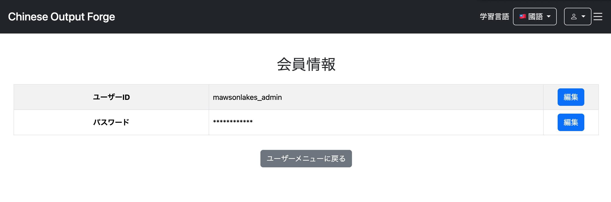

---

## 5. アカウント編集画面のUI修正

### 5.1 新しいユーザーIDの入力欄を空欄にする

**関連コミット：** `fix: clear new login ID field on edit form`

ユーザーID変更フォームで、現在のIDが新しいIDの入力欄にも表示される状態を修正した。現在のIDは参照用の表示欄にのみ表示し、入力用フォームには初期値を設定しないようにした。

- 修正前の表示：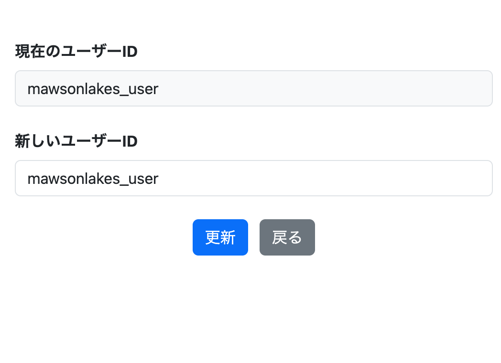
- 修正後の表示：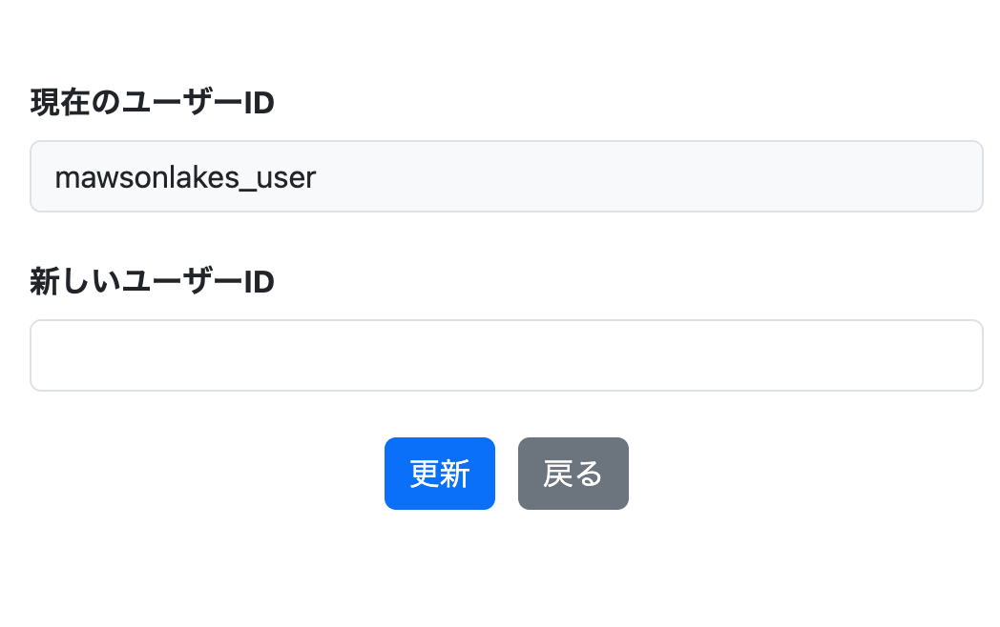

### 5.2 入力条件のプレースホルダを追加

**関連コミット：** `ui: add validation hints to account edit forms`

新しいユーザーID、新しいパスワード、確認用パスワードの入力欄に、新規登録画面で使っていた入力条件のプレースホルダを再利用した。現在のパスワード欄には、新規作成用の条件を表示しない。

```html
<input th:field="*{loginId}"
       th:placeholder="#{signup.loginId.placeholder}">

<input type="password" th:field="*{newPassword}"
       th:placeholder="#{signup.password.placeholder}">

<input type="password" th:field="*{newPasswordConfirm}"
       th:placeholder="#{signup.passwordConfirm.placeholder}">
```

- 修正前のユーザーID変更画面：
- 修正前のパスワード変更画面：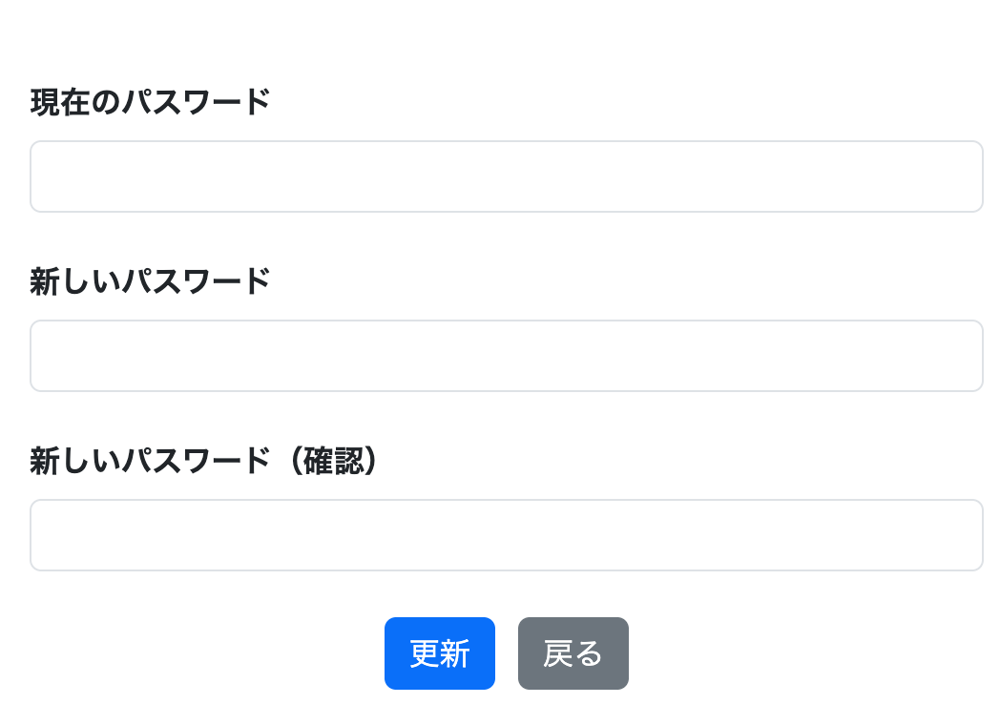
- 修正後のユーザーID変更画面：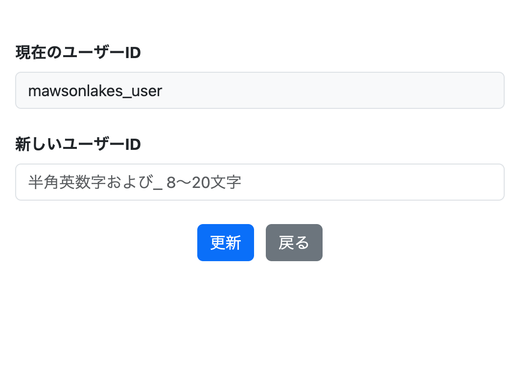
- 修正後のパスワード変更画面：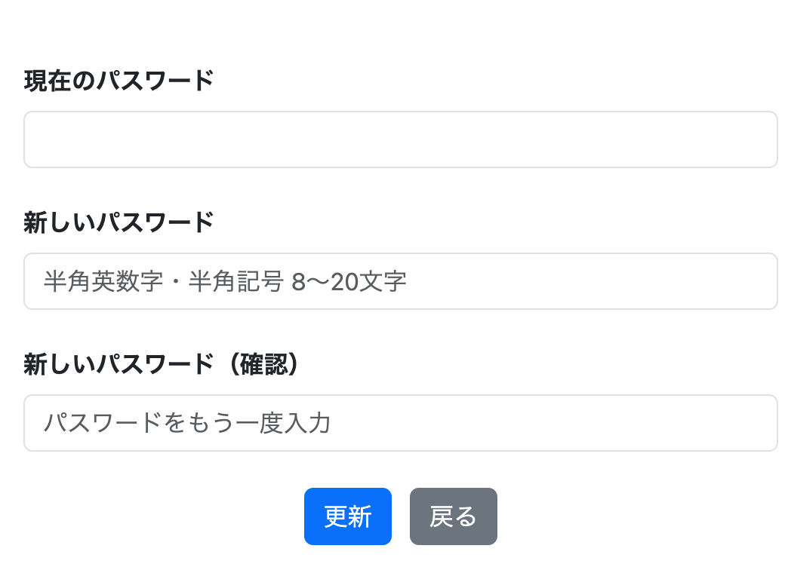

---

## 6. 実装のまとめ

プロフィール確認、ユーザーID変更、パスワード変更、退会を一連のユーザー管理機能として実装した。ユーザーID・パスワード変更では、入力検証と業務ルールの検証を分け、変更後は古い認証情報を削除して再ログインを促すようにした。

退会では、外部キーで関連付くデータを先に削除し、`@Transactional`で処理をまとめた。ADMINの削除防止については、Serviceの業務ルールを維持したまま画面でも操作を隠した。

実装中に判明したフォームのプロパティ名不一致や入力欄の初期表示についても、追加修正として時系列で記録した。
