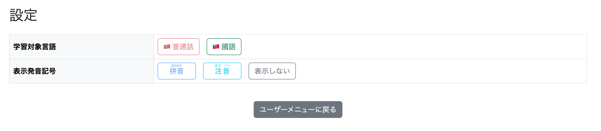
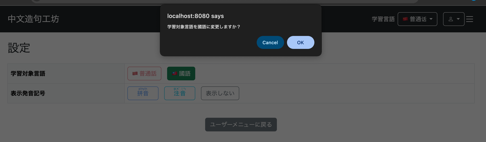
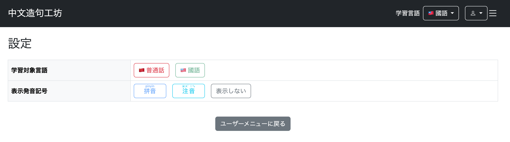
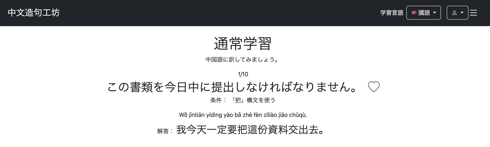
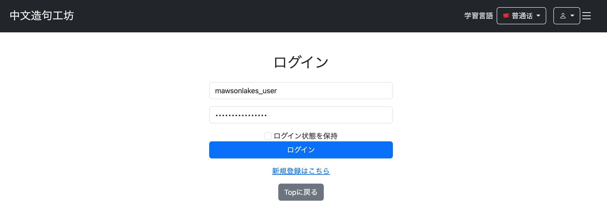
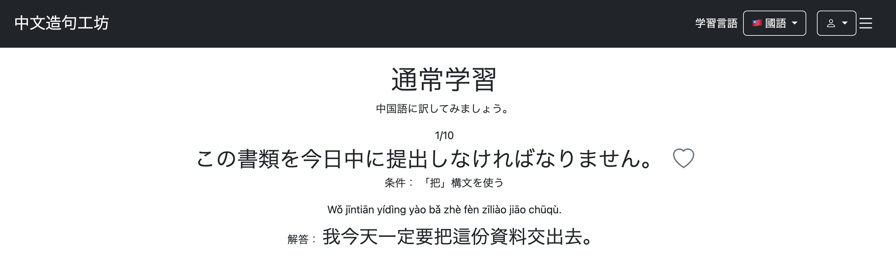
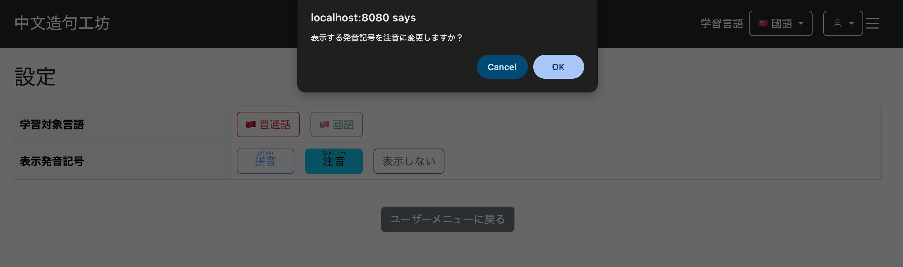
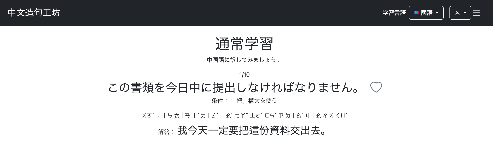

# 014 ユーザーメニューの実装 その3 — ユーザー設定【実装ログ】

## 1. 概要

学習対象言語（`MAINLAND`／`TAIWAN`）と表示発音記号（`PINYIN`／`ZHUYIN`／`NONE`）の設定画面を実装した。従来はSessionのみで管理していたため、ログアウトすると設定が失われていた。今回からログインユーザーの設定を`users`テーブルにも保存し、ログイン成功時にSessionへ復元する。

```text
設定変更 → usersへ保存＋Session更新 → ログアウト → 再ログイン → usersからSessionへ復元
```

未ログインユーザーについては、引き続きSessionのみを更新する。

## 2. usersテーブルとEntityの変更

```bash
git commit -m "feat: add persistent user language and pronunciation settings"
```

### 2-1. 既存データを移行してからNOT NULL制約を付与

既存ユーザーが存在するため、まずNULL許容でカラムを追加し、初期値を設定してから`NOT NULL`制約を付けた。

```sql
ALTER TABLE users ADD COLUMN language_variant VARCHAR(20);
ALTER TABLE users ADD COLUMN pronunciation_type VARCHAR(20);

UPDATE users
SET language_variant = 'MAINLAND',
    pronunciation_type = 'PINYIN';

ALTER TABLE users ALTER COLUMN language_variant SET NOT NULL;
ALTER TABLE users ALTER COLUMN pronunciation_type SET NOT NULL;
```

更新後は`SELECT id, login_id, role, language_variant, pronunciation_type FROM users;`で既存ユーザーの設定値を確認した。

### 2-2. Users.java

```java
@Enumerated(EnumType.STRING)
@Column(name = "language_variant", nullable = false, length = 20)
private LanguageVariant languageVariant = LanguageVariant.MAINLAND;

@Enumerated(EnumType.STRING)
@Column(name = "pronunciation_type", nullable = false, length = 20)
private PronunciationType pronunciationType = PronunciationType.PINYIN;
```

Enumは文字列として保存する。フィールドの初期化式は新規ユーザーのデフォルト値に使用する。

## 3. 設定更新処理の実装

```bash
git commit -m "feat: implement user settings management"
```

### 3-1. UserAccountService

ログインIDから対象ユーザーを取得し、設定値を更新する2つのメソッドを追加した。ユーザーが存在しない場合は、`MessageSource`からLocaleに応じたエラーメッセージを取得して例外を発生させる。

```java
@Transactional
public void updateLanguageVariant(
        String loginId, LanguageVariant languageVariant, Locale locale) {

    Users user = getUserOne(loginId);
    if (user == null) {
        throw new IllegalArgumentException(messageSource.getMessage(
                "user.settings.error.notFound", null, locale));
    }

    user.setLanguageVariant(languageVariant);
    userRepository.save(user);
    log.info("学習対象言語変更 loginId={}, languageVariant={}",
            user.getLoginId(), languageVariant);
}
```

`updatePronunciationType(String loginId, PronunciationType pronunciationType, Locale locale)`も同じ構成で実装し、`user.setPronunciationType(pronunciationType)`で更新する。

### 3-2. LanguageVariantController

言語変更時はログイン状態に応じてDBを更新し、その後Sessionへ反映する。言語が変わると中断中の通常学習問題との整合性が崩れるため、該当するSessionデータを破棄する。

```java
@GetMapping("/language-variant")
public String changeLanguageVariant(
        @AuthenticationPrincipal UserDetails loginUser,
        @RequestParam LanguageVariant languageVariant,
        @RequestParam(required = false) String redirect,
        Locale locale, HttpSession session) {

    LanguageVariant current =
            (LanguageVariant) session.getAttribute("languageVariant");
    if (languageVariant == current) {
        return redirect != null ? "redirect:" + redirect : "redirect:/";
    }

    if (loginUser != null) {
        userAccountService.updateLanguageVariant(
                loginUser.getUsername(), languageVariant, locale);
    }

    session.removeAttribute("practiceQuestions");
    session.removeAttribute("practiceCurrentPage");
    session.setAttribute("languageVariant", languageVariant);

    return redirect != null ? "redirect:" + redirect : "redirect:/";
}
```

以前は`/practice/menu`だけを特別扱いしていたが、`redirect`パラメータで戻り先を指定できる形に変更した。

### 3-3. PronunciationTypeController

発音記号もログイン時はDBとSessionを更新する。ただし、発音記号は問題の抽出条件を変えないため、中断中の学習データは破棄しない。

```java
@GetMapping("/pronunciation-type")
public String changePronunciationType(
        @AuthenticationPrincipal UserDetails loginUser,
        @RequestParam PronunciationType pronunciationType,
        Locale locale, HttpSession session) {

    PronunciationType current =
            (PronunciationType) session.getAttribute("pronunciationType");
    if (pronunciationType == current) {
        return "redirect:/user/settings";
    }

    if (loginUser != null) {
        userAccountService.updatePronunciationType(
                loginUser.getUsername(), pronunciationType, locale);
    }
    session.setAttribute("pronunciationType", pronunciationType);
    return "redirect:/user/settings";
}
```

## 4. ログイン成功時の設定復元

### 4-1. LoginSuccessHandler.java

`security`パッケージに`LoginSuccessHandler`を作成。`SavedRequestAwareAuthenticationSuccessHandler`を継承し、ログイン前にアクセスしようとしたページへ戻る標準動作を維持しながら、DB上の設定をSessionへ格納する。

```java
@Component
public class LoginSuccessHandler
        extends SavedRequestAwareAuthenticationSuccessHandler {

    private final UserAccountService userAccountService;

    public LoginSuccessHandler(UserAccountService userAccountService) {
        this.userAccountService = userAccountService;
        super.setDefaultTargetUrl("/");
    }

    @Override
    public void onAuthenticationSuccess(
            HttpServletRequest request,
            HttpServletResponse response,
            Authentication authentication)
            throws IOException, ServletException {

        Users user = userAccountService.getUserOne(authentication.getName());
        HttpSession session = request.getSession();
        session.setAttribute("languageVariant", user.getLanguageVariant());
        session.setAttribute("pronunciationType", user.getPronunciationType());

        super.onAuthenticationSuccess(request, response, authentication);
    }
}
```

`super.onAuthenticationSuccess(...)`を最後に呼び、Spring Securityの既存の成功後処理に制御を戻す。

### 4-2. SecurityConfig.java

`LoginSuccessHandler`をDIし、`formLogin`の`.defaultSuccessUrl("/", false)`を次の設定に置き換えた。

```java
.successHandler(loginSuccessHandler)
```

ログイン失敗時の既存の`AuthenticationFailureHandler`は変更していない。

## 5. 設定画面とメッセージ

### 5-1. UserMenuController

```java
@GetMapping("/user/settings")
public String getSettings() {
    return "user/settings";
}
```

### 5-2. user/settings.html

設定画面には、学習対象言語2種類と発音記号3種類の選択ボタンを配置した。元のHTML全文は省略し、Thymeleafによる状態表示・遷移の要点を抜粋する。

```html
<!-- 普通話：選択中なら無効化し、変更前に確認する -->
<a class="btn btn-outline-danger"
   th:classappend="${session.languageVariant != null
       && session.languageVariant.name() == 'MAINLAND'} ? ' disabled'"
   th:href="@{/language-variant(
       languageVariant='MAINLAND', redirect='/user/settings')}"
   th:onclick="return confirm([[#{settings.languageVariant.mainland.confirm}]])">
    🇨🇳 <span th:text="#{settings.languageVariant.mainland}">普通話</span>
</a>

<!-- 発音記号：例として注音 -->
<a class="btn btn-outline-info"
   th:classappend="${session.pronunciationType != null
       && session.pronunciationType.name() == 'ZHUYIN'} ? ' disabled'"
   th:href="@{/pronunciation-type(pronunciationType='ZHUYIN')}"
   th:onclick="return confirm([[#{settings.pronunciationType.zhuyin.confirm}]])">
    <ruby>注音<rt>ㄓㄨˋ ㄧㄣ</rt></ruby>
</a>
```

`TAIWAN`、`PINYIN`、`NONE`も同じ形式で実装した。現在選択中のボタンは`th:classappend`で無効化し、切り替え前には`confirm()`を表示する。ユーザーメニューへ戻るボタンも配置した。

### 5-3. messages.properties

画面見出し、選択肢、確認ダイアログ、ユーザー未検出エラーのキーを追加し、各言語のメッセージファイルにも対応させた。

```properties
settings.title=設定
settings.languageVariant=学習対象言語
settings.languageVariant.mainland=普通話
settings.languageVariant.taiwan=國語
settings.languageVariant.mainland.confirm=学習対象言語を普通話に変更しますか？
settings.languageVariant.taiwan.confirm=学習対象言語を國語に変更しますか？
settings.pronunciationType=表示発音記号
settings.pronunciationType.none=表示しない
settings.pronunciationType.pinyin.confirm=表示する発音記号を拼音に変更しますか？
settings.pronunciationType.zhuyin.confirm=表示する発音記号を注音に変更しますか？
settings.pronunciationType.none.confirm=発音記号を表示しない設定に変更しますか？
user.settings.error.notFound=ユーザーが存在しません。
```

## 6. 起動時の循環依存と修正

Spring Bootの再起動時にBeanの循環依存が発生した。

```text
SecurityConfig → LoginSuccessHandler → UserAccountService
    → PasswordEncoder → SecurityConfig
```

`PasswordEncoder`のBean定義が`SecurityConfig`にあり、依存関係が元に戻っていた。そこで`PasswordEncoderConfig`へ分離した。

```java
@Configuration
public class PasswordEncoderConfig {
    @Bean
    PasswordEncoder passwordEncoder() {
        return new BCryptPasswordEncoder();
    }
}
```

`SecurityConfig`から従来の`passwordEncoder()`定義を削除し、循環依存を解消した。

## 7. 動作確認

### 7-1. 学習対象言語の保存と復元

設定画面で選択中のボタンが無効化されることを確認した。



國語への変更時に確認ダイアログが表示され、変更後は國語が選択された。





通常学習でも國語の問題が出題された。



ログアウトしてから再ログインし、國語の設定が維持されることを確認した。





### 7-2. 表示発音記号の変更

変更前の拼音表示から、設定画面で注音を選択し、学習画面の解答表示が注音へ切り替わることを確認した。







## 8. 後日の修正：言語変更後の戻り先

### 8-1. 復習メニュー

```bash
git commit -m "fix: preserve review menu after language switch"
```

復習メニューで言語を変更するとHomeへ戻っていたため、`ReviewController#getReviewMenu`に戻り先を追加した。

```java
model.addAttribute("languageVariantRedirect", "/review/menu");
```

ヘッダーから`redirect=${languageVariantRedirect}`を渡すことで、変更後も復習メニューへ戻るようにした。

### 8-2. ユーザー問題一覧

```bash
git commit -m "fix: preserve user question list after language switch"
```

同様に、問題一覧で言語を変更した際にHomeへ戻る問題を修正した。`UserQuestionListController#getUserQuestionList`へ次を追加した。

```java
model.addAttribute("languageVariantRedirect", "/user/question/list");
```

ヘッダーでは復習メニューと同様に`redirect`パラメータへ設定し、変更後に問題一覧へ戻るようにした。

## 9. まとめ

ログインユーザーの言語・発音記号設定をDBに永続化し、ログイン成功時にSessionへ復元できるようにした。あわせて、言語変更時の学習データ破棄、循環依存の解消、画面ごとの戻り先修正を実施した。
