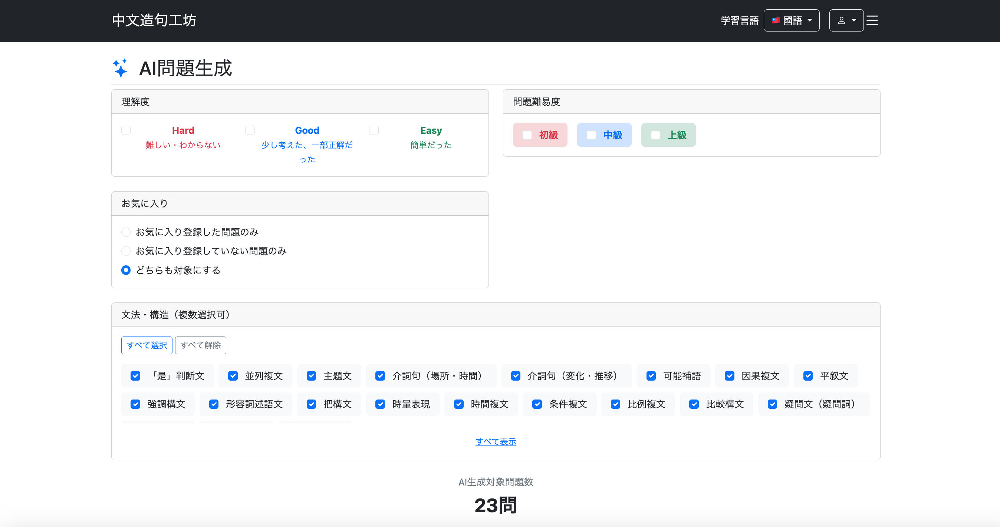
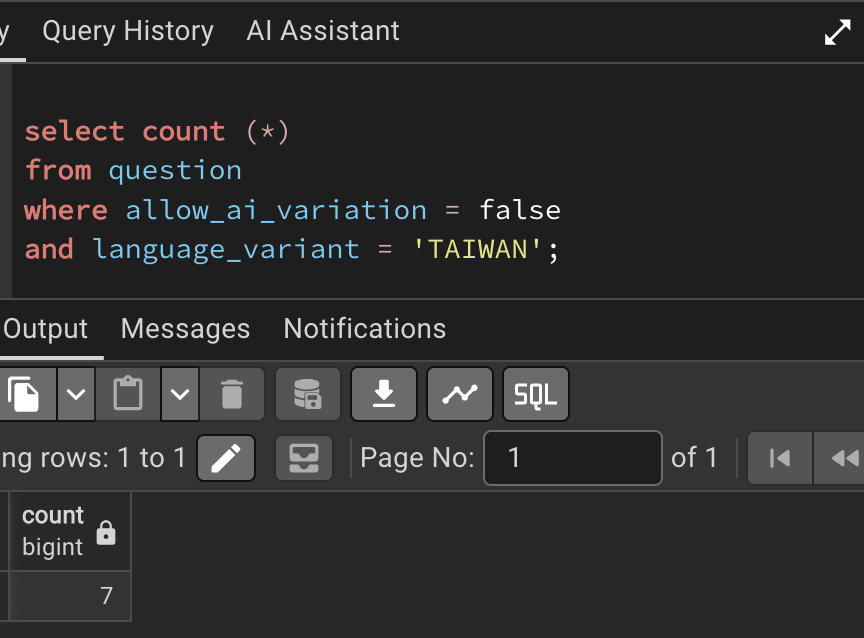

# 015 AI問題生成モードの実装 その1 — メニュー画面と生成元問題の絞り込み【実装ログ】

## 1. 概要

AI問題生成モードの入口となる`/ai-practice/menu`と、指定条件に該当する生成元問題数を返す`/ai-practice/count`を実装した。

AI生成では、`question`テーブルの既存問題を生成元として利用する。今回の段階では**AIによる問題生成そのものは未実装**であり、対象問題の絞り込みと件数表示までを扱う。

```text
/ai-practice/menu
  ↓ 理解度・難易度・お気に入り・文法／構造を選択
/ai-practice/count
  ↓ DBで生成対象の件数を集計
メニューに対象問題数を表示
  ↓ 今後実装
生成元問題を取得 → AIで改変 → Sessionへ保存 → /ai-practice/question
```

検索には画面指定の4条件に加え、Sessionの学習対象言語と`allow_ai_variation = TRUE`を適用する。既存の復習モードと問題一覧のフィルター機能を参考にした。

## 2. 生成元問題の件数検索

```bash
git commit -m "feat: add AI practice menu and source question filtering"
```

### 2-1. `QuestionRepository`に集計クエリを追加

`countAiGenerationSourceQuestions()`を追加した。重要な条件部分は以下のとおり。

```sql
SELECT COUNT(*)
FROM question q
JOIN study_history sh
  ON q.question_id = sh.question_id
 AND sh.user_id = :userId
LEFT JOIN favorite f
  ON q.question_id = f.question_id
 AND f.user_id = :userId
WHERE q.difficulty IN (:difficulties)
  AND sh.evaluation IN (:evaluations)
  AND (
       :favoriteCondition = 'ALL'
       OR (:favoriteCondition = 'FAVORITED' AND f.question_id IS NOT NULL)
       OR (:favoriteCondition = 'NOT_FAVORITED' AND f.question_id IS NULL)
  )
  AND q.structure_id IN (:structureIds)
  AND q.language_variant = :languageVariant
  AND q.allow_ai_variation = TRUE
```

`@Query(nativeQuery = true)`で定義し、`userId`、`difficulties`、`evaluations`、`favoriteCondition`、`structureIds`、`languageVariant`を引数として渡す。

- `study_history`を`INNER JOIN`し、対象ユーザーの理解度が登録された問題を検索する。**学習履歴のない問題はこの時点では対象外**となる。
- `favorite`は`LEFT JOIN`とし、登録の有無によって`ALL`・`FAVORITED`・`NOT_FAVORITED`を切り替える。
- `structure_id`は`question`にあるため、`structure`テーブルとのJOINは不要。
- `language_variant`と`allow_ai_variation`は画面で選ぶ条件とは別に必ず適用する。

### 2-2. `AiPracticeService`を作成

Serviceは画面から渡されたEnum等を`SearchConditionConverter`でSQL用の文字列へ変換し、Repositoryへ渡す。

当初はService内でも難易度・理解度・お気に入りの未指定時の初期値を設定していた。後日、Converterとの重複が判明したため、**最終的には文法・構造の未指定時のみServiceで補完**する構成に修正した（第7章）。

```java
public Long countAiGenerationSourceQuestions(
        long userId,
        List<Difficulty> difficulties,
        List<Evaluation> evaluations,
        FavoriteCondition favoriteCondition,
        List<Long> structureIds,
        LanguageVariant languageVariant) {

    if (structureIds == null || structureIds.isEmpty()) {
        structureIds = structureRepository.findAllStructureIds();
    }

    return questionRepository.countAiGenerationSourceQuestions(
            userId,
            searchConditionConverter.convertDifficulty(difficulties),
            searchConditionConverter.convertEvaluation(evaluations),
            searchConditionConverter.convertFavoriteCondition(favoriteCondition),
            structureIds,
            languageVariant.name());
}
```

`SearchConditionConverter`は未指定の難易度・理解度を全選択、お気に入りを`ALL`として扱う。一方、文法・構造の全ID取得は`AiPracticeService`で行う。

## 3. `AiPracticeController`を作成

追加したエンドポイントは次の2つ。

| URL | 役割 |
|---|---|
| `GET /ai-practice/menu` | 検索条件のメニュー画面を表示 |
| `GET /ai-practice/count` | 条件に該当する生成元問題数を返す |

### 3-1. メニュー表示

`getAiPracticeMenu()`では、文法・構造の選択肢と、中断中のトレーニング情報をModelに渡す。

```java
@GetMapping("/ai-practice/menu")
public String getAiPracticeMenu(HttpSession session, Model model) {
    model.addAttribute("languageVariantRedirect", "/ai-practice/menu");

    List<Question> questions =
            (List<Question>) session.getAttribute("aiPracticeQuestions");
    Integer currentPage =
            (Integer) session.getAttribute("aiPracticeCurrentPage");

    boolean canResume = questions != null && currentPage != null;
    model.addAttribute("canResume", canResume);
    if (canResume) {
        model.addAttribute("currentPage", currentPage);
        model.addAttribute("totalCount", questions.size());
    }

    model.addAttribute("structures", reviewService.findStructures());
    return "/ai-practice/menu";
}
```

`aiPracticeQuestions`と`aiPracticeCurrentPage`は、後で中断・再開を実装するためのSessionキー。この段階では再開処理自体は未実装である。

### 3-2. 条件に応じた件数取得

`getAiPracticeCount()`では、ログインユーザーのIDとSessionの学習対象言語を取得してServiceへ渡す。

```java
@GetMapping("/ai-practice/count")
@ResponseBody
public long getAiPracticeCount(
        @AuthenticationPrincipal UserDetails loginUser,
        @RequestParam(required = false) List<Evaluation> evaluations,
        @RequestParam(required = false) List<Difficulty> difficulties,
        @RequestParam(required = false) FavoriteCondition favoriteCondition,
        @RequestParam(required = false) List<Long> structureIds,
        HttpSession session) {

    Users user = userAccountService.getUserOne(loginUser.getUsername());
    LanguageVariant languageVariant =
            (LanguageVariant) session.getAttribute("languageVariant");
    if (languageVariant == null) {
        languageVariant = LanguageVariant.MAINLAND;
    }

    return aiPracticeService.countAiGenerationSourceQuestions(
            user.getId(), difficulties, evaluations,
            favoriteCondition, structureIds, languageVariant);
}
```

`@ResponseBody`によって、テンプレート名ではなく件数そのものをレスポンスとして返す。画面の表示と件数取得を別エンドポイントに分け、JavaScriptから条件変更のたびに問い合わせられるようにした。

## 4. AI問題生成メニューを作成

`templates/ai-practice/menu.html`を追加。既存の`review/menu.html`を基に、以下の要素を配置した。

| 画面要素 | 内容 |
|---|---|
| 理解度 | `HARD`・`GOOD`・`EASY`のチェックボックス |
| 難易度 | `BEGINNER`・`INTERMEDIATE`・`ADVANCED`のチェックボックス |
| お気に入り | `FAVORITED`・`NOT_FAVORITED`・`ALL`のラジオボタン |
| 文法・構造 | `structures`から生成するチェックボックス、全選択・全解除・折りたたみ |
| 件数 | `countAiPracticeQuestions`に対象問題数を表示 |
| 操作 | 出題開始、Topに戻る、中断データがある場合の再開ボタン |

AI生成では現在設定中の言語を使用するため、メニュー内に言語選択欄は設けない。

### 4-1. 主要なThymeleaf記述

```html
<form th:action="@{/ai-practice/start}" method="get">
    <!-- 理解度・難易度・お気に入りの入力欄 -->
    <label th:each="structure : ${structures}"
           th:data-bs-title="${session.languageVariant != null
               && session.languageVariant.name() == 'TAIWAN'
               ? structure.descriptionZhTw
               : structure.descriptionZhCn}">
        <input type="checkbox" name="structureIds"
               th:value="${structure.structureId}" checked>
        <span th:text="${structure.name}"></span>
    </label>
    <h2 id="countAiPracticeQuestions">-</h2>
    <button type="submit" th:text="#{aiPractice.menu.start}">出題開始</button>
</form>
```

文法・構造の説明Tooltipは学習対象言語に応じて簡体字・繁体字の説明を切り替える。HTML全体は既存メニューと共通する部分が多いため省略した。

`messages.properties`には`aiPractice.menu.*`のメッセージキーを追加し、画面タイトル、各検索条件、全選択・解除、対象問題数、出題開始、中断・再開などを多言語化した。

## 5. JavaScriptで対象問題数を動的更新

`/js/ai-practice/menu.js`を作成した。ページ初回表示時と検索条件の変更時に、選択値をクエリパラメータとして`/ai-practice/count`へ送る。

```javascript
document.addEventListener("DOMContentLoaded", () => {
    const searchConditions = document.querySelectorAll(
        "input[name='evaluations'], " +
        "input[name='difficulties'], " +
        "input[name='favoriteCondition'], " +
        "input[name='structureIds']"
    );
    const countArea = document.getElementById("countAiPracticeQuestions");

    async function updateCount() {
        const params = new URLSearchParams();

        for (const name of ["evaluations", "difficulties", "structureIds"]) {
            document.querySelectorAll(`input[name='${name}']:checked`)
                .forEach(input => params.append(name, input.value));
        }
        const favorite = document.querySelector(
            "input[name='favoriteCondition']:checked"
        );
        if (favorite) params.append("favoriteCondition", favorite.value);

        const response = await fetch("/ai-practice/count?" + params);
        const count = await response.text();
        countArea.textContent = count + "問";
    }

    searchConditions.forEach(input =>
        input.addEventListener("change", updateCount));
    updateCount();

    // 文法・構造の全選択・全解除後もupdateCount()を呼び出す。
    // 表示の展開・折りたたみとBootstrap Tooltipも設定する。
});
```

`URLSearchParams`にチェック済みの値を同名パラメータとして複数追加することで、Spring MVC側の`List`引数へ渡す。お気に入りは選択されたラジオボタンの値を1つ送る。

文法・構造の全選択・全解除、表示切り替え、Tooltip初期化は復習メニューと同じ処理を利用したため、ここでは全文掲載を省略する。

## 6. 検証用データの準備と動作確認

### 6-1. `question`テーブルの設定

AI生成に適さない問題を除き、`allow_ai_variation`を`TRUE`に設定した。

```sql
UPDATE question
SET allow_ai_variation = TRUE
WHERE question_id NOT IN (
    10, 20, 27, 28, 37, 38, 42, 45, 48, 52, 55, 58
);
```

当初の設計では、AIが変更可能な箇所を`template`内のプレースホルダーで表した。設定例は以下のとおり。

```sql
UPDATE question
SET template = CASE question_id
    WHEN 1 THEN '我们坐{noun}去{noun}吧。'
    WHEN 2 THEN '我們搭{noun}去{noun}吧。'
    WHEN 3 THEN '{subject}把{noun}忘在{noun}了。'
    WHEN 5 THEN '这部电影很{adjective}。'
END
WHERE question_id IN (1, 2, 3, 5);
```

プレースホルダーには`{subject}`、`{noun}`、`{verb}`、`{verb_phrase}`、`{adjective}`、`{predicate}`などを使用した。加えて、`{subject}`を持つ問題に`subject_type = 'ALL'`、動詞系プレースホルダーを持つ問題に`verb_variation = 'FIXED'`を設定した。

```sql
UPDATE question SET subject_type = 'ALL'
WHERE question_id IN (3, 4, 7, 11, 12, 13, 16, 20, 22, 25, 32, 35, 46, 56);

UPDATE question SET verb_variation = 'FIXED'
WHERE template LIKE '%{verb}%' OR template LIKE '%{verb_phrase}%';
```

件数検索では`study_history`をJOINするため、検証対象の問題にはpgAdmin 4またはアプリケーションから理解度を登録した。

### 6-2. 画面で確認

`http://localhost:8080/ai-practice/menu`へアクセスし、メニューと対象件数の表示を確認した。



國語の問題30問すべてに理解度を設定した状態で、対象件数は**23問**となった。残る7問は`allow_ai_variation = false`のため対象外である。



これにより、理解度・難易度・お気に入り・文法／構造・学習対象言語・AI改変可否を使った件数集計が動作することを確認できた。

この時点では、`/ai-practice/start`以降の生成元問題取得、AIリクエスト、生成問題セットの作成、出題画面は未実装である。

## 7. 追加修正（8月29日）：検索条件の初期値設定を整理

```bash
git commit -m "refactor: remove redundant filter defaults from AI practice service"
```

`AiPracticeService.countAiGenerationSourceQuestions()`を見直した結果、難易度・理解度・お気に入りの未指定時の補完が、Serviceと`SearchConditionConverter`の両方で行われていることが分かった。

**修正前：** Service内で`Difficulty.values()`、`Evaluation.values()`、`FavoriteCondition.ALL`を設定したうえでConverterへ渡していた。

**修正後：** 3条件の補完をConverterへ一元化し、Serviceから重複処理を削除した。文法・構造だけはConverterで全IDを取得しないため、Serviceの`structureRepository.findAllStructureIds()`を残した。

```java
// 修正後：文法・構造のみServiceで未指定時を補完
if (structureIds == null || structureIds.isEmpty()) {
    structureIds = structureRepository.findAllStructureIds();
}

return questionRepository.countAiGenerationSourceQuestions(
        userId,
        searchConditionConverter.convertDifficulty(difficulties),
        searchConditionConverter.convertEvaluation(evaluations),
        searchConditionConverter.convertFavoriteCondition(favoriteCondition),
        structureIds,
        languageVariant.name());
```

これにより、未指定時の条件変換の責務が整理され、同じ補完ロジックを複数箇所に持たずに済むようになった。

## 8. まとめ

今回、AI問題生成モードのメニューと生成元問題の件数検索を実装した。既存の復習フィルターを活用しつつ、`allow_ai_variation`と学習対象言語を追加条件として適用した。また、画面の選択状態とDBの検索結果をJavaScriptで連動させた。

次の段階では、検索条件に該当するQuestionの取得、AIへの送信と問題生成、生成問題のSession保存、トレーニング画面での出題を実装する。
