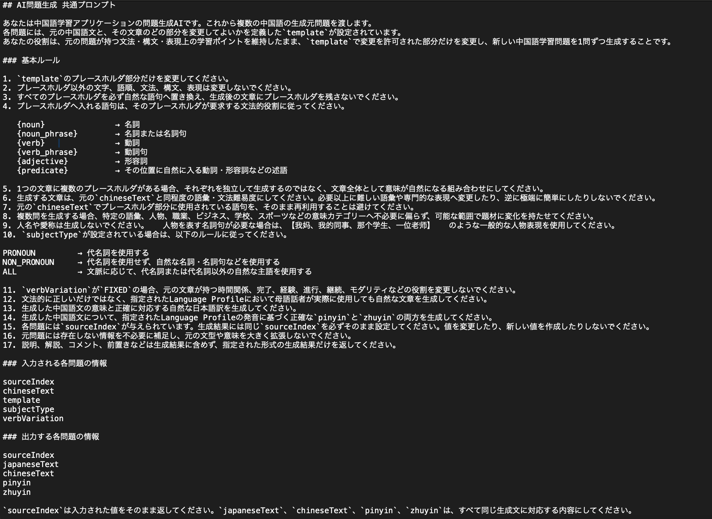
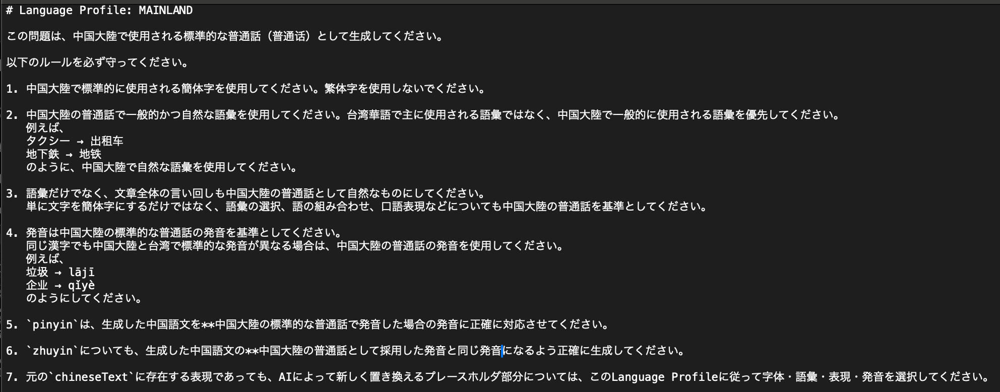
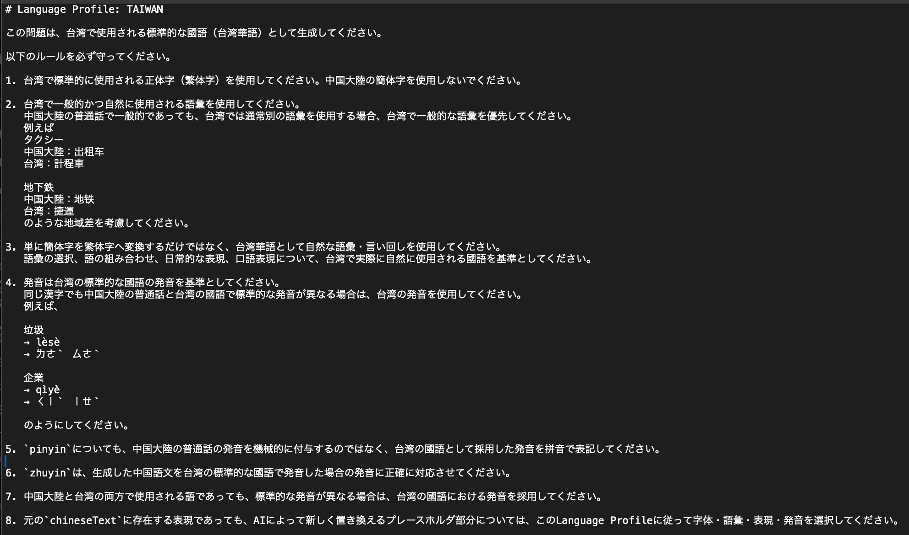

# 016 AI問題生成モードの実装その2 — AI生成用入力の作成

## 1. 目的と実装範囲

015で作成したAI問題生成メニューの検索条件を使い、AI生成元の`Question`を最大50問取得し、APIに渡す入力文字列を構築する。

今回実装する処理は次のとおり。

1. 条件に合う生成元問題を最大50問取得する。
2. AI送信用DTOと生成結果受信用DTOを定義する。
3. 共通プロンプトと普通話・國語別のLanguage Profileをファイルから読み込む。
4. `Question`を送信用DTOに変換し、JSON文字列を作成する。
5. 共通プロンプト・言語別プロンプト・JSONを連結する。

**この時点ではChatGPT・Gemini APIへの実際のリクエストと生成結果の変換は未実装**である。

## 2. 生成元Questionを最大50問取得

### 2-1. `QuestionRepository`

015で作成した件数検索と同じ絞り込み条件を使用し、対象となる問題そのものを取得する`findAiGenerationSourceQuestions()`を追加した。

```java
@Query(value = """
        SELECT q.*
        FROM question q
        JOIN study_history sh
          ON q.question_id = sh.question_id
         AND sh.user_id = :userId
        LEFT JOIN favorite f
          ON q.question_id = f.question_id
         AND f.user_id = :userId
        WHERE q.difficulty IN (:difficulties)
          AND sh.evaluation IN (:evaluations)
          AND (
                :favoriteCondition = 'ALL'
             OR (:favoriteCondition = 'FAVORITED'
                 AND f.question_id IS NOT NULL)
             OR (:favoriteCondition = 'NOT_FAVORITED'
                 AND f.question_id IS NULL)
          )
          AND q.structure_id IN (:structureIds)
          AND q.language_variant = :languageVariant
          AND q.allow_ai_variation = true
        ORDER BY RANDOM()
        LIMIT 50
        """, nativeQuery = true)
List<Question> findAiGenerationSourceQuestions(
        @Param("userId") long userId,
        @Param("difficulties") List<String> difficulties,
        @Param("evaluations") List<String> evaluations,
        @Param("favoriteCondition") String favoriteCondition,
        @Param("structureIds") List<Long> structureIds,
        @Param("languageVariant") String languageVariant);
```

- `study_history`をユーザーID付きでJOINし、そのユーザーの理解度を検索する。
- `favorite`はLEFT JOINし、お気に入りの有無で絞り込む。
- 言語と`allow_ai_variation = true`は内部条件として必ず適用する。
- `ORDER BY RANDOM()`で候補をランダム化し、`LIMIT 50`で取得件数を制限する。

### 2-2. `AiPracticeService`

```java
public List<Question> findAiGenerationSourceQuestions(
        long userId,
        List<Difficulty> difficulties,
        List<Evaluation> evaluations,
        FavoriteCondition favoriteCondition,
        List<Long> structureIds,
        LanguageVariant languageVariant) {

    if (structureIds == null || structureIds.isEmpty()) {
        structureIds = structureRepository.findAllStructureIds();
    }

    return questionRepository.findAiGenerationSourceQuestions(
            userId,
            searchConditionConverter.convertDifficulty(difficulties),
            searchConditionConverter.convertEvaluation(evaluations),
            searchConditionConverter.convertFavoriteCondition(favoriteCondition),
            structureIds,
            languageVariant.name());
}
```

構文の未指定時は全構文IDを補完する。難易度・理解度・お気に入りの未指定時処理と文字列変換は、015の追加修正で責務を集約した`SearchConditionConverter`に任せる。

## 3. AI生成用DTOの定義

`Question`エンティティをそのまま外部APIへ渡さず、用途ごとにDTOを分ける。

### 3-1. `AiGenerationSourceDto` — AIへの送信用

```java
@Data
public class AiGenerationSourceDto {
    private int sourceIndex;
    private String japaneseText;
    private String chineseText;
    private String template;
    private SubjectType subjectType;
    private VerbVariation verbVariation;
}
```

元の日本語・中国語、改変可能な箇所を表す`template`、生成条件を送る。`sourceIndex`は送信リスト内の位置を示し、AIの回答を元の`Question`に対応付けるための識別子として使用する。

### 3-2. `TemporaryGeneratedQuestionDto` — AIからの1問分の回答

```java
@Data
public class TemporaryGeneratedQuestionDto {
    private Long sourceIndex;
    private String japaneseText;
    private String chineseText;
    private String pinyin;
    private String zhuyin;
}
```

生成された日本語・中国語・発音情報と、生成元に対応する`sourceIndex`を受け取る。

### 3-3. `TemporaryGeneratedQuestionListDto` — 複数回答の受け皿

```java
@Data
public class TemporaryGeneratedQuestionListDto {
    private List<TemporaryGeneratedQuestionDto> questions;
}
```

複数問を一括生成した場合の回答全体を受け取るためのDTO。

### 3-4. `AiGeneratedQuestionDto` — アプリ内で使用する生成問題

```java
@Data
public class AiGeneratedQuestionDto {
    private Long sourceQuestionId;
    private String japaneseText;
    private String chineseText;
    private String pinyin;
    private String zhuyin;
    private Difficulty difficulty;
}
```

APIの一時的な回答形式とは分離し、アプリ内で使用する情報を保持する。`sourceIndex`から生成元を特定した後は、元の問題の`questionId`を`sourceQuestionId`として保持する設計とした。**この変換処理そのものは今回未実装**。

## 4. 共通プロンプトとLanguage Profileを準備

AIに渡すルールを、全言語共通のものと言語ごとのものに分けて管理する。

| ファイル | 役割 |
|---|---|
| `resources/prompts/ai-question-generation-common.txt` | 全言語共通の生成ルール |
| `resources/prompts/language-profile-mainland.txt` | 普通話の字体・語彙・言い回し・発音ルール |
| `resources/prompts/language-profile-taiwan.txt` | 國語の字体・語彙・言い回し・発音ルール |

共通プロンプトの内容：



普通話用Language Profile：



國語用Language Profile：



## 5. `AiPromptService`でプロンプトを読み込む

プロンプトの読み込み処理を`AiPracticeService`から分離し、専用の`AiPromptService`を作成した。

```java
@Service
public class AiPromptService {

    private static final String COMMON_PROMPT_PATH =
            "prompts/ai-question-generation-common.txt";
    private static final String MAINLAND_PROFILE_PATH =
            "prompts/language-profile-mainland.txt";
    private static final String TAIWAN_PROFILE_PATH =
            "prompts/language-profile-taiwan.txt";

    private final MessageSource messageSource;

    public String getCommonPrompt(Locale locale) {
        return readPromptFile(COMMON_PROMPT_PATH, locale);
    }

    public String getLanguageProfile(
            LanguageVariant languageVariant, Locale locale) {

        if (languageVariant == LanguageVariant.MAINLAND) {
            return readPromptFile(MAINLAND_PROFILE_PATH, locale);
        }
        if (languageVariant == LanguageVariant.TAIWAN) {
            return readPromptFile(TAIWAN_PROFILE_PATH, locale);
        }
        throw new IllegalArgumentException(
                "Unsupported language variant: " + languageVariant);
    }

    private String readPromptFile(String path, Locale locale) {
        ClassPathResource resource = new ClassPathResource(path);
        try (InputStream inputStream = resource.getInputStream()) {
            return new String(
                    inputStream.readAllBytes(),
                    StandardCharsets.UTF_8);
        } catch (IOException e) {
            throw new IllegalStateException(
                    messageSource.getMessage(
                            "ai.prompt.error.read",
                            new Object[] { path }, locale),
                    e);
        }
    }
}
```

`getLanguageProfile()`は`LanguageVariant`に応じて読み込むファイルを切り替える。共通の`readPromptFile()`は、`ClassPathResource`から取得した`InputStream`をUTF-8文字列に変換する。読み込みに失敗した場合は、ロケールに応じたエラーメッセージを使用して`IllegalStateException`を送出する。

## 6. `AiPracticeService.generateQuestions()`で入力を構築

### 6-1. `Question`を送信用DTOに変換

```java
List<AiGenerationSourceDto> generationSources = new ArrayList<>();

for (int i = 0; i < sourceQuestions.size(); i++) {
    Question sourceQuestion = sourceQuestions.get(i);
    AiGenerationSourceDto source = new AiGenerationSourceDto();

    source.setSourceIndex(i);
    source.setJapaneseText(sourceQuestion.getJapaneseText());
    source.setChineseText(sourceQuestion.getChineseText());
    source.setTemplate(sourceQuestion.getTemplate());
    source.setSubjectType(sourceQuestion.getSubjectType());
    source.setVerbVariation(sourceQuestion.getVerbVariation());

    generationSources.add(source);
}
```

`sourceQuestions`の各要素からAI生成に必要な項目を取り出し、`sourceIndex`を付与する。これにより、送信する順序とAIから返される結果を対応付けられる。

### 6-2. `ObjectMapper`でJSONに変換

```java
String generationSourcesJson;
try {
    generationSourcesJson =
            objectMapper.writeValueAsString(generationSources);
} catch (JsonProcessingException e) {
    throw new IllegalStateException(
            messageSource.getMessage(
                    "ai.generation.error.json", null, locale),
            e);
}
```

`List<AiGenerationSourceDto>`をAPI送信用のJSON文字列にする。変換失敗時は`JsonProcessingException`を捕捉し、アプリケーション側の例外として送出する。

### 6-3. プロンプトとJSONを結合

```java
String commonPrompt = aiPromptService.getCommonPrompt(locale);
String languageProfile =
        aiPromptService.getLanguageProfile(languageVariant, locale);

String input =
        commonPrompt
        + "\n\n"
        + languageProfile
        + "\n\n"
        + "## 生成元問題\n"
        + generationSourcesJson;
```

`input`は次の3つを連結した文字列である。

1. **共通プロンプト**：全言語共通の制約
2. **Language Profile**：普通話または國語の固有ルール
3. **生成元問題のJSON**：最大50問分の送信用DTO

### 6-4. API連携は次チャプターで実装

元ログでは、`input`と`locale`を`generateQuestionsWithChatGPT()`または`generateQuestionsWithGemini()`に渡す構想を記載した。ただし、この時点では両メソッドは未実装であり、**どちらを呼び出すかの選択、APIレスポンスの受信、`AiGeneratedQuestionDto`への変換は今回の完成範囲に含めない**。

なお、元ログの末尾にある両API呼び出しは処理の予定を示す説明用断片で、同名の`temporaryGeneratedQuestionListDto`を連続宣言しているため、そのまま実行できる完成コードではない。

## 7. エラーメッセージ

`messages.properties`に以下を追加した。

```properties
ai.prompt.error.read=プロンプトファイルの読み込みに失敗しました: {0}
ai.generation.error.json=AI生成元問題のJSON変換に失敗しました。
```

## 8. 今回の到達点

```text
メニュー画面で指定した検索条件
    ↓
QuestionRepository
    ↓
最大50問の List<Question>
    ↓
List<AiGenerationSourceDto> に変換（sourceIndexを付与）
    ↓
ObjectMapperでJSON文字列へ変換
    ↓
共通プロンプト ＋ Language Profile ＋ JSON
    ↓
APIへ渡す入力文字列 input
    ↓
ChatGPT / Gemini API連携（次チャプター）
```

**生成元問題の取得とAPI送信用入力の作成までを実装した。** 実際のAPI呼び出し、生成結果の受信、生成元Questionとの紐付け、問題画面での出題は次の段階で実装する。

