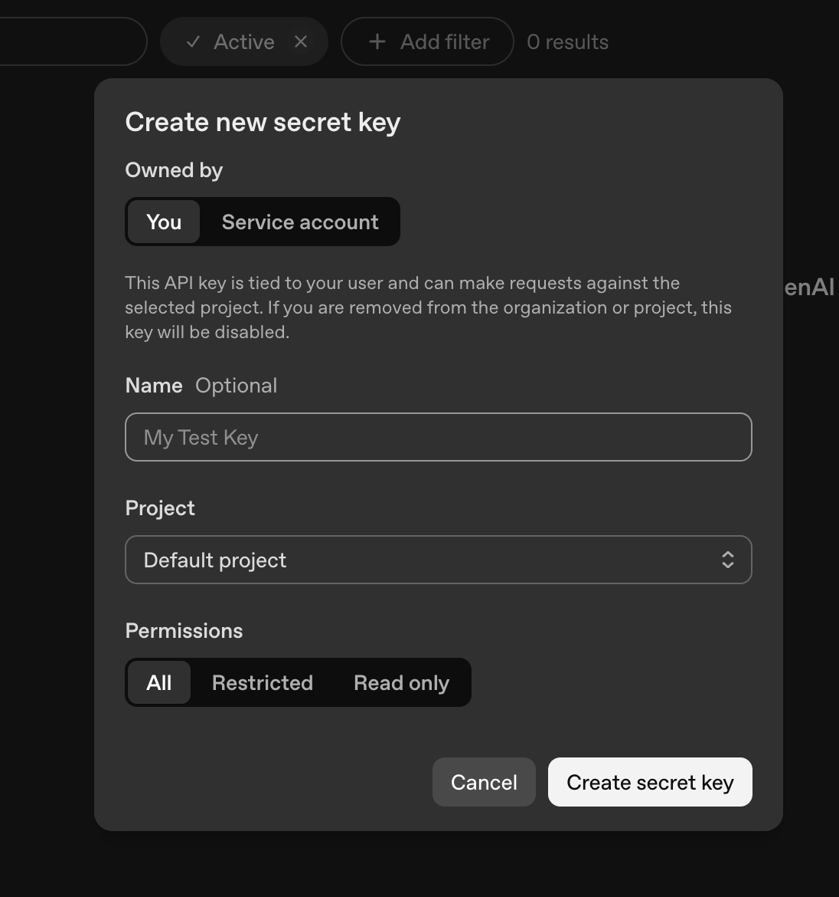
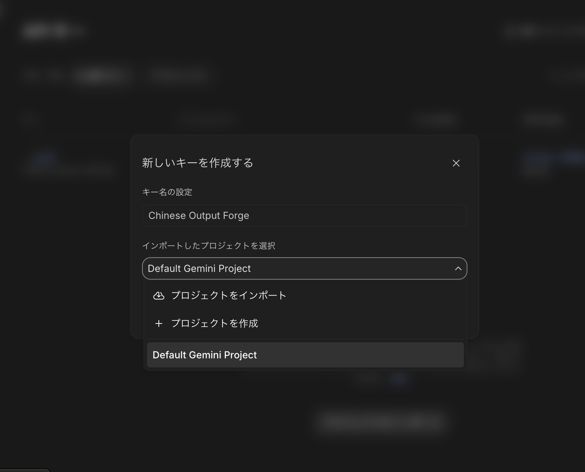
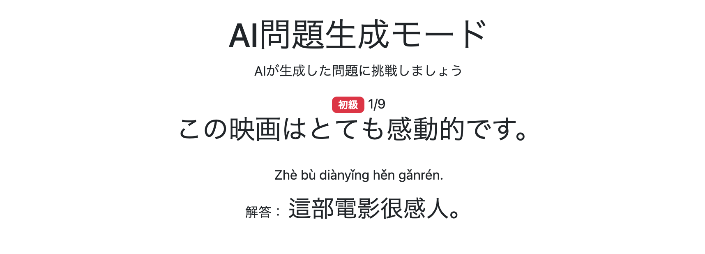

# 018 AI問題生成モードの実装その4｜生成問題の画面表示とAPI利用準備

## はじめに

017までに、生成元の`List<Question>`からAIへの`input`を作成し、OpenAIまたはGeminiのレスポンスを`TemporaryGeneratedQuestionListDto`として取得する処理を実装した。

本章では、生成結果を`List<AiGeneratedQuestionDto>`に変換し、Controller・Session・Thymeleafを通して学習画面に表示する。加えて、前後移動・中断・再開・完了・終了の画面遷移、APIクライアントのBean登録とAPIキー設定、実際の生成結果の確認までを記録する。

## 1. AI生成結果を画面表示用DTOに変換

APIから返る`TemporaryGeneratedQuestionListDto`はAIが生成した文面を保持するが、画面では生成元の`questionId`と難易度も必要となる。そこで`sourceIndex`を介して生成元の`Question`を参照し、画面表示用の`AiGeneratedQuestionDto`を組み立てる。

### `AiPracticeService.generateQuestions()`からの呼び出し

```java
// API別の生成処理後は同じ一時DTOを使用する
List<AiGeneratedQuestionDto> generatedQuestions =
        convertToGeneratedQuestions(
                temporaryGeneratedQuestionListDto,
                sourceQuestions);

return generatedQuestions;
```

両APIの結果は同じ一時DTOに統一されているため、以降の変換処理は共通化できる。

### `convertToGeneratedQuestions()`（実装コード）

```java
private List<AiGeneratedQuestionDto> convertToGeneratedQuestions(
        TemporaryGeneratedQuestionListDto temporaryGeneratedQuestionListDto,
        List<Question> sourceQuestions) {

    // DTOの中から生成された複数の問題を取得
    List<TemporaryGeneratedQuestionDto> temporaryGeneratedQuestionDtos =
            temporaryGeneratedQuestionListDto.getQuestions();

    // 最終的なAI生成問題を格納するListを作成
    List<AiGeneratedQuestionDto> generatedQuestions =
            new ArrayList<>();

    // AIが生成した問題を順番に処理
    for (int i = 0; i < temporaryGeneratedQuestionDtos.size(); i++) {

        TemporaryGeneratedQuestionDto temporaryGeneratedQuestionDto =
                temporaryGeneratedQuestionDtos.get(i);

        // sourceIndexを基に生成元問題を取得
        Question sourceQuestion =
                sourceQuestions.get(
                        temporaryGeneratedQuestionDto.getSourceIndex());

        // 最終的なAI生成問題DTOを作成
        AiGeneratedQuestionDto generatedQuestion =
                new AiGeneratedQuestionDto();

        generatedQuestion.setSourceQuestionId(
                sourceQuestion.getQuestionId());

        generatedQuestion.setJapaneseText(
                temporaryGeneratedQuestionDto.getJapaneseText());

        generatedQuestion.setChineseText(
                temporaryGeneratedQuestionDto.getChineseText());

        generatedQuestion.setPinyin(
                temporaryGeneratedQuestionDto.getPinyin());

        generatedQuestion.setZhuyin(
                temporaryGeneratedQuestionDto.getZhuyin());

        generatedQuestion.setDifficulty(
                sourceQuestion.getDifficulty());

        // Listへ追加
        generatedQuestions.add(generatedQuestion);
    }

    return generatedQuestions;
}
```

処理順は、`getQuestions()`で生成問題の一覧を取得 → 各要素の`sourceIndex`で`sourceQuestions`を参照 → 生成元のID・難易度とAIの生成文・発音記号を統合 → `List<AiGeneratedQuestionDto>`を返却、となる。

| `AiGeneratedQuestionDto`の項目 | 取得元 |
|---|---|
| `sourceQuestionId` | 生成元`Question.questionId` |
| `difficulty` | 生成元`Question.difficulty` |
| `japaneseText` / `chineseText` | AI生成結果 |
| `pinyin` / `zhuyin` | AI生成結果 |

`sourceIndex`はデータベース上のIDではなく、AIへ渡した生成元リスト内のインデックスである。実装当時は`sourceQuestions.get(sourceIndex)`で直接参照しているため、想定外のインデックスが返ると範囲外アクセスになる点は今後の検証課題である。

## 2. Controllerで問題生成を開始し、Sessionに保存

`/ai-practice/start`では既存のAI学習状態を消去し、選択条件から生成元問題を取得する。対象が0件ならメニューへ戻し、取得できた場合だけAPIによる生成処理を実行する。

### `AiPracticeController.getAiPracticeStart()`

```java
@GetMapping("/ai-practice/start")
public String getAiPracticeStart(
         HttpSession session,
         @AuthenticationPrincipal UserDetails loginUser,
         @RequestParam(name = "evaluations", required = false)
                List<Evaluation> evaluations,
         @RequestParam(name = "difficulties", required = false)
                List<Difficulty> difficulties,
         @RequestParam(name = "favoriteCondition", required = false)
                FavoriteCondition favoriteCondition,
         @RequestParam(name = "structureIds", required = false)
                List<Long> structureIds,
         Locale locale) {

    // 既存の学習状態を破棄
    clearAiPracticeSession(session);

    // 学習対象言語を取得
    LanguageVariant languageVariant =
            (LanguageVariant) session.getAttribute("languageVariant");

    // 未設定の場合は普通話
    if (languageVariant == null) {
        languageVariant = LanguageVariant.MAINLAND;
    }

    // 先に宣言
    List<Question> sourceQuestions;

    // user_id(文字列)からUsersを取得
    Users user = getLoginUser(loginUser);
    Long userId = user.getId();

    // 新しい問題セットを作成
    sourceQuestions = aiPracticeService.getQuestion(
            userId,
            difficulties,
            evaluations,
            favoriteCondition,
            structureIds,
            languageVariant);

    // 問題が1件もない場合は開始しない
    if (sourceQuestions.isEmpty()) {
        return "redirect:/ai-practice/menu";
    }

    // AIで問題を生成
    List<AiGeneratedQuestionDto> aiPracticeQuestions;

    aiPracticeQuestions = aiPracticeService.generateQuestions(
            sourceQuestions,
            languageVariant,
            locale);

    session.setAttribute(
            "aiPracticeQuestions",
            aiPracticeQuestions);

    session.setAttribute(
            "aiPracticeQuestionsCurrentPage",
            0);

    return "redirect:/ai-practice/question?page=0";
}
```

生成後は`aiPracticeQuestions`に問題一覧、`aiPracticeQuestionsCurrentPage`に`0`を保存して、`/ai-practice/question?page=0`へリダイレクトする。これにより問題画面ではAPIを再呼び出しせず、Sessionに保持した生成済み問題を参照できる。

## 3. 問題画面のControllerとModel

### `GET /ai-practice/question`

```text
/ai-practice/question
```

Sessionに問題一覧がない場合、または`page`が負数・問題数以上の場合はメニューへ戻す。正常な場合は現在ページをSessionに保存し、`QuestionModelUtil`へ表示用Modelの設定を委譲する。

当時は未保存のAI生成問題に対して、通常学習と同じお気に入り判定を適用できなかったため、該当コードをコメントアウトしていた。`sourceQuestionId`は生成元のIDであり、生成された問題自体の保存済みIDではない。理解度・お気に入り機能は生成問題のDB保存機能を実装してから対応する方針とした。

### `QuestionModelUtil.setAiQuestionModel()`

```java
setAiQuestionModel()
```

`question`、問題番号、総問題数、前後の有無をModelへ設定する。また、Sessionの`pronunciationType`に応じて、`PINYIN`は拼音、`ZHUYIN`は注音、`NONE`は非表示にする。未設定の場合は`PINYIN`を既定値とする。

## 4. ThymeleafでAI生成問題を表示

`templates/ai-practice/question.html`を作成した。画面の主な要素は難易度・現在の問題番号・日本語問題・「解答を見る」ボタン・中国語解答・発音記号・前後移動・中断・終了である。

実装の要点を以下に残す（全HTMLの共通レイアウト宣言などは省略）。

### 問題文・解答の表示

```html
<h1 th:text="#{aiPractice.question.title}">AI問題生成モード</h1>
<span th:text="${nextPageIndex + '/' + totalPages}">1/10</span>
<h2 th:text="${question.japaneseText}">日本語問題</h2>

<button id="answerButton" type="button" onclick="showAnswer()"
        th:text="#{aiPractice.question.showAnswer}">解答を見る</button>
<div id="answerArea" style="display:none;">
    <p th:if="${pronunciation != null}" th:text="${pronunciation}"></p>
    <span th:text="${question.chineseText}">Chinese Answer</span>
</div>
```

`showAnswer()`は既存の`/js/practice.js`を使用し、非表示の解答領域を表示する。難易度バッジは`question.difficulty`に応じて色・文言を切り替える。

### ページ移動・中断・終了

```html
<a th:if="${hasPrevious}"
   th:href="@{/ai-practice/question(page=${nextPageIndex - 2})}"
   th:text="#{aiPractice.question.previous}">前の問題へ</a>

<a th:if="${hasNext}"
   th:href="@{/ai-practice/question(page=${nextPageIndex})}"
   th:text="#{aiPractice.question.next}">次の問題へ</a>

<a th:if="${!hasNext}"
   th:href="@{/ai-practice/complete}"
   th:text="#{aiPractice.question.complete}">完了</a>

<a th:href="@{/ai-practice/suspend(page=${nextPageIndex - 1})}"
   th:attr="onclick=|return confirm('#{aiPractice.question.suspend.confirm}');|"
   th:text="#{aiPractice.question.suspend}">中断する</a>

<a th:href="@{/ai-practice/quit}"
   th:attr="onclick=|return confirm('#{aiPractice.question.quit.confirm}');|"
   th:text="#{aiPractice.question.quit}">やめる</a>
```

`nextPageIndex`は`page + 1`なので、前の問題への遷移は`nextPageIndex - 2`、次の問題は`nextPageIndex`、中断時の現在ページは`nextPageIndex - 1`になる。

### `messages.properties`（追加分）

```properties
# AI問題生成モード 問題画面
aiPractice.question.pageTitle=AI問題生成モード | Chinese Output Forge
aiPractice.question.title=AI問題生成モード
aiPractice.question.message=AIが生成した問題に挑戦しましょう
aiPractice.question.showAnswer=解答を見る
aiPractice.question.answer=解答：
aiPractice.question.previous=前の問題へ
aiPractice.question.next=次の問題へ
aiPractice.question.complete=完了
aiPractice.question.suspend=中断する
aiPractice.question.suspend.confirm=学習を中断しますか？
aiPractice.question.quit=やめる
aiPractice.question.quit.confirm=AI問題生成モードを終了しますか？
```

## 5. Sessionによる中断・再開・完了・終了

通常学習・復習モードと同じ考え方で、生成済み問題一覧と現在ページをSessionで保持する。

### メニューで再開可能かを判定

```java
@GetMapping("/ai-practice/menu")
public String getAiPracticeMenu(
        HttpSession session,
        Model model) {

    // 言語切替後の戻り先
    model.addAttribute(
            "languageVariantRedirect",
            "/ai-practice/menu");

    // セッションから情報を取得
    List<AiGeneratedQuestionDto> questions =
            (List<AiGeneratedQuestionDto>) session.getAttribute(
                    "aiPracticeQuestions");

    Integer currentPage =
            (Integer) session.getAttribute(
                    "aiPracticeQuestionsCurrentPage");

    // 中断したデータがあるか判定
    boolean canResume =
            questions != null && currentPage != null;

    // 中断したデータ情報を返す
    model.addAttribute("canResume", canResume);

    if (canResume) {
        model.addAttribute("currentPage", currentPage);
        model.addAttribute("totalCount", questions.size());
    }

    // 画面表示用structureを取得
    model.addAttribute(
            "structures",
            reviewService.findStructures());

    return "/ai-practice/menu";
}
```

`aiPracticeQuestions`と`aiPracticeQuestionsCurrentPage`が両方ある場合に`canResume=true`とし、現在ページと総問題数をModelへ渡す。

### 再開・中断

```java
@GetMapping("/ai-practice/resume")
public String getAiPracticeResume(
        Model model,
        HttpSession session) {

    // 中断していないならmenuに戻す
    if (session.getAttribute("aiPracticeQuestions") == null) {
        return "redirect:/ai-practice/menu";
    }

    // 中断時のページ情報を取得
    Integer page =
            (Integer) session.getAttribute(
                    "aiPracticeQuestionsCurrentPage");

    return "redirect:/ai-practice/question?page=" + page;
}
```

```java
@GetMapping("/ai-practice/suspend")
public String getAiPracticeSuspend(
        @RequestParam int page,
        HttpSession session) {

    log.info("getAiPracticeSuspend reached");

    session.setAttribute(
            "aiPracticeQuestionsCurrentPage",
            page);

    return "redirect:/";
}
```

中断時には問題一覧を削除せず、ページ位置だけ更新してトップへ戻る。再開時はSessionに保持したページへリダイレクトするため、AI APIへの再リクエストは不要である。

### 完了・終了・Session削除

```java
@GetMapping("/ai-practice/complete")
public String getAiPracticeComplete(
        HttpSession session) {

    clearAiPracticeSession(session);

    return "redirect:/complete";
}
```

```java
@GetMapping("/ai-practice/quit")
public String getAiPracticeQuit(
        HttpSession session) {

    clearAiPracticeSession(session);

    return "redirect:/";
}
```

```java
clearAiPracticeSession()
```

完了は共通の`/complete`、終了はトップページ`/`へ遷移する。いずれも`clearAiPracticeSession()`でAI学習専用の2つの属性を削除する。新規開始時にも同メソッドを使う。

### ログインユーザー取得処理の共通化

```java
getLoginUser()
```

`getLoginUser()`は`UserDetails.getUsername()`から`Users`を取得する共通処理として切り出し、生成元件数の取得や学習開始で使用した。

## 6. OpenAI・Gemini ClientをSpring Beanとして登録

### OpenAI Client

`AiPracticeService`は`private final OpenAIClient openAIClient;`をコンストラクタ注入する設計だったが、実際に起動するにはBean登録が必要である。

`OpenAiConfig.java`

```java
@Configuration
public class OpenAiConfig {

    @Bean
    OpenAIClient openAIClient() {
        return OpenAIOkHttpClient.fromEnv();
    }
}
```

`OpenAIOkHttpClient.fromEnv()`で環境変数から接続情報を読み取り、`@Bean`によってSpring管理の`OpenAIClient`を生成する。APIキーはソースコードへ直書きせず、Eclipseの実行構成の環境変数`OPENAI_API_KEY`へ設定した。



### Gemini ClientのDIエラーと対応

OpenAIを使用するため`useChatGPT=true`にして起動しても、`AiPracticeService`には`private final Client geminiClient;`も存在するため、Springは起動時に両方の依存オブジェクトを要求した。

発生したエラー：

```text
required a bean of type 'com.google.genai.Client'
```

`GeminiConfig.java`

```java
@Configuration
public class GeminiConfig {

    @Bean
    Client geminiClient() {
        return new Client();
    }
}
```

Bean登録後は、Gemini Client生成時にAPIキーが見つからず、次のエラーが発生した。

```text
API key must either be provided or set in the environment variable GOOGLE_API_KEY or GEMINI_API_KEY.
```

Google AI StudioでAPIキーを取得し、Eclipseの環境変数`GEMINI_API_KEY`へ設定した。



**学んだ点：** `if (useChatGPT)`でGemini側のメソッドを呼ばなくても、DI対象のBeanはService生成時に必要になる。実行時の分岐とSpringの依存解決は別のタイミングである。

## 7. 動作確認：AI生成から画面表示まで

ClientのBean登録とAPIキー設定後、次の一連の処理が動作した。

```text
/ai-practice/start
  → 生成元Questionの取得
  → input作成・AI API呼び出し
  → TemporaryGeneratedQuestionListDto
  → sourceIndexによる生成元との対応付け
  → List<AiGeneratedQuestionDto>
  → Sessionへ保存
  → /ai-practice/questionで画面表示
```

ローカルの`http://localhost:8080/ai-practice/question`で表示を確認した。



確認条件は**國語・初級**、生成元問題は**9件**。以下のように元の文型を保ちながら内容を変えた問題が生成された。

| 生成元 | AI生成後 |
|---|---|
| 這部電影很好看。／この映画はとても面白いです。 | 這部電影很感人。／この映画はとても感動的です。 |
| 請問，洗手間在哪裡？／すみません、お手洗いはどこですか？ | 請問，服務台在哪裡？／すみません、サービスカウンターはどこですか？ |
| 我把手機忘在家裡了。／携帯電話を家に忘れました。 | 我媽把鑰匙忘在車上了。／母は鍵を車の中に忘れました。 |
| 我們搭計程車去車站吧。／駅までタクシーで行こう。 | 我們搭公車去夜市吧。／私たちはバスで夜市に行こう。 |

※この動作確認は、記載した条件・例で生成と表示が成功した記録であり、全入力条件・全モデルでの検証完了を意味するものではない。

## 8. このチャプターのまとめ

今回、AIから受け取った一時DTOを`sourceIndex`で生成元問題に対応付け、`AiGeneratedQuestionDto`へ変換して学習画面へ表示するまでを実装した。通常学習・復習モードと同様の前後移動、中断・再開、完了・終了もSessionを利用して実現した。

さらに、OpenAI・GeminiそれぞれのClientをSpring Beanとして登録し、環境変数にAPIキーを設定した。GeminiのBean不足とAPIキー不足の起動エラーへの対応を通じ、**APIを呼び出す前にDIが成立している必要がある**ことを確認した。

これにより、生成条件の指定からAPIによる問題生成、DTO変換、Session保存、問題画面表示までを実際に動作確認できた。次チャプターでは、問題画面のUIやAI生成結果の多様性などを見直す。

