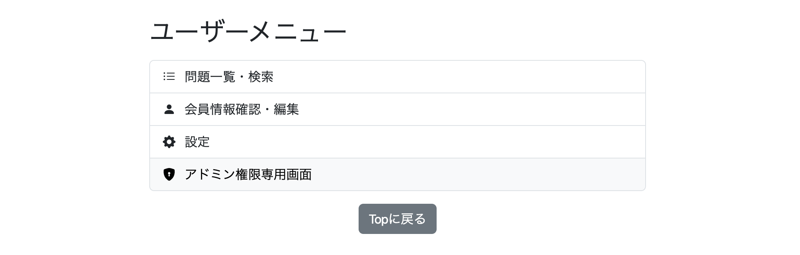
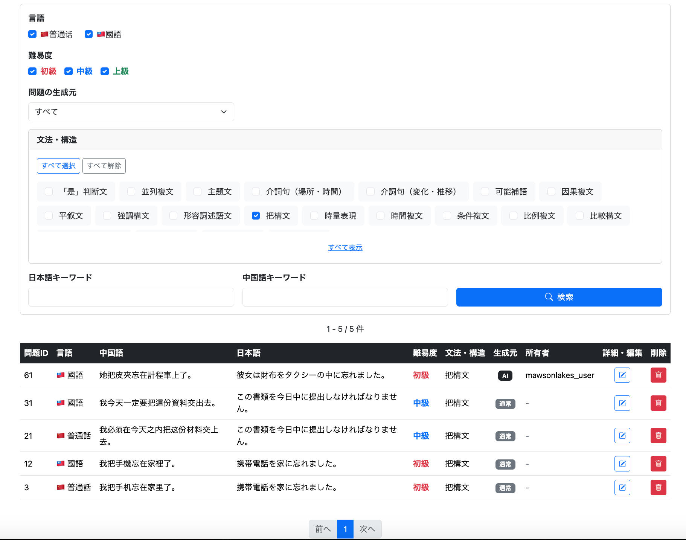

# 022-01 Adminメニューと問題一覧・検索機能の実装

> このログは実装・変更を時系列で記録したものです。途中のコードや仕様は、その後の開発によって変更されている場合があります。現在の実装はソースコードを参照してください。
>
> 元の「022 Admin管理機能の実装」から、Adminメニューと問題一覧・検索機能を独立させた記録です。問題削除、表示順の改善、問題追加・編集は後続の022シリーズで扱います。

## 概要

管理者が専用メニューから問題一覧へ移動し、登録済みの問題を条件付きで検索・閲覧できるようにした。一般ユーザー向けの問題一覧を参考にしつつ、Adminでは全ユーザーが所有するAI生成問題も閲覧できる構成とした。

| 機能 | 内容 |
| --- | --- |
| Adminメニュー | `/admin/menu` から管理機能へ遷移 |
| 問題一覧 | `/admin/question/list` に検索結果を表示 |
| 検索 | 言語、難易度、生成元、文法・構造、日本語・中国語キーワード |
| 所有者表示 | AI生成問題のOwnerのログインIDを表示 |
| ページング | `Page<AdminQuestionListDto>` と既存のページネーション処理を利用 |

管理画面の文言は日本語固定とし、原則として`messages.properties`による多言語化は行わない。検証にはAdminロールのアカウントを用意した。**認証情報は実装ログに記載しない。**

## 1. Adminメニューページの実装

### 1.1 目的と変更内容

一般ユーザーのメニューから管理者専用画面に移動し、管理機能への入口をまとめる。`AdminController`に`/admin/menu`を追加し、`admin/menu.html`を作成した。

| ファイル | 役割 |
| --- | --- |
| `AdminController` | AdminメニューのGETリクエストを受け付ける |
| `templates/admin/menu.html` | ユーザー管理・問題管理・問題追加へのリンクを表示 |
| `templates/user/menu.html` | 既存のAdminメニューへのリンクを利用（追加修正なし） |

### 1.2 Controller

```java
@Controller
public class AdminController {
    
    @GetMapping("/admin/menu")
    public String getAdminMenu() {
        return "admin/menu";
    }

}
```

この段階のControllerは画面名を返すだけのシンプルな実装である。

### 1.3 画面と権限表示

`admin/menu.html`はBootstrapの`list-group`を使い、以下のリンクを配置した。

```html
<div class="list-group mt-3">
    <a th:href="@{/admin/user/list}" class="list-group-item list-group-item-action">ユーザー管理</a>
    <a th:href="@{/admin/question/list}" class="list-group-item list-group-item-action">問題管理</a>
    <a th:href="@{/admin/question/add}" class="list-group-item list-group-item-action">問題追加</a>
</div>
<a th:href="@{/user/menu}" class="btn btn-secondary">userメニューに戻る</a>
```

`user/menu.html`にはすでにAdmin向けリンクがあり、次の条件で表示を切り替えていた。

```html
<a th:href="@{/admin/menu}"
   class="list-group-item list-group-item-action"
   sec:authorize="hasRole('ROLE_ADMIN')">
    <span th:text="#{user.menu.admin}">アドミン権限専用画面</span>
</a>
```

`sec:authorize`は**画面上のリンクの表示制御**である。URLへの直接アクセスも含むサーバー側の認可設定については、この箇所の記録だけでは確認できないため、別途Security設定を参照する。

### 1.4 動作確認

Adminユーザーで`http://localhost:8080/user/menu`にアクセスし、管理者専用メニューへのリンクが表示されることを確認した。



リンクからAdmin専用画面に遷移できることも確認した。


**コミット**

```text
git commit -m "feat: add admin menu page"
```

## 2. Admin用問題一覧・検索機能の実装

### 2.1 目的とUser用画面との違い

Admin用の問題一覧はUser用の一覧画面を基に作成したが、閲覧範囲と検索条件が異なる。

| 観点 | Admin用の仕様 |
| --- | --- |
| AI生成問題 | 全ユーザーが所有する問題を表示対象に含める |
| Owner | AI生成問題の所有者ログインIDを表示する。ただしOwnerによる検索は設けない |
| 学習状態 | 理解度・お気に入り登録状況では絞り込まない |
| 言語 | 普通話・國語を両方、または片方だけ指定できる |
| その他 | 難易度・生成元・文法構造・日本語／中国語キーワードを指定できる |

実装では、一覧に必要な情報だけを取得するため、`Question` EntityそのものではなくInterface-based Projectionを使用した。

### 2.2 追加・変更した主なファイル

| ファイル | 変更内容 |
| --- | --- |
| `AdminQuestionListDto` | 問題一覧用のProjectionを定義 |
| `QuestionRepository` | 複数条件のNative Queryと件数取得Queryを追加 |
| `AdminQuestionService` | 未指定条件を補完してRepositoryに渡す |
| `AdminQuestionController` | 検索条件を受け取り、一覧とページ情報をModelに格納 |
| `templates/admin/question/list.html` | 検索フォーム、一覧、ページネーションを表示 |
| `static/js/admin/question/list.js` | 文法・構造の全選択・解除、表示の展開・折りたたみ |

### 2.3 Interface-based Projectionの採用

```java
public interface AdminQuestionListDto {

    Long getQuestionId();

    LanguageVariant getLanguageVariant();

    String getChineseText();

    String getJapaneseText();

    Difficulty getDifficulty();

    String getStructureName();

    boolean isAiGenerated();

    String getOwnerLoginId();

}
```

Ownerを表示するには`question`に加えて`users`テーブルを参照する必要がある。そのため、一覧表示に必要な項目をまとめた`AdminQuestionListDto`をRepositoryの戻り値とした。

Spring Data JPAでは、SQLの別名（例：`questionId`、`ownerLoginId`）とインターフェースのgetter名を対応させることで、取得結果をProxyオブジェクト経由で扱える。DTOの実装クラスやコンストラクタを自作せずに済む点が利点である。

### 2.4 Repository：全ユーザーの問題を検索

```java
    @Query(
            value = """
            SELECT
                q.question_id      AS questionId,
                q.language_variant AS languageVariant,
                q.chinese_text     AS chineseText,
                q.japanese_text    AS japaneseText,
                q.difficulty       AS difficulty,
                s.name             AS structureName,
                q.ai_generated     AS aiGenerated,
                u.login_id         AS ownerLoginId

            FROM question q

            JOIN structure s
                ON q.structure_id = s.structure_id

            LEFT JOIN users u
                ON q.owner_user_id = u.id

            WHERE q.difficulty IN (:difficulties)

            AND (
                :sourceCondition = 'ALL'
                OR (:sourceCondition = 'ORIGINAL_ONLY' AND q.ai_generated = false)
                OR (:sourceCondition = 'GENERATED_ONLY' AND q.ai_generated = true)
            )

            AND q.structure_id IN (:structureIds)
            AND q.language_variant IN (:languageVariants)

            AND (
                :japaneseKeyword = ''
                OR LOWER(q.japanese_text)
                    LIKE LOWER(CONCAT('%', :japaneseKeyword, '%'))
            )

            AND (
                :chineseKeyword = ''
                OR LOWER(q.chinese_text)
                    LIKE LOWER(CONCAT('%', :chineseKeyword, '%'))
                OR LOWER(q.alternative_answer)
                    LIKE LOWER(CONCAT('%', :chineseKeyword, '%'))
            )

            ORDER BY q.question_id DESC
            """,
            countQuery = """
                SELECT COUNT(*)
                FROM question q
                WHERE q.difficulty IN (:difficulties)
                AND (
                    :sourceCondition = 'ALL'
                    OR (:sourceCondition = 'ORIGINAL_ONLY' AND q.ai_generated = false)
                    OR (:sourceCondition = 'GENERATED_ONLY' AND q.ai_generated = true)
                )
                AND q.structure_id IN (:structureIds)
                AND q.language_variant IN (:languageVariants)
                AND (
                    :japaneseKeyword = ''
                    OR LOWER(q.japanese_text)
                        LIKE LOWER(CONCAT('%', :japaneseKeyword, '%'))
                )
    
                AND (
                    :chineseKeyword = ''
                    OR LOWER(q.chinese_text)
                        LIKE LOWER(CONCAT('%', :chineseKeyword, '%'))
                    OR LOWER(q.alternative_answer)
                        LIKE LOWER(CONCAT('%', :chineseKeyword, '%'))
                )
                """,
            nativeQuery = true
        )
        Page<AdminQuestionListDto> findFilteredAdminQuestionList(
                @Param("difficulties") List<String> difficulties,
                @Param("sourceCondition") String sourceCondition,
                @Param("structureIds") List<Long> structureIds,
                @Param("languageVariants") List<String> languageVariants,
                @Param("japaneseKeyword") String japaneseKeyword,
                @Param("chineseKeyword") String chineseKeyword,
                Pageable pageable
        );
```

このQueryで重要な設計判断は次のとおり。

- `JOIN structure`で構文名を取得する。
- `LEFT JOIN users`でOwnerを取得する。通常問題はOwnerを持たないため、内部結合では通常問題が結果から除外されてしまう。
- `sourceCondition`で`ALL`、`ORIGINAL_ONLY`、`GENERATED_ONLY`を切り替える。
- 難易度・文法構造・言語は`IN`条件で指定する。
- 日本語キーワードは`japanese_text`、中国語キーワードは`chinese_text`または`alternative_answer`に部分一致させる。
- `countQuery`を別に定義し、検索条件に合う総件数を取得する。
- **この時点の表示順は`question_id DESC`**。後から導入した更新日時順の並び替えは022-02で扱う。

Admin用のQueryには、通常ユーザー向けのOwner制限を入れていない。全ユーザーのAI生成問題を閲覧するという要件に合わせた違いである。

### 2.5 Service：検索条件の補完

```java

@Service
@RequiredArgsConstructor
public class AdminQuestionService {
    
    private final StructureRepository structureRepository;
    private final SearchConditionConverter searchConditionConverter;
    private final QuestionRepository questionRepository;

    public Page<AdminQuestionListDto> getFilteredAdminQuestions(
            List<Difficulty> difficulties,
            QuestionSourceCondition sourceCondition,
            List<Long> structureIds,
            List<LanguageVariant> languageVariants,
            String japaneseKeyword,
            String chineseKeyword,
            Pageable pageable) {
        
        // 言語未選択なら全言語
        if (languageVariants == null || languageVariants.isEmpty()) {
            languageVariants = Arrays.asList(LanguageVariant.values());
        }

        // 難易度未選択なら全難易度
        if (difficulties == null || difficulties.isEmpty()) {
            difficulties = Arrays.asList(Difficulty.values());
        }
        
        // 文法・構造未選択ならすべて選択
        if (structureIds == null || structureIds.isEmpty()) {
            structureIds = structureRepository.findAllStructureIds();
        }
        
        // キーワード未記入なら空白
        if (japaneseKeyword == null) {
        japaneseKeyword = "";
        }
        
        if (chineseKeyword == null) {
        chineseKeyword = "";
        }
        
        // 問題の生成元が未指定の場合はすべて
        if (sourceCondition == null) {
            sourceCondition = QuestionSourceCondition.ALL;
        }

        return questionRepository.findFilteredAdminQuestionList(
                searchConditionConverter.convertDifficulty(difficulties),
                sourceCondition.name(),
                structureIds,
                searchConditionConverter.convertLanguageVariant(languageVariants),
                japaneseKeyword,
                chineseKeyword,
                pageable);
    }
}
```

未選択・未入力の条件は、Repositoryに渡す前に次のように補完する。

| 条件 | 未指定時の扱い |
| --- | --- |
| 言語 | `LanguageVariant.values()`で全言語 |
| 難易度 | `Difficulty.values()`で全難易度 |
| 文法・構造 | `findAllStructureIds()`ですべてのID |
| 日本語・中国語キーワード | 空文字列 |
| 生成元 | `QuestionSourceCondition.ALL` |

Enumのリストは`SearchConditionConverter`を使ってQuery用の値に変換している。この補完によって、画面でチェック項目を指定しなかった場合も、全件検索として扱える。

### 2.6 Controller：検索結果とページング情報を画面へ渡す

```java

    @GetMapping("/admin/question/search")
    public String getAdminQuestionSearch(
            @PageableDefault(page = 0, size = 50) Pageable pageable,
            @RequestParam(required = false) List<Difficulty> difficulties,
            @RequestParam(required = false) QuestionSourceCondition sourceCondition,
            @RequestParam(required = false) List<Long> structureIds,
            @RequestParam(required = false) List<LanguageVariant> languageVariants,
            @RequestParam(required = false, defaultValue = "") String japaneseKeyword,
            @RequestParam(required = false, defaultValue = "") String chineseKeyword,
            HttpSession session,
            HttpServletRequest request,
            Model model) {
        
        Page<AdminQuestionListDto> allFilteredQuestionList = 
                adminQuestionService.getFilteredAdminQuestions(
                        difficulties,
                        sourceCondition,
                        structureIds,
                        languageVariants,
                        japaneseKeyword,
                        chineseKeyword,
                        pageable
                        );
                        
        PaginationDto pagination = paginationService.createPagination(allFilteredQuestionList);
        
        long start = allFilteredQuestionList.getNumber() * allFilteredQuestionList.getSize() + 1;
        long end = start + allFilteredQuestionList.getNumberOfElements() - 1;
        
        // ページ情報
        model.addAttribute("start", start);
        model.addAttribute("end", end);
        model.addAttribute("total", allFilteredQuestionList.getTotalElements());

        model.addAttribute("questionList", allFilteredQuestionList.getContent());
        model.addAttribute("page", allFilteredQuestionList);
        model.addAttribute("pagination", pagination);

        // 検索条件
        model.addAttribute("selectedDifficulties", difficulties);
        model.addAttribute("selectedSourceCondition", sourceCondition);
        model.addAttribute("selectedStructureIds", structureIds);
        model.addAttribute("selectedLanguageVariants", languageVariants);
        model.addAttribute("japaneseKeyword", japaneseKeyword);
        model.addAttribute("chineseKeyword", chineseKeyword);

        // 構文一覧
        model.addAttribute(
                "structures",
                reviewService.findStructures());
        
        return "/admin/question/list";
        
    }
```

`@PageableDefault(page = 0, size = 50)`で初期ページとページサイズを指定し、`PaginationService`でページ番号表示用の情報を作成する。

Modelには検索結果のほか、`start`・`end`・`total`、ページ情報、選択済み検索条件、文法・構造一覧を設定する。検索条件を再表示するため、選択値を画面に戻している。

**記録上の確認点：** Controllerのマッピングは`/admin/question/search`だが、後述のフォーム送信先は`/admin/question/list`になっている。元ログにはその対応関係の説明がないため、ここでは一致しているとは断定しない。実際の動作に用いるマッピングは現行ソースで確認する必要がある。

### 2.7 Thymeleaf：検索フォームと結果一覧

`admin/question/list.html`では検索条件と検索結果を同じページに配置した。HTML全文は長く、Bootstrapのレイアウト記述も多いため、検索値の受け渡しと画面生成に関係する箇所を抜粋する。

**検索条件の送信と復元**

```html
<form th:action="@{/admin/question/list}" method="get">
    <input type="checkbox" name="languageVariants" value="MAINLAND"
           th:checked="${selectedLanguageVariants == null or selectedLanguageVariants.![name()].contains('MAINLAND')}">
    <input type="checkbox" name="languageVariants" value="TAIWAN"
           th:checked="${selectedLanguageVariants == null or selectedLanguageVariants.![name()].contains('TAIWAN')}">

    <select name="sourceCondition">
        <option value="ALL" th:selected="${selectedSourceCondition == null or selectedSourceCondition.name() == 'ALL'}">すべて</option>
        <option value="ORIGINAL_ONLY" th:selected="${selectedSourceCondition != null and selectedSourceCondition.name() == 'ORIGINAL_ONLY'}">通常問題のみ</option>
        <option value="GENERATED_ONLY" th:selected="${selectedSourceCondition != null and selectedSourceCondition.name() == 'GENERATED_ONLY'}">AI生成問題のみ</option>
    </select>

    <label th:each="structure : ${structures}">
        <input type="checkbox" name="structureIds"
               th:value="${structure.structureId}"
               th:checked="${selectedStructureIds == null or selectedStructureIds.contains(structure.structureId)}">
        <span th:text="${structure.name}"></span>
    </label>

    <input type="text" name="japaneseKeyword" th:value="${japaneseKeyword}">
    <input type="text" name="chineseKeyword" th:value="${chineseKeyword}">
    <button type="submit">検索</button>
</form>
```

難易度も同様に`difficulties`のチェックボックスで選択し、`selectedDifficulties`を使って状態を復元する。

**件数表示とページング**

```html
<div th:if="${total > 0}">
    <span th:text="${start}"></span> -
    <span th:text="${end}"></span> /
    <span th:text="${total}"></span> 件
</div>
<div th:if="${total == 0}">0件</div>

<nav th:if="${page.totalPages > 0}">
    <a th:href="@{/admin/question/list(
        page=${page.number + 1},
        size=${page.size},
        difficulties=${selectedDifficulties},
        sourceCondition=${selectedSourceCondition},
        structureIds=${selectedStructureIds},
        languageVariants=${selectedLanguageVariants},
        japaneseKeyword=${japaneseKeyword},
        chineseKeyword=${chineseKeyword}
    )}">次へ</a>
</nav>
```

実際の画面には問題ID、言語、中国語・日本語、難易度、文法・構造、生成元、Ownerなどを表示する一覧テーブルを設けた。ページ番号、前へ・次へ、先頭・末尾ページも表示する。ページ遷移時に検索条件をURLへ引き継ぐことで、絞り込みを維持する。

この段階で一覧には編集・削除用の操作ボタンも配置しているが、削除処理自体の実装は022-02、編集機能は後続の章で扱う。

### 2.8 JavaScript：文法・構造の選択補助

```js

    // =========================
    // 文法・構造の一括選択
    // =========================
    
    const selectAllStructuresButton =
        document.getElementById("selectAllStructures");
    
    const clearAllStructuresButton =
        document.getElementById("clearAllStructures");
    
    const structureCheckboxes =
        document.querySelectorAll("input[name='structureIds']");
    
    
    // すべて選択
    selectAllStructuresButton.addEventListener("click", () => {
    
        structureCheckboxes.forEach(checkbox => {
            checkbox.checked = true;
        });
    
    });
    
    
    // すべて解除
    clearAllStructuresButton.addEventListener("click", () => {
    
        structureCheckboxes.forEach(checkbox => {
            checkbox.checked = false;
        });
    
    });
    
    
    // =========================
    // 文法・構造欄表示
    // =========================
    
    const structureList =
        document.getElementById("structureList");
    
    const toggleStructuresButton =
        document.getElementById("toggleStructures");
    
    toggleStructuresButton.addEventListener("click", () => {
    
        const expanded =
            structureList.classList.toggle("expanded");
    
        toggleStructuresButton.textContent =
            expanded
                ? toggleStructuresButton.dataset.hideText
                : toggleStructuresButton.dataset.showText;
    
    });
```

`/user/question/list.js`の既存処理をほぼそのまま流用した。文法・構造のチェックボックスを一括で選択・解除し、表示領域を展開・折りたたみできるようにしている。

### 2.9 動作確認

Admin用問題一覧を表示し、登録済みの問題が一覧に表示されることを確認した。また、指定した検索条件に応じて問題が絞り込まれることを確認した。



**コミット**

```text
git commit -m "feat: add admin question list and search functionality"
```

## 3. この章のまとめ

Adminメニューを新設し、管理者が全ユーザーのAI生成問題を含む問題一覧を検索・閲覧できるようにした。技術的には、`LEFT JOIN`によるOwner情報の取得、Interface-based Projectionによる一覧DTO、複数条件のNative Query、検索条件を保持するページネーションが中心となった。

続く**022-02**では、問題削除機能と表示順の改善（JPA Auditingの導入）を扱う。

### 関連コミット

```text
git commit -m "feat: add admin menu page"
git commit -m "feat: add admin question list and search functionality"
```
