# 022-02 Admin用問題削除と表示順の改善

> このログは実装・変更を時系列で記録したものです。途中のコードや仕様は、その後の開発によって変更されている場合があります。現在の実装はソースコードを参照してください。
>
> 元の「022 Admin管理機能の実装」の問題削除と表示順改善を独立させた記録です。Adminメニュー、問題一覧・検索の初期実装は022-01、問題追加・編集は後続の022シリーズを参照してください。

## 概要

022-01で実装したAdmin用問題一覧に、問題削除を追加した。その後、新規登録した問題だけでなく、**編集した既存問題もすぐに確認できるようにする**ため、作成日時・更新日時の記録と表示順の切り替えを導入した。

| 変更 | 内容 |
| --- | --- |
| 問題削除 | お気に入り・学習履歴を先に削除し、問題本体を削除 |
| 一覧への復帰 | 削除前の検索条件とページ番号を維持 |
| 更新日時管理 | `created_at`・`updated_at`とJPA Auditingを導入 |
| 並び順 | 最終更新日時の降順（デフォルト）／問題IDの昇順 |

## 1. Admin用問題削除機能

### 1.1 目的・変更内容

Admin用問題一覧から問題を削除できるようにした。削除後も一覧の検索条件やページ番号を維持し、同じ条件で作業を続けられるようにする。

| 対象 | 変更内容 |
| --- | --- |
| `AdminQuestionService` | 関連データと問題本体をトランザクション内で削除 |
| `AdminQuestionController` | 削除POSTと、戻り先URLをModelへ渡す処理を追加 |
| `templates/admin/question/list.html` | 削除ボタン、確認ダイアログ、成功メッセージを追加 |
| Repository | 既存の削除処理を再利用。今回新たなメソッドは追加しない |

**コミット**

```text
git commit -m "feat: add admin question deletion functionality"
```

### 1.2 関連データを削除してから問題本体を削除

問題に紐づくお気に入り・学習履歴を先に削除し、その後に問題本体を削除する。これらを`@Transactional`でまとめ、途中で失敗した場合に一連の削除をロールバックできるようにした。

```java
@Transactional
public void deleteOneQuestion(Long questionId) {
    favoriteRepository.deleteByQuestionQuestionId(questionId);
    studyHistoryRepository.deleteByStudyHistoryKeyQuestionId(questionId);
    questionRepository.deleteById(questionId);
    log.info("問題削除 questionId={}", questionId);
}
```

### 1.3 削除後も検索条件を維持する

一覧表示時に、現在のパスとクエリ文字列から戻り先URLを組み立て、Modelへ渡す。

```java
String currentUrl = request.getRequestURI();
if (request.getQueryString() != null) {
    currentUrl += "?" + request.getQueryString();
}
model.addAttribute("currentUrl", currentUrl);
```

削除処理は`questionId`と`returnUrl`を受け取り、削除後にFlashメッセージを設定してリダイレクトする。

```java
@PostMapping("/admin/question/delete")
public String postAdminQuestionDelete(
        @RequestParam long questionId,
        @RequestParam String returnUrl,
        RedirectAttributes redirectAttributes) {

    adminQuestionService.deleteOneQuestion(questionId);
    redirectAttributes.addFlashAttribute("successMessage", "問題を削除しました。");
    return "redirect:" + returnUrl;
}
```

画面側では隠しフィールドに削除対象と現在のURLを保持し、削除前に確認ダイアログを表示する。

```html
<form th:action="@{/admin/question/delete}" method="post">
    <input type="hidden" name="questionId" th:value="${question.questionId}">
    <input type="hidden" name="returnUrl" th:value="${currentUrl}">
    <button type="submit" class="btn btn-danger btn-sm"
            onclick="return confirm('この問題を削除しますか？')">
        <i class="bi bi-trash"></i>
    </button>
</form>
```

削除成功時には`successMessage`をBootstrapのアラートで表示する。HTML全文は省略し、メッセージ表示の条件を示す。

```html
<div th:if="${successMessage}" class="alert alert-success alert-dismissible fade show" role="alert">
    <span th:text="${successMessage}"></span>
    <button type="button" class="btn-close" data-bs-dismiss="alert" aria-label="Close"></button>
</div>
```

**実装上の確認事項：** この時点のコードは`returnUrl`をリクエストから受け取り、そのまま`redirect:`に連結している。Admin一覧への復帰という目的に対しては、許可するパスを`/admin/question/list`に限定するなど、リダイレクト先の検証を検討する余地がある。これは元ログの動作確認とは別の確認事項であり、修正済みという意味ではない。

### 1.4 動作確認

検索条件を指定した状態で問題一覧から削除を実行した。

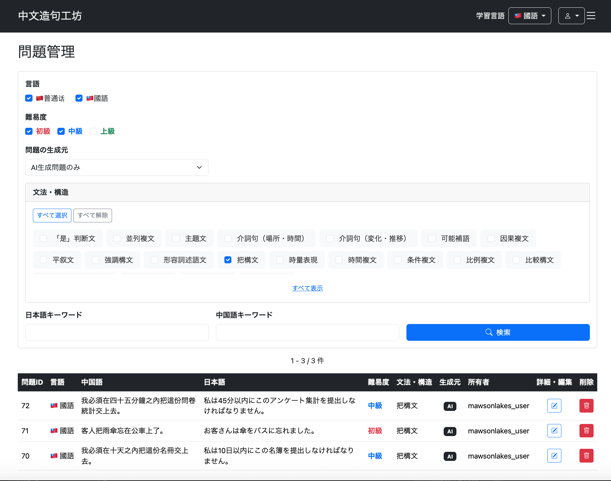

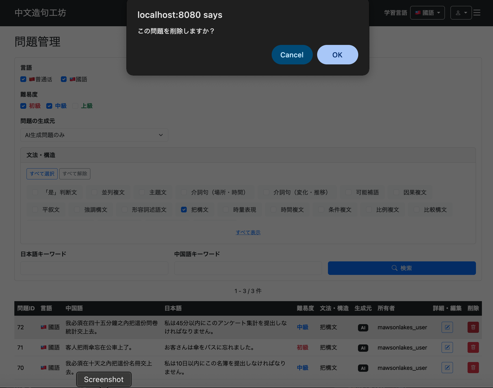

削除後に成功メッセージが表示され、検索条件を維持した一覧へ戻ることを確認した。

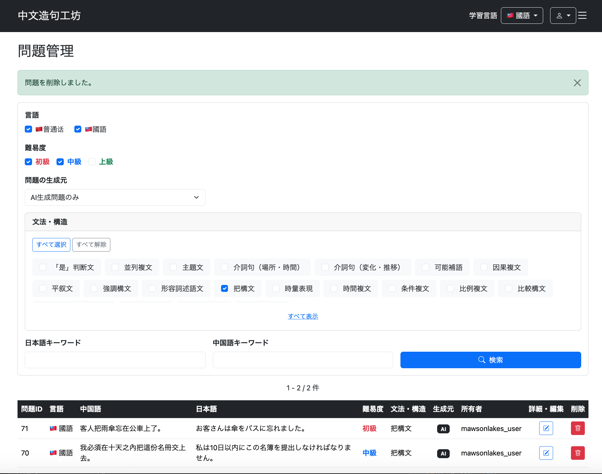

## 2. 作成日時・更新日時の記録

### 2.1 背景と設計判断

従来の一覧は`question_id DESC`で表示していた。新規追加した問題は新しいIDになるため先頭に表示されるが、**既存問題を編集してもIDは変わらず**、編集結果を一覧から確認しにくかった。

新規追加した問題が一覧の先頭に表示される状態：

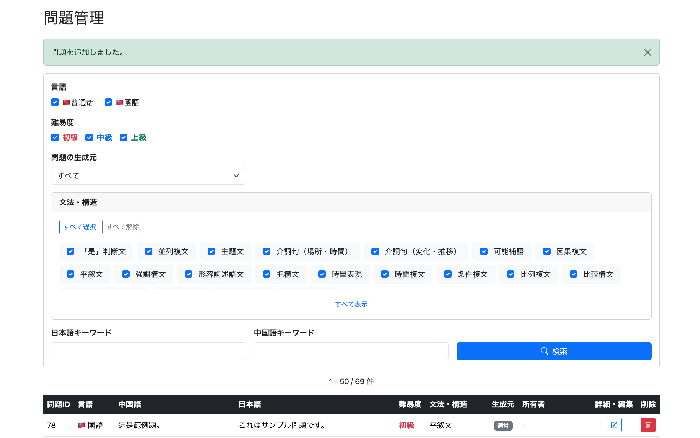

既存問題の「北京」を「深圳」に変更する例：

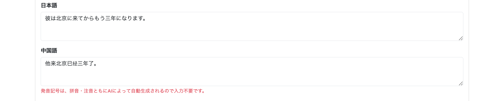

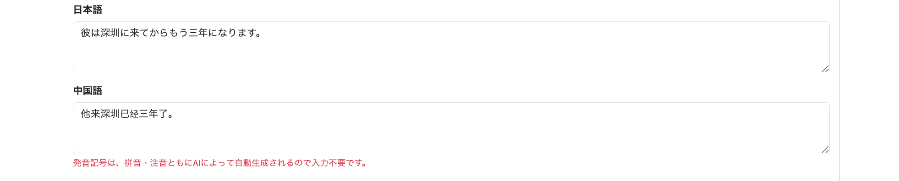

編集は反映されても、ID順では先頭に表示されない。

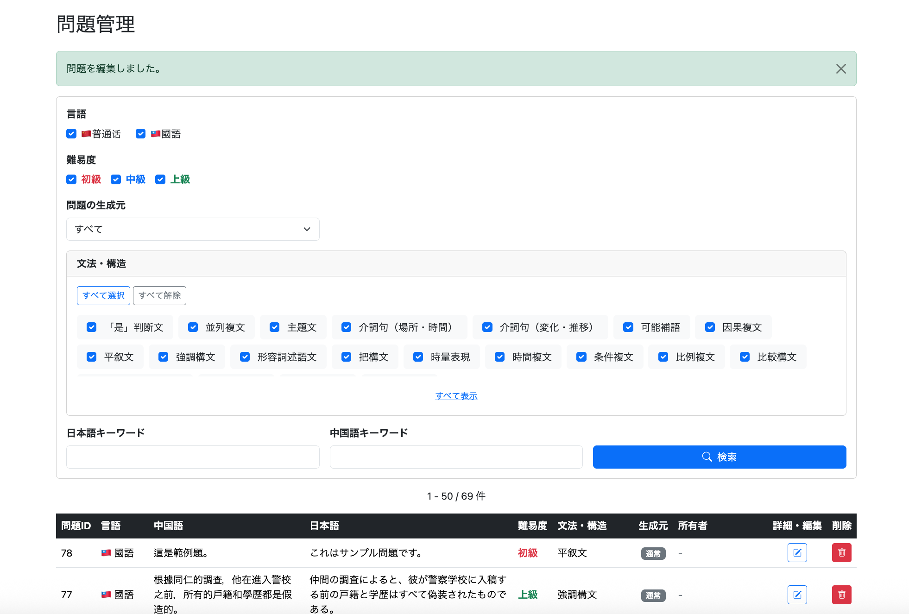

対策として、`Question`に作成日時`createdAt`と更新日時`updatedAt`を追加し、更新日時を基準に一覧表示できるようにする。新規作成時は両方に日時を設定し、編集時は更新日時のみを更新する。

### 2.2 設計資料の更新

要件定義書、テーブル定義書、データ設計書、ER図、画面設計書に日時項目とAdmin一覧の表示順を反映した。

```text
git commit -m "Update design docs for question timestamps and admin list ordering"
```

### 2.3 既存データを考慮したDB変更

既存レコードがあるため、最初はNULLを許容して列を追加し、既存データを埋めてから`NOT NULL`を設定した。

```sql
ALTER TABLE question
ADD COLUMN created_at TIMESTAMP,
ADD COLUMN updated_at TIMESTAMP;

UPDATE question
SET created_at = CURRENT_TIMESTAMP,
    updated_at = CURRENT_TIMESTAMP;

ALTER TABLE question
ALTER COLUMN created_at SET NOT NULL,
ALTER COLUMN updated_at SET NOT NULL;
```

既存問題の本来の作成・更新日時は復元できないため、移行時点の日時を設定した。**移行前の履歴を示す値ではない**ことに注意する。

### 2.4 JPA Auditingの導入

```text
git commit -m "Add auditing timestamps to Question"
```

`Question`に`AuditingEntityListener`を指定し、日時を自動設定する。

```java
@Getter
@Setter
@Entity
@EntityListeners(AuditingEntityListener.class)
@Table(name = "question")
public class Question {
    // 他のフィールドは省略

    @CreatedDate
    @Column(name = "created_at", nullable = false, updatable = false)
    private LocalDateTime createdAt;

    @LastModifiedDate
    @Column(name = "updated_at", nullable = false)
    private LocalDateTime updatedAt;
}
```

`@CreatedDate`は作成時、`@LastModifiedDate`は作成・更新時の日時を管理する。`createdAt`は`updatable = false`とし、作成後に変更されないようにする。アプリケーションのメインクラスには`@EnableJpaAuditing`を追加した。

```java
@SpringBootApplication
@EnableJpaAuditing
public class ChineseOutputForgeApplication {
    public static void main(String[] args) {
        SpringApplication.run(ChineseOutputForgeApplication.class, args);
    }
}
```

### 2.5 動作確認

問題を新規追加した。

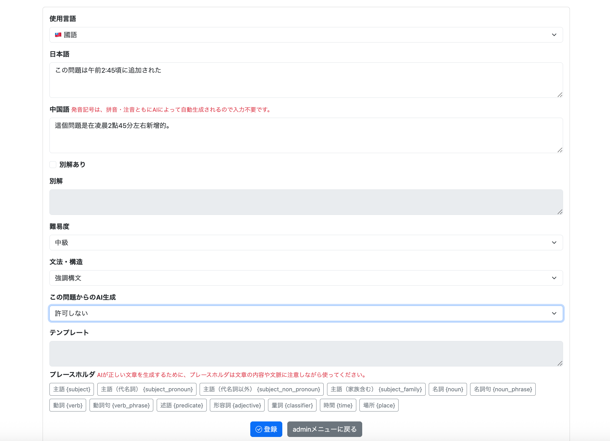

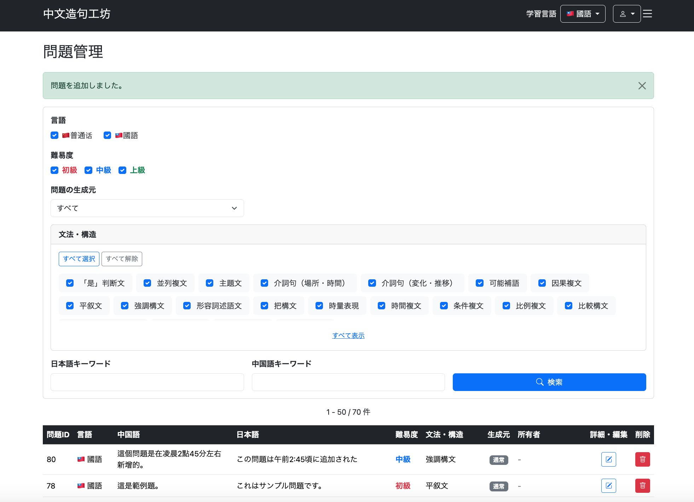

DBで`created_at`と`updated_at`が設定されたことを確認した。

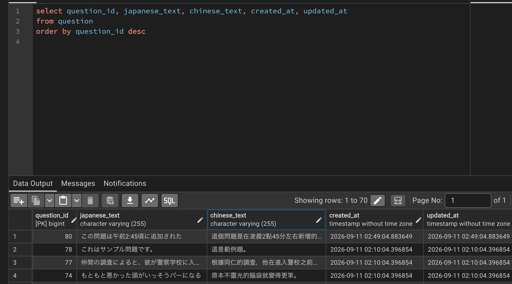

続いて問題を編集した。

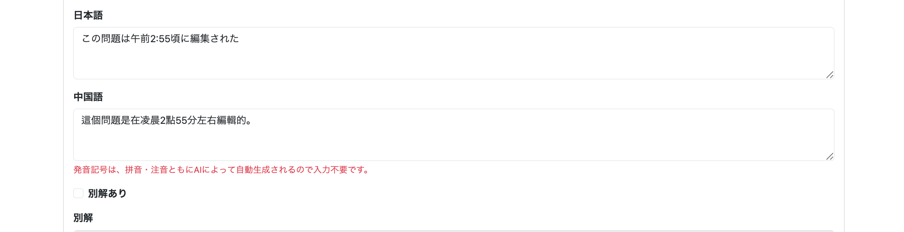

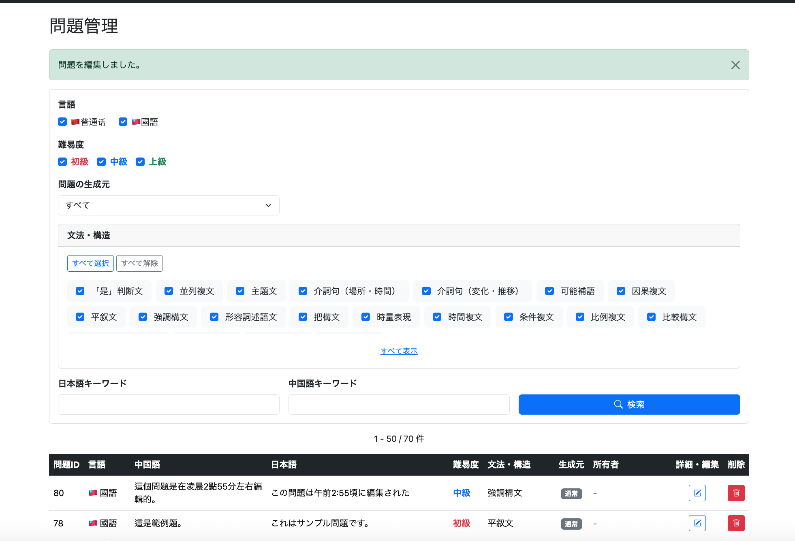

DBで`created_at`が維持され、`updated_at`だけが変更されたことを確認した。元ログに記録された更新日時の例は次のとおり。

```text
2026-09-11 02:49:04.883649 → 2026-09-11 02:55:47.977292
```

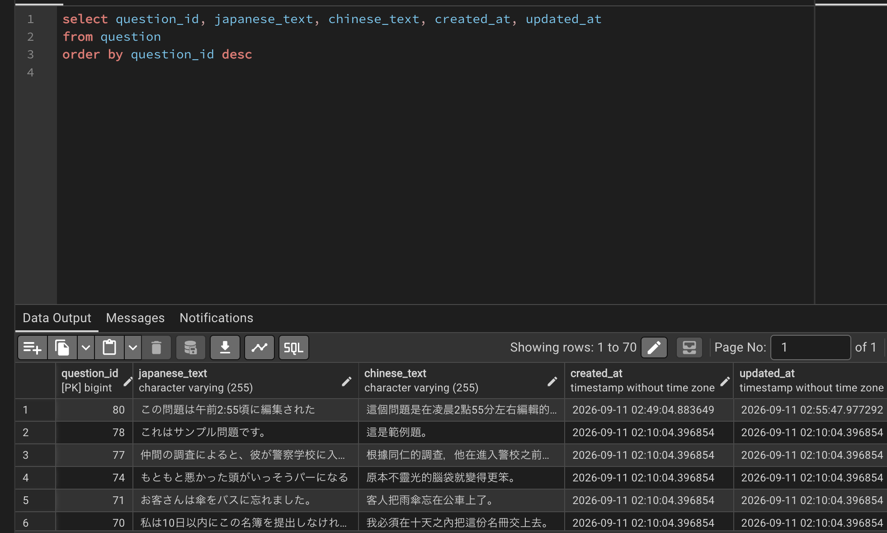

## 3. Admin用問題一覧の並び順を変更

### 3.1 要件・変更対象

並び順を「最終更新日時が新しい順（デフォルト）」と「問題IDの昇順」から選択できるようにした。検索条件としてControllerからService、Repositoryへ渡し、画面で選択状態も保持する。

```text
git commit -m "Add sorting options to admin question list"
```

### 3.2 Repository：条件に応じたORDER BY

以前の`ORDER BY q.question_id DESC`を、次の条件付きソートに変更した。

```sql
ORDER BY
    CASE
        WHEN :sortCondition = 'UPDATED_DESC'
        THEN q.updated_at
    END DESC,
    CASE
        WHEN :sortCondition = 'QUESTION_ID_ASC'
        THEN q.question_id
    END ASC,
    q.question_id DESC
```

Repositoryには`@Param("sortCondition") String sortCondition`を追加する。`UPDATED_DESC`では更新日時の降順、`QUESTION_ID_ASC`ではIDの昇順が有効になる。末尾の`q.question_id DESC`は、更新日時が同一の問題の並びを決めるためにも使用する。

### 3.3 EnumとService

```java
public enum AdminQuestionSortCondition {
    UPDATED_DESC,
    QUESTION_ID_ASC
}
```

Serviceの`getFilteredAdminQuestions`に`AdminQuestionSortCondition sortCondition`を追加し、未指定なら`UPDATED_DESC`を使用する。難易度・言語・構造・キーワード・生成元については022-01で整理した既存の補完処理を引き続き使う。

```java
if (sortCondition == null) {
    sortCondition = AdminQuestionSortCondition.UPDATED_DESC;
}

return questionRepository.findFilteredAdminQuestionList(
        searchConditionConverter.convertDifficulty(difficulties),
        sourceCondition.name(),
        structureIds,
        searchConditionConverter.convertLanguageVariant(languageVariants),
        japaneseKeyword,
        chineseKeyword,
        sortCondition.name(),
        pageable);
```

この抜粋では既存の検索条件を補完するコードを省略している。実際のServiceでは、Repository呼び出し前に未指定条件を補完している。

### 3.4 ControllerとThymeleaf

Controllerではリクエストパラメータとして受け取り、Serviceへ渡したうえで、選択状態をModelに設定する。

```java
@RequestParam(required = false, defaultValue = "UPDATED_DESC")
AdminQuestionSortCondition sortCondition,
```

```java
model.addAttribute("selectedSortCondition", sortCondition);
```

画面には次の選択欄を追加した。

```html
<div class="col-md-4">
    <label class="form-label fw-bold">並び順</label>
    <select class="form-select" name="sortCondition">
        <option value="UPDATED_DESC"
                th:selected="${selectedSortCondition == null or selectedSortCondition.name() == 'UPDATED_DESC'}">
            最終更新日時が新しい順
        </option>
        <option value="QUESTION_ID_ASC"
                th:selected="${selectedSortCondition != null and selectedSortCondition.name() == 'QUESTION_ID_ASC'}">
            問題IDの昇順
        </option>
    </select>
</div>
```

### 3.5 動作確認

デフォルトで「最終更新日時が新しい順」が選択されることを確認した。

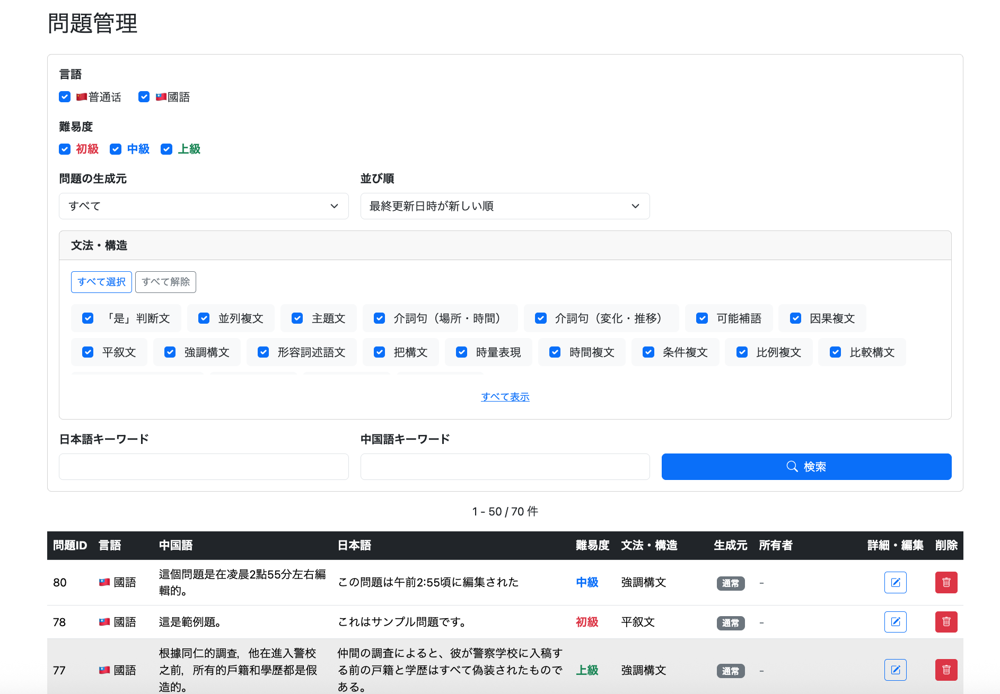

「問題IDの昇順」に切り替えると、IDの小さい順に表示された。

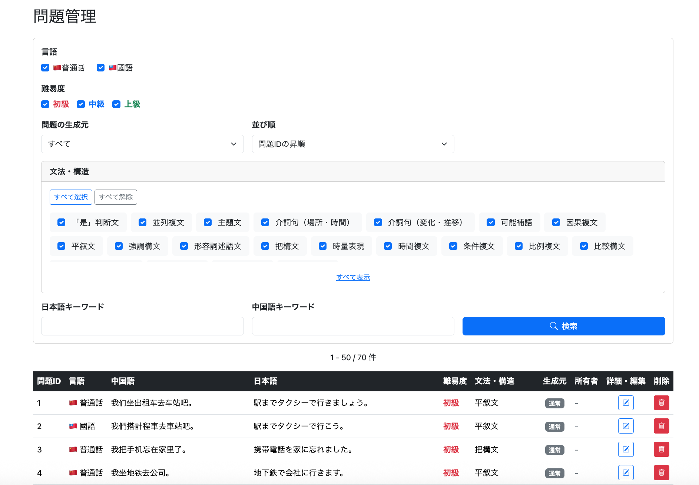

さらに、既存問題の「台北」を「嘉義」に編集した。


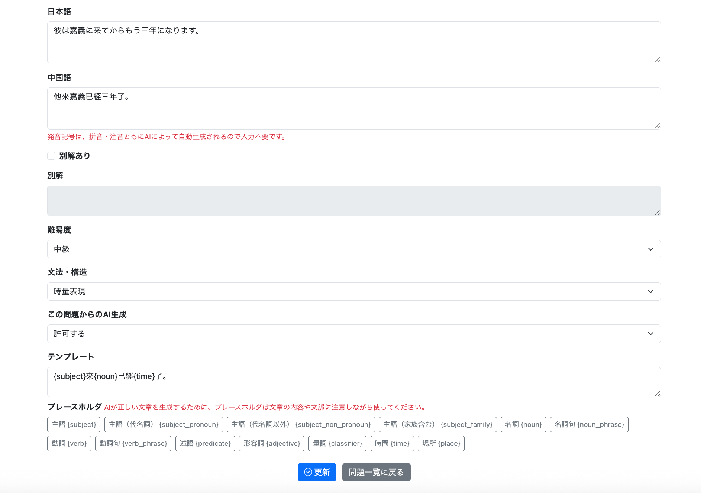

更新日時順では、編集した問題が一覧の先頭に表示されることを確認した。

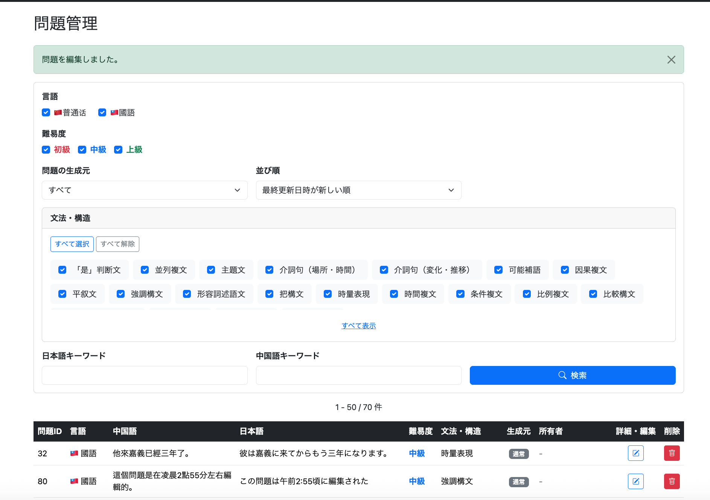

## まとめ

問題削除では、関連データを含むトランザクション処理と、検索条件を維持した画面遷移を実装した。表示順の改善では、既存データを考慮したDB変更、JPA Auditingによる日時管理、Enumを利用した並び順の切り替えを追加した。

問題の新規追加・編集機能そのものの実装については、後続の022シリーズで扱う。本ログに登場する追加・編集画面の画像は、**表示順改善を検証した際の記録**として掲載している。
