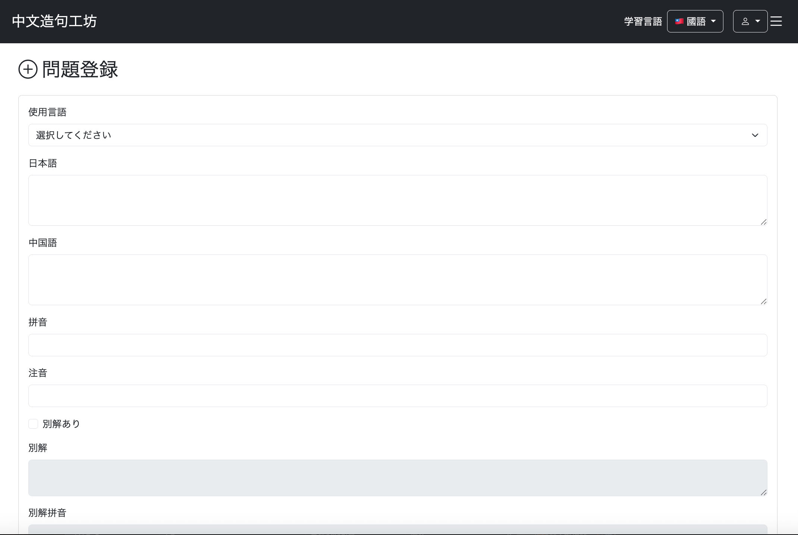
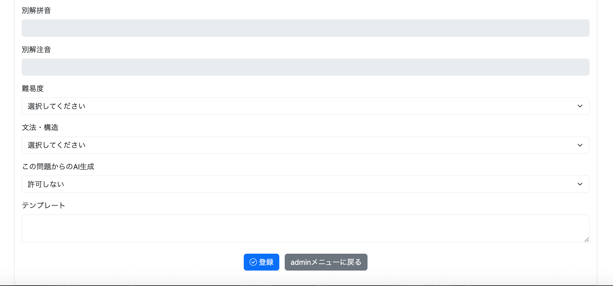
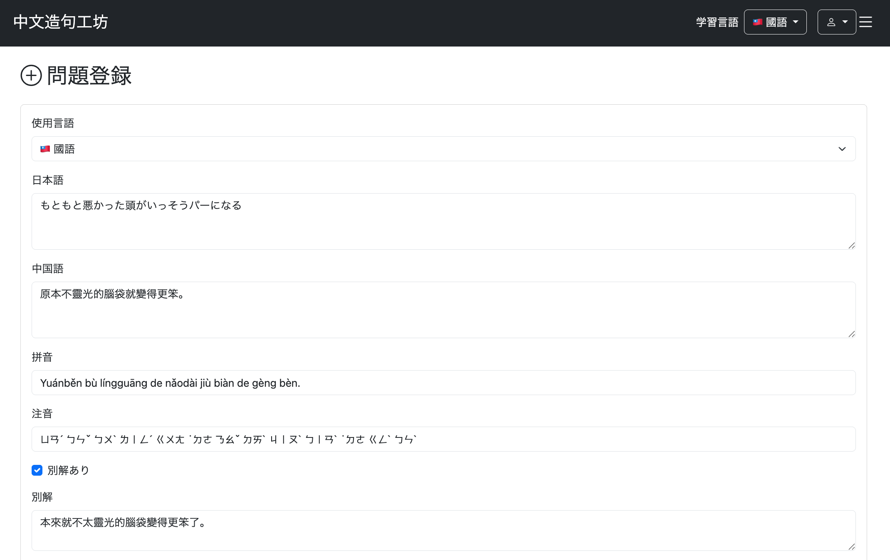
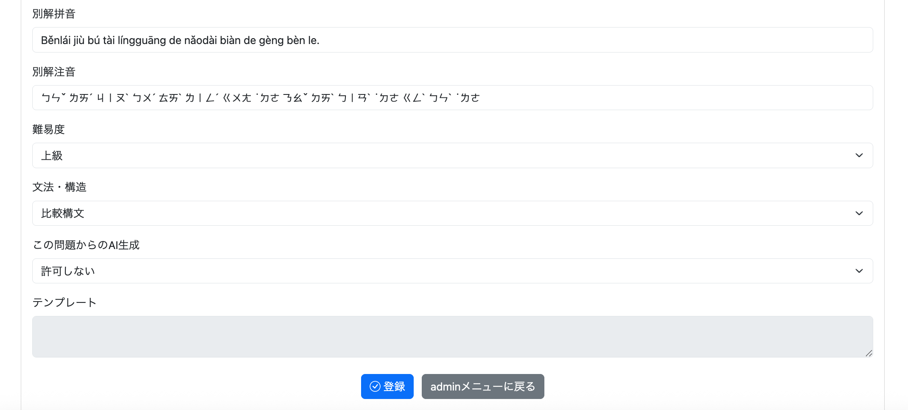
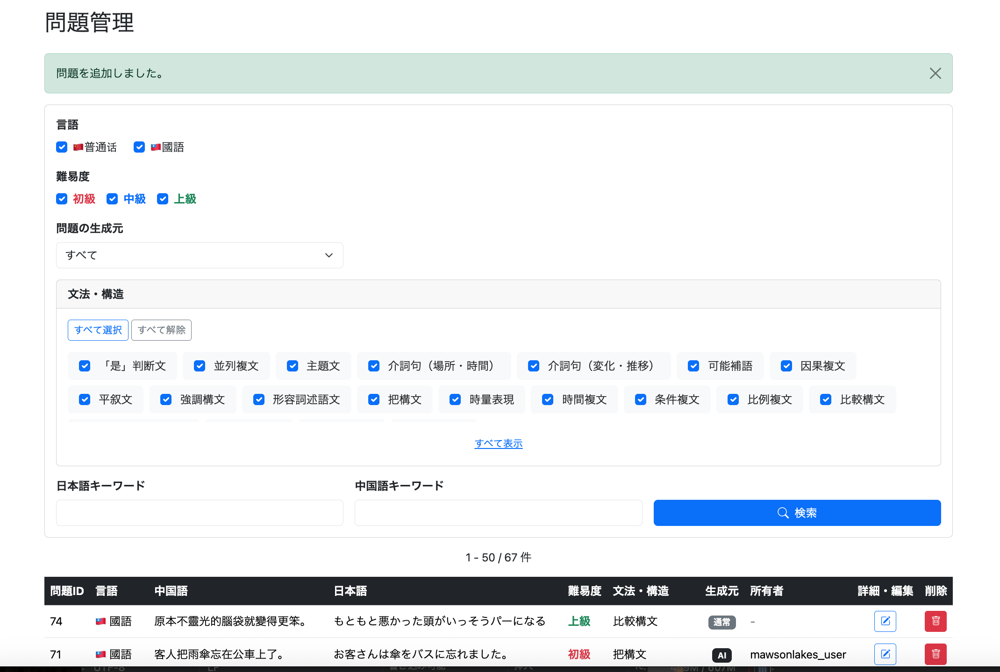
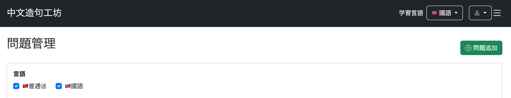
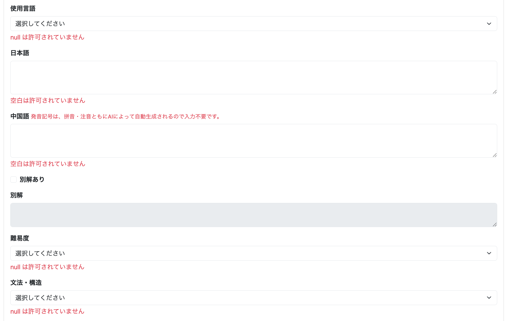

# 022-03 Admin用問題追加機能の実装

> このログは実装・変更を時系列で記録したものです。途中のコードや仕様は、その後の開発によって変更されている場合があります。現在の実装はソースコードを参照してください。

## 概要

Adminユーザーが新しい中国語学習問題を登録できるようにする。問題追加画面のフォーム、サーバー側の登録処理、入力項目に応じた表示制御、バリデーションエラーの表示を実装した。後続の問題編集画面は追加画面の構造を流用する方針とした。

このチャプターでは**問題追加の基本機能**を扱う。プレースホルダ入力補助とAIによる拼音・注音生成は次の「022-04」で扱う。

## 1. 実装方針と入力項目

### 1.1 目的

Adminから問題を直接登録するため、入力値を`QuestionForm`で受け取り、`Question` Entityに変換して保存する。文法・構造はIDをフォームで受け取り、保存時に`Structure` Entityを取得する。

### 1.2 追加・変更内容

| 対象 | 変更内容 |
| --- | --- |
| `QuestionForm` | 問題追加・編集に共用するフォームDTOと入力検証 |
| `AdminQuestionService` | `QuestionForm`から`Question`を生成・保存 |
| `AdminQuestionController` | 追加画面のGET、登録処理のPOST |
| `admin/question/add.html` | Thymeleafによる登録フォーム |
| `admin/question/add.js` | 別解・AI生成許可に応じた入力欄制御 |
| `admin/question/list.html` | 問題追加画面へのリンクを追加 |

選択項目は**使用言語、文法・構造、難易度、AI生成許可**。入力項目は**日本語、中国語、拼音、注音、別解とその発音表記、テンプレート**である。

## 2. QuestionFormと入力検証

フォームから受け取る項目と検証条件を定義した。

```java
@Data
public class QuestionForm {

    private Long questionId;

    @NotNull
    private LanguageVariant languageVariant;

    @NotBlank
    @Length(max = 255)
    private String japaneseText;

    @NotBlank
    @Length(max = 255)
    private String chineseText;

    @Length(max = 255)
    private String alternativeAnswer;

    @NotBlank
    private String pinyin;

    @NotBlank
    private String zhuyin;

    @Length(max = 255)
    private String alternativeAnswerPinyin;

    @Length(max = 255)
    private String alternativeAnswerZhuyin;

    @NotNull
    private Difficulty difficulty;

    @NotNull
    private Long structureId;

    private boolean allowAiVariation;

    @Length(max = 255)
    private String template;

}
```

`questionId`は新規追加時には使わないが、後の編集機能で既存問題を識別するために設けている。必須のEnumや構造IDには`@NotNull`、必須文字列には`@NotBlank`を指定した。文字列の一部には`@Length(max = 255)`を設定している。`allowAiVariation`はプリミティブの`boolean`であるため、必須チェックは設けない。

## 3. 問題を保存するService

### 3.1 目的と設計判断

フォームの`structureId`はそのままEntityの`structure`フィールドに代入できない。対応する`Structure`をRepositoryから取得して設定する必要がある。

```java
public void addQuestion(QuestionForm form) {

    Question question = new Question();

    // 文法コード以外をQuestionにSET
    copyQuestionForm(question, form);

    // 文法コードをQuestionにSET
    Structure structure = structureRepository
            .findById(form.getStructureId())
            .orElseThrow();

    question.setStructure(structure);

    // INSERT
    Question savedQuestion = questionRepository.save(question);

    log.info("問題登録完了 questionId={}", savedQuestion.getQuestionId());

}

private void copyQuestionForm(Question question, QuestionForm form) {

    question.setLanguageVariant(form.getLanguageVariant());
    question.setJapaneseText(form.getJapaneseText());
    question.setChineseText(form.getChineseText());
    question.setAlternativeAnswer(form.getAlternativeAnswer());
    question.setPinyin(form.getPinyin());
    question.setZhuyin(form.getZhuyin());
    question.setAlternativeAnswerPinyin(form.getAlternativeAnswerPinyin());
    question.setAlternativeAnswerZhuyin(form.getAlternativeAnswerZhuyin());
    question.setDifficulty(form.getDifficulty());
    question.setAllowAiVariation(form.isAllowAiVariation());
    question.setTemplate(form.getTemplate());

}
```

`copyQuestionForm`にフォーム値の転記をまとめたのは、後の問題編集機能でも共通化できるためである。`addQuestion`では新しい`Question`を作成し、構造を紐付けて`questionRepository.save`で保存する。

## 4. Controllerによる表示・登録処理

### 4.1 GET：追加画面の表示

```java
@GetMapping("/admin/question/add")
public String getQuestionAdd(
        @ModelAttribute QuestionForm form,
        Model model) {

    model.addAttribute("questionForm", form);

    // 使用言語
    model.addAttribute(
            "languageVariants",
            LanguageVariant.values());

    // 難易度
    model.addAttribute(
            "difficulties",
            Difficulty.values());

    // 文法・構造
    model.addAttribute(
            "structures",
            reviewService.findStructures());

    return "admin/question/add";
}
```

使用言語と難易度の選択肢はEnumの`values()`から取得する。文法・構造は`reviewService.findStructures()`を使用する。選択肢をModelに設定することで、初期表示時だけでなくバリデーションエラーによる再表示時にも選択欄を構築できる。

### 4.2 POST：入力検証と登録

```java
@PostMapping("/admin/question/add")
public String postQuestionAdd(
        @Validated @ModelAttribute QuestionForm form,
        BindingResult bindingResult,
        Model model,
        RedirectAttributes redirectAttributes) {

    if (bindingResult.hasErrors()) {
        return getQuestionAdd(form, model);
    }

    log.info("問題登録 {}", form);

    adminQuestionService.addQuestion(form);

    redirectAttributes.addFlashAttribute(
            "successMessage",
            "問題を追加しました。");

    return "redirect:/admin/question/list";
}
```

`@Validated`と`BindingResult`で入力内容を検証し、エラーがあればGET用メソッドを呼んで同じフォームを再表示する。成功時はFlashメッセージを設定し、問題一覧へリダイレクトする。

## 5. ThymeleafフォームとJavaScript

### 5.1 登録フォーム

`admin/question/add.html`は`QuestionForm`を`th:object`で受け取り、各入力項目を`th:field`でバインドする。送信先は`POST /admin/question/add`とする。元ログにはフォーム全体の長いHTMLが掲載されているが、ここでは**データバインドと登録処理に必要な構成**に絞って記録する。

```html
<form th:action="@{/admin/question/add}" th:object="${questionForm}" method="post">
    <!-- 使用言語・難易度・文法構造の選択欄と各テキスト入力欄 -->
    <button type="submit" class="btn btn-primary">登録</button>
</form>
```

※上記は構成を示す抜粋であり、元のテンプレート全文ではない。

### 5.2 入力欄の有効・無効切り替え

```javascript
document.addEventListener("DOMContentLoaded", () => {

    const hasAlternativeAnswer =
        document.getElementById("hasAlternativeAnswer");

    const alternativeAnswerFields =
        document.querySelectorAll(".alternative-answer-field");

    function updateAlternativeAnswerFields() {

        alternativeAnswerFields.forEach(field => {
            field.disabled = !hasAlternativeAnswer.checked;
        });

    }

    // 初期表示
    updateAlternativeAnswerFields();

    // チェック状態変更時
    hasAlternativeAnswer.addEventListener(
        "change",
        updateAlternativeAnswerFields
    );

    // =========================
    // AI生成許可によるテンプレート制御
    // =========================

    const allowAiVariation =
        document.getElementById("allowAiVariation");

    const template =
        document.getElementById("template");

    function updateTemplateField() {

        template.disabled =
            allowAiVariation.value === "false";

    }

    // 初期表示
    updateTemplateField();

    // 選択変更時
    allowAiVariation.addEventListener(
        "change",
        updateTemplateField
    );

});
```

「別解あり」が未選択なら別解関連の入力欄を無効化する。またAI生成を許可しない場合、テンプレート入力欄を無効化する。どちらも初期表示時と選択変更時に同じ関数を呼び出している。

## 6. 動作確認

問題追加ページを開き、登録フォームが表示されることを確認した。





テストデータとして、日本語「もともと悪かった頭がいっそうパーになる」、中国語「原本不靈光的腦袋就變得更笨。」を登録した。別解も設定し、難易度を「上級」、文法・構造を「比較構文」、AI生成を「許可しない」とした。拼音・注音と別解の発音表記も入力している。





登録後、問題一覧へ戻り、新規問題が表示されることを確認した。



## 7. 追加修正：問題一覧から登録画面への導線

問題一覧ページから追加画面へ移動できるよう、リンクボタンを追加した。

```html
<a th:href="@{/admin/question/add}" class="btn btn-success">
    <i class="bi bi-plus-circle"></i>
    問題追加
</a>
```



## 8. 追加修正：バリデーションエラーを表示する

### 8.1 発見した問題

初期実装では、フォーム送信時にバリデーションエラーのメッセージが十分に表示されなかった。使用言語と難易度の入力欄には`th:errors`がなく、日本語・中国語にはHTMLの`required`属性が設定されていた。

`required`があると空欄の送信をブラウザ側で止めるため、Spring MVCの`@Validated`と`BindingResult`までリクエストが届かない。今回はSpring側のメッセージに統一するため、該当する`required`を外した。

### 8.2 対応

```html
<!-- 使用言語 -->
<div class="text-danger mt-1"
     th:if="${#fields.hasErrors('languageVariant')}"
     th:errors="*{languageVariant}"></div>

<!-- 難易度 -->
<div class="text-danger mt-1"
     th:if="${#fields.hasErrors('difficulty')}"
     th:errors="*{difficulty}"></div>

<!-- 日本語：HTML5 requiredを外しSpring側で検証 -->
<textarea th:field="*{japaneseText}" class="form-control" rows="3"></textarea>
```

中国語も同様に`required`を外した。未入力のまま送信すると、Spring側のバリデーションエラーメッセージが表示されることを確認した。



## 9. コミット記録

- `git commit -m "feat: add admin question creation functionality"`
- `feat: add question creation link to admin question list`
- `fix: display validation errors on admin question form`

## まとめ

問題追加用のフォーム、登録処理、入力補助の基本的な制御、バリデーション表示を実装した。登録画面の構造は後の問題編集機能にも利用する。次の022-04では、プレースホルダ入力補助とAIによる拼音・注音生成を扱う。
