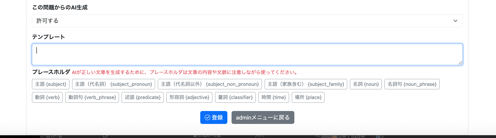
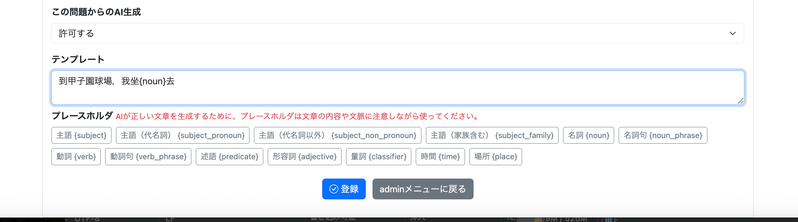
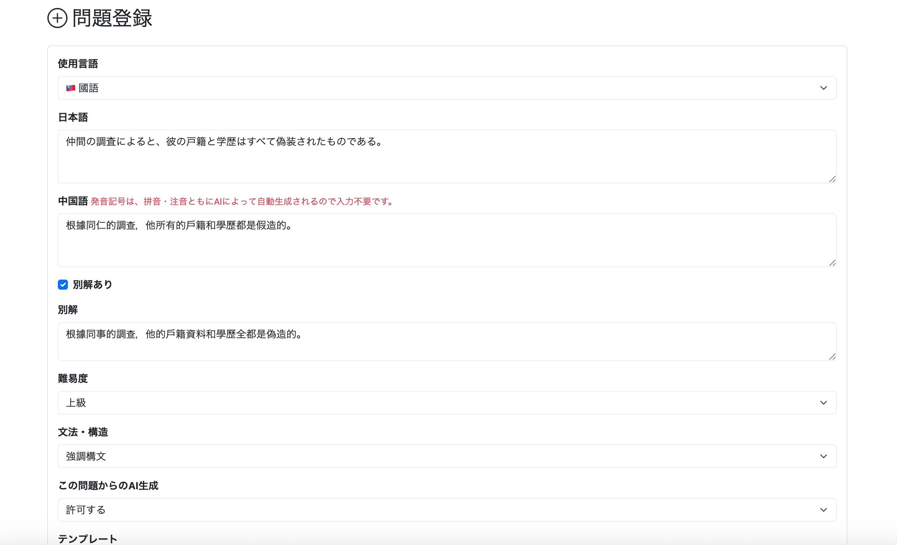
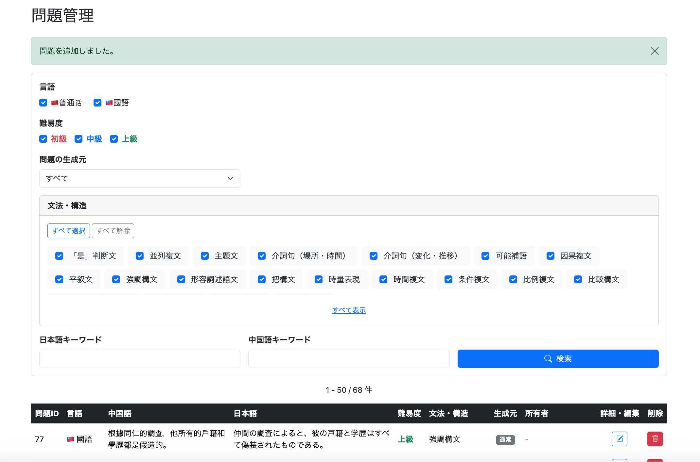
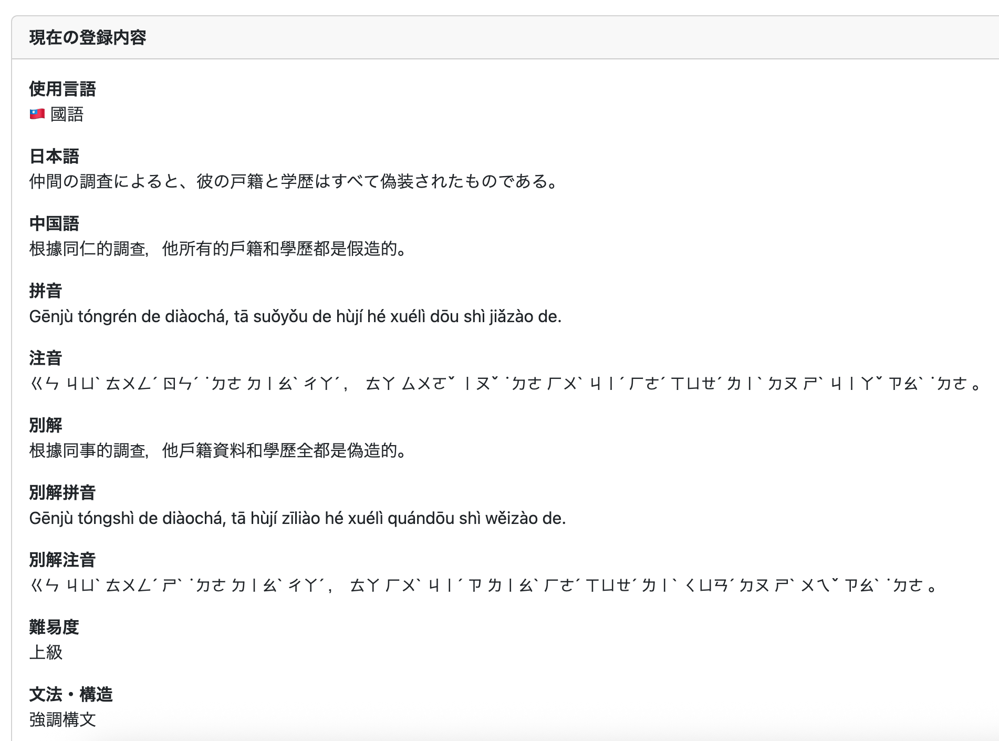

# 022-04 問題追加画面の入力補助とAI生成機能

> このログは実装・変更を時系列で記録したものです。途中のコードや仕様は、その後の開発によって変更されている場合があります。現在の実装はソースコードを参照してください。

## 概要

022-03で実装したAdmin用問題追加画面を拡張する。変更は、①AI生成用テンプレートのプレースホルダ入力補助、②中国語本文・別解から拼音と注音を自動生成する処理、の2つである。画面上の入力負担を減らしつつ、生成元となる中国語の内容と使用言語に対応した発音情報を保存する。

| 対象 | 主な変更 |
| --- | --- |
| `admin/question/add.html` | プレースホルダボタンと発音情報の入力案内 |
| `admin/question/add.js` | カーソル位置へのプレースホルダ挿入 |
| `QuestionForm` | 発音情報の入力方式変更に対応 |
| `AiPronunciationRequestDto` / `AiPronunciationResponseDto` | AIとの送受信データ |
| `AdminQuestionService` | 登録時の発音生成処理を統合 |
| `AiPromptService` | 言語別プロンプトの読み込み |
| `AiPronunciationService` | AIへの生成依頼と結果の受け取り |

## 1. テンプレートのプレースホルダ入力補助

### 1.1 目的と画面の変更

テンプレートのプレースホルダは文章の構造や文脈に応じて選択する必要がある。従来の手入力に代わり、利用可能な種類を一覧表示し、ボタンから挿入できるようにした。

各ボタンの`data-placeholder`に挿入文字列を保持する。以下は画面側の代表例であり、元の実装では主語・名詞・動詞など複数種類のボタンを用意した。

```html
<button type="button"
        class="btn btn-outline-secondary btn-sm placeholder-button"
        data-placeholder="{subject}">
    主語 {subject}
</button>
```

### 1.2 JavaScriptによる挿入処理

```javascript
// =========================
// プレースホルダ入力
// =========================

const placeholderButtons =
    document.querySelectorAll(".placeholder-button");

placeholderButtons.forEach(button => {

    button.addEventListener("click", () => {

        // テンプレート入力不可の場合は何もしない
        if (template.disabled) {
            return;
        }

        const placeholder =
            button.dataset.placeholder;

        // 現在のカーソル位置
        const start =
            template.selectionStart;

        const end =
            template.selectionEnd;

        // カーソル位置にプレースホルダを挿入
        template.value =
            template.value.substring(0, start)
            + placeholder
            + template.value.substring(end);

        // カーソルを挿入した文字の後ろへ移動
        const cursorPosition =
            start + placeholder.length;

        template.setSelectionRange(
            cursorPosition,
            cursorPosition
        );

        template.focus();

    });

});
```

`data-placeholder`から値を取得し、`selectionStart`と`selectionEnd`で指定されたカーソル位置（選択範囲）へ挿入する。挿入後は`setSelectionRange`と`focus`で入力を継続できる状態に戻す。テンプレート入力欄が無効な場合は挿入しない。

### 1.3 動作確認

問題追加画面にプレースホルダ一覧が表示され、クリックするとカーソル位置へ挿入されることを確認した。





## 2. AIによる拼音・注音の自動生成

### 2.1 目的と処理の流れ

問題登録時に拼音・注音を手入力する負担と入力ミスを減らすため、使用言語、中国語本文、別解（存在する場合）をAIへ渡し、発音表記を生成して保存する方式へ変更した。

```text
QuestionForm
    │
    │ languageVariant
    │ chineseText
    │ alternativeAnswer（存在する場合）
    ↓
AiPronunciationRequestDto
    ↓
AiPronunciationService
    ↓
AiPromptService
    │
    │ 発音生成用プロンプト取得
    ↓
Gemini API
    ↓
AiPronunciationResponseDto
    │
    │ pinyin
    │ zhuyin
    │ alternativeAnswerPinyin
    │ alternativeAnswerZhuyin
    ↓
AdminQuestionService
    ↓
QuestionへSET
    ↓
QuestionRepository.save()
```

### 2.2 フォームとDTO

入力フォームとAIへのリクエスト・レスポンスを分離する。

```java
@Data
public class QuestionForm {

    private Long questionId;

    @NotNull
    private LanguageVariant languageVariant;

    @NotBlank
    @Length(max = 255)
    private String japaneseText;

    @NotBlank
    @Length(max = 255)
    private String chineseText;

    @Length(max = 255)
    private String alternativeAnswer;

//    @NotBlank
//    private String pinyin;
//
//    @NotBlank
//    private String zhuyin;
//
//    @Length(max = 255)
//    private String alternativeAnswerPinyin;
//
//    @Length(max = 255)
//    private String alternativeAnswerZhuyin;

    @NotNull
    private Difficulty difficulty;

    @NotNull
    private Long structureId;

    private boolean allowAiVariation;

    @Length(max = 255)
    private String template;

}
```

### 2.3 AIリクエストDTO

生成に必要な言語と中国語本文、別解を渡す。

```java
@Data
public class AiPronunciationRequestDto {

    private final LanguageVariant languageVariant;

    private final String chineseText;

    private final String alternativeAnswer;

}
```

### 2.4 AIレスポンスDTO

AIが返す発音表記を受け取る。

```java
@Data
public class AiPronunciationResponseDto {

    private final String pinyin;

    private final String zhuyin;

    private final String alternativeAnswerPinyin;

    private final String alternativeAnswerZhuyin;

}
```

### 2.5 登録処理への統合

フォームの入力から生成依頼を組み立て、結果を問題保存に反映する。

```java
public void addQuestion(QuestionForm form) {

    Question question = new Question();

    // 発音生成用DTOを作成
    AiPronunciationRequestDto request =
            new AiPronunciationRequestDto(
                    form.getLanguageVariant(),
                    form.getChineseText(),
                    form.getAlternativeAnswer()
            );

    // AIで発音情報を生成
    AiPronunciationResponseDto pronunciation =
            aiPronunciationService.generatePronunciation(request);

    // 文法コード以外をQuestionにSET
    copyQuestionForm(question, form, pronunciation);

    // 文法コードをQuestionにSET
    Structure structure = structureRepository
            .findById(form.getStructureId())
            .orElseThrow();

    question.setStructure(structure);

    // INSERT
    Question savedQuestion =
            questionRepository.save(question);

    log.info(
            "問題登録完了 questionId={}",
            savedQuestion.getQuestionId());

}

private void copyQuestionForm(
        Question question,
        QuestionForm form,
        AiPronunciationResponseDto pronunciation) {

    question.setLanguageVariant(form.getLanguageVariant());
    question.setJapaneseText(form.getJapaneseText());
    question.setChineseText(form.getChineseText());
    question.setAlternativeAnswer(form.getAlternativeAnswer());

    question.setPinyin(pronunciation.getPinyin());
    question.setZhuyin(pronunciation.getZhuyin());

    question.setAlternativeAnswerPinyin(
            pronunciation.getAlternativeAnswerPinyin());

    question.setAlternativeAnswerZhuyin(
            pronunciation.getAlternativeAnswerZhuyin());

    question.setAllowAiVariation(form.isAllowAiVariation());
    question.setTemplate(form.getTemplate());

}
```

ここでAI生成結果を問題Entityへ設定するため、発音情報をフォームから直接受け取る方式とは責務が変わる。

### 2.6 プロンプトの管理

普通話と國語でプロンプトを分ける。

**ai-pronunciation-mainland.txt（普通話）**

```text
あなたは中国語の発音情報を生成するシステムです。

入力された中国語文に対して、普通話（中国大陸の標準中国語）の発音情報を生成してください。

【生成ルール】

1. pinyin

- 普通話の発音に基づく漢語拼音を生成してください。
- 声調は数字ではなく声調記号で表記してください。
- 単語ごとに半角スペースで区切ってください。
- 文頭は大文字にしてください。
- 中国語本文の句読点に対応する句読点を保持してください。

2. zhuyin

- 普通話の発音に基づく注音符號（ㄅㄆㄇㄈ）を生成してください。
- 各音節を半角スペースで区切ってください。
- 声調記号を付けてください。
- 第一声には声調記号を付けないでください。
- 軽声は「˙」を音節の前に付けてください。
- 中国語本文の句読点に対応する句読点を保持してください。

3. alternativeAnswerPinyin

- alternativeAnswerが存在する場合、その普通話の発音に基づく漢語拼音を生成してください。
- alternativeAnswerが存在しない場合はnullにしてください。

4. alternativeAnswerZhuyin

- alternativeAnswerが存在する場合、その普通話の発音に基づく注音符號を生成してください。
- alternativeAnswerが存在しない場合はnullにしてください。

【重要】

- 中国大陸の普通話の発音を基準にしてください。
- 中国語本文を翻訳・修正・言い換えしないでください。
- 入力された中国語文そのものの発音を生成してください。
- 発音情報以外の説明を追加しないでください。
```

**ai-pronunciation-taiwan.txt（國語）**

```text
省略
```

### 2.7 プロンプト読み込み

使用言語に応じてプロンプトを選択する。

```java
private static final String MAINLAND_PRONUNCIATION_PATH =
        "prompts/ai-pronunciation-mainland.txt";

private static final String TAIWAN_PRONUNCIATION_PATH =
        "prompts/ai-pronunciation-taiwan.txt";

// 発音記号取得のプロンプトを取得する
public String getPronunciationPrompt(
        LanguageVariant languageVariant) {

    if (languageVariant == LanguageVariant.MAINLAND) {

        return loadPronunciationPrompt(
                MAINLAND_PRONUNCIATION_PATH);

    } else {

        return loadPronunciationPrompt(
                TAIWAN_PRONUNCIATION_PATH);

    }

}

// classpath上のプロンプトファイルを読み込む(発音記号)
private String loadPronunciationPrompt(String path) {

    ClassPathResource resource =
            new ClassPathResource(path);

    try (InputStream inputStream =
            resource.getInputStream()) {

        return new String(
                inputStream.readAllBytes(),
                StandardCharsets.UTF_8);

    } catch (IOException e) {

        throw new IllegalStateException(
                "プロンプトファイルの読み込みに失敗しました: " + path,
                e);

    }

}
```

### 2.8 発音生成サービス

AI呼び出しと結果の変換を専用Serviceに集約する。

```java
public AiPronunciationResponseDto generatePronunciation(
        AiPronunciationRequestDto request) {

    // 言語別ルールを取得
    String pronunciationPrompt =
            aiPromptService.getPronunciationPrompt(
                    request.getLanguageVariant());

    // DTOをJSON形式に変換
    String requestJson;

    try {

        requestJson =
                objectMapper.writeValueAsString(request);

    } catch (JsonProcessingException e) {

        throw new IllegalStateException(
                "発音情報生成リクエストのJSON変換に失敗しました。",
                e);

    }

    // AIへ送信する入力を作成
    String input =
            pronunciationPrompt
            + "\n\n"
            + "## 中国語及び別解\n"
            + requestJson;

    return generatePronunciationWithGemini(input);

}

private AiPronunciationResponseDto generatePronunciationWithGemini(
        String input) {

    // 発音情報の出力形式を定義
    Schema responseSchema =
            Schema.builder()
                    .type(Type.Known.OBJECT)
                    .properties(Map.of(
                            "pinyin",
                            Schema.builder()
                                    .type(Type.Known.STRING)
                                    .build(),
                            "zhuyin",
                            Schema.builder()
                                    .type(Type.Known.STRING)
                                    .build(),
                            "alternativeAnswerPinyin",
                            Schema.builder()
                                    .type(Type.Known.STRING)
                                    .nullable(true)
                                    .build(),
                            "alternativeAnswerZhuyin",
                            Schema.builder()
                                    .type(Type.Known.STRING)
                                    .nullable(true)
                                    .build()
                    ))
                    .required(List.of(
                            "pinyin",
                            "zhuyin",
                            "alternativeAnswerPinyin",
                            "alternativeAnswerZhuyin"))
                    .build();

    // Thinking LevelをLOWに設定
    ThinkingConfig thinkingConfig =
            ThinkingConfig.builder()
                    .thinkingLevel(ThinkingLevel.Known.LOW)
                    .build();

    // APIリクエストを作成(Gemini)
    GenerateContentConfig config =
            GenerateContentConfig.builder()
                    .responseMimeType("application/json")
                    .responseSchema(responseSchema)
                    .thinkingConfig(thinkingConfig)
                    .build();

    // APIへリクエストを送信
    GenerateContentResponse response =
            geminiClient.models.generateContent(
                    "gemini-3.7-flash",
                    input,
                    config);

    // AIが生成したJSONを取得
    String responseJson =
            response.text();

    // JSONをDTOへ変換
    AiPronunciationResponseDto aiPronunciationResponseDto;

    try {

        aiPronunciationResponseDto =
                objectMapper.readValue(
                        responseJson,
                        AiPronunciationResponseDto.class);

    } catch (JsonProcessingException e) {

        throw new IllegalStateException(
                "発音情報の生成結果を取得できませんでした。",
                e);

    }

    return aiPronunciationResponseDto;

}
```

### 2.9 問題追加画面の変更

拼音・注音の入力欄は手入力を前提としない案内へ変更した。画面全体のHTMLは022-03と重複するため、変更点のみ記録する。

```html
<span class="text-danger small">
    発音記号は、拼音・注音ともにAIによって自動生成されるので入力不要です。
</span>
```

### 2.10 動作確認

Admin用問題追加画面から問題を登録し、問題一覧への反映を確認した。さらにDBで、手入力していない拼音・注音と別解の発音表記が生成・保存されたことを確認した。







**当時の生成結果の例**

| 項目 | 内容 |
| --- | --- |
| 中国語 | 根據同仁的調查，他所有的戶籍和學歷都是假造的。 |
| 拼音 | Gēnjù tóngrén de diàochá, tā suǒyǒu de hùjí hé xuélì dōu shì jiǎzào de. |
| 注音 | ㄍㄣ ㄐㄩˋ ㄊㄨㄥˊ ㄖㄣˊ ˙ㄉㄜ ㄉㄧㄠˋ ㄔㄚˊ ， ㄊㄚ ㄙㄨㄛˇ ㄧㄡˇ ˙ㄉㄜ ㄏㄨˋ ㄐㄧˊ ㄏㄜˊ ㄒㄩㄝˊ ㄌㄧˋ ㄉㄡ ㄕˋ ㄐㄧㄚˇ ㄗㄠˋ ˙ㄉㄜ 。 |
| 別解 | 根據同事的調查，他的戶籍資料和學歷全都是偽造的。 |
| 別解拼音 | Gēnjù tóngshì de diàochá, tā de hùjí zīliào hé xuélì quándōu shì wěizào de. |
| 別解注音 | ㄍㄣ ㄐㄩˋ ㄊㄨㄥˊ ㄕˋ ˙ㄉㄜ ㄉㄧㄠˋ ㄔㄚˊ ， ㄊㄚ ˙ㄉㄜ ㄏㄨˋ ㄐㄧˊ ㄗ ㄌㄧㄠˋ ㄏㄜˊ ㄒㄩㄝˊ ㄌㄧˋ ㄑㄩㄢˊ ㄉㄡ ㄕˋ ㄨㄟˇ ㄗㄠˋ ˙ㄉㄜ 。 |

## 3. 実装上の整理

- プレースホルダ補助は画面上の入力支援であり、適切なプレースホルダを選ぶ判断そのものを自動化するものではない。
- 発音表記の生成は`AiPronunciationService`へ分離し、Adminの登録処理とAI呼び出しの責務を分けた。
- 言語ごとの発音生成指示はプロンプトファイルに分離した。
- 動作確認で生成・保存を確認しているが、AIが生成する発音表記の正確性を恒久的に保証するものではない。

## コミット記録

```text
git commit -m "feat: add AI-generated pronunciation for admin questions"
```

次の022-05では、Admin用問題編集機能を扱う。
