# 022-05 Admin用問題編集機能の実装

> このログは実装・変更を時系列で記録したものです。途中のコードや仕様は、その後の開発によって変更されている場合があります。現在の実装はソースコードを参照してください。

## 概要

022-03・022-04で実装した問題追加機能を踏まえ、Adminが既存問題の登録内容を確認・編集できる画面を追加した。続いて、AI生成を許可する問題ではテンプレート入力を必須とする条件付きバリデーションを導入した。

| 対象 | 変更内容 |
| --- | --- |
| `OriginalQuestionDTO` | 編集前の登録内容を表示するためのDTO |
| `AdminQuestionService` | 既存問題の取得・更新、発音情報の再生成 |
| `AdminQuestionController` | 詳細・編集画面のGETと更新POST |
| `admin/question/edit.html` | 現在値の表示、編集フォーム、AI生成問題の表示制御 |
| `QuestionForm` | テンプレートの条件付き検証を追加 |
| `ValidQuestionTemplate` / `ValidQuestionTemplateValidator` | 複数フィールドにまたがる検証 |
| `admin/question/add.html` | 同じ検証エラーを追加画面にも表示 |

## 1. 既存問題の詳細表示と編集

### 1.1 目的とデータの役割

新規追加では新しい`Question`を作成するのに対し、編集では`questionId`から既存Entityを取得して更新する。編集画面では変更前の情報を確認しながら入力できるよう、**表示用の`OriginalQuestionDTO`**と**入力用の`QuestionForm`**を分離した。

- `OriginalQuestionDTO`：DBに保存されている現在の問題内容、発音情報、AI生成フラグ、生成ユーザーなどを表示する。
- `QuestionForm`：更新対象の入力項目を保持し、送信時にバリデーションする。

発音情報はAIで生成するため入力フォームには含めず、変更前の詳細表示にのみ含める。AI生成由来の問題は詳細閲覧のみとし、編集画面の入力操作を制限する方針とした。

**コミット記録**

```text
git commit -m "Add admin question detail and edit functionality"
```

### 1.2 `OriginalQuestionDTO`

現在値の表示には言語種別、日本語・中国語本文、別解、拼音・注音、難易度、構文、AI生成許可、テンプレート、AI生成由来かどうか、所有者のログインIDを保持する。

```java
@Data
public class OriginalQuestionDTO {

    private LanguageVariant languageVariant;

    private String japaneseText;

    private String chineseText;

    private String alternativeAnswer;

    private String pinyin;

    private String zhuyin;

    private String alternativeAnswerPinyin;

    private String alternativeAnswerZhuyin;

    private Difficulty difficulty;

    private long structureId;

    private String structureName;

    private boolean allowAiVariation;

    private String template;

    private boolean aiGenerated;

    private String ownerLoginId;

}
```

### 1.3 Service：現在値の取得

`getOriginalQuestion`で対象問題を検索し、DTOに必要な項目を詰める。所有者のない問題もあるため、`owner`が存在するときだけログインIDを設定する。

```java
public OriginalQuestionDTO getOriginalQuestion(long questionId) {

    Question question = questionRepository.findById(questionId)
            .orElseThrow(() ->
                    new IllegalArgumentException("Question not found."));

    OriginalQuestionDTO dto = new OriginalQuestionDTO();

    dto.setLanguageVariant(question.getLanguageVariant());
    dto.setJapaneseText(question.getJapaneseText());
    dto.setChineseText(question.getChineseText());
    dto.setAlternativeAnswer(question.getAlternativeAnswer());
    dto.setPinyin(question.getPinyin());
    dto.setZhuyin(question.getZhuyin());

    dto.setAlternativeAnswerPinyin(
            question.getAlternativeAnswerPinyin());

    dto.setAlternativeAnswerZhuyin(
            question.getAlternativeAnswerZhuyin());

    dto.setDifficulty(question.getDifficulty());

    dto.setStructureId(
            question.getStructure().getStructureId());

    dto.setStructureName(
            question.getStructure().getName());

    dto.setAllowAiVariation(
            question.getAllowAiVariation());

    dto.setTemplate(question.getTemplate());
    dto.setAiGenerated(question.isAiGenerated());

    if (question.getOwner() != null) {

        dto.setOwnerLoginId(
                question.getOwner().getLoginId());

    }

    return dto;
}
```

### 1.4 Service：既存問題の更新

`updateOneQuestion`は既存の`Question`を取得し、入力値を反映して保存する。中国語本文・別解の変更に対応するため、AIから拼音・注音を再生成する。`structureId`は`Structure` Entityに変換して関連付ける。新規Entityを作成する処理とは区別する。

```java
public void updateOneQuestion(
        long questionId,
        QuestionForm form
        ) {

    Question question = questionRepository.findById(questionId)
            .orElseThrow(() ->
                    new IllegalArgumentException("Question not found."));

    log.info("問題更新前 {}", question);

    // 発音生成用DTOを作成
    AiPronunciationRequestDto request =
            new AiPronunciationRequestDto(
                    form.getLanguageVariant(),
                    form.getChineseText(),
                    form.getAlternativeAnswer()
            );

    // AIで発音情報を生成
    AiPronunciationResponseDto pronunciation =
            aiPronunciationService.generatePronunciation(request);

    // 文法コード以外をQuestionにSET
    copyQuestionForm(question, form, pronunciation);

    // 文法コードをQuestionにSET
    Structure structure = structureRepository
            .findById(form.getStructureId())
            .orElseThrow();

    question.setStructure(structure);

    // UPDATE
    questionRepository.save(question);

    log.info("問題更新後 {}", question);
}
```

### 1.5 Controller：画面表示と更新

GETでは`OriginalQuestionDTO`をModelに登録し、その値から`QuestionForm`の初期値を設定する。POSTでは`@Validated`による検証を行い、エラーがあれば現在値と選択肢を再設定して同じ画面を返す。正常時は更新後に一覧へリダイレクトする。

**GET：編集画面の表示**

```java
@GetMapping("/admin/question/edit")
public String getAdminQuestionEdit(
        @RequestParam long questionId,
        Model model) {

    // 変更前の問題情報
    OriginalQuestionDTO originalQuestion =
            adminQuestionService.getOriginalQuestion(questionId);

    model.addAttribute(
            "originalQuestion",
            originalQuestion);

    // 編集フォームの初期値
    QuestionForm form = new QuestionForm();

    form.setLanguageVariant(
            originalQuestion.getLanguageVariant());

    form.setJapaneseText(
            originalQuestion.getJapaneseText());

    form.setChineseText(
            originalQuestion.getChineseText());

    form.setAlternativeAnswer(
            originalQuestion.getAlternativeAnswer());

    form.setDifficulty(
            originalQuestion.getDifficulty());

    form.setStructureId(
            originalQuestion.getStructureId());

    form.setAllowAiVariation(
            originalQuestion.isAllowAiVariation());

    form.setTemplate(
            originalQuestion.getTemplate());

    model.addAttribute(
            "questionForm",
            form);

    setQuestionFormOptions(model);

    return "admin/question/edit";
}
```

**POST：更新処理**

```java
@PostMapping("/admin/question/edit")
public String postAdminQuestionEdit(
        @RequestParam long questionId,
        @ModelAttribute @Validated QuestionForm form,
        BindingResult bindingResult,
        Model model,
        RedirectAttributes redirectAttributes) {

    // バリデーションエラー
    if (bindingResult.hasErrors()) {

        // 変更前の問題情報
        OriginalQuestionDTO originalQuestion =
                adminQuestionService.getOriginalQuestion(questionId);

        model.addAttribute(
                "originalQuestion",
                originalQuestion);

        setQuestionFormOptions(model);

        return "admin/question/edit";
    }

    log.info("問題更新 {}", form);

    adminQuestionService.updateOneQuestion(
            questionId,
            form);

    redirectAttributes.addFlashAttribute(
            "successMessage",
            "問題を編集しました。");

    return "redirect:/admin/question/list";
}
```

**選択肢の再設定**

入力エラーで画面を再表示する際にも、言語・難易度・構文などの選択肢が欠けないよう、`setQuestionFormOptions`を呼び出す。

```java
private void setQuestionFormOptions(Model model) {

    // 使用言語
    model.addAttribute(
            "languageVariants",
            LanguageVariant.values());

    // 難易度
    model.addAttribute(
            "difficulties",
            Difficulty.values());

    // 文法・構造
    model.addAttribute(
            "structures",
            reviewService.findStructures());
}
```

### 1.6 Thymeleaf：現在値と編集フォーム

`admin/question/edit.html`は、変更前データの表示と`questionForm`の編集欄を同じ画面に配置する。画面の長いBootstrapレイアウト全体は省略し、役割が分かる箇所を抜粋する。

- `originalQuestion`：現在の登録内容を表示する。
- `questionForm`：変更後の入力を`th:field`でバインドする。
- `originalQuestion.aiGenerated`：AI生成問題では編集欄を無効化するための表示制御に使用する。

**注意：** テンプレートでの入力無効化だけではサーバー側の更新権限は保証できない。元ログのController・ServiceにAI生成問題の更新拒否が明示されていないため、サーバー側の制御は別途確認が必要である。

### 1.7 動作確認

元ログでは詳細表示・編集操作を画像で記録している。画像は元のパスを変更せず残す。

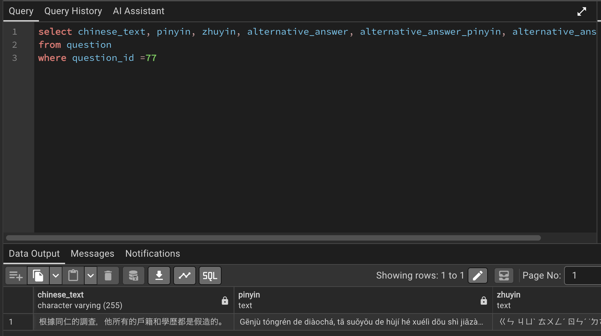

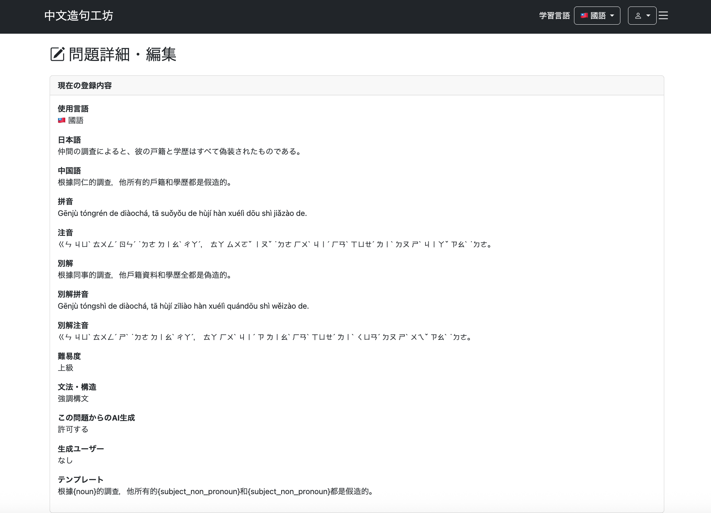

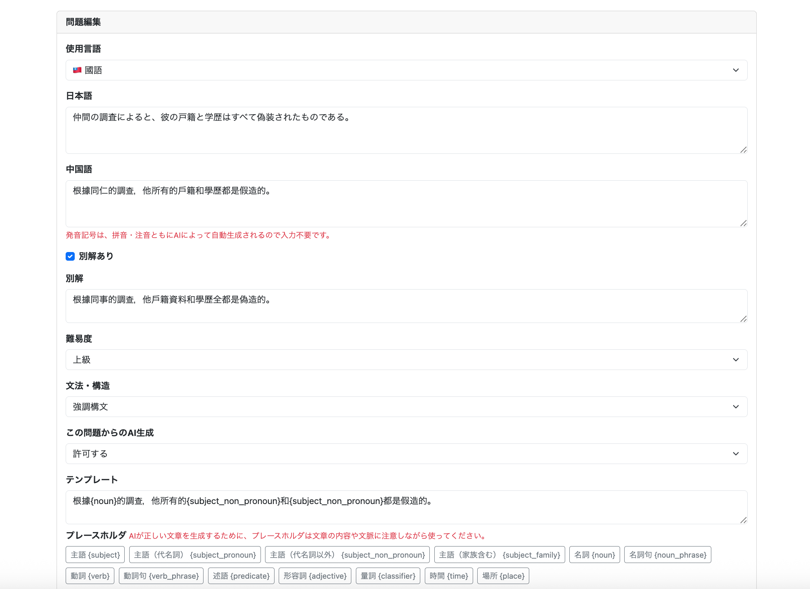

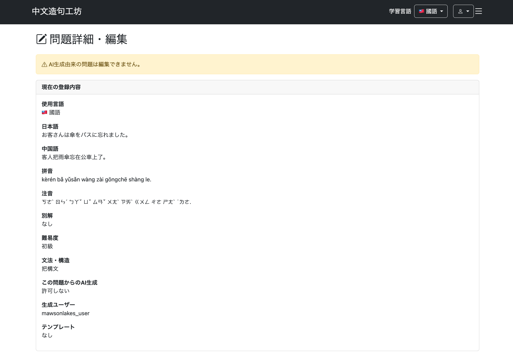

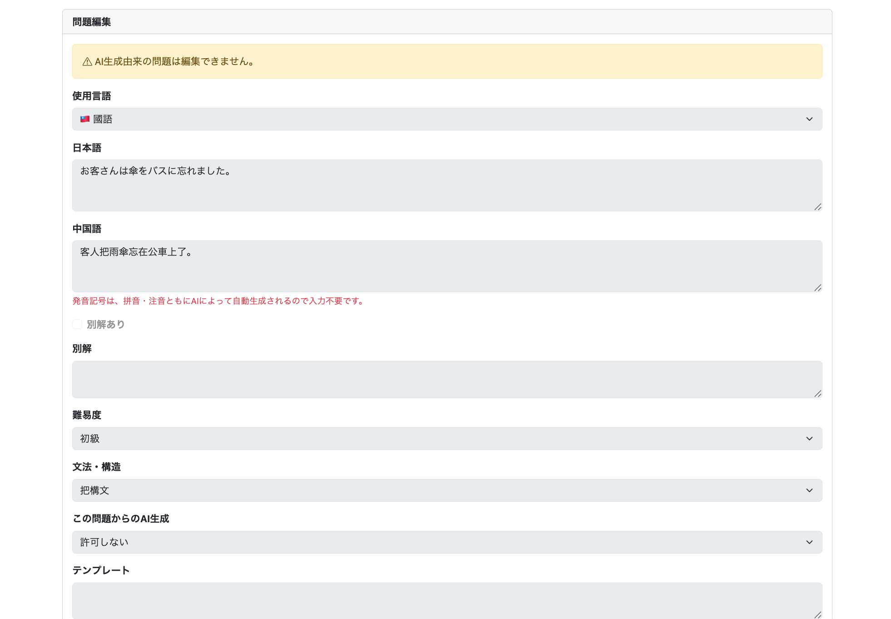

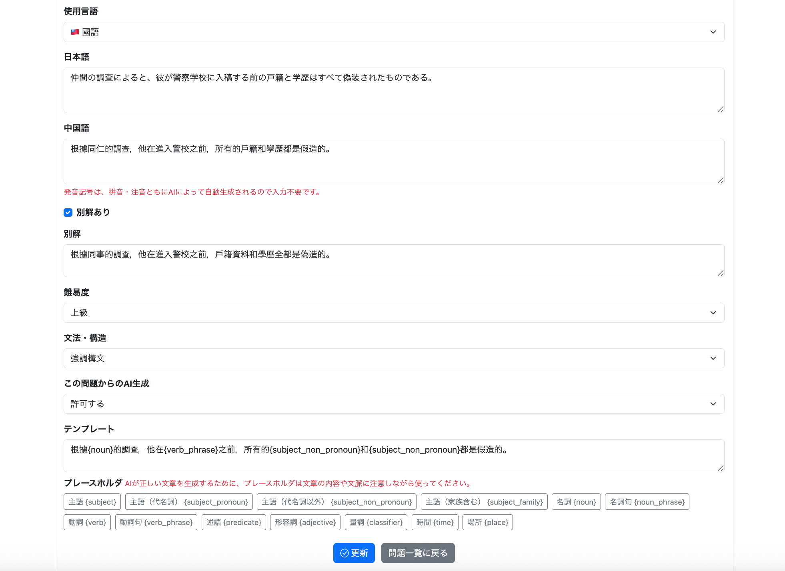

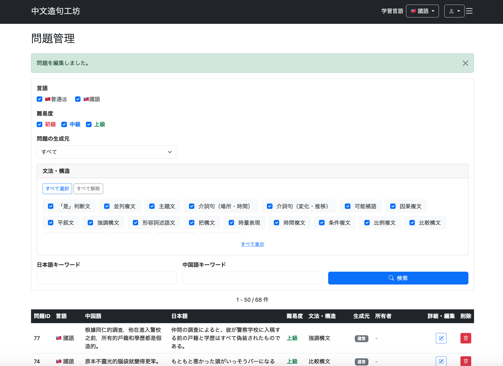

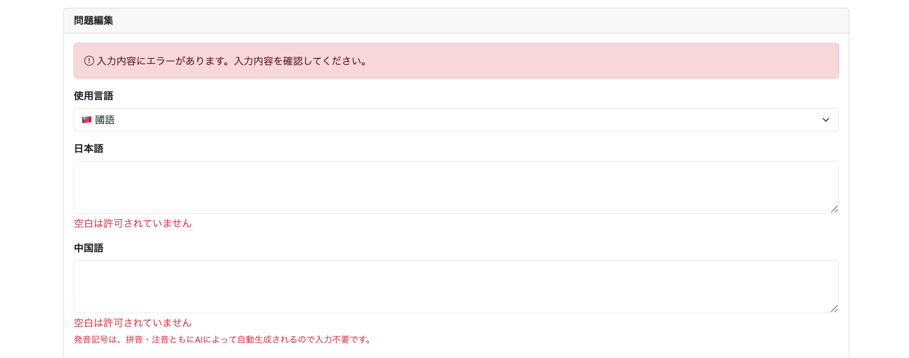

## 2. 追加修正：Templateの条件付きバリデーション

**コミット記録**

```text
git commit -m "Add conditional template validation for AI variation"
```

### 2.1 発見した不具合

`allowAiVariation`が`true`でも、Templateを空欄にして更新できてしまった。既存の`@Length(max = 255)`は文字数上限を検証するだけで、空欄を禁止しないためである。一方、TemplateはAI生成を許可しない問題では必須ではないため、無条件の`@NotBlank`も適さない。

**修正前の確認画像**

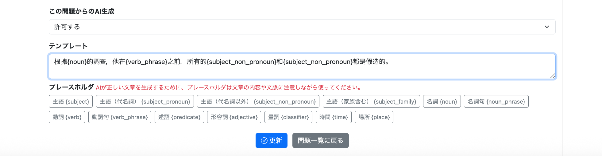

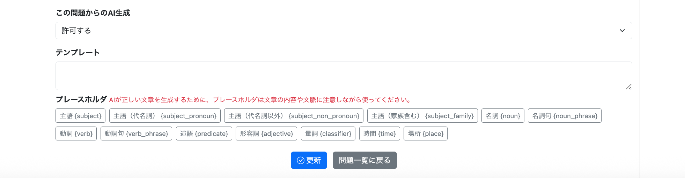

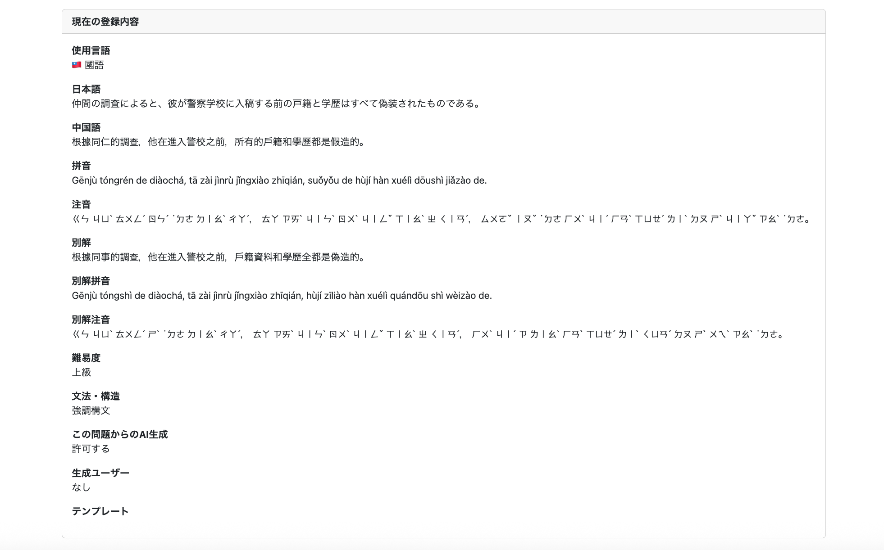

### 2.2 検証条件と設計判断

| `allowAiVariation` | `template` | 結果 |
| --- | --- | --- |
| `true` | 入力あり | 有効 |
| `true` | 空欄 | エラー |
| `false` | 入力あり | 有効 |
| `false` | 空欄 | 有効 |

2つのフィールドを組み合わせて判定するため、`QuestionForm`全体を対象にしたクラスレベルの独自バリデーション`@ValidQuestionTemplate`を作成する。今回はフォーム固有の条件なので、汎用的なフィールド名指定方式にはしない。

### 2.3 独自アノテーション

```java
@Documented
@Constraint(validatedBy = { ValidQuestionTemplateValidator.class })
@Target(ElementType.TYPE)
@Retention(RetentionPolicy.RUNTIME)
public @interface ValidQuestionTemplate {

    String message() default
            "AI生成を許可する場合はテンプレートを入力してください。";

    Class<?>[] groups() default {};

    Class<? extends Payload>[] payload() default {};

}
```

`@Target(ElementType.TYPE)`でクラス全体を対象とし、`@Constraint`でValidatorを指定する。

### 2.4 Validatorの実装

```java
public class ValidQuestionTemplateValidator
        implements ConstraintValidator<ValidQuestionTemplate, QuestionForm> {

    @Override
    public boolean isValid(
            QuestionForm form,
            ConstraintValidatorContext context) {

        if (form == null) {
            return true;
        }

        if (!form.isAllowAiVariation()) {
            return true;
        }

        if (form.getTemplate() != null
                && !form.getTemplate().isBlank()) {
            return true;
        }

        // デフォルトのクラスレベルエラーを無効化
        context.disableDefaultConstraintViolation();

        // エラーをtemplateフィールドに紐付ける
        context.buildConstraintViolationWithTemplate(
                        context.getDefaultConstraintMessageTemplate())
                .addPropertyNode("template")
                .addConstraintViolation();

        return false;
    }

}
```

`allowAiVariation`が`false`ならTemplateは任意。`true`でTemplateが`null`または空白の場合にのみエラーとする。

クラスレベルのエラーをTemplate欄の下に表示するため、`disableDefaultConstraintViolation()`でデフォルトエラーを無効化し、`addPropertyNode("template")`で`template`フィールドに紐付ける。この処理によってThymeleafの`#fields.hasErrors('template')`と`th:errors="*{template}"`が利用できる。

### 2.5 Formへの適用と画面側のエラー表示

`QuestionForm`に`@ValidQuestionTemplate`を付与する。問題編集画面だけでなく、同じFormを利用する問題追加画面にもTemplate欄のエラー表示を追加した。

```java
@ValidQuestionTemplate
@Data
public class QuestionForm {
    // 既存の入力項目とフィールド単位の検証は省略
}
```

```html
<textarea th:field="*{template}" id="template" class="form-control"></textarea>
<div class="text-danger mt-1"
     th:if="${#fields.hasErrors('template')}"
     th:errors="*{template}"></div>
```

上記HTMLは**バリデーション表示の説明用抜粋**であり、実際の編集画面ではAI生成問題の入力無効化などの属性も設定している。

### 2.6 画面上部のエラー通知

入力欄ごとのメッセージに加え、画面上部にもエラーがあることを表示する。`#fields`がフォームのバインド対象を参照できるよう、画面上部を含むコンテナに`th:object="${questionForm}"`を設定した。

```html
<div class="container mt-4"
     th:object="${questionForm}">

    <!-- バリデーションエラーの場合 -->
    <div th:if="${#fields.hasAnyErrors()}"
         class="alert alert-danger"
         role="alert">

        <i class="bi bi-exclamation-circle"></i>

        入力内容にエラーがあります。入力内容を確認してください。

    </div>

    <!-- 現在の登録内容 -->

    ...
```

### 2.7 修正後の動作確認

AI生成を許可した状態でTemplateを空欄にして更新し、更新されずにTemplate欄と画面上部へエラーが表示されることを確認した。

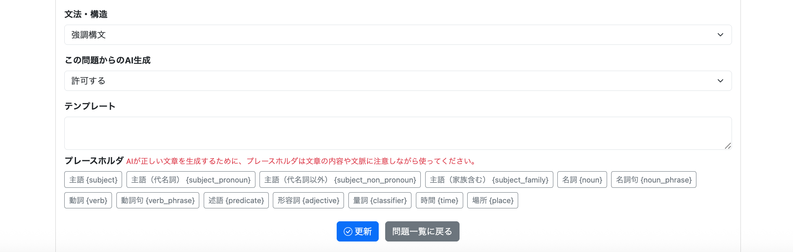

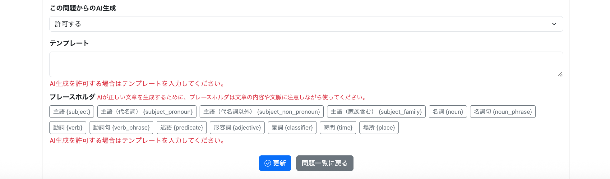

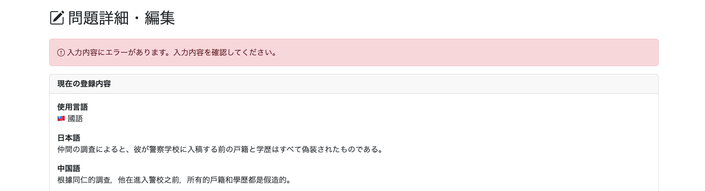

## 3. まとめ・確認事項

- 編集前の値を表示する`OriginalQuestionDTO`と、入力値を扱う`QuestionForm`の役割を分けた。
- 更新時には既存Entityへ入力内容を反映し、拼音・注音を再生成する。
- Templateの必須条件は`allowAiVariation`との組み合わせで検証し、追加・編集の両画面に反映した。
- AI生成問題の編集制限について、元ログでは画面側の無効化が確認できる一方、サーバー側で更新を拒否する検証は明示されていない。公開・運用時には別途確認する。

次の022-06では、Admin用ユーザー一覧・検索機能を扱う。
