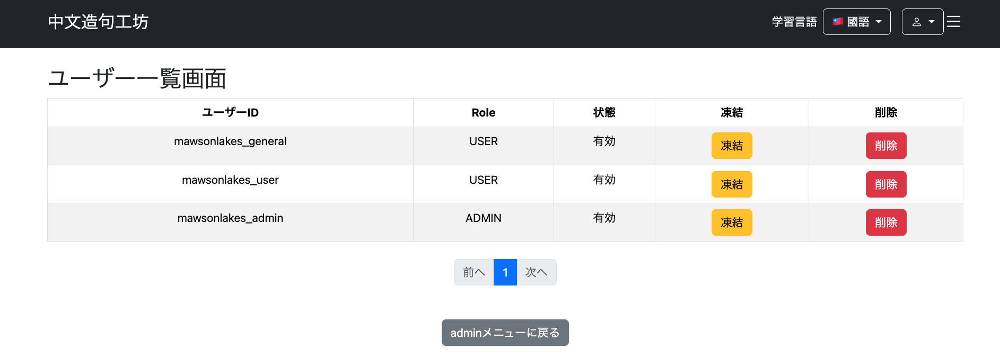
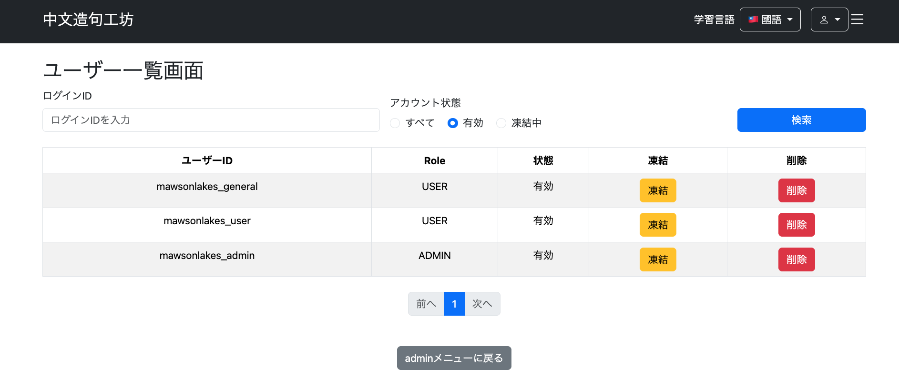
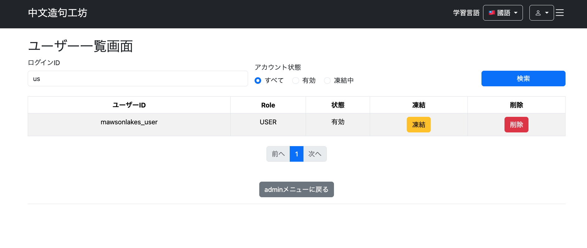

# 022-06 Admin用ユーザー一覧・検索機能の実装

> このログは実装・変更を時系列で記録したものです。途中のコードや仕様は、その後の開発によって変更されている場合があります。現在の実装はソースコードを参照してください。

## 概要

Adminが登録ユーザーを一覧表示し、ログインIDとアカウント状態で絞り込めるようにした。最初にページネーション付きの一覧を実装し、その後、検索条件とページ移動時の条件維持を追加した。凍結・凍結解除および削除の操作自体は次の022-07で扱う。

| 対象 | 変更内容 |
| --- | --- |
| `users` / `Users` | 後続の凍結機能を見据えて`account_locked`を追加 |
| `AdminUserService` | 一覧取得と検索条件付き取得 |
| `AdminUserController` | `/admin/user/list`、検索条件の初期化、ページネーション |
| `AdminUserSearchDto` / `AccountStatus` | ログインID・アカウント状態の検索条件 |
| `UserRepository` | JPQLによる条件付き検索 |
| `admin/user/list.html` | 一覧、検索フォーム、検索条件を維持するページリンク |

## 1. 事前準備：仕様とアカウント状態の追加

ユーザー管理機能の追加に合わせて、要件定義書、テーブル定義書、データ設計書、ER図、画面設計書を更新した。アカウント凍結の状態を保持するため、`users`テーブルに`account_locked`を追加した。

**コミット記録**

```text
git commit -m "docs: add account lock and user management specifications"
git commit -m "feat: add account lock field to users"
```

```sql
ALTER TABLE users
ADD COLUMN account_locked BOOLEAN NOT NULL DEFAULT FALSE;
```

```java
@Column(name = "account_locked")
private boolean accountLocked;
```

`true`を凍結中、`false`を有効とし、`NOT NULL DEFAULT FALSE`で既存ユーザーにも初期状態を設定する。この段階では状態の保持のみを実装し、凍結操作と認証時の扱いは022-07で記録する。

## 2. ユーザー一覧とページネーション

### 2.1 目的・実装方針

最初の段階では、管理者がユーザーを確認できる一覧画面を作る。1ページ50件の`Page<Users>`を取得し、既存の`PaginationService`を再利用する。

**コミット記録**

```text
git commit -m "feat: add paginated admin user list"
```

### 2.2 `AdminUserService`

```java
@Service
@RequiredArgsConstructor
public class AdminUserService {

    private final UserRepository userRepository;

    // ユーザー一覧取得
    public Page<Users> getUsers(Pageable pageable) {

        Page<Users> users =
                userRepository.findAll(pageable);

        return users;
    }

}
```

初期実装では`UserRepository.findAll(pageable)`を呼び出し、検索条件を持たないユーザー一覧を取得した。

### 2.3 `AdminUserController`

```java
@Controller
@RequiredArgsConstructor
public class AdminUserController {

    private final AdminUserService adminUserService;
    private final PaginationService paginationService;

    @GetMapping("/admin/user/list")
    public String getUserList(
            @PageableDefault(page = 0, size = 50) Pageable pageable,
            Model model) {

        Page<Users> userList =
                adminUserService.getUsers(pageable);

        PaginationDto pagination =
                paginationService.createPagination(userList);

        // 一覧
        model.addAttribute(
                "userList",
                userList.getContent());

        model.addAttribute(
                "page",
                userList);

        model.addAttribute(
                "pagination",
                pagination);

        return "/admin/user/list";
    }

}
```

`@PageableDefault(page = 0, size = 50)`で初期ページと件数を設定し、一覧の中身・`Page`・`PaginationDto`を画面へ渡す。問題一覧で用いたページネーションの仕組みを流用した。

### 2.4 一覧画面と動作確認

`admin/user/list.html`にはユーザー情報の一覧とページ移動のリンクを配置した。Bootstrapの表組みやページネーションの繰り返しマークアップはここでは省略し、後述する検索対応時の変更点を中心に記録する。



## 3. ログインID・アカウント状態による検索

### 3.1 検索条件の設計

ユーザー数が増えても対象を見つけられるよう、ログインIDの部分一致検索と、アカウント状態（すべて・有効・凍結中）の絞り込みを追加した。

**コミット記録**

```text
git commit -m "feat: add search filters to admin user list"
```

### 3.2 `AdminUserSearchDto`

```java
@Data
public class AdminUserSearchDto {

    private String loginId;

    private AccountStatus accountStatus;

}
```

フォームの入力値をまとめて保持する。

### 3.3 `AccountStatus`

```java
public enum AccountStatus {

    ALL,

    ACTIVE,

    LOCKED

}
```

検索条件の`ALL`・`ACTIVE`・`LOCKED`はアカウント自体の状態ではなく、一覧画面の絞り込み指定を表す。

### 3.4 `UserRepository`

```java
@Query("""
        SELECT u
        FROM Users u
        WHERE
            (:loginId IS NULL
                OR :loginId = ''
                OR u.loginId LIKE CONCAT('%', :loginId, '%'))
        AND
            (:accountStatus = 'ALL'
                OR (:accountStatus = 'ACTIVE' AND u.accountLocked = false)
                OR (:accountStatus = 'LOCKED' AND u.accountLocked = true))
        """)
Page<Users> findUsers(
        @Param("loginId") String loginId,
        @Param("accountStatus") String accountStatus,
        Pageable pageable);
```

`loginId`が`null`または空文字列ならログインIDで絞り込まず、値があれば`LIKE`で部分一致検索する。`accountStatus`は`ALL`なら全件、`ACTIVE`なら`accountLocked = false`、`LOCKED`なら`true`を選択する。`Page<Users>`を返すため、検索結果にもページネーションを適用できる。

### 3.5 `AdminUserService`（検索対応後）

```java
// ユーザー一覧取得
public Page<Users> getUsers(
        AdminUserSearchDto searchDto,
        Pageable pageable) {

    return userRepository.findUsers(
            searchDto.getLoginId(),
            searchDto.getAccountStatus().name(),
            pageable);
}
```

当初の引数`Pageable`のみのメソッドから、検索DTOも受け取る形へ変更した。`AccountStatus.name()`をRepositoryに渡している。

### 3.6 `AdminUserController`（検索対応後）

```java
@GetMapping("/admin/user/list")
public String getUserList(
        @ModelAttribute AdminUserSearchDto searchDto,
        @PageableDefault(page = 0, size = 50) Pageable pageable,
        Model model) {

    if (searchDto.getAccountStatus() == null) {
        searchDto.setAccountStatus(AccountStatus.ALL);
    }

    Page<Users> userList =
            adminUserService.getUsers(
                    searchDto,
                    pageable);

    PaginationDto pagination =
            paginationService.createPagination(userList);

    // 一覧
    model.addAttribute(
            "userList",
            userList.getContent());

    model.addAttribute(
            "page",
            userList);

    model.addAttribute(
            "pagination",
            pagination);

    // 検索条件
    model.addAttribute(
            "searchDto",
            searchDto);

    return "/admin/user/list";
}
```

初回アクセス時に`accountStatus`が未指定なら`ALL`を設定する。`@ModelAttribute`で受け取った条件を一覧取得に渡し、フォームへ再表示するためModelにも保持する。

### 3.7 Thymeleafの検索フォーム

フォームはGETで`/admin/user/list`へ送信する。ログインIDはテキスト入力、アカウント状態は選択式とし、`th:object="${searchDto}"`でDTOにバインドする。検索URLは次の形式となる。

```text
/admin/user/list?loginId=test&accountStatus=LOCKED
```

### 3.8 ページネーションで検索条件を維持

検索後にページを移動しても絞り込みが解除されないよう、ページリンクに`loginId`と`accountStatus`を引き継ぐ。元ログでは「前へ」「1ページ目」「ページ番号」「最終ページ」「次へ」のすべてを修正した。代表例として「次へ」のリンクを示す。

```html
<a class="page-link"
   th:href="@{/admin/user/list(
       page=${page.number + 1},
       size=${page.size},
       loginId=${searchDto.loginId},
       accountStatus=${searchDto.accountStatus}
   )}">
    次へ
</a>
```

ページ番号や前後リンクも同じクエリパラメータを付ける。単に検索フォームを追加するだけでは、ページ遷移時に検索条件が失われるため、この変更が必要だった。

### 3.9 動作確認

検索条件を指定したユーザー一覧と、検索後のページ移動を確認した。





## 4. この段階での到達点

一覧画面へのアクセス、50件単位のページネーション、ログインIDの部分一致検索、アカウント状態による絞り込み、ページ遷移時の検索条件維持を実装した。ユーザーの凍結・凍結解除と削除は次の**022-07**で扱う。

> **確認事項**：この記録に掲載したControllerの`@GetMapping`だけでは、管理者以外のアクセスが禁止されているかは判断できない。`/admin/**`の認可はSpring Security設定等の実装を参照して確認する。
