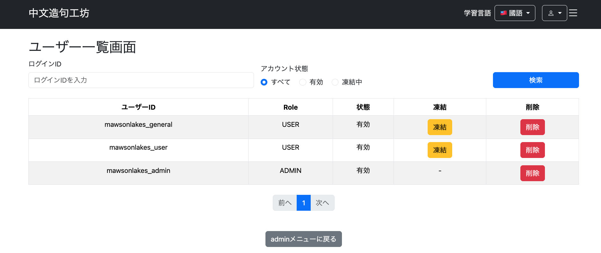
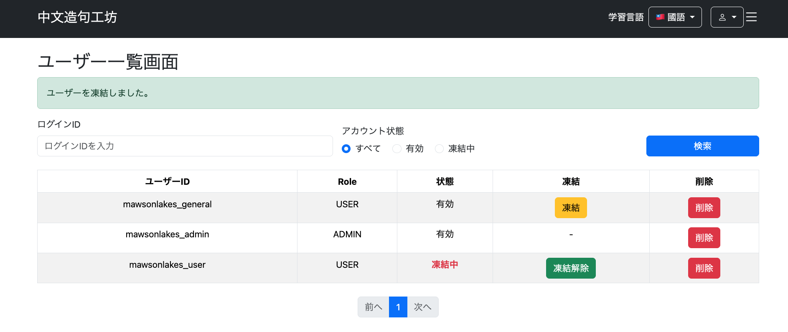
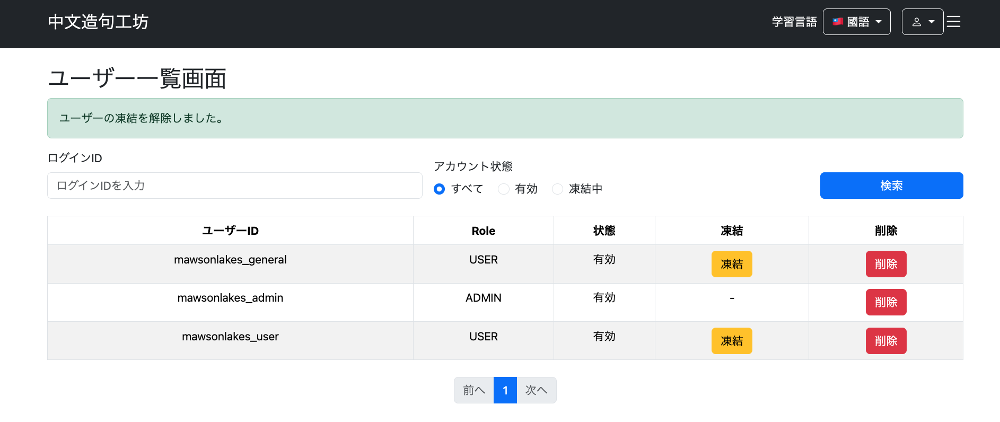
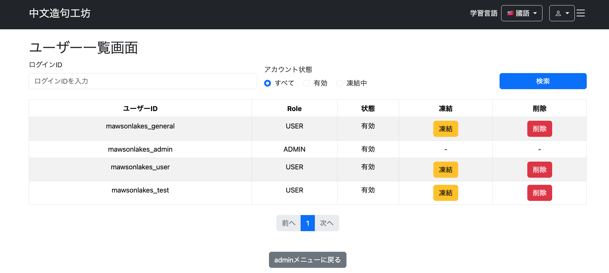
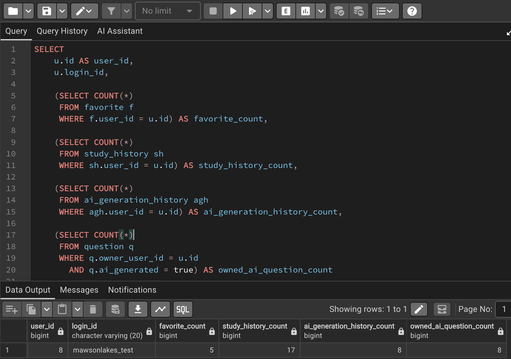
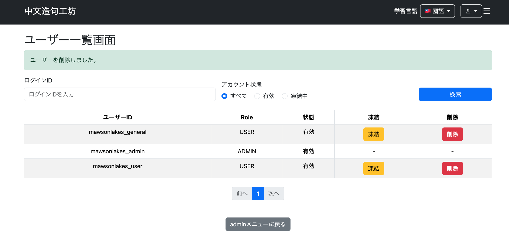
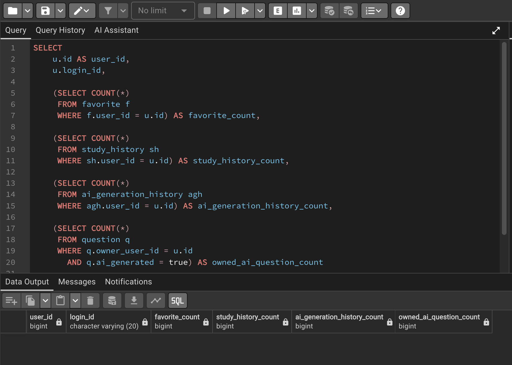

# 022-07 ユーザーの凍結・削除機能の実装

> このログは実装・変更を時系列で記録したものです。途中のコードや仕様は、その後の開発によって変更されている場合があります。現在の実装はソースコードを参照してください。

## 概要

前回の022-06で実装したAdmin用ユーザー一覧・検索画面に、アカウントの凍結・凍結解除とユーザー削除を追加する。削除では外部キー制約を考慮し、一般ユーザー自身の退会処理と共通化する。

| 機能 | 主な変更箇所 |
| --- | --- |
| 凍結・凍結解除 | `AdminUserService`、`AdminUserController`、`/admin/user/list.html` |
| 関連データを含む削除 | `FavoriteRepository`、`AiGenerationHistoryRepository`、`StudyHistoryRepository`、`QuestionRepository`、`UserAccountService` |
| Adminからの削除操作 | `AdminUserController`、`/admin/user/list.html`、`messages.properties` |

## 1. ユーザーの凍結・凍結解除

```text
git commit -m "feat: add user account lock and unlock functionality"
```

### 1.1 目的と方針

一般ユーザーの`accountLocked`を切り替え、管理画面から凍結・解除できるようにする。ADMINの凍結はService側で禁止し、画面にも操作ボタンを表示しない。`UserRepository`は`JpaRepository<Users, Long>`を継承しており、既存の`findById()`と`save()`で対応できるためメソッドは追加しない。

### 1.2 Serviceの実装

```java
// AdminUserService
public void lockUser(Long userId) {
    Users user = userRepository.findById(userId)
            .orElseThrow();

    if (user.getRole() == Role.ADMIN) {
        throw new IllegalStateException(
                "管理者ユーザーは凍結できません。");
    }

    if (!user.isAccountLocked()) {
        user.setAccountLocked(true);
    }
    userRepository.save(user);
}

public void unlockUser(Long userId) {
    Users user = userRepository.findById(userId)
            .orElseThrow();

    if (user.isAccountLocked()) {
        user.setAccountLocked(false);
    }
    userRepository.save(user);
}
```

凍結処理はADMINを拒否する。一方、この時点の`unlockUser`にはADMIN判定がなく、凍結解除側の権限・対象制御については実装の確認事項として残る。どちらも現在の状態を確認してから変更する。

### 1.3 Controllerと画面

```java
// AdminUserController
@PostMapping("/admin/user/lock")
public String lockUser(
        @RequestParam Long userId,
        RedirectAttributes redirectAttributes) {
    adminUserService.lockUser(userId);
    redirectAttributes.addFlashAttribute(
            "successMessage", "ユーザーを凍結しました。");
    return "redirect:/admin/user/list";
}

@PostMapping("/admin/user/unlock")
public String unlockUser(
        @RequestParam Long userId,
        RedirectAttributes redirectAttributes) {
    adminUserService.unlockUser(userId);
    redirectAttributes.addFlashAttribute(
            "successMessage", "ユーザーの凍結を解除しました。");
    return "redirect:/admin/user/list";
}
```

`/admin/user/list.html`では、ADMINに`-`を表示し、一般ユーザーの`accountLocked`に応じてPOSTフォームを切り替える。操作前にはJavaScriptの`confirm()`で確認する。

```html
<td>
    <span th:if="${item.role.name() == 'ADMIN'}">-</span>

    <form th:if="${item.role.name() != 'ADMIN' and !item.accountLocked}"
          th:action="@{/admin/user/lock}" method="post">
        <input type="hidden" name="userId" th:value="${item.id}">
        <button type="submit" class="btn btn-warning"
                onclick="return confirm('ユーザーを凍結しますか？');">
            凍結
        </button>
    </form>

    <form th:if="${item.role.name() != 'ADMIN' and item.accountLocked}"
          th:action="@{/admin/user/unlock}" method="post">
        <input type="hidden" name="userId" th:value="${item.id}">
        <button type="submit" class="btn btn-success"
                onclick="return confirm('ユーザーの凍結を解除しますか？');">
            凍結解除
        </button>
    </form>
</td>
```

成功メッセージは一覧画面に共通の領域を設けて表示する。

```html
<div th:if="${successMessage}" class="alert alert-success"
     role="alert" th:text="${successMessage}"></div>
```

### 1.4 動作確認

ADMINには凍結・凍結解除ボタンが表示されないことを確認した。この時点では削除ボタンの制御は未実装。



一般ユーザーを凍結すると状態が「凍結中」となり、成功メッセージが表示された。



同じユーザーを凍結解除すると「有効」に戻り、成功メッセージが表示された。



## 2. ユーザーと関連データの削除

```text
git commit -m "feat: add user deletion with related data cleanup"
```

### 2.1 目的と削除順序

`Users`だけを削除すると、ユーザーに紐づくデータの外部キー制約に抵触する。そこで以下の順序で削除する。

```text
Favorite
  ↓
AiGenerationHistory
  ↓
StudyHistory
  ↓
ユーザー所有のAI生成由来Question
  ↓
Users
```

一般ユーザー自身の退会とAdminからの削除で同じ手順を使用するため、削除処理は`AdminUserService`ではなく`UserAccountService`に集約する。

### 2.2 実装中に発生した外部キー制約違反

当初は次のような派生削除クエリを使用していた。

```java
void deleteByFavoriteKeyUserId(Long userId);
```

しかし、関連データを順に削除した後、`Question`を削除する際に次のエラーが発生した。

```text
Key (question_id)=(83) is still referenced from table "favorite"
```

Java側では`Favorite`の削除を先に呼び出していたものの、`Question`削除時点で参照元の`Favorite`がDBに残っていた。実際のSQL実行順やHibernate内部状態は確認していないため、派生削除クエリそのものが直接原因だったとは断定しない。

派生削除クエリは一致するEntityを取得して個別に削除するのに対し、`@Modifying`と`@Query`による明示的なDELETEは、Entityを1件ずつ取得せずに削除クエリを実行する。今回は関連データの削除方法を統一するため、`Favorite`、`AiGenerationHistory`、`StudyHistory`の3つを明示的なDELETEへ変更した。

### 2.3 Repositoryの変更

```java
// FavoriteRepository
@Modifying
@Query("""
        DELETE FROM Favorite f
        WHERE f.favoriteKey.userId = :userId
        """)
void deleteByFavoriteKeyUserId(@Param("userId") Long userId);

// AiGenerationHistoryRepository
@Modifying
@Query("""
        DELETE FROM AiGenerationHistory a
        WHERE a.user.id = :userId
        """)
void deleteByUserId(@Param("userId") Long userId);

// StudyHistoryRepository
@Modifying
@Query("""
        DELETE FROM StudyHistory sh
        WHERE sh.studyHistoryKey.userId = :userId
        """)
void deleteByStudyHistoryKeyUserId(@Param("userId") Long userId);

// QuestionRepository
@Modifying
@Query("""
        DELETE FROM Question q
        WHERE q.owner.id = :userId
        AND q.aiGenerated = true
        """)
void deleteByOwnerId(@Param("userId") Long userId);
```

`Question`については、対象ユーザーが所有する**AI生成由来の問題のみ**を削除する。`@Modifying`は`@Query`で更新・削除クエリを実行することをSpring Data JPAに示す。

### 2.4 UserAccountServiceで削除処理を共通化

一般ユーザーの退会処理とAdminの削除処理は、対象ユーザーの取得方法とADMINの削除可否が異なる。実際の関連データ削除は共通の`deleteUserData`へ委譲する。

```java
@Transactional
public void cancelMembership(String loginId, Locale locale) {
    Users user = getUserOne(loginId);
    if (user == null) {
        throw new IllegalArgumentException(
                messageSource.getMessage(
                        "user.delete.error.notFound", null, locale));
    }
    deleteUserData(user);
    log.info("退会完了 loginId={}", loginId);
}

@Transactional
public void deleteUser(Long userId, Locale locale) {
    Users user = userRepository.findById(userId)
            .orElseThrow(() -> new IllegalArgumentException(
                    messageSource.getMessage(
                            "user.delete.error.notFound", null, locale)));

    if (user.getRole() == Role.ADMIN) {
        throw new IllegalStateException(
                messageSource.getMessage(
                        "admin.user.delete.error.admin", null, locale));
    }
    deleteUserData(user);
    log.info("ユーザー削除完了 userId={}", userId);
}

private void deleteUserData(Users user) {
    Long userId = user.getId();
    favoriteRepository.deleteByFavoriteKeyUserId(userId);
    aiGenerationHistoryRepository.deleteByUserId(userId);
    studyHistoryRepository.deleteByStudyHistoryKeyUserId(userId);
    questionRepository.deleteByOwnerId(userId);
    userRepository.delete(user);
}
```

`@Transactional`により一連の削除処理をトランザクション内で実行する。Adminによる削除ではService側でADMINを拒否し、画面側でも削除ボタンを非表示にする。

### 2.5 Controller・画面・メッセージ

```java
// AdminUserController
@PostMapping("/admin/user/delete")
public String deleteUser(
        @RequestParam Long userId,
        RedirectAttributes redirectAttributes,
        Locale locale) {
    userAccountService.deleteUser(userId, locale);
    redirectAttributes.addFlashAttribute(
            "successMessage", "ユーザーを削除しました。");
    return "redirect:/admin/user/list";
}
```

`/admin/user/list.html`には、ADMIN以外にだけ削除ボタンを表示するPOSTフォームを追加する。

```html
<td>
    <span th:if="${item.role.name() == 'ADMIN'}">-</span>
    <form th:if="${item.role.name() != 'ADMIN'}"
          th:action="@{/admin/user/delete}" method="post">
        <input type="hidden" name="userId" th:value="${item.id}">
        <button type="submit" class="btn btn-danger"
                onclick="return confirm('ユーザーを削除しますか？');">
            削除
        </button>
    </form>
</td>
```

成功メッセージ表示には凍結機能で追加した`successMessage`領域を再利用する。削除処理を一般ユーザーの退会と共有するため、エラーメッセージは`messages.properties`で管理する。

```properties
user.delete.error.notFound=ユーザーが存在しません
admin.user.delete.error.admin=管理者ユーザーは削除できません
admin.user.delete.success=ユーザーを削除しました。
```

### 2.6 動作確認

ADMINに削除ボタンが表示されないことを確認した。



テストユーザーにお気に入り、学習履歴、AI生成履歴、所有するAI生成問題を登録し、削除前の件数をSQLで確認した。

```sql
SELECT
    u.id AS user_id,
    u.login_id,
    (SELECT COUNT(*) FROM favorite f
     WHERE f.user_id = u.id) AS favorite_count,
    (SELECT COUNT(*) FROM study_history sh
     WHERE sh.user_id = u.id) AS study_history_count,
    (SELECT COUNT(*) FROM ai_generation_history agh
     WHERE agh.user_id = u.id) AS ai_generation_history_count,
    (SELECT COUNT(*) FROM question q
     WHERE q.owner_user_id = u.id AND q.ai_generated = true)
        AS owned_ai_question_count
FROM users u
WHERE u.login_id = 'mawsonlakes_test';
```

| 削除前のデータ | 件数 |
| --- | ---: |
| ユーザーID | 8 |
| お気に入り | 5 |
| 学習履歴 | 17 |
| AI生成履歴 | 8 |
| 所有するAI生成由来問題 | 8 |



管理画面からテストユーザーを削除し、成功メッセージが表示されることを確認した。



DBを再確認し、ユーザーID `8` のユーザーと、そのユーザーに紐づく関連データが削除されていることを確認した。



## 3. 実装上の整理と確認事項

- 凍結・削除は、ボタン非表示だけに頼らずService側でもADMINを保護する設計とした。ただし凍結解除メソッドにADMIN判定はない。
- 関連データ削除時の外部キー制約違反を受け、派生削除クエリから明示的なDELETEへ変更した。原因の断定は避け、確認できた事象と採用した対処を区別する。
- 一般ユーザーの退会とAdminからの削除は、`UserAccountService`の共通処理へ集約した。
- `/admin/user/*`へのアクセスがSpring Security側でADMINに制限されているか、また凍結ユーザーの認証が適切に拒否されるかは、このログ内の動作確認だけでは判断できない。現行設定を別途確認する。

次の022-08では、文法・構造の一覧表示と追加機能を扱う。
