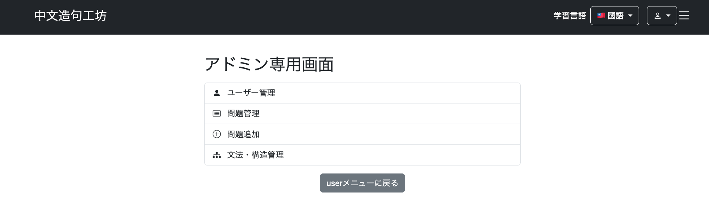
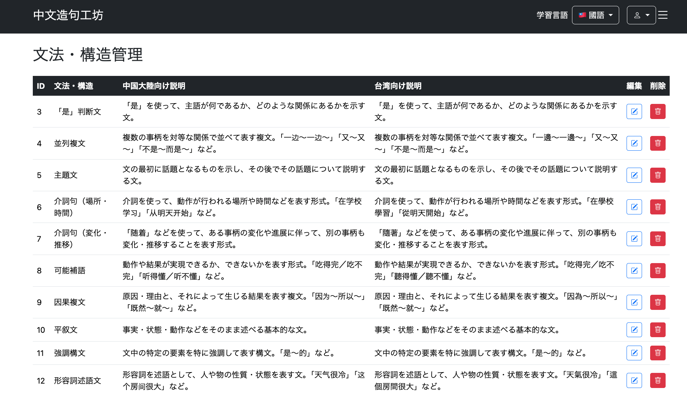
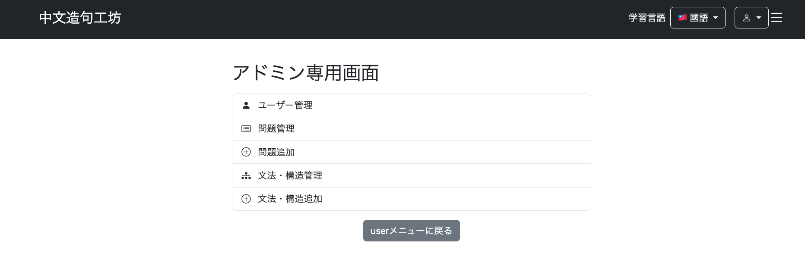
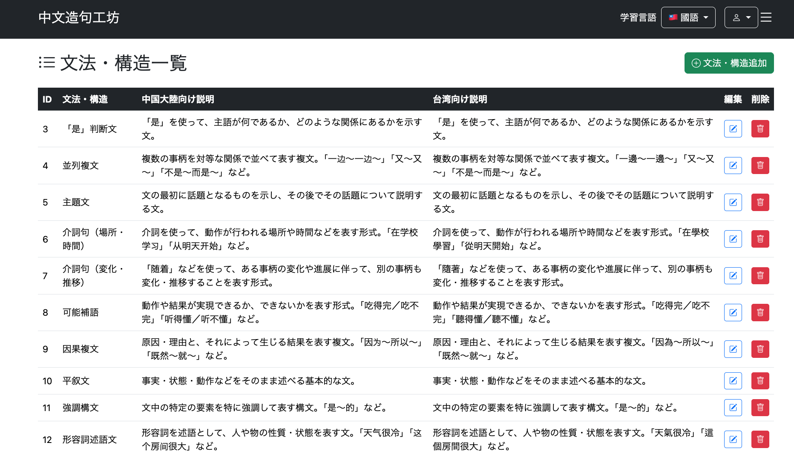
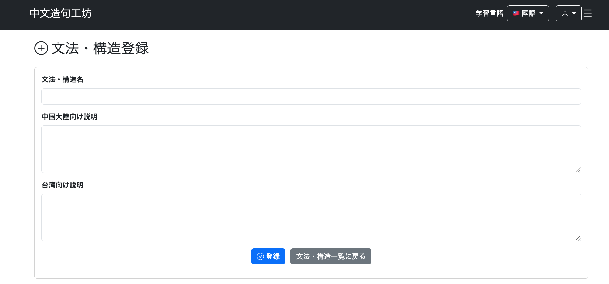
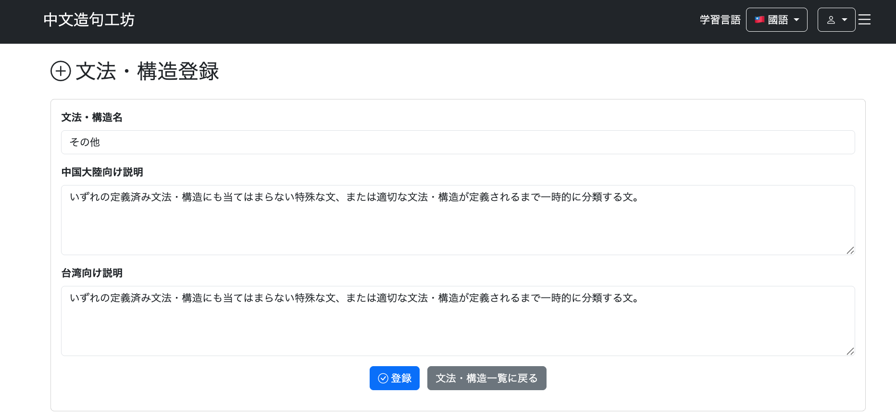
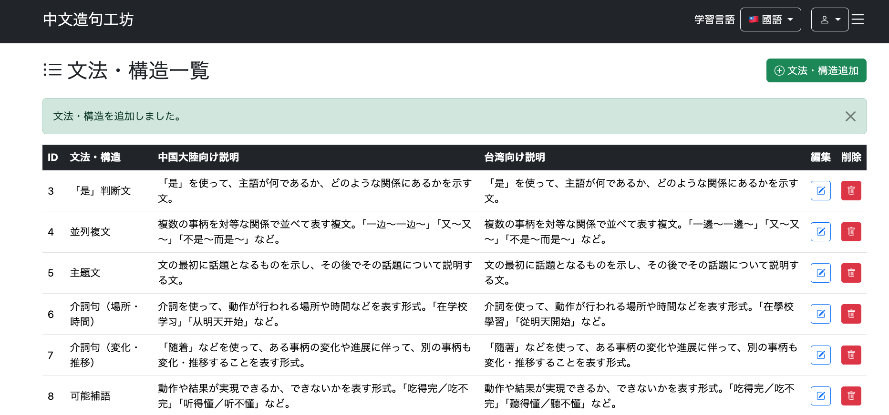
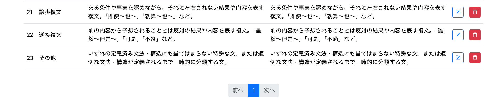
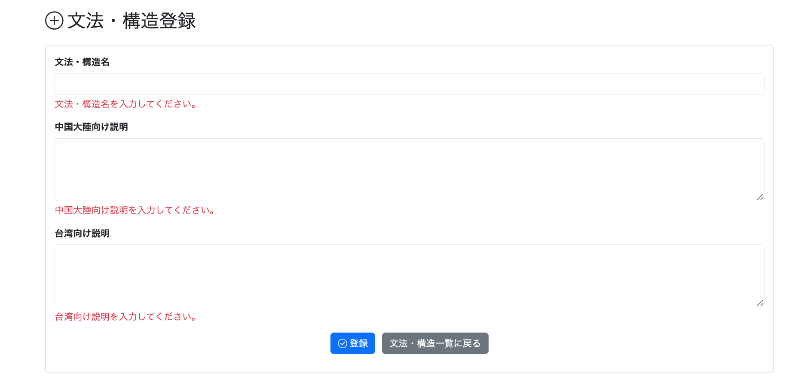

# 022-08 文法・構造一覧と追加機能の実装

> このログは実装・変更を時系列で記録したものです。途中のコードや仕様は、その後の開発によって変更されている場合があります。現在の実装はソースコードを参照してください。

## 概要

問題を新規追加・編集する際、既存の文法・構造の選択肢に適切なものがないケースがあった。今後の追加にも対応できるよう、Adminから文法・構造を確認・登録する機能を実装した。

本章では**一覧表示と新規追加**を扱う。登録済みデータの編集・削除は022-09、022-10で記録する。

| 機能 | 主な変更箇所 |
| --- | --- |
| 文法・構造一覧 | `StructureRepository`、`AdminStructureService`、`AdminStructureController`、`/admin/structure/list.html` |
| 文法・構造追加 | `StructureForm`、`StructureRepository`、`AdminStructureService`、`AdminStructureController`、`/admin/structure/add.html` |
| 画面への導線 | `/admin/menu.html`、`/admin/structure/list.html` |

## 1. 文法・構造一覧ページの実装

```text
git commit -m "feat: add admin structure management list"
```

### 1.1 目的と表示項目

Adminが登録済みの文法・構造を確認できる一覧ページを作る。表示項目は、文法ID、文法・構造名、中国大陸向け説明、台湾向け説明の4つ。各行に編集・削除ボタンも用意するが、それぞれの処理は後続の実装で扱う。

### 1.2 RepositoryとService

文法・構造は`structureId`の昇順で取得し、ページネーションを適用する。`Page<Structure>`を返すことで、表示データと総ページ数などの情報を扱える。

```java
// StructureRepository
@Query("""
        SELECT s
        FROM Structure s
        ORDER BY s.structureId ASC
        """)
Page<Structure> findStructures(Pageable pageable);
```

```java
// AdminStructureService
@Service
@RequiredArgsConstructor
public class AdminStructureService {

    private final StructureRepository structureRepository;

    public Page<Structure> getStructures(Pageable pageable) {
        return structureRepository.findStructures(pageable);
    }
}
```

### 1.3 Controllerとページネーション

```java
// AdminStructureController
@Controller
@RequiredArgsConstructor
public class AdminStructureController {

    private final AdminStructureService adminStructureService;
    private final PaginationService paginationService;

    @GetMapping("/admin/structure/list")
    public String getStructureList(
            @PageableDefault(page = 0, size = 50) Pageable pageable,
            Model model) {

        Page<Structure> structureList =
                adminStructureService.getStructures(pageable);

        PaginationDto pagination =
                paginationService.createPagination(structureList);

        model.addAttribute("structureList", structureList.getContent());
        model.addAttribute("page", structureList);
        model.addAttribute("pagination", pagination);

        return "/admin/structure/list";
    }
}
```

1ページ50件を基本とし、既存の`PaginationService`から表示ページ番号などを取得する。Thymeleafには、表示対象の一覧、`Page`、`PaginationDto`を別々に渡す。

### 1.4 Thymeleafの一覧画面

`/admin/structure/list.html`では、Bootstrapのテーブルに各文法・構造を表示する。以下は動的な表示と編集・削除への導線に関わる部分の抜粋。

```html
<tr th:each="structure : ${structureList}">
    <td th:text="${structure.structureId}"></td>
    <td th:text="${structure.name}"></td>
    <td th:text="${structure.descriptionZhCn}"></td>
    <td th:text="${structure.descriptionZhTw}"></td>
    <td>
        <a th:href="@{/admin/structure/edit(structureId=${structure.structureId})}"
           class="btn btn-outline-primary btn-sm">
            <i class="bi bi-pencil-square"></i>
        </a>
    </td>
    <td>
        <form th:action="@{/admin/structure/delete}" method="post">
            <input type="hidden" name="structureId"
                   th:value="${structure.structureId}">
            <button type="submit" class="btn btn-danger btn-sm"
                    onclick="return confirm('この文法・構造を削除しますか？')">
                <i class="bi bi-trash"></i>
            </button>
        </form>
    </td>
</tr>
```

ページネーションは既存の`PaginationDto`を利用し、`page.number`、`page.totalPages`、`pagination.displayStartPage`、`pagination.displayEndPage`などから「前へ」「次へ」、ページ番号、省略記号を表示する。各リンクは`/admin/structure/list`に`page`と`size`を渡す。

Adminメニューには、一覧へのリンクを追加した。

```html
<a th:href="@{/admin/structure/list}"
   class="list-group-item list-group-item-action">
    <i class="bi bi-diagram-3-fill me-2"></i>
    文法・構造管理
</a>
```

### 1.5 動作確認

Adminメニューに「文法・構造管理」のリンクが表示されることを確認した。



リンクを選択すると一覧画面へ遷移し、登録済みの文法・構造が表示されることを確認した。



## 2. 文法・構造の新規追加

```text
git commit -m "feat: add admin structure creation"
```

### 2.1 目的と入力項目

Adminから新しい文法・構造を登録できるようにする。入力するのは文法・構造名、中国大陸向け説明、台湾向け説明の3項目で、いずれも必須とした。

### 2.2 StructureFormとバリデーション

```java
@Data
public class StructureForm {

    @NotBlank(message = "文法・構造名を入力してください。")
    private String name;

    @NotBlank(message = "中国大陸向け説明を入力してください。")
    private String descriptionZhCn;

    @NotBlank(message = "台湾向け説明を入力してください。")
    private String descriptionZhTw;
}
```

`@NotBlank`により、空文字列だけでなく空白のみの入力もエラーとする。

### 2.3 文法・構造名の重複確認と登録

`Structure.name`にはDB側でも`unique = true`が設定されている。これとは別に、登録前に同名データを確認し、画面に分かりやすいエラーを返すため、Repositoryに次のメソッドを追加した。

```java
// StructureRepository
boolean existsByName(String name);
```

```java
// AdminStructureService
@Transactional
public void addStructure(StructureForm form) {

    if (structureRepository.existsByName(form.getName())) {
        throw new IllegalArgumentException(
                "同じ名前の文法・構造がすでに登録されています。");
    }

    Structure structure = new Structure();
    structure.setName(form.getName());
    structure.setDescriptionZhCn(form.getDescriptionZhCn());
    structure.setDescriptionZhTw(form.getDescriptionZhTw());

    structureRepository.save(structure);
}
```

新規登録には`JpaRepository`の`save()`を使うため、登録専用のRepositoryメソッドは不要。Serviceの`@Transactional`で登録処理をトランザクション内にまとめる。

### 2.4 Controller：入力画面と登録処理

```java
// AdminStructureController
@GetMapping("/admin/structure/add")
public String getStructureAdd(
        @ModelAttribute StructureForm structureForm) {
    return "/admin/structure/add";
}

@PostMapping("/admin/structure/add")
public String addStructure(
        @Validated @ModelAttribute StructureForm structureForm,
        BindingResult bindingResult,
        RedirectAttributes redirectAttributes) {

    if (bindingResult.hasErrors()) {
        return "/admin/structure/add";
    }

    try {
        adminStructureService.addStructure(structureForm);
    } catch (IllegalArgumentException e) {
        bindingResult.rejectValue(
                "name", "structure.add.error", e.getMessage());
        return "/admin/structure/add";
    }

    redirectAttributes.addFlashAttribute(
            "successMessage", "文法・構造を追加しました。");
    return "redirect:/admin/structure/list";
}
```

`@Validated`による必須項目チェックと、Serviceによる名前の重複チェックを分けている。重複時は`bindingResult.rejectValue("name", ...)`で文法・構造名のフィールドエラーとして表示し、登録成功時はFlash Attributeを設定して一覧へ戻す。

### 2.5 Thymeleafフォームと画面遷移

`/admin/structure/add.html`では、`th:object="${structureForm}"`を指定したPOSTフォームを用意する。各項目に`th:field`を割り当て、`th:errors`でフィールドごとの検証エラーを表示する。

```html
<form th:action="@{/admin/structure/add}"
      th:object="${structureForm}" method="post">

    <input type="text" th:field="*{name}" class="form-control">
    <div class="text-danger mt-1"
         th:if="${#fields.hasErrors('name')}"
         th:errors="*{name}"></div>

    <textarea th:field="*{descriptionZhCn}"
              class="form-control" rows="4"></textarea>
    <div class="text-danger mt-1"
         th:if="${#fields.hasErrors('descriptionZhCn')}"
         th:errors="*{descriptionZhCn}"></div>

    <textarea th:field="*{descriptionZhTw}"
              class="form-control" rows="4"></textarea>
    <div class="text-danger mt-1"
         th:if="${#fields.hasErrors('descriptionZhTw')}"
         th:errors="*{descriptionZhTw}"></div>

    <button type="submit" class="btn btn-primary">登録</button>
    <a th:href="@{/admin/structure/list}"
       class="btn btn-secondary">文法・構造一覧に戻る</a>
</form>
```

追加画面への導線は2か所に設けた。

- `/admin/menu.html`に「文法・構造追加」リンクを追加。
- `/admin/structure/list.html`のタイトル横に「文法・構造追加」ボタンを配置。

```html
<!-- Adminメニュー -->
<a th:href="@{/admin/structure/add}"
   class="list-group-item list-group-item-action">
    <i class="bi bi-plus-circle me-2"></i>
    文法・構造追加
</a>

<!-- 文法・構造一覧のタイトル横 -->
<a th:href="@{/admin/structure/add}" class="btn btn-success">
    <i class="bi bi-plus-circle"></i>
    文法・構造追加
</a>
```

### 2.6 動作確認

Adminメニューに「文法・構造追加」リンクが表示されることを確認した。



文法・構造一覧の上部にも追加ボタンが表示されることを確認した。



どちらからも文法・構造登録画面へ遷移できることを確認した。



文法・構造名と中国大陸・台湾向けの説明を入力して登録した。



登録後は一覧画面へ戻り、成功メッセージが表示されることを確認した。



追加した文法・構造が一覧に表示されることを確認した。



必須項目を空欄にすると、入力欄にバリデーションエラーが表示されることを確認した。



## 3. 設計上の判断と今回見送った機能

### 3.1 並び順と検索

文法・構造は100件未満の登録を想定していたため、検索機能や並び順の切り替えは実装せず、`structureId`昇順で固定した。一覧にはページネーションを設けている。

### 3.2 説明文のAI生成

中国大陸・台湾向けの説明をAIで生成する案も検討した。しかし、文法・構造の説明を適切に生成するためのプロンプトや処理が複雑になるため、今回は見送った。説明文はAdminが手動入力する。

## 4. 次の実装

登録済みの文法・構造について、名称と中国大陸・台湾向け説明を変更できる編集機能を022-09で扱う。削除処理は022-10で扱う。
