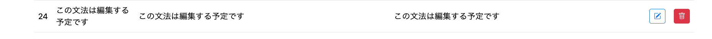
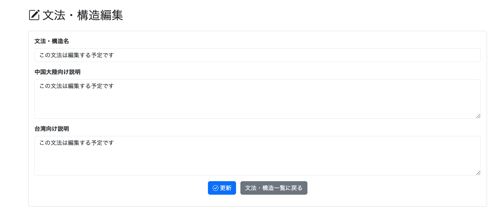
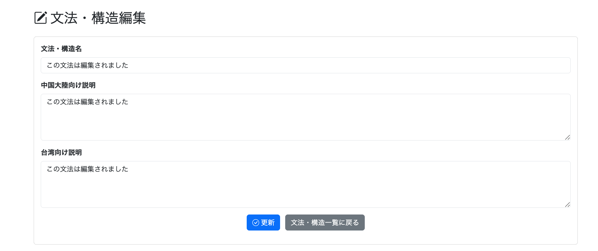
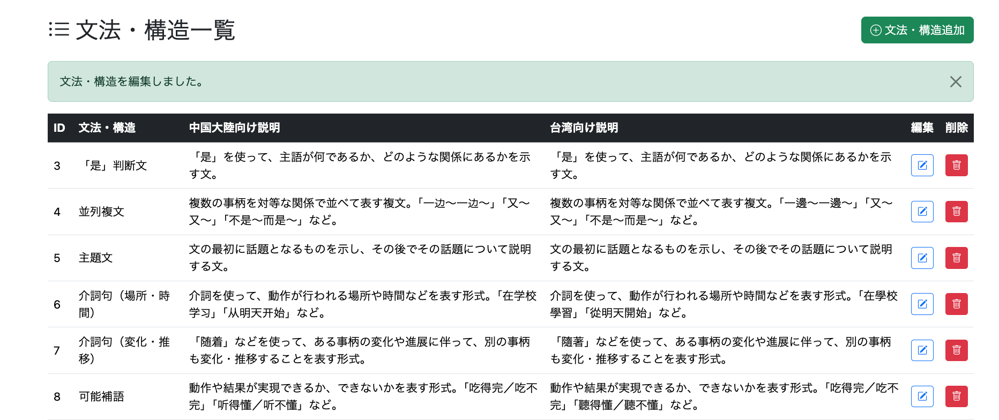
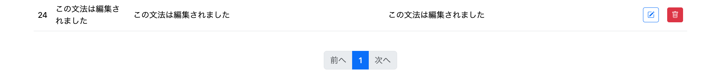
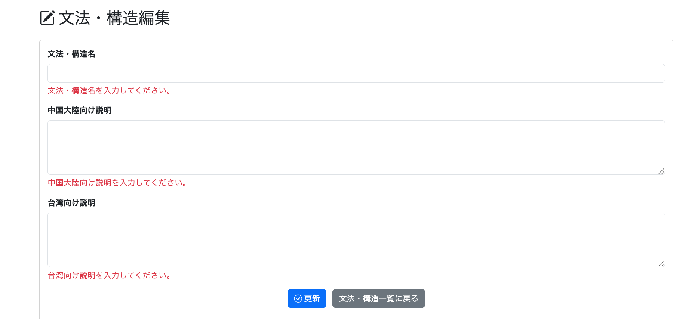

# 022-09 文法・構造編集機能の実装

> このログは実装・変更を時系列で記録したものです。途中のコードや仕様は、その後の開発によって変更されている場合があります。現在の実装はソースコードを参照してください。

## 概要

022-08では、Admin用の文法・構造一覧と新規追加機能を実装した。本章では、登録済みの文法・構造について、**文法・構造名、中国大陸向け説明、台湾向け説明**を変更する機能を追加する。

```text
git commit -m "feat: add admin structure editing"
```

| 変更対象 | 実装内容 |
| --- | --- |
| `StructureRepository` | 編集対象自身を除外した名称重複チェック |
| `AdminStructureService` | 編集対象の取得、更新処理 |
| `AdminStructureController` | 編集画面の表示、入力検証、更新後の遷移 |
| `/admin/structure/edit.html` | 現在値を表示する編集フォームとエラー表示 |

## 1. Repository：編集対象自身を除外した重複チェック

### 1.1 編集対象の取得

編集対象の取得には、`JpaRepository`が標準で提供する`findById()`を利用する。専用の取得メソッドは追加しない。

```java
structureRepository.findById(structureId);
```

### 1.2 名称変更時の重複判定

追加機能で使用した`existsByName()`をそのまま編集に使うと、**名称を変更しない場合にも編集対象自身が一致してしまう**。そこで、編集対象のIDを除外して判定する派生クエリを追加した。

```java
boolean existsByNameAndStructureIdNot(
        String name,
        Long structureId);
```

このメソッドは、指定された名称を持ち、かつ指定IDとは異なる文法・構造が存在するかを調べる。SQLで考えると、次の条件に相当する。

```sql
SELECT EXISTS (
    SELECT 1
    FROM structure
    WHERE name = :name
      AND structure_id <> :structureId
);
```

`Not`を用いたSpring Data JPAの派生クエリにより、名称を変更しない通常の編集を許容しつつ、別の文法・構造との重複を防ぐ。

## 2. Service：既存Entityの更新

### 2.1 編集対象の取得

```java
public Structure getStructure(Long structureId) {
    return structureRepository.findById(structureId)
            .orElseThrow(() ->
                    new IllegalArgumentException(
                            "文法・構造が存在しません。"));
}
```

`findById()`は`Optional<Structure>`を返す。対象が存在しない場合は`orElseThrow()`で例外とする。

### 2.2 更新処理

```java
@Transactional
public void updateStructure(
        Long structureId,
        StructureForm structureForm) {

    Structure structure = getStructure(structureId);

    if (structureRepository.existsByNameAndStructureIdNot(
            structureForm.getName(),
            structureId)) {
        throw new IllegalArgumentException(
                "同じ名前の文法・構造がすでに登録されています。");
    }

    structure.setName(structureForm.getName());
    structure.setDescriptionZhCn(
            structureForm.getDescriptionZhCn());
    structure.setDescriptionZhTw(
            structureForm.getDescriptionZhTw());
}
```

最初に対象を取得し、他の文法・構造と名称が重複しないことを確認してから、3項目を更新する。

**設計上の判断：** `@Transactional`内で取得したEntityはJPAの管理対象であるため、setterによる変更はDirty Checking（変更検知）の対象となる。この実装では`save()`を明示的に呼び出さず、トランザクション終了時に更新を反映する。

## 3. Controller：編集画面の表示と更新

### 3.1 GET：現在値をフォームへ設定

```java
@GetMapping("/admin/structure/edit")
public String getStructureEdit(
        @RequestParam Long structureId,
        @ModelAttribute StructureForm structureForm) {

    Structure structure =
            adminStructureService.getStructure(structureId);

    structureForm.setName(structure.getName());
    structureForm.setDescriptionZhCn(
            structure.getDescriptionZhCn());
    structureForm.setDescriptionZhTw(
            structure.getDescriptionZhTw());

    return "/admin/structure/edit";
}
```

一覧から渡された`structureId`で編集対象を取得し、`StructureForm`に既存値を設定する。編集画面を開いた時点で現在の内容が入力された状態となる。

### 3.2 POST：入力検証と更新

```java
@PostMapping("/admin/structure/edit")
public String updateStructure(
        @RequestParam Long structureId,
        @Validated @ModelAttribute StructureForm structureForm,
        BindingResult bindingResult,
        RedirectAttributes redirectAttributes) {

    if (bindingResult.hasErrors()) {
        return "/admin/structure/edit";
    }

    try {
        adminStructureService.updateStructure(
                structureId,
                structureForm);
    } catch (IllegalArgumentException e) {
        bindingResult.rejectValue(
                "name",
                "structure.edit.error",
                e.getMessage());
        return "/admin/structure/edit";
    }

    redirectAttributes.addFlashAttribute(
            "successMessage",
            "文法・構造を編集しました。");

    return "redirect:/admin/structure/list";
}
```

`@Validated`による入力チェックでエラーがあれば編集画面を再表示する。Serviceから`IllegalArgumentException`が送出された場合は、`name`フィールドにエラーを追加して画面へ戻す。成功時はFlash Attributeでメッセージを渡し、一覧へリダイレクトする。

**確認事項：** この例外処理は、名称重複以外に「対象が存在しない」場合の例外も同じ`name`エラーとして扱う。元ログに記載された当時の実装をそのまま示しており、例外の種類ごとに処理を分ける改善は実施済みとはしていない。

## 4. Thymeleaf：既存値を編集するフォーム

`/admin/structure/edit.html`は022-08で作成した追加画面とほぼ同じ構成である。タイトルとPOST先、更新ボタンの表記を編集用に変更し、`StructureForm`に設定された既存値を表示する。

以下は重要な部分のみを抜粋した。

```html
<form th:action="@{/admin/structure/edit(
          structureId=${param.structureId}
      )}"
      th:object="${structureForm}"
      method="post">

    <label class="form-label fw-bold">文法・構造名</label>
    <input type="text" th:field="*{name}" class="form-control">
    <div class="text-danger mt-1"
         th:if="${#fields.hasErrors('name')}"
         th:errors="*{name}"></div>

    <label class="form-label fw-bold">中国大陸向け説明</label>
    <textarea th:field="*{descriptionZhCn}"
              class="form-control" rows="4"></textarea>
    <div class="text-danger mt-1"
         th:if="${#fields.hasErrors('descriptionZhCn')}"
         th:errors="*{descriptionZhCn}"></div>

    <label class="form-label fw-bold">台湾向け説明</label>
    <textarea th:field="*{descriptionZhTw}"
              class="form-control" rows="4"></textarea>
    <div class="text-danger mt-1"
         th:if="${#fields.hasErrors('descriptionZhTw')}"
         th:errors="*{descriptionZhTw}"></div>

    <button type="submit" class="btn btn-primary">更新</button>
    <a th:href="@{/admin/structure/list}"
       class="btn btn-secondary">文法・構造一覧に戻る</a>
</form>
```

`th:object`と`th:field`でフォーム値をバインドし、`th:errors`で項目ごとのバリデーションエラーを表示する。POST先には`structureId`を含め、更新対象をControllerへ渡す。

## 5. 動作確認

### 5.1 編集画面への遷移と初期値

文法・構造一覧から編集ボタンを選択した。



選択した文法・構造の現在値がフォームに表示されることを確認した。



### 5.2 更新の反映

フォームの内容を変更して更新した。



更新後は一覧に戻り、成功メッセージが表示されることを確認した。



一覧上でも変更後の内容が反映されていることを確認した。



### 5.3 入力エラー

必須項目が適切に入力されていない場合、バリデーションエラーが表示されることを確認した。



## 6. まとめ

登録済みの文法・構造を取得し、現在値をフォームへ設定して更新できるようになった。名称の重複チェックでは編集対象自身を除外し、JPAの変更検知を利用して更新する構成とした。

次の022-10では、文法・構造の削除機能とAdmin管理機能全体の総括を扱う。
