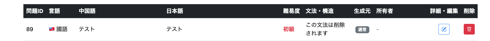
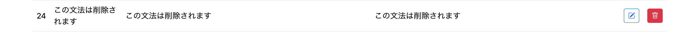
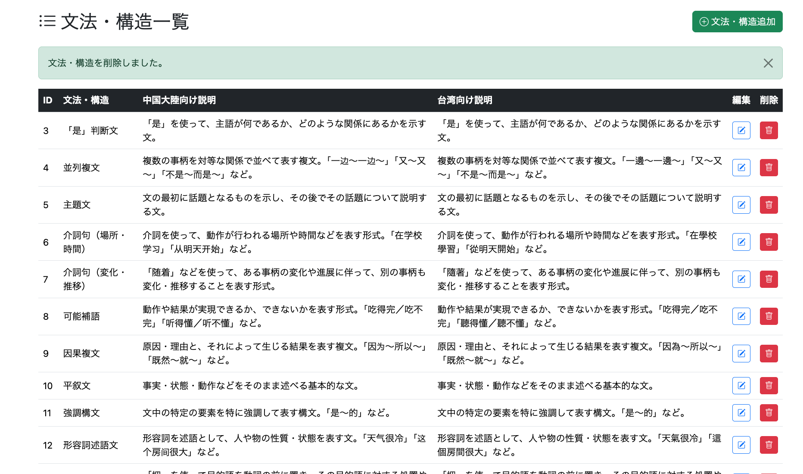
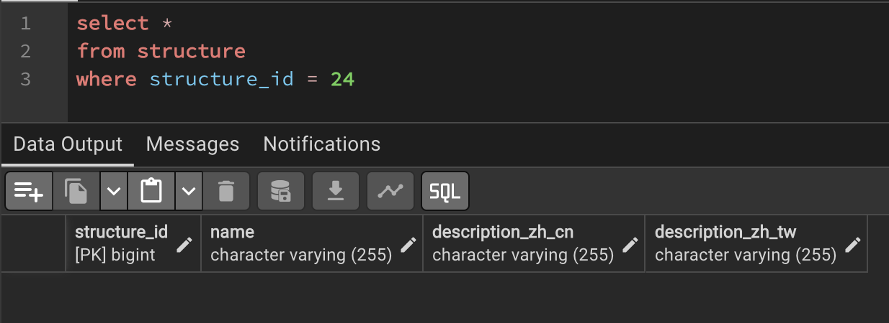
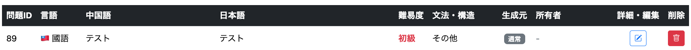

# 022-10 文法・構造削除機能の実装

> このログは実装・変更を時系列で記録したものです。途中のコードや仕様は、その後の開発によって変更されている場合があります。現在の実装はソースコードを参照してください。

## 概要

022-08で文法・構造の一覧・追加、022-09で編集を実装した。本章では、Admin画面から文法・構造を削除する機能を追加する。

問題（`Question`）は文法・構造（`Structure`）を参照しており、`Question.structure`は`NOT NULL`である。そのため、**削除対象を参照している問題を残したまま文法・構造だけを削除することはできない**。本実装では、該当する問題の参照先を「その他」に変更してから削除する。

```text
git commit -m "feat: add admin structure deletion"
```

| 変更対象 | 実装内容 |
| --- | --- |
| `QuestionRepository` | 削除対象を参照する問題の文法・構造を一括変更 |
| `AdminStructureService` | 「その他」の保護、参照先の付け替え、削除を一括処理 |
| `AdminStructureController` | 削除リクエストと成功・失敗メッセージの処理 |
| `/admin/structure/list.html` | 削除失敗時のメッセージ表示 |

## 1. 削除方針と処理の流れ

削除対象の文法・構造を使用している問題は、StructureId `23`の**「その他」**へ移す。そのうえで削除対象の`Structure`を削除する。

```text
削除対象のStructureを取得
        ↓
「その他」（StructureId 23）を取得
        ↓
削除対象を使用しているQuestionを「その他」へ変更
        ↓
削除対象のStructureを削除
```

「その他」自体を削除すると移行先がなくなるため、StructureId `23`の削除は禁止する。なお、`23`というIDは当時のデータを前提とした固定値である。

## 2. Repository：参照先の一括変更

### 2.1 StructureRepository

対象の取得には`findById()`、削除には`delete()`を使用する。いずれも`JpaRepository`の標準メソッドであり、`StructureRepository`への専用メソッド追加は不要とした。

```java
// 削除対象と移行先の取得
structureRepository.findById(structureId);
structureRepository.findById(23L);

// 削除
structureRepository.delete(targetStructure);
```

### 2.2 QuestionRepository

削除対象を参照している問題の`structure`を、一括更新するメソッドを追加した。

```java
@Modifying
@Query("""
        UPDATE Question q
        SET q.structure = :replacementStructure
        WHERE q.structure = :targetStructure
        """)
void replaceStructure(
        @Param("targetStructure") Structure targetStructure,
        @Param("replacementStructure") Structure replacementStructure);
```

`targetStructure`を参照する`Question`だけを更新する。対象となる問題が複数存在しても、個別に取得してループするのではなく、JPQLのUPDATE文でまとめて変更する。

## 3. Service：参照先の変更と削除を同一トランザクションで実行

```java
@Transactional
public void deleteStructure(Long structureId) {

    // 「その他」自体は削除不可
    if (structureId.equals(23L)) {
        throw new IllegalArgumentException(
                "「その他」は削除できません。");
    }

    // 削除対象の取得
    Structure targetStructure =
            structureRepository.findById(structureId)
                    .orElseThrow(() ->
                            new IllegalArgumentException(
                                    "文法・構造が存在しません。"));

    // 問題の移行先の取得
    Structure replacementStructure =
            structureRepository.findById(23L)
                    .orElseThrow(() ->
                            new IllegalStateException(
                                    "「その他」の文法・構造が存在しません。"));

    // 問題の参照先を変更してから削除
    questionRepository.replaceStructure(
            targetStructure,
            replacementStructure);
    structureRepository.delete(targetStructure);
}
```

ここでは次の点を重視した。

- **削除禁止対象の確認**：移行先となる「その他」は削除できない。
- **対象データの存在確認**：削除対象が存在しない場合と「その他」が存在しない場合を、それぞれ例外として扱う。
- **処理順序**：問題の参照先を先に更新し、削除対象への参照を解消してから`Structure`を削除する。
- **トランザクション**：`@Transactional`により、参照先変更と削除を一連の処理として実行する。途中で失敗した場合に片方だけ反映される状態を防ぐ。

## 4. Controllerと画面への反映

### 4.1 AdminStructureController

```java
@PostMapping("/admin/structure/delete")
public String deleteStructure(
        @RequestParam Long structureId,
        RedirectAttributes redirectAttributes) {

    try {
        adminStructureService.deleteStructure(structureId);
    } catch (IllegalArgumentException | IllegalStateException e) {
        redirectAttributes.addFlashAttribute(
                "errorMessage", e.getMessage());
        return "redirect:/admin/structure/list";
    }

    redirectAttributes.addFlashAttribute(
            "successMessage", "文法・構造を削除しました。");
    return "redirect:/admin/structure/list";
}
```

一覧から受け取った`structureId`をServiceへ渡し、結果に応じてFlash Attributeにメッセージを設定する。成功時も失敗時も文法・構造一覧へ戻す。

### 4.2 `/admin/structure/list.html`

既存の一覧画面に、削除失敗時のエラーメッセージ表示を追加した。

```html
<div th:if="${errorMessage}"
     class="alert alert-danger alert-dismissible fade show"
     role="alert">
    <span th:text="${errorMessage}"></span>
    <button type="button"
            class="btn-close"
            data-bs-dismiss="alert"
            aria-label="Close"></button>
</div>
```

これにより、「その他」の削除を試みた場合や対象データが存在しない場合に、Serviceで設定したエラー内容を画面上で確認できる。

## 5. 動作確認

### 5.1 テストデータの用意

削除しても問題のないテスト用の文法・構造を作成し、それを使用する問題を登録した。



### 5.2 Admin画面から削除

文法・構造一覧からテスト用データを削除した。



削除後に成功メッセージが表示されることを確認した。



### 5.3 DBと問題一覧で結果を確認

DB上で対象データが`structure`テーブルから削除されていることを確認した。



さらに、削除対象を使用していた問題の文法・構造が「その他」に変更されていることを問題一覧で確認した。



これにより、**文法・構造の削除だけでなく、既存の問題が参照先を失わずに残ること**も確認できた。

## 6. 実装上の補足

今回の実装では、移行先の「その他」をStructureId `23`で指定している。これは当時のDB構成に依存するため、データを作り直す場合や別環境へ移す場合には、同じIDで存在することを確認する必要がある。

また、JPQLの一括UPDATEは通常のEntity更新とは異なるため、同じトランザクション内で更新対象の`Question`をすでに読み込んでいる場合には、永続化コンテキストとの整合性に注意が必要となる。本ログの動作確認は、元ログに記載された削除後のDB・一覧表示の確認に基づく。

## 7. Admin管理機能全体の総括

本章をもって、Adminメニューから利用する管理機能の実装が一通り完了した。

| 実装ログ | 機能 |
| --- | --- |
| 022-01 | Adminメニュー、問題一覧・検索 |
| 022-02 | 問題削除、作成・更新日時、表示順の改善 |
| 022-03 | 問題追加 |
| 022-04 | 問題追加画面の入力補助、拼音・注音のAI生成 |
| 022-05 | 問題編集 |
| 022-06 | ユーザー一覧・検索 |
| 022-07 | ユーザー凍結・解除・削除 |
| 022-08 | 文法・構造一覧・追加 |
| 022-09 | 文法・構造編集 |
| 022-10 | 文法・構造削除 |

これらの機能により、デプロイ後もAdmin画面から**問題・ユーザー・文法／構造の主要な管理操作**を行えるようになった。
