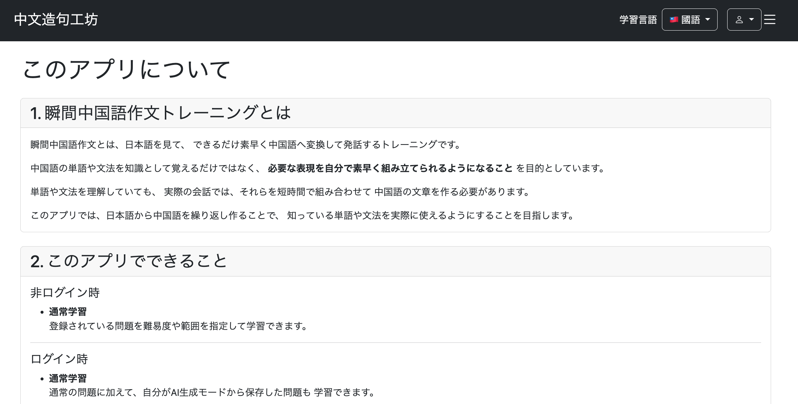
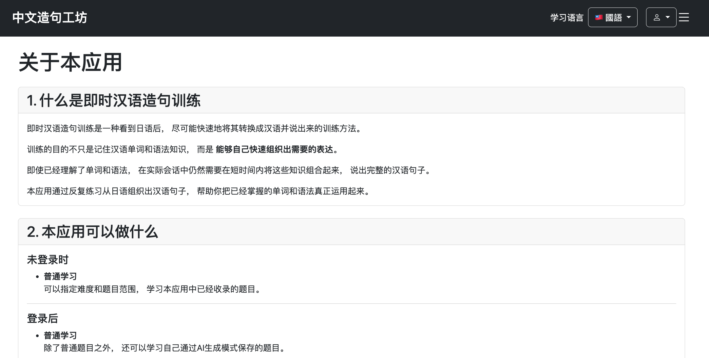
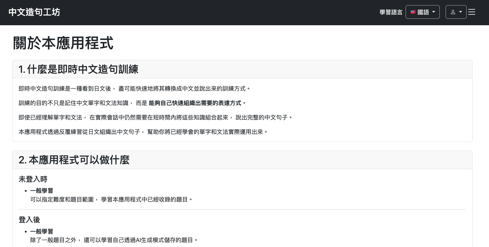
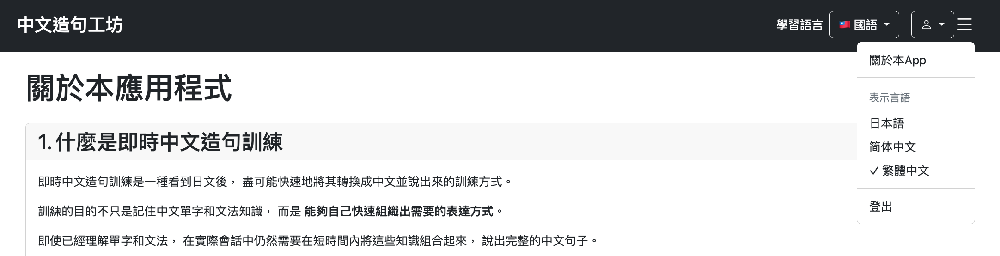
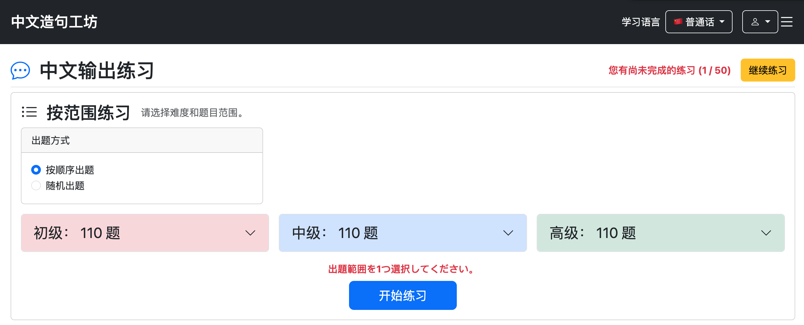
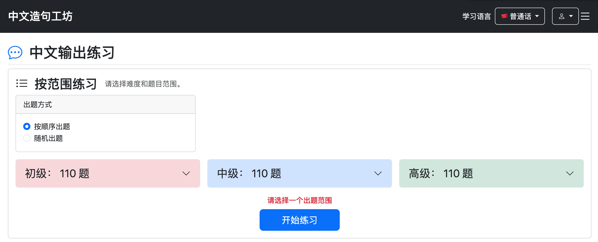

# 023-02 アプリ概要ページの実装と多言語対応の整理

## はじめに

Chinese Output Forgeの主要機能がそろってきたため、初めて利用するユーザーがアプリの目的や使い方を確認できる「このアプリについて」ページを追加した。併せて、表示言語の構成を整理し、画面の一部に残っていた日本語固定のエラーメッセージを多言語化した。

本章は、元の023「UI・機能の最終調整」の「2. アプリ概要・利用ガイドページの実装」「3. 英語UI表記の削除」「7. 多言語メッセージ定義の修正」をまとめたものである。ページ内容には、後続の開発で追加した機能の説明も含まれる。

## 1. アプリ概要ページの追加

```bash
git commit -m "feat: add multilingual about page"
```

### 1.1 ページの目的と構成

`/about`に、瞬間中国語作文の学習方法、利用可能な機能、基本的な学習の流れ、AI生成モード、発音表記、学習時の注意点を説明するページを設けた。操作を順番に案内するJavaScript製チュートリアルではなく、必要なときに参照できる案内ページとした。

このページは文章量が多いため、全文を`messages.properties`に記述するのではなく、表示言語ごとにHTMLテンプレートを分ける方式を採用した。

| 表示言語 | テンプレート |
| --- | --- |
| 日本語 | `about/about.html` |
| 簡体字中国語 | `about/about-zh-cn.html` |
| 繁体字中国語 | `about/about-zh-tw.html` |

### 1.2 Localeによるテンプレートの切り替え

`HomeController`で`Locale`を確認し、同じ`/about`へのアクセスに対して表示するテンプレートを切り替えた。

```java
@GetMapping("/about")
public String getAbout(Locale locale) {
    if (Locale.SIMPLIFIED_CHINESE.equals(locale)) {
        return "about/about-zh-cn";
    }

    if (Locale.TRADITIONAL_CHINESE.equals(locale)) {
        return "about/about-zh-tw";
    }

    return "about/about";
}
```

この方式では、URLを言語別に増やさずに済み、長文を含む各ページをHTMLとして編集できる。一方、各言語のテンプレートを個別に管理するため、見出しや機能説明を追加した場合は、それぞれに反映する必要がある。

### 1.3 動作確認

日本語ページを表示できることを確認した。



ヘッダーから表示言語を切り替えると、同じURLで簡体字・繁体字のページに切り替わることを確認した。

**簡体字中国語**



**繁体字中国語**



## 2. 非ログインユーザーにも概要ページを公開

```bash
git commit -m "fix: allow unauthenticated access to about page"
```

概要ページを追加した当初は、`SecurityConfig`で`/about`を公開対象に指定しておらず、非ログインユーザーが閲覧できなかった。

アプリの説明はログイン前にも確認できるべき内容なので、認可設定に次の指定を追加した。

```java
.requestMatchers("/about").permitAll()
```

修正後、非ログイン状態でも`/about`にアクセスできることを確認した。

## 3. 概要ページの説明内容を拡充

### 3.1 普通話と國語の違い

```bash
git commit -m "docs: add explanation of Mainland and Taiwan Chinese variants"
```

学習対象として用意した普通話（中国大陸）と國語（台湾）について、文字体系だけでなく、発音表記、発音、語彙、言い回しにも違いがあることを案内ページへ追記した。

このアプリでは、両者を単純に簡体字・繁体字へ変換した同一問題として扱わず、**学習対象言語ごとに問題を用意している**ことを明記した。また、学習対象言語と発音表記は独立して設定できるため、普通話で注音、國語で拼音を選ぶこともできると説明した。

### 3.2 リスト機能と発音表記

後から追加したリスト機能についても、概要ページに説明を加えた。リストは問題を目的別にまとめ、通常学習の出題範囲として使用できる機能である。ただし、リスト内の問題であっても、現在の学習対象言語と異なる問題は出題しない旨を記載した。

拼音・注音の説明も拡充した。拼音はアルファベット、注音は専用の記号を用いる発音表記であることを説明し、学習目的に応じて選択できることを案内した。

これらの追記に伴い、ページ内の見出し番号も調整した。元の実装記録には日本語テンプレートへの追記が掲載されているが、他言語版への同等の追記については、その記録だけでは確認できない。

## 4. 英語UI表記の削除

```bash
git commit -m "refactor: remove English localization support"
```

開発初期は日本語・英語・簡体字中国語・繁体字中国語の4言語を表示候補としていた。しかし、主な対象は日本語から中国語を学ぶユーザーであり、英語UIに対応するなら、問題文や学習内容まで英語化するかという別の検討も必要になる。

そこで、表示言語を**日本語・簡体字中国語・繁体字中国語の3種類**に絞った。簡体字・繁体字のUIは、中国語学習者が日常的に中国語を目にする機会を増やすことも意図している。

変更内容は次のとおり。

- `header.html`の言語選択メニューから`English`の項目を削除
- 不要となった`messages_en.properties`を削除

変更後、ヘッダーの表示言語選択欄から英語が消えたことを確認した。



## 5. エラーメッセージの多言語対応

```bash
git commit -m "fix: localize practice range selection error message"
```

### 5.1 問題点

表示言語を簡体字中国語にしていても、通常学習メニューで出題範囲を複数選択した場合、エラーメッセージが日本語で表示されていた。



原因は、このエラー文言をController内に日本語で直接記述していたことだった。

```java
if (selectedCount != 1) {
    redirectAttributes.addFlashAttribute(
            "errorMessage",
            "出題範囲を1つ選択してください。");
    return "redirect:/practice/menu";
}
```

### 5.2 MessageSourceを使った修正

`PracticeController.getPracticeStart`で`MessageSource`から現在の`Locale`に対応するメッセージを取得し、Flash Attributeに設定するよう変更した。

```java
if (selectedCount != 1) {
    String errorMessage = messageSource.getMessage(
            "practice.error.selectOneRange",
            null,
            locale
    );

    redirectAttributes.addFlashAttribute(
            "errorMessage",
            errorMessage
    );

    return "redirect:/practice/menu";
}
```

各言語のプロパティファイルに同じキーを定義した。

**`messages.properties`（日本語）**

```properties
practice.error.selectOneRange=出題範囲を1つ選択してください。
```

**`messages_zh_CN.properties`（簡体字）**

```properties
practice.error.selectOneRange=请选择一个出题范围。
```

**`messages_zh_TW.properties`（繁体字）**

```properties
practice.error.selectOneRange=請選擇一個出題範圍。
```

※元の記録では3言語分の定義が1つのコードブロックに連続して記載されていたため、ここでは言語別の定義として整理した。実際のファイル名はプロジェクトのメッセージバンドル構成に合わせる。

### 5.3 動作確認

表示言語を簡体字中国語に設定した状態で、通常学習の出題範囲を複数選択し、エラーメッセージが簡体字で表示されることを確認した。



## まとめ

今回の調整では、案内ページの追加に加え、**言語ごとにHTMLを分ける部分**と、**`MessageSource`で文言を切り替える部分**を使い分けた。長文の案内ページはテンプレート単位で管理し、Controllerから表示する短いエラーメッセージはメッセージキーで管理する構成である。

また、非ログイン状態での閲覧可否や、表示言語を切り替えたときのエラー表示まで確認することで、画面を追加するだけでは見落としやすい利用条件も調整できた。
