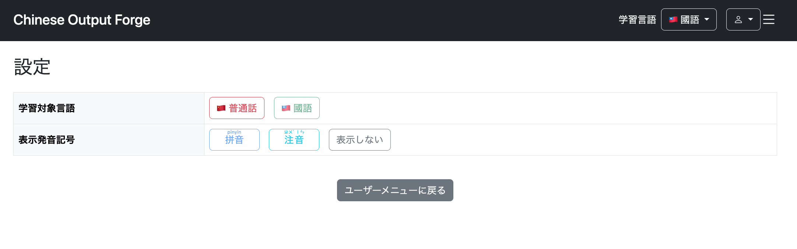
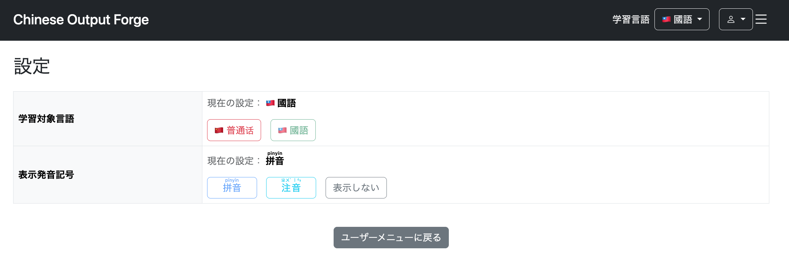
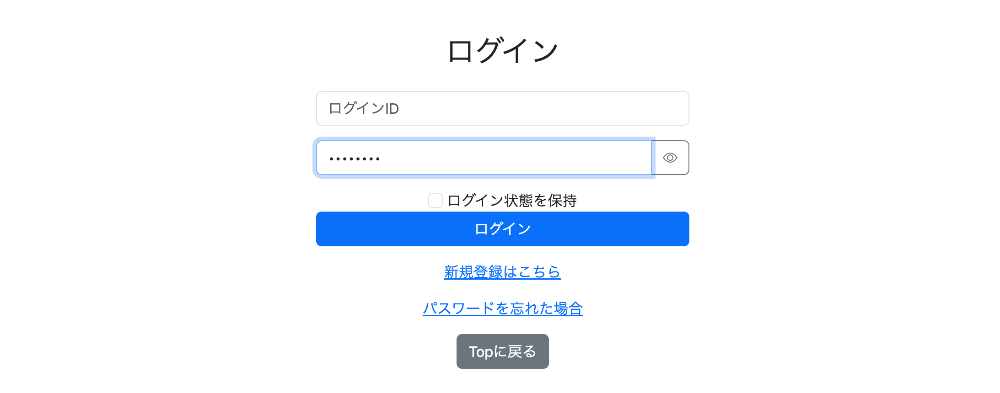
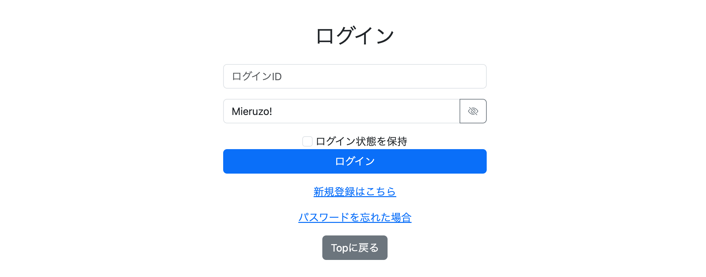
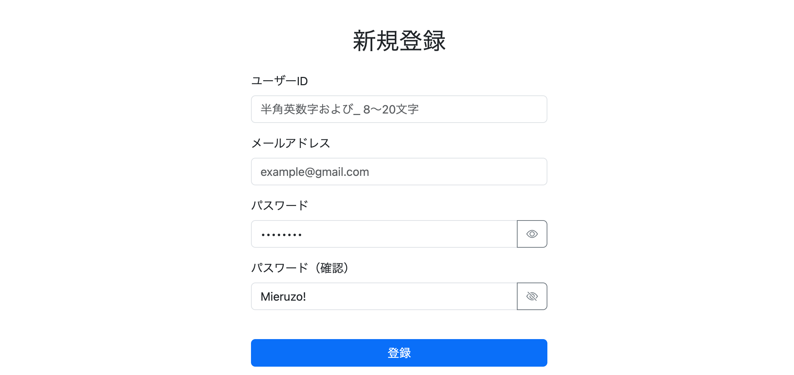
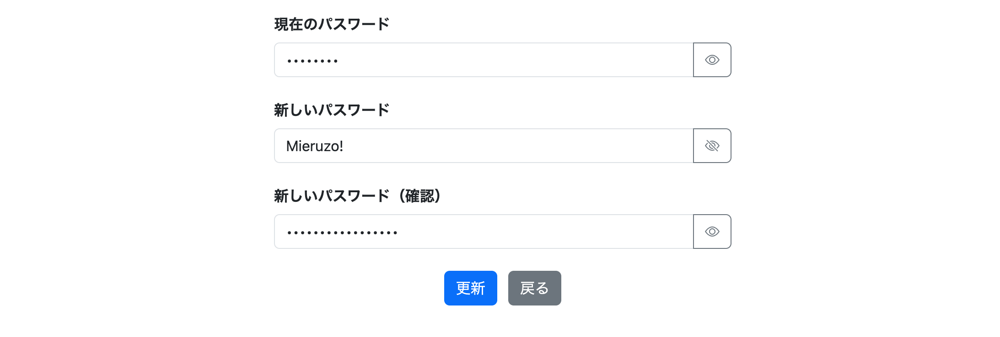
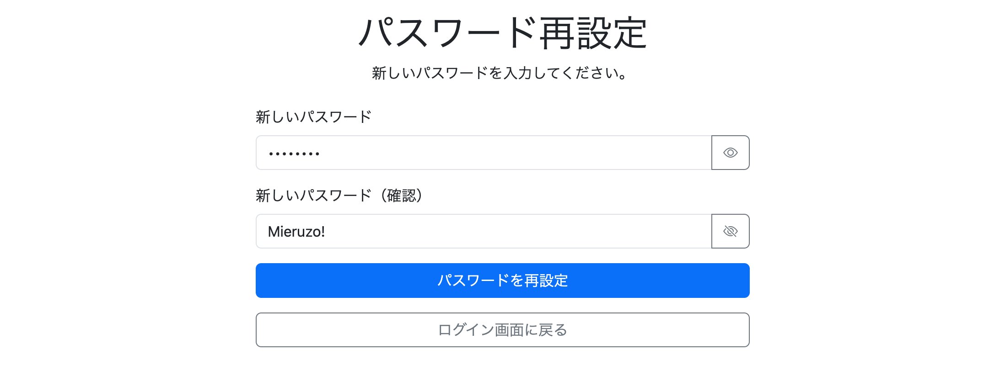

# 023-04 ユーザー設定画面とパスワード入力UIの改善

## はじめに

本章では、ユーザーが現在の設定を把握しやすくするための表示改善と、パスワード入力時の操作性向上を行った。いずれも既存機能の処理内容を変更するのではなく、画面上での確認・操作を分かりやすくする調整である。

## 1. ユーザー設定画面に現在の設定値を表示

```bash
git commit -m "feat: improve settings page with current setting display"
```

### 変更の背景

従来の設定画面では、学習対象言語や発音表記の選択肢は表示されていたものの、**現在どの値が設定されているかを直感的に把握しにくかった**。



そこで、既存のテーブル構成を大きく変えず、各設定項目の選択ボタンの上に「現在の設定」を表示するようにした。

### 学習対象言語の表示

`/user/setting.html`で、セッションに保持している`languageVariant`を参照し、普通話と國語のどちらが選択されているかを表示する。

```html
<div class="mb-3">
    <span class="text-muted" th:text="#{settings.current}">
        現在の設定：
    </span>

    <strong th:if="${session.languageVariant != null
                    && session.languageVariant.name() == 'MAINLAND'}">
        🇨🇳
        <span th:text="#{settings.languageVariant.mainland}">普通話</span>
    </strong>

    <strong th:if="${session.languageVariant != null
                    && session.languageVariant.name() == 'TAIWAN'}">
        🇹🇼
        <span th:text="#{settings.languageVariant.taiwan}">國語</span>
    </strong>
</div>
```

`th:if`で現在の言語に対応する要素だけを表示し、名称は`messages.properties`のメッセージキーから取得する。

### 発音表記の表示

発音表記については、`pronunciationType`に応じて拼音・注音・非表示のいずれかを表示する。複数の値を切り替えるため、`th:switch`と`th:case`を使用した。

```html
<div class="mb-3">
    <span class="text-muted" th:text="#{settings.current}">
        現在の設定：
    </span>

    <strong th:switch="${session.pronunciationType != null
                        ? session.pronunciationType.name()
                        : 'PINYIN'}">
        <span th:case="'PINYIN'">
            <ruby>拼音<rt>pīnyīn</rt></ruby>
        </span>
        <span th:case="'ZHUYIN'">
            <ruby>注音<rt>ㄓㄨˋ ㄧㄣ</rt></ruby>
        </span>
        <span th:case="'NONE'"
              th:text="#{settings.pronunciationType.none}">
            表示しない
        </span>
    </strong>
</div>
```

この実装では、セッション値が`null`の場合に表示上は`PINYIN`を使用する。これは**表示用のフォールバック**であり、DBの設定値を変更する処理ではない。

メッセージ定義にも次を追加した。

```properties
settings.current=現在の設定：
```

### 動作確認

`/user/settings`にアクセスし、学習対象言語と発音表記の現在値が各項目に表示されることを確認した。



## 2. パスワード入力欄に表示・非表示の切り替えを追加

```bash
git commit -m "feat: add password visibility toggle"
```

### 変更の背景と対象画面

パスワード入力欄は通常、`type="password"`によって入力内容が伏せ字になる。入力ミスを確認しやすくするため、ボタンを押すと文字列を表示し、もう一度押すと伏せ字に戻す機能を追加した。

対象は、ログイン、新規登録、パスワード変更、パスワードリセットの各画面である。複数の入力欄を持つ画面でも共通のJavaScriptを利用する方針とした。

### HTML側の変更

各画面でパスワード入力欄をBootstrapの`input-group`で囲み、切り替えボタンを追加する。以下はログイン画面の例である。

```html
<div class="mb-3">
    <div class="input-group">
        <input type="password"
               id="password"
               class="form-control"
               th:placeholder="#{login.password}"
               name="password">

        <button type="button"
                class="btn btn-outline-secondary password-toggle"
                data-target="password">
            <i class="bi bi-eye"></i>
        </button>
    </div>
</div>
```

ここでは、`input`の`id`とボタンの`data-target`を一致させている。たとえば新規登録画面の確認欄では、両方に`passwordConfirm`を指定する。

```html
<input type="password"
       id="passwordConfirm"
       class="form-control"
       th:field="*{passwordConfirm}"
       th:placeholder="#{signup.passwordConfirm.placeholder}"
       th:errorclass="is-invalid">

<button type="button"
        class="btn btn-outline-secondary password-toggle"
        data-target="passwordConfirm">
    <i class="bi bi-eye"></i>
</button>
```

新規登録・パスワード変更・パスワードリセットの各画面でも、同じ仕組みを適用した。既存の`th:field`、`th:errorclass`、`th:errors`などのフォーム連携・エラー表示処理は維持している。

各HTMLには共通スクリプトを読み込む。

```html
<script th:src="@{/js/password-toggle.js}" defer></script>
```

### JavaScriptの共通化

`password-toggle.js`では、`.password-toggle`を持つボタンをすべて取得し、クリックされたボタンの`data-target`から操作対象の入力欄を特定する。

```javascript
document.querySelectorAll(".password-toggle").forEach(button => {

    button.addEventListener("click", () => {

        const passwordInput =
                document.getElementById(button.dataset.target);

        const icon = button.querySelector("i");

        if (passwordInput.type === "password") {
            passwordInput.type = "text";

            icon.classList.remove("bi-eye");
            icon.classList.add("bi-eye-slash");

        } else {
            passwordInput.type = "password";

            icon.classList.remove("bi-eye-slash");
            icon.classList.add("bi-eye");
        }
    });
});
```

`button.dataset.target`はHTMLの`data-target`属性に対応する。したがって、同じ画面にパスワード欄が複数あっても、各ボタンは対応する入力欄だけを切り替えられる。

```text
<button data-target="passwordConfirm">
              ↓
document.getElementById("passwordConfirm")
              ↓
<input id="passwordConfirm" type="password">
```

入力欄の`type`を`password`と`text`の間で切り替えると同時に、Bootstrap Iconsの`bi-eye`と`bi-eye-slash`を切り替えて、現在の操作状態が分かるようにした。

### 動作確認

各画面のパスワード入力欄で、表示・非表示を切り替えられることを確認した。

**ログイン画面**





**新規登録画面**



**パスワード変更画面**



**パスワードリセット画面**



## まとめ

今回の調整では、設定画面に現在値を明示することで選択状態を把握しやすくし、パスワード入力欄には共通JavaScriptによる表示切り替えを追加した。

いずれも既存の認証・設定更新処理そのものには手を加えず、Thymeleafによる状態表示と、HTMLの`data-*`属性を利用したJavaScriptの再利用によって、画面の使いやすさを改善した。
