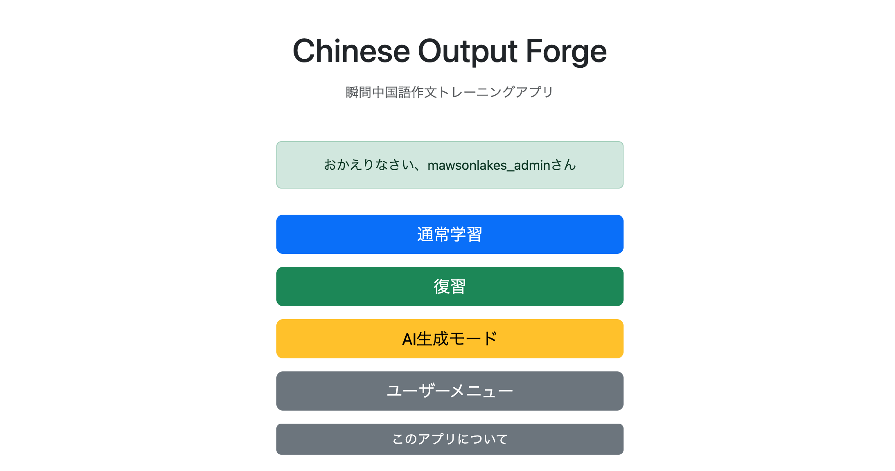

# 023-05 ログイン成功時の歓迎メッセージ表示

## はじめに

ログイン成功後、Home画面に「おかえりなさい、〇〇さん」という歓迎メッセージを表示する機能を追加した。既存の`LoginSuccessHandler`は、ログインユーザーの学習対象言語と発音表記をセッションへ保存していたため、ここからログインIDとメッセージキーをリダイレクト先へ渡す方針とした。

```bash
git commit -m "feat: add login success welcome message"
```

## 1. 認証成功ハンドラから値を渡す方法

`LoginSuccessHandler`は`SavedRequestAwareAuthenticationSuccessHandler`を継承しており、ログイン成功時にはユーザー情報を取得し、セッションへ設定を保存した後、親クラスの処理により遷移する。

Controllerであれば`RedirectAttributes.addFlashAttribute()`を使って、リダイレクト後のリクエストへ一時的に値を渡せる。しかし、`onAuthenticationSuccess()`はSpring Securityから呼び出され、Controllerのように`RedirectAttributes`を引数として受け取らない。

そこで、Spring MVCの**FlashMap**を利用することにした。FlashMapはリダイレクト先などの次のリクエストに渡す値を一時保存する仕組みで、`RedirectAttributes.addFlashAttribute()`もこの仕組みを利用している。

今回渡すのは、表示文言そのものではなく、次の2つである。

- `messageKey`：多言語メッセージのキー`login.success`
- `loginId`：歓迎メッセージに埋め込むログインID

## 2. 最初の実装と発生したエラー

最初は`RequestContextUtils.getFlashMapManager(request)`で`FlashMapManager`を取得する方法を試した。

```java
FlashMap flashMap = new FlashMap();
flashMap.put("messageKey", "login.success");
flashMap.put("loginId", user.getLoginId());

FlashMapManager flashMapManager =
        RequestContextUtils.getFlashMapManager(request);
flashMapManager.saveOutputFlashMap(flashMap, request, response);
```

しかし、ログイン時に次の例外が発生した。

```text
java.lang.NullPointerException:
Cannot invoke "org.springframework.web.servlet.FlashMapManager.saveOutputFlashMap(...)"
because "flashMapManager" is null
```

### 原因の調査

`RequestContextUtils.getFlashMapManager(request)`は`FlashMapManager`を生成するメソッドではなく、Spring MVCの`DispatcherServlet`がリクエストに設定したものを取得するメソッドである。

参考にした`Interceptor`は`DispatcherServlet`の処理内で動作するが、`LoginSuccessHandler`はその前段階にあるSpring SecurityのFilter処理で動作する。**同じHTTPリクエストを扱っていても、処理の実行位置によって取得できる情報が異なる**ことが分かった。

```text
HTTPリクエスト
    ↓
Spring SecurityのFilter
    └─ LoginSuccessHandler（認証成功時）
    ↓
DispatcherServlet
    └─ Spring MVCのInterceptor・Controller
```

今回の`LoginSuccessHandler`の実行時点では、`RequestContextUtils`から取得した`FlashMapManager`が`null`だったため、保存処理で例外が発生した。

## 3. SessionFlashMapManagerを使った修正

`RequestContextUtils`による取得をやめ、HTTPセッションにFlashMapを保存する`SessionFlashMapManager`を生成して利用した。

### LoginSuccessHandler.onAuthenticationSuccess

```java
@Override
public void onAuthenticationSuccess(
        HttpServletRequest request,
        HttpServletResponse response,
        Authentication authentication)
        throws IOException, ServletException {

    Users user = userAccountService.getUserOne(authentication.getName());

    // 従来のログイン時設定を維持
    HttpSession session = request.getSession();
    session.setAttribute("languageVariant", user.getLanguageVariant());
    session.setAttribute("pronunciationType", user.getPronunciationType());

    log.info("Login succeeded: loginId={}", authentication.getName());

    // ログイン成功時に一度だけ表示する情報
    FlashMap flashMap = new FlashMap();
    flashMap.put("messageKey", "login.success");
    flashMap.put("loginId", user.getLoginId());

    FlashMapManager flashMapManager = new SessionFlashMapManager();
    flashMapManager.saveOutputFlashMap(flashMap, request, response);

    super.onAuthenticationSuccess(request, response, authentication);
}
```

`SessionFlashMapManager`はHTTPセッションを利用するため、`DispatcherServlet`が処理する前の認証成功ハンドラからも保存できる。元の実装と同様に、`SavedRequestAwareAuthenticationSuccessHandler`による遷移処理は最後に実行している。

なお、ログイン前にアクセスしようとしたページへ戻る場合もあるため、元の記録では`FlashMap`の遷移先パスを固定していない。この場合、**Home画面以外に遷移すると、Home画面に用意した歓迎メッセージ表示部分が必ず実行されるわけではない**点には注意が必要である。

## 4. 多言語メッセージとHome画面の表示

表示文言は各言語の`messages.properties`に定義した。

**日本語**

```properties
login.success=おかえりなさい、{0}さん
```

**簡体字中国語**

```properties
login.success=欢迎回来，{0}
```

**繁体字中国語**

```properties
login.success=歡迎回來，{0}
```

`{0}`にはFlashMapで渡した`loginId`を埋め込む。

### home.html

```html
<div th:if="${messageKey}"
     class="alert alert-success"
     role="alert"
     th:text="#{${messageKey}(${loginId})}">
    おかえりなさい
</div>
```

これにより、表示言語に応じた歓迎メッセージを、ログイン後のHome画面に表示する。

## 5. 動作確認

`SessionFlashMapManager`に変更してログインを再試行したところ、Home画面に歓迎メッセージが表示されることを確認した。



## まとめ

今回の修正では、Spring Securityの認証成功ハンドラから、Spring MVCの画面へ一時的な情報を引き継ぐ方法を学んだ。特に、`RequestContextUtils`が利用できる前提を理解せずにInterceptor向けの実装を流用すると、認証処理では`null`が返る場合があることを、実際の例外を通じて確認できた。

`SessionFlashMapManager`を使うことで目的の表示は実現できたが、ログイン成功後の遷移先がHome画面とは限らないという、`SavedRequestAwareAuthenticationSuccessHandler`固有の挙動も考慮する必要がある。
