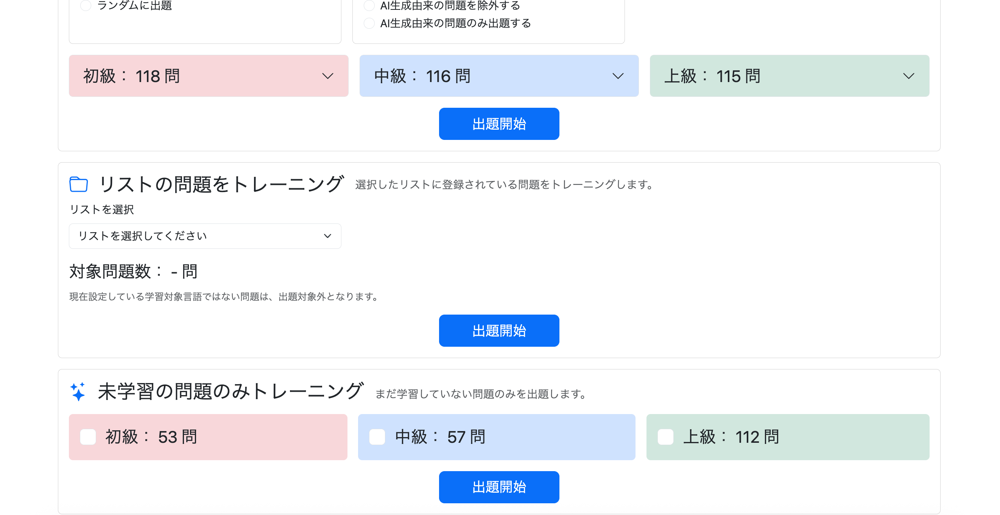
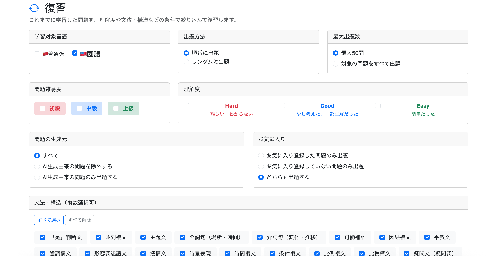
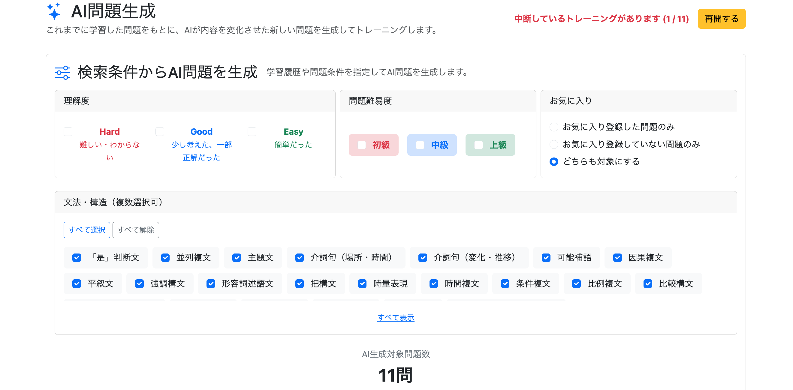
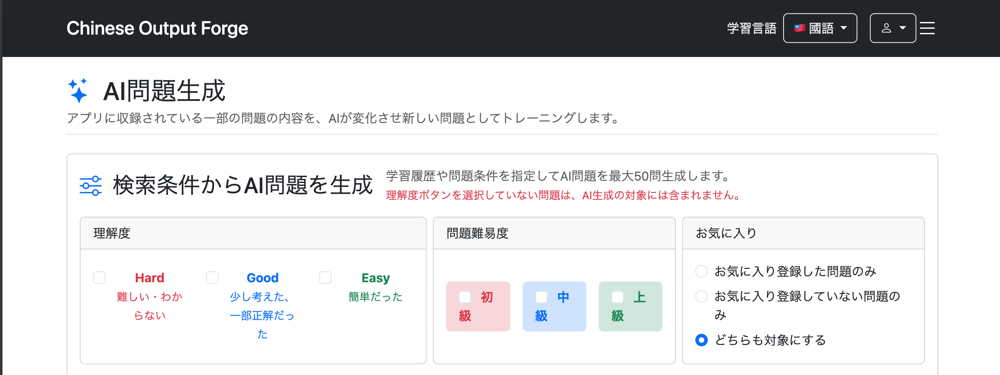
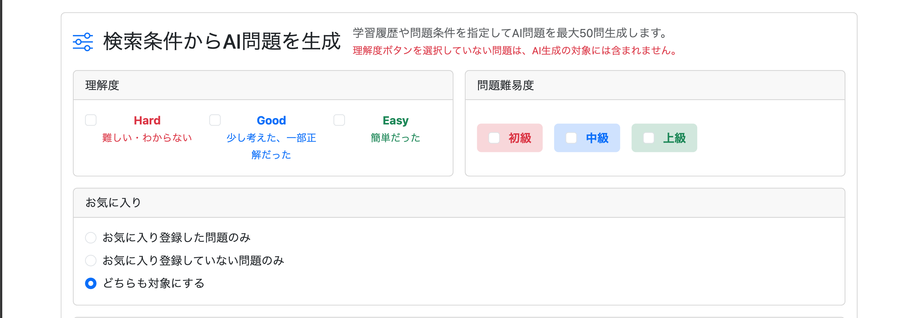
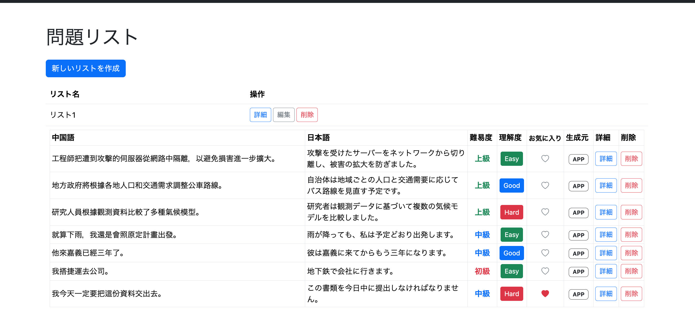
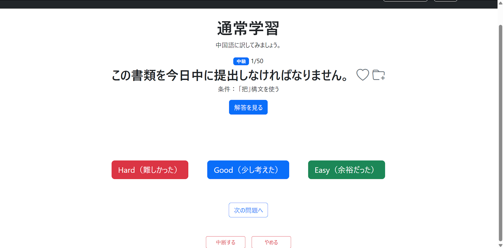
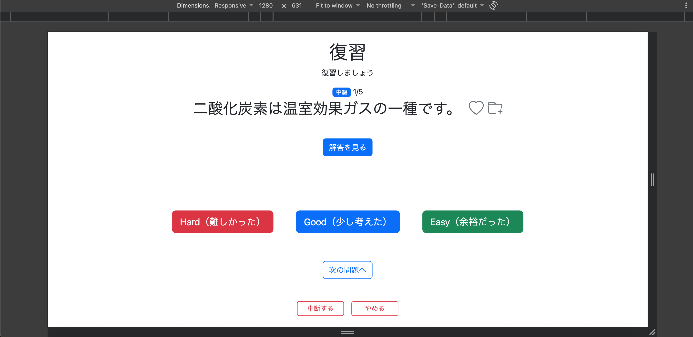

# 023-09 各画面のレイアウトと余白の調整

## はじめに

主要機能の実装後、通常学習・復習・AI生成・問題一覧の各画面を確認し、検索条件の配置、テーブルの視認性、画面下部の余白を調整した。

特に、Windowsのディスプレイ拡大率150%の環境では、Macでの通常表示と実際に使えるViewportが異なり、一部のレイアウトが窮屈になることが分かった。見た目の調整だけでなく、**異なる表示環境でも操作しやすい構成**を目指した。

## 1. 通常学習メニューの表示調整

```bash
git commit -m "style: adjust practice list section layout"
```

通常学習メニューでは、出題問題数の表示と、未学習問題の難易度選択ボタンが小さく、他の操作要素と視覚的な統一感がなかった。

出題問題数にはBootstrapの`fs-4`を適用して文字を大きくし、難易度ボタンを並べる要素にもフォントサイズの調整を加えた。また、各難易度の`label`に`flex-fill`を指定し、横方向の領域を均等に使用するようにした。

**変更前**

```html
<label class="bg-danger-subtle rounded px-3 py-2 text-center">
```

**変更後**

```html
<label class="bg-danger-subtle rounded px-3 py-3 flex-fill text-center">
```

`py-2`から`py-3`への変更によってボタンの高さにも余裕を持たせた。



## 2. 復習メニューの検索条件の再配置

```bash
git commit -m "Improve review menu search condition layout"
```

復習メニューでは、検索条件を同じBootstrapの`.row`内に連続して配置していたため、意図しない組み合わせで横並びになることがあった。

検索条件を次のように整理した。

| 行 | 検索条件 | カラム幅の考え方 |
| --- | --- | --- |
| 1 | 学習対象言語・出題方法・最大出題数 | 各`col-md-4` |
| 2 | 難易度・理解度 | `col-md-4`と`col-md-8` |
| 3 | 問題の生成元・お気に入り | 各`col-md-6` |
| 4 | 文法・構造 | `col-md-12` |

また、学習対象言語だけがカード形式になっていなかったため、他の検索条件と同様に`card`・`card-header`・`card-body`を使用した。

言語選択のチェックボックスでは、`th:checked`で選択済みの言語を維持し、`th:classappend`でセッションに設定された学習対象言語を強調表示する既存の挙動を残した。

```html
<input class="form-check-input"
       type="checkbox"
       name="languageVariants"
       value="MAINLAND"
       id="mainland"
       th:checked="${selectedLanguageVariants != null
           and selectedLanguageVariants.![name()].contains('MAINLAND')}">
```

**検索条件の配置を変更しても、選択状態の復元や言語の強調表示が変わらないこと**を重視した。



## 3. AI生成メニューの検索条件レイアウト

```bash
git commit -m "Improve AI practice search condition layout"
```

AI生成メニューの「理解度」「問題難易度」「お気に入り」は、当初Flexboxで横一列に配置し、各カードの横幅を`flex`で調整した。

```html
<div class="d-flex gap-2">
    <div class="mb-4" style="flex: 5;">...</div>
    <div class="mb-4" style="flex: 3.5;">...</div>
    <div class="mb-4" style="flex: 3.5;">...</div>
</div>
```

カードの高さは`h-100`で揃え、選択肢は`card-body d-flex align-items-center`で中央寄せしていた。



しかし、Windowsの拡大率150%環境を再現した`1280 × 631`のViewportでは、横幅が不足し、説明文や選択肢が細かく折り返された。



そこで、3列を維持するのではなく、**理解度と問題難易度を横並び、お気に入りをその下に全幅表示**する構成へ変更した。

```html
<div class="row g-3">
    <!-- 理解度 -->
    <div class="col-md-6">...</div>

    <!-- 問題難易度 -->
    <div class="col-md-6">...</div>

    <!-- お気に入り -->
    <div class="col-12">...</div>
</div>
```

`col-md-6`は`md`以上の画面幅で12カラム中6カラムを使い、それより狭い画面では縦並びになる。`g-3`はカラム間の縦横の余白を指定する。

横幅を個別の`flex`値で調整する方式からBootstrap Gridに変更したことで、表示幅に応じて配置を切り替えやすくなった。

同じViewportで確認した結果、検索条件が窮屈にならず表示された。



## 4. リスト一覧画面のテーブル表示改善

```bash
git commit -m "Improve question list detail table layout"
```

リスト一覧の問題テーブルは`/js/user/question-list/list.js`で動的に生成しているため、HTMLテンプレートではなくJavaScript側のDOM生成処理を変更した。

### 4.1 難易度・理解度・生成元を中央揃え

各`td`に`text-center`を指定し、値の表示位置を揃えた。

```javascript
difficultyTd.className = "text-center";
evaluationTd.className = "text-center";
sourceTd.className = "text-center";
```

### 4.2 生成元をバッジ表示へ変更

従来の「通常」「AI」というテキストを、通常問題は「APP」、AI生成問題は「AI」というバッジに変更した。

```javascript
const sourceTd = document.createElement("td");
sourceTd.className = "text-center";

const sourceSpan = document.createElement("span");

if (question.aiGenerated) {
    sourceSpan.className = "badge bg-black";
    sourceSpan.textContent = "AI";
} else {
    sourceSpan.className = "badge bg-white text-dark border border-dark";
    sourceSpan.textContent = "APP";
}

sourceTd.appendChild(sourceSpan);
```

### 4.3 列幅と見出しの調整

中国語の列を広く、日本語の列をやや狭くするなど、問題文と操作項目のバランスを調整した。元の記録では、中国語44%、日本語28%、難易度・理解度・お気に入り・生成元を各5%、詳細・削除を各4%としている。

また、「お気に入り」の見出しが折り返されないよう、`text-nowrap small`を指定した。

```html
<th class="text-nowrap small">${messages.favorite}</th>
```



## 5. Viewportの高さを考慮した画面下部の余白調整

```bash
git commit -m "fix: add bottom margin to practice page controls"
```

Windows環境で画面解像度`1920 × 1200`、ディスプレイ拡大率150%に設定した際、Chromeの実際のViewportが`1280 × 631`となっていた。この環境では、問題ページ最下部の「中断する」「やめる」ボタンの下にほとんど余白がなかった。



MacのChrome DevToolsでViewportを`1280 × 631`に設定すると、同じ状態を再現できた。

原因は、ページ最下部の操作ボタンを囲む要素に下余白がなかったことだったため、Bootstrapの`mb-4`を追加した。

**変更前**

```html
<!-- 学習中断・終了 -->
<div class="d-flex justify-content-center gap-3"
     style="margin-top:40px;">
```

**変更後**

```html
<!-- 学習中断・終了 -->
<div class="d-flex justify-content-center gap-3 mb-4"
     style="margin-top:40px;">
```

同様の問題が確認された以下のページにも修正を適用した。

- `practice/menu.html`
- `review/menu.html`
- `ai-practice/menu.html`

既存の解答表示領域やボタン位置を安定させる縦方向のレイアウトは変更せず、最下部の余白のみを追加した。

修正後、同じViewportで操作ボタンの下に余白が確保され、解答表示後も「Hard」「Good」「Easy」「次の問題へ」「中断する」「やめる」が正常に表示されることを確認した。



## まとめ

今回の調整では、文字サイズや余白の変更に加えて、**画面の構造そのものを見直す必要がある箇所**が見つかった。

特にAI生成メニューでは、カードを横一列に収めることよりも、選択肢を読みやすく表示できることを優先してBootstrap Gridへ変更した。また、Windowsの表示拡大率を考慮したViewportで確認したことで、通常の開発環境だけでは気付きにくい問題も発見できた。

今後も画面の見た目だけでなく、異なるViewportでの可読性と操作性を確認することが重要だと分かった。
