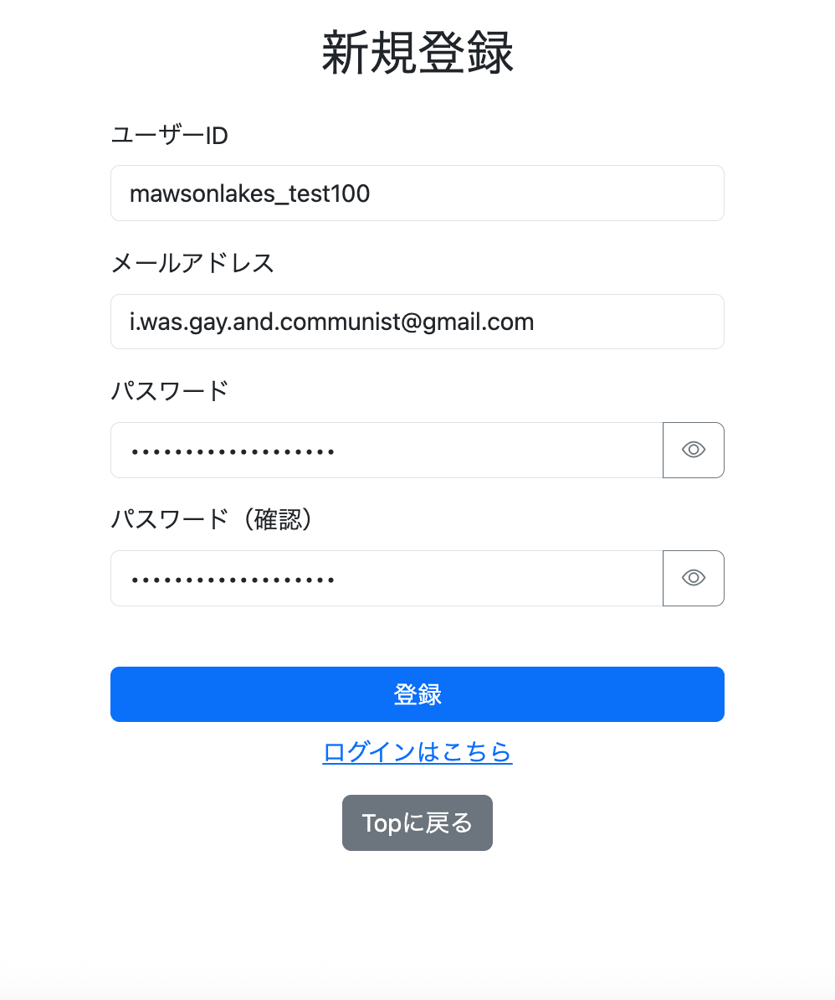
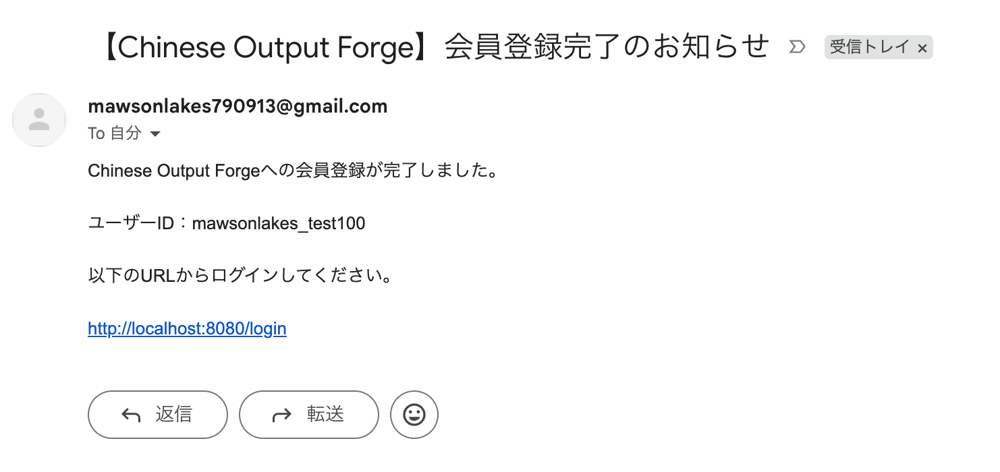
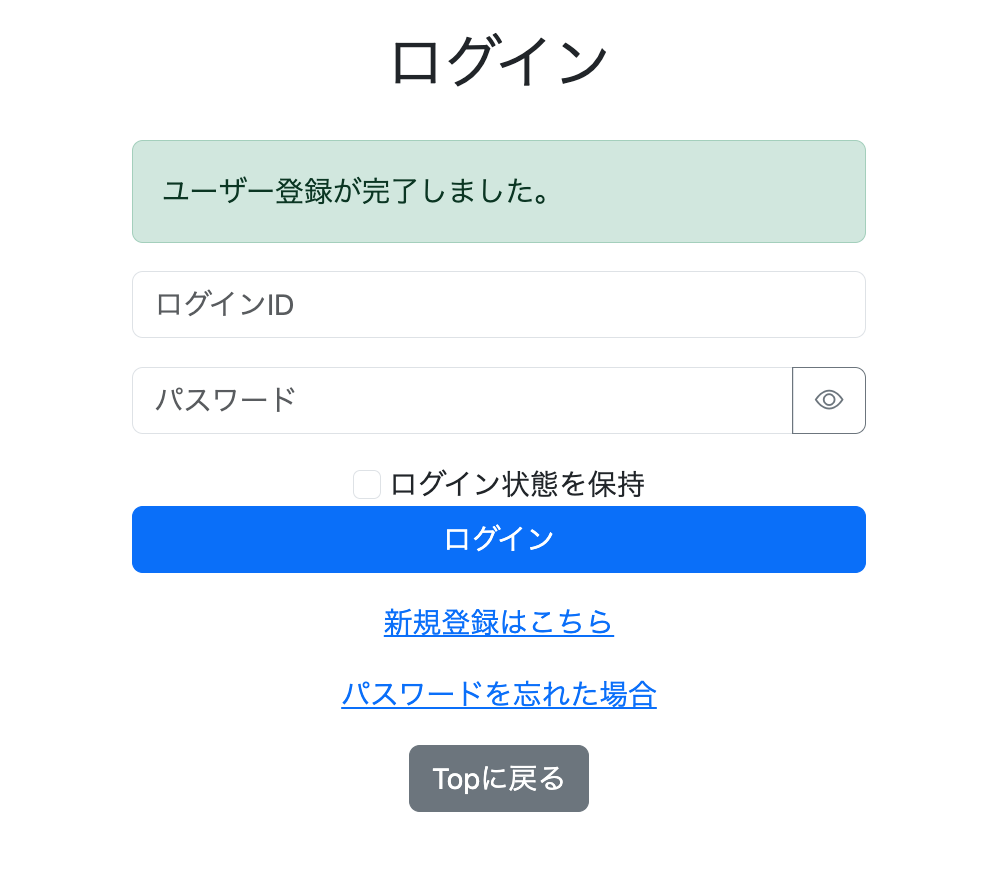

# 023-10 会員登録完了メールの送信機能

> **章番号と実装順序について**  
> 本節は「023 UI・機能の最終調整」に収録しているが、**第23章から第32章までの番号は、すべての機能を実装した厳密な時系列を示すものではない**。当初は第23章までで主要な実装を終える想定だったが、開発を進める中で、当初の実装範囲には含めていなかった機能も追加した方がよいと判断し、第24章以降に新たな実装記録を設けた。一方、第23章は「UI・機能の最終調整」として、その後も追加修正が発生するたびに追記していたため、後の章で実装した機能を前提とする内容も含まれている。
>
> **本節の実際の実装順序**  
> 第27章「メールアドレス登録」で会員登録時のメールアドレス保存・管理機能を実装し、第28章「メールを利用したパスワードリセット機能」で`spring-boot-starter-mail`と`JavaMailSender`を導入してGmailのSMTPによるメール送信を実装した。**第28章の実装時点では、会員登録完了メールの送信機能はまだ追加していなかった**。その後、既存のメール送信機能を会員登録にも利用することを決め、第23章の最終調整記録に本節を追記した。したがって、本節は第28章より後に行った追加実装の記録である。
>
> **送信方式の変更について（第33章）**  
> 以下は実装当時の`JavaMailSender`を使った処理である。その後、第33章でAWS SDKからAmazon SES APIを呼び出す方式へ移行したため、**現在の送信実装を示すコードではない**。

```bash
git commit -m "feat: send registration completion email after signup"
```

## 1. 背景と実装方針

従来の会員登録処理では、登録が成功すると画面に完了メッセージを表示するのみで、登録メールアドレスへの通知は行っていなかった。そこで、**ユーザー登録が正常に完了した後、登録先のメールアドレスへ完了通知を送信する**処理を追加した。

第27章で登録時のメールアドレス保存を実装済みであり、メール送信の仕組みは、第28章で実装したパスワードリセットメール送信の仕組みを再利用する。会員登録完了メールは本人確認やアカウント有効化のためのメールではなく、登録完了を知らせる通知である。そのため、**メール送信に失敗しても、成功した会員登録は取り消さない**方針とした。

```text
新規登録フォームの検証・重複確認
    ↓
ユーザー登録処理の成功
    ↓
会員登録完了メールの送信を試行
    ├─ 成功 → 後続処理へ
    └─ 失敗 → エラーログを記録して後続処理へ
    ↓
登録完了メッセージを表示するため /login へリダイレクト
```

## 2. MailServiceへの送信処理追加

実装当時は、`MailService`に`sendSignupCompleteEmail()`を追加した。登録メールアドレスとログインIDを受け取り、ログイン画面のURLを本文に含める。パスワードやパスワード再設定トークンは含めない。

```java
/** 実装当時のJavaMailSender版。第33章で送信方式を変更。 */
public void sendSignupCompleteEmail(String email, String loginId) {
    String url = baseUrl + "/login";
    String subject = "【Chinese Output Forge】会員登録完了のお知らせ";
    String text = "Chinese Output Forgeへの会員登録が完了しました。\n\n"
            + "ユーザーID：" + loginId + "\n\n"
            + "以下のURLからログインしてください。\n\n"
            + url;

    MimeMessage message = mailSender.createMimeMessage();
    try {
        MimeMessageHelper helper = new MimeMessageHelper(message);
        helper.setFrom("<設定済みの送信元メールアドレス>");
        helper.setTo(email);
        helper.setText(text);
        helper.setSubject(subject);
        mailSender.send(message);
    } catch (MessagingException e) {
        throw new MailSendException("メッセージの設定に失敗しました", e);
    }
}
```

ログイン画面のURLは`app.base-url`をもとに組み立てた。送信元アドレスはここでは記録上の設定値に置き換えている。

なお、元の実装記録では、`MailSendException`の導入前に`RuntimeException`を送出する段階もあった。上の抜粋は、その後の例外処理改善を反映した形で示している。また、**`MessagingException`の捕捉だけでは`mailSender.send()`から発生するすべての送信失敗を処理できるとは限らない**。実際の例外変換範囲は実装に合わせて確認する必要がある。

## 3. SignupControllerからの呼び出し

`signupService.signup(form, locale)`が正常終了した後にメール送信処理を呼び出した。登録の重複エラーは従来どおりフォームへ返し、メール送信エラーは会員登録の成功・失敗とは切り離す。

```java
try {
    signupService.signup(form, locale);
} catch (DuplicateSignupException e) {
    bindingResult.rejectValue(e.getField(), "duplicate", e.getMessage());
    return getSignup(form);
}

// ユーザー登録成功後に完了通知を送信
try {
    mailService.sendSignupCompleteEmail(
            form.getEmail(), form.getLoginId());
} catch (MailSendException e) {
    log.error("会員登録完了メールの送信に失敗 loginId={}",
            form.getLoginId(), e);
}

// 以降、登録完了メッセージの設定とログイン画面への遷移を継続
```

ここで重要なのは、**通知メールの送信失敗によって、登録済みのユーザーが登録失敗と誤認する状況を避けること**である。登録後にメール送信例外がそのまま伝播すると、画面上は失敗したように見える一方、再登録時にはログインIDやメールアドレスの重複エラーが発生し得る。

ただし、この実装記録だけから、DBトランザクションのコミット時点まで厳密に保証されているとは断定できない。ここで記録しているのは、**登録処理の正常終了後に通知処理を呼び出す設計**である。

## 4. メール送信専用例外の導入

メール処理の失敗を他の例外と区別するため、`MailSendException`を定義した。

```java
package io.github.mawsonlakes790913.chineseoutputforge.exception;

/** メールの作成または送信に失敗した場合の例外。 */
public class MailSendException extends RuntimeException {
    public MailSendException(String message, Throwable cause) {
        super(message, cause);
    }
}
```

`Throwable cause`を親クラスへ渡すことで、発生元の例外情報を保持できる。Controllerでは`catch (MailSendException e)`と記述し、メール送信に関係する失敗のみを対象としてログを出す構成にした。

この変更は、当初の`MailService`で使用していた汎用的な`RuntimeException`からの改善である。

## 5. 動作確認

新規会員登録からメール受信、ログインまでを確認した。

1. 新規登録画面からユーザー情報を登録し、登録したメールアドレスに完了通知が届くことを確認した。メール本文にはログインIDとログイン画面のURLが記載されていた。

   

2. メール本文のURLからログイン画面を開けることを確認した。

   

3. 登録したログインIDとパスワードでログインできることを確認した。

   

以上は**メール送信成功時の一連の動作確認**である。送信失敗時にも登録成功として処理を継続する設計についてはコード上の対応を記録しているが、元の記録には送信失敗を再現したテスト結果は示されていない。

## 6. まとめ

既存のメール送信基盤を利用して、会員登録完了の通知を追加した。実装上の中心はメール本文の作成そのものよりも、**登録処理と通知処理の責務・失敗時の扱いを分離したこと**にある。

なお、本節の`JavaMailSender`による送信処理は実装当時の記録であり、後の第33章でAmazon SES APIを利用する方式へ変更している。
