# 023 UI・機能の最終調整

これまでにChinese Output Forgeの主要機能を実装した。本章では、アプリケーション全体の動作と画面構成を確認し、残る機能面・UI面の調整を行った。

個別に実装した機能を横断的に確認し、画面間のリンクやボタンの不足、UIの不統一、他の処理への反映が不十分な箇所を修正した。

Admin機能のアカウント凍結状態を、実際のログイン認証にも反映した。

また、画面遷移を確認し、相互リンク・戻るボタンの追加、表示と操作方法の統一を行った。

本章は新規の大規模機能ではなく、既存機能の連携と利用時の操作性を整える最終調整の記録である。

# 1. 凍結アカウントのログイン制限

```bash
git commit -m "feat: block login for locked accounts"
```

Admin機能では、`users`テーブルの`accountLocked`を更新することでアカウントの凍結・凍結解除を行える。しかし、従来の認証処理ではこの値を参照していなかったため、凍結されたユーザーもログインできる状態だった。

そこで、DBに保存された凍結状態をSpring Securityの認証処理に反映し、凍結中のアカウントからのログインを拒否するように変更した。また、通常の認証失敗とアカウント凍結を区別するエラーメッセージを追加した。

## アカウントの凍結判定を実装する場所

アカウントの凍結状態は、`SecurityConfig`に独自の判定処理を追加するのではなく、`UserDetailsServiceImpl`からSpring Securityへ渡すユーザー情報に反映する。

Spring Securityの`UserDetails`には、アカウントがロックされていないかを表す`accountNonLocked`が用意されている。DBの`accountLocked`をこの値に変換することで、標準の認証処理を利用できる。

## UserDetailsServiceImplへのアカウント状態の反映

`UserDetailsServiceImpl`の`UserDetails`生成処理を、アカウント状態を指定できるコンストラクタへ変更した。

**変更前**

```java
// UserDetails生成
UserDetails userDetails = new User(loginUser.getLoginId(),
        loginUser.getPassword(),
        authorities);
```

**変更後**

```java
// UserDetails生成
UserDetails userDetails = new User(
        loginUser.getLoginId(),
        loginUser.getPassword(),
        true,
        true,
        true,
        !loginUser.isAccountLocked(),
        authorities
);

return userDetails;
```

### 変更前のUserコンストラクタ

従来使用していたコンストラクタは、ログインID、パスワード、権限情報を指定して`UserDetails`を生成するものだった。

```java
// UserDetails生成
UserDetails userDetails = new User(loginUser.getLoginId(),
        loginUser.getPassword(),
        authorities);
```

この形式では、DBに保存されたアカウント凍結状態を個別に指定していなかった。そのため、アカウント状態を指定できるコンストラクタへ切り替えた。

```java
UserDetails userDetails = new User(
        loginUser.getLoginId(),
        loginUser.getPassword(),
        true,                           // enabled
        true,                           // accountNonExpired
        true,                           // credentialsNonExpired
        !loginUser.isAccountLocked(),   // accountNonLocked
        authorities
);
```

### 変更後のUserコンストラクタと引数

変更後のコンストラクタでは、ユーザー名・パスワード・権限に加えて、アカウントの有効状態やロック状態を指定できる。

```java
UserDetails userDetails = new User(
        loginUser.getLoginId(),
        loginUser.getPassword(),
        enabled,
        accountNonExpired,
        credentialsNonExpired,
        accountNonLocked,
        authorities
);
```

| 引数 | 意味 | `true`の場合 |
| --- | --- | --- |
| `username` | ユーザー名 | ― |
| `password` | 暗号化済みパスワード | ― |
| `enabled` | アカウントが有効か | 有効 |
| `accountNonExpired` | アカウントの有効期限が切れていないか | 期限切れではない |
| `credentialsNonExpired` | 認証情報の有効期限が切れていないか | 期限切れではない |
| `accountNonLocked` | アカウントがロックされていないか | ロックされていない |
| `authorities` | ユーザーに付与された権限 | `ROLE_USER`など |

### DBのaccountLockedとSpring SecurityのaccountNonLockedの対応

今回の実装では、`enabled`、`accountNonExpired`、`credentialsNonExpired`の3項目をいずれも`true`に設定した。これらはアカウントの有効性や有効期限を表す項目であり、今回の凍結機能では個別の制限を設けない。

一方、`accountNonLocked`には、DBから取得した`accountLocked`の否定値を指定する。

DBの`accountLocked`は、`true`が凍結中、`false`が凍結されていない状態を表す。これに対し、Spring Securityの`accountNonLocked`は、`true`がロックされていない状態、`false`がロック中の状態を表す。両者は真偽値の意味が逆になるため、`!`演算子で値を反転する必要がある。

| DBの`accountLocked` | Spring Securityの`accountNonLocked` | 認証上の状態 |
| --- | --- | --- |
| `false` | `true` | ロックされていない |
| `true` | `false` | ロック中 |

```java
!loginUser.isAccountLocked()
```

この式によって、DBに保存された凍結状態をSpring Securityが扱うロック状態へ変換している。

### Spring Security標準のアカウントロック判定

`UserDetails`の`accountNonLocked`を`false`に設定すると、Spring Securityの認証処理がアカウントのロック状態を検出し、ログインを拒否する。

そのため、次のような独自の例外送出処理を追加する必要はない。

```java
if (loginUser.isAccountLocked()) {
    throw ...
}
```

認証処理へ返すユーザー情報にロック状態を設定することで、標準のアカウント状態チェックを利用する構成とした。

## アカウント凍結時のエラーメッセージの分岐

従来は、ログインIDやパスワードの不一致とアカウント凍結を区別せず、通常の認証失敗メッセージを表示していた。

そこで、`SecurityConfig`の`AuthenticationFailureHandler`を修正し、アカウント凍結が原因で認証に失敗した場合には「このアカウントは凍結されています」と表示するようにした。

### SecurityConfigのAuthenticationFailureHandler

**変更前**

```java
@Override
public void onAuthenticationFailure(HttpServletRequest request,
                                    HttpServletResponse response,
                                    AuthenticationException exception)
        throws IOException {

    HttpSession session = request.getSession(true);
    session.setAttribute(
            "loginErrorMessage",
            "login.error");

    response.sendRedirect("/login");
}
```

変更前は認証失敗の原因にかかわらず、セッションに`login.error`を保存していた。

**変更後**

```java
@Override
public void onAuthenticationFailure(HttpServletRequest request,
                                    HttpServletResponse response,
                                    AuthenticationException exception)
        throws IOException {

    HttpSession session = request.getSession(true);
    if (exception instanceof LockedException) {
        session.setAttribute(
                "loginErrorMessage",
                "login.error.locked");
    } else {
        session.setAttribute(
                "loginErrorMessage",
                "login.error");
    }

    response.sendRedirect("/login");
}
```

認証失敗時に発生した例外の種類を判定し、アカウント凍結の場合のみ専用のメッセージキーを保存するように変更した。

#### 変更前の認証失敗処理

```java
session.setAttribute(
        "loginErrorMessage",
        "login.error");
```

従来は、ログインID・パスワードの不一致だけでなく、アカウント凍結による認証失敗でも同じ`login.error`を使用していた。

#### 変更後のLockedException判定

```java
if (exception instanceof LockedException)
```

`instanceof`によって、認証失敗の原因となった`exception`が`LockedException`のインスタンスであるかを判定する。`LockedException`は、アカウントがロックされているため認証できない場合に使用されるSpring Securityの例外クラスである。

ロックが原因の場合は、専用のメッセージキーをセッションへ保存する。

```java
session.setAttribute(
        "loginErrorMessage",
        "login.error.locked");
```

それ以外の認証失敗については、従来どおり`login.error`を使用する。

### messages.propertiesへのメッセージ追加

```properties
login.error.locked=このアカウントは凍結されています
```

アカウント凍結時に表示するメッセージを追加した。

### 動作確認

`mawsonlakes_user`が凍結中であることをAdmin画面で確認した。

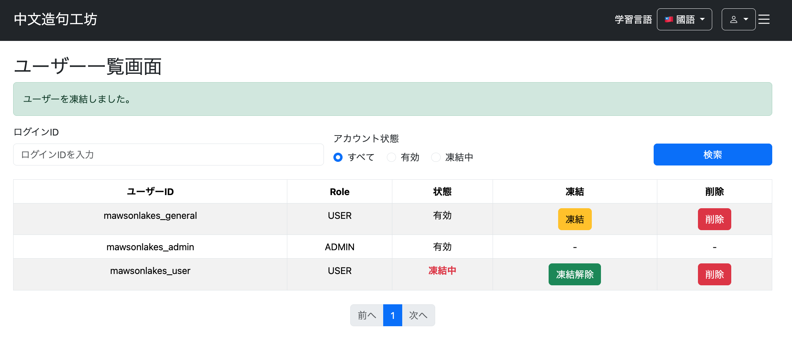

凍結中の`mawsonlakes_user`でログインを試みた。

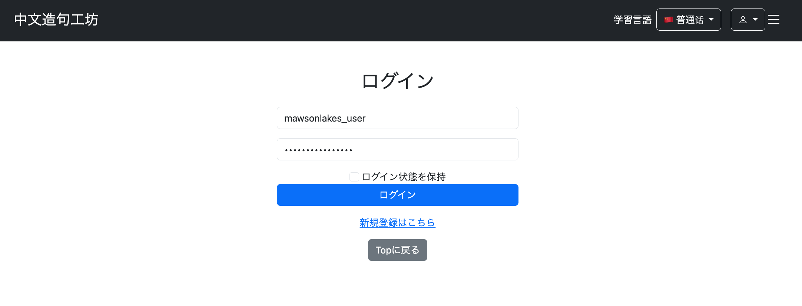

ログインは拒否され、アカウント凍結を通知するメッセージが表示された。

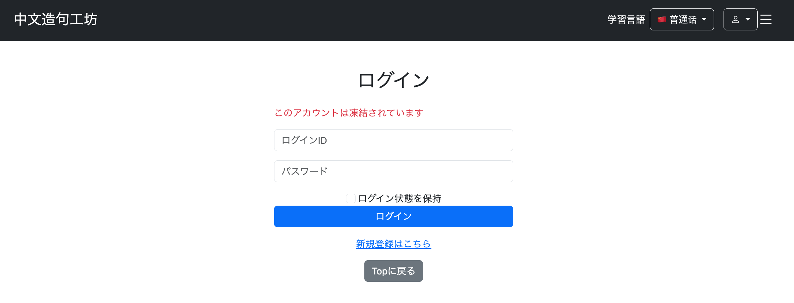

続いて、Admin画面から`mawsonlakes_user`の凍結を解除した。

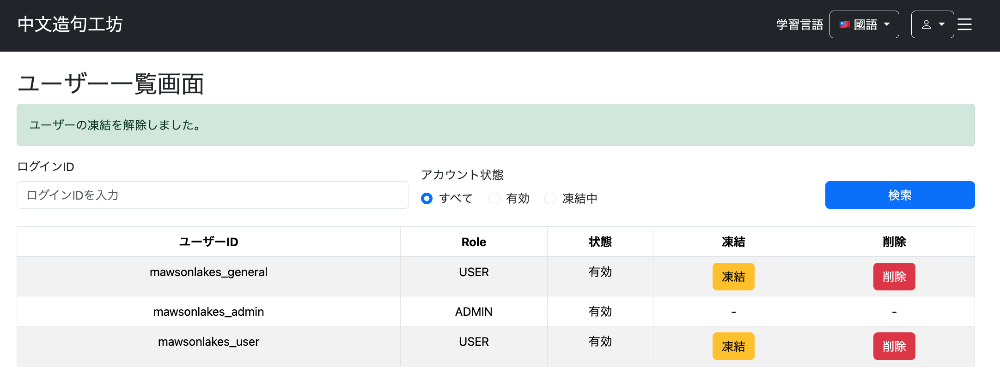

同じユーザーで再度ログインを試みた。


凍結解除後はログインに成功し、Home画面へ遷移した。

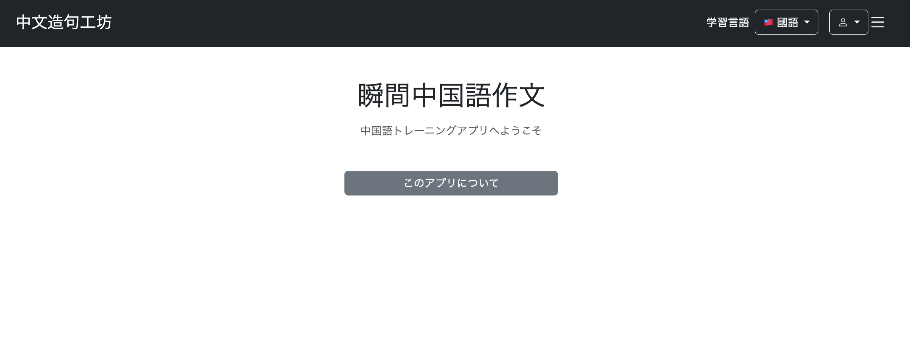

以上により、Admin画面で設定したアカウント凍結状態が、ログイン認証に反映されることを確認した。


# 2. アプリ概要・利用ガイドページの実装

```bash
git commit -m "feat: add multilingual about page"
```

アプリの概要や使い方を簡単にまとめたページを作成する。
なお、よく見かけるようなJSゴリゴリのチュートリアルを作るわけではない。

## 多言語ページのHTML分割方針

案内ページは文章量が多いため、`messages.properties`へ全文を定義する方式は採用せず、表示言語ごとにHTMLテンプレートを分離した。

```text
/tutorial
    ↓
HomeController
    ↓
Localeを確認
    ├─ ja → tutorial.html
    ├─ zh_CN → tutorial-zh-cn.html
    └─ zh_TW → tutorial-zh-tw.html
```

## HomeController

```java
	@GetMapping("/about")
	public String getAbout(Locale locale) {

	    if (Locale.SIMPLIFIED_CHINESE.equals(locale)) {
	        return "about/about-zh-cn";
	    }

	    if (Locale.TRADITIONAL_CHINESE.equals(locale)) {
	        return "about/about-zh-tw";
	    }

	    return "about/about";
	}
```

## /about/about.html(日本語)

```html
<!DOCTYPE html>

<html xmlns:th="http://www.thymeleaf.org"
      xmlns:layout="http://www.ultraq.net.nz/thymeleaf/layout"
      layout:decorate="~{layout/layout}">

<head>
    <meta charset="UTF-8">

    <title>このアプリについて</title>

    <link rel="stylesheet"
          th:href="@{/webjars/bootstrap/css/bootstrap.min.css}">
</head>

<body>

<div layout:fragment="content">

    <div class="container mt-4 mb-5">

        <h1 class="mb-4">
            このアプリについて
        </h1>


        <!-- ===================================================== -->
        <!-- 瞬間中国語作文とは -->
        <!-- ===================================================== -->

        <div class="card mb-4">

            <div class="card-header">
                <h3 class="mb-0">
                    1. 瞬間中国語作文トレーニングとは
                </h3>
            </div>

            <div class="card-body">

                <p>
                    瞬間中国語作文とは、日本語を見て、
                    できるだけ素早く中国語へ変換して発話するトレーニングです。
                </p>

                <p>
                    中国語の単語や文法を知識として覚えるだけではなく、
                    <strong>必要な表現を自分で素早く組み立てられるようになること</strong>
                    を目的としています。
                </p>

                <p>
                    単語や文法を理解していても、
                    実際の会話では、それらを短時間で組み合わせて
                    中国語の文章を作る必要があります。
                </p>

                <p class="mb-0">
                    このアプリでは、日本語から中国語を繰り返し作ることで、
                    知っている単語や文法を実際に使えるようにすることを目指します。
                </p>

            </div>
        </div>


        <!-- ===================================================== -->
        <!-- このアプリでできること -->
        <!-- ===================================================== -->

        <div class="card mb-4">

            <div class="card-header">
                <h3 class="mb-0">
                    2. このアプリでできること
                </h3>
            </div>

            <div class="card-body">

                <h5>非ログイン時</h5>

                <ul>
                    <li>
                        <strong>通常学習</strong><br>
                        登録されている問題を難易度や範囲を指定して学習できます。
                    </li>
                </ul>

                <hr>

                <h5>ログイン時</h5>

                <ul>

                    <li class="mb-2">
                        <strong>通常学習</strong><br>
                        通常の問題に加えて、自分がAI生成モードから保存した問題も
                        学習できます。
                    </li>

					<li class="mb-2">
					    <strong>理解度の記録</strong><br>
					    問題を解いた後に、理解度をHard・Good・Easyの3段階で記録できます。
					    「Hard」はまだ十分に理解できていない問題、
					    「Good」は理解できているものの復習したい問題、
					    「Easy」は問題なく答えられる問題の目安として利用できます。
					    記録した理解度は、後から復習する問題を絞り込むためにも利用できます。
					</li>

                    <li class="mb-2">
                        <strong>お気に入り登録</strong><br>
                        苦手な問題や、繰り返し練習したい問題を
                        お気に入りとして登録できます。
                    </li>

                    <li class="mb-2">
                        <strong>復習</strong><br>
                        一度学んだことのある問題を、理解度、文法・構造、お気に入りなどの条件から
                        絞り込んで復習できます。
                    </li>

                    <li class="mb-2">
                        <strong>AI生成モード</strong><br>
                        一度学んだことのある問題をもとに、
                        AIが内容を変化させた新しい問題を生成します。
                    </li>

                    <li>
                        <strong>問題の保存・管理</strong><br>
                        AIが生成した問題を保存し、
                        通常学習や復習で繰り返し利用できます。
                    </li>

                </ul>

            </div>
        </div>


        <!-- ===================================================== -->
        <!-- 学習の流れ -->
        <!-- ===================================================== -->

        <div class="card mb-4">

            <div class="card-header">
                <h3 class="mb-0">
                    3. 基本的な学習の流れ
                </h3>
            </div>

            <div class="card-body">

                <h5>① 通常学習</h5>

                <p>
                    まずは自分に合った難易度を選び、
                    日本語を見て中国語を作る練習をしましょう。
                </p>

                <p>
                    答えを見る前に、できるだけ自分で中国語を組み立て、
                    実際に声に出してみてください。
                </p>

                <p>
                    ログインしている場合は、問題を解いた後に
                    Hard・Good・Easyで理解度を記録できます。
                </p>

                <hr>

                <h5>② 復習</h5>

                <p>
                    一度学習した問題は、理解度やお気に入りなどを利用して
                    絞り込んで復習できます。
                </p>

                <p>
                    特にHardを付けた問題を中心に繰り返し練習し、
                    自分で自然に中国語を組み立てられる状態を目指しましょう。
                </p>

                <hr>

                <h5>③ AI生成モード</h5>

                <p>
                    既存の問題に慣れてきたら、
                    AI生成モードを使って別の内容の問題にも挑戦できます。
                </p>

                <p class="mb-0">
                    気に入った生成問題は保存でき、
                    その後の通常学習や復習でも利用できます。
                </p>

            </div>
        </div>


        <!-- ===================================================== -->
        <!-- AI生成モード -->
        <!-- ===================================================== -->

        <div class="card mb-4">

            <div class="card-header">
                <h3 class="mb-0">
                    4. AI生成モードについて
                </h3>
            </div>

            <div class="card-body">

                <p>
                    AI生成モードでは、既存の問題をもとに、
                    文法や文章構造をできるだけ維持しながら
                    内容を変化させた問題を生成します。
                </p>

                <p>
                    同じ問題の答えを覚えてしまうことを防ぎ、
                    学習した文法や表現を別の文章でも使えるか確認することが目的です。
                </p>

                <p>
                    生成された問題は保存することができ、
                    保存した問題は自分専用の問題として利用できます。
                </p>

                <div class="alert alert-warning mb-0">
                    AIが生成する内容は必ずしも正確とは限りません。
                    不自然な中国語や誤った内容が生成される可能性があります。
                </div>

            </div>
        </div>


        <!-- ===================================================== -->
        <!-- 発音表記 -->
        <!-- ===================================================== -->

        <div class="card mb-4">

            <div class="card-header">
                <h3 class="mb-0">
                    5. 拼音・注音について
                </h3>
            </div>

            <div class="card-body">

                <p>
                    このアプリでは、中国語の発音表記として
                    拼音（Pinyin）と注音（Zhuyin）を利用できます。
                </p>

                <p class="mb-0">
                    自分の設定に応じた発音表記を確認しながら、
                    中国語を実際に声に出して練習してください。
                </p>

            </div>
        </div>


        <!-- ===================================================== -->
        <!-- 学習時の注意点 -->
        <!-- ===================================================== -->

        <div class="card mb-4">

            <div class="card-header">
                <h3 class="mb-0">
                    6. 学習時の注意点
                </h3>
            </div>

            <div class="card-body">

                <h5>答えを暗記しない</h5>

                <p>
                    このトレーニングの目的は、
                    問題と答えの組み合わせを暗記することではありません。
                </p>

                <p>
                    日本語を見て、その都度自分で中国語を組み立てることを
                    意識してください。
                </p>

                <hr>

                <h5>必ず一度は自分で考える</h5>

                <p>
                    分からない場合でも、すぐに答えを見るのではなく、
                    知っている単語や文法を使って一度中国語を作ってみましょう。
                </p>

                <hr>

                <h5>同じ問題を連続して解きすぎない</h5>

                <p class="mb-0">
                    同じ問題を短時間に何度も解くと、
                    中国語を組み立てるのではなく答えそのものを覚えてしまいやすくなります。
                    適度に間隔を空けながら復習しましょう。
                </p>

            </div>
        </div>


        <div class="text-center">

            <a th:href="@{/}"
               class="btn btn-secondary">
                Topへ戻る
            </a>

        </div>

    </div>

</div>

</body>

</html>
```


## /about/about-zh-cn.html

省略

## /about/about-zh-tw.html

省略

## 動作確認

http://localhost:8080/aboutにアクセスし、チュートリアルページの表示を確認した


ヘッダーの表示言語を切り替えるとページの表示言語も切り替わった。
簡体字

繁体字


## 非ログインユーザーへの閲覧権限の追加

```bash
git commit -m "fix: allow unauthenticated access to about page"
```

チュートリアルページはまだSecurityConfigでpermitAll()の対象になっていないので非ログインユーザーは閲覧できなくなっている。

### SecurityConfig

```java
	            .requestMatchers("/about").permitAll()
```

を追加

### 動作確認

http://localhost:8080/aboutに非ログインユーザーでもアクセスできるようになった。

## 普通話・國語の違いに関する説明の追加

```bash
git commit -m "docs: add explanation of Mainland and Taiwan Chinese variants"
```

### /about/about.html

```html
		<!-- ===================================================== -->
		<!-- 学習可能な2つの中国語 -->
		<!-- ===================================================== -->
		
		<div class="card mb-4">
		
		    <div class="card-header">
		
		        <h3 class="mb-0">
		            5. 学習可能な2つの中国語について
		        </h3>
		
		    </div>
		
		    <div class="card-body">
		
		        <p>
		            このアプリでは、
		            中国（中華人民共和国）で標準語として使用されている
		            <strong>普通话</strong>と、
		            台湾（中華民国）で標準語として使用されている
		            <strong>國語</strong>の
		            2つの中国語を学習できます。
		        </p>
		
		        <p>
		            普通話と國語は相互に意思疎通が可能で、
		            基本的な文法にも大きな違いはありません。
		            一方で、実際に使われる中国語にはいくつかの違いがあります。
		        </p>
		
		        <ul>
		            <li>
		                使用する文字が異なる
		                （普通話では簡体字、國語では繁体字）
		            </li>
		            <li>
		                一般的に使用される発音表記が異なる
		                （拼音・注音）
		            </li>
		            <li>
		                同じ漢字でも発音が異なる場合がある
		            </li>
		            <li>
		                よく使われる言い回しや表現が異なる場合がある
		            </li>
		            <li>
		                同じものを表す場合でも、使用する単語が異なる場合がある
		            </li>
		        </ul>
		
		        <p>
		            なお、このアプリでは発音表記を学習対象言語とは独立して設定できるため、
		            普通話を注音で確認したり、
		            國語を拼音で確認したりすることもできます。
		        </p>
		
		        <p>
		            こうした違いに対応するため、
		            このアプリでは普通話と國語で同じ問題を単純に文字変換して使用するのではなく、
		            <strong>それぞれに別の問題を用意しています。</strong>
		        </p>
		
		        <p>
		            学習対象言語を切り替えることで、
		            それぞれの地域で使われる語彙・表現・発音に沿った問題を
		            学習できます。
		        </p>
		
		        <p class="mb-0">
		            普通話と國語のどちらを主に身につけたいかに応じて、
		            学習対象言語を切り替えて利用してください。
		        </p>
		
		    </div>
		
		</div>    
```

## リスト機能と発音表記に関する説明の拡充

### /about/about.html

### 2. このアプリでできること

```html
<li class="mb-2">
    <strong>リスト機能</strong><br>
    学習したい問題を自分で作成したリストに登録し、
    リスト内の問題だけを使ってトレーニングできます。
    苦手な問題や特定のテーマの問題をまとめて学習したい場合に利用できます。
</li>
```

を追加

### 5. リストについて

4. AI生成モードについて のカードの直後に、これを追加

```html
<!-- ===================================================== -->
<!-- リスト -->
<!-- ===================================================== -->

<div class="card mb-4">

    <div class="card-header">
        <h3 class="mb-0">
            5. リストについて
        </h3>
    </div>

    <div class="card-body">

        <p>
            リスト機能では、学習したい問題を自分で作成したリストに登録して
            管理することができます。
        </p>

        <p>
            例えば、苦手な問題、重点的に練習したい問題、
            特定の文法や表現を含む問題などをまとめておくことで、
            自分の目的に合わせた問題集として利用できます。
        </p>

        <p>
            作成したリストは通常学習の出題範囲として選択でき、
            リストに登録した問題だけを使ってトレーニングすることができます。
        </p>

        <p class="mb-0">
            なお、リストに登録されている問題であっても、
            現在設定している学習対象言語と異なる問題は出題されません。
        </p>

    </div>

</div>

その結果、現在の
```
5. 学習可能な2つの中国語について → 6.
6. 拼音・注音について → 7.
7. 学習時の注意点 → 8.
となる

### 7. 拼音・注音について

```html
現在は「拼音と注音を利用できる」「設定に応じて確認できる」というかなり短い説明だけなので説明を増やす。

<div class="card mb-4">

    <div class="card-header">
        <h3 class="mb-0">
            7. 拼音・注音について
        </h3>
    </div>

    <div class="card-body">

        <p>
            このアプリでは、中国語の発音表記として
            <strong>拼音（Pinyin）</strong>と
            <strong>注音（Zhuyin）</strong>を利用できます。
        </p>

        <p>
            拼音はアルファベットを使って中国語の発音を表記する方法で、
            現在は主に中国大陸で使用されています。
            一方、注音は「ㄅ・ㄆ・ㄇ・ㄈ」などの記号を使って発音を表記する方法で、
            主に台湾で使用されています。
        </p>

        <p>
            このアプリでは、
            学習対象言語と発音表記を別々に設定することができます。
        </p>

        <p>
            そのため、普通話を学習するときに注音を表示したり、
            國語を学習するときに拼音を表示したりすることもできます。
        </p>

        <p class="mb-0">
            中国大陸・台湾で一般的に使用されている発音表記に合わせるだけでなく、
            自分が読み慣れている表記や学習目的に合わせて選択してください。
        </p>

    </div>

</div>
```


# 3. 英語UI表記の削除

```bash
git commit -m "refactor: remove English localization support"
```

開発当初は、表示言語として日本語・英語・簡体字中国語・繁体字中国語を選択できるようにしていたが、開発途中で英語表示には対応しない方針へ変更した。

理由は以下のとおりである。

- 英語表示まで対応すると、UIだけでなく問題文についても英語を用意する必要があり、実装・データ管理の負担が大きくなる。
- このアプリケーションは、中国語を学習する日本語母語話者を主な対象としているため、英語から中国語への翻訳機能は目的から外れる。
- 簡体字・繁体字へのUI切替は中国語母語話者向けではなく、学習者が日常的に中国語を目にする機会を増やし、中国語の読解力向上につなげることを目的としている。

そのため、不要になった英語表示関連の実装を削除し、表示言語を日本語・簡体字中国語・繁体字中国語の3種類に整理する。

## header.html

```html
				        <li>
				            <a class="dropdown-item"
				               th:href="@{?lang=en}">
				                <span th:if="${#locale.language == 'en'}">✓ </span>English
				            </a>
				        </li>
```

を消す

## messages_en.propertiesを削除

## 動作確認
headerの表示言語選択欄から英語が消えた


# 4. Home画面の表示内容の拡充

```bash
git commit -m "feat: expand home page with navigation links"
```

Home画面は、これまでアプリケーション名などを表示する最低限の構成にしていた。


しかし、主要な機能がおおむね完成したため、Home画面から各機能へ直接移動できるように変更した。

English Output TrainerのHome画面を参考に、通常学習、復習、AI生成モード、ユーザーメニュー、このアプリについてページなどへのリンクボタンを配置する。

また、ログイン状態によって利用できる機能が異なるため、Spring Securityの`sec:authorize`を使用して表示するボタンを切り替える。

## /home.html

```html
<div layout:fragment="content"
     class="container text-center mt-5">

    <h1 class="mb-3"
        th:text="#{title}">
        Chinese Output Forge
    </h1>

    <p class="text-muted"
       th:text="#{home.description}">
        瞬間中国語作文トレーニングアプリ
    </p>

    <div class="d-grid gap-3 col-md-4 mx-auto mt-5">

        <!-- 通常学習 -->
        <a th:href="@{/practice/menu}"
           class="btn btn-primary btn-lg"
           th:text="#{home.practice}">
            通常学習
        </a>

        <!-- 復習 -->
        <a sec:authorize="isAuthenticated()"
           th:href="@{/review/menu}"
           class="btn btn-success btn-lg"
           th:text="#{home.review}">
            復習
        </a>

        <!-- AI生成モード -->
        <a sec:authorize="isAuthenticated()"
           th:href="@{/ai-practice/menu}"
           class="btn btn-warning btn-lg"
           th:text="#{home.aiPractice}">
            AI生成モード
        </a>

        <!-- ユーザーメニュー -->
        <a sec:authorize="isAuthenticated()"
           th:href="@{/user/menu}"
           class="btn btn-secondary btn-lg"
           th:text="#{home.userMenu}">
            ユーザーメニュー
        </a>

        <!-- このアプリについて -->
        <a th:href="@{/about}"
           class="btn btn-secondary"
           th:text="#{home.about}">
            このアプリについて
        </a>

        <!-- ログイン -->
        <a sec:authorize="isAnonymous()"
           th:href="@{/login}"
           class="btn btn-outline-primary"
           th:text="#{home.login}">
            ログイン
        </a>

        <!-- 新規登録 -->
        <a sec:authorize="isAnonymous()"
           th:href="@{/signup/signup}"
           class="btn btn-outline-success"
           th:text="#{home.signup}">
            新規登録
        </a>

    </div>

</div>
```

## messages.properties

```properties
title=Chinese Output Forge
home.description=瞬間中国語作文トレーニングアプリ
home.practice=通常学習
home.review=復習
home.aiPractice=AI生成モード
home.userMenu=ユーザーメニュー
home.about=このアプリについて
home.login=ログイン
home.signup=新規登録
```

## 動作確認

http://localhost:8080/にアクセスすると各メニューへのリンクボタンを持ったHome画面が表示された

ログイン時
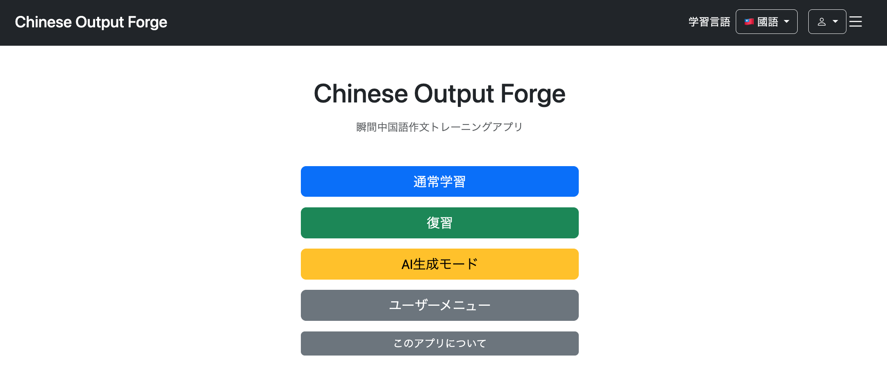
非ログイン時
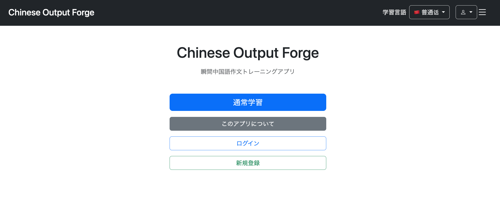


# 5. トレーニング完了画面の拡充


トレーニング完了画面には、これまでHome画面と通常学習メニューへ戻るリンクボタンしか配置していなかった。

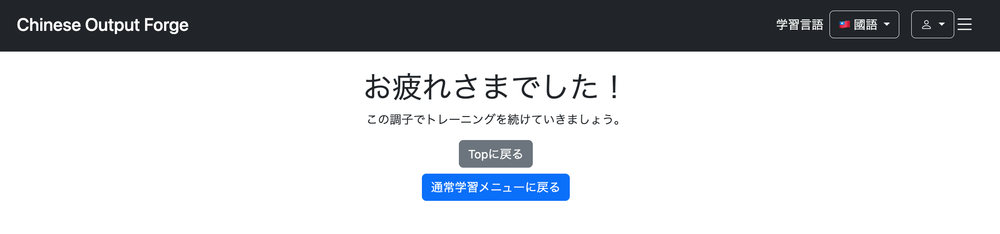

しかし、トレーニング終了後は通常学習を続けるだけでなく、復習やAI生成モードなどへ移動することも考えられる。

そこで、Home画面と同様に各メニューへのリンクボタンを追加し、トレーニング完了後に次の学習方法を選択しやすくする。

なお、復習、AI生成モード、ユーザーメニューはログインユーザーのみ利用できるため、`sec:authorize`を使用してログイン時のみ表示する。


## /complete.html

```bash
git commit -m "feat: add navigation links to training complete page"
```

```html
<div class="text-center"
     layout:fragment="content">

    <h1 th:text="#{complete.title}">
        お疲れさまでした！
    </h1>

    <p th:text="#{complete.message}">
        この調子でトレーニングを続けていきましょう。
    </p>

    <div class="d-grid gap-3 col-md-4 mx-auto mt-4">

        <!-- 通常学習 -->
        <a th:href="@{/practice/menu}"
           class="btn btn-primary"
           th:text="#{complete.backToPractice}">
            通常学習メニューに戻る
        </a>

        <!-- 復習 -->
        <a sec:authorize="isAuthenticated()"
           th:href="@{/review/menu}"
           class="btn btn-success"
           th:text="#{complete.review}">
            復習
        </a>

        <!-- AI生成モード -->
        <a sec:authorize="isAuthenticated()"
           th:href="@{/ai-practice/menu}"
           class="btn btn-warning"
           th:text="#{complete.aiPractice}">
            AI生成モード
        </a>

        <!-- Home -->
        <a th:href="@{/}"
           class="btn btn-outline-secondary"
           th:text="#{common.backToTop}">
            Topに戻る
        </a>

    </div>

</div>
```

## messages.properties

```properties
complete.pageTitle=学習完了 | Chinese Output Forge
complete.title=お疲れさまでした！
complete.message=この調子でトレーニングを続けていきましょう。
complete.backToPractice=通常学習メニューに戻る
complete.review=復習メニューに戻る
complete.aiPractice=AI生成モードメニューに戻る
```

## 動作確認

トレーニングが完了し、http://localhost:8080/completeに遷移すると、各メニューへのリンクボタンが表示された

ログイン時
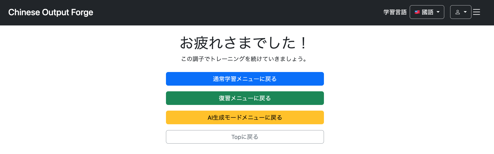

非ログイン時
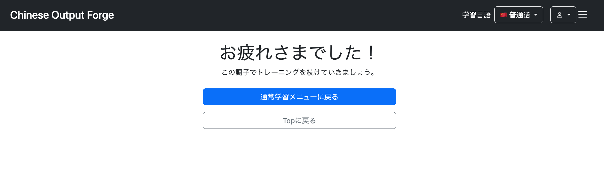

# 6. ユーザー設定画面のUI改善

```bash
git commit -m "feat: improve settings page with current setting display"
```
現在の仕様では設定画面で何を選択しているのかが視覚的に分かりづらい。

今ログイン中のアカウントでは
学習対象言語：國語
発音記号：拼音
となっているが、よくわからない。


## /user/setting.html

今のテーブル構造をほぼ変えずに、各tdの先頭へ現在値を追加する

### 学習対象言語

```html
<td>

    <!-- 現在の設定 -->
    <div class="mb-3">
        <span class="text-muted"
              th:text="#{settings.current}">
            現在の設定：
        </span>

        <strong th:if="${session.languageVariant != null
                        && session.languageVariant.name() == 'MAINLAND'}">
            🇨🇳
            <span th:text="#{settings.languageVariant.mainland}">
                普通話
            </span>
        </strong>

        <strong th:if="${session.languageVariant != null
                        && session.languageVariant.name() == 'TAIWAN'}">
            🇹🇼
            <span th:text="#{settings.languageVariant.taiwan}">
                國語
            </span>
        </strong>
    </div>

    <div class="d-flex flex-wrap gap-3">

        <!-- 既存のボタン -->

    </div>

</td>
```

### 発音記号

```html
<td>

    <!-- 現在の設定 -->
    <div class="mb-3">
        <span class="text-muted"
              th:text="#{settings.current}">
            現在の設定：
        </span>

        <strong th:switch="${session.pronunciationType != null
                            ? session.pronunciationType.name()
                            : 'PINYIN'}">

            <span th:case="'PINYIN'">
                <ruby>
                    拼音
                    <rt>pīnyīn</rt>
                </ruby>
            </span>

            <span th:case="'ZHUYIN'">
                <ruby>
                    注音
                    <rt>ㄓㄨˋ ㄧㄣ</rt>
                </ruby>
            </span>

            <span th:case="'NONE'"
                  th:text="#{settings.pronunciationType.none}">
                表示しない
            </span>

        </strong>
    </div>

    <div class="d-flex flex-wrap gap-3">

        <!-- 既存のボタン -->

    </div>

</td>
```

## messages.properties

```properties
settings.current=現在の設定：
```

を追加

## 動作確認
http://localhost:8080/user/settingsにアクセスすると、各ステータス設定のセル内に現在値が表示されわかりやすくなった


# 7. 多言語メッセージ定義の修正

まだ一部表示をmessages.propertiesで管理しておらず、表示言語を日本語以外にすると日本語でメッセージが出てくることがある。

例: 表示言語を普通話にした状態で通常学習メニューでわざとエラーを出すと日本語でエラーメッセージがでる。


## 通常学習で出題範囲を複数選択したときのエラーメッセージ
```bash
git commit -m "fix: localize practice range selection error message"
```
### PracticeController.getPracticeStart

```java
if (selectedCount != 1) {
    redirectAttributes.addFlashAttribute(
            "errorMessage",
            "出題範囲を1つ選択してください。");

    return "redirect:/practice/menu";
}
```

↓

```java
if (selectedCount != 1) {
    String errorMessage = messageSource.getMessage(
            "practice.error.selectOneRange",
            null,
            locale
    );

    redirectAttributes.addFlashAttribute(
            "errorMessage",
            errorMessage
    );

    return "redirect:/practice/menu";
}
```


### messages.properties

```properties
practice.error.selectOneRange=出題範囲を1つ選択してください。
practice.error.selectOneRange=请选择一个出题范围。
practice.error.selectOneRange=請選擇一個出題範圍。
```

### 動作確認

表示言語簡体字の状態でhttp://localhost:8080/practice/menuでわざとエラーを起こすとエラーメッセージも簡体字になった。


# 8. 各モードのメニュー画面への説明文の追加

```bash
git commit -m "feat: add descriptions to mode menu screens"
```

例えばタイトルが通常学習だけでは「どういう通常学習なのか」が不明瞭なので、多少の説明が必要である。

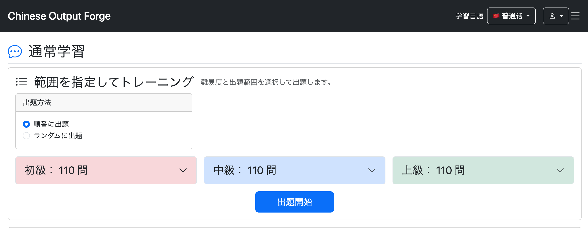

これは復習モードでもAI生成モードでも同じである。

## messages.properties

```properties
practice.menu.description=アプリケーションに収録されている問題を使って、瞬間中国語作文トレーニングを行います。
```

## /practice/menu.html

```html
<div class="header border-bottom pb-2 mb-2 d-flex justify-content-between align-items-center">

    <div>
        <h1 class="h2 mb-1">
            <i class="bi bi-chat-dots me-2 text-primary"></i>
            <span th:text="#{practice.menu.title}"></span>
        </h1>

        <p class="text-muted mb-0"
           th:text="#{practice.menu.description}">
            アプリケーションに収録されている問題を使って、
            瞬間中国語作文トレーニングを行います。
        </p>
    </div>

    <!-- 中断中のトレーニング -->
    <div th:if="${canResume}"
         class="d-flex align-items-center gap-3">
	...(中略)...

    </div>

</div>
```

とタイトルのあとにpタグを入れる。

## /review/menu.html
```html


    <div>
        <h1 class="h2 mb-1">
            <i class="bi bi-arrow-repeat me-2 text-primary"></i>

            <span th:text="#{review.menu.title}">
                復習
            </span>
        </h1>

        <p class="text-muted mb-0"
           th:text="#{review.menu.description}">
            これまでに学習した問題を、理解度や文法・構造などの条件で絞り込んで復習します。
        </p>
    </div>

```
とタイトルのあとにpタグを入れる。

## ai-ptactice/menu.html

```html
<div>
    <h1 class="h2 mb-1">

        <i class="bi bi-stars me-2 text-primary"></i>

        <span th:text="#{aiPractice.menu.title}">
            AI問題生成
        </span>

    </h1>

    <p class="text-muted mb-0"
       th:text="#{aiPractice.menu.description}">
        これまでに学習した問題をもとに、AIが内容を変化させた新しい問題を生成してトレーニングします。
    </p>
</div>
```

とタイトルのあとにpタグを入れる。

## /user/question/list.html

```html
<div class="mb-4">

    <h2 class="mb-1"
        th:text="#{user.question.list.title}">
        問題一覧
    </h2>

    <p class="text-muted mb-0"
       th:text="#{user.question.list.description}">
        アプリケーションに登録されている問題や、自分が保存したAI生成由来の問題を検索・確認できます。
    </p>

</div>
```

とタイトルのあとにpタグを入れる。

## messeages.properties

```properties
practice.menu.description=アプリケーションに収録されている問題を使って、瞬間中国語作文トレーニングを行います。
review.menu.description=これまでに学習した問題を、理解度や文法・構造などの条件で絞り込んで復習します。
aiPractice.menu.description=これまでに学習した問題をもとに、AIが内容を変化させた新しい問題を生成してトレーニングします。
user.question.list.description=アプリケーションに登録されている問題や、自分が保存したAI生成由来の問題を検索・確認できます。
```

## 動作確認

各メニューのタイトル直下に簡易的な説明が表示されるようになっった。

通常学習
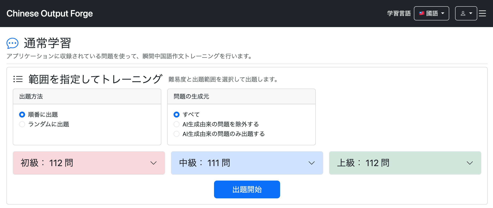

復習
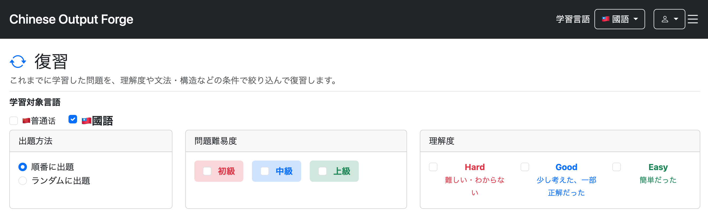

AI生成
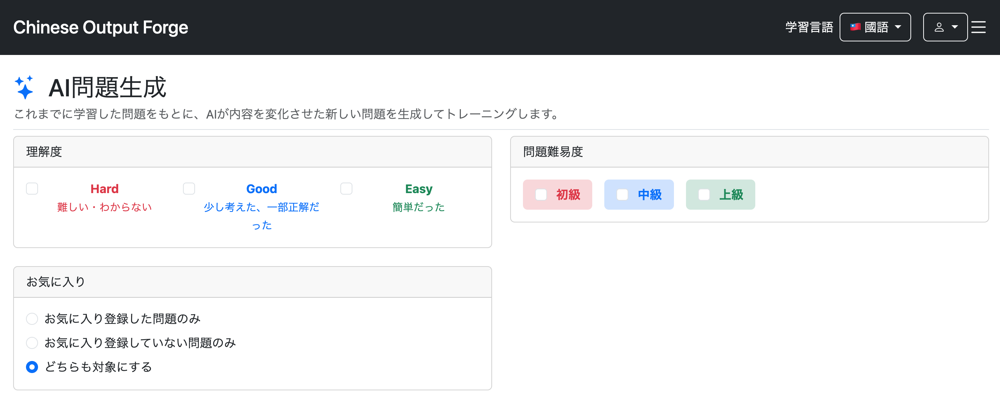

問題一覧
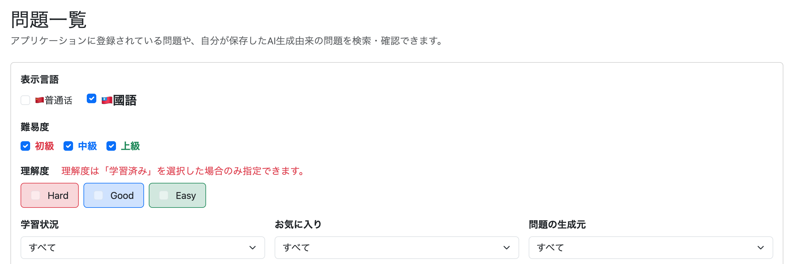

# 9. ログイン成功時のHome画面への歓迎メッセージ表示
```bash
git commit -m "feat: add login success welcome message"
```

LoginSuccessHandlerからパラメータを送れるようにすればいい

## 変更前のログイン成功ハンドラ

```java
@Component
@Slf4j
public class LoginSuccessHandler
extends SavedRequestAwareAuthenticationSuccessHandler {
	
	private final UserAccountService userAccountService;
	
	public LoginSuccessHandler(UserAccountService userAccountService) {
	    this.userAccountService = userAccountService;
	    super.setDefaultTargetUrl("/");
	}
	
	@Override
	public void onAuthenticationSuccess(HttpServletRequest request, HttpServletResponse response, Authentication authentication) throws IOException, ServletException {
        // ログインIDからユーザー情報を取得
		Users user = userAccountService.getUserOne(authentication.getName());
		
		// usersテーブルから学習対象言語と発音記号を取得
        LanguageVariant languageVariant = user.getLanguageVariant();
        PronunciationType pronunciationType = user.getPronunciationType();
        
        // セッションの取得
        HttpSession session = request.getSession();
        
        //  セッションに学習対象言語と発音記号の情報を保存
        session.setAttribute("languageVariant", languageVariant);
        session.setAttribute("pronunciationType", pronunciationType);
        
        // ログイン成功を記録
        log.info("Login succeeded: loginId={}", authentication.getName());
        
        // Spring Security標準のログイン成功後処理を実行
        super.onAuthenticationSuccess(request, response, authentication);
        
	}

}
```

ログイン成功
  ↓
loginIdからUsersを取得
  ↓
languageVariantをSessionへ保存
  ↓
pronunciationTypeをSessionへ保存
  ↓
ログイン成功をログへ記録
  ↓
SavedRequestAwareAuthenticationSuccessHandlerの処理

を担当している

しかも、

```java
Users user =
        userAccountService.getUserOne(
                authentication.getName());
```

でUsersまで取得済みなので、表示に必要なユーザー情報もここにある。

## 認証成功ハンドラからFlash Attributeを設定する際の制約

いままで新規登録成功時やエラーメッセージ表示時に活躍してきたredirectAttributes.addFlashAttribute(...)が今回使えない。
Controllerでは、

```java
public String someMethod(
        RedirectAttributes redirectAttributes) {

のようにSpring MVCからRedirectAttributesを引数として受け取れるので、
```

```java
redirectAttributes.addFlashAttribute("message", "成功しました");
```

と簡単に書ける。

一方、AuthenticationSuccessHandlerのメソッドはSpring Securityによって、

```java
onAuthenticationSuccess(
        HttpServletRequest request,
        HttpServletResponse response,
        Authentication authentication)
```

という形で呼び出される。ここには当然ながらRedirectAttributesがない。

そのため、

```java
redirectAttributes.addFlashAttribute(...)
```

というController向けの便利な方法をそのまま使えない

## FlashMapを用いたリダイレクト後のメッセージ受け渡し

RedirectAttributesの元になっている仕組みであるFlashMapを使ってパラメータを送る。

### FlashMapの役割

リダイレクトをまたいで、次のリクエストにだけ値を渡すための一時的な入れ物。
リダイレクト前に保存され、リダイレクト後に使用可能になり、すぐに削除される。

普通のModelでは、リダイレクトすると値を渡せない。

これは、

ログイン成功時のリクエスト
    ↓
Modelにmessageを入れる
    ↓
リダイレクト
    ↓
新しく GET / が発生
    ↓
別のリクエストなのでmessageはない

となる。

そこでFlashMapを使う。

ログイン成功時のリクエスト
    ↓
FlashMap
「message = ログイン成功」を保存
    ↓
リダイレクト
    ↓
GET /
    ↓
FlashMapのmessageを利用できる
    ↓
使ったら削除

となる。

### RedirectAttributesとFlashMapの関係

これまでControllerでリダイレクト先へ一時的な値を渡す際には、RedirectAttributes の addFlashAttribute() を使用していた。

```java
redirectAttributes.addFlashAttribute(
        "messageKey",
        "password.reset.success");

return "redirect:/login";
```

addFlashAttribute() で設定した値は、内部的には FlashMap に保存される。

Model に設定した値は現在のリクエスト内でのみ利用できるため、リダイレクトすると失われる。一方、Flash Attributeはリダイレクト前に一時保存され、リダイレクト後のリクエストで利用できる。

現在のリクエスト
    ↓
addFlashAttribute()
    ↓
FlashMapへ一時保存
    ↓
リダイレクト
    ↓
次のリクエスト
    ↓
Flash Attributeとして利用
    ↓
利用後に削除

つまり、RedirectAttributes.addFlashAttribute() はFlash Attribute独自の保存領域を持っているわけではなく、Spring MVCのFlashMapをControllerから簡単に利用するための仕組みである。

一方、InterceptorやSpring SecurityのHandlerでは、Controllerのようにメソッド引数としてRedirectAttributesを受け取らない。そのため、同じことを行う場合はFlashMapを作成し、FlashMapManagerを利用して直接保存する方法がある。

### LoginSuccessHandler.onAuthenticationSuccess

```java
	@Override
	public void onAuthenticationSuccess(HttpServletRequest request, HttpServletResponse response, Authentication authentication) throws IOException, ServletException {
        // ログインIDからユーザー情報を取得
		Users user = userAccountService.getUserOne(authentication.getName());
		
		// usersテーブルから学習対象言語と発音記号を取得
        LanguageVariant languageVariant = user.getLanguageVariant();
        PronunciationType pronunciationType = user.getPronunciationType();
        
        // セッションの取得
        HttpSession session = request.getSession();
        
        //  セッションに学習対象言語と発音記号の情報を保存
        session.setAttribute("languageVariant", languageVariant);
        session.setAttribute("pronunciationType", pronunciationType);
        
        // ログイン成功を記録
        log.info("Login succeeded: loginId={}", authentication.getName());
        
		// FlashMapを作成
		FlashMap flashMap = new FlashMap();

		// ログイン成功メッセージのキーを設定
		flashMap.put("messageKey", "login.success");
		
		// ログインIDを設定
		flashMap.put("loginId", user.getLoginId());

		// FlashMapManagerを取得
		FlashMapManager flashMapManager = 
				RequestContextUtils.getFlashMapManager(request);
		
		// FlashMapを保存
		flashMapManager.saveOutputFlashMap(flashMap, request, response);
        
        // Spring Security標準のログイン成功後処理を実行
        super.onAuthenticationSuccess(request, response, authentication);
        
	}

```
#### FlashMapインスタンスの生成

リダイレクト先へ一時的に渡す値を保存するため、`FlashMap`を作成する。

```java
FlashMap flashMap = new FlashMap();
```

`FlashMap`に保存した値は、リダイレクト後のリクエストで利用され、その後削除される。

#### ログイン成功メッセージキーの格納

表示するメッセージを`messages.properties`から取得するため、メッセージキーを保存する。

```java
flashMap.put("messageKey", "login.success");
```

#### ログインIDの格納

ログイン成功メッセージにユーザー名を表示するため、`loginId`も保存する。

```java
flashMap.put("loginId", user.getLoginId());
```

`messages.properties`では、`{0}`の部分にこの値を渡して使用する。

```properties
login.success=おかえりなさい、{0}さん
```

#### FlashMapManagerの取得

##### FlashMapManager

FlashMapをどこに保存し、次のリクエストでどのFlashMapを取り出すかを管理するクラス

FlashMap →「何を渡すか」を入れる箱
FlashMapManager → その箱を「保存する・取り出す」役

##### RequestContextUtils

`RequestContextUtils`は、`request`からSpring MVCが管理している情報を取得するためのユーティリティクラスである。今回は`getFlashMapManager(request)`を使用して、`FlashMap`を管理する`FlashMapManager`を取得している。

FlashMapManager はFlashMapManager flashMapManager = ...と簡単には取得できない

ので簡単に言えばFlashMapManagerを使うためにRequestContextUtilsを使っている。


#### FlashMapの保存

作成した`FlashMap`を、リダイレクト後のリクエストで利用できるように保存する。

```java
flashMapManager.saveOutputFlashMap(
        flashMap,
        request,
        response);
```

これによって、`messageKey`と`loginId`がリダイレクト先へ引き継がれる。

#### リダイレクト先パスの設定要否

`FlashMap`を保存する前に、値を受け取るリダイレクト先を指定することもできる。

```java
flashMap.setTargetRequestPath(redirectPath);
```

これは、`FlashMap`を特定のパスへのリクエストだけで使用させたい場合に利用する。

今回は`SavedRequestAwareAuthenticationSuccessHandler`を使用しているため、ログイン成功後の遷移先が常に同じとは限らない。ログイン前にアクセスしようとしていたページがあれば、そのページへ戻る場合がある。

そのため、特定のパスを`setTargetRequestPath()`で固定せず、ログイン成功後のリダイレクト先でFlash Attributeを受け取れるように変更した。

## messages.properties

```properties
login.success=おかえりなさい、{0}さん
login.success=欢迎回来，{0}
login.success=歡迎回來，{0}
```

## /home.html

```html
<div th:if="${messageKey}"
     class="alert alert-success"
     role="alert"
     th:text="#{${messageKey}(${loginId})}">
    おかえりなさい
</div>
```

## 動作確認

ログイン成功時に`FlashMap`へメッセージを保存する処理を追加し、ログインを試みたもののエラーになった。

```text
java.lang.NullPointerException:
Cannot invoke "org.springframework.web.servlet.FlashMapManager.saveOutputFlashMap(...)"
because "flashMapManager" is null
```

ログイン処理自体は成功しているが、`LoginSuccessHandler`内で`flashMapManager`が`null`となり、`saveOutputFlashMap()`の実行時に`NullPointerException`が発生していた。

## エラーの原因と調査結果

`FlashMapManager`を取得するため、以下の処理を使用していた。

```java
FlashMapManager flashMapManager =
        RequestContextUtils.getFlashMapManager(request);
```

### Spring MVCとDispatcherServlet

`Spring MVC`は、HTTPリクエストをControllerで処理するためのSpringのWeb機能である。

`DispatcherServlet`はそのSpring MVCの入口となり、リクエストを受け取って適切なControllerなどへ処理を振り分ける。

### RequestContextUtilsによる取得が失敗した原因

`RequestContextUtils.getFlashMapManager(request)`は、`FlashMapManager`を新しく作成する処理ではなく、`DispatcherServlet`がSpring MVCの処理を開始する際に、そのリクエストで利用できるようにした`FlashMapManager`を取得する処理である。

参考にした`Interceptor`はSpring MVCの機能であり、`DispatcherServlet`の処理の中で実行されるため、この方法で`FlashMapManager`を取得できる。

一方、`LoginSuccessHandler`はSpring MVCの処理ではなく、`DispatcherServlet`より前のSpring SecurityのFilter処理で実行される。

```text
Spring Security
    ↓
LoginSuccessHandler
    ↓
DispatcherServlet
    ↓
Spring MVC
    ↓
Interceptor
    ↓
Controller
```

そのため、`LoginSuccessHandler`の実行時点では`RequestContextUtils`から`FlashMapManager`を取得できず、`null`となった。

今回は`SessionFlashMapManager`を自分で作成し、HTTPセッションを利用して`FlashMap`を保存する方法へ変更する。


## 参考実装とLoginSuccessHandlerの実行コンテキストの違い

参考にしていた実装では、`LoginSuccessHandler`ではなくSpring MVCの`Interceptor`から以下の処理を使用していた。

```java
FlashMapManager flashMapManager =
        RequestContextUtils.getFlashMapManager(request);
```

`Interceptor`は`DispatcherServlet`によるSpring MVCの処理の中で実行されるため、`RequestContextUtils`から`FlashMapManager`を取得できる。

一方、`LoginSuccessHandler`はSpring SecurityのFilter処理の中で実行されるため、同じ取得方法をそのまま利用することはできなかった。

## 修正内容

### SessionFlashMapManagerへの切り替え

`RequestContextUtils`から`FlashMapManager`を取得するのではなく、`SessionFlashMapManager`を使用するように変更する。

```java
FlashMapManager flashMapManager =
        new SessionFlashMapManager();

flashMapManager.saveOutputFlashMap(
        flashMap,
        request,
        response);
```

### SessionFlashMapManager

HTTPセッションを利用して`FlashMap`を保存・取得する`FlashMapManager`の実装クラスである。

### 認証成功ハンドラでSessionFlashMapManagerを使用できる理由

`SessionFlashMapManager`は、`DispatcherServlet`が用意した`FlashMapManager`を取得するのではなく、自分でインスタンスを作成して使用できる。

```java
FlashMapManager flashMapManager =
        new SessionFlashMapManager();
```

また、`SessionFlashMapManager`はHTTPセッションを利用して`FlashMap`を保存する。

HTTPセッションはSpring MVCの処理に入る前でも利用できるため、Spring Security側で実行される`LoginSuccessHandler`からでも`FlashMap`を保存できる。


		// FlashMapを作成
		FlashMap flashMap = new FlashMap();

		// ログイン成功メッセージのキーを設定
		flashMap.put("messageKey", "login.success");
		
		// ログインIDを設定
		flashMap.put("loginId", user.getLoginId());

		// FlashMapManagerを取得
		FlashMapManager flashMapManager = 
				RequestContextUtils.getFlashMapManager(request);
		
		// FlashMapを保存
		flashMapManager.saveOutputFlashMap(flashMap, request, response);

↓

		// FlashMapを作成
		FlashMap flashMap = new FlashMap();

		// ログイン成功メッセージのキーを設定
		flashMap.put("messageKey", "login.success");
		
		// ログインIDを設定
		flashMap.put("loginId", user.getLoginId());

		// FlashMapManagerを作成
		FlashMapManager flashMapManager =
		        new SessionFlashMapManager();

		// FlashMapを保存
		flashMapManager.saveOutputFlashMap(
		        flashMap,
		        request,
		        response);

		// Spring Security標準のログイン成功後処理を実行
		super.onAuthenticationSuccess(
		        request,
		        response,
		        authentication);

## 動作確認

再度ログインを試みるとログイン成功時にメッセージが表示されるようになった


# 10. パスワード入力欄への表示切り替え機能の追加

ログイン画面や会員登録画面などのパスワード入力欄では、入力内容が通常は伏せ字で表示される。そのため、入力したパスワードを確認するには、一度入力し直す必要がある場合があった。

そこで、パスワード入力欄に表示・非表示を切り替えるボタンを追加した。通常はパスワードを伏せ字で表示し、ボタンを押すと入力内容を確認できるようにする。再度ボタンを押すと、伏せ字の表示に戻る。

```bash
git commit -m "feat: add password visibility toggle"
```
## 各HTMLファイルに共通する変更

```html
<script th:src="@{/js/password-toggle.js}" defer></script>
```

を追加

## login.html

                    <!-- パスワード -->
```html
                    <div class="mb-3">
                        <input type="password"
                               class="form-control"
                               th:placeholder="#{login.password}"
                               name="password">
                    </div>

```
↓

<!-- パスワード -->
```html
<div class="mb-3">
    <div class="input-group">
        <input type="password"
               id="password"
               class="form-control"
               th:placeholder="#{login.password}"
               name="password">

        <button type="button"
                class="btn btn-outline-secondary password-toggle"
                data-target="password">
            <i class="bi bi-eye"></i>
        </button>
    </div>
</div>
```

JSで制御するためのIDとボタンタグを追加。

## /signup/signup.html

                    <!-- パスワード -->
```html
                    <div class="mb-3">
                        <label for="password"
                               class="form-label"
                               th:text="#{signup.password}">
                            パスワード
                        </label>

                        <input type="password"
                               id="password"
                               class="form-control"
                               th:field="*{password}"
                               th:placeholder="#{signup.password.placeholder}"
                               th:errorclass="is-invalid">

                        <div class="invalid-feedback"
                             th:errors="*{password}">
                        </div>
                    </div>
```

                    <!-- パスワード確認 -->
```html
                    <div class="mb-3">
                        <label for="passwordConfirm"
                               class="form-label"
                               th:text="#{signup.passwordConfirm}">
                            パスワード（確認）
                        </label>

                        <input type="password"
                               id="passwordConfirm"
                               class="form-control"
                               th:field="*{passwordConfirm}"
                               th:placeholder="#{signup.passwordConfirm.placeholder}"
                               th:errorclass="is-invalid">

                        <div class="invalid-feedback"
                             th:errors="*{passwordConfirm}">
                        </div>
                    </div>
```

↓

<!-- パスワード -->
```html
<div class="mb-3">
    <label for="password"
           class="form-label"
           th:text="#{signup.password}">
        パスワード
    </label>

    <div class="input-group">
        <input type="password"
               id="password"
               class="form-control"
               th:field="*{password}"
               th:placeholder="#{signup.password.placeholder}"
               th:errorclass="is-invalid">

        <button type="button"
                class="btn btn-outline-secondary password-toggle"
                data-target="password">
            <i class="bi bi-eye"></i>
        </button>
    </div>

    <div class="invalid-feedback"
         th:errors="*{password}">
    </div>
</div>
```

<!-- パスワード確認 -->
```html
<div class="mb-3">
    <label for="passwordConfirm"
           class="form-label"
           th:text="#{signup.passwordConfirm}">
        パスワード（確認）
    </label>

    <div class="input-group">
        <input type="password"
               id="passwordConfirm"
               class="form-control"
               th:field="*{passwordConfirm}"
               th:placeholder="#{signup.passwordConfirm.placeholder}"
               th:errorclass="is-invalid">

        <button type="button"
                class="btn btn-outline-secondary password-toggle"
                data-target="passwordConfirm">
            <i class="bi bi-eye"></i>
        </button>
    </div>

    <div class="invalid-feedback"
         th:errors="*{passwordConfirm}">
    </div>
</div>
```

## /user/edit/password.html

					<!-- 現在のパスワード -->
```html
					<div class="mb-4">
					
					    <label for="currentPassword"
					           class="form-label fw-bold"
					           th:text="#{user.edit.password.current}">
					        現在のパスワード
					    </label>
					
					    <input type="password"
					           id="currentPassword"
					           th:field="*{currentPassword}"
					           th:errorclass="is-invalid"
					           class="form-control">
					
					    <div class="invalid-feedback"
					         th:errors="*{currentPassword}">
					    </div>
					
					</div>
```
					
					<!-- 新しいパスワード -->
```html
					<div class="mb-4">
					
					    <label for="newPassword"
					           class="form-label fw-bold"
					           th:text="#{user.edit.password.new}">
					        新しいパスワード
					    </label>
					
					    <input type="password"
					           id="newPassword"
					           th:field="*{newPassword}"
					           th:placeholder="#{signup.password.placeholder}"
					           th:errorclass="is-invalid"
					           class="form-control">
					
					    <div class="invalid-feedback"
					         th:errors="*{newPassword}">
					    </div>
					
					</div>
```
					
					<!-- 新しいパスワード（確認） -->
```html
					<div class="mb-4">
					
					    <label for="newPasswordConfirm"
					           class="form-label fw-bold"
					           th:text="#{user.edit.password.confirm}">
					        新しいパスワード（確認）
					    </label>
					
					    <input type="password"
					           id="newPasswordConfirm"
					           th:field="*{newPasswordConfirm}"
					           th:placeholder="#{signup.passwordConfirm.placeholder}"
					           th:errorclass="is-invalid"
					           class="form-control">
					
					    <div class="invalid-feedback"
					         th:errors="*{newPasswordConfirm}">
					    </div>
					
					</div>
```

↓

<!-- 現在のパスワード -->
```html
<div class="mb-4">

    <label for="currentPassword"
           class="form-label fw-bold"
           th:text="#{user.edit.password.current}">
        現在のパスワード
    </label>

    <div class="input-group">
        <input type="password"
               id="currentPassword"
               th:field="*{currentPassword}"
               th:errorclass="is-invalid"
               class="form-control">

        <button type="button"
                class="btn btn-outline-secondary password-toggle"
                data-target="currentPassword">
            <i class="bi bi-eye"></i>
        </button>
    </div>

    <div class="invalid-feedback"
         th:errors="*{currentPassword}">
    </div>

</div>
```

<!-- 新しいパスワード -->
```html
<div class="mb-4">

    <label for="newPassword"
           class="form-label fw-bold"
           th:text="#{user.edit.password.new}">
        新しいパスワード
    </label>

    <div class="input-group">
        <input type="password"
               id="newPassword"
               th:field="*{newPassword}"
               th:placeholder="#{signup.password.placeholder}"
               th:errorclass="is-invalid"
               class="form-control">

        <button type="button"
                class="btn btn-outline-secondary password-toggle"
                data-target="newPassword">
            <i class="bi bi-eye"></i>
        </button>
    </div>

    <div class="invalid-feedback"
         th:errors="*{newPassword}">
    </div>

</div>
```

<!-- 新しいパスワード（確認） -->
```html
<div class="mb-4">

    <label for="newPasswordConfirm"
           class="form-label fw-bold"
           th:text="#{user.edit.password.confirm}">
        新しいパスワード（確認）
    </label>

    <div class="input-group">
        <input type="password"
               id="newPasswordConfirm"
               th:field="*{newPasswordConfirm}"
               th:placeholder="#{signup.passwordConfirm.placeholder}"
               th:errorclass="is-invalid"
               class="form-control">

        <button type="button"
                class="btn btn-outline-secondary password-toggle"
                data-target="newPasswordConfirm">
            <i class="bi bi-eye"></i>
        </button>
    </div>

    <div class="invalid-feedback"
         th:errors="*{newPasswordConfirm}">
    </div>

</div>
```

## /reset-password.html

            <!-- 新しいパスワード -->
```html
            <div class="mb-3">

                <label for="newPassword"
                       class="form-label"
                       th:text="#{password.reset.form.newPassword}">
                    新しいパスワード
                </label>

                <input type="password"
                       id="newPassword"
                       class="form-control"
                       th:field="*{newPassword}">

                <div class="text-danger"
                     th:if="${#fields.hasErrors('newPassword')}"
                     th:errors="*{newPassword}">
                </div>

            </div>
```

            <!-- 新しいパスワード（確認） -->
```html
            <div class="mb-3">

                <label for="newPasswordConfirm"
                       class="form-label"
                       th:text="#{password.reset.form.newPasswordConfirm}">
                    新しいパスワード（確認）
                </label>

                <input type="password"
                       id="newPasswordConfirm"
                       class="form-control"
                       th:field="*{newPasswordConfirm}">

                <div class="text-danger"
                     th:if="${#fields.hasErrors('newPasswordConfirm')}"
                     th:errors="*{newPasswordConfirm}">
                </div>

            </div>
```

↓

<!-- 新しいパスワード -->
```html
<div class="mb-3">

    <label for="newPassword"
           class="form-label"
           th:text="#{password.reset.form.newPassword}">
        新しいパスワード
    </label>

    <div class="input-group">
        <input type="password"
               id="newPassword"
               class="form-control"
               th:field="*{newPassword}">

        <button type="button"
                class="btn btn-outline-secondary password-toggle"
                data-target="newPassword">
            <i class="bi bi-eye"></i>
        </button>
    </div>

    <div class="text-danger"
         th:if="${#fields.hasErrors('newPassword')}"
         th:errors="*{newPassword}">
    </div>

</div>
```

<!-- 新しいパスワード（確認） -->
```html
<div class="mb-3">

    <label for="newPasswordConfirm"
           class="form-label"
           th:text="#{password.reset.form.newPasswordConfirm}">
        新しいパスワード（確認）
    </label>

    <div class="input-group">
        <input type="password"
               id="newPasswordConfirm"
               class="form-control"
               th:field="*{newPasswordConfirm}">

        <button type="button"
                class="btn btn-outline-secondary password-toggle"
                data-target="newPasswordConfirm">
            <i class="bi bi-eye"></i>
        </button>
    </div>

    <div class="text-danger"
         th:if="${#fields.hasErrors('newPasswordConfirm')}"
         th:errors="*{newPasswordConfirm}">
    </div>

</div>
```


## password-toggle.js

```javascript
document.querySelectorAll(".password-toggle").forEach(button => {

    button.addEventListener("click", () => {

        const passwordInput =
                document.getElementById(button.dataset.target);

        const icon = button.querySelector("i");

        if (passwordInput.type === "password") {
            passwordInput.type = "text";

            icon.classList.remove("bi-eye");
            icon.classList.add("bi-eye-slash");

        } else {
            passwordInput.type = "password";

            icon.classList.remove("bi-eye-slash");
            icon.classList.add("bi-eye");
        }
    });
});
```

ポイントになるのが、

```html
data-target="password"
```
だ。

ボタンに「どのパスワード欄を操作するのか」を持たせている。

```text
button
data-target="password"
       ↓
document.getElementById("password")
       ↓
<input id="password">
```

なので、`signup.html`のように2個ある場合でも、

```html
data-target="password"
```

と

```html
data-target="passwordConfirm"
```

に分ければ、**同じJavaScriptをそのまま使える。**

たとえば確認欄は、

```html
<div class="input-group">
    <input type="password"
           id="passwordConfirm"
           class="form-control"
           th:field="*{passwordConfirm}"
           th:placeholder="#{signup.passwordConfirm.placeholder}"
           th:errorclass="is-invalid">

    <button type="button"
            class="btn btn-outline-secondary password-toggle"
            data-target="passwordConfirm">
        <i class="bi bi-eye"></i>
    </button>
</div>
```

となる。

## 動作確認

すべてのパスワード入力欄でパスワードの表示非表示を切り替えられるようになった

ログイン


新規登録


パスワード変更


パスワードリセット


# 11. 所有者付き非公開問題へのアクセス制限

```bash
git commit -m "fix: restrict access to questions by owner"
```

開発者自身の学習用として、一般ユーザーには公開しない問題を登録できるように変更した。

現在の問題取得処理では、

- `ai_generated = false`の問題は共通問題
- `ai_generated = true`の問題は`owner_user_id`が一致するユーザーのみ取得可能

という条件で問題を取得している。

しかし、この条件では、

```text
ai_generated = false
allow_ai_variation = false
owner_user_id = 開発者のuserId
```

のような非公開問題を登録した場合でも、`ai_generated = false`であるため一般ユーザーが取得できてしまう。

そこで、`owner_user_id`が設定されている問題については、その所有者本人だけが取得できるように問題取得条件を修正する。

## 問題の公開範囲

今後は`owner_user_id`によって、その問題へアクセスできるユーザーを判断する。

```text
owner_user_id = NULL
    → 共通問題
    → すべてのユーザーが利用可能

owner_user_id = ログインユーザーのuserId
    → そのユーザーが所有する問題
    → 所有者本人のみ利用可能

owner_user_id = 他のユーザーのuserId
    → 他のユーザーが所有する問題
    → 利用不可
```

ただし、所有者専用の問題だけを取得するための検索条件は追加しない。

ログインユーザーが通常学習などを利用する場合は、

```sql
owner_user_id IS NULL
OR owner_user_id = :userId
```

を基本的なアクセス条件とする。

そのため、開発者が通常学習で出題元を限定しない場合は、

- 全ユーザーが利用できる共通問題
- 自分が保存したAI生成由来の問題
- `owner_user_id`に自分の`userId`を設定した非公開問題

のすべてが通常の出題対象となる。

`owner_user_id`を設定した非公開問題についても、専用の出題モードや検索条件は設けず、所有者から見れば通常の問題と同じように扱う。

一方、他のユーザーからは`owner_user_id`が一致しない問題を取得できないように変更した。

### 既存の検索条件を維持する方針

`owner_user_id`を設定した非公開問題についても、専用の出題モードや検索条件は設けず、所有者から見れば通常の問題と同じように扱う。

これは、非公開問題を一般ユーザー向けの機能として提供するのではなく、**開発者自身の学習用としてのみ使用することを想定しているため**である。

開発者自身は、どの難易度や構文にどのような問題を登録しているかをおおむね把握しているため、通常学習画面に「自分が所有する問題のみ」のような専用の検索条件を追加する必要性は低い。

また、開発者用の非公開問題を追加する際には、`PgAdmin4`から`question`テーブルへ問題を追加すると同時に、必要に応じて問題リストにも登録する予定である。

そのため、特定の非公開問題だけをまとめて学習したい場合は問題リストを利用し、通常学習では共通問題や自分が所有する問題を区別せず出題対象とする。

この仕様により、開発者専用の用途のためだけに通常学習や復習の検索条件を増やすことを避け、一般ユーザーの画面や操作を複雑にしないように変更した。

## アクセス制限の適用対象

問題を取得しているRepositoryのクエリを確認し、`owner_user_id`を考慮するように修正する。

主な対象は以下とする。

- 非ログインユーザーの通常学習
- ログインユーザーの通常学習
- 復習
- ユーザー用問題一覧
- AI生成元問題の取得
- その他、Questionを取得する処理

非ログインユーザーについては`owner_user_id IS NULL`の問題だけを取得する。

ログインユーザーについては、

```sql
owner_user_id IS NULL
OR owner_user_id = :userId
```

を基本として、共通問題と自分自身が所有する問題だけを取得できるように変更した。

これにより、

```text
ai_generated = false
allow_ai_variation = false
owner_user_id = 開発者のuserId
```

として登録した問題を、開発者自身の非公開問題として利用できるように変更した。

## アクセス制限の実装

### 通常学習モードに関わる修正(主にPracticeRepository)

#### countByLanguageVariantAndDifficulty(...) - 非ログインユーザー用の件数取得

現在は、

```sql
AND ai_generated = false
```

だけなので、開発者所有の

```properties
ai_generated = false
owner_user_id = 開発者ID
```

も数えてしまう。
ここは、

```sql
AND ai_generated = false
AND owner_user_id IS NULL
```

に変更した。

#### countPracticeQuestions(...) - ログインユーザー用の件数取得

現在は、

```sql
(:sourceCondition = 'ALL'
    AND (
        (ai_generated = true AND owner_user_id = :userId)
        OR ai_generated = false
    )
)
OR (:sourceCondition = 'ORIGINAL_ONLY'
    AND ai_generated = false
)
OR (:sourceCondition = 'GENERATED_ONLY'
    AND (ai_generated = true AND owner_user_id = :userId)
)
```

であり、
1.問題の生成元「すべて」を選択　→ アプリが用意した問題と自身所有のAI生成由来の問題を取得
2.問題の生成元「AI生成由来の問題を除く」を選択 → アプリが用意した問題を取得
3.問題の生成元「AI生成由来の問題のみを出題」を選択 → 自身所有のAI生成由来の問題を取得

だが、
この時点では
```properties
ai_generated = false
owner_user_id = 誰か
```
のケースを想定していないので、もしそのような問題があった場合は

1と2で開発者が追加した開発者専用の問題を拾ってしまう。
簡単に言うと、現状ではai_generated = falseなら所有者を確認しない。

修正後
```sql
(:sourceCondition = 'ALL'
    AND (
        (ai_generated = true AND owner_user_id = :userId)
        OR ai_generated = false AND (owner_user_id = NULL OR owner_user_id = :userId)
    )
)
OR (:sourceCondition = 'ORIGINAL_ONLY'
    AND ai_generated = false AND (owner_user_id IS NULL OR owner_user_id = :userId)
)
OR (:sourceCondition = 'GENERATED_ONLY'
    AND (ai_generated = true AND owner_user_id = :userId)
)
```

なお、ここまでくると、3パターンのいずれもowner_user_id IS NULL か owner_user_id = :userIdのどちらかまたは両方を条件として所有していることがわかる。

つまり下記のようにアクセス条件とAI生成元条件を分離することもできる。
```sql
AND (
    owner_user_id IS NULL
    OR owner_user_id = :userId
)
AND (
    :sourceCondition = 'ALL'
    OR (
        :sourceCondition = 'ORIGINAL_ONLY'
        AND ai_generated = false
    )
    OR (
        :sourceCondition = 'GENERATED_ONLY'
        AND ai_generated = true
    )
)
```

この書き方の方が重複は減るが、今の既存SQLをなるべく崩さず修正するために、前者の書き方を採用する。今回のような小規模修正なら、むしろ変更点が追いやすいということを考慮した。

#### findQuestionsByLanguageVariantAndDifficulty(...) - 非ログインユーザー用の問題取得

これも現在、

```sql
AND ai_generated = false
```

だけなので、

```sql
AND ai_generated = false
AND owner_user_id IS NULL
```

へ変更する

#### findAvailableQuestionsByUserIdAndLanguageVariantAndDifficulty - ログインユーザー用問題取得

ここもcountPracticeQuestions(...)と同様現状ではai_generated = falseなら所有者を確認しないので同じ修正。

```sql
(:sourceCondition = 'ALL'
    AND (
        (ai_generated = true AND owner_user_id = :userId)
        OR (
            ai_generated = false
            AND (owner_user_id IS NULL OR owner_user_id = :userId)
        )
    )
)
OR (
    :sourceCondition = 'ORIGINAL_ONLY'
    AND ai_generated = false
    AND (owner_user_id IS NULL OR owner_user_id = :userId)
)
OR (
    :sourceCondition = 'GENERATED_ONLY'
    AND (
        ai_generated = true
        AND owner_user_id = :userId
    )
)
```

#### existsAccessibleQuestion -

このメソッドの目的は「そのユーザーが、その問題に対して評価・お気に入り操作をしてよいか」の確認である。

現在は、

```java
@Query("""
        SELECT COUNT(q) > 0
        FROM Question q
        WHERE q.questionId = :questionId
        AND (
            q.aiGenerated = false
            OR q.owner.id = :userId
        )
        """)
boolean existsAccessibleQuestion(
        @Param("questionId") Long questionId,
        @Param("userId") Long userId);
```

なので、今回追加する

```properties
aiGenerated = false
owner = 開発者
```

も、一般ユーザーにとってq.aiGenerated = falseが成立してしまう。

つまり、通常学習からは見えなくしても、例えばquestionIdを直接指定された場合にはEvaluationServiceやFavoriteServiceのチェックを通過してしまう。

修正後

```java
@Query(value = """
        SELECT COUNT(*) > 0
        FROM question
        WHERE question_id = :questionId
        AND (
            owner_user_id IS NULL
            OR
            (owner_user_id = :userId AND allow_ai_variation = true)
            OR
            (owner_user_id = :userId AND allow_ai_variation = false)
        )
        """, nativeQuery = true)
boolean existsAccessibleQuestion(
        @Param("questionId") Long questionId,
        @Param("userId") Long userId);
```

これなら、以下の3種類を明示的に書いている。

① owner_user_id IS NULL
   → 全員共有の問題

② owner_user_id = 自分 AND allow_ai_variation = true
   → 自分所有でAI生成元として利用可能な問題

③ owner_user_id = 自分 AND allow_ai_variation = false
   → 自分所有でAI生成元として利用しない問題

ただし、allow_ai_variationがNOT NULLなので、論理的には②＋③をまとめてowner_user_id = :userIdにできる。

```java
@Query(value = """
        SELECT COUNT(*) > 0
        FROM question
        WHERE question_id = :questionId
        AND (
            owner_user_id IS NULL
            OR owner_user_id = :userId
        )
        """, nativeQuery = true)
boolean existsAccessibleQuestion(
        @Param("questionId") Long questionId,
        @Param("userId") Long userId);
```

併せて使い慣れたネイティブクエリにしておく。

#### countUnlearnedQuestionsとfindUnlearnedQuestionsByUserIdAndDifficulty

countUnlearnedQuestions - 未学習問題の数を取得
findUnlearnedQuestionsByUserIdAndDifficulty - 未学習問題を取得

```sql
AND (
    q.ai_generated = false
    OR (q.ai_generated = true AND owner_user_id = :userId)
)
```

なので、また同じく

```properties
ai_generated = false
owner_user_id = 開発者ID
```

の問題が、他の一般ユーザーの「未学習問題」に含まれてしまう。
今回の仕様なら、ここもアクセス可否はowner_user_idで判断すればよい。

これで開発者の場合は、

共通問題
＋ 自分所有のAI生成問題
＋ 自分所有の非AI問題

のうち、まだstudy_historyに存在しないものが「未学習問題」になり、

一般ユーザーの場合は、

共通問題
＋ 自分所有のAI生成問題

の未学習分だけが抽出されるようになった。


### 通常学習モードに関わる修正(主にStudyHistoryRepository)

復習対象となる問題は、ユーザーの学習履歴（`study_history`）に登録され、理解度（`evaluation`）が設定されている問題である。

また、通常学習では`QuestionRepository`側で問題の所有者を確認しているため、通常の操作では他のユーザーが所有する非公開問題が`study_history`に登録されることはない。

そのため、通常の利用だけを考えれば、`StudyHistoryRepository`側で改めて所有者を確認する必要性は低い。

しかし、`StudyHistoryRepository`では`question`テーブルを直接JOINして復習対象の問題を取得している。

そのため、過去のデータやDBから直接登録されたデータなどにより、他のユーザーが所有する問題が`study_history`に紐付いていた場合でも取得されないよう、`StudyHistoryRepository`側でも所有者によるアクセス制限を行う。

これは単なる二重チェックではなく、問題を取得するRepository自身でもアクセス可能な問題であることを保証するための処理である。

#### countReviewQuestions()とfindReviewQuestions()

countReviewQuestions() - 復習問題数を取得
findReviewQuestions() - 復習問題を取得

現在、

(q.ai_generated = true AND q.owner_user_id = :userId)
```sql
OR q.ai_generated = false
```

なので、以前と同じく「非AIなら誰の所有でもOK」になってしまう。

修正後
```text
AND (
    (:sourceCondition = 'ALL'
        AND (
            q.owner_user_id IS NULL
            OR q.owner_user_id = :userId
        )
    )
    OR (
        :sourceCondition = 'ORIGINAL_ONLY'
        AND q.ai_generated = false
        AND (
            q.owner_user_id IS NULL
            OR q.owner_user_id = :userId
        )
    )
    OR (
        :sourceCondition = 'GENERATED_ONLY'
        AND q.ai_generated = true
        AND q.owner_user_id = :userId
    )
)
```

### ユーザーページの問題一覧を取得に関わる修正(QuestionRepository)

#### findFilteredUserQuestionList() - 条件で絞り込んだ問題一覧と件数を取得

現在のクエリではvalue側が、

```sql
AND (
    (:sourceCondition = 'ALL'
        AND (
            (q.ai_generated = true AND q.owner_user_id = :userId)
            OR q.ai_generated = false
        )
    )
    OR (:sourceCondition = 'ORIGINAL_ONLY'
        AND q.ai_generated = false
    )
    OR (:sourceCondition = 'GENERATED_ONLY'
        AND (q.ai_generated = true AND q.owner_user_id = :userId)
    )
)
```

となっている。ここも通常学習と同じように、

たとえば一般ユーザーであっても、

```properties
ai_generated = false
owner_user_id = 開発者ID
```

ならOR q.ai_generated = falseに引っかかって、ユーザー問題一覧に表示されてしまう、という問題がある。

したがって、通常学習で直したのと同じように、

```sql
AND (
    (:sourceCondition = 'ALL'
        AND (
            (q.ai_generated = true AND q.owner_user_id = :userId)
            OR (
                q.ai_generated = false
                AND (q.owner_user_id IS NULL OR q.owner_user_id = :userId)
            )
        )
    )
    OR (
        :sourceCondition = 'ORIGINAL_ONLY'
        AND q.ai_generated = false
        AND (q.owner_user_id IS NULL OR q.owner_user_id = :userId)
    )
    OR (
        :sourceCondition = 'GENERATED_ONLY'
        AND (
            q.ai_generated = true
            AND q.owner_user_id = :userId
        )
    )
)
```

に変更した。CountQueryも同じ修正をする。


#### findFilteredAdminQuestionList(...) - アドミン専用の条件で絞り込んだ問題一覧と件数を取得

Admin一覧は所有者にかかわらず全Questionを管理するための画面で、実際にownerLoginIdまで取得する設計になっているので、今回変更しなくてよい。


## アクセス制限の検証

まず開発者専用の問題を追加する前に、非ログイン状態と、開発者としてログイン状態で通常学習メニューを確認する

非ログイン状態 - 初級中級上級ともに110問あり
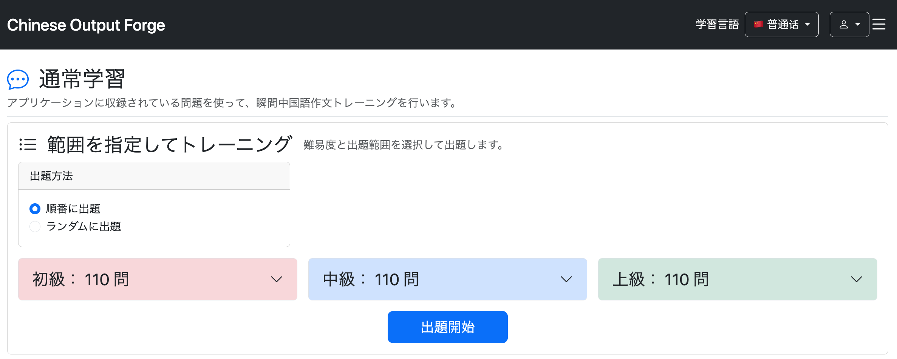

ログイン中 - 初級112 中級111 上級112
つまり、初級と上級は2問、中級は1問AI生成由来の問題がある。


これでこの時点では開発者に表示される通常学習の最大問題数は
335問(うちAI生成由来の開発者所有の問題が5問)

ここから下記の問題を開発者専用として追加する(もちろんAI生成由来ではない)。

| 日本語 | 中国語（繁体字） | 難易度 | 所有者 |
|---|---|---|---|
| 冷蔵庫を開けたら、プリンが私を見つめていました。 | 我打開冰箱的時候，布丁正在盯著我看。 | 初級 | userId: 7 |
| 猫に椅子を取られたので、私は床に座っています。 | 因為椅子被貓搶走了，所以我現在坐在地板上。 | 初級 | userId: 7 |
| ダイエットは明日から始めるので、今日は唐揚げを食べても大丈夫です。 | 減肥從明天開始，所以今天吃炸雞沒關係。 | 初級 | userId: 7 |
| 財布を忘れたことに、レジで気づきました。 | 我到了櫃檯才發現自己忘了帶錢包。 | 中級 | userId: 7 |
| 目覚まし時計を五個セットしたのに、全部無視しました。 | 我明明設了五個鬧鐘，結果全部都被我無視了。 | 中級 | userId: 7 |
| Wi-Fiが切れた瞬間、家族との会話が始まりました。 | Wi-Fi一斷線，我們全家突然開始聊天了。 | 中級 | userId: 7 |
| 給料日はまだ三日前なのに、もうお金がありません。 | 才發薪水三天，我就已經沒錢了。 | 中級 | userId: 7 |
| 運動するためにジムへ行きましたが、二時間ずっとスマホを見ていました。 | 我為了運動去了健身房，結果兩個小時都在滑手機。 | 上級 | userId: 7 |
| 部屋を掃除していたはずなのに、なぜか昔の写真を二時間見ていました。 | 我本來是在打掃房間，不知道為什麼最後看了兩個小時的舊照片。 | 上級 | userId: 7 |
| 早く寝ようと思っていたのに、気づいたら午前三時にWikipediaを読んでいました。 | 我本來想早點睡，回過神來已經凌晨三點了，我還在看維基百科。 | 上級 | userId: 7 |

そしてふたたび通常学習メニューにアクセスすると、初級中級上級ともに115問つまり合計345問に増えている
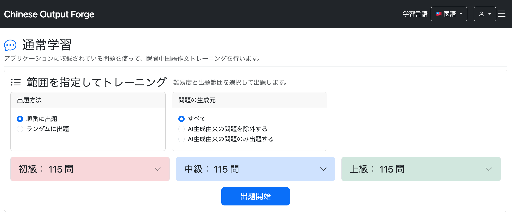

違うユーザーでログインし、通常学習メニューにアクセスするともちろん問題数が異なる(ユーザーの所有するAI生成由来の問題の数によって左右される)。
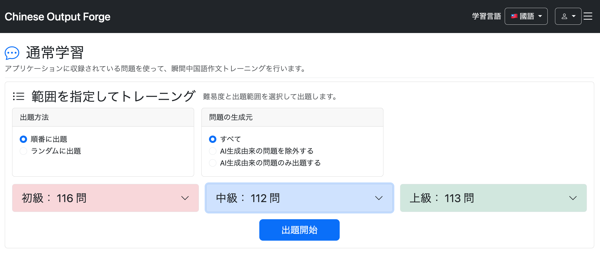

また、開発者の問題一覧(ADMIN専用の問題一覧ではなくユーザーメニューの問題一覧)を確認すると、最後の10問は今追加した10問である(691-700)。またその追加の10問の直前の問題は689番である。
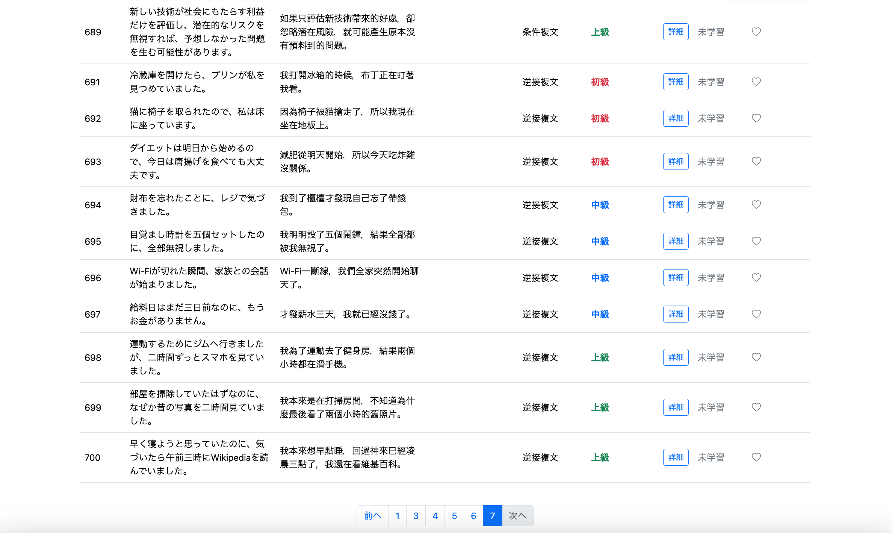

違うユーザーでログインし、問題一覧を確認すると、最後の問題は689番で、開発者専用の10問は見つからなかった(690番は欠番)。
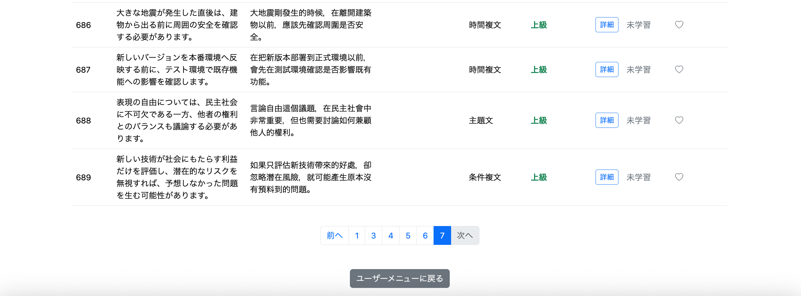

以上より、`ai_generated = false`の問題であっても、`owner_user_id`が設定されている場合は所有者本人のみが取得できることを確認した。

また、所有者本人からは共通問題と同様に通常学習およびユーザー用問題一覧から利用でき、他のユーザーからは取得できないことを確認した。

このことから、今回追加した問題の所有者によるアクセス制御が正常に機能していることを確認できた。


# 12. Repositoryのクエリとメソッド名の整理

Repositoryの内容そのものは間違っていないが、可読性や保守性にまだ改善の余地があるので修正する。
修正内容は主に、
1. Native Queryへの統一
2. メソッド名の簡素化
3. 復習問題の最大出題数を検討
である。

## Repositoryメソッドへのコメント追加

```bash
git commit -m "docs: add comments to repository methods"
```

現時点で各Repositoryのメソッドがかなり増えており、クエリが長いメソッドもあるため、クエリを参照しただけでそれが何をしているのかを瞬時で識別するのも難しい。

そこでまずは各Repositoryのメソッドにコメントを付与する。

## 1. Native Queryへ統一する

```bash
git commit -m "refactor: replace JPQL queries with native queries"
```

Repository内でJPQLとNative Queryが混在しているため、
既存クエリを確認し、特別な理由がないものはNative Queryへ統一する。

なお、これまではJPQLを使用している箇所もあったが、開発者自身はNative Queryに慣れており、特別な理由がない限りJPQLを使用する必要もないため、今後はNative Queryを基本とする。

### AiGenerationHistoryRepository

```java
	// 指定したユーザーのAI生成履歴をすべて削除
	@Modifying
	@Query("""
	        DELETE FROM AiGenerationHistory a
	        WHERE a.user.id = :userId
	        """)
	void deleteByUserId(@Param("userId") Long userId);
```
↓
```java
// 指定したユーザーのAI生成履歴をすべて削除
@Modifying
@Query(value = """
        DELETE FROM ai_generation_history
        WHERE user_id = :userId
        """, nativeQuery = true)
void deleteByUserId(@Param("userId") Long userId);
```

### FavoriteRepository

```java
	// 指定したユーザーのお気に入りをすべて削除
	@Modifying
	@Query("""
	        DELETE FROM Favorite f
	        WHERE f.favoriteKey.userId = :userId
	        """)
	void deleteByFavoriteKeyUserId(
	        @Param("userId") Long userId);
```
↓
```java
// 指定したユーザーのお気に入りをすべて削除
@Modifying
@Query(value = """
        DELETE FROM favorite
        WHERE user_id = :userId
        """, nativeQuery = true)
void deleteByFavoriteKeyUserId(
        @Param("userId") Long userId);
```

### QuestionRepository

```java
@Modifying
@Query("""
        DELETE FROM Question q
        WHERE q.owner.id = :userId
        AND q.aiGenerated = true
        """)
void deleteByOwnerId(
        @Param("userId") Long userId);
```
↓

```java
// 指定したユーザーが所有するAI生成由来の問題をすべて削除
@Modifying
@Query(value = """
        DELETE FROM question
        WHERE owner_user_id = :userId
        AND ai_generated = true
        """, nativeQuery = true)
void deleteByOwnerId(
        @Param("userId") Long userId);
```


### StructureRepository

```java
// 構文を構文IDの昇順でページング取得
@Query("""
        SELECT s
        FROM Structure s
        ORDER BY s.structureId ASC
        """)
Page<Structure> findStructures(Pageable pageable);
```

↓
```java
// 構文を構文IDの昇順でページング取得
@Query(value = """
        SELECT *
        FROM structure
        ORDER BY structure_id ASC
        """, nativeQuery = true)
Page<Structure> findStructures(Pageable pageable);
```

#### StudyHistoryRepository

```java
// 指定したユーザーの学習履歴をすべて削除
@Modifying
@Query("""
        DELETE FROM StudyHistory sh
        WHERE sh.studyHistoryKey.userId = :userId
        """)
void deleteByStudyHistoryKeyUserId(
        @Param("userId") Long userId);
```

↓

```java
// 指定したユーザーの学習履歴をすべて削除
@Modifying
@Query(value = """
        DELETE FROM study_history
        WHERE user_id = :userId
        """, nativeQuery = true)
void deleteByStudyHistoryKeyUserId(
        @Param("userId") Long userId);
```


### UserRepository

```java
	// 検索条件に一致するユーザーを指定した並び順でページング取得
	@Query("""
	        SELECT u
	        FROM Users u
	        WHERE
	            (:loginId IS NULL
	                OR :loginId = ''
	                OR u.loginId LIKE CONCAT('%', :loginId, '%'))
	        AND
	            (:accountStatus = 'ALL'
	                OR (:accountStatus = 'ACTIVE' AND u.accountLocked = false)
	                OR (:accountStatus = 'LOCKED' AND u.accountLocked = true))
			AND (
			    :email IS NULL
			    OR :email = ''
			    OR LOWER(u.email)
			        LIKE LOWER(CONCAT('%', :email, '%'))
			)
			ORDER BY
				CASE
				    WHEN :sortCondition = 'LOGIN_ID_ASC'
				    THEN u.loginId
				END ASC,
			    CASE
			        WHEN :sortCondition = 'EMAIL_ASC'
			        THEN u.email
			    END ASC
	        """)
	Page<Users> findUsers(
	        @Param("loginId") String loginId,
	        @Param("accountStatus") String accountStatus,
	        @Param("email") String email,
	        @Param("sortCondition") String sortCondition,
	        Pageable pageable);
```

↓

```java
	// 検索条件に一致するユーザーを指定した並び順でページング取得
	@Query(
	        value = """
	                SELECT *
	                FROM users
	                WHERE (
	                    :loginId IS NULL
	                    OR :loginId = ''
	                    OR login_id LIKE CONCAT('%', :loginId, '%')
	                )
	                AND (
	                    :accountStatus = 'ALL'
	                    OR (:accountStatus = 'ACTIVE' AND account_locked = false)
	                    OR (:accountStatus = 'LOCKED' AND account_locked = true)
	                )
	                AND (
	                    :email IS NULL
	                    OR :email = ''
	                    OR LOWER(email)
	                        LIKE LOWER(CONCAT('%', :email, '%'))
	                )
	                ORDER BY
	                    CASE
	                        WHEN :sortCondition = 'LOGIN_ID_ASC'
	                        THEN login_id
	                    END ASC,
	                    CASE
	                        WHEN :sortCondition = 'EMAIL_ASC'
	                        THEN email
	                    END ASC
	                """,
	        countQuery = """
	                SELECT COUNT(*)
	                FROM users
	                WHERE (
	                    :loginId IS NULL
	                    OR :loginId = ''
	                    OR login_id LIKE CONCAT('%', :loginId, '%')
	                )
	                AND (
	                    :accountStatus = 'ALL'
	                    OR (:accountStatus = 'ACTIVE' AND account_locked = false)
	                    OR (:accountStatus = 'LOCKED' AND account_locked = true)
	                )
	                AND (
	                    :email IS NULL
	                    OR :email = ''
	                    OR LOWER(email)
	                        LIKE LOWER(CONCAT('%', :email, '%'))
	                )
	                """,
	        nativeQuery = true
	)
	Page<Users> findUsers(
	        @Param("loginId") String loginId,
	        @Param("accountStatus") String accountStatus,
	        @Param("email") String email,
	        @Param("sortCondition") String sortCondition,
	        Pageable pageable);
```

今回はPage<Users>なので、先ほどのStructureRepositoryと同様に、ページ数計算用のcountQueryも明示しておく形に変更

### QuestionRepository.replaceStructureはJPQLのまま残す

もしここまでネイティブクエリにすると、

```java
@Modifying
@Query("""
        UPDATE Question q
        SET q.structure = :replacementStructure
        WHERE q.structure = :targetStructure
        """)
void replaceStructure(
        @Param("targetStructure") Structure targetStructure,
        @Param("replacementStructure") Structure replacementStructure);
```
↓
```java
// 指定した構文を使用する問題の構文を別の構文へ一括置換
@Modifying
@Query(value = """
        UPDATE question
        SET structure_id = :replacementStructureId
        WHERE structure_id = :targetStructureId
        """, nativeQuery = true)
void replaceStructure(
        @Param("targetStructureId") Long targetStructureId,
        @Param("replacementStructureId") Long replacementStructureId);
```

で引数をStructureからLongのIDへ変更することになり、それを呼び出すAdminStructureService.deleteStructure()も修正する必要が出てくる。

```java
        // 削除対象の文法を持つ問題を「その他」に変更
        questionRepository.replaceStructure(
                targetStructure,
                replacementStructure);
```

↓

```java
    // 移行先の「その他」を取得
    Structure replacementStructure =
            structureRepository.findById(OTHER_STRUCTURE_ID)
                    .orElseThrow(() ->
                            new IllegalStateException(
                                    "「その他」の文法・構造が存在しません。"
                            )
                    );

    // 削除対象の文法を持つ問題を「その他」に変更
    questionRepository.replaceStructure(
            targetStructure.getStructureId(),
            replacementStructure.getStructureId());
```

ここまでするとかえって修正どころかコードを冗長にしてしまうのでここはJPQLを使うことに変更した。

## Repositoryメソッド名の統一

```bash
git commit -m "refactor: simplify repository method names"
```

`@Query`でクエリを明示しているメソッドについて、
検索条件を列挙した長いメソッド名ではなく、
そのメソッドの用途が分かる名前へ変更する。

例：

findAvailableQuestionsByUserIdAndLanguageVariantAndDifficulty(...)
↓
findPracticeQuestions(...)

メソッド名からクエリを生成する必要がないため、
引数や検索条件をすべてメソッド名へ含める必要はない。

### FavoriteRepository

```java
	// 指定したユーザーのお気に入りをすべて削除
	@Modifying
	@Query(value = """
	    DELETE FROM favorite
	    WHERE user_id = :userId
	    """, nativeQuery = true)
	void deleteByFavoriteKeyUserId(
	    @Param("userId") Long userId);
```

という名前は、Favoriteの複合主キーであるfavoriteKeyの構造をメソッド名に反映したものだが、今回は@QueryでDELETE文を明示している。そのため、内部のEntity構造まで名前に出す必要はない。

deleteByUserIdでいい。

### QuestionRepository

非ログイン用のcountByLanguageVariantAndDifficulty(...)は用途を揃え、
↓
countAnonymousPracticeQuestions(...)
問題取得の
findQuestionsByLanguageVariantAndDifficulty(...)も
↓
findAnonymousPracticeQuestions(...)へかえる

ログインユーザー用問題取得のfindAvailableQuestionsByUserIdAndLanguageVariantAndDifficultyは
↓
findPracticeQuestionsで十分である

つまりPractice系は、

countAnonymousPracticeQuestions(...)
countPracticeQuestions(...)

findAnonymousPracticeQuestions(...)
findPracticeQuestions(...)

と綺麗にまとまった。

未学習問題取得のfindUnlearnedQuestionsByUserIdAndDifficultyも
↓
findUnlearnedQuestions()に変更

ユーザー用・Admin用問題一覧も
findFilteredUserQuestionList(...)→findUserQuestionList(...)
findFilteredAdminQuestionList(...)→findAdminQuestionList(...)
に変更した。

### StudyHistoryRepository

```java
	// 指定したユーザーの学習履歴をすべて削除
	@Modifying
	@Query(value = """
	        DELETE FROM study_history
	        WHERE user_id = :userId
	        """, nativeQuery = true)
	void deleteByStudyHistoryKeyUserId(
	        @Param("userId") Long userId);
```

は、deleteByUserIdでいい。

# 13. AI問題生成中のローディング表示の追加

```bash
git commit -m "Add loading overlay during AI question generation"
```
AI生成問題学習モードでは既存の問題からAIで問題を新しく生成する間、一定の待機時間がある。これは数秒で終わる場合もあれば、分単位掛かる可能性もある。

いずれにせよ、その間に画面で何の動きもないと、使用者がクリックし損なったor固まったと勘違いして再度送信してしまうかもしれないので画面上にNowLoadingの要領で「問題を生成中」のようなメッセージを表示する

基本的には、HTMLでローディングオーバーレイを作り、JavaScriptで制御する。

## ローディングオーバーレイ

Webサイトやアプリでデータ読み込み中や送信処理中に、画面全体または特定の要素の上に半透明の背景と回転するアイコン（スピナー）などを重ねて表示し、ユーザーの操作を一時的にブロックするUIパターンのことである。いわば待機中のクルクルのこと。

イメージとしては、
┌──────────────────────────────┐
│                              │
│     元の画面（暗くしてもOK）     │
│                              │
│       ┌──────────────┐       │
│       │   ◯           │       │
│       │ Now Loading...│       │
│       └──────────────┘       │
│                              │
└──────────────────────────────┘

### /ai-practice/menu.html

既存のモーダルの下に書く(body 直下に独立して置く)。

```html
    <!-- ============================= -->
    <!-- ローディング -->
    <!-- ============================= -->    
    
	<div id="loadingOverlay" class="loading-overlay d-none">
	    <div class="loading-box text-center">
	        <div class="spinner-border"></div>
	        <div class="mt-2">
	            Loading...
	        </div>
	    </div>
	</div>
```

- **`id="loadingOverlay"`**
  - JavaScriptからローディング画面を特定するための名前。
  - `document.getElementById("loadingOverlay")` で取得する。
  - JSから `d-none` を外すことでローディング画面を表示する。

- **`class="loading-overlay"`**
  - CSSでローディング画面全体を制御するためのクラス。
  - 画面全体を覆う、背景を暗くする、最前面に表示する、Loadingウインドウを中央に配置する、といった役割を持つ。

- **`d-none`**
  - Bootstrapの非表示用クラス。
  - `display: none;` にしてローディング画面を非表示に変更した。
  - 通常時は非表示にしておき、AI問題生成開始時にJSで `d-none` を外して表示する。

- **`class="loading-box"`**
  - CSSで中央のLoadingウインドウの見た目を設定するためのクラス。
  - 白い背景、余白、角丸などを設定し、暗くした背景の上にLoadingウインドウとして表示する。

- **`text-center`**
  - Bootstrapのクラス。
  - Loadingウインドウ内のspinnerと文字を中央揃えに変更した。

- **`spinner-border`**
  - Bootstrapのクラス。
  - くるくる回る円形のローディングアニメーションを表示する。

- **`mt-2`**
  - Bootstrapのクラス。
  - `margin-top` を設定し、spinnerと `Now Loading...` の間に少し余白を作る。

- **`shadow`（使用する場合）**
  - Bootstrapのクラス。
  - Loadingウインドウに影を付け、暗くなった背景より手前に浮いているように見せる。

### /ai-practice/menu.cssを作成

```css
.loading-overlay {
    position: fixed;
    inset: 0;

    /* 背景を暗くする */
    background: rgba(0, 0, 0, 0.5);

    /* 最前面 */
    z-index: 9999;

    /* Loadingウインドウを中央配置 */
    display: flex;
    justify-content: center;
    align-items: center;
}

/* Loadingウインドウ */
.loading-box {
    background: white;
    padding: 30px 50px;
    border-radius: 8px;
}

/* 非表示 */
.loading-overlay.d-none {
    display: none;
}
```

1. **`position: fixed;`**
   - ローディング画面をブラウザ画面を基準に配置する。
   - スクロールしても画面全体を覆った状態を維持する。

2. **`inset: 0;`**
   - `top: 0; right: 0; bottom: 0; left: 0;` の省略形。
   - `loading-overlay` を画面全体に広げる。

3. **`background: rgba(0, 0, 0, 0.5);`**
   - ローディング中の元画面を半透明の黒で覆う。
   - `0, 0, 0` は黒、`0.5` は50%の透明度を表す。
   - Loadingウインドウを目立たせる役割も持つ。

4. **`z-index: 9999;`**
   - 要素の重なり順を指定する。
   - 大きな値を設定し、ローディング画面を通常の画面やモーダルより手前に表示する。

5. **`display: flex;`**
   - Flexboxを有効に変更した。
   - 中にある `loading-box` を画面中央に配置するために使用する。

6. **`justify-content: center;`**
   - `loading-box` を横方向の中央に配置する。

7. **`align-items: center;`**
   - `loading-box` を縦方向の中央に配置する。
   - `justify-content: center;` と組み合わせることで画面の中央に表示する。

8. **`.loading-box`**
   - 画面中央に表示するLoadingウインドウの見た目を設定するクラス。

9. **`background: white;`**
   - Loadingウインドウの背景を白に変更した。
   - spinnerや `Now Loading...` を見やすくする。

10. **`padding: 30px 50px;`**
    - Loadingウインドウの内側に余白を作る。
    - 上下に30px、左右に50pxの余白を設定する。

11. **`border-radius: 8px;`**
    - Loadingウインドウの四隅を丸くする。

12. **`.loading-overlay.d-none`**
    - `loading-overlay` と `d-none` の両方のクラスを持つ要素に適用する。
    - Bootstrapの `d-none` による非表示を確実に有効にするために使用する。

13. **`display: none;`**
    - ローディング画面全体を非表示にする。
    - 通常時は非表示にしておき、AI問題生成開始時にJSで `d-none` を削除して表示する。

つまり全体としては、

**`position + inset` → 全画面を覆う**  
**`background + z-index` → 暗い幕を最前面に出す**  
**`flex + justify + align` → Loadingを中央に置く**  
**`d-none` → 必要ないときは隠す**


### /ai-practice/menu.js


```javascript
document.addEventListener("DOMContentLoaded", () => {
```
の直後に

```javascript

	// ローディング画面
    const loadingOverlay =
        document.getElementById("loadingOverlay");
```

を挿入。これで
- HTMLに配置した `id="loadingOverlay"` の要素を取得し、`loadingOverlay` という変数に格納する。
- 以降の処理では、この変数を使って `d-none` クラスを追加・削除し、ローディング画面の表示・非表示を制御できる。
- `DOMContentLoaded` 後に取得することで、HTMLの読み込みが完了してから対象要素を取得できる。

そして、
```javascript
    // =========================
    // 文法・構造の一括選択
    // =========================

    const selectAllStructuresButton =
        document.getElementById("selectAllStructures");
```
よりも前に、
```javascript
    // =========================
    // AI問題生成時のローディング表示
    // =========================

    const aiPracticeForms =
        document.querySelectorAll(
            "form[action='/ai-practice/start'], " +
            "form[action='/ai-practice/list/start']"
        );

    aiPracticeForms.forEach(form => {

        form.addEventListener("submit", () => {

            loadingOverlay.classList.remove("d-none");

        });

    });	
```
を挿入。
- `document.querySelectorAll()` で、検索条件からのAI生成 `/ai-practice/start` と、リストからのAI生成 `/ai-practice/list/start` の2つのフォームを取得する。
- `forEach()` で取得した各フォームに `submit` イベントを設定する。
- 「出題開始」によってフォームが送信されると、`loadingOverlay` から `d-none` を削除し、非表示だったローディング画面を表示する。
- その後はSpring Boot側でAI問題生成処理が行われ、レスポンスによって次のページへ遷移するため、JS側でローディング画面を再び非表示にする処理は不要。
- 「文法・構造の一括選択」より前に配置するのは、**AI問題生成時の処理を、検索条件の取得・件数表示などの処理に続けてまとめ、文法・構造の画面操作処理と役割を分けてコードを整理するため**。動作上、この位置でなければならないわけではない。

## 動作確認

http://localhost:8080/ai-practice/menuで問題生成を開始すると、ローディングオーバーレイが表示されるようになった。

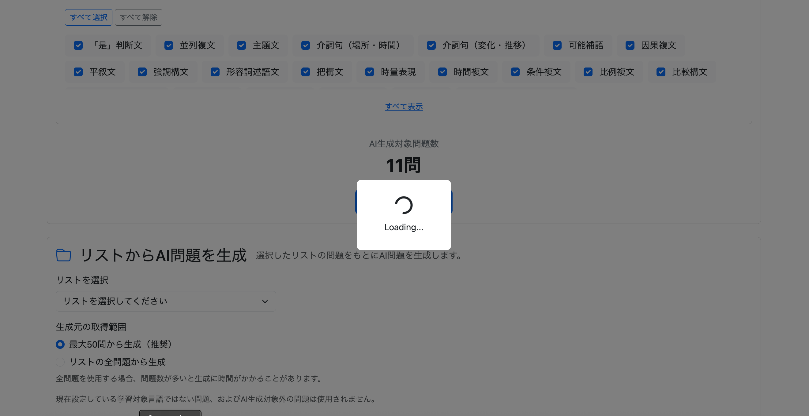

## CSSファイル名の明確化

```bash
git commit -m "Move shared question structure styles to common CSS"
```

/ai-practice/menu.htmlに
```html
    <link rel="stylesheet"
          th:href="@{/css/ai-practice/menu.css}">   
を追加しているときに、
    <link rel="stylesheet"
          th:href="@{/css/review/menu.css}">
```
の存在に気がついた。
「ai-practiceなのになぜreview？」と思ったが、内容は、

```css
/* =========================
   文法・構造
   ========================= */
   
.structure-list {
    max-height: 100px;
    overflow: hidden;
}

.structure-list.expanded {
    max-height: none;
}

.tooltip-inner {
    max-width: 400px;
    padding: 12px 16px;
    font-size: 1rem;
    text-align: left;
}
```
なので、「Review画面専用のCSS」ではなく実際には、「文法・構造の折り畳み」「Tooltip」という共通UIであった。
参照しているのは
/review/menu.html
/ai-practice/menu.html
だけである。ここは名前を /css/common/question-structure.css にでもしてわかりやすくする。

css/
├── common/
│   └── question-structure.css
├── review/
│   └── menu.css
└── ai-practice/
    └── menu.css

そして両方のHTMLから、
```html
<link rel="stylesheet"
      th:href="@{/css/common/question-structure.css}">
```

と参照させる。

# 14. 各画面のUIレイアウトの最終調整

## 通常学習メニュー

```bash
git commit -m "style: adjust practice list section layout"
```

出題問題数-問　のテキストが小さいので<div class="mb-2 fs-4">とfs−4を付けて大きく見せるよう修正
未学習問題の初級中級上級ボタンが小さいので
```html
<div class="d-flex gap-3 mb-3 fs-4">
```
と、fs-5を付けて大きく見せるよう修正し、さらに各ボタンを横幅いっぱいを3等分にしたいので、
それぞれの label に flex-fill を付ける。
**変更前**

```html
<label class="bg-danger-subtle rounded px-3 py-2 text-center">
```

**変更後**

```html
<label class="bg-danger-subtle rounded px-3 py-3 flex-fill text-center">
```

さらにpy-2をpy-3にすることでボタンそのもの高さが高くなり、範囲を指定してトレーニングのボタンと一貫性を持つ見た目になった


## 復習メニュー
```bash
git commit -m "Improve review menu search condition layout"
```

検索条件欄が、

学習対象言語
出題方法　最大出題数　難易度
理解度　問題の生成元
お気に入り
文法

になっている。
現在はすべて同じ .row の中で col-md-* を連続させているため、Bootstrapが空き幅に応じて同じ行へ詰めてしまっている。

1段目：学習対象言語 4 ｜ 出題方法 4 ｜ 最大出題数 4
2段目：難易度 4       ｜ 理解度 8
3段目：問題の生成元 6 ｜ お気に入り 6
4段目：文法・構造 12

このようにしたい

### 学習対象言語をカード化

現在ここだけ col-md-12 の直下にラベルとチェックボックスがあり、確かに他とデザインが違う
これを他と同じ card 構造にする

```html
<!-- ========================= -->
<!-- 学習対象言語 -->
<!-- ========================= -->
```

```html
<div class="col-md-4 mb-4">

    <div class="card h-100">

        <div class="card-header"
             th:text="#{review.menu.languageVariant}">
            学習対象言語
        </div>

        <div class="card-body">

            <div class="d-flex align-items-center gap-4">

                <!-- 普通話 -->
                <div class="form-check">

                    <input class="form-check-input"
                           type="checkbox"
                           name="languageVariants"
                           value="MAINLAND"
                           id="mainland"
                           th:checked="${selectedLanguageVariants != null
                               and selectedLanguageVariants.![name()].contains('MAINLAND')}">

                    <label class="form-check-label"
                           for="mainland"
                           th:classappend="${session.languageVariant == null
                               or session.languageVariant.name() == 'MAINLAND'}
                               ? ' fs-5 fw-bold'
                               : ''">
                        🇨🇳普通话
                    </label>

                </div>

                <!-- 國語 -->
                <div class="form-check">

                    <input class="form-check-input"
                           type="checkbox"
                           name="languageVariants"
                           value="TAIWAN"
                           id="taiwan"
                           th:checked="${selectedLanguageVariants != null
                               and selectedLanguageVariants.![name()].contains('TAIWAN')}">

                    <label class="form-check-label"
                           for="taiwan"
                           th:classappend="${session.languageVariant != null
                               and session.languageVariant.name() == 'TAIWAN'}
                               ? ' fs-5 fw-bold'
                               : ''">
                        🇹🇼國語
                    </label>

                </div>

            </div>

        </div>

    </div>

</div>
```

### 他のcol-mdを修正

出題方法・最大出題数を col-md-4
難易度と理解度を col-md-4
難易度と理解度を col-md-8
問題の生成元・お気に入りはそのまま

これで全体的に見やすい検索欄になった


## AI生成学習メニュー

```bash
git commit -m "Improve AI practice search condition layout"
```

AI問題生成の検索条件として、

- 理解度
- 問題難易度
- お気に入り

を表示する。

当初は3つのカードを横一列に配置していた。

```text
理解度　問題難易度　お気に入り
```

理解度には、

- 難しい・わからない
- 少し考えた、一部正解だった
- 簡単だった

など比較的長いテキストが含まれているため、Bootstrapの`4-4-4`では理解度のテキストが大きく改行されてしまった。

そこで、

```text
4 : 4 : 4
5 : 3 : 4
5 : 4 : 3
```

などの比率を試したが、いずれも3つのカードをきれいに表示することができなかった。

そのため、Bootstrapの12カラムでは表現できない`5 : 3.5 : 3.5`の比率をFlexboxで指定していた。

```html
<div class="d-flex gap-2">

    <!-- 理解度 -->
    <div class="mb-4" style="flex: 5;">
        <div class="card h-100">
            ...
        </div>
    </div>

    <!-- 問題難易度 -->
    <div class="mb-4" style="flex: 3.5;">
        <div class="card h-100">
            ...
        </div>
    </div>

    <!-- お気に入り -->
    <div class="mb-4" style="flex: 3.5;">
        <div class="card h-100">
            ...
        </div>
    </div>

</div>
```

`h-100`を指定することで3つのカードの高さを揃え、理解度と問題難易度では`card-body`に以下を指定して、選択肢をカードの中央に配置していた。

```html
<div class="card-body d-flex align-items-center">
```

これで
理解度　問題難易度　お気に入り
が1つの列に収まり見栄えが良くなった。


しかし、ディスプレイの表示設定が異なるデバイス(今回はWindowsのディスプレイ拡大率150%の環境)で表示確認を行ったところ、実際のViewportが`1280 × 631`となり、3つのカードを横一列に配置すると内部の横幅が不足することが分かった。

特に、

- 理解度の説明文が細かく改行される
- 問題難易度の「初級」などが途中で改行される
- お気に入りの長い選択肢が複数行になる

など、カード内部のレイアウトが窮屈になっていた。


(画像はMacでWindowsの当該環境を再現している)

そのため、3つのカードを無理に横一列へ配置するのをやめ、以下の2段構成へ変更する。

```text
┌──────────────┬──────────────┐
│ 理解度         │ 問題難易度      │
└──────────────┴──────────────┘

┌─────────────────────────────┐
│ お気に入り                                    │
└─────────────────────────────┘
```

Bootstrap Gridを使用し、理解度と問題難易度をそれぞれ`col-md-6`、お気に入りを`col-12`とする。

これまで3つのカードを横一列に配置するため、外側の要素には以下を指定していた。

```html
<div class="d-flex gap-2">
```

`d-flex`はBootstrapのFlexboxユーティリティで、子要素をFlexboxとして配置する。

また、`gap-2`によって子要素間に`0.5rem`の間隔を設定していた。

この構成では、各カードの横幅をBootstrap Gridのカラム数ではなく、`flex`を使って個別に指定していた。

```html
<div class="mb-4" style="flex: 5;">
<div class="mb-4" style="flex: 3.5;">
<div class="mb-4" style="flex: 3.5;">
```

これをBootstrap Gridによるレイアウトへ変更する。

```html
<div class="row g-3">

    <!-- 理解度 -->
    <div class="col-md-6">
        ...
    </div>

    <!-- 問題難易度 -->
    <div class="col-md-6">
        ...
    </div>

    <!-- お気に入り -->
    <div class="col-12">
        ...
    </div>

</div>
```

`row`はBootstrap Gridの行を作るクラスであり、その直下に`col-*`を配置することで、Bootstrapの12カラムを基準として横幅を指定できる。

今回は、

```text
理解度       col-md-6  → 12カラム中6
問題難易度   col-md-6  → 12カラム中6
お気に入り   col-12     → 12カラム中12
```

とする。

そのため、`md`以上の画面幅では以下のような2段構成になる。

```text
┌──────────────┬──────────────┐
│ 理解度         │ 問題難易度      │
└──────────────┴──────────────┘
┌─────────────────────────────┐
│ お気に入り                                    │
└─────────────────────────────┘
```

`col-md-6`の`md`はBootstrapのブレークポイントを表しており、`md`以上では横幅が6カラムとなる。

一方、`md`未満では`col-md-6`の横幅指定が適用されなくなるため、理解度と問題難易度もそれぞれ1行を使用し、縦に並ぶ。

また、`g-3`の`g`は**gutter（ガター）**を意味し、Grid内のカラム同士の間隔を指定するBootstrapのクラスである。

```text
g-0 → 0
g-1 → 0.25rem
g-2 → 0.5rem
g-3 → 1rem
g-4 → 1.5rem
g-5 → 3rem
```

今回は`g-3`を指定することで、カード同士の縦方向・横方向の両方に`1rem`の間隔を確保する。

つまり、

```html
<div class="d-flex gap-2">
```

では、Flexboxで3つのカードを横方向に配置し、それぞれの横幅を`flex`で独自に調整していたのに対し、

```html
<div class="row g-3">
```

では、Bootstrap Gridによってカードの配置と横幅を管理し、`g-3`によってカラム間の余白を設定する。

これにより、理解度と問題難易度には十分な横幅を確保し、お気に入りには1行分の横幅を使用できるため、Viewportの横幅が小さくなった場合でも各カードの内容を読みやすく表示できる。

また、文章の長い選択肢を持つお気に入りには1行分の横幅を使用できるため、3つのカードを横一列に配置した場合よりも内容を読みやすく表示できる。

さらに画面幅が小さくなった場合は、Bootstrapの`col-md-6`によって理解度と問題難易度も縦方向に並ぶため、画面幅に応じてレイアウトを変更できる構成となる。

MacのChrome DevToolsでViewportをWindowsの150%表示時と同じ`1280 × 631`に設定し、各検索条件が窮屈にならず表示されることを確認した。


## リスト一覧画面

```bash
git commit -m "Improve question list detail table layout"
```

難易度、理解度、生成元の値を中央揃え
お気に入りのthが折り返さないようにテキストを小さくする
生成元の表記は問題一覧と同じくbgを使う

にしましょう

### 難易度・理解度・生成元を中央揃え

テーブルは /js/user/question-list/list.js が動的に生成しているのでjsを修正する。

#### 難易度のテキストの位置

```javascript
const difficultyTd =
    document.createElement(
        "td"
    );
```

に

```javascript
difficultyTd.className =
    "text-center";
```

をつける。

#### 理解度のテキストの位置

```javascript
const evaluationTd =
    document.createElement(
        "td"
    );
```

に

```javascript
evaluationTd.className =
    "text-center";
```
をつける

#### 生成元のテキストの位置

```javascript
const sourceTd =
    document.createElement(
        "td"
    );
```

に

```javascript
sourceTd.className =
    "text-center";
```

をつける

### お気に入りのthのテキストを小さくする

```javascript
thead.innerHTML = `
    <tr>
        ...
        <th>
            ${messages.favorite}
        </th>
        ...
    </tr>
`;
```

これを：
```javascript
thead.innerHTML = `
    <tr>
        ...
        <th class="text-nowrap small">
            ${messages.favorite}
        </th>
        ...
    </tr>
`;
```
にする

### 生成元の値をテキストからアイコンに変化

```javascript
                                // ======================
                                // 生成元
                                // ======================
                                const sourceTd =
                                    document.createElement(
                                        "td"
                                    );

                                sourceTd.textContent =
                                    question.aiGenerated
                                        ? messages.ai
                                        : messages.normal;
```
を

```javascript
// ======================
// 生成元
// ======================
const sourceTd =
    document.createElement(
        "td"
    );

sourceTd.className =
    "text-center";

const sourceSpan =
    document.createElement(
        "span"
    );

if (question.aiGenerated) {

    sourceSpan.className =
        "badge bg-black";

    sourceSpan.textContent =
        "AI";

} else {

    sourceSpan.className =
        "badge bg-white text-dark border border-dark";

    sourceSpan.textContent =
        "APP";
}

sourceTd.appendChild(
    sourceSpan
);
```

に置き換える。

これはもともと、生成元を「通常」「AI」のテキストで表示していたのを、通常問題は白背景・黒枠の「APP」、AI生成問題は黒背景の「AI」というバッジ表示に変更している。

### 中国語の幅を広くして日本語は狭くする

テーブルの各列の幅を次のように調整した。

```html
                            <tr>
								<th style="width: 44%;">
								    ${messages.chinese}
								</th>
								<th style="width: 28%;">
								    ${messages.japanese}
								</th>
                                <th style="width: 5%;">
                                    ${messages.difficulty}
                                </th>
                                <th style="width: 5%;">
                                    ${messages.evaluation}
                                </th>
						        <th style="width: 5%;"
						            class="text-nowrap small">
						            ${messages.favorite}
						        </th>
                                <th style="width: 5%;">
                                    ${messages.source}
                                </th>
								<th style="width: 4%;"
								    class="text-nowrap">
								    ${messages.detail}
								</th>
								<th style="width: 4%;"
								    class="text-nowrap">
								    ${messages.delete}
								</th>
                            </tr>
```

これにより、各列の幅を調整した。


# 15. 各画面の説明文と表示文言の修正

```bash
git commit -m "Improve learning menu descriptions"
```

まだまだ説明が曖昧だっり不足している箇所がある。
ここは致命的なミスとまではいかないが、修正したほうがユーザーの混乱を減らすことができるので直せるだけ直す。

## 通常学習メニュー

難易度と出題範囲を選択して出題します。
↓
難易度と出題範囲を選択して出題します。ユーザーが保存したAI生成由来の問題もこの中に含まれます。
选择难度和出题范围进行练习。其中也包括用户保存的由 AI 生成的问题。
選擇難度和出題範圍進行練習。其中也包括使用者儲存的由 AI 生成的問題。

選択したリストに登録されている問題をトレーニングします。
↓
ユーザーがリストに登録した問題をトレーニングします。
练习用户添加到列表中的问题。
練習使用者加入清單中的問題。

現在設定している学習対象言語ではない問題は、出題対象外となります。
↓
リスト内であっても現在設定している学習対象言語ではない問題は、出題対象外となります。
即使问题已添加到列表中，如果不是当前设置的学习目标语言，也不会被列入出题范围。
即使問題已加入清單中，如果不是目前設定的學習目標語言，也不會被列入出題範圍。

まだ学習していない問題のみを出題します。
↓
ユーザーがまだ学習していない(理解度ボタンを押していない)問題のみを出題します。
仅出题用户尚未学习（尚未点击理解度按钮）的问题。
僅出題使用者尚未學習（尚未點擊理解度按鈕）的問題。

## 復習メニュー

これまでに学習した問題を、理解度や文法・構造などの条件で絞り込んで復習します。
↓
これまでに学習した問題を、理解度や文法・構造などの条件で絞り込んで復習します。復習対象は、理解度ボタンを押した問題のみになります。
将已学习过的问题按照理解度、语法・结构等条件进行筛选并复习。复习对象仅限于已点击理解度按钮的问题。
將已學習過的問題按照理解度、文法・結構等條件進行篩選並複習。複習對象僅限於已點擊理解度按鈕的問題。

## AI問題生成

これまでに学習した問題をもとに、AIが内容を変化させた新しい問題を生成してトレーニングします。
↓
アプリに収録されている一部の問題の内容を、AIが変化させ新しい問題としてトレーニングします。
AI会对应用中收录的部分问题内容进行变化，并将其作为新问题进行练习。
AI會對應用程式中收錄的部分問題內容進行變化，並將其作為新問題進行練習。

学習履歴や問題条件を指定してAI問題を生成します。
↓
学習履歴や問題条件を指定してAI問題を最大50問生成します。
指定学习记录和问题条件，由 AI 最多生成 50 道问题。
指定學習紀錄和問題條件，由 AI 最多生成 50 道問題。
さらにその下に、
理解度ボタンを押していない問題はAI生成の対象になりません(ここは小さく赤色)
を挿入。

### /ai-practice.menu.html

```html
<p class="mb-0 text-muted">
    <span th:text="#{aiPractice.menu.search.description}">
        学習履歴や問題条件を指定してAI問題を生成します。
    </span>

    <br>

    <small class="text-danger"
           th:text="#{aiPractice.menu.search.evaluationNote}">
        理解度ボタンを押していない問題はAI生成の対象になりません。
    </small>
</p>
```


# 16. 会員登録完了メールの送信機能

> **実装方式に関する補足（第33章で変更）**  
> この節では、実装当時の`MailService`を使用した会員登録完了メールの送信処理を記録している。その後、第33章でメール送信方式を変更し、Spring Mailの`JavaMailSender`を使用する方式から、AWS SDKを通じてAmazon SES APIを呼び出す方式へ移行した。そのため、以下に記載する`JavaMailSender`による送信方式は現在使用していない。

```bash
git commit -m "feat: send registration completion email after signup"
```

これまでの実装で、ユーザーはメールアドレスを入力して新規会員登録を行えるようになった。

しかし、現状では会員登録が正常に完了しても画面上に完了メッセージが表示されるだけで、登録したメールアドレスには何も通知されない。

そこで今回は、**会員登録が正常に完了したタイミングで、登録されたメールアドレス宛に会員登録完了メールを自動送信する機能**を追加した。

すでにパスワードリセット機能でメール送信の仕組みを導入しているため、今回はその仕組みを利用して会員登録完了メールを送信する。

## 実装方針と処理の流れ

現在のSignupでは、入力されたメールアドレスの形式・重複を確認したうえで、`Users.email`としてDBへ保存している。

そのため、ユーザー情報の保存が正常に完了した後に、保存されたユーザーのメールアドレスを使用して会員登録完了メールを送信する。

処理の流れは以下とする。

```text
/signupへPOST
    ↓
SignupFormのバリデーション
    ↓
ログインID・メールアドレスの重複確認
    ↓
Usersを作成
    ↓
usersテーブルへ保存
    ↓
ユーザー登録成功
    ↓
会員登録完了メールを送信
    │
    ├── ブラウザ
    │      ↓
    │   /login へリダイレクト
    │      ↓
    │   ユーザー自身でログイン
    │
    └── メール
           ↓
        「会員登録が完了しました」
        「ログインはこちら」
           ↓
        ログイン画面のURL

メールにも特別な内容はなく、単に、
会員登録が完了しました。

ユーザーID：xxxxxxxx

以下のページからログインできます。
https://xxxxx/login

のようなものである。
```

### 会員登録完了メールの送信処理を追加

パスワードリセットですでに使用しているメール送信の仕組みを利用し、会員登録完了メールを送信する処理を追加した。

メール送信時には、登録されたユーザーのメールアドレスとログインIDを使用する。

```text
Users
├── email
└── loginId
        ↓
会員登録完了メールを作成
        ↓
登録メールアドレスへ送信
```

パスワードなどの認証情報はメール本文には含めない。

### ユーザー保存成功後にメールを送信

会員登録完了メールは、ユーザー情報がDBへ正常に保存されたことを確認してから送信する。

```text
userRepository.save()
    ↓
DBへの保存成功
    ↓
会員登録完了メールを送信
```

これにより、ユーザー登録が成立していない状態で登録完了メールが送信されることを防ぐ。

### 会員登録完了メールの内容を設定

送信するメールには、会員登録が正常に完了したことが分かる件名と本文を設定する。

メール本文には必要に応じて登録したログインIDを表示する。

```text
件名
会員登録が完了しました

本文
会員登録が完了しました。

ユーザーID：xxxxxxxx

ご登録ありがとうございます。
```

### メール送信失敗時の例外処理

会員登録完了メールはアカウントを有効化するためのメールではなく、登録完了を通知するためのメールである。

そのため、

```text
DBへのユーザー登録成功
    ↓
メール送信
    ├── 成功
    │      ↓
    │   送信成功
    │
    └── 失敗
           ↓
        エラーログを記録
```

という構成とし、メール送信に失敗した場合の扱いについても確認する。

### 動作確認

実際に新規ユーザーを登録し、

```text
Signup
    ↓
usersテーブルへユーザー登録
    ↓
登録したメールアドレスへ
会員登録完了メールを送信
```

となることを確認した。

あわせて、

- ユーザー情報がDBへ正常に保存されていること
- 登録したメールアドレスへメールが届くこと
- メールの件名・本文が正しく表示されること
- Signup成功後にログイン画面へ遷移すること
- 登録完了メッセージが表示されること

を確認した。

## 会員登録完了メールの送信処理を追加

### MailService

```java
	/**
	 * 指定したメールアドレスへ会員登録完了メールを送信する。
	 * ログイン画面のURLを作成し、メール本文に設定する。
	 *
	 * @param email 送信先メールアドレス
	 * @param loginId 登録されたユーザーID
	 */
	public void sendSignupCompleteEmail(
	        String email,
	        String loginId) {

	    // ログイン画面のURLを作成
	    String url = baseUrl + "/login";

	    // メールの件名と本文を作成
	    String subject = "【Chinese Output Forge】会員登録完了のお知らせ";
	    String text =
	            "Chinese Output Forgeへの会員登録が完了しました。\n\n"
	            + "ユーザーID：" + loginId + "\n\n"
	            + "以下のURLからログインしてください。\n\n"
	            + url;

	    // 会員登録完了メールを作成
	    MimeMessage message = mailSender.createMimeMessage();
	    try {
	        // 送信先や件名などのメール情報を設定
	        MimeMessageHelper messageHelper = new MimeMessageHelper(message);
	        messageHelper.setFrom("liuniao790913@gmail.com");
	        messageHelper.setTo(email);
	        messageHelper.setText(text);
	        messageHelper.setSubject(subject);

	        // 会員登録完了メールを送信
	        mailSender.send(message);

	    } catch (MessagingException e) {
	        // メール情報の設定に失敗した場合は例外をスロー
	        throw new RuntimeException(
	                "メッセージの設定に失敗しました",
	                e);
	    }
	}
```

token が一切ないこと以外はパスワード再設定用メールのメソッドとほぼ同じことをしている。

## ユーザー保存成功後にメールを送信

### SignupController

```java
	    // ユーザー登録
	    try {
	        signupService.signup(form, locale);
	    } catch (DuplicateSignupException e) {
	        // 重複エラーをフォームへ設定して入力画面を再表示
	        bindingResult.rejectValue(
	                e.getField(),
	                "duplicate",
	                e.getMessage());

	        return getSignup(form);
	    }
	    
	    // 会員登録完了メールを送信 ← これを追加
	    mailService.sendSignupCompleteEmail(
	            form.getEmail(),
	            form.getLoginId());

	    // 登録完了メッセージを設定
	    redirectAttributes.addFlashAttribute(
	            "signupSuccess",
	            messageSource.getMessage(
	                    "signup.success",
	                    null,
	                    locale));
```

ユーザー登録が正常終了した後にメールを送る。

## 会員登録完了メールの内容を設定

会員登録完了メールには、会員登録が正常に完了したことと、登録したユーザーID、ログイン画面のURLを記載する。

### MailService.sendSignupCompleteEmail(↑で実装済み)

```java
// ログイン画面のURLを作成
String url =
        baseUrl + "/login";

// メールの件名と本文を作成
String subject =
        "【Chinese Output Forge】会員登録完了のお知らせ";

String text =
        "Chinese Output Forgeへの会員登録が完了しました。\n\n"
        + "ユーザーID：" + loginId + "\n\n"
        + "以下のURLからログインしてください。\n\n"
        + url;
```

ログイン画面のURLは、`application.properties`で設定している`app.base-url`に`/login`を追加して作成する。

メールにはパスワードを記載せず、ログイン画面へのURLのみを案内する。

ユーザーはメール内のURLからログイン画面へ移動し、自身でユーザーIDとパスワードを入力してログインする。

## メール送信失敗時の例外処理

現在の`MailService`は、メール作成に失敗すると`RuntimeException`をスローする。

そのため、このまま`SignupController`からメール送信処理を呼び出すと、メール送信に失敗した場合は以下の流れとなる。

```text
ユーザー登録成功
    ↓
メール送信失敗
    ↓
RuntimeException
    ↓
ログイン画面へリダイレクトされない
```

この場合、ユーザー情報自体はすでにDBへ登録されている可能性がある。

そのため、ユーザーから見ると会員登録に失敗したように見えるにもかかわらず、再度登録しようとすると同じユーザーIDやメールアドレスがすでに使用されている状態となってしまう。

今回送信する会員登録完了メールは、メールアドレスの認証に使用するものではなく、**会員登録が完了したことを通知するためのメール**である。

そのため、メールの送信に失敗した場合でも会員登録自体は成功扱いとし、以下の流れとする。

```text
ユーザー登録成功
    ↓
メール送信
    ├─ 成功 → そのまま続行
    │
    └─ 失敗 → エラーログを記録して続行
                    ↓
              /loginへリダイレクト
```

つまり、`SignupController`側でメール送信時に発生した例外を受け止め、**メール送信に失敗しても会員登録自体は成功扱いに変更した。**

### SignupController.postSignup

会員登録処理が正常に完了した後、`MailService`の`sendSignupCompleteEmail`を呼び出して、登録されたメールアドレスへ会員登録完了メールを送信する。

```java
// 会員登録完了メールを送信
try {
    mailService.sendSignupCompleteEmail(
            form.getEmail(),
            form.getLoginId());

} catch (MailSendException e) {
    // メール送信に失敗してもユーザー登録は成功扱いとする
    log.error(
            "会員登録完了メールの送信に失敗 loginId={}",
            form.getLoginId(),
            e);
}
```

メール送信処理は`try-catch`で囲み、メールの作成または送信に失敗して`MailSendException`がスローされた場合は、Controller側で例外を受け止める。

```java
try {
    mailService.sendSignupCompleteEmail(
            form.getEmail(),
            form.getLoginId());

} catch (MailSendException e) {
```

これにより、メール送信に失敗した場合でも例外がControllerの外まで伝播せず、その後の処理を継続できる。

また、メール送信に失敗したこと自体は確認できるように、`ERROR`レベルのログを出力する。

```java
log.error(
        "会員登録完了メールの送信に失敗 loginId={}",
        form.getLoginId(),
        e);
```

ログには対象となった`loginId`と発生した例外を記録する。

この処理によって、

```text
メール送信成功
    ↓
通常どおり処理を続行

メール送信失敗
    ↓
MailSendExceptionをcatch
    ↓
ERRORログを出力
    ↓
通常どおり処理を続行
```

となり、メール送信の成否によって会員登録そのものの結果が変わらないように変更した。

### MailSendException

メール送信処理で発生した例外だけを`SignupController`側で判別できるように、メールの作成または送信失敗を表す`MailSendException`を作成する。

```java
package io.github.mawsonlakes790913.chineseoutputforge.exception;

/**
 * メールの作成または送信に失敗した場合にスローされる例外。
 */
public class MailSendException extends RuntimeException {

    public MailSendException(
            String message,
            Throwable cause) {

        super(message, cause);
    }
}
```

`MailSendException`は`RuntimeException`を継承した独自例外とする。

```java
public class MailSendException extends RuntimeException {
```

コンストラクタでは、エラーメッセージと原因となった例外を受け取り、親クラスのコンストラクタへ渡す。

```java
public MailSendException(
        String message,
        Throwable cause) {

    super(message, cause);
}
```

これにより、メール送信処理で発生した元の例外を保持したまま、アプリケーション内では`MailSendException`として扱うことができる。

また、汎用的な`RuntimeException`ではなくメール送信専用の例外を使用することで、`SignupController`では、

```java
catch (MailSendException e)
```

として、**メール送信に関する失敗だけを対象に例外処理を行える。**

### MailService

これまで`MailService`では、メール情報の設定に失敗した場合に`RuntimeException`をスローしていた。

```java
throw new RuntimeException(
        "メッセージの設定に失敗しました",
        e);
```

これを、今回作成した`MailSendException`へ変更する。

```java
throw new MailSendException(
        "メッセージの設定に失敗しました",
        e);
```

これにより、メール処理で発生した例外であることを呼び出し元で明確に判別できるようになる。

処理の流れは以下となる。

```text
MailService
    ↓
メール情報の設定に失敗
    ↓
MailSendExceptionをスロー
    ↓
SignupController
    ↓
MailSendExceptionをcatch
    ↓
ERRORログを記録
    ↓
会員登録成功後の処理を継続
    ↓
/loginへリダイレクト
```

このように、メール送信処理の失敗とユーザー登録処理の成功・失敗を分離することで、会員登録完了メールを送信できなかった場合でも、正常に登録されたユーザーはそのままログイン画面へ進めるように変更した。

## 動作確認

実際に新規ユーザーを登録し、会員登録完了メールの送信からログインまでの一連の処理を確認した。

### 会員登録とメール送信を確認

新規登録画面からユーザーID、メールアドレス、パスワードを入力して会員登録を行う。

会員登録完了後、登録したメールアドレス宛に会員登録完了メールが送信されることを確認した。

メールには、登録したユーザーIDとログイン画面のURLが正しく表示されている。


### メールからログイン画面へアクセス

会員登録完了メールに記載されているログイン画面のURLをクリックする。

ログイン画面が正常に表示されることを確認した。


### 登録したアカウントでログイン

会員登録時に設定したユーザーIDとパスワードを入力し、ログインを行う。

登録したアカウントで正常にログインできることを確認した。


以上より、

```text
新規会員登録
    ↓
ユーザー情報をDBへ保存
    ↓
会員登録完了メールを送信
    ↓
メールからログイン画面へアクセス
    ↓
登録したアカウントでログイン
```

という一連の処理が正常に動作することを確認できた。

---

# 17. 問題ページ下部の余白調整

```bash
git commit -m "fix: add bottom margin to practice page controls"
```

Windows環境でアプリケーションの表示確認を行ったところ、ディスプレイの拡大率を150%に設定している環境では、一部の問題ページで画面下部の余白がほとんどなくなることを確認した。


画面右のバーを見れば分かる通りこのページはこれ以上、下にスクロールすることができない。
つまり、中断、やめるボタンの下には全くのスペースがないということになる。

Windowsでは、高解像度のディスプレイを搭載した一部のノートPCなどで、文字やUIを見やすくするためにディスプレイの拡大率が150%に設定されている場合がある。

そのため、ユーザーが設定を変更しなくても正常に利用できるよう、150%表示についてもレイアウトを確認することにした。

確認したWindows環境では、画面解像度が`1920 × 1200`、ディスプレイの拡大率が150%となっており、Chromeで実際に使用できるViewportは以下となっていた。

```text
1280 × 631
```

MacのChrome DevToolsでViewportを`1280 × 631`に設定したところ、同じ表示を再現することができた。

原因を確認したところ、ページ最下部に配置しているボタンの下に余白が設定されていなかったため、Viewportの高さが小さい環境ではボタンが画面下端付近に表示されていた。

そのため、最下部のボタンを配置している要素にBootstrapの`mb-4`を追加した。

## 修正内容

問題ページの最下部に配置されているボタンの下に余白を追加した。

変更前：

```html
<!-- 学習中断・終了 -->
<div class="d-flex justify-content-center gap-3"
     style="margin-top:40px;">
```

変更後：

```html
<!-- 学習中断・終了 -->
<div class="d-flex justify-content-center gap-3 mb-4"
     style="margin-top:40px;">
```

Bootstrapの`mb-4`を追加し、最下部のボタンの下に余白を確保する。

同様の問題が以下のページでも発生していたため、一括して修正した。

- `practice/menu.html`
- `review/menu.html`
- `ai-practice/menu.html`

なお、問題ページでは解答の表示・非表示によって「前の問題へ」「次の問題へ」などのボタン位置が大きく変化しないよう、あらかじめ縦方向のスペースを確保している。

そのため、既存の縦方向のレイアウトには変更を加えず、ページ最下部に`mb-4`を追加することで対応した。

## 動作確認

MacのChrome DevToolsでDevice Toolbarを開き、Windows環境で確認したViewportと同じ以下のサイズに設定する。

```text
1280 × 631
```

修正前は、「中断する」「やめる」ボタンが画面下端付近に表示され、下部にほとんど余白がない状態となっていた。

修正後、同じ`1280 × 631`で表示を確認したところ、「中断する」「やめる」ボタンの下に適切な余白が確保されることを確認した。


また、解答を表示した状態でもレイアウトが崩れず、「Hard」「Good」「Easy」、「次の問題へ」、「中断する」「やめる」の各ボタンが正常に表示されることを確認した。

これにより、Windowsのディスプレイ拡大率が150%となっている環境を含め、Viewportの高さが小さい環境でも問題ページ下部に適切な余白が確保されるようになった。

---

# 18. スマートフォン向けレイアウトの調整

ここまでの実装では主にPCのブラウザを使用して動作確認を行ってきたが、スマートフォンのブラウザからもアプリケーションへアクセスし、主要な機能を使用できることを確認した。

一方、スマートフォンではPCと比較してViewportの横幅が大幅に小さくなるため、PCでは問題なく表示されていたUIの一部が非常に見にくくなることが分かった。

実機で確認したところ、主に以下の問題が発生していた。

- ヘッダー内のテキストが細かく折り返される
- メニュー画面で横並びにしている見出しや説明文が細かく折り返される
- ログイン成功メッセージが表示された場合、ホーム画面下部の余白がほとんどなくなる
- AI問題生成画面の検索条件がスマートフォンでは極端に縦長になる
- 問題一覧では各カラムの横幅が狭くなり、日本語や中国語の文章が細かく折り返される
- 問題一覧のすべての情報を確認するために横スクロールが必要になる
- 問題リストに収録されている問題一覧でも同様の問題が発生する

一方、問題の出題画面では、文章が長い場合に複数行へ折り返されるものの、これは限られた画面幅の中で文章全体を表示するための自然な動作であり、操作にも大きな問題はない。

そのため、すべての改行をなくすのではなく、**スマートフォンの画面幅ではPC向けの横並びレイアウトが適さない箇所を中心にレイアウトを変更する**。

PCでの既存レイアウトを維持しながら、Bootstrapのレスポンシブ機能やMedia Queryなどを使用し、スマートフォンでも各機能を操作しやすいUIへ調整する。

## 1. ヘッダー内のテキストが細かく折り返される

```bash
git commit -m "Improve header layout for mobile devices"
```

スマートフォンで各ページを表示したところ、共通ヘッダー内のテキストが不自然に折り返されることを確認した。

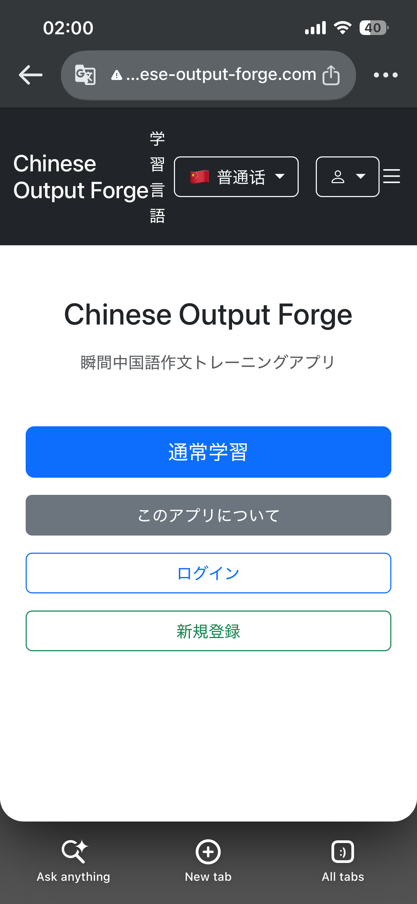

PCでは、ヘッダー内に以下の要素を横方向に配置している。

- アプリケーション名
- 「学習言語」のテキスト
- 学習言語の選択ボタン
- ユーザーメニュー
- ナビゲーションメニュー

PCでは十分な横幅があるため問題なく表示されるが、スマートフォンではViewportの横幅が小さいにもかかわらず、これらの要素が同じように横方向へ配置されている。

その結果、各要素に割り当てられる横幅が不足し、特に「学習言語」が以下のように1文字ずつ折り返されていた。

```text
学
習
言
語
```

また、アプリケーション名についても、
Chinese
Output Forge

のように複数行へ折り返されている。
ヘッダーはすべてのページで共通して表示されるため、スマートフォンの画面幅でも各要素を無理なく表示できるよう、レスポンシブ対応を行う。

### 修正内容

スマートフォンではヘッダー全体をPCと同じように横一列で表示すると、それぞれの要素に十分な横幅を確保できず、テキストが細かく折り返されてしまう。

そこで、BootstrapのFlexbox関連のクラスを利用し、**スマートフォンではヘッダーを2段、PCでは従来どおり1段で表示する**ように変更した。

#### ヘッダー全体を画面幅によって縦・横に切り替える

修正前は、ヘッダー内の要素を常に横方向へ配置していた。

```html
<div class="container d-flex justify-content-between align-items-center">
```

これを以下のように変更した。

```html
<div class="container d-flex flex-column flex-md-row
            justify-content-between align-items-md-center gap-3">
```

追加・変更したクラスには以下の役割がある。

- `d-flex`
  - `display: flex` を指定する。
- `flex-column`
  - Flexboxの子要素を縦方向に配置する。
- `flex-md-row`
  - `md`（768px）以上では子要素を横方向に配置する。
- `align-items-md-center`
  - `md`以上では要素を交差軸方向の中央に揃える。
- `gap-3`
  - Flexbox内の要素間に余白を設ける。

これにより、スマートフォンでは、

```text
Chinese Output Forge

学習言語　[言語選択]　[ユーザー]　[メニュー]
```

のような2段構成となり、`md`以上では従来どおり横一列に配置される。

PC向けのレイアウトを維持しながらスマートフォンのみ縦方向へ切り替えられるため、この方法を採用した。

参考：

- [【Bootstrap4】d-flexも使おう、row / colだけがレスポンシブを表現するわけじゃない](https://qiita.com/marshmallow88/items/119adc4eb098ef086781)

---

#### アプリケーション名の折り返しを防止する

修正前は以下のようになっていた。

```html
<h1 class="h4 m-0">
```

スマートフォンでは横幅が不足することで、

```text
Chinese
Output Forge
```

のようにアプリケーション名が途中で折り返される場合があった。

そこで、`text-nowrap`を追加した。

```html
<h1 class="h4 m-0 text-nowrap">
```

`text-nowrap`は、テキストを途中で折り返さないようにするBootstrapのクラスである。

アプリケーション名は文章とは異なり、途中で改行するよりも1つの名称として表示した方が読みやすい。そのため、スマートフォンでも`Chinese Output Forge`を1行で表示するようにした。

参考：

- [とほほのBootstrap 5入門 - Text](https://www.tohoho-web.com/bootstrap/text.html)

---

#### `ms-auto`をPC表示時のみ適用する

修正前は、学習言語やユーザーメニューを含むグループに`ms-auto`を指定していた。

```html
<div class="ms-auto d-flex gap-3 align-items-center">
```

`ms-auto`は`margin-inline-start: auto`を指定するBootstrapのSpacing Utilityであり、通常の左から右へ表示する環境では、左側に自動マージンを設けることで要素を右側へ押し出す働きをする。

PCではヘッダーを横一列で表示するため、この指定によって右側の操作項目を右寄せできる。

一方、今回の変更によってスマートフォンではヘッダーが2段になるため、2段目でも常に`ms-auto`を適用する必要はない。

そこで以下のように変更した。

```html
<div class="d-flex gap-3 align-items-center ms-md-auto">
```

`ms-md-auto`とすることで、

- スマートフォン：`margin-inline-start: auto`を適用しない
- `md`（768px）以上：`margin-inline-start: auto`を適用する

という切り替えができる。

これにより、スマートフォンでは2段目を自然に配置しながら、PCでは従来どおり右側へ配置できる。

---

#### 「学習言語」の文字が1文字ずつ折り返されることを防止する

修正前は以下のようになっていた。

```html
<div class="d-flex align-items-center gap-2">
```

スマートフォンでは利用できる横幅が小さくなるため、「学習言語」の表示領域が狭くなり、

```text
学
習
言
語
```

のように1文字ずつ折り返されていた。

そこで、`text-nowrap`を追加した。

```html
<div class="d-flex align-items-center gap-2 text-nowrap">
```

これにより、この要素内のテキストを折り返さず、「学習言語」を1行で表示できる。

「学習言語」は短いラベルであり、複数行に分割する必要がないため、アプリケーション名と同様に`text-nowrap`を使用した。

---

#### スマートフォンで学習言語とユーザー操作部分の間隔を広げる

2段表示に変更しただけでは、スマートフォン上で学習言語の選択部分とユーザーアイコン・メニューアイコンが近く、各機能のまとまりが分かりにくかった。

そこで、BootstrapのSpacing Utilityである`ms-5`と`me-5`を使用して、両者の間隔を広げた。

```html
me-5 me-md-0
```

```html
ms-5 ms-md-0
```

`ms`は`margin start`、`me`は`margin end`を表す。

通常の左から右へ表示する環境では、

- `ms-5`：左側に大きなマージンを追加する
- `me-5`：右側に大きなマージンを追加する

という働きになる。

そのため、学習言語側に`me-5`、ユーザー操作側に`ms-5`を指定することで、スマートフォンでは両方から余白を設け、次のように2つの操作領域を視覚的に分離した。

```text
学習言語 [🇹🇼 國語 ▼]              [ユーザー ▼] [メニュー]
```

ただし、この大きな余白は横幅の小さいスマートフォン表示を調整するためのものであり、PCでは必要ない。

そこで、それぞれに`me-md-0`、`ms-md-0`を組み合わせた。

```text
スマートフォン
me-5 / ms-5
    ↓
大きな余白を設ける

md以上
me-md-0 / ms-md-0
    ↓
追加した余白を0に戻す
```

これにより、PCの既存レイアウトには影響を与えず、スマートフォンでのみ学習言語部分とユーザー操作部分の間隔を広げることができた。

---

### 表示確認

修正後、スマートフォンの画面幅でヘッダーを表示し、以下の点を確認した。

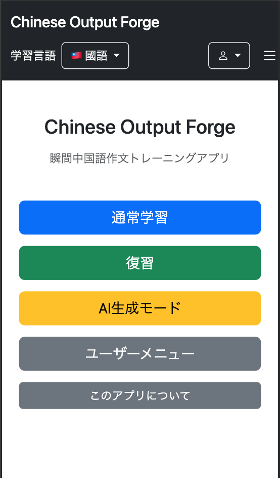

- `Chinese Output Forge`が途中で折り返されず、1行で表示される
- 「学習言語」が1文字ずつ折り返されず、1行で表示される
- スマートフォンではアプリケーション名と各操作項目が2段に分かれて表示される
- 学習言語の選択部分とユーザー操作部分の間に十分な間隔が確保される
- ユーザーアイコンとメニューアイコンは右側にまとまって表示される
- ヘッダー内の要素が画面外にはみ出さない
- PC表示では従来どおり横一列のレイアウトが維持される

以上から、PC向けのヘッダー表示を維持したまま、スマートフォンで発生していた不自然なテキストの折り返しを解消できた。

## 2. 通常学習モードのメニュー画面で横並びにしている見出しや説明文が細かく折り返される

```bash
git commit -m "Improve practice menu layout for mobile devices"
```

通常学習モードのメニュー画面では、PCでの表示を前提として、メニュー項目の見出しと説明文を横方向に並べている箇所がある。

PCでは十分な横幅があるため問題なく表示されるが、スマートフォンではViewportの横幅が小さくなることで、それぞれの要素に割り当てられる横幅も狭くなる。

その結果、見出しや説明文が細かく折り返され、1つのメニュー項目が縦に長くなって読みづらくなっていた。

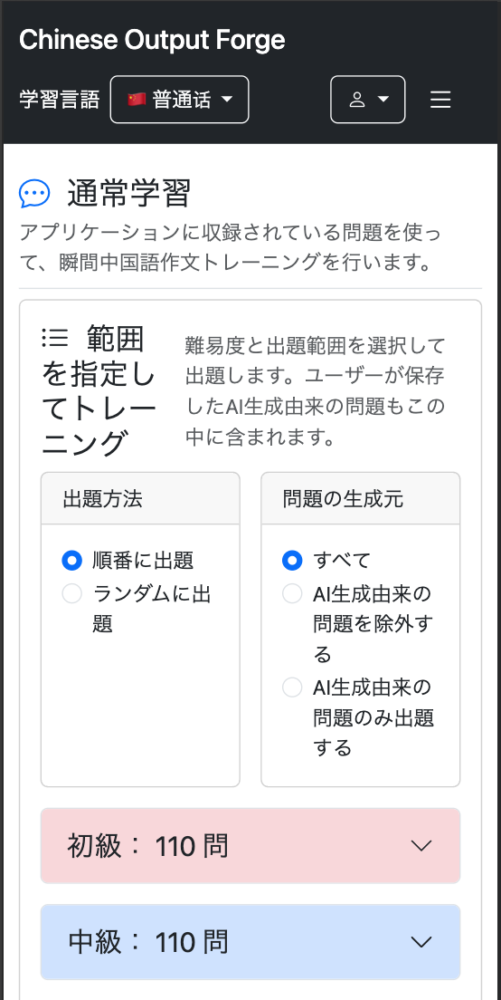

特に、説明文の横に見出しを配置するレイアウトでは、限られた横幅を複数の要素で分け合うため、文章を表示するための十分なスペースを確保できない。

そこで、PCでは既存の横並びレイアウトを維持しながら、スマートフォンでは見出しと説明文を縦方向に配置するように変更する。

### 修正内容

通常学習モードのメニュー画面では、見出しと説明文を以下のように`d-flex`で横方向に配置していた。

```html
<div class="d-flex align-items-center gap-3 mb-2">
```

PCでは十分な横幅があるため問題ないが、スマートフォンでも横並びが維持されることで、見出しと説明文が限られた横幅を分け合っていた。

そこで、ヘッダーの修正と同様に`flex-column`と`flex-md-row`を使用し、スマートフォンでは縦並び、`md`以上では横並びになるよう変更した。

**修正前**

```html
<div class="d-flex align-items-center gap-3 mb-2">
```

**修正後**

```html
<div class="d-flex flex-column flex-md-row
            align-items-start align-items-md-center gap-3 mb-2">
```

それぞれのクラスには以下の役割がある。

- `d-flex`
  - Flexboxを有効に変更した。
- `flex-column`
  - スマートフォンでは子要素を縦方向に配置する。
- `flex-md-row`
  - `md`（768px）以上では子要素を横方向に配置する。
- `align-items-start`
  - スマートフォンでは子要素を左側に揃える。
- `align-items-md-center`
  - `md`以上では従来どおり中央に揃える。
- `gap-3`
  - 見出しと説明文の間隔を確保する。
- `mb-2`
  - 要素全体の下側に余白を設ける。

これにより、PCでは従来の横並びを維持しながら、スマートフォンでは以下のように見出しと説明文を上下に分けて表示できる。

```text
範囲を指定してトレーニング

難易度と出題範囲を選択して出題します。
ユーザーが保存したAI生成由来の問題もこの中に含まれます。
```

同じ構成で見出しと説明文を横並びにしている箇所が通常学習モードのメニュー画面内に複数存在するため、該当する5箇所について同様の変更を行った。

参考：

- [【Bootstrap4】d-flexも使おう、row / colだけがレスポンシブを表現するわけじゃない](https://qiita.com/marshmallow88/items/119adc4eb098ef086781)

---

縦並びへの変更によって説明文の横幅は十分に確保できるようになったが、「範囲を指定してトレーニング」の見出しについては、スマートフォンでは文字サイズが大きいため、最後の1文字だけ次の行へ折り返されていた。

```text
範囲を指定してトレーニン
グ
```

現在、この見出しには`h3`を使用している。

```html
<h3 class="mb-0">
```

見出しの文字サイズを小さくするために`h4`へ変更することもできるが、`h3`から`h4`へ変更するとHTML上の見出しレベル自体も変更される。

今回は見出しとしての意味や文書構造は`h3`のまま維持し、表示上の文字サイズだけを小さくするため、Bootstrapの`h4`クラスを追加した。

**修正前**

```html
<h3 class="mb-0">
```

**修正後**

```html
<h3 class="h4 mb-0">
```

これにより、

```text
HTML上の見出しレベル：h3
表示上の文字サイズ：h4相当
```

とすることができる。

見出しとしての階層構造を変更する必要はなく、問題となっているのは表示上の文字サイズのみであるため、HTMLタグそのものを`h4`へ変更するのではなく、この方法を採用した。

### 追加修正1

「未学習の問題をトレーニング」は文字サイズを小さくしても折り返してしまうので「未学習問題をトレーニング」になるようにmessages.propertiesそのものを修正した

また、非ログイン時の
「リストの問題をトレーニング」
「未学習の問題をトレーニング」
は
その左にリストor星のアイコン、
右に鍵のアイコンが表示されるようになっていた。
それだと幅が広がり、鍵のアイコンが改行されてしまうのでいっそのこと
リストと星のアイコンは消した。


### 表示確認

修正後、スマートフォンの画面幅で通常学習モードのメニュー画面を表示し、レイアウトを確認した。

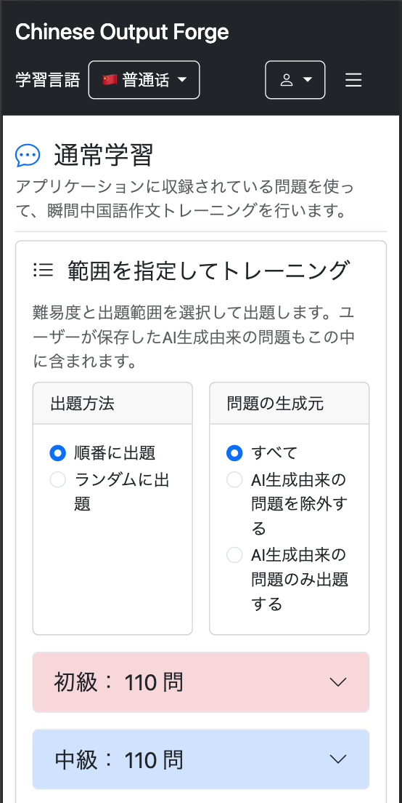

修正後は、スマートフォンでは見出しと説明文が縦方向に配置され、それぞれがカードの横幅を使用できるようになった。

また、表示上の文字サイズを小さくしたことで、「範囲を指定してトレーニング」も1行で表示されるようになった。

以上から、PC向けのレイアウトを維持しながら、スマートフォンで発生していた見出しと説明文の細かい折り返しを改善できた。

### 追加修正2 - 「未学習問題のみトレーニング」の各級選択ボタン内のテキストの折り返しを修正

```bash
git commit -m "Improve unstudied training layout for mobile devices"
```

通常学習モードのメニュー画面について、見出しと説明文のレスポンシブ対応を行った後、画面下部にある「未学習問題のみトレーニング」の表示を確認した。

この機能では、出題する問題の難易度を「初級」「中級」「上級」の3つから選択できるようになっており、PCでは3つの選択項目を横並びで表示している。

スマートフォンでも3つの選択項目自体は横並びで表示できているものの、それぞれの横幅が狭くなることで、難易度と問題数のテキストが以下のように細かく折り返されていた。

```text
初
級：
53問

中
級：
57問

上
級：
112問
```

特に「初級」「中級」「上級」が途中で改行されるため、選択項目が必要以上に縦長になり、視認性も低下している。
3つの選択項目はスマートフォンでも横並びのまま表示できるだけのスペースがあるため、レイアウト自体を縦並びに変更するのではなく、各選択項目内のテキストが不自然に折り返されないように調整する。

#### 修正内容

当初は各選択項目内のテキストに`text-nowrap`を指定し、文字列そのものの折り返しを防止した。

しかし、折り返しを禁止すると、

```text
初級：53問    中級：57問    上級：112問
```

という3つの文字列を横並びで表示するためのスペースが不足し、今度は選択項目が画面の横幅からはみ出してしまった。

そのため、文字列だけを調整するのではなく、画面幅に応じて3つの選択項目自体の配置方向を変更することにした。

**修正前**

```html
<div class="d-flex gap-3 mb-3 fs-4">
```

**修正後**

```html
<div class="d-flex flex-column flex-md-row gap-3 mb-3 fs-4">
```

`flex-column`と`flex-md-row`を組み合わせることで、

- スマートフォンでは3つの選択項目を縦方向に配置する
- `md`（768px）以上では従来どおり横方向に配置する

ようにした。

```text
スマートフォン

[ □ 初級：53問 ]
[ □ 中級：57問 ]
[ □ 上級：112問 ]


PC

[ □ 初級：53問 ] [ □ 中級：57問 ] [ □ 上級：112問 ]
```

なお、各選択項目に指定している以下のクラスは変更していない。

```html
<label class="bg-primary-subtle rounded px-3 py-3 flex-fill">
```

`px-3`や`py-3`などによる各選択項目内の余白を変更するのではなく、親要素のFlexboxの配置方向をレスポンシブに切り替えることで対応した。

これにより、PCでの既存レイアウトや各選択項目のデザインを維持したまま、スマートフォンで必要な横幅を確保できるようにした。

#### 表示確認

修正後、スマートフォンの画面幅で「未学習問題のみトレーニング」を表示し、各選択項目のレイアウトを確認した。

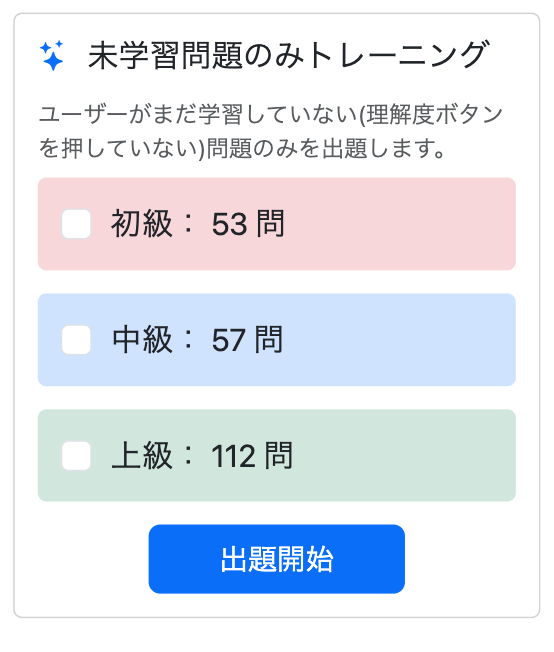

最終的に`flex-column flex-md-row`へ変更したことで、スマートフォンでは以下のように3つの選択項目が縦方向に表示された。

## 3. ログイン画面でログイン成功メッセージが表示された場合、ホーム画面下部の余白がほとんどなくなる

スマートフォンからログインを行い、ログイン後のホーム画面を確認したところ、ログイン成功メッセージが表示された場合に、画面下部の余白がほとんどなくなることを確認した。


ログイン後は、ホーム画面上部に以下のようなログイン成功メッセージが追加で表示される。

```text
おかえりなさい、ユーザー名さん
```

このメッセージが表示されることでホーム画面全体の高さが増加するが、スマートフォンではPCと比較してViewportの高さが限られている。

その結果、ホーム画面下部にある「このアプリについて」ボタンの直後に十分な余白がなくなり、ブラウザ下部のUIに近接した状態で表示されていた。

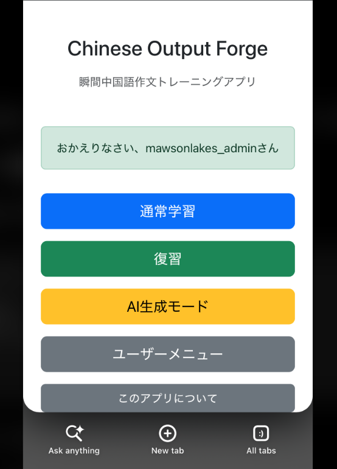

各ボタンの表示や操作そのものに問題はないものの、ページ最下部のボタンとブラウザのUIが近すぎるため、画面下部が窮屈に見える。

そこで、ログイン成功メッセージが表示された場合でも、最後のボタンの下に適切な余白が確保されるよう、ホーム画面下部の余白を調整する。

### 修正内容

ホーム画面では、ログイン成功メッセージと各メニューボタンを以下の`div`でまとめている。

**修正前**

```html
<div class="d-grid gap-3 col-md-4 mx-auto mt-5">
```

そこで、このメニュー全体を囲む要素にBootstrapの`mb-4`を追加した。

**修正後**

```html
<div class="d-grid gap-3 col-md-4 mx-auto mt-5 mb-4">
```

`mb-4`は要素の下側にマージンを追加するBootstrapのSpacing Utilityである。

今回、最後に表示されるボタンへ直接`mb-4`を指定するのではなく、メニュー全体を囲む親要素へ指定した。

ホーム画面では認証状態によって表示されるメニューが異なり、ログインユーザーと未ログインユーザーでは最後に表示されるボタンも異なるためである。

```text
ログイン時

[おかえりなさい、ユーザー名さん]

[通常学習]
[復習]
[AI生成モード]
[ユーザーメニュー]
[このアプリについて]

    ← mb-4による下部余白
```

このようにメニュー全体へ下マージンを設定することで、認証状態にかかわらず最後に表示されるボタンの下に一定の余白を確保できる。

また、既存のボタン間隔や配置には変更を加えず、ページ最下部の余白だけを追加する最小限の修正とした。

## 4. AI生成学習モードのメニュー画面でテキストが細かく折り返される

```bash
git commit -m "Improve AI practice menu layout for mobile devices"
```

AI生成学習モードのメニュー画面をスマートフォンで確認したところ、一部のテキストが細かく折り返され、読みづらくなっていることを確認した。

特に、以下の2つの問題が発生していた。

- 「検索条件からAI問題を生成」「リストからAI問題を生成」の見出しと説明文が横並びになっているため、それぞれの横幅が狭くなり、文章が細かく折り返される
- 問題難易度の「初級」「中級」「上級」が、それぞれ「初／級」「中／級」「上／級」のように2行へ折り返される

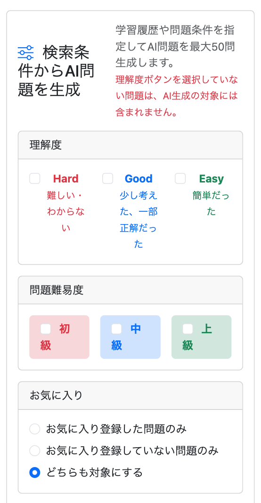

「理解度」「問題難易度」「お気に入り」の検索条件については、すでにBootstrapのGridを使用してスマートフォンでは縦方向に配置されるようになっているため、検索条件全体のレイアウトを変更する必要はない。

今回問題となっているのは、検索条件内の「初級」「中級」「上級」の表示と、AI問題生成方法の見出し・説明文の配置である。

そこで、PCでの既存レイアウトを維持しながら、スマートフォンでは見出しと説明文を縦方向に配置する。

また、「初級」「中級」「上級」についても、限られた横幅の中で文字が途中で折り返されないようにレイアウトを調整する。

### 修正内容

まず、「検索条件からAI問題を生成」と「リストからAI問題を生成」の見出しと説明文の配置を修正する。

修正前は、見出しと説明文を`d-flex`によって横方向に配置していた。

**修正前**

```html
<div class="d-flex align-items-center gap-3 mb-3">
```

PCでは十分な横幅があるため問題ないが、スマートフォンでも横並びのままとなるため、見出しと説明文の両方で細かい折り返しが発生していた。

そこで、通常学習モードのメニュー画面と同様に、画面幅によってFlexboxの方向を切り替える。

**修正後**

```html
<div class="d-flex flex-column flex-md-row
            align-items-start align-items-md-center gap-3 mb-3">
```

`flex-column`によってスマートフォンでは見出しと説明文を縦方向に配置し、`flex-md-row`によって`md`以上では従来どおり横方向に配置する。

また、配置方向の変更に合わせて、スマートフォンでは`align-items-start`で左揃え、`md`以上では`align-items-md-center`で中央揃えとする。

これにより、スマートフォンでは以下のような配置となる。

```text
検索条件からAI問題を生成

学習履歴や問題条件を指定して
AI問題を最大50問生成します。
```

「リストからAI問題を生成」についても同じ変更を行う。


#### 「初級」「中級」「上級」の折り返しを修正

問題難易度では、3つの選択項目を以下のように横並びで表示している。

```html
<div class="d-flex gap-3">
```

スマートフォンではそれぞれの横幅が狭くなるため、「初級」「中級」「上級」が以下のように途中で折り返されていた。

```text
初    中    上
級    級    級
```

そこで、通常学習モードの「未学習問題のみトレーニング」で行った修正と同様に、スマートフォンでは3つの選択項目を縦方向に配置し、`md`以上では横方向に配置する。

**修正前**

```html
<div class="d-flex gap-3">
```

**修正後**

```html
<div class="d-flex flex-column flex-md-row gap-3">
```

各難易度の`label`自体には変更を加えない。

```html
<label class="bg-danger-subtle rounded px-3 py-2">
    ...
</label>

<label class="bg-primary-subtle rounded px-3 py-2">
    ...
</label>

<label class="bg-success-subtle rounded px-3 py-2">
    ...
</label>
```

これにより、スマートフォンでは、

```text
[ □ 初級 ]

[ □ 中級 ]

[ □ 上級 ]
```

のように十分な横幅を確保して表示し、`md`以上では従来どおり、

```text
[ □ 初級 ] [ □ 中級 ] [ □ 上級 ]
```

と横並びで表示する。

以上の変更により、PCでの既存レイアウトを維持しながら、スマートフォンで発生していた見出し・説明文および問題難易度の不自然な折り返しを解消する。

### 表示確認

修正後、スマートフォンのブラウザからAI生成学習モードのメニュー画面を確認した。

「検索条件からAI問題を生成」では、見出しと説明文が縦方向に配置され、それぞれに十分な横幅が確保されるようになった。

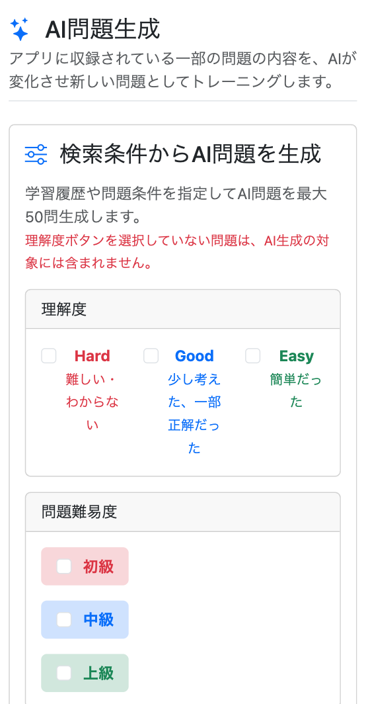

修正前は見出しと説明文が横並びになっていたため、限られた横幅を分け合うことで両方の文章が細かく折り返されていたが、修正後は自然な位置で改行されるようになった。

また、「問題難易度」の「初級」「中級」「上級」についても、スマートフォンでは3つの選択項目が縦方向に配置されるようになった。

これにより、

```text
初
級
```

のように文字の途中で折り返されることなく、「初級」「中級」「上級」がそれぞれ1行で表示されることを確認した。

PCでは`md`以上で従来の横並びレイアウトへ切り替わるため、PC向けの表示を維持しながら、スマートフォンで発生していた不自然な折り返しを解消できた。

## 5. 問題一覧では各カラムの横幅が狭くなり、日本語や中国語の文章が細かく折り返される

```bash
git commit -m "Improve question list layout for mobile devices"
```

問題一覧画面をスマートフォンで確認したところ、PC向けに作成したテーブルをそのまま表示しているため、各カラムの横幅が非常に狭くなっていることを確認した。

問題一覧では、問題番号、日本語、中国語、文法・構造、難易度、生成元、詳細、理解度、お気に入りなど、多くの情報を1つのテーブルに表示している。

PCでは十分な横幅があるため、それぞれの情報を問題なく確認できるが、スマートフォンでは限られた画面幅の中に多数のカラムを表示しようとするため、特に日本語や中国語の文章を表示するカラムの横幅が不足する。

その結果、以下のように文章が数文字ごとに折り返され、1件の問題を表示するために必要な縦幅が大きくなっていた。

```text
駅ま
でタ
クシ
ーで
行こ
う。
```

また、中国語についても同様に細かい折り返しが発生するため、文章全体を一目で確認することが難しい。

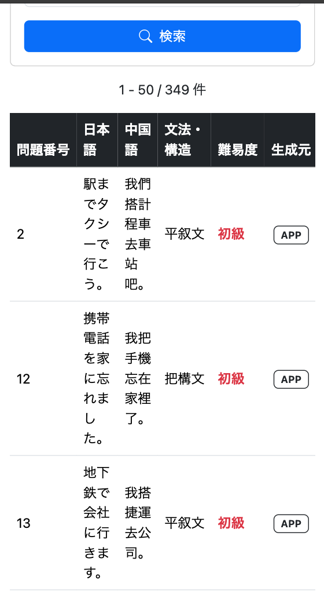

さらに、テーブルのすべてのカラムを確認するには横方向へのスクロールが必要となり、画面をスクロールした位置によっては問題番号や問題文が見えなくなる。

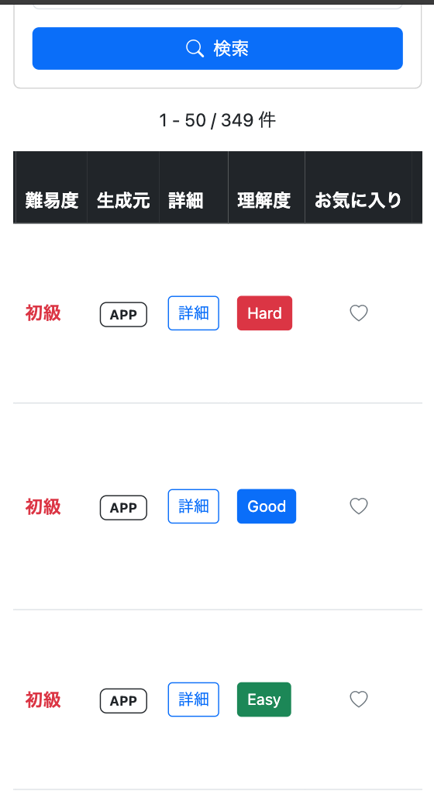

このように、多数のカラムを横方向に並べるテーブル形式はPCでは情報を一覧しやすい一方、スマートフォンの画面幅には適していない。

そこで、PCでは現在のテーブル形式を維持しながら、スマートフォンでは問題の情報を確認しやすいレイアウトへ変更する。

### レイアウト変更方針

問題一覧では、問題番号、日本語、中国語、文法・構造、難易度、生成元、詳細、理解度、お気に入りなど、多くの情報をテーブル形式で表示している。

PCでは十分な横幅があるため、テーブル形式の方が複数の問題を比較しやすく、一覧性も高い。

一方、スマートフォンでは限られた画面幅に多数のカラムを表示するため、特に日本語や中国語の問題文が数文字単位で折り返されてしまう。

単純に文字サイズやカラム幅を調整するだけでは根本的な解決にならないため、**PCでは既存のテーブル形式を維持し、スマートフォンでは1問ずつカード形式で表示する**ことにした。

表示の切り替えにはBootstrapのレスポンシブDisplay Utilityを使用する。

### `/user/question/list.html`

まず、既存の問題一覧テーブルを囲んでいる`div`に`d-none d-md-block`を追加した。

```html
<!-- PC用 -->
<div class="table-responsive d-none d-md-block">

    <table class="table table-hover align-middle">

        <!-- 既存の問題一覧テーブル -->

    </table>

</div>
```

次に、PC用テーブルの下にスマートフォン用の問題一覧を追加した。

```html
<!-- スマホ用 -->
<div class="d-md-none">

    <div th:each="question : ${questionList}"
         class="card mb-3">

        <div class="card-body">

            <!-- 問題番号 -->
            <div class="mb-3">
                <span class="fw-bold"
                      th:text="#{user.question.list.questionId}">
                    問題番号
                </span>
                <span>：</span>
                <span th:text="${question.questionId}"></span>
            </div>

            <!-- 日本語 -->
            <div class="mb-3">
                <div class="fw-bold mb-1"
                     th:text="#{user.question.list.japanese}">
                    日本語
                </div>
                <div th:text="${question.japaneseText}"></div>
            </div>

            <!-- 中国語 -->
            <div class="mb-3">
                <div class="fw-bold mb-1"
                     th:text="#{user.question.list.chinese}">
                    中国語
                </div>
                <div th:text="${question.chineseText}"></div>
            </div>

            <!-- 文法・構造 -->
            <div class="mb-2">
                <span class="fw-bold"
                      th:text="#{user.question.list.structure}">
                    文法・構造
                </span>
                <span>：</span>

                <span th:text="${question.structureName}"
                      data-bs-toggle="tooltip"
                      data-bs-placement="top"
                      th:data-bs-title="${session.languageVariant != null
                          && session.languageVariant.name() == 'TAIWAN'
                          ? question.structureDescriptionZhTw
                          : question.structureDescriptionZhCn}">
                    文法・構造
                </span>
            </div>

            <!-- 難易度 -->
            <div class="mb-2">
                <span class="fw-bold"
                      th:text="#{user.question.list.difficulty}">
                    難易度
                </span>
                <span>：</span>

                <span class="text-danger fw-bold"
                      th:if="${question.difficulty.name() == 'BEGINNER'}"
                      th:text="#{difficulty.beginner}">
                    初級
                </span>

                <span class="text-primary fw-bold"
                      th:if="${question.difficulty.name() == 'INTERMEDIATE'}"
                      th:text="#{difficulty.intermediate}">
                    中級
                </span>

                <span class="text-success fw-bold"
                      th:if="${question.difficulty.name() == 'ADVANCED'}"
                      th:text="#{difficulty.advanced}">
                    上級
                </span>
            </div>

            <!-- 生成元 -->
            <div class="mb-3">
                <span class="fw-bold">生成元：</span>

                <span class="badge bg-black"
                      th:if="${question.aiGenerated}">
                    AI
                </span>

                <span class="badge bg-white text-dark border border-dark"
                      th:unless="${question.aiGenerated}">
                    APP
                </span>
            </div>

            <!-- 操作 -->
            <div class="d-flex align-items-center gap-3">

                <!-- 詳細 -->
                <button type="button"
                        class="detailButton btn btn-outline-primary btn-sm text-nowrap"
                        data-bs-toggle="modal"
                        data-bs-target="#questionDetailModal"
                        th:data-japanese="${question.japaneseText}"
                        th:data-chinese="${question.chineseText}"
                        th:data-alternative="${question.alternativeAnswer}"
                        th:data-pinyin="${question.pinyin}"
                        th:data-zhuyin="${question.zhuyin}"
                        th:data-alternative-pinyin="${question.alternativeAnswerPinyin}"
                        th:data-alternative-zhuyin="${question.alternativeAnswerZhuyin}"
                        th:text="#{user.question.list.detail}">
                    詳細
                </button>

                <!-- 理解度 -->
                <span th:if="${question.evaluation == null}"
                      class="text-secondary text-nowrap"
                      th:text="#{user.question.list.unlearned}">
                    未学習
                </span>

                <button th:if="${question.evaluation?.name() == 'HARD'}"
                        class="btn btn-sm btn-danger evaluationButton"
                        th:data-question-id="${question.questionId}"
                        data-bs-toggle="modal"
                        data-bs-target="#evaluationModal">
                    Hard
                </button>

                <button th:if="${question.evaluation?.name() == 'GOOD'}"
                        class="btn btn-sm btn-primary evaluationButton"
                        th:data-question-id="${question.questionId}"
                        data-bs-toggle="modal"
                        data-bs-target="#evaluationModal">
                    Good
                </button>

                <button th:if="${question.evaluation?.name() == 'EASY'}"
                        class="btn btn-sm btn-success evaluationButton"
                        th:data-question-id="${question.questionId}"
                        data-bs-toggle="modal"
                        data-bs-target="#evaluationModal">
                    Easy
                </button>

                <!-- お気に入り -->
                <button class="btn btn-link p-0 favoriteButton"
                        th:data-question-id="${question.questionId}">

                    <i class="bi bi-heart-fill text-danger"
                       th:if="${question.favorite}">
                    </i>

                    <i class="bi bi-heart text-secondary"
                       th:unless="${question.favorite}">
                    </i>

                </button>

                <!-- リスト -->
                <button type="button"
                        class="btn p-0 border-0 bg-transparent questionListButton"
                        th:data-question-id="${question.questionId}"
                        data-bs-toggle="modal"
                        data-bs-target="#questionListModal">

                    <i class="bi bi-folder-plus fs-5 text-secondary"></i>

                </button>

                <!-- 削除 -->
                <form th:action="@{/user/question/delete}"
                      method="post"
                      class="ms-auto">

                    <input type="hidden"
                           name="questionId"
                           th:value="${question.questionId}">

                    <input type="hidden"
                           name="returnUrl"
                           th:value="${currentUrl}">

                    <button type="submit"
                            class="btn btn-dark btn-sm"
                            th:disabled="${!question.aiGenerated}"
                            th:onclick="|return confirm('#{user.question.delete.confirm}')|">

                        <i class="bi bi-trash"></i>

                    </button>

                </form>

            </div>

        </div>

    </div>

</div>
```

### レスポンシブ表示の実装構成

#### 1. Bootstrapによる表示の切り替え

BootstrapのDisplay Utilityでは、画面幅に応じて要素の表示・非表示を切り替えられる。

今回使用したクラスは以下のとおり。

| クラス | 動作 |
|---|---|
| `d-none` | 要素を非表示にする |
| `d-md-block` | `md`以上で`display: block`を適用する |
| `d-md-none` | `md`以上で要素を非表示にする |

Bootstrap 5では、`md`のブレークポイントは**768px**である。

そのため、今回の実装では以下のように表示が切り替わる。

```text
Viewport幅 768px未満
    → スマートフォン用カードを表示

Viewport幅 768px以上
    → PC用テーブルを表示
```

#### 2. BootstrapのCardを使用した問題表示

スマートフォン用の問題一覧では、Bootstrapの`card`を使用する。

```html
<div th:each="question : ${questionList}"
     class="card mb-3">

    <div class="card-body">

        <!-- 1問分の情報 -->

    </div>

</div>
```

- `th:each`：`${questionList}`に含まれる問題を1件ずつ繰り返す
- `card`：問題ごとに枠線で囲まれた領域を作成する
- `card-body`：カード内部に余白を設ける
- `mb-3`：各カードの下に余白を設ける

PC用テーブルとスマートフォン用カードは、同じ`${questionList}`を使用しているため、Controller側で表示形式ごとに異なるデータを用意する必要はない。

また、各項目を横方向のカラムとして並べるのではなく、1問分の情報を縦方向に配置することで、日本語や中国語の問題文に十分な横幅を確保できる。

#### 3. 既存JavaScriptとの共通化

スマートフォン用カードにも、PC用テーブルと同じ操作ボタンを配置する。

「詳細」「理解度」「お気に入り」「リスト」については、既存のJavaScriptが使用している以下のclassをそのまま設定する。

- `detailButton`
- `evaluationButton`
- `favoriteButton`
- `questionListButton`

さらに、`data-bs-target`や`th:data-question-id`などの属性も維持することで、PC用とスマートフォン用で同じモーダルやJavaScriptの処理を利用できる。

削除についても、既存と同じフォーム送信処理を使用する。

これにより、PC用とスマートフォン用で表示形式を分けながら、既存の機能を維持できる。

### 参考資料

- Bootstrap公式：Display property  
  https://getbootstrap.com/docs/5.3/utilities/display/

- Bootstrap公式：Breakpoints  
  https://getbootstrap.com/docs/5.3/layout/breakpoints/


### 表示確認

修正後、スマートフォンのブラウザから問題一覧画面を確認した。

PCでは従来どおりテーブル形式で問題一覧が表示される一方、スマートフォンでは1問ごとにカード形式で表示されるようになった。

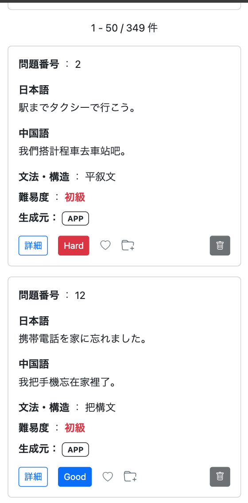

スマートフォンでは、日本語と中国語の問題文がカードの横幅を使用して表示されるため、修正前のように文章が数文字単位で細かく折り返されることがなくなった。

また、文法・構造、難易度、生成元についても問題文の下に縦方向に配置され、各問題の情報を1つのカード内で確認できる。

「詳細」「理解度」「お気に入り」「リスト」「削除」の各操作もカード下部に配置され、横スクロールすることなく操作できることを確認した。

これにより、PCでは従来のテーブルによる一覧性を維持しながら、スマートフォンでは画面幅に適したカード形式で問題一覧を確認・操作できるようになった。


