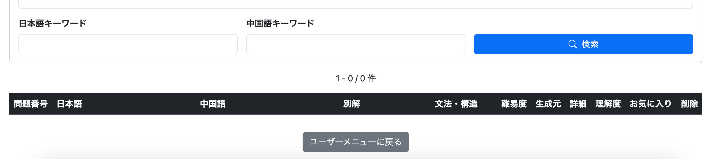

# 024 内部処理のリファクタリング

## はじめに

主要機能の実装後、Controller・Serviceを中心に、責務の分散、重複処理、不要な分岐、命名の不統一を見直した。新機能の追加ではなく、**既存の振る舞いを維持しながら、処理の目的と依存関係を分かりやすくすること**が目的である。

共通化はコード量を減らすために一律に行うのではなく、複数箇所で使われ、処理に明確な名前を付けられる場合に限定した。短い分岐や一度しか使わない処理は、その場に残した方が読みやすい場合もある。

なお、本章にはリファクタリングとは別に、ログイン時にまれに発生していた`status 999`への対策も含む。この不具合は原因が確定していないため、調査で確認できた事実と仮説を分けて記録する。

## 1. ログイン時に発生する`status 999`への対応

### 1.1 発生した現象

Spring Bootを起動したまま長時間操作せず、セッションが切れた後に再ログインすると、まれに次のJSON形式のエラーが表示された。

```json
{
  "status": 999,
  "error": "None",
  "message": "No message available"
}
```

その画面を再読み込みすると、Whitelabel Error Pageに以下の内容が表示された。

```text
There was an unexpected error (type=None, status=999).
No message available
```

ブラウザでログイン画面に戻り、同じようにフォームを再送信すると正常にログインできた。通常のログインでは発生せず、再現性の低い現象だった。

### 1.2 `/error`へのアクセス許可

`SecurityConfig`には`.anyRequest().authenticated()`が設定されていた一方、エラー処理に使用する`/error`は認証不要のパスとして指定していなかった。

そこで、何らかのエラーが発生して`/error`に処理が転送された際、Spring Securityの保護対象となり、エラー表示の処理自体が妨げられている可能性を考えた。

```java
.requestMatchers("/error").permitAll()
```

を追加し、認証状態にかかわらず`/error`へアクセスできるようにした。

ただし、**この変更はエラー処理経路に対する対策であり、最初のエラーの原因を特定したものではない**。通常の認証失敗は設定済みの`AuthenticationFailureHandler`が`/login`へリダイレクトするため、今回の現象が通常のパスワード誤りに起因したとも断定できない。また、エラー表示時点で認証が成功していたかどうかも確認できていない。

### 1.3 再発時に備えたログ設定

再現性が低く、その場で詳細な原因を追跡できなかったため、`application.yml`にSpring SecurityのDEBUGログを設定した。

```yaml
logging:
  level:
    org.springframework.security: DEBUG
```

これにより、再発時に認証処理、SecurityContext、フィルターによるアクセス処理の流れを調査できるようにした。**対策後に再発しないことや根本原因の解消は、元の記録では確認できていない**。今後の再発有無とログの確認を課題として残した。

## 2. ControllerとServiceの責務を整理する

Controllerではリクエストの受け取り、Modelへの値の設定、画面遷移を中心に扱い、業務ルールやデータ操作は適切なServiceへ委譲するよう見直した。

### 2.1 管理機能のForm生成と検索条件

`AdminQuestionController`で行っていた`OriginalQuestionDTO`から`QuestionForm`への値のコピーを、`AdminQuestionService.createQuestionForm()`へ移した。`languageVariant`、日本語・中国語の問題文、別解、難易度、構文ID、AI変化許可、テンプレートなどの値をServiceで設定し、Controllerは完成したFormを受け取る。

```java
QuestionForm form =
        adminQuestionService.createQuestionForm(originalQuestion);
```

同様に、`AdminStructureController`で行っていた`Structure`から`StructureForm`への変換を`AdminStructureService.createStructureForm(structureId)`へ移した。

`AdminUserController`にあった、アカウント状態が未指定なら`AccountStatus.ALL`とする初期値補完は、`AdminUserService.getUsers()`へ移動した。検索条件の既定値というルールをService側で扱うためである。

### 2.2 AI生成学習と生成履歴

`AiPracticeController`が`QuestionRepository`を直接呼び、所有者IDと中国語本文から保存済み問題を検索していた処理は、`AiPracticeService.getSavedQuestionId(userId, chineseText)`へ移した。保存済みなら問題IDを、存在しなければ`null`を返すという既存の仕様は維持した。

また、`AiPracticeService`からAI生成履歴のRepositoryを直接操作する処理と、`AiGenerationHistoryService`へ委譲する処理が混在していたため、履歴の取得・削除・保存を`AiGenerationHistoryService`へ集約した。

```text
AiPracticeService
    ↓
AiGenerationHistoryService
    ↓
AiGenerationHistoryRepository
```

履歴を最大10件に保つ処理も`updateGenerationHistory()`にまとめ、古い履歴の削除と新規履歴の保存を同じServiceが担当するようにした。

### 2.3 通常学習と会員登録

`PracticeController.getPracticeStart()`には、ログイン状態による問題取得方法の切り替えと、`sourceCondition`が未指定の場合に`ALL`とする判断が含まれていた。これらを`PracticeService.getPracticeQuestions()`へ集約し、Controllerは必要な検索条件を渡して問題一覧を受け取る構成とした。

`SignupController`では、`SignupForm`から`Users`を生成する処理を削除し、Formを`SignupService.signup(form)`へ渡すようにした。Entityの生成、一般ユーザー権限の設定、パスワードのハッシュ化、保存はServiceが担当する。

```java
signupService.signup(form);
```

## 3. Service内部の重複処理と依存関係を整理する

### 3.1 新規登録と更新に共通する値設定

`AdminQuestionService`の`addQuestion()`と`updateOneQuestion()`では、発音生成、FormからEntityへの値設定、Structureの取得・設定が重複していた。これを次のprivateメソッドへまとめた。

```java
private void applyQuestionForm(Question question, QuestionForm form)
```

新規登録では新しい`Question`、更新では既存の`Question`に対して同じ処理を適用する。

`AdminStructureService`でも、追加・更新時のFormからEntityへの値設定を`applyStructureForm(Structure structure, StructureForm form)`へ集約した。また、削除時の移行先となる「その他」のStructure IDは、次の定数にした。

```java
private static final Long OTHER_STRUCTURE_ID = 23L;
```

「その他」が存在しない場合は通常のStructure不存在と意味が異なるため、既存の`IllegalStateException`による扱いを維持した。

### 3.2 AI生成処理を役割ごとに分離

長くなっていた`AiPracticeService.generateQuestions()`から、生成元QuestionをAI送信用DTOへ変換する処理と、そのDTOをJSONへ変換する処理を切り出した。

```java
private List<AiGenerationSourceDto> createGenerationSources(...)
private String convertGenerationSourcesToJson(...)
```

Gemini API向けのStructured Outputs Schema生成も、API呼び出し本体から分離した。`AiPronunciationService.generatePronunciationWithGemini()`でも同様にSchema生成処理をprivateメソッドへ移した。

さらに、AIの切り替えを`boolean useChatGPT = false`で表していた箇所をenumに変更した。

```java
public enum AiProvider {
    CHAT_GPT,
    GEMINI
}

private static final AiProvider AI_PROVIDER = AiProvider.GEMINI;
```

API呼び出しは`switch`で選択する構成とした。真偽値では伝わりにくかった選択肢を、名前で明示できるようになった。

### 3.3 履歴・お気に入り・ユーザー情報の扱い

- `AiGenerationHistoryService`：履歴保持件数の`10`を`MAX_HISTORY_SIZE`として定数化。外部から直接呼ばなくなった`saveGenerationHistory()`をprivate化し、更新の入口を`updateGenerationHistory()`へ統一。
- `EvaluationService`：学習履歴のUPDATEとINSERTで重複していた値設定・保存処理をまとめ、既存Entityの取得または新規生成の後に共通処理を実行。
- `FavoriteService`：Entityの内容が不要な存在確認を、`Optional<Favorite>`の取得からRepositoryの`existsById()`へ変更。
- `AdminUserService`：凍結・解除時の事前状態チェックを削除し、それぞれ`setAccountLocked(true)`と`setAccountLocked(false)`を直接設定。
- `UserAccountService`：ログインIDからユーザーを取得し、存在しなければ例外を送出する処理をprivateメソッドへ共通化。
- `SignupService`：平文パスワードを一度Entityへ設定してから取り出す処理を廃止。Formのパスワードを直接`PasswordEncoder`へ渡し、ハッシュ化した値だけをEntityへ設定。
- `UserDetailsServiceImpl`：生成した`UserDetails`を不要な一時変数に入れず、そのままreturn。
- `UserQuestionService`：削除対象が所有者本人の問題であることを表すメソッド名へ変更。

また、`PracticeService`では問題取得の入口を`getPracticeQuestions()`に統合したため、不要になった`getAvailablePracticeQuestions()`を削除した。

Structure一覧の取得は、他の機能から`ReviewService.findStructures()`を利用するのではなく、Structureマスタを担当する`StructureService`へ集約した。別機能のServiceを経由する不自然な依存関係を解消した。

## 4. Controller内部の命名と共通処理を整理する

### 4.1 メソッド名・変数名の統一

Controllerのリクエスト処理メソッドは、原則として次の規則に合わせた。

```text
GET  → get○○
POST → post○○
```

代表的な変更は以下のとおり。

| 対象 | 変更前 | 変更後 |
| --- | --- | --- |
| AdminStructureController | `addStructure()` / `updateStructure()` / `deleteStructure()` | `postStructureAdd()` / `postStructureEdit()` / `postStructureDelete()` |
| AdminUserController | `lockUser()` / `unlockUser()` / `deleteUser()` | `postUserLock()` / `postUserUnlock()` / `postUserDelete()` |
| LanguageVariantController | `changeLanguageVariant()` | `getLanguageVariantChange()` |
| PronunciationTypeController | `changePronunciationType()` | `getPronunciationTypeChange()` |
| PracticeController | `postEvaluation()` | `postPracticeEvaluation()` |
| ReviewController | `postEvaluation()` | `postReviewEvaluation()` |
| UserProfileController | `cancelMembership()` | `postUserDelete()` |
| UserQuestionController | `toggleEvaluation()` | `postEvaluationToggle()` |

`Page<T>`を保持する変数は、`questionList`、`structureList`、`userList`のような名前から、`questionPage`、`structurePage`、`userPage`へ変更した。`AdminQuestionController`の`allFilteredQuestionList`も`questionPage`へ変更し、型と変数名の意味を一致させた。

そのほか、`Locale local`を`Locale locale`、`current`を`currentLanguageVariant`や`currentPronunciationType`に変更し、`editpasswordForm`と`editPasswordForm`の表記は後者へ統一した。

### 4.2 重複するController処理の共通化

`AiPracticeController`、`PracticeController`、`ReviewController`、`UserQuestionController`では、ログインユーザーの取得方法を既存または新設の`getLoginUser()`へ統一した。

`AiPracticeController`と`PracticeController`では、セッションの`languageVariant`が未設定なら`MAINLAND`を使用する処理が複数箇所にあったため、次のメソッドへまとめた。

```java
private LanguageVariant getLanguageVariant(HttpSession session)
```

一方、`ReviewController`では同じ処理が1箇所だけだったため、無理に切り出さなかった。

`UserProfileController`では、ログインID変更後とパスワード変更後に繰り返していた認証状態の破棄を共通化した。

```java
private void clearAuthentication(HttpSession session) {
    SecurityContextHolder.clearContext();
    session.removeAttribute(
            HttpSessionSecurityContextRepository.SPRING_SECURITY_CONTEXT_KEY);
}
```

この処理は「認証状態を破棄する」という明確な意味を持つため、privateメソッド化する利点がある。

また、同Controllerの例外処理では、再利用するGETメソッド側でもFormをModelへ追加していたため、catch内の重複した`model.addAttribute()`を削除した。

### 4.3 不要な記述の削除と、残した処理

`AiPracticeController`、`PracticeController`、`ReviewController`などでは、不要な変数の先行宣言、使用していない`Model`引数やimportを削除した。`UserQuestionController`では単一要素のList生成を`List.of()`へ変更し、不要になった`Arrays`のimportを削除した。

一方、`LanguageVariantController`と`PronunciationTypeController`の短いリダイレクト判定は、処理をその場で確認できることを優先し、共通メソッドにはしなかった。`AiPracticeController`のセッションからの問題一覧取得や、`SignupController`でバリデーションエラー時に`getSignup(form)`を再利用する構成も維持した。

**同じ記述が存在することだけを理由に、すべてをprivateメソッド化するわけではない**という方針で整理した。

## 5. 検索結果が0件の場合の表示を修正する

`AdminQuestionController`では、検索結果が0件の場合に開始位置が`1`、終了位置が`0`となり、画面に「1〜0件 / 全0件」と表示されていた。



そこで、開始位置と終了位置を`0`で初期化し、ページにデータがある場合だけ計算するようにした。

```java
long start = 0;
long end = 0;

if (questionPage.hasContent()) {
    start = (long) questionPage.getNumber()
            * questionPage.getSize() + 1;
    end = start + questionPage.getNumberOfElements() - 1;
}
```

これは単なる命名整理ではなく、**検索結果が空の場合の表示上の不整合を修正した変更**である。元の記録には修正コードと修正前の画像があるが、修正後の画面確認結果までは示されていない。

## 6. 今回の整理で維持した方針

今回の変更では、ControllerからServiceへの処理移動、Service間の依存関係の整理、共通処理の切り出し、定数化、命名規則の統一を行った。基本となる依存関係は次のとおりである。

```text
Controller
    ↓
Service
    ↓
Repository
```

ただし、すべてのメソッドを短くすることや、重複を機械的にゼロにすることは目指していない。一本道で追いやすい長いメソッドや、短く明示的な条件分岐は、そのまま残した。

また、開発中に利用していた`System.out.println()`、処理時間計測、ログ出力の整理は本章の対象から外し、後続のAOP・ログ対応で扱うこととした。

## まとめ

今回のリファクタリングでは、**どの層が何を担当するのかを明確にし、コードを読むときに処理の意味を追いやすくすること**を重視した。

一方、`status 999`は`/error`のアクセス許可とDEBUGログ設定まで対応したものの、最初のエラーの発生原因は未特定である。リファクタリングで行った変更と、不具合に対する暫定的な対策・調査準備を混同せず、今後の確認事項として残す。

元の実装記録にはリファクタリング後の包括的な回帰テスト結果は記載されていないため、本章でも動作確認済みとは断定しない。
