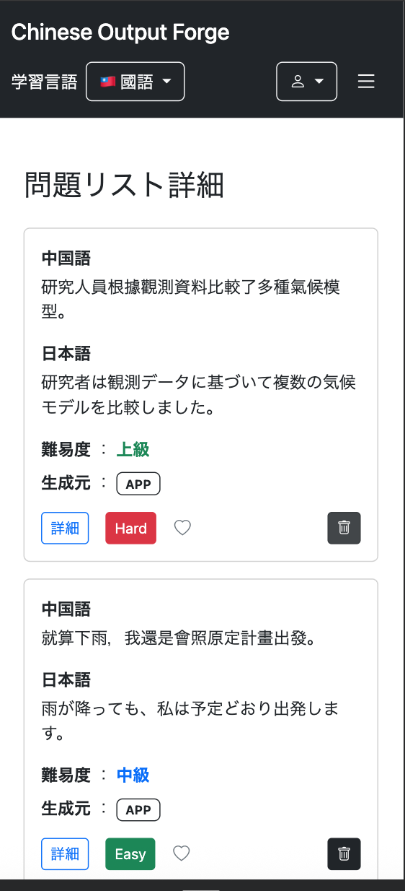

# 029-03 問題リスト機能③｜Spring MVC・Thymeleafによる詳細画面の再設計

## 概要

029-01では問題リストのDB・Entity・Repository・Service・DTOと基本操作を実装し、029-02ではJavaScriptによる詳細表示や、各学習画面からリストを操作する機能を追加した。

しかし、JavaScriptで問題一覧のHTMLを生成する方式では、表示項目や操作が増えるほど画面構築の処理が複雑になり、スマートフォン対応も難しくなった。

そこで本章では、**問題リストの詳細を独立したページへ移し、Spring MVCとThymeleafで表示する方式へ変更する**。これまでのデータ取得処理を再利用しつつ、問題詳細モーダル、削除後の画面遷移、スマートフォン用のカード表示まで実装する。

---

# 問題リスト詳細を独立したページとして表示する（10月12日）

```text
git commit -m "Refactor question list details into a dedicated page"
```

## 設計変更の方針

旧設計では、問題リスト一覧画面の「詳細」をクリックすると、`GET /user/question-list/detail`から`QuestionListItemDto`をJSONとして取得し、`question-list/list.js`が問題一覧のHTMLを動的に生成していた。

```text
旧設計

question-list/list.html
        ↓
list.js
        ↓
GET /user/question-list/detail
        ↓
@ResponseBody
        ↓
List<QuestionListItemDto>をJSONとして返す
        ↓
JavaScriptで問題一覧を生成
        ↓
list.html内に表示
```

スマートフォンでは、この方式で生成した横長のテーブルが画面幅に収まりにくく、各項目が細かく折り返されて見にくくなっていた。

そこで、問題リスト詳細を独立したページとして表示する構成へ変更する。

```text
新設計

question-list/list.html
        ↓
GET /user/question-list/detail?listId=...
        ↓
QuestionListController
        ↓
QuestionListItemService
        ↓
QuestionListItemDto
        ↓
Model
        ↓
question-list/detail.html
```

この変更では、Repository・Service・`QuestionListItemDto`によるデータ取得処理はそのまま利用し、Controller以降の表示方法を変更する。

問題一覧のHTMLはSpring MVCとThymeleafで生成し、JavaScriptは問題詳細モーダルなどの画面操作に限定して使用する。

---

## QuestionListControllerの変更

### `getUserQuestionListDetail()`をページ表示用に変更する

旧設計では、`@ResponseBody`を付けたControllerから`List<QuestionListItemDto>`を返し、SpringによってJSONへ変換していた。

```java
@GetMapping("/user/question-list/detail")
@ResponseBody
public List<QuestionListItemDto> getUserQuestionListDetail(
        @AuthenticationPrincipal UserDetails loginUser,
        @RequestParam Long listId,
        Locale locale) {

    Users user = getLoginUser(loginUser);

    List<QuestionListItemDto> listItems =
            questionListItemService.getQuestionListItems(
                    user,
                    listId,
                    locale);

    return listItems;
}
```

新設計では`@ResponseBody`を削除し、取得した`QuestionListItemDto`をModelへ格納して`detail.html`を返す。

また、問題詳細モーダルではユーザーの設定に応じて拼音または注音を表示するため、通常の問題一覧画面と同様に`HttpSession`から`pronunciationType`を取得してModelへ渡す。

```java
/**
 * 指定された問題リストに登録されている問題の一覧を表示する。
 *
 * @param loginUser ログインユーザー情報
 * @param listId 対象リストのID
 * @param model 画面に渡すデータ
 * @param locale 現在の言語・地域情報
 * @param session HTTPセッション
 * @return 問題リスト詳細画面のビュー名
 */
@GetMapping("/user/question-list/detail")
public String getUserQuestionListDetail(
        @AuthenticationPrincipal UserDetails loginUser,
        @RequestParam Long listId,
        Model model,
        Locale locale,
        HttpSession session) {

    // ログインユーザーを取得
    Users user = getLoginUser(loginUser);

    // 指定した問題リストに登録されている問題を取得
    List<QuestionListItemDto> listItems =
            questionListItemService.getQuestionListItems(
                    user,
                    listId,
                    locale);

    // 問題リストの問題一覧を画面へ渡す
    model.addAttribute(
            "listItems",
            listItems);

    // 表示する発音表記を取得
    PronunciationType pronunciationType =
            (PronunciationType) session.getAttribute("pronunciationType");

    // 未設定の場合は拼音を使用
    if (pronunciationType == null) {
        pronunciationType = PronunciationType.PINYIN;
    }

    model.addAttribute(
            "pronunciationType",
            pronunciationType);

    return "user/question-list/detail";
}
```

これにより、`QuestionListItemDto`はJSONへ変換されず、Modelの`listItems`としてThymeleafへ渡されるようになった。

---

## `question-list/list.html`を新設計に合わせて整理する

### 「詳細」ボタンをページ遷移へ変更する

旧設計では、JavaScriptから`listId`を取得するため、「詳細」を`button`として実装していた。

```html
<button type="button"
        class="btn btn-sm btn-outline-primary question-list-detail-button"
        th:data-list-id="${questionList.listId}"
        th:text="#{questionList.detail}">
    詳細
</button>
```

新設計では独立した詳細画面へ遷移するため、リンクへ変更する。

```html
<a th:href="@{/user/question-list/detail(listId=${questionList.listId})}"
   class="btn btn-sm btn-outline-primary"
   th:text="#{questionList.detail}">
    詳細
</a>
```

これにより、「詳細」をクリックすると以下の流れで画面遷移する。

```text
question-list/list.html
        ↓
詳細をクリック
        ↓
GET /user/question-list/detail?listId=...
        ↓
QuestionListController
        ↓
Model
        ↓
question-list/detail.html
```

### 旧設計専用の要素を削除する

問題リスト詳細を`detail.html`へ分離したため、`question-list/list.html`に残っていた旧設計専用の要素を削除する。

削除対象は以下である。

- JavaScriptで取得した問題一覧を表示する旧インライン詳細領域
- `questionListSuccessMessage`
- `questionListErrorMessage`
- `questionListMessages`
- 旧詳細表示用の`questionDetailModal`
- 旧詳細表示用の`evaluationModal`
- `/js/user/question-list/list.js`の読み込み

一方、以下は問題リスト一覧画面の機能として引き続き必要なため残す。

- 問題リスト一覧
- 新規リスト作成
- リスト名編集
- リスト自体の削除
- Thymeleafによる成功・エラーメッセージ
- ユーザーメニューへ戻る処理
- 問題リスト詳細画面へのリンク

### `question-list/list.js`を削除する

`question-list/list.js`の内容を確認したところ、このファイルはすべて旧設計の問題リスト詳細表示に使用されていた。

主な処理は以下である。

```text
list.js

├─ CSRF情報の取得
├─ questionListMessagesからメッセージを取得
├─ 「詳細」ボタンのクリックイベント
├─ GET /user/question-list/detail の実行
├─ QuestionListItemDtoをJSONとして取得
├─ JavaScriptによる問題一覧テーブルの生成
├─ お気に入り登録・解除
├─ 問題詳細モーダルの表示
├─ リストから問題を削除
└─ 理解度変更モーダルの表示・更新
```

新設計ではJSONを取得して問題一覧そのものを生成する必要がなくなった。また、このファイルには問題リストの作成・編集・削除に必要な処理は含まれていなかった。

そのため、以下のファイルを削除する。

```text
static/js/user/question-list/list.js
```

それに伴い、`question-list/list.html`から以下の読み込みも削除する。

```html
<script th:src="@{/js/user/question-list/list.js}"></script>
```

変更後、`question-list/list.html`は「問題リスト自体の管理」、`question-list/detail.html`は「選択した問題リストに登録されている問題の表示・操作」を担当する構成となる。

---

## `question-list/detail.html`を作成する

### 問題一覧をThymeleafで表示する

新しい`detail.html`では、ControllerからModelへ渡された`listItems`をThymeleafで繰り返し表示する。

一覧には以下の項目を表示する。

- 中国語
- 日本語
- 難易度
- 理解度
- お気に入り
- 生成元
- 詳細
- 削除

```html
<tbody>
    <tr th:each="question : ${listItems}">

        <td th:text="${question.chineseText}"></td>

        <td th:text="${question.japaneseText}"></td>

        <!-- 難易度 -->
        <td>
            <span class="text-danger fw-bold"
                  th:if="${question.difficulty.name() == 'BEGINNER'}"
                  th:text="#{questionList.detail.difficulty.beginner}">
                初級
            </span>

            <span class="text-primary fw-bold"
                  th:if="${question.difficulty.name() == 'INTERMEDIATE'}"
                  th:text="#{questionList.detail.difficulty.intermediate}">
                中級
            </span>

            <span class="text-success fw-bold"
                  th:if="${question.difficulty.name() == 'ADVANCED'}"
                  th:text="#{questionList.detail.difficulty.advanced}">
                上級
            </span>
        </td>

        <!-- 理解度 -->
        <td>
            <span th:if="${question.evaluation == null}"
                  class="text-secondary text-nowrap"
                  th:text="#{questionList.detail.evaluation.unlearned}">
                未学習
            </span>

            <button th:if="${question.evaluation?.name() == 'HARD'}"
                    type="button"
                    class="btn btn-sm btn-danger evaluationButton"
                    th:data-question-id="${question.questionId}"
                    data-bs-toggle="modal"
                    data-bs-target="#evaluationModal">
                Hard
            </button>

            <button th:if="${question.evaluation?.name() == 'GOOD'}"
                    type="button"
                    class="btn btn-sm btn-primary evaluationButton"
                    th:data-question-id="${question.questionId}"
                    data-bs-toggle="modal"
                    data-bs-target="#evaluationModal">
                Good
            </button>

            <button th:if="${question.evaluation?.name() == 'EASY'}"
                    type="button"
                    class="btn btn-sm btn-success evaluationButton"
                    th:data-question-id="${question.questionId}"
                    data-bs-toggle="modal"
                    data-bs-target="#evaluationModal">
                Easy
            </button>
        </td>

        <!-- お気に入り -->
        <td class="text-center">
            <button type="button"
                    class="btn btn-link p-0 favoriteButton"
                    th:data-question-id="${question.questionId}">
                <i class="bi bi-heart-fill text-danger"
                   th:if="${question.favorite}"></i>
                <i class="bi bi-heart text-secondary"
                   th:unless="${question.favorite}"></i>
            </button>
        </td>

        <!-- 生成元 -->
        <td class="text-center">
            <span class="badge bg-black"
                  th:if="${question.aiGenerated}">
                AI
            </span>
            <span class="badge bg-white text-dark border border-dark"
                  th:unless="${question.aiGenerated}">
                APP
            </span>
        </td>

        <!-- 詳細 -->
        <td>
            <button type="button"
                    class="detailButton btn btn-outline-primary btn-sm text-nowrap"
                    data-bs-toggle="modal"
                    data-bs-target="#questionDetailModal"
                    th:data-japanese="${question.japaneseText}"
                    th:data-chinese="${question.chineseText}"
                    th:data-pinyin="${question.pinyin}"
                    th:data-zhuyin="${question.zhuyin}"
                    th:data-alternative="${question.alternativeAnswer}"
                    th:data-alternative-pinyin="${question.alternativeAnswerPinyin}"
                    th:data-alternative-zhuyin="${question.alternativeAnswerZhuyin}"
                    th:data-structure="${question.structureName}"
                    th:text="#{questionList.detail}">
                詳細
            </button>
        </td>

        <!-- 削除 -->
        <td class="text-center">
            <form th:action="@{/user/question-list/item/delete}"
                  method="post">
                <input type="hidden"
                       name="listId"
                       th:value="${param.listId}">
                <input type="hidden"
                       name="questionId"
                       th:value="${question.questionId}">
                <button type="submit"
                        class="btn btn-dark btn-sm"
                        th:onclick="|return confirm('#{questionListItem.delete.confirm}')|">
                    <i class="bi bi-trash"></i>
                </button>
            </form>
        </td>

    </tr>
</tbody>
```

ここで使用する`question`は、`th:each="question : ${listItems}"`で定義した`QuestionListItemDto`である。

### messages.propertiesへ画面用メッセージを追加する

問題リスト詳細画面のタイトルと戻るボタン用のメッセージを追加する。

```properties
questionList.detail.title=問題リスト詳細
questionList.backToList=問題リストに戻る
```

---

## 問題詳細モーダルを追加する

### 通常の問題一覧画面の実装を確認する

通常の`/user/question/list.html`では、詳細ボタンの`data-*`属性へ問題情報を設定し、`question/list.js`がクリックされた問題の情報を`questionDetailModal`へ設定している。

問題リスト詳細画面でも同じ方式を使用する。

```text
詳細ボタン
        ↓
data-*属性から問題情報を取得
        ↓
detail.js
        ↓
questionDetailModalへ値を設定
        ↓
モーダルを表示
```

### 詳細ボタンへ問題情報を設定する

`detail.html`の詳細ボタンには、モーダルで使用する情報を`data-*`属性として設定する。

```html
<button type="button"
        class="detailButton btn btn-outline-primary btn-sm text-nowrap"
        data-bs-toggle="modal"
        data-bs-target="#questionDetailModal"
        th:data-japanese="${question.japaneseText}"
        th:data-chinese="${question.chineseText}"
        th:data-pinyin="${question.pinyin}"
        th:data-zhuyin="${question.zhuyin}"
        th:data-alternative="${question.alternativeAnswer}"
        th:data-alternative-pinyin="${question.alternativeAnswerPinyin}"
        th:data-alternative-zhuyin="${question.alternativeAnswerZhuyin}"
        th:data-structure="${question.structureName}"
        th:text="#{questionList.detail}">
    詳細
</button>
```

当初は`${item...}`を参照していたが、`detail.html`の`th:each`で使用している変数名は`question`であるため、最終的にすべて`${question...}`へ統一した。

### `questionDetailModal`を追加する

モーダルでは、日本語、中国語、ユーザー設定に応じた発音表記、文法・構造、別解、別解の発音表記を表示する。

```html
<!-- ========================= -->
<!-- 問題詳細モーダル -->
<!-- ========================= -->

<div class="modal fade"
     id="questionDetailModal"
     th:data-pronunciation-type="${pronunciationType}">

    <div class="modal-dialog">
        <div class="modal-content">

            <div class="modal-header">
                <h5 class="modal-title"
                    th:text="#{user.question.list.detailTitle}">
                    問題詳細
                </h5>

                <button type="button"
                        class="btn-close"
                        data-bs-dismiss="modal">
                </button>
            </div>

            <div class="modal-body">

                <!-- 日本語 -->
                <p>
                    <strong th:text="#{user.question.list.japanese}">
                        日本語
                    </strong>
                    <br>
                    <span id="modalJapanese"></span>
                </p>

                <!-- 中国語 -->
                <div class="mb-3">
                    <strong th:text="#{user.question.list.chinese}">
                        中国語
                    </strong>
                    <br>
                    <span id="modalChinese"></span>

                    <!-- 中国語の発音記号 -->
                    <div id="modalChinesePronunciationArea"
                         class="text-secondary small mt-1">
                        <span id="modalChinesePronunciation"></span>
                    </div>
                </div>

                <!-- 文法・構造 -->
                <div class="mb-3">
                    <strong>文法・構造</strong>
                    <br>
                    <span id="modalStructure"></span>
                </div>

                <!-- 別解 -->
                <div id="modalAlternativeArea"
                     class="mb-3">
                    <strong th:text="#{user.question.list.alternativeAnswer}">
                        別解
                    </strong>
                    <br>
                    <span id="modalAlternative"></span>

                    <!-- 別解の発音記号 -->
                    <div id="modalAlternativePronunciationArea"
                         class="text-secondary small mt-1">
                        <span id="modalAlternativePronunciation"></span>
                    </div>
                </div>

            </div>

            <div class="modal-footer">
                <button type="button"
                        class="btn btn-secondary"
                        data-bs-dismiss="modal"
                        th:text="#{common.close}">
                    閉じる
                </button>
            </div>

        </div>
    </div>
</div>
```

### 発音表記の設定をControllerから渡す

`questionDetailModal`では、`data-pronunciation-type`から現在の発音表記設定を参照する。

```html
<div class="modal fade"
     id="questionDetailModal"
     th:data-pronunciation-type="${pronunciationType}">
```

`pronunciationType`は前述の`getUserQuestionListDetail()`でセッションから取得してModelへ設定している。

未設定の場合は通常の問題一覧画面と同様に`PINYIN`を使用する。

---

## `detail.js`で問題詳細モーダルを制御する

`detail.js`では画面そのものを生成せず、Thymeleafによって詳細ボタンへ設定された`data-*`属性を読み取り、既存のモーダルへ値を設定する。

`detail.html`の`<head>`から以下のJavaScriptを読み込む。

```html
<script th:src="@{/js/user/question-list/detail.js}"
        defer>
</script>
```

最終的な問題詳細モーダルの処理は以下のようになる。

```javascript
// =========================
// 問題詳細モーダル
// =========================

const detailButtons =
    document.querySelectorAll(".detailButton");

const modal =
    document.getElementById("questionDetailModal");

const pronunciationType =
    modal.dataset.pronunciationType;

detailButtons.forEach(button => {

    button.addEventListener("click", () => {

        // 日本語
        document.getElementById("modalJapanese")
            .textContent = button.dataset.japanese || "";

        // 中国語
        document.getElementById("modalChinese")
            .textContent = button.dataset.chinese || "";

        // 文法・構造
        document.getElementById("modalStructure")
            .textContent = button.dataset.structure || "";

        // 中国語の発音
        const chinesePronunciationArea =
            document.getElementById(
                "modalChinesePronunciationArea");

        const chinesePronunciation =
            document.getElementById(
                "modalChinesePronunciation");

        if (pronunciationType === "PINYIN") {

            chinesePronunciation.textContent =
                button.dataset.pinyin || "";

            chinesePronunciationArea.style.display =
                button.dataset.pinyin ? "" : "none";

        } else if (pronunciationType === "ZHUYIN") {

            chinesePronunciation.textContent =
                button.dataset.zhuyin || "";

            chinesePronunciationArea.style.display =
                button.dataset.zhuyin ? "" : "none";

        } else {

            chinesePronunciationArea.style.display = "none";
        }

        // =========================
        // 別解
        // =========================

        const alternativeArea =
            document.getElementById(
                "modalAlternativeArea");

        const alternative =
            button.dataset.alternative;

        if (alternative) {

            alternativeArea.style.display = "";

            document.getElementById("modalAlternative")
                .textContent = alternative;

            // 別解の発音
            const alternativePronunciationArea =
                document.getElementById(
                    "modalAlternativePronunciationArea");

            const alternativePronunciation =
                document.getElementById(
                    "modalAlternativePronunciation");

            if (pronunciationType === "PINYIN") {

                alternativePronunciation.textContent =
                    button.dataset.alternativePinyin || "";

                alternativePronunciationArea.style.display =
                    button.dataset.alternativePinyin
                        ? ""
                        : "none";

            } else if (pronunciationType === "ZHUYIN") {

                alternativePronunciation.textContent =
                    button.dataset.alternativeZhuyin || "";

                alternativePronunciationArea.style.display =
                    button.dataset.alternativeZhuyin
                        ? ""
                        : "none";

            } else {

                alternativePronunciationArea.style.display = "none";
            }

        } else {

            alternativeArea.style.display = "none";
        }

    });

});
```

これにより、処理の役割は以下のように分かれる。

```text
QuestionListItemDto
        ↓
Thymeleaf
        ↓
詳細ボタンのdata-*属性へ問題情報を設定
        ↓
詳細ボタンをクリック
        ↓
detail.js
        ↓
questionDetailModalへ値を設定
        ↓
問題詳細を表示
```

JavaScriptはControllerからJSONを取得せず、問題一覧のHTMLも生成しない。画面表示はThymeleaf、モーダルの操作はJavaScriptという形で役割を分離した。

---

## 問題削除後も同じ詳細画面にとどまるようにする

問題リスト詳細画面から問題を削除すると、当初は削除後に`question-list/list.html`へ戻っていた。

旧実装では、削除処理のリダイレクト先が以下になっていたためである。

```java
return "redirect:/user/question-list/list";
```

独立した詳細画面を導入したため、削除後は対象となっている問題リストの詳細画面を再表示するように変更する。

また、削除成功メッセージを`RedirectAttributes`のFlash属性として渡す。

```java
/**
 * 指定された問題を問題リストから削除する。
 *
 * @param loginUser ログインユーザー情報
 * @param listId 削除元のリストID
 * @param questionId 削除する問題のID
 * @param locale 現在の言語・地域情報
 * @param redirectAttributes リダイレクト先へ渡すFlash属性
 * @return 問題リスト詳細画面へのリダイレクト先
 */
@PostMapping("/user/question-list/item/delete")
public String postQuestionListItemDelete(
        @AuthenticationPrincipal UserDetails loginUser,
        @RequestParam Long listId,
        @RequestParam Long questionId,
        Locale locale,
        RedirectAttributes redirectAttributes) {

    Users user = getLoginUser(loginUser);

    questionListItemService.deleteQuestionFromList(
            user,
            listId,
            questionId,
            locale);

    redirectAttributes.addFlashAttribute(
            "successMessage",
            messageSource.getMessage(
                    "questionListItem.delete.success",
                    null,
                    locale));

    return "redirect:/user/question-list/detail?listId=" + listId;
}
```

処理の流れは以下のようになる。

```text
問題リスト詳細画面
        ↓
問題を削除
        ↓
POST /user/question-list/item/delete
        ↓
問題リストから対象問題を削除
        ↓
successMessageをFlash属性へ設定
        ↓
GET /user/question-list/detail?listId={listId}
        ↓
同じ問題リスト詳細画面を再表示
```

### 削除成功メッセージを表示する

`detail.html`の画面上部に`successMessage`の表示領域を追加する。

```html
<!-- ========================= -->
<!-- 成功メッセージ -->
<!-- ========================= -->

<div th:if="${successMessage}"
     class="alert alert-success alert-dismissible fade show"
     role="alert">

    <span th:text="${successMessage}"></span>

    <button type="button"
            class="btn-close"
            data-bs-dismiss="alert">
    </button>

</div>
```

これにより、問題を削除した後も同じ問題リスト詳細画面にとどまり、削除された問題が一覧から消えた状態で成功メッセージを確認できるようになった。

---

## 確認

問題リスト一覧から「詳細」をクリックし、選択した問題リストの詳細画面へ遷移できることを確認した。

問題リスト詳細画面では、リストに登録されている問題について以下の情報が一覧で表示されることを確認した。

- 中国語
- 日本語
- 難易度
- 理解度
- お気に入り
- 生成元
- 詳細
- 削除


また、「詳細」をクリックすると問題詳細モーダルが表示され、以下の情報を確認できることを確認した。

- 日本語
- 中国語
- ユーザーが設定している発音表記（拼音または注音）
- 文法・構造
- 別解
- 別解の発音表記


さらに、問題を削除した場合は問題リスト一覧画面へ戻らず、同じ問題リスト詳細画面が再表示されることを確認した。

削除された問題が一覧から消え、画面上部に削除成功メッセージが表示されることも確認した。


最終的な構成は以下となる。

```text
問題リスト一覧
        ↓
GET /user/question-list/detail?listId=...
        ↓
QuestionListController
        ↓
QuestionListItemService
        ↓
QuestionListItemDto
        ↓
Model
        ↓
detail.html（Thymeleaf）
        ↓
問題一覧を表示
        ↓
detail.js
        ↓
問題詳細モーダルなどの画面操作
```

これにより、従来の「JSONを取得してJavaScriptで問題一覧を生成する構成」から、「Spring MVCとThymeleafで問題一覧を生成し、JavaScriptは画面操作を担当する構成」への変更が完了した。

---

## 追加修正 - 問題リスト詳細画面のスマートフォン対応

```text
git commit -m "Improve question list detail layout for mobile devices"
```

問題リスト詳細画面を実装した後、スマートフォンのブラウザから表示を確認した。

PCでは問題リストに登録されている問題をテーブル形式で一覧表示しているが、スマートフォンでは画面幅が狭いため、中国語や日本語の文章が細かく折り返され、各項目が非常に見にくくなっていた。

また、すべての項目を確認するためには横スクロールが必要となり、スマートフォンでの操作性も低下していた。

そのため、通常の問題一覧画面で実装したスマートフォン向けのカード表示と同様に、画面幅によって表示形式を切り替える。

```text
PC
↓
テーブル形式

スマートフォン
↓
カード形式
```

### PC用テーブルをスマートフォンでは非表示にする

既存のPC用テーブルにBootstrapのレスポンシブ表示クラスを追加する。

```html
<div th:unless="${#lists.isEmpty(listItems)}"
     class="table-responsive d-none d-md-block">
```

`d-none d-md-block`を指定することで、`md`未満ではテーブルを非表示にし、`md`以上ではこれまでどおりテーブルを表示する。

### スマートフォン用のカード表示を追加する

PC用テーブルの後に、スマートフォン用のカード表示を追加する。

```html
<!-- ========================= -->
<!-- 問題一覧（スマホ） -->
<!-- ========================= -->

<div th:unless="${#lists.isEmpty(listItems)}"
     class="d-md-none">

    <div th:each="question : ${listItems}"
         class="card mb-3">

        <div class="card-body">

            <!-- 中国語 -->
            <div class="mb-3">
                <div class="fw-bold mb-1"
                     th:text="#{questionList.detail.chinese}">
                    中国語
                </div>

                <div th:text="${question.chineseText}"></div>
            </div>

            <!-- 日本語 -->
            <div class="mb-3">
                <div class="fw-bold mb-1"
                     th:text="#{questionList.detail.japanese}">
                    日本語
                </div>

                <div th:text="${question.japaneseText}"></div>
            </div>

            <!-- 難易度 -->
            <div class="mb-2">

                <span class="fw-bold"
                      th:text="#{questionList.detail.difficulty}">
                    難易度
                </span>

                <span>：</span>

                <span class="text-danger fw-bold"
                      th:if="${question.difficulty.name() == 'BEGINNER'}"
                      th:text="#{questionList.detail.difficulty.beginner}">
                    初級
                </span>

                <span class="text-primary fw-bold"
                      th:if="${question.difficulty.name() == 'INTERMEDIATE'}"
                      th:text="#{questionList.detail.difficulty.intermediate}">
                    中級
                </span>

                <span class="text-success fw-bold"
                      th:if="${question.difficulty.name() == 'ADVANCED'}"
                      th:text="#{questionList.detail.difficulty.advanced}">
                    上級
                </span>

            </div>

            <!-- 生成元 -->
            <div class="mb-3">

                <span class="fw-bold"
                      th:text="#{questionList.detail.source}">
                    生成元
                </span>

                <span>：</span>

                <span class="badge bg-black"
                      th:if="${question.aiGenerated}">
                    AI
                </span>

                <span class="badge bg-white text-dark border border-dark"
                      th:unless="${question.aiGenerated}">
                    APP
                </span>

            </div>

            <!-- 操作 -->
            <div class="d-flex align-items-center gap-3">

                <!-- 詳細 -->
                <button type="button"
                        class="detailButton btn btn-outline-primary btn-sm text-nowrap"
                        data-bs-toggle="modal"
                        data-bs-target="#questionDetailModal"
                        th:data-japanese="${question.japaneseText}"
                        th:data-chinese="${question.chineseText}"
                        th:data-alternative="${question.alternativeAnswer}"
                        th:data-pinyin="${question.pinyin}"
                        th:data-zhuyin="${question.zhuyin}"
                        th:data-alternative-pinyin="${question.alternativeAnswerPinyin}"
                        th:data-alternative-zhuyin="${question.alternativeAnswerZhuyin}"
                        th:data-structure="${question.structureName}"
                        th:text="#{user.question.list.detail}">
                    詳細
                </button>

                <!-- 理解度 -->
                <span th:if="${question.evaluation == null}"
                      class="text-secondary text-nowrap"
                      th:text="#{questionList.detail.evaluation.unlearned}">
                    未学習
                </span>

                <button th:if="${question.evaluation?.name() == 'HARD'}"
                        type="button"
                        class="btn btn-sm btn-danger evaluationButton"
                        th:data-question-id="${question.questionId}"
                        data-bs-toggle="modal"
                        data-bs-target="#evaluationModal">
                    Hard
                </button>

                <button th:if="${question.evaluation?.name() == 'GOOD'}"
                        type="button"
                        class="btn btn-sm btn-primary evaluationButton"
                        th:data-question-id="${question.questionId}"
                        data-bs-toggle="modal"
                        data-bs-target="#evaluationModal">
                    Good
                </button>

                <button th:if="${question.evaluation?.name() == 'EASY'}"
                        type="button"
                        class="btn btn-sm btn-success evaluationButton"
                        th:data-question-id="${question.questionId}"
                        data-bs-toggle="modal"
                        data-bs-target="#evaluationModal">
                    Easy
                </button>

                <!-- お気に入り -->
                <button type="button"
                        class="btn btn-link p-0 favoriteButton"
                        th:data-question-id="${question.questionId}">

                    <i class="bi bi-heart-fill text-danger"
                       th:if="${question.favorite}">
                    </i>

                    <i class="bi bi-heart text-secondary"
                       th:unless="${question.favorite}">
                    </i>

                </button>

                <!-- 削除 -->
                <form th:action="@{/user/question-list/item/delete}"
                      method="post"
                      class="ms-auto">

                    <input type="hidden"
                           name="listId"
                           th:value="${param.listId}">

                    <input type="hidden"
                           name="questionId"
                           th:value="${question.questionId}">

                    <button type="submit"
                            class="btn btn-dark btn-sm"
                            th:onclick="|return confirm('#{questionListItem.delete.confirm}')|">

                        <i class="bi bi-trash"></i>

                    </button>

                </form>

            </div>

        </div>

    </div>

</div>
```

`d-md-none`を指定しているため、このカード表示は`md`未満の場合のみ表示される。

PC用とスマートフォン用で表示形式は異なるが、どちらもControllerからModelへ渡された`listItems`を使用している。

また、詳細・理解度・お気に入り・削除についても既存のクラス名や`data-*`属性、エンドポイントをそのまま使用することで、既存の処理を再利用している。

これにより、画面サイズに応じて次のように表示を切り替えられるようになった。

```text
QuestionListController
        ↓
     listItems
        ↓
   detail.html
      ／     ＼
     ／       ＼
md未満       md以上
カード        テーブル
```

### 確認

Chrome DevToolsでiPhone 13相当のViewport（390 × 844）を設定し、問題リスト詳細画面を確認した。

PCでは従来のテーブル形式を維持したまま、スマートフォンでは各問題がカード形式で表示されることを確認した。

スマートフォンでは中国語と日本語の文章に十分な横幅を確保でき、テーブル表示時に発生していた細かい折り返しや横スクロールも解消された。

また、各カードから詳細表示、理解度、お気に入り、問題リストからの削除を操作できることを確認した。




---

## まとめ

029-02で採用していたJavaScriptによる問題一覧の動的生成を廃止し、`QuestionListController`からModelへ`QuestionListItemDto`の一覧を渡して、`detail.html`をThymeleafで描画する構成へ変更した。DB・Repository・Service・DTOは基本的に再利用し、表示方法を変更する範囲を明確にした。

また、問題詳細モーダルの操作は`detail.js`に残し、問題をリストから削除した後も同じ詳細ページに戻るようにした。さらに、Bootstrapの表示クラスを利用して、PCではテーブル、スマートフォンではカードを表示する構成とした。

これで029-01から029-03までの問題リスト機能の実装が一通り完了した。初期設計と変更後の設計を比較することで、**データ取得と画面表示の責務を分け、アプリケーション全体の実装方針に合わせて構成を選ぶ重要性**を確認できた。
