0029-45# 029 リスト機能

## 概要

これまで、ユーザーが後から確認したい問題を保存する機能として「お気に入り」を実装していた。

しかし、お気に入りでは問題を保存することはできても、目的や学習内容ごとに分類して管理することはできない。

そこで今回、ユーザーが任意のリストを作成し、問題を好きなリストへ登録できる**リスト機能**を実装する。

例えば、

-   苦手な問題
-   復習したい問題
-   旅行で使いたい表現

など、ユーザー自身が用途に応じてリストを作成し、問題を分類できるようにする。

また、1つの問題を複数のリストへ登録できる構成とし、リストごとに登録された問題を確認・管理できるようにする。

------------------------------------------------------------------------

## 仕様変更

問題リスト機能の実装当初は、問題リスト一覧画面で「詳細」ボタンを押すと、JavaScriptからリストに収録されている問題を取得し、同じ画面内に問題一覧を動的に表示する構成としていた。

具体的には、

``` text
問題リスト一覧画面
    ↓
「詳細」をクリック
    ↓
JavaScriptからリクエストを送信
    ↓
収録問題をJSON形式で取得
    ↓
JavaScriptでテーブルを生成
    ↓
同じ画面内に収録問題を表示
```

という流れで実装していた。

この方法でも必要な機能は実現できるが、収録問題のテーブル自体をJavaScriptで生成しているため、中国語、日本語、難易度、理解度、お気に入り、生成元などの表示だけでなく、各種ボタンやイベントについてもJavaScript側で管理する必要があった。

また、スマートフォンへの対応を考えた場合、PCではテーブル形式、スマートフォンではカード形式といったように画面幅に応じて表示方法を変更する必要がある。

従来の構成のまま対応すると、JavaScript側でPC用とスマートフォン用のHTML要素をそれぞれ生成する必要があり、画面表示に関する処理がさらに複雑になる。

このアプリケーションでは、**JavaとSpring
Bootを中心としてWebアプリケーションを構築し、画面表示にはThymeleafを使用する**ことを基本としている。

JavaScriptはお気に入りの切り替えやモーダルの操作など、画面上で非同期処理が必要な箇所を補助する目的で使用しており、画面そのものをJavaScriptで構築することを中心にはしていない。

そのため、問題リストの収録問題についてもJavaScriptによる動的な画面生成を続けるのではなく、**独立したリスト詳細ページへ遷移し、Spring
MVCとThymeleafを使用して表示する構成へ変更する**。

なお、このチャプターではまず新旧どちらの方式でも共通して使用するDB・Entity・Repository・Service・DTOなどを整理した後、当初実装したJavaScriptによる詳細表示を「旧設計」としてまとめる。

新しい詳細ページ方式については、この旧設計の後に追加する。

------------------------------------------------------------------------

# DB設計

``` text
git commit -m "Add database schema and entities for question lists"
```

「リストそのもの」と「リストに登録された問題」は別の概念なので、2つのテーブルを用意する。

## QUESTION_LIST --- リストそのもの

  -----------------------------------------------------------------------
  カラム         PostgreSQL型     制約
  -------------- ---------------- ---------------------------------------
  `list_id`      `BIGSERIAL`      `PRIMARY KEY`

  `user_id`      `BIGINT`         `NOT NULL`, `FOREIGN KEY → USERS(id)`

  `list_name`    `VARCHAR(100)`   `NOT NULL`

  `created_at`   `TIMESTAMP`      `NOT NULL DEFAULT CURRENT_TIMESTAMP`

  `updated_at`   `TIMESTAMP`      `NOT NULL DEFAULT CURRENT_TIMESTAMP`
  -----------------------------------------------------------------------

関係は、

``` text
USERS 1 → N QUESTION_LIST
```

となる。

## QUESTION_LIST_ITEM --- リストに入っている問題

こちらは中間テーブルとする。

`list_id`と`question_id`による複合主キーとし、同じ問題を同じリストへ二重登録できないことをDB側でも保証する。

  -------------------------------------------------------------------------
  カラム          PostgreSQL型   制約
  --------------- -------------- ------------------------------------------
  `list_id`       `BIGINT`       `NOT NULL`,
                                 `FOREIGN KEY → QUESTION_LIST(list_id)`

  `question_id`   `BIGINT`       `NOT NULL`, `FOREIGN KEY → QUESTION(id)`

  `added_at`      `TIMESTAMP`    `NOT NULL DEFAULT CURRENT_TIMESTAMP`
  -------------------------------------------------------------------------

### 中間テーブル

1つのリストには複数の問題を入れられる。

また、1つの問題を複数のリストへ登録できるようにする必要がある。

そのため、

``` text
QUESTION_LIST
      1
      |
      N
QUESTION_LIST_ITEM
      N
      |
      1
QUESTION
```

という中間テーブルを利用した構成にする。

### テーブル定義

``` sql
CREATE TABLE question_list (
    list_id BIGSERIAL PRIMARY KEY,
    user_id BIGINT NOT NULL,
    list_name VARCHAR(100) NOT NULL,
    created_at TIMESTAMP NOT NULL DEFAULT CURRENT_TIMESTAMP,
    updated_at TIMESTAMP NOT NULL DEFAULT CURRENT_TIMESTAMP,

    CONSTRAINT fk_question_list_user
        FOREIGN KEY (user_id)
        REFERENCES users(id)
        ON DELETE CASCADE
);

CREATE TABLE question_list_item (
    list_id BIGINT NOT NULL,
    question_id BIGINT NOT NULL,
    added_at TIMESTAMP NOT NULL DEFAULT CURRENT_TIMESTAMP,

    PRIMARY KEY (list_id, question_id),

    CONSTRAINT fk_question_list_item_list
        FOREIGN KEY (list_id)
        REFERENCES question_list(list_id)
        ON DELETE CASCADE,

    CONSTRAINT fk_question_list_item_question
        FOREIGN KEY (question_id)
        REFERENCES question(question_id)
        ON DELETE CASCADE
);
```

------------------------------------------------------------------------

## Entityクラス追加

### QuestionList

``` java
@Data
@Entity
@Table(name = "question_list")
public class QuestionList {

    @Id
    @GeneratedValue(strategy = GenerationType.IDENTITY)
    @Column(name = "list_id")
    private Long listId;

    @ManyToOne
    @JoinColumn(name = "user_id", nullable = false)
    private Users user;

    @Column(name = "list_name", nullable = false, length = 100)
    private String listName;

    @CreationTimestamp
    @Column(name = "created_at", nullable = false, updatable = false)
    private LocalDateTime createdAt;

    @UpdateTimestamp
    @Column(name = "updated_at", nullable = false)
    private LocalDateTime updatedAt;
}
```

`QuestionList`では`user_id`は主キーではないため、Favoriteの複合主キーで利用しているような`@MapsId`は必要ない。

### QuestionListItem

``` java
@Data
@Entity
@Table(name = "question_list_item")
public class QuestionListItem {

    @EmbeddedId
    private QuestionListItemKey id;

    @ManyToOne
    @MapsId("listId")
    @JoinColumn(name = "list_id")
    private QuestionList questionList;

    @ManyToOne
    @MapsId("questionId")
    @JoinColumn(name = "question_id")
    private Question question;

    @CreationTimestamp
    @Column(name = "added_at", nullable = false, updatable = false)
    private LocalDateTime addedAt;
}
```

`QuestionListItemKey`の`listId`と`questionId`は複合主キーの値を保持するためのものであり、それだけではJPA上で`QuestionList`や`Question`との関連を表現できない。

そのため、

``` java
private QuestionList questionList;
private Question question;
```

を`@ManyToOne`で定義する。

`@MapsId`によって、それぞれのEntityのIDと`QuestionListItemKey`内のIDを対応付ける。

つまり、

``` text
QuestionListItemKey
    → 主キーの管理

questionList / question
    → Entity間の関連付け
```

を担当する。

### QuestionListItemKey

``` java
@Embeddable
@Data
public class QuestionListItemKey implements Serializable {

    private Long listId;

    private Long questionId;
}
```

その後、`LocalDateTime`型のフィールドにHibernateが日時を自動設定するアノテーションを追加した。

``` text
git commit -m "Add automatic timestamp handling to question list entities"
```

------------------------------------------------------------------------

# リスト基本操作の実装

``` text
git commit -m "Implement basic question list management"
```

まずは**「リストを使える状態にする」ことに集中**し、その後に「リストを学習条件として活用する」段階へ進む。

今回実装する基本操作は、

``` text
List作成
List名編集
List削除
問題をListへ追加
問題をListから削除
同一Listへの同一問題の重複登録防止
出題ページからの操作
ユーザーメニューの問題一覧からの操作
モーダルによる操作
```

とする。

------------------------------------------------------------------------

## 準備編 - Repositoryクラスを作成

### QuestionListRepository

``` java
public interface QuestionListRepository
        extends JpaRepository<QuestionList, Long> {
}
```

### QuestionListItemRepository

``` java
public interface QuestionListItemRepository
        extends JpaRepository<QuestionListItem, QuestionListItemKey> {
}
```

------------------------------------------------------------------------

## QuestionListService

リストの新規作成、リスト名変更、リスト削除を担当する。

### createQuestionList - リストを新規作成するメソッド

``` java
public void createQuestionList(
        Users user,
        String listName,
        Locale locale) {

    // リスト作成数上限に達していないか確認
    boolean isAdmin =
            user.getRole() == Role.ADMIN;

    int maxLists =
            isAdmin ? 1000 : 30;

    if (questionListRepository
            .countByUserId(user.getId()) >= maxLists) {

        throw new IllegalArgumentException(
                messageSource.getMessage(
                        "questionList.error.limitExceeded",
                        null,
                        locale));
    }

    // 同じ名前のリストがあるか確認
    if (questionListRepository
            .existsByUserIdAndListName(
                    user.getId(),
                    listName)) {

        throw new IllegalArgumentException(
                messageSource.getMessage(
                        "questionList.error.duplicateName",
                        null,
                        locale));
    }

    QuestionList questionList =
            new QuestionList();

    questionList.setUser(user);
    questionList.setListName(listName);

    questionListRepository.save(questionList);

    log.debug(
            "リスト追加 listId={}, userId={}",
            questionList.getListId(),
            questionList.getUser().getId());
}
```

一般ユーザーが作成できるリスト数には上限を設ける。

また、そのユーザーが同じ名前のリストを複数作成することも禁止する。

### editQuestionList - リストを編集するメソッド

``` java
public void editQuestionList(
        Users user,
        Long listId,
        String listName,
        Locale locale) {

    QuestionList questionList =
            questionListRepository
                    .findByListIdAndUserId(
                            listId,
                            user.getId())
                    .orElseThrow(
                            () -> new IllegalArgumentException(
                                    messageSource.getMessage(
                                            "questionList.error.notFound",
                                            null,
                                            locale)));

    if (questionListRepository
            .existsByUserIdAndListName(
                    user.getId(),
                    listName)) {

        throw new IllegalArgumentException(
                messageSource.getMessage(
                        "questionList.error.duplicateName",
                        null,
                        locale));
    }

    questionList.setListName(listName);

    questionListRepository.save(questionList);
}
```

`listId`だけではなく`userId`も検索条件に含めることで、他ユーザーが所有するリストを編集できないようにする。

### deleteQuestionList - リストを削除するメソッド

``` java
public void deleteQuestionList(
        Users user,
        Long listId,
        Locale locale) {

    QuestionList questionList =
            questionListRepository
                    .findByListIdAndUserId(
                            listId,
                            user.getId())
                    .orElseThrow(
                            () -> new IllegalArgumentException(
                                    messageSource.getMessage(
                                            "questionList.error.notFound",
                                            null,
                                            locale)));

    questionListRepository.delete(questionList);
}
```

------------------------------------------------------------------------

## QuestionListItemService

問題をリストへ追加・削除する処理を担当する。

### addQuestionToList - 問題をリストへ追加する

``` java
public void addQuestionToList(
        Users user,
        Long listId,
        Long questionId,
        Locale locale) {

    // ユーザーが所有するリストを取得
    QuestionList questionList =
            questionListRepository
                    .findByListIdAndUserId(
                            listId,
                            user.getId())
                    .orElseThrow(
                            () -> new IllegalArgumentException(
                                    messageSource.getMessage(
                                            "questionList.error.notFound",
                                            null,
                                            locale)));

    // リスト内の問題数が上限に達していないか確認
    if (questionListItemRepository
            .countByQuestionListItemKeyListId(listId) >= 1000) {

        throw new IllegalArgumentException(
                messageSource.getMessage(
                        "questionListItem.error.limitExceeded",
                        null,
                        locale));
    }

    // 追加対象の問題を取得
    Question question =
            questionRepository
                    .findByQuestionId(questionId)
                    .orElseThrow(
                            () -> new IllegalArgumentException(
                                    messageSource.getMessage(
                                            "question.error.notFound",
                                            null,
                                            locale)));

    // 同じ問題がリストに登録済みでないか確認
    if (questionListItemRepository
            .existsByQuestionListItemKeyListIdAndQuestionListItemKeyQuestionId(
                    listId,
                    questionId)) {

        throw new IllegalArgumentException(
                messageSource.getMessage(
                        "questionListItem.error.duplicateItem",
                        null,
                        locale));
    }

    // リストIDと問題IDから複合主キーを作成
    QuestionListItemKey key = new QuestionListItemKey();
    key.setListId(listId);
    key.setQuestionId(questionId);

    // リストと問題の紐付けを作成
    QuestionListItem questionListItem =
            new QuestionListItem();

    questionListItem.setQuestionListItemKey(key);
    questionListItem.setQuestionList(questionList);
    questionListItem.setQuestion(question);

    // リストに問題を追加
    questionListItemRepository.save(questionListItem);

    log.debug(
            "問題をリストへ追加 listId={}, userId={}, questionId={}",
            questionList.getListId(),
            questionList.getUser().getId(),
            question.getQuestionId());
}
```

まず`listId`と`userId`を利用して、操作対象がログインユーザー自身のリストであることを確認する。

その後、1つのリストに登録できる問題数の上限である1000問に達していないか確認し、追加対象の`Question`を取得する。

同じ問題がすでに登録されている場合は、複合主キーによるDB側の重複防止に任せるのではなく、Service側で事前に確認して適切なエラーメッセージを返す。

最後に`listId`と`questionId`から`QuestionListItemKey`を作成し、`QuestionListItem`を保存する。

### deleteQuestionFromList - リストから問題を削除する

``` java
public void deleteQuestionFromList(
        Users user,
        Long listId,
        Long questionId,
        Locale locale) {

    // ユーザーが所有するリストか確認
    questionListRepository
            .findByListIdAndUserId(
                    listId,
                    user.getId())
            .orElseThrow(
                    () -> new IllegalArgumentException(
                            messageSource.getMessage(
                                    "questionList.error.notFound",
                                    null,
                                    locale)));

    // リストIDと問題IDから複合主キーを作成
    QuestionListItemKey key =
            new QuestionListItemKey();

    key.setListId(listId);
    key.setQuestionId(questionId);

    // リストから問題を削除
    questionListItemRepository
            .deleteByQuestionListItemKey(key);

    log.debug(
            "問題をリストから削除 listId={}, userId={}, questionId={}",
            listId,
            user.getId(),
            questionId);
}
```

削除時も`listId`だけで処理せず、`listId`と`userId`からリストを検索することで、ログインユーザーが所有するリストからのみ削除できるようにする。

ここで取得した`QuestionList`自体はその後の削除処理では利用しない。

目的は、

``` text
listIdが存在する
    +
そのlistIdの所有者がログインユーザーである
    ↓
問題を削除

存在しない / 他ユーザーのリスト
    ↓
例外を投げて処理終了
```

という所有者確認である。

### getQuestionListItems - 指定したリストの問題をすべて取得する

この段階では画面表示用DTOをまだ作成していないため、一時的に`Question`の一覧として返す。

``` java
public List<Question> getQuestionListItems(
        Users user,
        Long listId,
        Locale locale) {

    // ユーザーが所有するリストか確認
    questionListRepository
            .findByListIdAndUserId(
                    listId,
                    user.getId())
            .orElseThrow(
                    () -> new IllegalArgumentException(
                            messageSource.getMessage(
                                    "questionList.error.notFound",
                                    null,
                                    locale)));

    // リストに登録されている項目を取得
    List<QuestionListItem> questionListItems =
            questionListItemRepository
                    .findByQuestionListItemKeyListId(listId);

    // Questionだけを格納するリストを作成
    List<Question> questions =
            new ArrayList<>();

    // QuestionListItemからQuestionを取り出す
    for (QuestionListItem questionListItem : questionListItems) {
        Question question =
                questionListItem.getQuestion();

        questions.add(question);
    }

    return questions;
}
```

追加・削除と同様に、先に所有者確認を行ってからリスト内の問題を取得する。

### getQuestionListItem - 指定したquestionIdの問題を取得する

``` java
public Question getQuestionListItem(
        Users user,
        Long listId,
        Long questionId,
        Locale locale) {

    // ユーザーが所有するリストか確認
    questionListRepository
            .findByListIdAndUserId(
                    listId,
                    user.getId())
            .orElseThrow(
                    () -> new IllegalArgumentException(
                            messageSource.getMessage(
                                    "questionList.error.notFound",
                                    null,
                                    locale)));

    // 指定した問題がリストに登録されているか確認
    if (!questionListItemRepository
            .existsByQuestionListItemKeyListIdAndQuestionListItemKeyQuestionId(
                    listId,
                    questionId)) {

        throw new IllegalArgumentException(
                messageSource.getMessage(
                        "questionListItem.error.notFound",
                        null,
                        locale));
    }

    // 指定したIDの問題を取得
    Question question =
            questionRepository
                    .findByQuestionId(questionId)
                    .orElseThrow(
                            () -> new IllegalArgumentException(
                                    messageSource.getMessage(
                                            "question.error.notFound",
                                            null,
                                            locale)));

    return question;
}
```

### QuestionListItemService実装に伴い追加したRepositoryメソッド

#### QuestionRepository

``` java
Optional<Question> findByQuestionId(Long questionId);
```

#### QuestionListItemRepository

``` java
boolean existsByQuestionListItemKeyListIdAndQuestionListItemKeyQuestionId(
        Long listId,
        Long questionId);

QuestionListItem
        findByQuestionListItemKeyListIdAndQuestionListItemKeyQuestionId(
                Long listId,
                Long questionId);

List<QuestionListItem>
        findByQuestionListItemKeyListId(Long listId);

void deleteByQuestionListItemKey(
        QuestionListItemKey key);

int countByQuestionListItemKeyListId(
        Long listId);
```

------------------------------------------------------------------------

# 問題リスト詳細表示のDTO化

``` text
git commit -m "Implement question list detail view and interactions"
```

## QuestionListItemDto

``` java
public interface QuestionListItemDto {

    Long getQuestionId();

    String getChineseText();

    String getJapaneseText();

    Difficulty getDifficulty();

    Evaluation getEvaluation();

    boolean isFavorite();

    boolean isAiGenerated();

    String getPinyin();

    String getZhuyin();

    String getAlternativeAnswer();

    String getAlternativeAnswerPinyin();

    String getAlternativeAnswerZhuyin();

    String getStructureName();
}
```

今回は一覧用・詳細用でDTOを分割せず、同じ`QuestionListItemDto`を利用する。

一覧では、

``` text
chineseText
japaneseText
difficulty
evaluation
favorite
aiGenerated
```

を使用し、詳細モーダルでは、

``` text
pinyin
zhuyin
alternativeAnswer
alternativeAnswerPinyin
alternativeAnswerZhuyin
structureName
```

も利用する。

------------------------------------------------------------------------

## QuestionListItemRepository

複数のEntityから必要な情報を取得する。

``` java
@Query(value = """
        SELECT
            q.question_id AS questionId,
            q.chinese_text AS chineseText,
            q.japanese_text AS japaneseText,
            q.difficulty AS difficulty,
            sh.evaluation AS evaluation,

            CASE
                WHEN f.question_id IS NOT NULL
                THEN TRUE
                ELSE FALSE
            END AS favorite,

            q.ai_generated AS aiGenerated,
            q.pinyin AS pinyin,
            q.zhuyin AS zhuyin,
            q.alternative_answer AS alternativeAnswer,
            q.alternative_answer_pinyin
                AS alternativeAnswerPinyin,
            q.alternative_answer_zhuyin
                AS alternativeAnswerZhuyin,
            s.name AS structureName

        FROM question_list_item qli

        JOIN question q
            ON qli.question_id = q.question_id

        JOIN structure s
            ON q.structure_id = s.structure_id

        LEFT JOIN study_history sh
            ON q.question_id = sh.question_id
            AND sh.user_id = :userId

        LEFT JOIN favorite f
            ON q.question_id = f.question_id
            AND f.user_id = :userId

        WHERE qli.list_id = :listId
        """,
        nativeQuery = true)
List<QuestionListItemDto> findQuestionListItems(
        Long listId,
        Long userId);
```

これにより、

``` text
question_list_item
    ↓
question
    ↓
structure

+ study_history
+ favorite
```

から、問題リスト画面に必要な情報を1つのDTOとして取得できる。

------------------------------------------------------------------------

## QuestionListItemService.getQuestionListItems()

戻り値を`List<Question>`から`List<QuestionListItemDto>`へ変更する。

``` java
public List<QuestionListItemDto> getQuestionListItems(
        Users user,
        Long listId,
        Locale locale) {

    // ユーザーが所有するリストか確認
    questionListRepository
            .findByListIdAndUserId(
                    listId,
                    user.getId())
            .orElseThrow(
                    () -> new IllegalArgumentException(
                            messageSource.getMessage(
                                    "questionList.error.notFound",
                                    null,
                                    locale)));

    // DTOとして取得
    return questionListItemRepository
            .findQuestionListItems(
                    listId,
                    user.getId());
}
```

------------------------------------------------------------------------

## QuestionListController

リスト管理画面では、

``` text
GET  /user/question-list/list
POST /user/question-list/create
GET  /user/question-list/detail
POST /user/question-list/delete
POST /user/question-list/edit
```

を利用する。

新規作成・編集については専用画面へ遷移せず一覧画面上のBootstrap
Modalを利用するため、作成画面・編集画面表示専用のGETは作成しない。

### getUserQuestionList - ユーザーの問題リスト一覧を表示

``` java
@GetMapping("/user/question-list/list")
public String getUserQuestionList(
        @AuthenticationPrincipal UserDetails loginUser,
        Model model) {

    // ログインユーザーを取得
    Users user =
            userAccountService
                    .getUserOne(loginUser.getUsername());

    // ユーザーが所有するリストをすべて取得
    List<QuestionList> questionLists =
            questionListService
                    .getQuestionLists(user);

    // リスト一覧を画面に渡す
    model.addAttribute(
            "questionLists",
            questionLists);

    return "/user/question-list/list";
}
```

### postUserQuestionListCreate - リストを新規作成する

``` java
@PostMapping("/user/question-list/create")
public String postUserQuestionListCreate(
        @AuthenticationPrincipal UserDetails loginUser,
        @RequestParam String listName,
        RedirectAttributes redirectAttributes,
        Locale locale) {

    // ログインユーザーを取得
    Users user = getLoginUser(loginUser);

    try {
        // 新しいリストを作成
        questionListService.createQuestionList(
                user,
                listName,
                locale);

        // 作成完了メッセージを設定
        redirectAttributes.addFlashAttribute(
                "successMessage",
                messageSource.getMessage(
                        "questionList.success.create",
                        null,
                        locale));

    } catch (IllegalArgumentException e) {
        // エラーメッセージを設定
        redirectAttributes.addFlashAttribute(
                "errorMessage",
                e.getMessage());
    }

    // リスト一覧画面へ戻る
    return "redirect:/user/question-list/list";
}
```

### postUserQuestionListDelete - リストを削除する

``` java
@PostMapping("/user/question-list/delete")
public String postUserQuestionListDelete(
        @AuthenticationPrincipal UserDetails loginUser,
        @RequestParam Long listId,
        RedirectAttributes redirectAttributes,
        Locale locale) {

    // ログインユーザーを取得
    Users user = getLoginUser(loginUser);

    try {
        // 指定したリストを削除
        questionListService.deleteQuestionList(
                user,
                listId,
                locale);

        // 削除完了メッセージを設定
        redirectAttributes.addFlashAttribute(
                "successMessage",
                messageSource.getMessage(
                        "questionList.success.delete",
                        null,
                        locale));

    } catch (IllegalArgumentException e) {
        // エラーメッセージを設定
        redirectAttributes.addFlashAttribute(
                "errorMessage",
                e.getMessage());
    }

    // リスト一覧画面へ戻る
    return "redirect:/user/question-list/list";
}
```

### postUserQuestionListEdit - リスト名を変更する

``` java
@PostMapping("/user/question-list/edit")
public String postUserQuestionListEdit(
        @AuthenticationPrincipal UserDetails loginUser,
        @RequestParam Long listId,
        @RequestParam String listName,
        RedirectAttributes redirectAttributes,
        Locale locale) {

    // ログインユーザーを取得
    Users user = getLoginUser(loginUser);

    try {
        // 指定したリストの名前を変更
        questionListService.editQuestionList(
                user,
                listId,
                listName,
                locale);

        // 変更完了メッセージを設定
        redirectAttributes.addFlashAttribute(
                "successMessage",
                messageSource.getMessage(
                        "questionList.success.edit",
                        null,
                        locale));

    } catch (IllegalArgumentException e) {
        // エラーメッセージを設定
        redirectAttributes.addFlashAttribute(
                "errorMessage",
                e.getMessage());
    }

    // リスト一覧画面へ戻る
    return "redirect:/user/question-list/list";
}
```

------------------------------------------------------------------------

## QuestionListItemController

問題リスト項目については、

``` text
GET  /user/question-list/item
POST /user/question-list/item/add
POST /user/question-list/item/delete
```

を利用する。

### getUserQuestionListItem - 指定した問題の詳細を取得する

``` java
@GetMapping("/user/question-list/item")
@ResponseBody
public Question getUserQuestionListItem(
        @AuthenticationPrincipal UserDetails loginUser,
        @RequestParam Long listId,
        @RequestParam Long questionId,
        Locale locale) {

    // ログインユーザーを取得
    Users user = getLoginUser(loginUser);

    // 指定したリスト内の問題を取得
    Question question =
            questionListItemService
                    .getQuestionListItem(
                            user,
                            listId,
                            questionId,
                            locale);

    return question;
}
```

### postQuestionListItemAdd - リストに問題を追加する

``` java
@PostMapping("/user/question-list/item/add")
public String postQuestionListItemAdd(
        @AuthenticationPrincipal UserDetails loginUser,
        @RequestParam Long listId,
        @RequestParam Long questionId,
        Locale locale) {

    // ログインユーザーを取得
    Users user = getLoginUser(loginUser);

    // 指定した問題をリストに追加
    questionListItemService.addQuestionToList(
            user,
            listId,
            questionId,
            locale);

    // リスト一覧画面へ戻る
    return "redirect:/user/question-list/list";
}
```

この時点では、問題を1つのリストへ直接追加するための専用POSTエンドポイントとして実装した。

### postQuestionListItemDelete - リストから問題を削除する

``` java
@PostMapping("/user/question-list/item/delete")
public String postQuestionListItemDelete(
        @AuthenticationPrincipal UserDetails loginUser,
        @RequestParam Long listId,
        @RequestParam Long questionId,
        Locale locale) {

    // ログインユーザーを取得
    Users user = getLoginUser(loginUser);

    // 指定した問題をリストから削除
    questionListItemService.deleteQuestionFromList(
            user,
            listId,
            questionId,
            locale);

    // リスト一覧画面へ戻る
    return "redirect:/user/question-list/list";
}
```

------------------------------------------------------------------------

## /user/question-list/list.html

ユーザーが所有する問題リストを一覧表示する画面を追加する。

この画面から、

``` text
新規作成
詳細
編集
削除
```

を行えるようにする。

リスト一覧そのものや新規作成・編集・削除の機能は、詳細表示方式を変更した後も利用する共通部分である。

------------------------------------------------------------------------

## /user/menu.html

ユーザーメニューから問題リスト管理画面へ移動できるリンクを追加する。

``` html
<a th:href="@{/user/question-list/list}"
   class="list-group-item list-group-item-action">

    <i class="bi bi-list-check me-2"></i>

    <span th:text="#{user.menu.questionList}">
        問題リスト
    </span>

</a>
```

------------------------------------------------------------------------

# 旧設計 - JavaScriptによる問題リスト詳細表示

ここからは、問題リスト機能を最初に実装した際に採用していた詳細表示方式をまとめる。

この方式では、問題リスト一覧画面の「詳細」ボタンを押した際に、JavaScriptから収録問題を取得し、同じ画面内へ動的に表示していた。

この方式は一度動作するところまで実装したが、後に独立した詳細ページをSpring
MVCとThymeleafで表示する構成へ変更するため、**最終的には使用しない旧設計**となる。

## Controllerから収録問題をJSONで返す

初期段階では、`GET /user/question-list/detail`から`Question`の一覧をそのままJSON形式で返していた。

``` java
@GetMapping("/user/question-list/detail")
@ResponseBody
public List<Question> getUserQuestionListDetail(
        @AuthenticationPrincipal UserDetails loginUser,
        @RequestParam Long listId,
        Locale locale) {

    Users user = getLoginUser(loginUser);

    return questionListItemService
            .getQuestionListItems(
                    user,
                    listId,
                    locale);
}
```

この時点では、まずリストに登録されている問題を取得して画面へ表示できることを確認することを優先した。

## JavaScriptから収録問題を取得する

`/user/question-list/list.js`では、「詳細」ボタンが押されたリストの`listId`を使用してリクエストを送信する。

``` javascript
const response = await fetch(
    `/user/question-list/detail?listId=${listId}`
);

if (!response.ok) {
    throw new Error(
        "リストの取得に失敗しました。"
    );
}

const listItems =
    await response.json();
```

取得した問題は、JavaScriptからHTML要素を生成して詳細表示領域へ追加する。

初期段階では、

``` javascript
listItems.forEach(question => {

    const div =
        document.createElement("div");

    div.textContent =
        question.chineseText +
        " / " +
        question.japaneseText;

    detailContent.appendChild(div);
});
```

のような簡易表示としていた。

## 初期実装の動作確認

`/user/question-list/list`へアクセスすると、問題リストページが表示される。

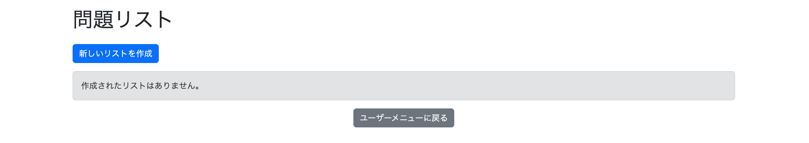

新しいリストを作成できる。

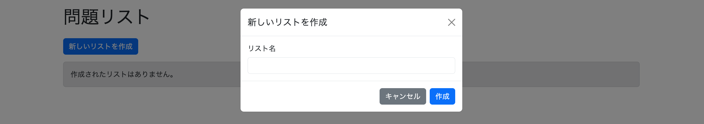

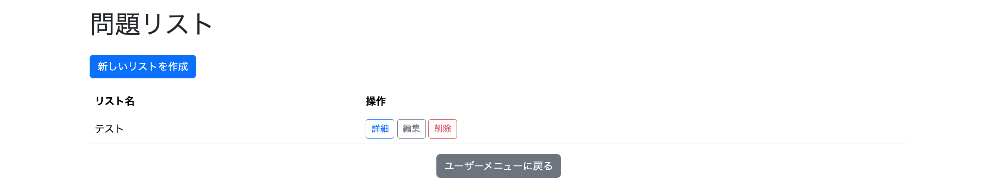

同じ名前のリストを作成した場合はエラーになる。

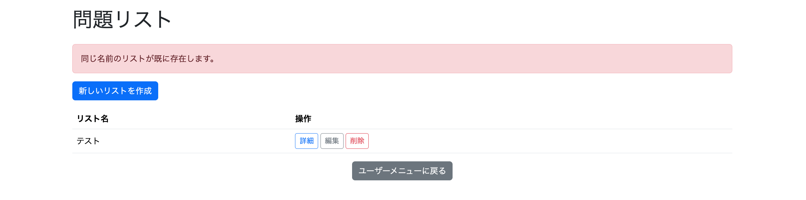

収録問題が存在しない場合は、その旨を詳細表示領域へ表示する。

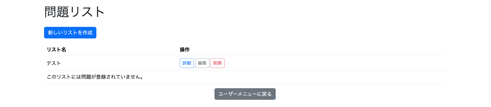

リスト名の編集・削除など、詳細表示方式とは独立した基本操作についても動作を確認した。

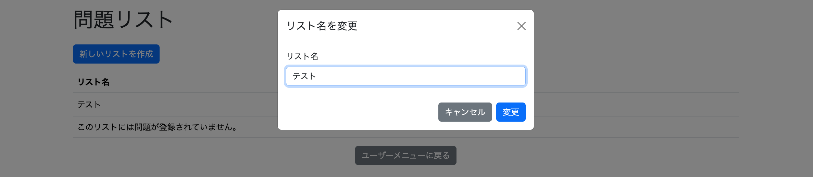

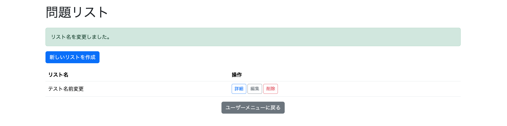

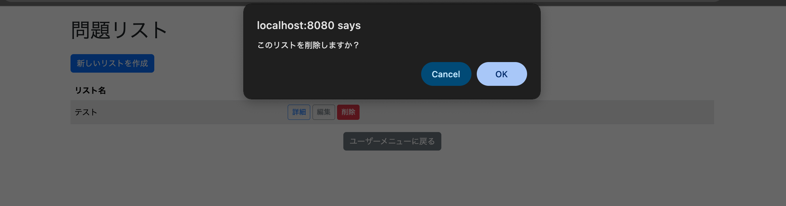

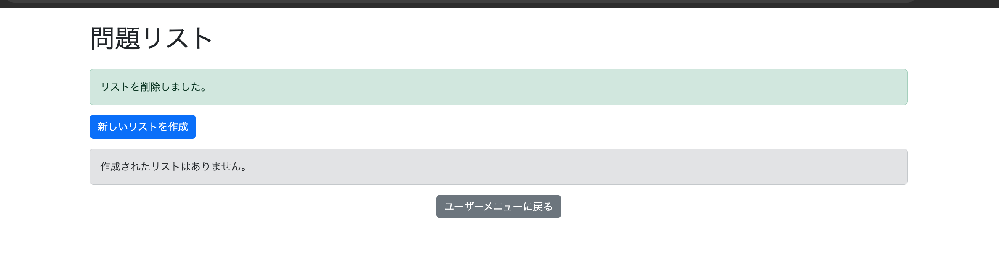

一般ユーザーのリスト作成数上限も確認した。

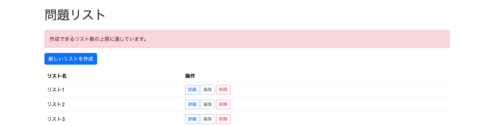

------------------------------------------------------------------------

## 初期詳細表示の問題点

基本的なリスト操作はできるようになったが、多数の問題を登録した状態で詳細を開くと、取得した`Question`の情報をそのまま表示しているだけで、画面表示に必要な情報が整理されていない。

動作確認のため、DBから50問を登録した。

``` sql
INSERT INTO question_list_item (
    list_id,
    question_id,
    added_at
)
SELECT
    3,
    q.question_id,
    CURRENT_TIMESTAMP
FROM question q
ORDER BY RANDOM()
LIMIT 50;
```

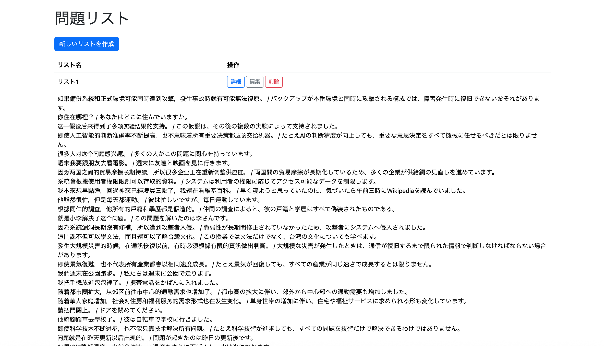

最終的に詳細表示で必要なのは、

``` text
中国語
日本語
難易度
理解度
お気に入り
生成元
発音情報
別解
構文
```

などである。

理解度は`StudyHistory`、お気に入りは`Favorite`に存在するため、`Question`だけでは情報が不足する。

そこで、前項で作成した`QuestionListItemDto`を利用する構成へ変更した。

------------------------------------------------------------------------

## DTOをJSONとして返す方式へ変更

DTO導入後も、この時点では詳細表示そのものはJavaScriptで行う設計を維持していた。

Controllerでは`QuestionListItemDto`の一覧をJSONとして返す。

``` java
@GetMapping("/user/question-list/detail")
@ResponseBody
public List<QuestionListItemDto>
        getUserQuestionListDetail(
                @AuthenticationPrincipal
                UserDetails loginUser,
                @RequestParam Long listId,
                Locale locale) {

    Users user =
            getLoginUser(loginUser);

    return questionListItemService
            .getQuestionListItems(
                    user,
                    listId,
                    locale);
}
```

これにより、EntityそのものをJSONへ変換するのではなく、画面表示に必要な情報をDTOとして取得できるようになった。

ここで導入したDTO・Repository・Serviceによるデータ取得部分は後の設計でも利用できるが、**DTOをJSONとしてJavaScriptへ渡し、JavaScriptが画面を生成する部分は旧設計となる**。

------------------------------------------------------------------------

## JavaScriptによるテーブル表示・操作

取得した`QuestionListItemDto`を利用して、JavaScriptから問題リスト詳細のテーブルを生成するようにした。

テーブルには、

``` text
中国語
日本語
難易度
理解度
お気に入り
生成元
詳細
削除
```

を表示し、さらに、

``` text
理解度変更
お気に入り登録・解除
問題詳細表示
問題リストから削除
```

を同じ画面から操作できるようにした。

POST処理を`fetch()`から行うため、HTMLへCSRF情報を設定する。

``` html
<meta name="_csrf"
      th:content="${_csrf.token}">

<meta name="_csrf_header"
      th:content="${_csrf.headerName}">
```

JavaScript側ではこれらを取得し、理解度変更、お気に入り切り替え、削除などのリクエストに利用する。

この方式では、テーブル、各行、各セル、ボタンなども`document.createElement()`を使用してJavaScript側で生成していた。

------------------------------------------------------------------------

## JavaScriptで使用するメッセージの多言語対応

動的に生成するテーブルの見出しやボタンもJavaScript側で作成するため、それらの文言についても`messages.properties`で管理した。

``` properties
questionList.detail.chinese=中国語
questionList.detail.japanese=日本語
questionList.detail.difficulty=難易度
questionList.detail.evaluation=理解度
questionList.detail.favorite=お気に入り
questionList.detail.source=生成元

questionList.detail.difficulty.beginner=初級
questionList.detail.difficulty.intermediate=中級
questionList.detail.difficulty.advanced=上級

questionList.detail.evaluation.unlearned=未学習
questionList.detail.evaluation.change=理解度を変更
questionList.detail.evaluation.hard=Hard
questionList.detail.evaluation.good=Good
questionList.detail.evaluation.easy=Easy

questionListItem.delete=削除
questionListItem.delete.confirm=この問題をリストから削除しますか？
questionListItem.delete.error=問題の削除に失敗しました。
```

外部JavaScriptからThymeleafの`#{...}`を直接利用できないため、HTMLの`data-*`へメッセージを設定し、JavaScriptから取得する構成としていた。

------------------------------------------------------------------------

## 旧設計の動作確認

収録問題をテーブル形式で表示できるようになった。

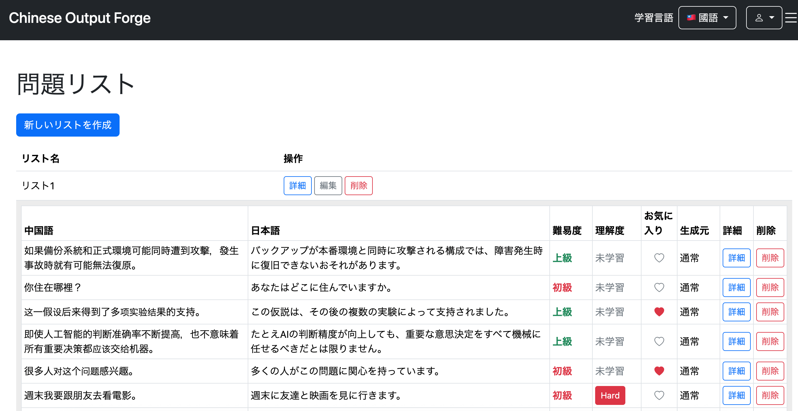

理解度を変更できる。

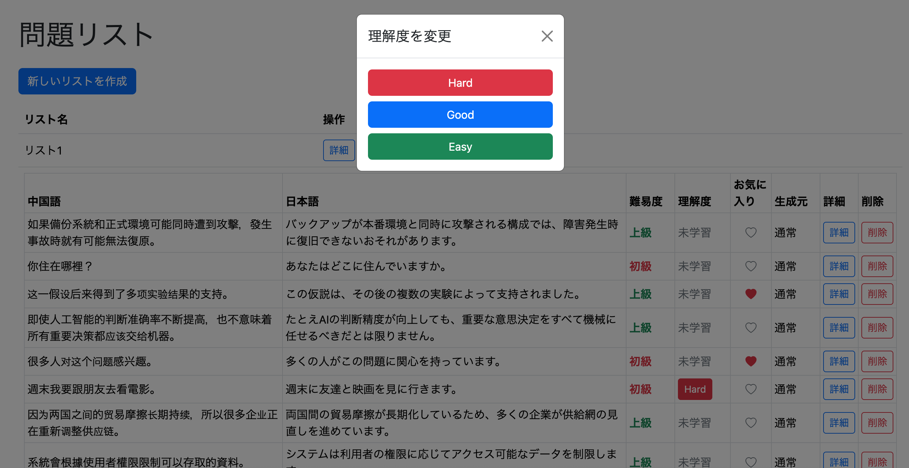

問題詳細を確認できる。

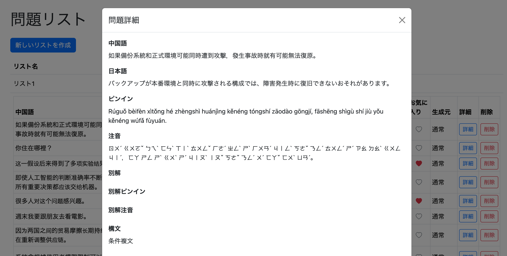

リストから問題を削除できる。

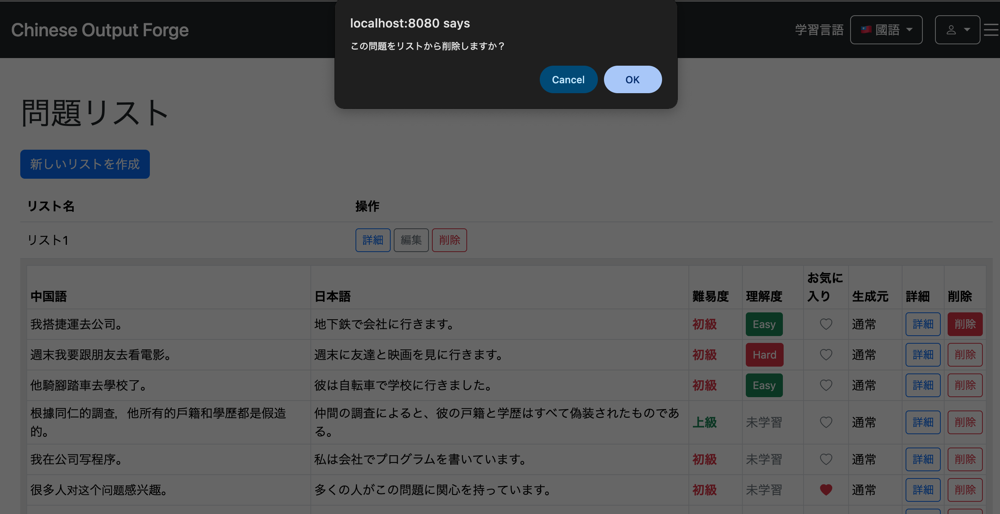

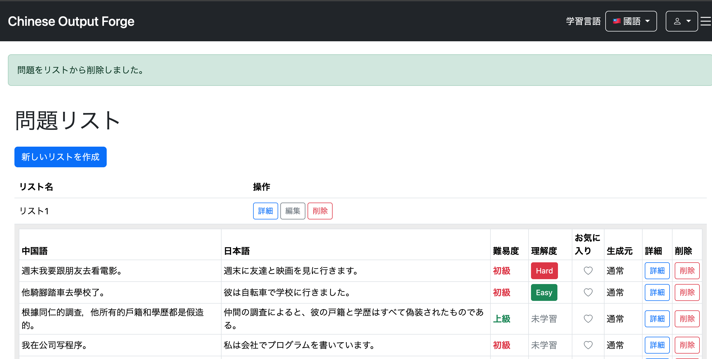

------------------------------------------------------------------------

## 旧設計を廃止する理由

この方式でも機能自体は実現できていたが、問題リストの詳細表示について、

``` text
データ取得
テーブル生成
各項目の表示
ボタン生成
イベント設定
```

の多くをJavaScript側で担当する構成となっていた。

このアプリケーションではJavaとSpring
Bootを中心として実装し、画面表示にはThymeleafを利用しているため、問題リスト詳細だけをJavaScript主体で構築すると、他の画面と比較して役割分担が大きく異なる。

さらにスマートフォン対応では、

``` text
PC
    → テーブル形式

スマートフォン
    → カード形式
```

のように表示を切り替えたい。

旧設計のまま対応する場合、JavaScript側でPC用のテーブルとスマートフォン用のカードの両方を生成・管理する必要があり、表示処理がさらに複雑になる。

そのため、このJavaScriptによる動的な詳細表示方式は廃止し、以降は**問題リスト詳細を独立したページとしてSpring
MVCとThymeleafで表示する方式**へ変更する。

> ここまでが、後に廃止したJavaScript主体の問題リスト詳細表示の実装である。

------------------------------------------------------------------------


# 各トレーニングのquestion画面から問題をリストに追加できるようにする

``` text
feat: add question list management to training question pages
```

これまでの実装ではリスト管理画面から問題を管理できるが、学習中に表示されている問題を直接リストへ追加することはできない。

そこで、

``` text
通常学習
復習
AI生成学習
```

の各`question.html`から現在の問題をリストへ追加できるようにする。

## どんな動きにするか

``` text
question.html
    │
    │ リストボタン
    ▼
┌───────────────────┐
│ リスト             │
│                   │
│ ☑ HSK6復習         │
│ ☐ 把構文           │
│ ☑ 苦手問題         │
│ ☐ 後で確認         │
│                   │
│ キャンセル   保存   │
└───────────────────┘
```

モーダルでは単純な「追加先」ではなく、**現在の問題がどのリストへ登録されているか**をチェック状態として表示する。

------------------------------------------------------------------------


## QuestionListSelectionDto

``` java
public interface QuestionListSelectionDto {

    Long getListId();

    String getListName();

    boolean getRegistered();
}
```

Repositoryではユーザーが所有するリストをすべて取得しつつ、現在の問題が登録されているかを判定する。

ここでは`INNER JOIN`にしてしまうと、問題が登録されていないリストが結果から消えてしまう。

そのため、ユーザー所有の全リストを残しつつ登録状態を判定できるようにする。

------------------------------------------------------------------------

## チェック状態に合わせて登録状態を一括更新

モーダルから、

``` text
questionId
selectedListIds
```

を送信する。

Service側では、

``` text
未登録 + チェックあり
    → 追加

登録済み + チェックなし
    → 削除

登録済み + チェックあり
    → 変更なし

未登録 + チェックなし
    → 変更なし
```

として差分を更新する。

------------------------------------------------------------------------

## /practice/question.html

お気に入りボタンの横へリストボタンを追加する。

``` html
<button id="questionListButton"
        type="button"
        class="btn p-0 border-0 bg-transparent"
        th:data-question-id="${question.questionId}"
        data-bs-toggle="modal"
        data-bs-target="#questionListModal">

    <i class="bi bi-folder-plus fs-4"></i>

</button>
```

さらに、リスト選択用のBootstrap Modalを追加する。

------------------------------------------------------------------------

## /practice/question.js

### リスト一覧を取得

``` javascript
function loadQuestionLists() {

    const questionId =
        questionListButton.dataset.questionId;

    fetch(
        "/user/question-list/selection?questionId="
        + questionId
    )

    .then(response => response.json())

    .then(questionLists => {

        const selectionArea =
            document.getElementById(
                "questionListSelectionArea"
            );

        selectionArea.innerHTML = "";

        questionLists.forEach(questionList => {

            const div =
                document.createElement("div");

            div.classList.add(
                "form-check",
                "mb-2"
            );

            const checkbox =
                document.createElement("input");

            checkbox.type = "checkbox";

            checkbox.classList.add(
                "form-check-input",
                "question-list-checkbox"
            );

            checkbox.value =
                questionList.listId;

            checkbox.id =
                "questionList-" +
                questionList.listId;

            checkbox.checked =
                questionList.registered;

            const label =
                document.createElement("label");

            label.classList.add(
                "form-check-label"
            );

            label.htmlFor =
                checkbox.id;

            label.textContent =
                questionList.listName;

            div.appendChild(checkbox);
            div.appendChild(label);

            selectionArea.appendChild(div);
        });
    });
}
```

### チェック状態を保存

``` javascript
const params =
    new URLSearchParams();

params.append(
    "questionId",
    questionId
);

checkedLists.forEach(checkbox => {

    params.append(
        "selectedListIds",
        checkbox.value
    );
});
```

更新APIへ送信する。

``` javascript
fetch("/user/question-list/item/update", {

    method: "POST",

    headers: {

        "Content-Type":
            "application/x-www-form-urlencoded",

        [csrfHeader]:
            csrfToken
    },

    body:
        params.toString()
});
```

更新成功後はページ遷移せずモーダルだけを閉じる。

``` javascript
const modalElement =
    document.getElementById(
        "questionListModal"
    );

const modal =
    bootstrap.Modal.getInstance(
        modalElement
    );

modal.hide();
```

------------------------------------------------------------------------

## 実行

通常学習画面にリストボタンが表示される。

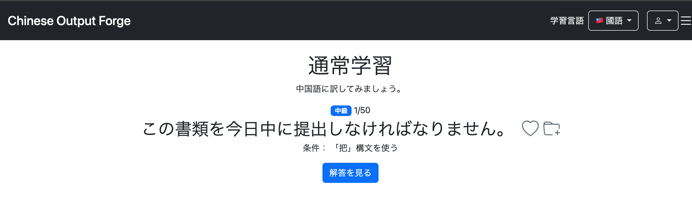

モーダルから追加先を選択できる。

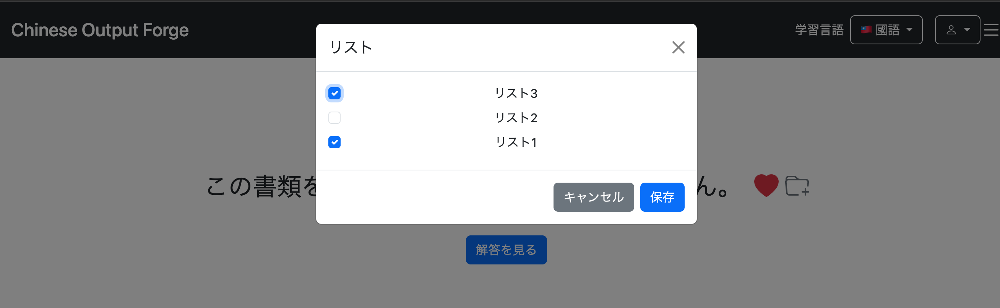

リスト1とリスト3へ登録する。

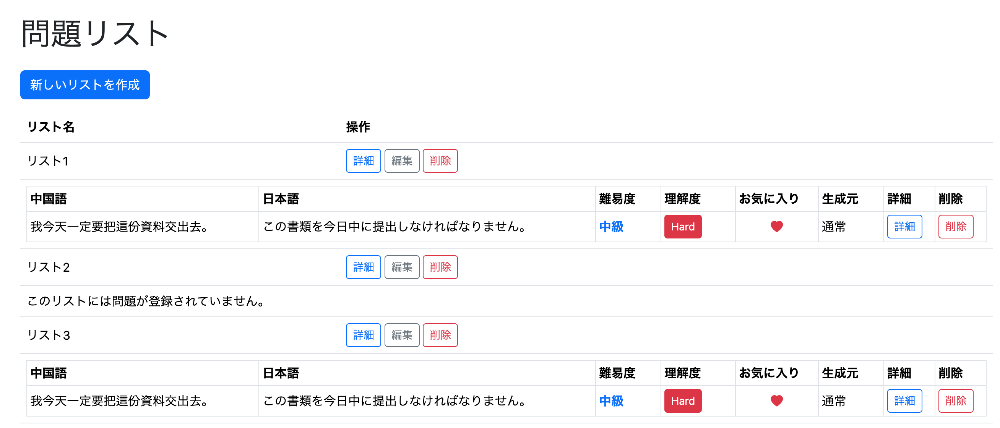

登録先をリスト1とリスト2へ変更する。

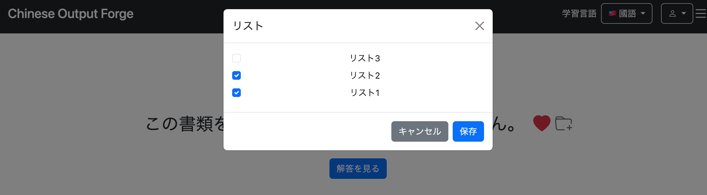

DB側でも登録状態が変更される。

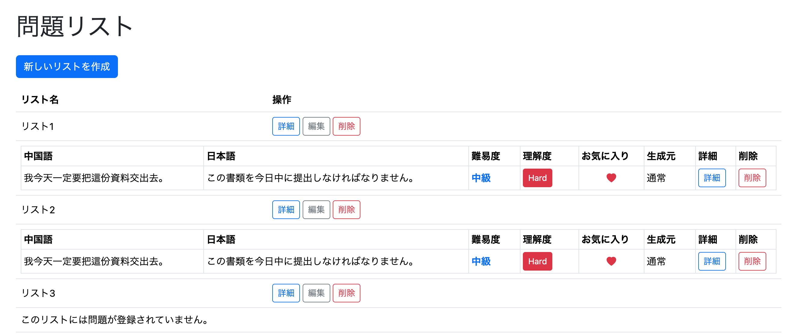

------------------------------------------------------------------------

## 追加修正　questionのモーダルからリストを新規に作れるようにする

既存リストへの追加だけでなく、question画面から新しいリスト自体を作成できるようにする。

通常の、

``` text
POST /user/question-list/create
```

は作成後にリスト管理画面へリダイレクトする。

question画面ではページ遷移したくないため、

``` java
@PostMapping("/user/question-list/create-modal")
@ResponseBody
public void postUserQuestionListCreateModal(
        @AuthenticationPrincipal
        UserDetails loginUser,
        @RequestParam String listName,
        Locale locale) {

    Users user =
            getLoginUser(loginUser);

    questionListService
            .createQuestionList(
                    user,
                    listName,
                    locale);
}
```

を追加する。

### JavaScript

``` javascript
const questionListCreateButton =
    document.getElementById(
        "questionListCreateButton"
    );

if (questionListCreateButton) {

    questionListCreateButton
        .addEventListener(
            "click",
            function () {

                const newQuestionListName =
                    document.getElementById(
                        "newQuestionListName"
                    );

                const listName =
                    newQuestionListName
                        .value
                        .trim();

                if (listName === "") {
                    return;
                }

                fetch(
                    "/user/question-list/create-modal",
                    {
                        method: "POST",

                        headers: {
                            "Content-Type":
                                "application/x-www-form-urlencoded",

                            [csrfHeader]:
                                csrfToken
                        },

                        body:
                            "listName=" +
                            encodeURIComponent(
                                listName
                            )
                    }
                )

                .then(response => {

                    if (!response.ok) {
                        throw new Error(
                            "リストの作成に失敗しました"
                        );
                    }

                    newQuestionListName.value =
                        "";

                    return loadQuestionLists();
                });
            }
        );
}
```

作成後に`questionListButton.click()`を実行すると、Bootstrap
Modalの開閉処理まで再実行されてしまう。

そこで、

``` javascript
function loadQuestionLists() {
    ...
}
```

として一覧取得処理を独立させ、作成後は、

``` javascript
return loadQuestionLists();
```

だけを呼び出す。

これによりモーダルを開いたまま一覧だけを再取得できる。

## 実行

モーダル内に新規リスト作成欄が表示される。

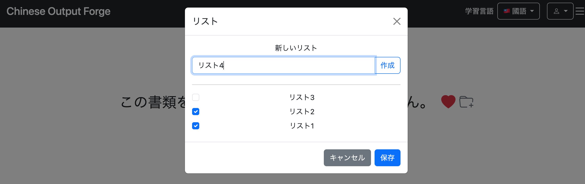

作成するとモーダルを閉じずに新しいリストが追加される。

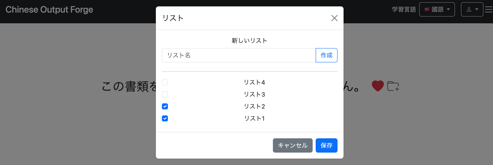

------------------------------------------------------------------------

### /review/question.html

通常学習と同じリストボタン・モーダルを追加する。

### /ai-practice/question.html

AI生成学習にも同じリスト操作を追加する。

ただし、生成直後のAI問題はまだDBへ保存されておらず`questionId`を持っていない。

そのため保存前はリストボタンを表示せず、AI生成問題を保存した後に利用可能にする。

### /ai-practice/question.js

AI生成問題保存後に返された`questionId`を、

``` javascript
questionListButton.dataset.questionId =
    questionId;
```

にも設定する。

これにより、保存されたAI生成問題を通常問題と同じようにリストへ登録できる。

## 実行

復習画面にもリストボタンが表示される。


モーダルからリストへ登録できる。

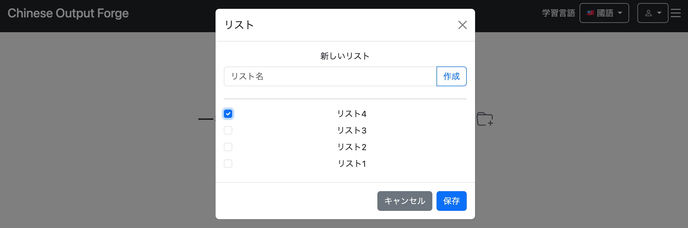

AI生成学習では保存前はリストボタンを表示しない。

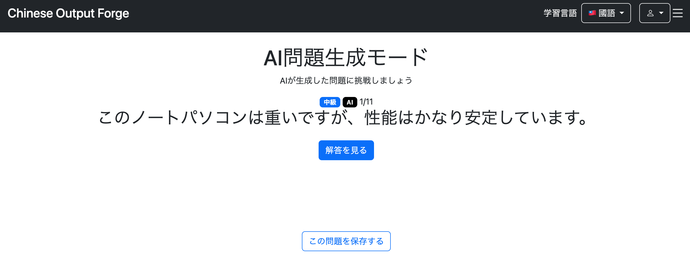

問題を保存するとリストボタンが表示される。

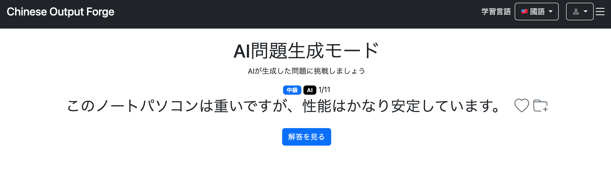

AI生成問題もリストへ登録できる。

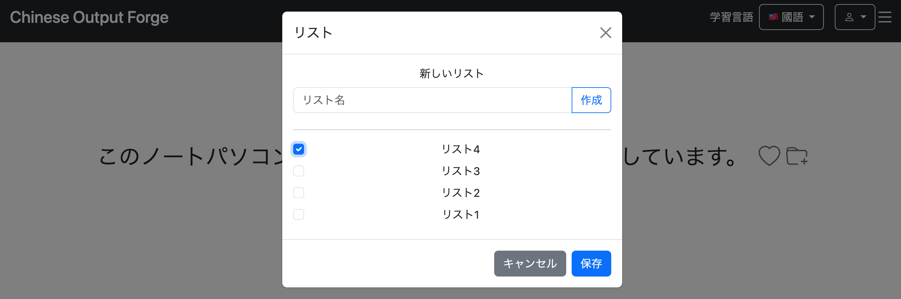

リスト管理画面から登録結果を確認できる。

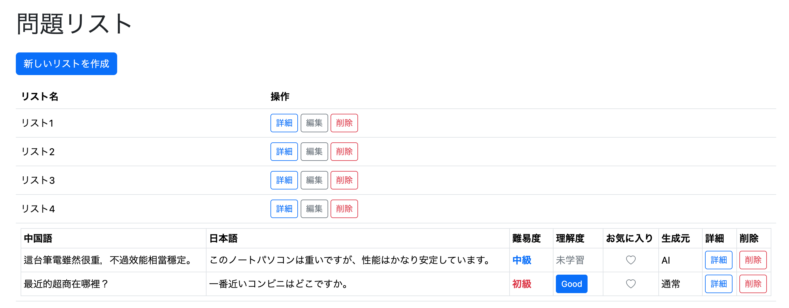

------------------------------------------------------------------------

## ファイル名の整理

リスト機能実装によってJavaScriptの役割が分かりにくくなった。

当初は、

``` text
/static/js/

├── practice/
│   └── question.js
│
├── practice.js
│
└── ai-practice/
    └── question.js
```

となっていた。

特に`/practice.js`は実質的にAI生成学習で利用しているにもかかわらず、名前から用途を判断できない。

また、

``` text
ai-practice/question.html
    ↓
practice.js
ai-practice/question.js
```

と1画面の処理が2ファイルへ分散している。

そこで、

``` text
/static/js/

├── practice/
│   └── question.js
│       → 通常学習・復習
│
└── ai-practice/
    └── question.js
        → AI生成学習
```

へ整理する。

`/practice.js`の処理を`/ai-practice/question.js`へ統合し、`/practice.js`は削除する。

------------------------------------------------------------------------

# 追加修正 - リストの表示順を更新日時の降順で取得するようにする

``` text
git commit -m "fix: sort lists by updated date in descending order"
```

現在は`findByUserId()`を利用しているため、リストの表示順が明示されていない。

そこでRepositoryを、

``` java
List<QuestionList>
    findByUserIdOrderByUpdatedAtDesc(
        Long userId
    );
```

のように変更し、最近更新されたリストから表示する。

------------------------------------------------------------------------

# 追加修正 − 問題追加・削除時もリストをupdated扱いにする

``` text
git commit -m "fix: update list timestamp when adding or removing questions"
```

`@UpdateTimestamp`は`QuestionList`自体がUPDATEされた場合に更新される。

そのため、

``` text
question_list_itemへ問題追加
question_list_itemから問題削除
```

だけでは`question_list.updated_at`は更新されない。

問題の追加・削除も「そのリストを更新した」とみなしたいため、`QuestionListItemService`から対象リストの`updatedAt`を更新する。

## 実行

長期間更新していないリスト2は後方に表示されている。

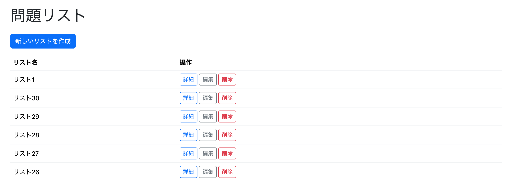

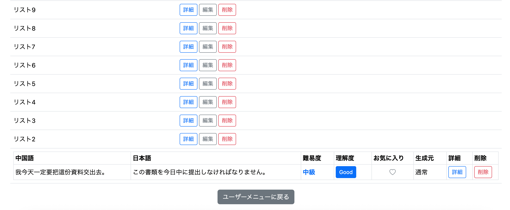

リスト2へ問題を追加する。


リスト管理画面へ戻ると、更新されたリスト2が先頭に表示される。

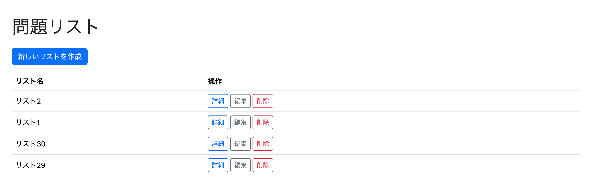

リスト3から問題を削除する。

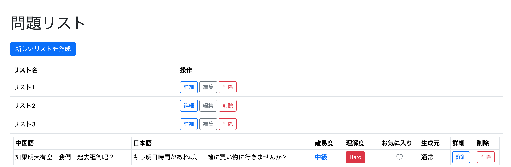

削除直後は画面上の並びは変わらない。

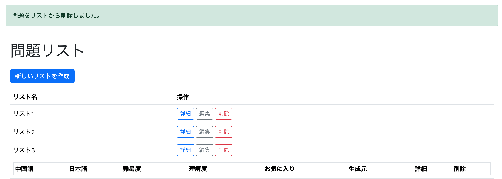

ページを再読み込みすると更新日時順に並び替えられる。

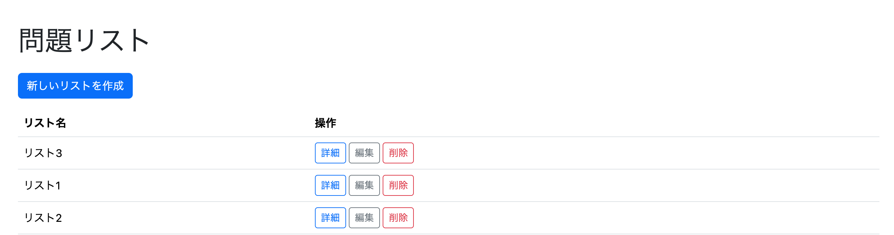

------------------------------------------------------------------------

# 追加修正 - リスト追加モーダルのリストの表示順も直す

``` text
git commit -m "fix: sort modal lists by updated date in descending order"
```

リスト管理画面の並び順は更新日時順になったが、question画面のリスト選択モーダルではまだ古い順序のままである。

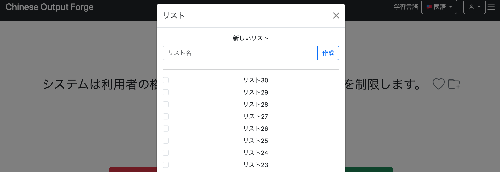

モーダル用のリスト取得についても、

``` text
updated_at DESC
```

で取得するよう修正する。

## 実行

モーダル内でも更新日時の降順で表示されるようになった。

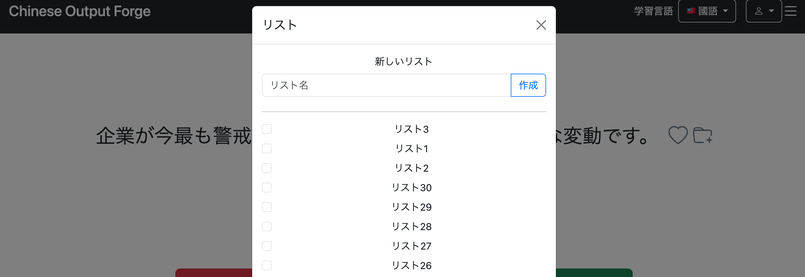

------------------------------------------------------------------------

# 追加修正 - messages.propertiesへの追加①

``` text
git commit -m "fix: add missing confirmation message for list deletion"
```

リストそのものを削除する際の確認メッセージが`messages.properties`へ設定されていなかった。

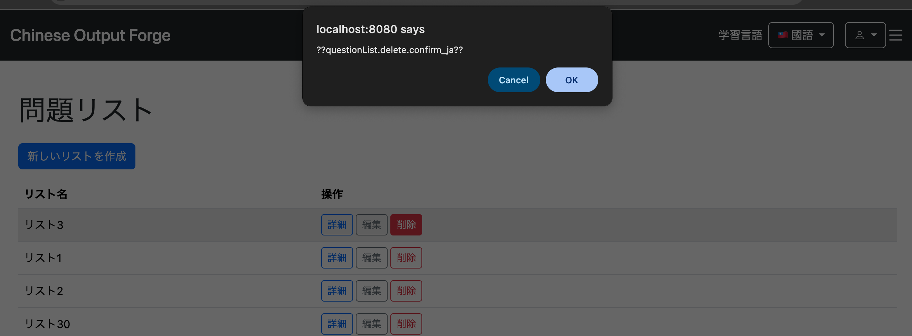

## messages.properties

``` properties
questionList.delete.confirm=このリストを削除しますか？
```

簡体字・繁体字についても対応する。

``` properties
questionList.delete.confirm=确定要删除这个列表吗？
```

``` properties
questionList.delete.confirm=確定要刪除這個清單嗎？
```

## 実行

リスト削除時の確認メッセージが表示されるようになった。

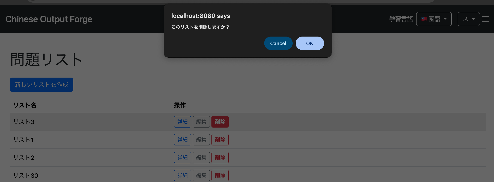

------------------------------------------------------------------------

# 追加修正 - messages.propertiesへの追加②

``` text
git commit -m "fix: localize question list modal messages"
```

question画面のリスト追加モーダルについて、表示言語を変更しても日本語のままになっている。

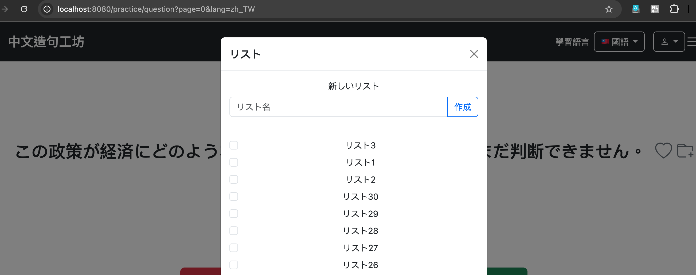

## 原因

モーダルの文言をHTMLへ直接記述していた。

例えば、

``` html
<h5 class="modal-title">
    リスト
</h5>

<label for="newQuestionListName"
       class="form-label">
    新しいリスト
</label>

<input type="text"
       id="newQuestionListName"
       class="form-control"
       placeholder="リスト名">

<button type="button"
        id="questionListCreateButton"
        class="btn btn-outline-primary">
    作成
</button>
```

となっている。

## html

通常学習・復習・AI生成学習の3画面で同じメッセージキーを使用する。

``` html
<h5 class="modal-title"
    th:text="#{questionList.modal.title}">
    リスト
</h5>

<label for="newQuestionListName"
       class="form-label"
       th:text="#{questionList.modal.newList}">
    新しいリスト
</label>

<input type="text"
       id="newQuestionListName"
       class="form-control"
       th:placeholder="#{questionList.modal.listName}">

<button type="button"
        id="questionListCreateButton"
        class="btn btn-outline-primary"
        th:text="#{questionList.modal.create}">
    作成
</button>
```

## messages.properties

``` properties
# 問題リスト選択モーダル
questionList.modal.title=リスト
questionList.modal.newList=新しいリスト
questionList.modal.listName=リスト名
questionList.modal.create=作成
questionList.modal.cancel=キャンセル
questionList.modal.save=保存
```

`messages_zh_CN.properties`と`messages_zh_TW.properties`にも同じキーを追加する。

## 実行

表示言語に合わせてリスト選択モーダルの文言も切り替わるようになった。

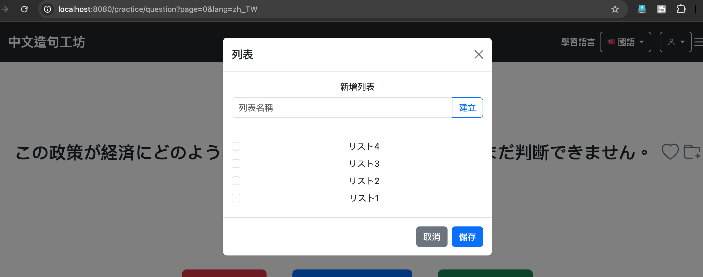

------------------------------------------------------------------------

# 追加修正 - 不要になった問題リスト追加用エンドポイントを削除する

各question画面から問題リストの登録状態を一括更新できるようになったことで、初期実装で追加した問題追加専用エンドポイントが使用されなくなった。

初期実装では、以下のメソッドから問題をリストへ追加していた。

``` java
@PostMapping("/user/question-list/item/add")
public String postQuestionListItemAdd(
        @AuthenticationPrincipal UserDetails loginUser,
        @RequestParam Long listId,
        @RequestParam Long questionId,
        Locale locale) {

    // ログインユーザーを取得
    Users user = getLoginUser(loginUser);

    // 指定した問題をリストに追加
    questionListItemService.addQuestionToList(
            user,
            listId,
            questionId,
            locale);

    // リスト一覧画面へ戻る
    return "redirect:/user/question-list/list";
}
```

その後、各question画面のリスト選択モーダルから、

``` text
POST /user/question-list/item/update
```

へ`questionId`と`selectedListIds`を送信し、`updateQuestionLists()`で現在の登録状態との差分を判定して追加・削除を行う構成へ変更した。

そのため、

``` text
POST /user/question-list/item/add
```

を直接呼び出す箇所は存在しなくなった。

不要になった`postQuestionListItemAdd()`を`QuestionListItemController`から削除する。

一方、

``` text
POST /user/question-list/item/delete
```

は問題リスト管理画面から問題を直接削除する際に使用しているため、こちらは残す。


# ここまでの実装

ここまでで、問題リスト機能のDB・Entity・Repository・Service・DTOなどの基盤と、リストの作成・編集・削除、問題の追加・削除、各question画面からのリスト操作を実装した。

一方、問題リストに収録されている問題の詳細表示については、当初JavaScriptからJSONを取得し、同じ画面内へ動的にテーブルを生成する方式としていた。

この旧方式は一度動作するところまで実装したものの、アプリケーション全体の構成やスマートフォン対応を考慮し、最終的には採用しない。

次に、問題リスト詳細を独立したページとして表示する新しい設計へ変更する。

------------------------------------------------------------------------


# 新設計 - 問題リスト詳細を独立したページとして表示する（10月12日）

```text
git commit -m "Refactor question list details into a dedicated page"
```

## 設計変更の方針

旧設計では、問題リスト一覧画面の「詳細」をクリックすると、`GET /user/question-list/detail`から`QuestionListItemDto`をJSONとして取得し、`question-list/list.js`が問題一覧のHTMLを動的に生成していた。

```text
旧設計

question-list/list.html
        ↓
list.js
        ↓
GET /user/question-list/detail
        ↓
@ResponseBody
        ↓
List<QuestionListItemDto>をJSONとして返す
        ↓
JavaScriptで問題一覧を生成
        ↓
list.html内に表示
```

スマートフォンでは、この方式で生成した横長のテーブルが画面幅に収まりにくく、各項目が細かく折り返されて見にくくなっていた。

そこで、問題リスト詳細を独立したページとして表示する構成へ変更する。

```text
新設計

question-list/list.html
        ↓
GET /user/question-list/detail?listId=...
        ↓
QuestionListController
        ↓
QuestionListItemService
        ↓
QuestionListItemDto
        ↓
Model
        ↓
question-list/detail.html
```

この変更では、Repository・Service・`QuestionListItemDto`によるデータ取得処理はそのまま利用し、Controller以降の表示方法を変更する。

問題一覧のHTMLはSpring MVCとThymeleafで生成し、JavaScriptは問題詳細モーダルなどの画面操作に限定して使用する。

---

## QuestionListControllerの変更

### `getUserQuestionListDetail()`をページ表示用に変更する

旧設計では、`@ResponseBody`を付けたControllerから`List<QuestionListItemDto>`を返し、SpringによってJSONへ変換していた。

```java
@GetMapping("/user/question-list/detail")
@ResponseBody
public List<QuestionListItemDto> getUserQuestionListDetail(
        @AuthenticationPrincipal UserDetails loginUser,
        @RequestParam Long listId,
        Locale locale) {

    Users user = getLoginUser(loginUser);

    List<QuestionListItemDto> listItems =
            questionListItemService.getQuestionListItems(
                    user,
                    listId,
                    locale);

    return listItems;
}
```

新設計では`@ResponseBody`を削除し、取得した`QuestionListItemDto`をModelへ格納して`detail.html`を返す。

また、問題詳細モーダルではユーザーの設定に応じて拼音または注音を表示するため、通常の問題一覧画面と同様に`HttpSession`から`pronunciationType`を取得してModelへ渡す。

```java
/**
 * 指定された問題リストに登録されている問題の一覧を表示する。
 *
 * @param loginUser ログインユーザー情報
 * @param listId 対象リストのID
 * @param model 画面に渡すデータ
 * @param locale 現在の言語・地域情報
 * @param session HTTPセッション
 * @return 問題リスト詳細画面のビュー名
 */
@GetMapping("/user/question-list/detail")
public String getUserQuestionListDetail(
        @AuthenticationPrincipal UserDetails loginUser,
        @RequestParam Long listId,
        Model model,
        Locale locale,
        HttpSession session) {

    // ログインユーザーを取得
    Users user = getLoginUser(loginUser);

    // 指定した問題リストに登録されている問題を取得
    List<QuestionListItemDto> listItems =
            questionListItemService.getQuestionListItems(
                    user,
                    listId,
                    locale);

    // 問題リストの問題一覧を画面へ渡す
    model.addAttribute(
            "listItems",
            listItems);

    // 表示する発音表記を取得
    PronunciationType pronunciationType =
            (PronunciationType) session.getAttribute("pronunciationType");

    // 未設定の場合は拼音を使用
    if (pronunciationType == null) {
        pronunciationType = PronunciationType.PINYIN;
    }

    model.addAttribute(
            "pronunciationType",
            pronunciationType);

    return "user/question-list/detail";
}
```

これにより、`QuestionListItemDto`はJSONへ変換されず、Modelの`listItems`としてThymeleafへ渡されるようになった。

---

## `question-list/list.html`を新設計に合わせて整理する

### 「詳細」ボタンをページ遷移へ変更する

旧設計では、JavaScriptから`listId`を取得するため、「詳細」を`button`として実装していた。

```html
<button type="button"
        class="btn btn-sm btn-outline-primary question-list-detail-button"
        th:data-list-id="${questionList.listId}"
        th:text="#{questionList.detail}">
    詳細
</button>
```

新設計では独立した詳細画面へ遷移するため、リンクへ変更する。

```html
<a th:href="@{/user/question-list/detail(listId=${questionList.listId})}"
   class="btn btn-sm btn-outline-primary"
   th:text="#{questionList.detail}">
    詳細
</a>
```

これにより、「詳細」をクリックすると以下の流れで画面遷移する。

```text
question-list/list.html
        ↓
詳細をクリック
        ↓
GET /user/question-list/detail?listId=...
        ↓
QuestionListController
        ↓
Model
        ↓
question-list/detail.html
```

### 旧設計専用の要素を削除する

問題リスト詳細を`detail.html`へ分離したため、`question-list/list.html`に残っていた旧設計専用の要素を削除する。

削除対象は以下である。

- JavaScriptで取得した問題一覧を表示する旧インライン詳細領域
- `questionListSuccessMessage`
- `questionListErrorMessage`
- `questionListMessages`
- 旧詳細表示用の`questionDetailModal`
- 旧詳細表示用の`evaluationModal`
- `/js/user/question-list/list.js`の読み込み

一方、以下は問題リスト一覧画面の機能として引き続き必要なため残す。

- 問題リスト一覧
- 新規リスト作成
- リスト名編集
- リスト自体の削除
- Thymeleafによる成功・エラーメッセージ
- ユーザーメニューへ戻る処理
- 問題リスト詳細画面へのリンク

### `question-list/list.js`を削除する

`question-list/list.js`の内容を確認したところ、このファイルはすべて旧設計の問題リスト詳細表示に使用されていた。

主な処理は以下である。

```text
list.js

├─ CSRF情報の取得
├─ questionListMessagesからメッセージを取得
├─ 「詳細」ボタンのクリックイベント
├─ GET /user/question-list/detail の実行
├─ QuestionListItemDtoをJSONとして取得
├─ JavaScriptによる問題一覧テーブルの生成
├─ お気に入り登録・解除
├─ 問題詳細モーダルの表示
├─ リストから問題を削除
└─ 理解度変更モーダルの表示・更新
```

新設計ではJSONを取得して問題一覧そのものを生成する必要がなくなった。また、このファイルには問題リストの作成・編集・削除に必要な処理は含まれていなかった。

そのため、以下のファイルを削除する。

```text
static/js/user/question-list/list.js
```

それに伴い、`question-list/list.html`から以下の読み込みも削除する。

```html
<script th:src="@{/js/user/question-list/list.js}"></script>
```

変更後、`question-list/list.html`は「問題リスト自体の管理」、`question-list/detail.html`は「選択した問題リストに登録されている問題の表示・操作」を担当する構成となる。

---

## `question-list/detail.html`を作成する

### 問題一覧をThymeleafで表示する

新しい`detail.html`では、ControllerからModelへ渡された`listItems`をThymeleafで繰り返し表示する。

一覧には以下の項目を表示する。

- 中国語
- 日本語
- 難易度
- 理解度
- お気に入り
- 生成元
- 詳細
- 削除

```html
<tbody>
    <tr th:each="question : ${listItems}">

        <td th:text="${question.chineseText}"></td>

        <td th:text="${question.japaneseText}"></td>

        <!-- 難易度 -->
        <td>
            <span class="text-danger fw-bold"
                  th:if="${question.difficulty.name() == 'BEGINNER'}"
                  th:text="#{questionList.detail.difficulty.beginner}">
                初級
            </span>

            <span class="text-primary fw-bold"
                  th:if="${question.difficulty.name() == 'INTERMEDIATE'}"
                  th:text="#{questionList.detail.difficulty.intermediate}">
                中級
            </span>

            <span class="text-success fw-bold"
                  th:if="${question.difficulty.name() == 'ADVANCED'}"
                  th:text="#{questionList.detail.difficulty.advanced}">
                上級
            </span>
        </td>

        <!-- 理解度 -->
        <td>
            <span th:if="${question.evaluation == null}"
                  class="text-secondary text-nowrap"
                  th:text="#{questionList.detail.evaluation.unlearned}">
                未学習
            </span>

            <button th:if="${question.evaluation?.name() == 'HARD'}"
                    type="button"
                    class="btn btn-sm btn-danger evaluationButton"
                    th:data-question-id="${question.questionId}"
                    data-bs-toggle="modal"
                    data-bs-target="#evaluationModal">
                Hard
            </button>

            <button th:if="${question.evaluation?.name() == 'GOOD'}"
                    type="button"
                    class="btn btn-sm btn-primary evaluationButton"
                    th:data-question-id="${question.questionId}"
                    data-bs-toggle="modal"
                    data-bs-target="#evaluationModal">
                Good
            </button>

            <button th:if="${question.evaluation?.name() == 'EASY'}"
                    type="button"
                    class="btn btn-sm btn-success evaluationButton"
                    th:data-question-id="${question.questionId}"
                    data-bs-toggle="modal"
                    data-bs-target="#evaluationModal">
                Easy
            </button>
        </td>

        <!-- お気に入り -->
        <td class="text-center">
            <button type="button"
                    class="btn btn-link p-0 favoriteButton"
                    th:data-question-id="${question.questionId}">
                <i class="bi bi-heart-fill text-danger"
                   th:if="${question.favorite}"></i>
                <i class="bi bi-heart text-secondary"
                   th:unless="${question.favorite}"></i>
            </button>
        </td>

        <!-- 生成元 -->
        <td class="text-center">
            <span class="badge bg-black"
                  th:if="${question.aiGenerated}">
                AI
            </span>
            <span class="badge bg-white text-dark border border-dark"
                  th:unless="${question.aiGenerated}">
                APP
            </span>
        </td>

        <!-- 詳細 -->
        <td>
            <button type="button"
                    class="detailButton btn btn-outline-primary btn-sm text-nowrap"
                    data-bs-toggle="modal"
                    data-bs-target="#questionDetailModal"
                    th:data-japanese="${question.japaneseText}"
                    th:data-chinese="${question.chineseText}"
                    th:data-pinyin="${question.pinyin}"
                    th:data-zhuyin="${question.zhuyin}"
                    th:data-alternative="${question.alternativeAnswer}"
                    th:data-alternative-pinyin="${question.alternativeAnswerPinyin}"
                    th:data-alternative-zhuyin="${question.alternativeAnswerZhuyin}"
                    th:data-structure="${question.structureName}"
                    th:text="#{questionList.detail}">
                詳細
            </button>
        </td>

        <!-- 削除 -->
        <td class="text-center">
            <form th:action="@{/user/question-list/item/delete}"
                  method="post">
                <input type="hidden"
                       name="listId"
                       th:value="${param.listId}">
                <input type="hidden"
                       name="questionId"
                       th:value="${question.questionId}">
                <button type="submit"
                        class="btn btn-dark btn-sm"
                        th:onclick="|return confirm('#{questionListItem.delete.confirm}')|">
                    <i class="bi bi-trash"></i>
                </button>
            </form>
        </td>

    </tr>
</tbody>
```

ここで使用する`question`は、`th:each="question : ${listItems}"`で定義した`QuestionListItemDto`である。

### messages.propertiesへ画面用メッセージを追加する

問題リスト詳細画面のタイトルと戻るボタン用のメッセージを追加する。

```properties
questionList.detail.title=問題リスト詳細
questionList.backToList=問題リストに戻る
```

---

## 問題詳細モーダルを追加する

### 通常の問題一覧画面の実装を確認する

通常の`/user/question/list.html`では、詳細ボタンの`data-*`属性へ問題情報を設定し、`question/list.js`がクリックされた問題の情報を`questionDetailModal`へ設定している。

問題リスト詳細画面でも同じ方式を使用する。

```text
詳細ボタン
        ↓
data-*属性から問題情報を取得
        ↓
detail.js
        ↓
questionDetailModalへ値を設定
        ↓
モーダルを表示
```

### 詳細ボタンへ問題情報を設定する

`detail.html`の詳細ボタンには、モーダルで使用する情報を`data-*`属性として設定する。

```html
<button type="button"
        class="detailButton btn btn-outline-primary btn-sm text-nowrap"
        data-bs-toggle="modal"
        data-bs-target="#questionDetailModal"
        th:data-japanese="${question.japaneseText}"
        th:data-chinese="${question.chineseText}"
        th:data-pinyin="${question.pinyin}"
        th:data-zhuyin="${question.zhuyin}"
        th:data-alternative="${question.alternativeAnswer}"
        th:data-alternative-pinyin="${question.alternativeAnswerPinyin}"
        th:data-alternative-zhuyin="${question.alternativeAnswerZhuyin}"
        th:data-structure="${question.structureName}"
        th:text="#{questionList.detail}">
    詳細
</button>
```

当初は`${item...}`を参照していたが、`detail.html`の`th:each`で使用している変数名は`question`であるため、最終的にすべて`${question...}`へ統一した。

### `questionDetailModal`を追加する

モーダルでは、日本語、中国語、ユーザー設定に応じた発音表記、文法・構造、別解、別解の発音表記を表示する。

```html
<!-- ========================= -->
<!-- 問題詳細モーダル -->
<!-- ========================= -->

<div class="modal fade"
     id="questionDetailModal"
     th:data-pronunciation-type="${pronunciationType}">

    <div class="modal-dialog">
        <div class="modal-content">

            <div class="modal-header">
                <h5 class="modal-title"
                    th:text="#{user.question.list.detailTitle}">
                    問題詳細
                </h5>

                <button type="button"
                        class="btn-close"
                        data-bs-dismiss="modal">
                </button>
            </div>

            <div class="modal-body">

                <!-- 日本語 -->
                <p>
                    <strong th:text="#{user.question.list.japanese}">
                        日本語
                    </strong>
                    <br>
                    <span id="modalJapanese"></span>
                </p>

                <!-- 中国語 -->
                <div class="mb-3">
                    <strong th:text="#{user.question.list.chinese}">
                        中国語
                    </strong>
                    <br>
                    <span id="modalChinese"></span>

                    <!-- 中国語の発音記号 -->
                    <div id="modalChinesePronunciationArea"
                         class="text-secondary small mt-1">
                        <span id="modalChinesePronunciation"></span>
                    </div>
                </div>

                <!-- 文法・構造 -->
                <div class="mb-3">
                    <strong>文法・構造</strong>
                    <br>
                    <span id="modalStructure"></span>
                </div>

                <!-- 別解 -->
                <div id="modalAlternativeArea"
                     class="mb-3">
                    <strong th:text="#{user.question.list.alternativeAnswer}">
                        別解
                    </strong>
                    <br>
                    <span id="modalAlternative"></span>

                    <!-- 別解の発音記号 -->
                    <div id="modalAlternativePronunciationArea"
                         class="text-secondary small mt-1">
                        <span id="modalAlternativePronunciation"></span>
                    </div>
                </div>

            </div>

            <div class="modal-footer">
                <button type="button"
                        class="btn btn-secondary"
                        data-bs-dismiss="modal"
                        th:text="#{common.close}">
                    閉じる
                </button>
            </div>

        </div>
    </div>
</div>
```

### 発音表記の設定をControllerから渡す

`questionDetailModal`では、`data-pronunciation-type`から現在の発音表記設定を参照する。

```html
<div class="modal fade"
     id="questionDetailModal"
     th:data-pronunciation-type="${pronunciationType}">
```

`pronunciationType`は前述の`getUserQuestionListDetail()`でセッションから取得してModelへ設定している。

未設定の場合は通常の問題一覧画面と同様に`PINYIN`を使用する。

---

## `detail.js`で問題詳細モーダルを制御する

`detail.js`では画面そのものを生成せず、Thymeleafによって詳細ボタンへ設定された`data-*`属性を読み取り、既存のモーダルへ値を設定する。

`detail.html`の`<head>`から以下のJavaScriptを読み込む。

```html
<script th:src="@{/js/user/question-list/detail.js}"
        defer>
</script>
```

最終的な問題詳細モーダルの処理は以下のようになる。

```javascript
// =========================
// 問題詳細モーダル
// =========================

const detailButtons =
    document.querySelectorAll(".detailButton");

const modal =
    document.getElementById("questionDetailModal");

const pronunciationType =
    modal.dataset.pronunciationType;

detailButtons.forEach(button => {

    button.addEventListener("click", () => {

        // 日本語
        document.getElementById("modalJapanese")
            .textContent = button.dataset.japanese || "";

        // 中国語
        document.getElementById("modalChinese")
            .textContent = button.dataset.chinese || "";

        // 文法・構造
        document.getElementById("modalStructure")
            .textContent = button.dataset.structure || "";

        // 中国語の発音
        const chinesePronunciationArea =
            document.getElementById(
                "modalChinesePronunciationArea");

        const chinesePronunciation =
            document.getElementById(
                "modalChinesePronunciation");

        if (pronunciationType === "PINYIN") {

            chinesePronunciation.textContent =
                button.dataset.pinyin || "";

            chinesePronunciationArea.style.display =
                button.dataset.pinyin ? "" : "none";

        } else if (pronunciationType === "ZHUYIN") {

            chinesePronunciation.textContent =
                button.dataset.zhuyin || "";

            chinesePronunciationArea.style.display =
                button.dataset.zhuyin ? "" : "none";

        } else {

            chinesePronunciationArea.style.display = "none";
        }

        // =========================
        // 別解
        // =========================

        const alternativeArea =
            document.getElementById(
                "modalAlternativeArea");

        const alternative =
            button.dataset.alternative;

        if (alternative) {

            alternativeArea.style.display = "";

            document.getElementById("modalAlternative")
                .textContent = alternative;

            // 別解の発音
            const alternativePronunciationArea =
                document.getElementById(
                    "modalAlternativePronunciationArea");

            const alternativePronunciation =
                document.getElementById(
                    "modalAlternativePronunciation");

            if (pronunciationType === "PINYIN") {

                alternativePronunciation.textContent =
                    button.dataset.alternativePinyin || "";

                alternativePronunciationArea.style.display =
                    button.dataset.alternativePinyin
                        ? ""
                        : "none";

            } else if (pronunciationType === "ZHUYIN") {

                alternativePronunciation.textContent =
                    button.dataset.alternativeZhuyin || "";

                alternativePronunciationArea.style.display =
                    button.dataset.alternativeZhuyin
                        ? ""
                        : "none";

            } else {

                alternativePronunciationArea.style.display = "none";
            }

        } else {

            alternativeArea.style.display = "none";
        }

    });

});
```

これにより、処理の役割は以下のように分かれる。

```text
QuestionListItemDto
        ↓
Thymeleaf
        ↓
詳細ボタンのdata-*属性へ問題情報を設定
        ↓
詳細ボタンをクリック
        ↓
detail.js
        ↓
questionDetailModalへ値を設定
        ↓
問題詳細を表示
```

JavaScriptはControllerからJSONを取得せず、問題一覧のHTMLも生成しない。画面表示はThymeleaf、モーダルの操作はJavaScriptという形で役割を分離した。

---

## 問題削除後も同じ詳細画面にとどまるようにする

問題リスト詳細画面から問題を削除すると、当初は削除後に`question-list/list.html`へ戻っていた。

旧実装では、削除処理のリダイレクト先が以下になっていたためである。

```java
return "redirect:/user/question-list/list";
```

独立した詳細画面を導入したため、削除後は対象となっている問題リストの詳細画面を再表示するように変更する。

また、削除成功メッセージを`RedirectAttributes`のFlash属性として渡す。

```java
/**
 * 指定された問題を問題リストから削除する。
 *
 * @param loginUser ログインユーザー情報
 * @param listId 削除元のリストID
 * @param questionId 削除する問題のID
 * @param locale 現在の言語・地域情報
 * @param redirectAttributes リダイレクト先へ渡すFlash属性
 * @return 問題リスト詳細画面へのリダイレクト先
 */
@PostMapping("/user/question-list/item/delete")
public String postQuestionListItemDelete(
        @AuthenticationPrincipal UserDetails loginUser,
        @RequestParam Long listId,
        @RequestParam Long questionId,
        Locale locale,
        RedirectAttributes redirectAttributes) {

    Users user = getLoginUser(loginUser);

    questionListItemService.deleteQuestionFromList(
            user,
            listId,
            questionId,
            locale);

    redirectAttributes.addFlashAttribute(
            "successMessage",
            messageSource.getMessage(
                    "questionListItem.delete.success",
                    null,
                    locale));

    return "redirect:/user/question-list/detail?listId=" + listId;
}
```

処理の流れは以下のようになる。

```text
問題リスト詳細画面
        ↓
問題を削除
        ↓
POST /user/question-list/item/delete
        ↓
問題リストから対象問題を削除
        ↓
successMessageをFlash属性へ設定
        ↓
GET /user/question-list/detail?listId={listId}
        ↓
同じ問題リスト詳細画面を再表示
```

### 削除成功メッセージを表示する

`detail.html`の画面上部に`successMessage`の表示領域を追加する。

```html
<!-- ========================= -->
<!-- 成功メッセージ -->
<!-- ========================= -->

<div th:if="${successMessage}"
     class="alert alert-success alert-dismissible fade show"
     role="alert">

    <span th:text="${successMessage}"></span>

    <button type="button"
            class="btn-close"
            data-bs-dismiss="alert">
    </button>

</div>
```

これにより、問題を削除した後も同じ問題リスト詳細画面にとどまり、削除された問題が一覧から消えた状態で成功メッセージを確認できるようになった。

---

## 確認

問題リスト一覧から「詳細」をクリックし、選択した問題リストの詳細画面へ遷移できることを確認した。

問題リスト詳細画面では、リストに登録されている問題について以下の情報が一覧で表示されることを確認した。

- 中国語
- 日本語
- 難易度
- 理解度
- お気に入り
- 生成元
- 詳細
- 削除

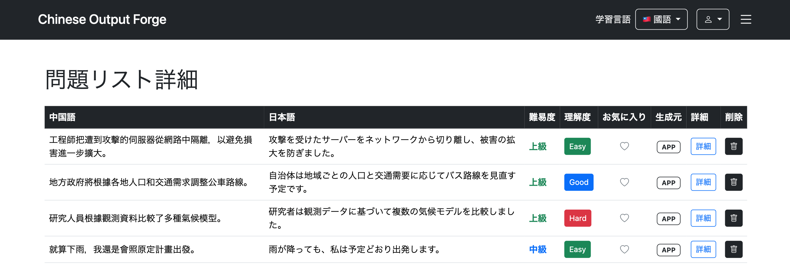

また、「詳細」をクリックすると問題詳細モーダルが表示され、以下の情報を確認できることを確認した。

- 日本語
- 中国語
- ユーザーが設定している発音表記（拼音または注音）
- 文法・構造
- 別解
- 別解の発音表記

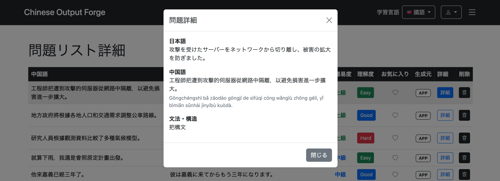

さらに、問題を削除した場合は問題リスト一覧画面へ戻らず、同じ問題リスト詳細画面が再表示されることを確認した。

削除された問題が一覧から消え、画面上部に削除成功メッセージが表示されることも確認した。

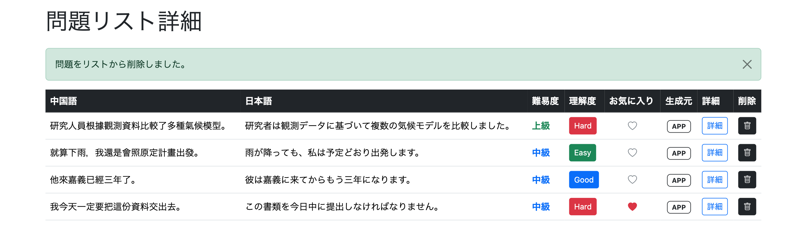

最終的な構成は以下となる。

```text
問題リスト一覧
        ↓
GET /user/question-list/detail?listId=...
        ↓
QuestionListController
        ↓
QuestionListItemService
        ↓
QuestionListItemDto
        ↓
Model
        ↓
detail.html（Thymeleaf）
        ↓
問題一覧を表示
        ↓
detail.js
        ↓
問題詳細モーダルなどの画面操作
```

これにより、従来の「JSONを取得してJavaScriptで問題一覧を生成する構成」から、「Spring MVCとThymeleafで問題一覧を生成し、JavaScriptは画面操作を担当する構成」への変更が完了した。
