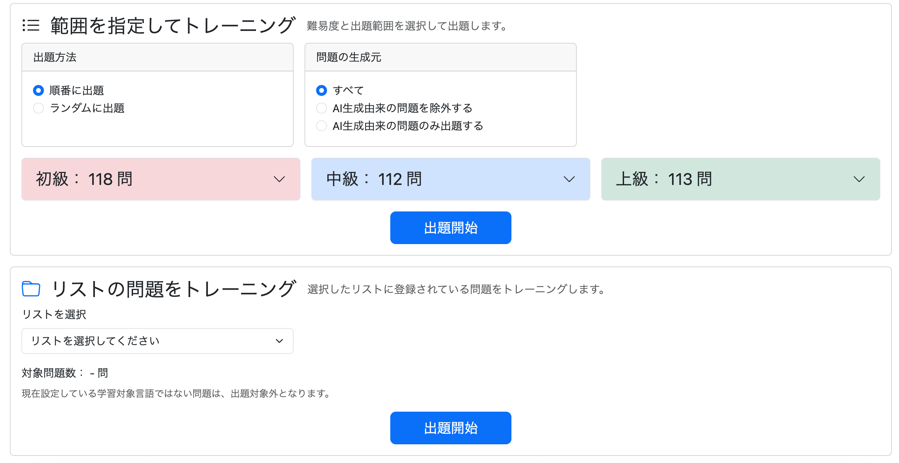
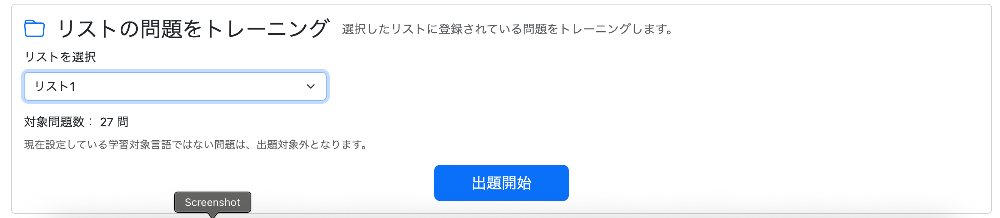
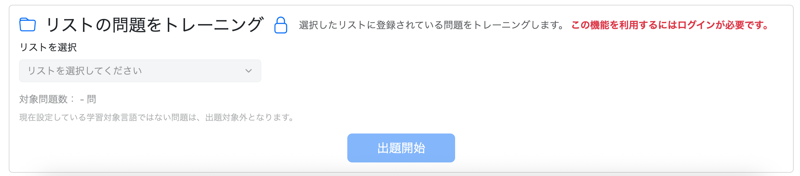
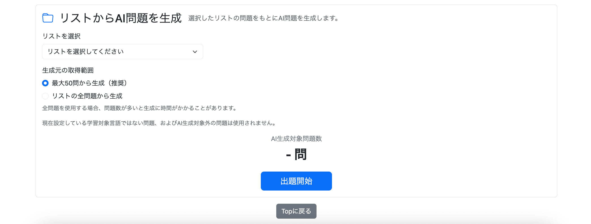
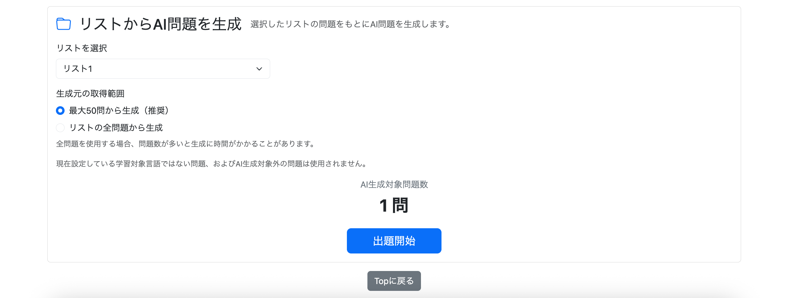

# 030-01 問題リスト機能④｜通常学習・AI生成学習への統合

## 概要

029-01〜029-03では、問題リストのDB設計、リストの作成・編集・削除、問題の登録・解除、詳細画面の再設計までを実装した。

本章では、作成したリストを**通常学習とAI生成学習の出題元として利用できるようにする**。既存の条件検索とは入口を分け、問題を取得した後の学習処理やAI生成処理は再利用する方針とした。

実装の過程では、リストの所有者確認、学習対象言語による絞り込み、AI生成元としての適格性、最大50問／全件の選択、各画面での件数表示などを扱う。

---

# 1. 通常学習・AI生成学習でリストを指定して出題対象を絞り込む

リストによる出題は、

* 通常学習
* AI生成学習

を対象とする。

復習については、通常学習ですでにリスト単位でトレーニングできるため、今回は対象外とした。

また、既存検索へ単純に`listId`を追加するのではなく、

```text
通常検索
    ↓
既存条件から問題セットを取得
    ↓
既存トレーニング処理

リスト検索
    ↓
listIdから問題セットを取得
    ↓
既存トレーニング処理
```

というように、**問題セットを取得する入口だけを分離し、その後の処理は既存実装を流用する**方針とした。

---

## 通常学習

既存の通常学習では、

* 難易度
* 出題範囲
* 生成元

などを利用して問題を検索している。

リストはすでにユーザー自身が選別した問題集合なので、これらの検索条件へさらに`listId`を組み込むのではなく、

```text
リストの問題をトレーニング
```

という独立したメニューを追加した。

リストは1つだけ選択する。

---

## 通常学習の検索処理

リスト指定時には、

```java
Long listId
```

を受け取り、

```sql
FROM question q

JOIN question_list_item qli
    ON q.question_id = qli.question_id

JOIN question_list ql
    ON qli.list_id = ql.list_id

WHERE qli.list_id = :listId
  AND ql.user_id = :userId
```

として対象問題を取得する。

`question_list`までJOINすることで、

```text
listId
+
userId
```

を同時に条件とし、指定されたリストがログインユーザー自身の所有するリストであることを保証する。

---

## 実装方針

今回の実装では、

* 通常学習とAI生成学習のみリスト指定に対応
* 復習には追加しない
* 通常条件検索とリスト検索は別の入口にする
* リストは1つだけ指定する
* Repositoryにリスト専用クエリを追加する
* `listId`だけでなく`userId`も条件にする
* 問題セット取得後の処理は既存処理を流用する

という構成とした。

---

## 実装 - 通常学習

```text
git commit -m "feat: add list-based practice mode"
```

### QuestionRepository - 指定したリストに登録されている問題数を取得するメソッド

```java
// 指定したリストに登録されている問題数を取得
@Query(value = """
        SELECT COUNT(*)
        FROM question q
        JOIN question_list_item qli
          ON q.question_id = qli.question_id
        JOIN question_list ql
          ON qli.list_id = ql.list_id
        WHERE qli.list_id = :listId
          AND ql.user_id = :userId
          AND q.language_variant = :languageVariant
        """, nativeQuery = true)
long countPracticeQuestionsByList(
        @Param("userId") Long userId,
        @Param("listId") Long listId,
        @Param("languageVariant") String languageVariant
);
```

`question_list_item`だけではリストの所有者を判定できないため、

```sql
JOIN question_list ql
  ON qli.list_id = ql.list_id
```

を追加し、

```sql
AND ql.user_id = :userId
```

で所有者を確認する。

また、リストにはMAINLANDとTAIWANの問題を混在させることができるが、現在の学習対象言語と異なる問題を突然出題するのはアプリの言語設定と矛盾する。

そのため、

```sql
AND q.language_variant = :languageVariant
```

も条件として残した。

---

### QuestionRepository - 指定したリストに登録されている問題を取得するメソッド

```java
// 指定したリストに登録されている問題を取得
@Query(value = """
        SELECT q.*
        FROM question q
        JOIN question_list_item qli
          ON q.question_id = qli.question_id
        JOIN question_list ql
          ON qli.list_id = ql.list_id
        WHERE qli.list_id = :listId
          AND ql.user_id = :userId
          AND q.language_variant = :languageVariant
        ORDER BY q.question_id
        """, nativeQuery = true)
List<Question> findPracticeQuestionsByList(
        @Param("userId") Long userId,
        @Param("listId") Long listId,
        @Param("languageVariant") String languageVariant
);
```

---

### PracticeService

Repositoryを呼び出すServiceを追加した。

```java
// 指定したリストに登録されている問題数を取得
public long countPracticeQuestionsByList(
        Long userId,
        Long listId,
        LanguageVariant languageVariant) {

    return questionRepository.countPracticeQuestionsByList(
            userId,
            listId,
            languageVariant.name());
}

// 指定したリストに登録されている問題を取得
public List<Question> getPracticeQuestionsByList(
        Long userId,
        Long listId,
        LanguageVariant languageVariant) {

    return questionRepository.findPracticeQuestionsByList(
            userId,
            listId,
            languageVariant.name());
}
```

今回は問題数という単一の値だけを返せばよいため、件数取得専用DTOは作らず`long`をそのまま返す。

---

### PracticeController - 指定したリストの問題数と問題を取得するメソッド

リストはユーザーが画面上で選択するため、メニュー表示時に件数を固定で取得するのではなく、選択されたタイミングで件数を取得するAPIを追加した。

```java
// 指定したリストの問題数を取得
@GetMapping("/practice/menu/count/by-list")
@ResponseBody
public long getPracticeCountByList(
        @AuthenticationPrincipal UserDetails loginUser,
        HttpSession session,
        @RequestParam Long listId) {

    Users user =
            getLoginUser(loginUser);

    LanguageVariant languageVariant =
            getLanguageVariant(session);

    return practiceService.countPracticeQuestionsByList(
            user.getId(),
            listId,
            languageVariant);
}
```

トレーニング開始についても既存の`/practice/start`へ統合せず、新しい入口を作成した。

```java
@PreAuthorize("isAuthenticated()")
@GetMapping("/practice/list/start")
public String getPracticeListStart(
        HttpSession session,
        @AuthenticationPrincipal UserDetails loginUser,
        @RequestParam Long listId) {

    clearPracticeSession(session);

    LanguageVariant languageVariant =
            getLanguageVariant(session);

    Users user =
            getLoginUser(loginUser);

    List<Question> questions =
            practiceService.getPracticeQuestionsByList(
                    user.getId(),
                    listId,
                    languageVariant);

    if (questions.isEmpty()) {
        return "redirect:/practice/menu";
    }

    session.setAttribute(
            "practiceQuestions",
            questions);

    session.setAttribute(
            "practiceCurrentPage",
            0);

    return "redirect:/practice/question?page=0";
}
```

入口は最終的に、

```text
/practice/start
    → 通常条件から出題

/practice/new/start
    → 未学習問題から出題

/practice/list/start
    → 指定したリストから出題
```

という構成になった。

---

### PracticeController - getPracticeMenuの修正

ログインユーザーが所有するリストを取得し、Modelへ追加する。

```java
Long userId = null;

if (loginUser != null) {

    Users user =
            getLoginUser(loginUser);

    userId =
            user.getId();

    List<QuestionList> questionLists =
            questionListService
                    .getQuestionLists(user);

    model.addAttribute(
            "questionLists",
            questionLists);
}
```

---

### /practice/menu.html

リスト選択用フォームを追加。

```html
<form th:action="@{/practice/list/start}"
      method="get">

    <select id="practiceQuestionList"
            class="form-select"
            name="listId"
            required>

        <option value=""
                selected
                th:text="#{practice.menu.list.selectPlaceholder}">
            リストを選択してください
        </option>

        <option th:each="questionList : ${questionLists}"
                th:value="${questionList.listId}"
                th:text="${questionList.listName}">
        </option>

    </select>

    <span id="practiceListQuestionCount">
        -
    </span>

    <button type="submit"
            class="btn btn-primary btn-lg px-5"
            th:text="#{practice.menu.start}">
        出題開始
    </button>

</form>
```

ログインユーザーは操作可能なフォームを表示する。

ゲストユーザーには機能自体の存在は表示するが、リスト選択と開始ボタンを`disabled`にする。

---

### practice/menu.js

リスト選択時に問題数を動的に取得する。

```javascript
const practiceQuestionList =
    document.getElementById(
        "practiceQuestionList"
    );

const practiceListQuestionCount =
    document.getElementById(
        "practiceListQuestionCount"
    );

if (practiceQuestionList) {

    practiceQuestionList.addEventListener(
        "change",
        async () => {

            const listId =
                practiceQuestionList.value;

            if (!listId) {

                practiceListQuestionCount
                    .textContent = "-";

                return;
            }

            const response =
                await fetch(
                    `/practice/menu/count/by-list?listId=${listId}`
                );

            const count =
                await response.json();

            practiceListQuestionCount
                .textContent = count;
        }
    );
}
```

ゲスト画面には`practiceQuestionList`が存在しないため、

```javascript
if (practiceQuestionList) {
```

で存在確認を行う。

---

### messages.properties

日本語・簡体字・繁体字へリストトレーニング用文言を追加した。

```properties
practice.menu.list.title=リストの問題をトレーニング
practice.menu.list.description=選択したリストに登録されている問題をトレーニングします。
practice.menu.list.select=リストを選択
practice.menu.list.selectPlaceholder=リストを選択してください
practice.menu.list.questionCount=対象問題数：
practice.menu.list.languageNotice=現在設定している学習対象言語ではない問題は、出題対象外となります。
practice.menu.list.loginRequired=この機能を利用するにはログインが必要です。
```

---

## 実行

ログイン状態で通常学習メニューを開くと、「リストの問題をトレーニング」が追加された。



リストを選択すると、現在の学習対象言語に一致する対象問題数が表示される。



出題開始後は既存のquestion画面を利用して通常どおりトレーニングできる。


非ログイン状態ではリストトレーニングを操作できない。



---

## 実装 - AI生成学習モード

```text
git commit -m "feat: add list-based AI practice generation"
```

### 実装の前に① - リストを指定する場合は「学習済み」という条件を外してよい

既存AI生成では、生成元を学習済み問題に限定している。

```text
全問題
↓
学習済み問題
↓
難易度・理解度・構文・お気に入り等
↓
AI生成元
```

しかしリスト検索では、ユーザー自身が明示的に問題をリストへ登録している。

そのため、

```text
ユーザー指定リスト
↓
リスト内の問題
↓
AI生成可能な問題
↓
AI生成元
```

とし、`study_history`は条件にしない。

必要な条件は、

```sql
WHERE qli.list_id = :listId
  AND ql.user_id = :userId
  AND q.language_variant = :languageVariant
  AND q.allow_ai_variation = true
```

とした。

---

### 実装の前に② - リストを指定する場合は最大件数取得と50件取得で選べるようにする

リスト内の対象問題について、

```text
最大50問から生成（推奨）
→ ランダムに最大50問

リストの全問題から生成
→ 対象問題を全件利用
```

の2種類を選択可能にした。

Repositoryでは、

```java
countAiGenerationSourceQuestionsByList()
findAiGenerationSourceQuestionsByList()
findAiGenerationSourceQuestionsByListLimit50()
```

の3メソッドを用意する。

---

### QuestionRepository

```java
@Query(value = """
        SELECT COUNT(*)
        FROM question q
        JOIN question_list_item qli
          ON q.question_id = qli.question_id
        JOIN question_list ql
          ON qli.list_id = ql.list_id
        WHERE qli.list_id = :listId
          AND ql.user_id = :userId
          AND q.language_variant = :languageVariant
          AND q.allow_ai_variation = true
        """, nativeQuery = true)
long countAiGenerationSourceQuestionsByList(
        @Param("userId") Long userId,
        @Param("listId") Long listId,
        @Param("languageVariant") String languageVariant
);
```

全件取得。

```java
@Query(value = """
        SELECT q.*
        FROM question q
        JOIN question_list_item qli
          ON q.question_id = qli.question_id
        JOIN question_list ql
          ON qli.list_id = ql.list_id
        WHERE qli.list_id = :listId
          AND ql.user_id = :userId
          AND q.language_variant = :languageVariant
          AND q.allow_ai_variation = true
        ORDER BY q.question_id
        """, nativeQuery = true)
List<Question> findAiGenerationSourceQuestionsByList(
        @Param("userId") Long userId,
        @Param("listId") Long listId,
        @Param("languageVariant") String languageVariant
);
```

最大50件取得。

```java
@Query(value = """
        SELECT q.*
        FROM question q
        JOIN question_list_item qli
          ON q.question_id = qli.question_id
        JOIN question_list ql
          ON qli.list_id = ql.list_id
        WHERE qli.list_id = :listId
          AND ql.user_id = :userId
          AND q.language_variant = :languageVariant
          AND q.allow_ai_variation = true
        ORDER BY RANDOM()
        LIMIT 50
        """, nativeQuery = true)
List<Question> findAiGenerationSourceQuestionsByListLimit50(
        @Param("userId") Long userId,
        @Param("listId") Long listId,
        @Param("languageVariant") String languageVariant
);
```

---

### AiPracticeService

件数・全件・最大50件それぞれのRepository呼び出しを追加した。

既存の曖昧な、

```java
getQuestion()
```

についても、

```java
getAiGenerationSourceQuestions()
```

へ改名した。

---

### AiPracticeController

リスト選択時の対象問題数を取得するAPIを追加。

```java
@GetMapping("/ai-practice/count/by-list")
@ResponseBody
public long getAiPracticeCountByList(
        @AuthenticationPrincipal UserDetails loginUser,
        @RequestParam Long listId,
        HttpSession session) {

    Users user =
            getLoginUser(loginUser);

    LanguageVariant languageVariant =
            getLanguageVariant(session);

    return aiPracticeService
            .countAiGenerationSourceQuestionsByList(
                    user.getId(),
                    listId,
                    languageVariant);
}
```

リストからAI生成学習を開始する入口も独立させた。

```java
@GetMapping("/ai-practice/list/start")
public String getAiPracticeListStart(
        HttpSession session,
        @AuthenticationPrincipal UserDetails loginUser,
        @RequestParam Long listId,
        @RequestParam boolean limit50,
        Locale locale) {

    clearAiPracticeSession(session);

    LanguageVariant languageVariant =
            getLanguageVariant(session);

    Users user =
            getLoginUser(loginUser);

    List<Question> sourceQuestions;

    if (limit50) {

        sourceQuestions =
                aiPracticeService
                        .getAiGenerationSourceQuestionsByListLimit50(
                                user.getId(),
                                listId,
                                languageVariant);

    } else {

        sourceQuestions =
                aiPracticeService
                        .getAiGenerationSourceQuestionsByList(
                                user.getId(),
                                listId,
                                languageVariant);
    }

    if (sourceQuestions.isEmpty()) {
        return "redirect:/ai-practice/menu";
    }

    List<AiGeneratedQuestionDto> aiPracticeQuestions =
            aiPracticeService.generateQuestions(
                    user,
                    sourceQuestions,
                    languageVariant,
                    locale);

    session.setAttribute(
            "aiPracticeQuestions",
            aiPracticeQuestions);

    session.setAttribute(
            "aiPracticeQuestionsCurrentPage",
            0);

    return "redirect:/ai-practice/question?page=0";
}
```

問題セットを取得した後は既存の、

```text
Question
↓
AiGenerationSourceDto
↓
プロンプト作成
↓
AI API
↓
AiGeneratedQuestionDto
```

という処理をそのまま利用する。

---

### /ai-practice/menu.html

通常の条件検索とは別フォームとして、

```html
<form th:action="@{/ai-practice/list/start}"
      method="get">
```

を追加。

ユーザー所有リストを選択し、

```html
<input type="radio"
       name="limit50"
       value="true"
       checked>
```

または、

```html
<input type="radio"
       name="limit50"
       value="false">
```

によって、最大50件／全件を切り替える。

---

### /ai-practice/menu.js

既存の通常検索用`updateCount()`とは分離して、リスト用の件数取得を追加した。

```javascript
const aiPracticeQuestionList =
    document.getElementById(
        "aiPracticeQuestionList"
    );

const aiPracticeListQuestionCount =
    document.getElementById(
        "aiPracticeListQuestionCount"
    );

if (aiPracticeQuestionList) {

    aiPracticeQuestionList.addEventListener(
        "change",
        async () => {

            const listId =
                aiPracticeQuestionList.value;

            if (!listId) {

                aiPracticeListQuestionCount
                    .textContent = "-";

                return;
            }

            const response =
                await fetch(
                    `/ai-practice/count/by-list?listId=${listId}`
                );

            const count =
                await response.text();

            aiPracticeListQuestionCount
                .textContent = count;
        }
    );
}
```

---

### messages.properties

リストからAI生成するための文言を日本語・簡体字・繁体字へ追加した。

```properties
aiPractice.menu.list.title=リストからAI問題を生成
aiPractice.menu.list.description=選択したリストの問題をもとにAI問題を生成します。
aiPractice.menu.list.select=リストを選択
aiPractice.menu.list.selectPlaceholder=リストを選択してください
aiPractice.menu.list.questionCount=AI生成対象問題数：
aiPractice.menu.list.range=生成元の取得範囲
aiPractice.menu.list.limit50=最大50問から生成（推奨）
aiPractice.menu.list.all=リストの全問題から生成
aiPractice.menu.list.allNotice=全問題を使用する場合、問題数が多いと生成に時間がかかることがあります。
aiPractice.menu.list.languageNotice=現在設定している学習対象言語ではない問題、およびAI生成対象外の問題は使用されません。
```

---

### 実行

AI生成学習メニューに「リストからAI問題を生成」が追加された。



リストを選択すると、AI生成元として利用可能な問題数が表示される。



開始後は既存のAI生成question画面へ遷移する。


---

## まとめ

本章では、ユーザーが作成したリストを通常学習とAI生成学習へ統合した。

通常学習では、リスト所有者と学習対象言語を確認したうえで問題を取得し、既存の学習セッションへ引き渡す。AI生成学習では、リスト指定時は学習履歴による絞り込みを行わず、`allow_ai_variation`で生成対象を限定し、最大50問または全件から生成元を選べるようにした。

両機能とも、**問題セットを取得する入口を追加し、その後の既存処理を再利用する**構成を採用している。

次の030-02では、リストをユーザーメニューの問題一覧画面の検索条件へ追加し、既存の絞り込み条件と組み合わせられるようにする。
