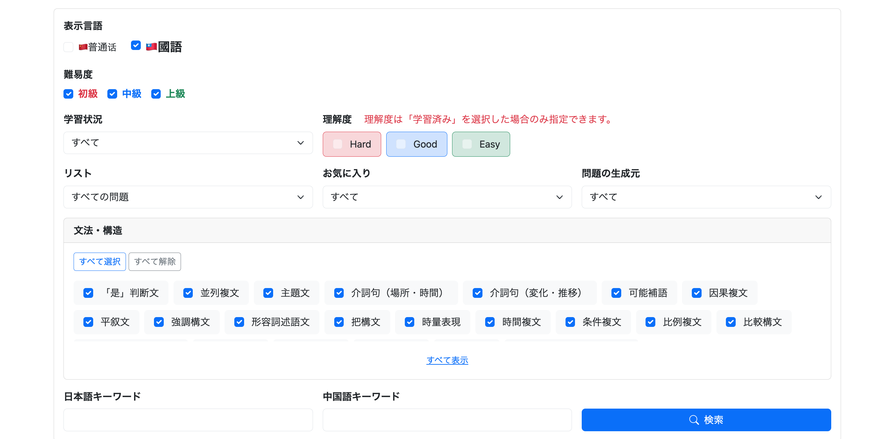
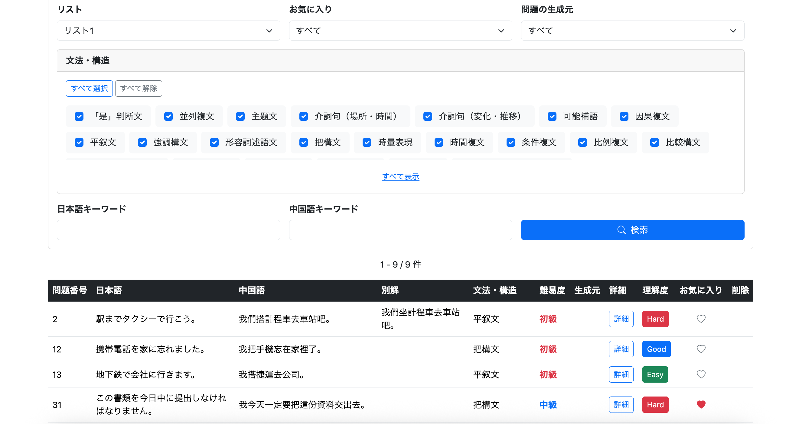

# 030-02 問題リスト機能⑤｜問題一覧への検索条件追加

## 概要

030-01では、問題リストを通常学習とAI生成学習の出題元として利用できるようにした。

本章では、ユーザーメニューの**問題一覧画面にリストによる絞り込みを追加する**。通常学習のリスト指定とは異なり、問題一覧ではリストを既存の検索条件と組み合わせて利用できるようにする。

主な実装内容は、Repositoryの`EXISTS`によるリスト所属判定、Service・Controllerへの`listId`の受け渡し、Thymeleafの検索フォームへの選択欄追加、ページネーションでの検索条件維持である。

---

# 1. ユーザーメニューの問題一覧画面で、リストを指定して問題を絞り込めるようにする

```text
git commit -m "feat: add list filter to user question search"
```

既存の問題一覧では、

* 難易度
* 理解度
* お気に入り
* 文法・構造
* 生成元
* 言語
* キーワード

などを利用して絞り込める。

ここへリスト条件を追加する。

---

## 実装する前に

通常学習とは異なり、問題一覧は「問題を探して管理する」画面である。

そのため、

```text
リスト：台湾旅行
難易度：上級
理解度：HARD
お気に入り：お気に入りのみ
```

のように、リスト内をさらに既存条件で検索できた方が使いやすい。

そこで、

```text
リスト未指定
→ 既存条件のみ

リスト指定
→ 指定リスト
   AND
   既存条件
```

とし、リストを**追加の検索条件**として扱う。

---

## QuestionRepository

既存の`findUserQuestionList()`へ`listId`を追加した。

リスト条件本体は、

```sql
AND (
    :listId IS NULL
    OR EXISTS (
        SELECT 1
        FROM question_list_item qli
        JOIN question_list ql
        ON qli.list_id = ql.list_id
        WHERE qli.question_id = q.question_id
        AND qli.list_id = :listId
        AND ql.user_id = :userId
    )
)
```

となる。

Repositoryの引数にも、

```java
@Param("listId")
Long listId,
```

を追加した。

`countQuery`側にも同じ条件を追加し、ページング件数と実際の検索結果が一致するようにする。

---

### JOINだけではだめ

単純に、

```sql
JOIN question_list_item qli
  ON q.question_id = qli.question_id
```

としてしまうと、どのリストにも登録されていない問題が検索対象から消えてしまう。

しかし仕様は、

```text
listId == null
→ リスト登録の有無にかかわらず検索

listId != null
→ 指定リスト内だけ検索
```

である。

---

### ① LEFT JOINの場合

`LEFT JOIN`なら未登録問題も残せる。

```sql
LEFT JOIN question_list_item qli
  ON q.question_id = qli.question_id
```

条件は、

```sql
AND (
    :listId IS NULL
    OR qli.list_id = :listId
)
```

とできる。

ただし、1問が複数リストに登録されていると、

```text
問題A | リスト10
問題A | リスト20
```

のように行が増える。

そのため`DISTINCT`による重複排除が必要になる。

---

### ② EXISTSの場合

今回は、

```sql
EXISTS (
    SELECT 1
    FROM question_list_item qli
    WHERE qli.question_id = q.question_id
      AND qli.list_id = :listId
)
```

を利用する方法も検討した。

`EXISTS`はリスト情報そのものを検索結果へ結合するのではなく、

```text
現在のquestionは
指定したリストに存在するか？
```

だけをTRUE/FALSEで判定する。

---

### 今回は②のEXISTSを採用

必要なのはリスト情報そのものではなく「その問題が指定リストに存在するか」という存在確認だけである。

そのため、

```sql
AND (
    :listId IS NULL
    OR EXISTS (...)
)
```

を採用した。

これならリスト未指定時に余分なJOINによる行増加が発生せず、`DISTINCT`も不要になる。

さらに、

```sql
JOIN question_list ql
    ON qli.list_id = ql.list_id

AND ql.user_id = :userId
```

によって、他ユーザーのリストを指定できないようにしている。

---

## UserQuestionService

既存の検索Serviceへ`listId`を追加し、そのままRepositoryへ渡す。

概念的には、

```java
public Page<UserQuestionListDto> getFilteredQuestionList(
        Long userId,
        ...,
        Long listId,
        String japaneseKeyword,
        String chineseKeyword,
        Pageable pageable) {

    return questionRepository.findUserQuestionList(
            userId,
            ...,
            listId,
            japaneseKeyword,
            chineseKeyword,
            pageable);
}
```

となる。

---

## UserQuestionController

問題一覧検索のリクエストパラメータへ、

```java
@RequestParam(
    name = "listId",
    required = false
)
Long listId
```

を追加。

また、検索画面へユーザー所有リストを表示するため、

```java
List<QuestionList> questionLists =
        questionListService
                .getQuestionLists(user);

model.addAttribute(
        "questionLists",
        questionLists);

model.addAttribute(
        "selectedListId",
        listId);
```

をModelへ渡す。

---

## /user/question/list.html

検索条件へリスト選択を追加。

```html
<select class="form-select"
        name="listId">

    <option value=""
            th:selected="${selectedListId == null}"
            th:text="#{user.question.list.questionList.all}">
        すべての問題
    </option>

    <option th:each="questionList : ${questionLists}"
            th:value="${questionList.listId}"
            th:text="${questionList.listName}"
            th:selected="${selectedListId != null
                and selectedListId == questionList.listId}">
        リスト名
    </option>

</select>
```

---

### ページネーションも変更が必要

検索条件をページ移動後も維持するため、

```text
listId=${selectedListId}
```

をページネーションへ追加した。

対象は、

* 前へ
* 1ページ目
* 中央のページ番号
* 最終ページ
* 次へ

の5か所。

---

## messages.properties

```properties
user.question.list.questionList=リスト
user.question.list.questionList.all=すべての問題
```

簡体字・繁体字についても追加した。

---

## 実行

問題一覧の検索欄へリスト選択が追加された。



リスト1を選択すると、リスト1に登録されている問題だけへ絞り込まれる。



---

---

# このチャプターはここまで

問題一覧の検索条件にリストを追加し、**指定リスト内の問題を難易度・理解度・お気に入りなどの既存条件と組み合わせて絞り込める**ようにした。

SQLでは、リスト情報を検索結果に結合するのではなく、`EXISTS`で指定リストへの登録有無を判定する方法を採用した。これにより、リスト未指定時の検索結果を維持しつつ、複数リストに登録された問題による行の重複を避けられる。

また、検索条件の選択状態とページネーションにも`listId`を引き継ぐことで、ページ移動後も絞り込みを維持できるようにした。

次の030-03では、問題一覧の各行からリスト登録状態を直接変更できるようにし、関連するUIの調整と追加修正をまとめる。
