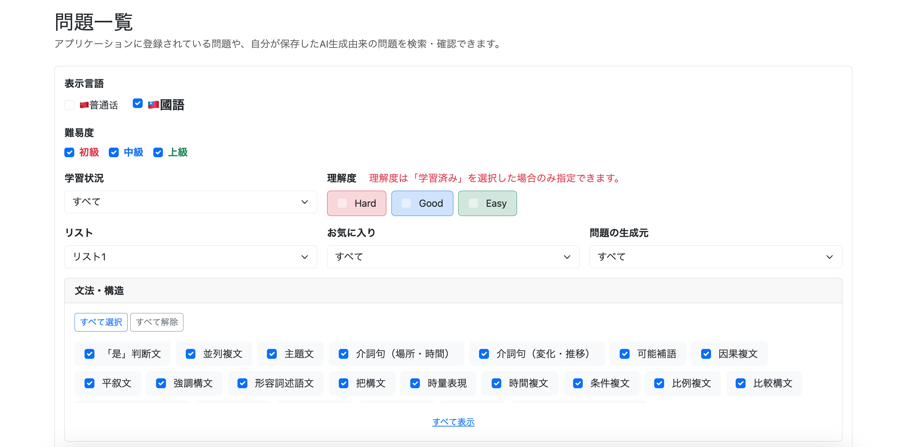
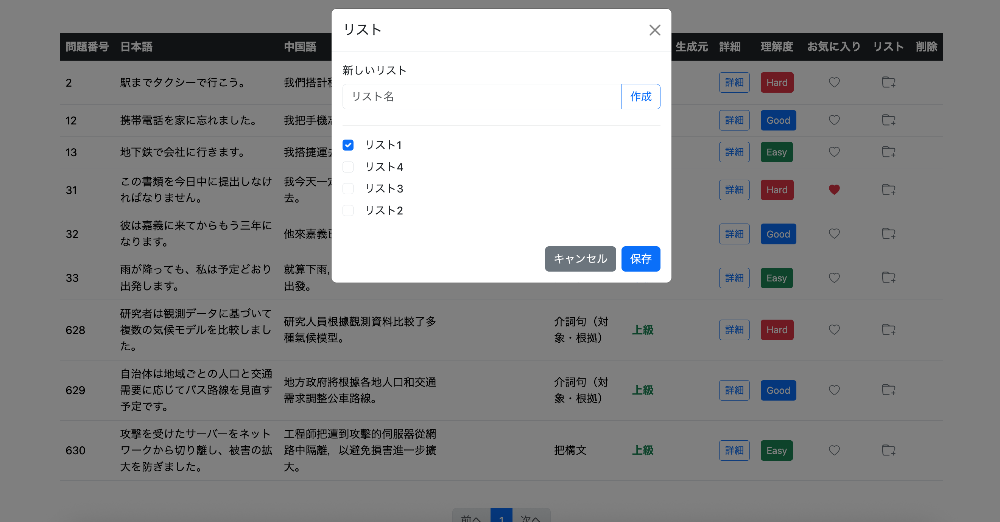
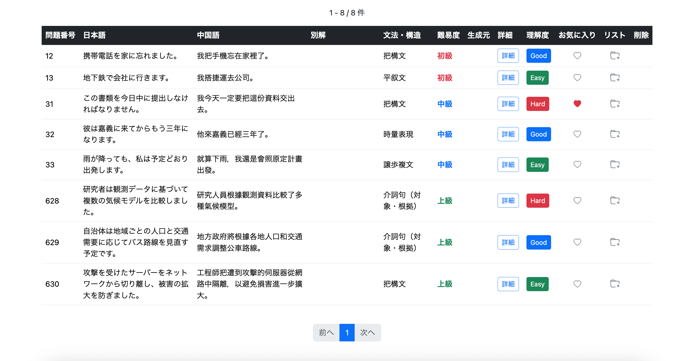
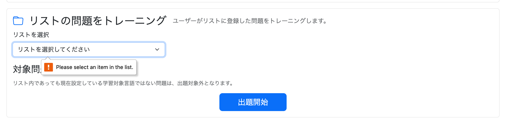
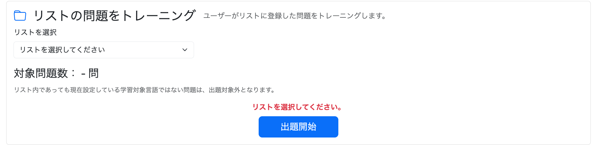

# 030-03 問題リスト機能⑥｜問題一覧からのリスト操作とUI改善

## 概要

030-01では通常学習・AI生成学習へのリスト機能の統合、030-02では問題一覧にリスト検索条件を追加した。

本章では、**問題一覧の各問題からリストへの追加・削除を直接操作できるようにする**。各トレーニングのquestion画面で実装済みのAPIを再利用し、問題一覧にリスト操作ボタンとモーダル、JavaScriptの処理を追加する。

その後に行った、複数画面で使用するモーダルの見た目の統一、問題一覧のTooltip・列構成の調整、通常学習・AI生成学習でリスト未選択時に独自のエラーを表示する修正も、実装した順序に沿って記録する。

---

# 1. ユーザーメニューの問題一覧画面から、問題を任意のリストへ追加・削除できるようにする

```text
git commit -m "feat: add list management to user question search"
```

問題一覧からも、各問題のリスト登録状態を変更できるようにする。

各question画面ではすでに、

```text
GET /user/question-list/selection
POST /user/question-list/item/update
POST /user/question-list/create-modal
```

を利用したリスト操作を実装済みである。

そのためバックエンドを新しく作り直すのではなく、既存APIを問題一覧からも利用する。

---

## 実装方針と処理の流れ

029で実装したリスト操作は、特定のトレーニング画面に依存せず、`questionId`を受け取って処理するAPIとして用意している。そのため、問題一覧用に同じ登録・解除処理を作る必要はない。

今回追加するのは、一覧の各行で「どの問題を操作するか」を特定し、既存APIに渡すための画面側の処理である。

```text
問題一覧のリストボタンを押す
    ↓
ボタンのdata-question-idから対象問題を特定
    ↓
GET /user/question-list/selection
    ↓
各リストの登録状態をチェックボックスへ反映
    ↓
ユーザーが登録先を変更して保存
    ↓
POST /user/question-list/item/update
    ↓
問題一覧を再読み込みして変更結果を反映
```

新しいリストの作成も既存の`POST /user/question-list/create-modal`を使用する。作成後はモーダル内の選択肢だけを再取得し、操作中の問題を変えずに登録先を選び直せるようにする。

---

## バックエンドの実装はほぼ不要

必要な、

```text
リスト登録状態取得
リスト登録状態更新
モーダルからのリスト新規作成
```

はすでに実装済み。

今回は主にHTMLとJavaScriptを追加する。

---

## /user/question/list.html

### 各問題のIDをボタンへ埋め込む

問題一覧には複数の問題が同時に表示されるため、単に共通モーダルを開くだけでは操作対象を判断できない。そこで、Thymeleafの`th:data-question-id`を使って、各行の問題IDをHTMLの`data-question-id`属性へ埋め込む。

JavaScript側ではクリックされたボタンの属性を読み取る。**モーダルは1つを共有し、対象問題のIDだけを切り替える**構成とする。問題ごとにモーダルを生成しないため、HTMLの重複を避けられる。


各問題行へリスト操作ボタンを追加。

ボタンには対象の`questionId`を保持させる。

```html
<button type="button"
        class="btn btn-outline-dark btn-sm questionListButton"
        th:data-question-id="${question.questionId}"
        data-bs-toggle="modal"
        data-bs-target="#questionListModal">

    <i class="bi bi-folder"></i>

</button>
```

リスト操作モーダルについてもquestion画面と同様の構成を追加した。

```html
<div sec:authorize="isAuthenticated()"
     class="modal fade"
     id="questionListModal"
     tabindex="-1"
     aria-hidden="true">

    <div class="modal-dialog">
        <div class="modal-content">

            <div class="modal-header">

                <h5 class="modal-title"
                    th:text="#{questionList.modal.title}">
                    リスト
                </h5>

                <button type="button"
                        class="btn-close"
                        data-bs-dismiss="modal">
                </button>

            </div>

            <div class="modal-body">

                <div class="mb-4">

                    <label for="newQuestionListName"
                           class="form-label"
                           th:text="#{questionList.modal.newList}">
                        新しいリスト
                    </label>

                    <div class="input-group">

                        <input type="text"
                               id="newQuestionListName"
                               class="form-control"
                               th:placeholder="#{questionList.modal.listName}">

                        <button type="button"
                                id="questionListCreateButton"
                                class="btn btn-outline-primary"
                                th:text="#{questionList.modal.create}">
                            作成
                        </button>

                    </div>

                </div>

                <hr>

                <div id="questionListSelectionArea">
                </div>

            </div>

            <div class="modal-footer">

                <button type="button"
                        class="btn btn-secondary"
                        data-bs-dismiss="modal"
                        th:text="#{questionList.modal.cancel}">
                    キャンセル
                </button>

                <button type="button"
                        id="questionListSaveButton"
                        class="btn btn-primary"
                        th:text="#{questionList.modal.save}">
                    保存
                </button>

            </div>

        </div>
    </div>
</div>
```

---

## user/question/list.js

### JavaScript側で対象問題を保持する

一覧のリストボタンは複数ある一方、モーダル内のチェックボックス表示領域は共通である。`questionListQuestionId`には現在操作している問題のIDを保持し、APIの取得・更新の両方で同じIDを使用する。

この値が別の問題のIDのまま残ると、画面で選んだ問題とは異なる問題の登録状態を変更するおそれがある。したがって、各ボタンを押した際にそのボタンの`data-question-id`を設定する処理が必要となる。

※以下の元ログに掲載されたコードは、主に変数宣言とAPI呼び出し部分の抜粋である。ボタンのクリックイベントにおけるIDの代入処理は掲載されていないため、ここでは実装済みと断定せず、処理上の必要条件として記録する。


対象問題を保持する変数を用意。

```javascript
let questionListQuestionId = null;

const questionListButtons =
    document.querySelectorAll(
        ".questionListButton"
    );

const questionListSelectionArea =
    document.getElementById(
        "questionListSelectionArea"
    );
```

### リスト登録状態の取得

モーダルを開いたときは、以前に表示したチェック状態を使い回さず、対象問題の登録状態をサーバーから取得する。

APIから返された各リストの`listId`、`listName`、`registered`を使い、JavaScriptで`label`と`input type="checkbox"`を組み立てる。`registered`を`checkbox.checked`へ代入することで、DB上の登録状態がそのまま初期表示に反映される。

`questionListSelectionArea.innerHTML = ""`は、前に開いた問題のチェックボックスを残さないための初期化である。続く`appendChild()`によって、取得したリストだけを表示する。


```javascript
function loadQuestionListSelection() {

    fetch(
        "/user/question-list/selection?questionId=" +
        encodeURIComponent(
            questionListQuestionId
        )
    )

    .then(function (response) {

        if (!response.ok) {

            throw new Error(
                "リスト情報の取得に失敗しました"
            );
        }

        return response.json();
    })

    .then(function (questionLists) {

        questionListSelectionArea
            .innerHTML = "";

        questionLists.forEach(
            function (questionList) {

                const label =
                    document.createElement(
                        "label"
                    );

                label.className =
                    "form-check mb-2";

                const checkbox =
                    document.createElement(
                        "input"
                    );

                checkbox.type =
                    "checkbox";

                checkbox.className =
                    "form-check-input";

                checkbox.name =
                    "selectedListIds";

                checkbox.value =
                    questionList.listId;

                checkbox.checked =
                    questionList.registered;

                const span =
                    document.createElement(
                        "span"
                    );

                span.className =
                    "form-check-label ms-2";

                span.textContent =
                    questionList.listName;

                label.appendChild(
                    checkbox
                );

                label.appendChild(
                    span
                );

                questionListSelectionArea
                    .appendChild(label);
            }
        );
    });
}
```

---

### リスト登録状態の保存

保存時には、チェックが付いているリストのIDだけを`selectedListIds`として集める。これは「追加したリストだけを送る」のではなく、**保存後にその問題が所属しているべきリストの集合を送る**方法である。

例えば、もともとリストA・Bに登録されている問題について、Aのチェックを外しCにチェックを付けた場合、送信するのはB・CのIDとなる。追加・解除の判定は既存のバックエンド側で行うため、画面側で個別の追加APIと削除APIを呼び分ける必要はない。

`URLSearchParams`はフォーム形式のデータを組み立てるために使う。`selectedListIds`を同名のキーで繰り返し追加することで、Spring MVC側で複数のリストIDとして受け取れる。すべてのチェックを外した場合も、`questionId`だけを送信して登録解除を表現できるよう、受信側では空の選択を扱える必要がある。

POSTリクエストにはCSRFトークンをヘッダーへ設定する。更新に成功した場合だけページを再読み込みし、失敗時は`response.ok`を確認してエラーとして扱う。


チェック済みのリストIDを取得する。

```javascript
const selectedListIds =
    Array.from(
        questionListSelectionArea
            .querySelectorAll(
                "input[name='selectedListIds']:checked"
            )
    )
    .map(function (checkbox) {
        return checkbox.value;
    });
```

送信用データを作成。

```javascript
const params =
    new URLSearchParams();

params.append(
    "questionId",
    questionListQuestionId
);

selectedListIds.forEach(
    function (listId) {

        params.append(
            "selectedListIds",
            listId
        );
    }
);
```

既存APIへPOSTする。

```javascript
fetch("/user/question-list/item/update", {

    method: "POST",

    headers: {

        "Content-Type":
            "application/x-www-form-urlencoded",

        [csrfHeader]:
            csrfToken
    },

    body:
        params.toString()

})
.then(function (response) {

    if (!response.ok) {

        throw new Error(
            "リストの更新に失敗しました"
        );
    }

    location.reload();
});
```

question画面とは異なり、問題一覧では更新後に、

```javascript
location.reload();
```

を実行する。

これによって現在の検索URLを維持したまま再検索できる。

特にリスト検索中に、そのリストから問題を外した場合、

```text
保存
↓
ページ再読み込み
↓
検索条件を再適用
↓
対象問題が一覧から消える
```

ため、変更結果が分かりやすい。

---

### 新しいリストの作成

問題を登録したいリストがまだ存在しない場合に、モーダルを閉じて管理画面へ移動する必要がないよう、同じモーダルからリストを新規作成できるようにする。

新規作成後に`loadQuestionListSelection()`を呼び直す理由は、サーバー側で新しいリストが増えても、すでに描画済みのチェックボックス一覧には自動反映されないためである。

ページ全体を再読み込みすると現在開いているモーダルが閉じ、操作対象の問題も選び直すことになる。ここでは**リスト一覧だけを更新する**ことで、そのまま新しいリストを選択できるようにしている。


```javascript
const params =
    new URLSearchParams();

params.append(
    "listName",
    listName
);

fetch("/user/question-list/create-modal", {

    method: "POST",

    headers: {

        "Content-Type":
            "application/x-www-form-urlencoded",

        [csrfHeader]:
            csrfToken
    },

    body:
        params.toString()

})
.then(function (response) {

    if (!response.ok) {

        throw new Error(
            "リストの作成に失敗しました"
        );
    }

    newQuestionListName.value = "";

    loadQuestionListSelection();
});
```

新規作成後はページ全体を再読み込みせず、モーダル内のリスト一覧だけを再取得する。

---

## 実行

問題一覧の各行へリスト操作アイコンが追加された。



アイコンからリスト操作モーダルを開き、問題の追加・削除を行える。



保存するとページが再読み込みされ、検索結果へ変更内容が反映される。



---

# 追加修正 - モーダルの見た目を修正

```text
git commit -m "style: improve question list modal appearance"
```

複数画面で同じリスト操作モーダルを使用するようになったため、表示を統一した。

---

## モーダル内のlabelを左揃えにする

同じモーダルを複数の画面で使用するようになると、モーダル自身のHTMLが同じでも、配置先の親要素のスタイルによって表示が変わることがある。今回はquestion画面の親要素に設定されていた`text-center`がモーダル内の文字にも影響していた。

そのため、画面ごとに親要素のスタイルを変更するのではなく、モーダルの本文側に`text-start`を指定し、モーダル内の表示位置を明示する。


question画面では親要素に`text-center`が設定されているため、モーダル内部まで中央揃えになっていた。

そこで、

```html
<div class="modal-body text-start">
```

として、モーダル内部を左揃えにした。

---

## モーダル内のチェックボックスを見やすくする

未選択のチェックボックスは背景との境界が分かりにくかったため、枠線を調整する。変更箇所を各画面のCSSへ個別に書くと、画面ごとに見た目が異なる可能性がある。

そこで`question-list-modal.css`を作成し、モーダルを使用する画面から共通で読み込む。セレクターを`#questionListSelectionArea .form-check-input`に限定することで、アプリ内のほかのチェックボックスへ影響を広げないようにする。


共通CSSを追加。

```text
src/main/resources/static/css/question-list-modal.css
```

```css
/* リスト選択モーダルのチェックボックス */
#questionListSelectionArea .form-check-input {
    border: 2px solid #777;
}
```

各モーダル使用画面から、

```html
<link rel="stylesheet"
      th:href="@{/css/question-list-modal.css}">
```

を読み込む。

これにより、未選択チェックボックスの境界も見やすくなり、モーダル固有のスタイルを1ファイルで管理できるようになった。

---

# 追加修正 - 表の説明を増やす

```text
git commit -m "style: improve question table clarity with tooltips"
```

問題一覧の「生成元」と「削除」は、列名だけでは意味や操作条件が分かりにくかったためTooltipを追加した。

---

## 生成元

問題一覧では、アプリがあらかじめ用意した問題と、ユーザーが保存したAI生成問題を同じ表に表示している。しかし「生成元」という列名だけでは、どちらを意味するのかが分かりにくい。

そこで、列見出しと各セルにTooltipを付け、`APP`と`AI`の意味を補足する。`th:title`でメッセージキーを参照することで、日本語・簡体字・繁体字の表示にも対応する。


### th側

```html
<th data-bs-toggle="tooltip"
    data-bs-placement="top"
    th:title="#{user.question.list.source.tooltip}">
    生成元
</th>
```

### td側

```html
<td data-bs-toggle="tooltip"
    data-bs-placement="top"
    th:title="#{user.question.list.source.item.tooltip}">

    <span class="badge bg-black"
          th:if="${question.aiGenerated}">
        AI
    </span>

    <span class="badge bg-white text-dark border border-dark"
          th:unless="${question.aiGenerated}">
        APP
    </span>

</td>
```

AI生成由来は黒の`AI`、アプリ収録問題は白の`APP`として視覚的にも区別した。

---

## 削除

削除できるのは、ユーザーが保存したAI生成由来の問題であり、アプリ収録問題は削除できない。以前は削除できない問題のボタン自体を非表示にしていたため、行によって操作欄の見え方が変わっていた。

今回はすべての行に削除ボタンを表示し、操作できない場合は`th:disabled`で無効化する。これにより、削除操作の位置を統一しつつ、削除できる問題とできない問題を区別できる。

ただし、`disabled`は画面上の操作制御である。**実際の削除権限や所有者の検証はサーバー側でも行う必要がある**。この章の抜粋には削除Controllerの検証処理は掲載されていないため、その実装内容までは断定しない。


以前は、

```text
APP問題
→ 削除ボタン非表示

AI生成問題
→ 削除ボタン表示
```

としていた。

これを、

```text
APP問題
→ 削除ボタン表示・disabled

AI生成問題
→ 削除ボタン表示・操作可能
```

へ変更した。

```html
<td class="text-center"
    data-bs-toggle="tooltip"
    data-bs-placement="top"
    th:title="#{user.question.delete.tooltip}">

    <form th:action="@{/user/question/delete}"
          method="post">

        <input type="hidden"
               name="questionId"
               th:value="${question.questionId}">

        <input type="hidden"
               name="returnUrl"
               th:value="${currentUrl}">

        <button type="submit"
                class="btn btn-dark btn-sm"
                th:disabled="${!question.aiGenerated}"
                th:onclick="|return confirm('#{user.question.delete.confirm}')|">

            <i class="bi bi-trash"></i>

        </button>

    </form>

</td>
```

---

## messages.properties

```properties
user.question.list.source.tooltip=アプリが用意した問題か、あなたが保存したAI生成由来の問題かを示します
user.question.list.source.item.tooltip=APPはアプリが用意した問題、AIはあなたが保存したAI生成由来の問題です
user.question.delete.tooltip=あなたが保存したAI生成由来の問題のみ削除できます
```

簡体字・繁体字についても同様に追加した。

---

# 追加修正 - 別解列はリストから消す

問題一覧にリスト操作列を追加したことで、もともと列数の多かった表がさらに横長になった。特に日本語・中国語の文章を表示する領域が狭いと、改行が増えて一覧性が低下する。

そこで、**一覧で常に確認する必要がある情報**と、**詳細を開いたときに確認できればよい情報**を分けて考える。別解は詳細モーダルでも確認できるため、一覧からは列を削除し、日本語・中国語の幅を広げることにした。


```text
git commit -m "style: simplify question list table layout"
```

リスト操作列の追加によって問題一覧の列数が増えたため、一覧上の「別解」列を削除した。

別解自体は詳細モーダルから確認できるため、機能上の問題はない。

変更後は、

```text
日本語   22% → 27%
中国語   22% → 27%
別解     14% → 削除
生成元   自動 → 6%
```

とした。

主要部分は以下。

```html
<tr>

    <th class="text-nowrap"
        style="width:5%;"
        th:text="#{user.question.list.questionId}">
        問題番号
    </th>

    <th style="width:27%;"
        th:text="#{user.question.list.japanese}">
        日本語
    </th>

    <th style="width:27%;"
        th:text="#{user.question.list.chinese}">
        中国語
    </th>

    <th style="width:10%;"
        th:text="#{user.question.list.structure}">
        文法・構造
    </th>

    <th class="text-nowrap"
        th:text="#{user.question.list.difficulty}">
        難易度
    </th>

    <th class="text-nowrap text-center"
        style="width:6%;"
        data-bs-toggle="tooltip"
        data-bs-placement="top"
        th:title="#{user.question.list.source.tooltip}">
        生成元
    </th>

    <th class="text-nowrap"
        th:text="#{user.question.list.detail}">
        詳細
    </th>

    <th class="text-nowrap"
        th:text="#{user.question.list.evaluation}">
        理解度
    </th>

    <th class="text-nowrap"
        th:text="#{user.question.list.favorite}">
        お気に入り
    </th>

    <th class="text-nowrap"
        th:text="#{user.question.list.questionList}">
        リスト
    </th>

    <th class="text-nowrap"
        data-bs-toggle="tooltip"
        data-bs-placement="top"
        th:title="#{user.question.delete.tooltip}">
        削除
    </th>

</tr>
```

一覧では主要情報と操作だけを表示し、別解のような補足情報は詳細モーダルへ集約することで、列数の増加による可読性低下を抑えた。

---

# 追加修正 − 通常学習のメニューでリストを選択せずに出題開始を押したときのエラーメッセージを表示させる

```text
git commit -m "fix: show error when no question list is selected"
```

現時点では、通常学習のリスト学習でリストを選択せずに「出題開始」を押すと、`PracticeController` が返すエラーメッセージではなく、`<select required>` に対してブラウザが表示するHTML標準の入力検証メッセージが表示される。



## 原因

今回の問題は、Controllerの条件分岐が実行されないことにある。HTMLの`required`が設定されていると、未選択のフォームはブラウザが送信を止めるため、Spring MVCまでリクエストが届かない。

アプリ独自のメッセージをControllerで表示する方針にするなら、ブラウザの必須入力検証を外したうえで、`listId`が渡されない場合をController側で受け入れられるようにする必要がある。


リスト選択用の`<select>`に`required`を指定していたため、リストを選択せずに「出題開始」を押すと、フォームが`PracticeController`へ送信される前にブラウザ側の入力検証によって処理が停止していた。

そのため、`PracticeController`側でリストが選択されているかを判定し、アプリケーション独自のエラーメッセージを返すことができなかった。

また、`@RequestParam`はデフォルトで`required = true`となるため、リスト未選択時の`listId`を`null`として受け取れるようにする必要がある。

## 修正

リスト選択用の`<select>`から`required`を削除し、フォームを`PracticeController`まで送信できるようにする。

また、`getPracticeListStart`で`listId`を任意のリクエストパラメータとして受け取り、`null`の場合はエラーメッセージをFlash Attributeに設定して通常学習メニューへ戻す。

### PracticeController.getPracticeListStart

`@RequestParam(required = false)`を指定すると、リスト未選択で`listId`が送信されなかった場合に`null`を受け取れる。そこでトレーニング開始処理より先に`listId == null`を判定する。

エラーメッセージは`MessageSource`から現在の`Locale`に対応する文言を取得する。`RedirectAttributes.addFlashAttribute()`を使用するのは、リダイレクト先のメニュー画面へ一時的にメッセージを渡すためである。


`listId`を未指定でも受け取れるように、`@RequestParam(required = false)`を指定する。

```java
@PreAuthorize("isAuthenticated()")
@GetMapping("/practice/list/start")
public String getPracticeListStart(
        HttpSession session,
        @AuthenticationPrincipal UserDetails loginUser,
        @RequestParam(required = false) Long listId,
        RedirectAttributes redirectAttributes,
        Locale locale) {

    // 何も選択していない場合はエラーを表示
    if (listId == null) {

        String listErrorMessage =
                messageSource.getMessage(
                        "practice.list.error.selectList",
                        null,
                        locale);

        redirectAttributes.addFlashAttribute(
                "listErrorMessage",
                listErrorMessage);

        return "redirect:/practice/menu";
    }

    // 以下省略
}
```

`listId == null`の場合は、`MessageSource`からエラーメッセージを取得する。

取得したメッセージを`listErrorMessage`という名前でFlash Attributeに保存し、`/practice/menu`へリダイレクトする。

### /practice/menu.html

リスト選択用の`<select>`から`required`を削除する。

```html
<select id="practiceQuestionList"
        class="form-select"
        name="listId">
```

また、リスト学習のエラーメッセージを表示する領域を追加する。

```html
<!-- ============================= -->
<!-- エラーメッセージ -->
<!-- ============================= -->

<p th:if="${listErrorMessage}"
   class="text-danger fw-bold mb-2 text-center"
   th:text="${listErrorMessage}">
</p>
```

`PracticeController`から`listErrorMessage`が渡された場合のみ、エラーメッセージを表示する。

### messages.properties

リストを選択していない場合に表示するメッセージを追加する。

```properties
practice.list.error.selectList=リストを選択してください。
```

各言語のメッセージファイルにも同じキーのメッセージを追加する。

## 実行

http://localhost:8080/practice/menu にアクセスし、リストを選択せずに「出題開始」を押す。

ブラウザ標準の入力検証メッセージではなく、`PracticeController`で設定したエラーメッセージが表示されるようになった。



---

# 追加修正 − AI学習のメニューでリストを選択せずに出題開始を押したときのエラーメッセージを表示させる

```text
git commit -m "fix: show error when no question list is selected in AI practice"
```

通常学習のリスト学習と同様に、AI学習のリストからの問題生成でも、リストを選択せずに「出題開始」を押した場合にブラウザ標準の入力検証メッセージではなく、`AiPracticeController`で設定したエラーメッセージを表示するように修正する。

## 原因

リスト選択用の`<select>`に`required`を指定していたため、リストを選択せずに「出題開始」を押すと、フォームが`AiPracticeController`へ送信される前にブラウザ側の入力検証によって処理が停止していた。

また、`@RequestParam`はデフォルトで`required = true`となるため、リスト未選択時の`listId`を`null`として受け取れるようにする必要がある。

## 修正

リスト選択用の`<select>`から`required`を削除し、フォームを`AiPracticeController`まで送信できるようにする。

また、`getAiPracticeListStart`で`listId`を任意のリクエストパラメータとして受け取り、`null`の場合はエラーメッセージをFlash Attributeに設定してAI学習メニューへ戻す。

### AiPracticeController.getAiPracticeListStart

通常学習で修正した原因と対処方法は、AI生成学習のリスト選択フォームにも当てはまる。そのため、AI生成学習側でも`required`を外し、`@RequestParam(required = false)`と`listId == null`の判定を追加する。

AI生成学習では`limit50`も受け取るが、今回修正するのはリスト未選択の扱いであり、生成元の取得範囲を切り替える既存処理は変更しない。


`listId`を未指定でも受け取れるように、`@RequestParam(required = false)`を指定する。

```java
@GetMapping("/ai-practice/list/start")
public String getAiPracticeListStart(
        HttpSession session,
        @AuthenticationPrincipal UserDetails loginUser,
        @RequestParam(required = false) Long listId,
        @RequestParam boolean limit50,
        RedirectAttributes redirectAttributes,
        Locale locale) {

    // 何も選択していない場合はエラーを表示
    if (listId == null) {

        String listErrorMessage =
                messageSource.getMessage(
                        "practice.list.error.selectList",
                        null,
                        locale);

        redirectAttributes.addFlashAttribute(
                "listErrorMessage",
                listErrorMessage);

        return "redirect:/ai-practice/menu";
    }

    // 以下省略
}
```

`listId == null`の場合は、`MessageSource`からエラーメッセージを取得する。

取得したメッセージを`listErrorMessage`という名前でFlash Attributeに保存し、`/ai-practice/menu`へリダイレクトする。

### /ai-practice/menu.html

リスト選択用の`<select>`から`required`を削除する。

```html
<select id="aiPracticeQuestionList"
        class="form-select"
        name="listId">
```

また、リストからのAI問題生成のエラーメッセージを表示する領域を追加する。

```html
<!-- ============================= -->
<!-- エラーメッセージ -->
<!-- ============================= -->

<p th:if="${listErrorMessage}"
   class="text-danger fw-bold mb-2 text-center"
   th:text="${listErrorMessage}">
</p>
```

`AiPracticeController`から`listErrorMessage`が渡された場合のみ、エラーメッセージを表示する。

### messages.properties

通常学習で追加したメッセージキーをそのまま使用するため、新たなメッセージの追加は不要である。

```properties
practice.list.error.selectList=リストを選択してください。
```

## 実行

`/ai-practice/menu`にアクセスし、リストを選択せずに「出題開始」を押す。

ブラウザ標準の入力検証メッセージではなく、`AiPracticeController`で設定したエラーメッセージが表示されることを確認する。

---

---

# このチャプターはここまで

問題一覧の各行から、既存のリスト操作APIを利用して問題の登録・解除と新しいリストの作成ができるようになった。登録状態の保存後はページを再読み込みし、現在の検索条件を適用した結果を表示する。

さらに、共通モーダルのスタイル、Tooltip、表の列構成を調整した。また、通常学習とAI生成学習のリスト選択フォームでは、HTMLの`required`によるブラウザ標準の検証から、Controllerの判定とFlash Attributeを用いたアプリ独自のエラー表示へ変更した。

これで030-01〜030-03を通して、問題リストを**通常学習・AI生成学習・問題一覧の検索・問題一覧からの管理操作**へ統合できた。
