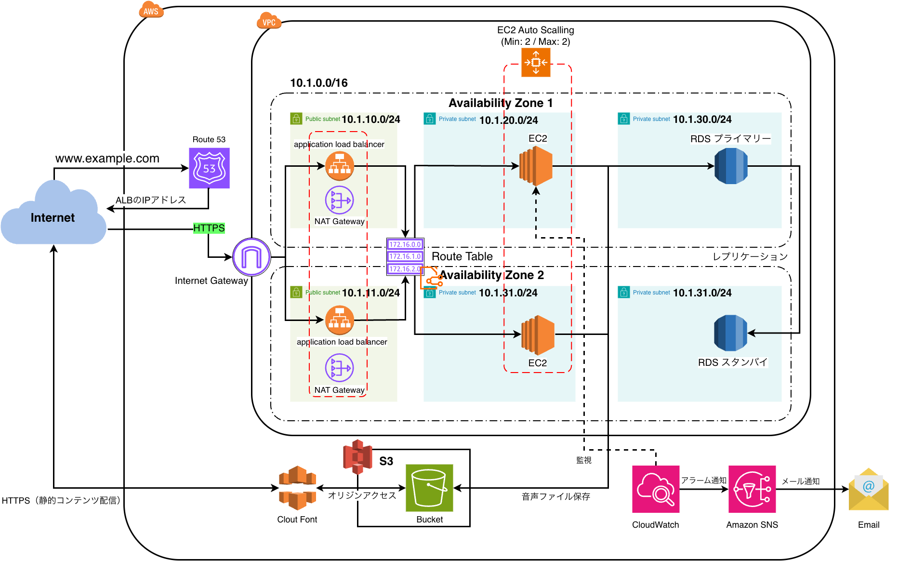

# 031-01 AWS高可用性構成①｜構成設計とネットワーク・RDSの構築

## 1. 作業概要

Chinese Output Forge（Java 21 / Spring Boot 3.5）をAWSへデプロイする。まず2つのAZを利用する高可用性構成を構築・確認し、その後の低コスト構成への移行は032で扱う。

本章の対象はVPC、サブネット、Internet Gateway、NAT Gateway、ルートテーブル、セキュリティグループ、RDSの作成まで。Elastic Beanstalkへのデプロイは031-02、RDSへのデータ移行は031-03に分ける。

## 2. 構成方針

- VPC：`10.1.0.0/16`
- 2つのAZにPublic、Private App、Private DBの各サブネットを作成（計6つ）
- Public Subnet：ALB、NAT Gateway
- Private App Subnet：EC2（Elastic Beanstalkで管理、2台維持）
- Private DB Subnet：RDS PostgreSQL（Multi-AZ）
- Route 53、ACM、CloudWatch、SNSは後続章で設定

※図は当初の構成案。CIDRは後述の実設定との照合が必要。

## 3. VPCを作成

| 項目 | 設定値 |
| --- | --- |
| 名前 | `chinese-output-forge-vpc` |
| IPv4 CIDR | `10.1.0.0/16` |

## 4. サブネットを作成

元ログの当初設計・手順に記載された値は以下のとおり。

| AZ | 種別 | CIDR |
| --- | --- | --- |
| 1a | Public | `10.1.10.0/24` |
| 1a | Private App | `10.1.20.0/24` |
| 1a | Private DB | `10.1.30.0/24` |
| 1c | Public | `10.1.11.0/24` |
| 1c | Private App | `10.1.21.0/24` |
| 1c | Private DB | `10.1.31.0/24` |

**確認事項：** 構築後に記録されたネットワーク情報ではPublicとPrivate AppのCIDRが異なるため、上表を確定した実設定として扱わない。

## 5. Internet Gatewayを作成

| 項目 | 設定値 |
| --- | --- |
| 名前 | `chinese-output-forge-igw` |
| アタッチ先 | `chinese-output-forge-vpc` |

作成したInternet GatewayをVPCにアタッチする。

## 6. NAT Gatewayを作成

各AZのPublic Subnetに1台ずつ作成し、それぞれにElastic IPを割り当てる。

| 項目 | 1a | 1c |
| --- | --- | --- |
| 名前 | `chinese-output-forge-nat-gateway-1a` | `chinese-output-forge-nat-gateway-1c` |
| 元ログ記載のIPv4 | `10.1.10.246` | `10.1.11.39` |
| 配置先 | Public Subnet | Public Subnet |
| Elastic IP | 割り当て | 割り当て |

記載されたIPv4はプライベートアドレス。Elastic IPの具体的な値はこの箇所には記録されていない。

## 7. ルートテーブルを設定

### 7.1 Public Subnet用

名前：`chinese-output-forge-route`

| 宛先 | ターゲット |
| --- | --- |
| `10.1.0.0/16` | `local` |
| `0.0.0.0/0` | Internet Gateway |

### 7.2 Private App Subnet（1a）用

名前：`chinese-output-forge-private-app-route-1a`

| 宛先 | ターゲット |
| --- | --- |
| `10.1.0.0/16` | `local` |
| `0.0.0.0/0` | `chinese-output-forge-nat-gateway-1a` |

### 7.3 Private App Subnet（1c）用

名前：`chinese-output-forge-private-app-route-1c`

| 宛先 | ターゲット |
| --- | --- |
| `10.1.0.0/16` | `local` |
| `0.0.0.0/0` | `chinese-output-forge-nat-gateway-1c` |

### 7.4 Private DB Subnet用

インターネット向けのデフォルトルートは設定せず、VPC内部の通信に限定する。

※ルートテーブルとサブネットの関連付け操作の個別証跡は、元ログの該当箇所にはない。

## 8. セキュリティグループを作成

### 8.1 ALB用

- 名前：`chinese-output-forge-alb-sg`
- 説明：`Allows HTTP/HTTPS traffic from the Internet`
- インバウンド：HTTP（Anywhere IPv4）、HTTPS（Anywhere IPv4）

### 8.2 EC2用

- 名前：`chinese-output-forge-ec2-sg`
- 説明：`Allows application traffic from the ALB to EC2 instances`
- インバウンド：カスタムTCP、送信元 `chinese-output-forge-alb-sg`

※元ログのこの箇所にはポート番号の記載がないため、補完しない。

### 8.3 RDS用

- 名前：`chinese-output-forge-rds-sg`
- 説明：`Allows PostgreSQL traffic from EC2 instances to RDS`
- インバウンド：カスタムTCP、送信元 `chinese-output-forge-ec2-sg`

後続の接続作業ではPostgreSQLのTCP `5432` を使用している。

通信経路は `Internet → ALB → EC2 → RDS` とする。

## 9. RDS PostgreSQLを作成

### 9.1 DB Subnet Group

- 元ログ記載名：`hinese-output-forge-db-subnet-group`
- `chinese-output-forge-private-db-subnet-1a`：`10.1.30.0/24`
- `chinese-output-forge-private-db-subnet-1c`：`10.1.31.0/24`

※Subnet Group名の先頭の `c` が欠けている可能性がある。AWS上の実名は要確認。

### 9.2 作成時の設定

| 項目 | 設定値 |
| --- | --- |
| エンジン | PostgreSQL |
| バージョン | `18.3` |
| 用途 | 本番稼働用 |
| 配置 | マルチAZ DBインスタンスデプロイ（2インスタンス） |
| DBインスタンス識別子 | `chinese-output-forge-db` |
| マスターユーザー名 | `cof_admin` |
| マスターパスワード | 非掲載（要確認） |
| インスタンスクラス | バースト可能 |
| インスタンスタイプ | `db.t3.micro` |
| ストレージ | 汎用SSD（`gp3`）、`20 GiB` |
| DB Subnet Group | 上記グループ |
| セキュリティグループ | `chinese-output-forge-rds-sg` |

マスターユーザー名は、当初考えた `chinese_output_forge_admin` が文字数制限にかかったため `cof_admin` にした。インスタンスタイプは、普段のアクセスが少ない個人開発アプリであることを踏まえて選択した。

### 9.3 Primary / SecondaryのAZが想定と逆になった

当初は1aをPrimary、1cをStandbyとする想定だったが、作成時の表示は以下となった。

- Primary：`ap-northeast-1c`
- Secondary：`ap-northeast-1a`

AWS公式ドキュメントを確認したところ、元ログではMulti-AZ DBインスタンスのPrimary / SecondaryのAZは利用者が個別に選択できない仕様と判断している。このため、配置を変更せず作業を続行した。

RDSへの既存データ移行は、Elastic BeanstalkのEC2からRDSへ接続できる経路を確立した後に実施する（031-03）。

## 10. S3 / CloudFrontの導入を見送る

当初は中国語音声再生機能を想定し、TTSで生成したMP3を `question-audio/{questionId}.mp3` の形式でS3に保存し、将来的にCloudFrontで配信する案も検討した。

しかし、この時点のChinese Output Forgeには音声ファイルの生成・保存・取得・再生処理が実装されていなかった。今回のデプロイに必要な機能ではないため、S3 / CloudFrontは導入せず、音声機能を実装する際に改めて検討することにした。

## 11. 次の作業

031-02ではElastic Beanstalk、ALB、EC2、Auto Scalingを設定し、Spring BootのJARをデプロイする。RDSへのデータ移行は031-03で扱う。

## 公開前の確認事項

- Public / Private Appサブネットの当初CIDRと実際の構築値の相違
- NAT GatewayのプライベートIPv4と配置先の整合
- DB Subnet Group名の綴り
- EC2・RDS用セキュリティグループの具体的な許可ポート
- RDSのPostgreSQLバージョンとMulti-AZ構成の実設定
- RDSマスターパスワード：元ログに推測可能な記述があるため、公開版では非掲載。実際の設定・変更要否を確認する
