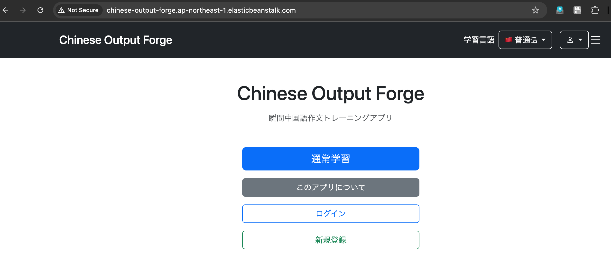
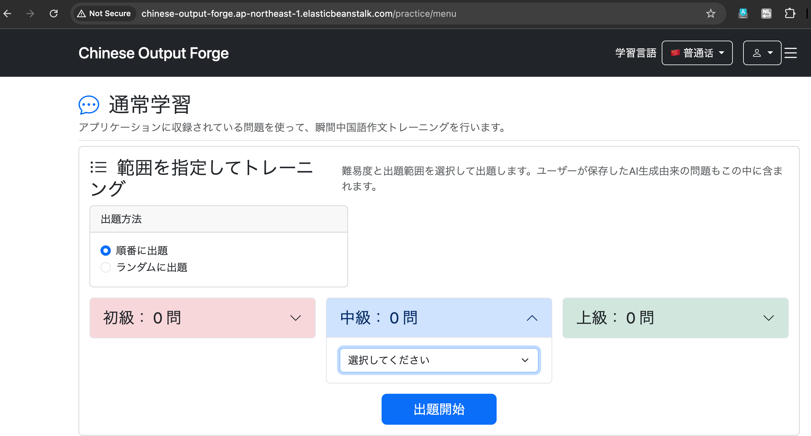
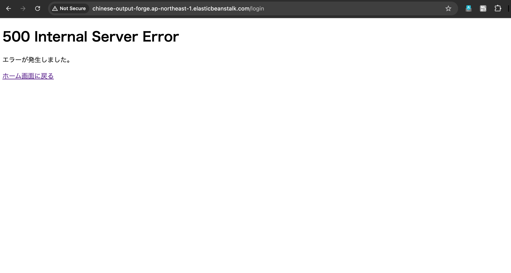

# 031-02 AWS高可用性構成②｜Elastic BeanstalkによるSpring Bootのデプロイ

## 1. Spring BootアプリケーションのJAR作成

Elastic Beanstalkへ配置するため、Eclipseで **実行 → Mavenビルド** を開き、ゴールに次を指定した。

```bash
clean package
```

ビルドが成功すると、`target`ディレクトリに実行可能なJARが生成される。

### ビルド時のエラーと対処

初回はMavenビルドの実行環境に必要な環境変数がなく、テスト実行時にSpring Bootが起動できずビルドに失敗した。EclipseのMavenビルド実行設定に必要な環境変数を追加して対処した。

| 環境変数 | 用途 |
| --- | --- |
| `DB_URL` | PostgreSQL接続先 |
| `DB_USERNAME` | DBユーザー名 |
| `DB_PASSWORD` | DBパスワード |
| `GOOGLE_API_KEY` | Google APIキー |
| `OPENAI_API_KEY` | OpenAI APIキー |
| `MAIL_USERNAME` | メール送信ユーザー名 |
| `MAIL_PASSWORD` | メール送信パスワード |

元ログには、この修正後のビルド出力全文やJARの具体的なファイル名は記録されていない。

## 2. IAMロールの作成・設定

Elastic Beanstalkのサービス用と、アプリケーションを実行するEC2用にIAMロールを設定した。

| 対象 | ロール名 | 信頼されたエンティティ | 設定したAWS管理ポリシー |
| --- | --- | --- | --- |
| EC2 | `chinese-output-forge-ec2-role` | EC2 | `AWSElasticBeanstalkWebTier` |
| Elastic Beanstalk | `chinese-output-forge-elasticbeanstalk-service-role` | Elastic Beanstalk | `AWSElasticBeanstalkEnhancedHealth`、`AWSElasticBeanstalkManagedUpdatesCustomerRolePolicy` |

EC2側のポリシーはWebサーバーとしての実行に、サービスロール側のポリシーは環境のヘルス情報取得やマネージド更新に使用する。後続のSSM接続に必要な追加権限は031-03で扱う。

## 3. Elastic Beanstalkアプリケーションと環境の作成

AWSコンソールからElastic Beanstalkアプリケーションと、負荷分散型のWebサーバー環境を作成した。環境作成時にALB、EC2、Auto Scalingを利用する設定を行った。

### アプリケーション・実行環境

| 項目 | 設定値 |
| --- | --- |
| アプリケーション名 | `chinese-output-forge` |
| 環境名 | `Chinese-output-forge-env` |
| 環境階層 | ウェブサーバー環境 |
| 環境タイプ | 負荷分散 |
| プラットフォーム | Java |
| プラットフォームブランチ | Corretto 21 running on 64bit Amazon Linux 2023 |
| プラットフォームバージョン | `4.12.9` |
| プロキシサーバー | nginx |
| アーキテクチャ | `x86_64` |
| インスタンスタイプ | `t3.micro` |
| 最小インスタンス数 | `2` |
| 最大インスタンス数 | `2` |
| フリート | オンデマンドインスタンス |

### ネットワーク・権限

| 項目 | 設定値 |
| --- | --- |
| VPC | `chinese-output-forge-vpc` |
| EC2配置先 | Private App Subnet（1a / 1c） |
| EC2セキュリティグループ | `chinese-output-forge-ec2-sg` |
| ロードバランサー | Application Load Balancer（ALB） |
| ALB公開範囲 | パブリック（インターネット向け） |
| ALB配置先 | Public Subnet（1a / 1c） |
| サービスロール | `chinese-output-forge-elasticbeanstalk-service-role` |
| EC2インスタンスプロファイル | `chinese-output-forge-ec2-role` |
| EC2キーペア | `chinese-output-forge-ssh-key` |

### デプロイ・監視設定

| 項目 | 設定値 |
| --- | --- |
| ヘルスレポート | 拡張 |
| モニタリング間隔 | 5分 |
| CloudWatch Logs | インスタンスログのストリーミング有効 |
| CloudWatch Logs保持期間 | 7日 |
| 環境終了時のログ | 保持 |
| デプロイポリシー | 1回にすべて |
| マネージドプラットフォーム更新 | 無効 |

## 4. Elastic Beanstalkの環境プロパティ設定

Spring Bootが実行時に参照する値を環境プロパティに設定した。

| キー | 設定値・用途 |
| --- | --- |
| `DB_URL` | `jdbc:postgresql://chinese-output-forge-db.c32cwi4eqr3d.ap-northeast-1.rds.amazonaws.com:5432/chinese_output_forge` |
| `DB_USERNAME` | `cof_admin` |
| `DB_PASSWORD` | RDS接続パスワード（値は記載しない） |
| `GOOGLE_API_KEY` | Google APIキー（値は記載しない） |
| `OPENAI_API_KEY` | OpenAI APIキー（値は記載しない） |
| `MAIL_USERNAME` | メール送信用アカウント（値は記載しない） |
| `MAIL_PASSWORD` | メール送信用パスワード（値は記載しない） |
| `SERVER_PORT` | `5000` |

`DB_URL`を設定しないと、元ログに記録された`application.yml`のデフォルト値であるローカルPostgreSQLを参照する。環境変数を使う構成のため、AWS用に`application.yml`を変更せずにデプロイした。

元ログに掲載された設定抜粋：

```yaml
datasource:
  url: ${DB_URL:jdbc:postgresql://localhost:5432/chinese_output_forge}
  username: ${DB_USERNAME:chinese_output_forge_app}
  password: ${DB_PASSWORD}
```

※ 上記は元ログの抜粋をそのまま収録したもので、`spring.datasource`以下を含むファイル全体の階層を示すものではない。

## 5. 初回デプロイ後の確認

Elastic Beanstalkが生成したドメインにアクセスした。

```text
chinese-output-forge.ap-northeast-1.elasticbeanstalk.com
```

**Home画面へのアクセスは成功**した。この段階では独自ドメインをまだ設定していない。



ただし、RDSに既存データを移行する前だったため、DBを必要とする機能は正常に利用できなかった。

- 通常学習メニュー：収録問題数が`0`と表示された。



- ログイン画面：アクセスできなかった。



この段階で元ログは、EC2（Spring Boot）からRDS（PostgreSQL）へのTCP `5432`の接続経路を確立したと記録している。ただし、具体的な疎通確認コマンドや出力はこの箇所にはない。

次の031-03では、ローカルPostgreSQLのデータをRDSへ移行する。SSMのポートフォワーディングと`pg_dump` / `pg_restore`の試行錯誤はそちらに分離する。

## 確認事項

- 初回のMavenビルド失敗について、元ログには具体的な例外メッセージがないため、エラー内容は追加していない。
- 初回ログイン画面の不具合について、データ未移行の段階で発生した事実のみを記録し、直接の原因は断定していない。
- `application.yml`のコードは元ログ記載の抜粋であり、実ファイルの階層・設定を確認する余地がある。
- 元ログでは環境プロパティに秘密情報を直接設定している。後のParameter Store導入は031-04に分離し、ここでは先取りしない。
