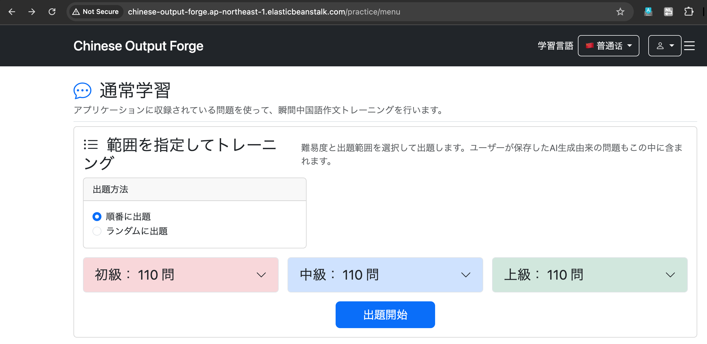

# 031-03 AWS高可用性構成③｜SSMを利用したRDSへのデータ移行

## 作業概要

Elastic Beanstalkへの初回デプロイ後、RDSにはテーブルが存在していたが、`question`のデータは0件だった。ローカルPostgreSQLのデータをRDSへ移行する。RDSとEC2はPrivate Subnetにあるため、MacからSSMポートフォワーディングを利用する。

> この章は元ログの「9. 既存データをRDSに移行」を実施順に整理したもの。コマンド・エラー・確認結果を残し、一般的な解説と重複説明を短縮した。


# ローカルDBを pg_dump

ローカルのPostgreSQLに保存されているChinese Output
Forgeの**テーブルやデータをRDSへ移行するため、まずバックアップファイルを作成する**。

PostgreSQLの`pg_dump`を使用して、ローカルDBの内容を`.dump`ファイルとして出力する。

## コマンド

/Library/PostgreSQL/18/bin/pg_dump\
-h localhost\
-p 5432\
-U chinese_output_forge_app\
-d chinese_output_forge\
-F c\
-f \~/chinese_output_forge.dump

-   `/Library/PostgreSQL/18/bin/pg_dump`：PostgreSQL 18の `pg_dump`
    をフルパスで実行
-   `-h localhost`：接続先をローカルPCに指定
-   `-p 5432`：PostgreSQLのポート番号を指定
-   `-U chinese_output_forge_app`：ローカルPostgreSQLへの接続ユーザーを指定
-   `-d chinese_output_forge`：バックアップ対象のデータベースを指定
-   `-F c`：Custom形式で出力（`pg_restore` で復元可能）
-   `-f ~/chinese_output_forge.dump`：ホームディレクトリにダンプファイルを保存


# RDSへ到達できる経路を用意

`pg_restore`を実行するには、RDSのPostgreSQL（ポート5432）へ通信できる環境が必要。
今回はすでに、Elastic
BeanstalkのEC2からRDSへ接続できる経路を構築・確認済み。

    RDSのインバウンドルール
    PostgreSQL
    TCP 5432
    送信元：chinese-output-forge-ec2-sg

そのため、RDSへ到達できるEC2を経由して、ローカルDBのデータをRDSへ移行する。

## 事前準備

-   AWS CLIのインストール
-   Session Manager Plugin のインストールする
-   踏み台EC2(中継となるEC2)にSSM
    AgentおよびIAMロールAmazonSSMManagedInstanceCoreが必要

### AWS CLIのインストール

curl -fsSL https://awscli.amazonaws.com/v2/install.sh \| bash

aws --version　で確認 ↓ aws-cli/2.37.9 Python/3.14.6 Darwin/24.6.0
script-exe/x86_64

aws-cli/2.37.9がインストール済だということが確認できた

### AWS CLI 用の Session Manager プラグインをインストール

署名されたインストーラーを使用して Session Manager プラグインを macOS
にインストールする

署名されたインストーラーをダウンロード curl
"https://s3.amazonaws.com/session-manager-downloads/plugin/latest/mac/session-manager-plugin.pkg"
-o "session-manager-plugin.pkg" ↓ インストールコマンドを実行 sudo
installer -pkg session-manager-plugin.pkg -target / sudo ln -s
/usr/local/sessionmanagerplugin/bin/session-manager-plugin
/usr/local/bin/session-manager-plugin ↓ The install was successful.

確認 session-manager-plugin --version ↓ 1.2.835.0が表示されたので成功

###　踏み台EC2(中継となるEC2)にSSM
AgentおよびIAMロールAmazonSSMManagedInstanceCoreが必要

#### SSM Agent

AWSコンソールで、 Systems Manager → フリートマネージャー（Fleet
Manager）にアクセス マネージドノード
としてEC2が表示され、さらにバージョンが3.3.4624.0なのでSSM
Agentのバージョン条件はクリア済

#### AmazonSSMManagedInstanceCore

AWSコンソールで、 EC2 → インスタンス → 対象のEC2を選択
→「セキュリティ」タブからロールを確認 1a,
1cともにchinese-output-forge-ec2-roleを使っており内訳は
・AmazonSSMManagedInstanceCore ← SSMを利用するための権限
・AWSElasticBeanstalkWebTier ← Elastic BeanstalkのWebサーバー用の権限

なので条件はクリア

## 手順

ローカルのターミナルで以下を実行

aws ssm start-session\
--target i-0ca9a935d68a2e87e\
--document-name AWS-StartPortForwardingSessionToRemoteHost\
--parameters
'{"host":\["chinese-output-forge-db.c32cwi4eqr3d.ap-northeast-1.rds.amazonaws.com"\],"portNumber":\["5432"\],"localPortNumber":\["5432"\]}'

このコマンドは、**AWS Systems Manager Session
Managerを利用して、ローカルPCからEC2を経由してRDSへ接続するためのトンネルを作成する**。

### 実行

user@Mac chinese-output-forge % aws ssm start-session\
--target i-0ca9a935d68a2e87e\
--document-name AWS-StartPortForwardingSessionToRemoteHost\
--parameters
'{"host":\["chinese-output-forge-db.c32cwi4eqr3d.ap-northeast-1.rds.amazonaws.com"\],"portNumber":\["5432"\],"localPortNumber":\["5432"\]}'

↓

aws: \[ERROR\]: An error occurred (NoRegion): You must specify a region.
You can also configure your region by running "aws configure".
user@Mac chinese-output-forge %

内容: どのリージョンを使うか　がまだ設定されていないためのエラー

### 修正・実行

今回のEC2とRDSは東京リージョン ap-northeast-1
なので、コマンドにリージョンを明示して実行する

aws ssm start-session\
--region ap-northeast-1\
--target i-0ca9a935d68a2e87e\
--document-name AWS-StartPortForwardingSessionToRemoteHost\
--parameters
'{"host":\["chinese-output-forge-db.c32cwi4eqr3d.ap-northeast-1.rds.amazonaws.com"\],"portNumber":\["5432"\],"localPortNumber":\["5432"\]}'

↓

Starting session with SessionId:
<SESSION_ID>

のままで止まる。本来ならば Port 5432 opened for sessionId ...
となるはずなのだがセッションが確立しない

### 修正

技術ブログや公式ドキュメントを参照すると、ローカルのポート番号に15432を採用しているので今回もそれに合わせてみる

aws ssm start-session\
--region ap-northeast-1\
--target i-0ca9a935d68a2e87e\
--document-name AWS-StartPortForwardingSessionToRemoteHost\
--parameters
'{"host":\["chinese-output-forge-db.c32cwi4eqr3d.ap-northeast-1.rds.amazonaws.com"\],"portNumber":\["5432"\],"localPortNumber":\["15432"\]}'


user@Mac chinese-output-forge % aws ssm start-session\
--region ap-northeast-1\
--target i-0ca9a935d68a2e87e\
--document-name AWS-StartPortForwardingSessionToRemoteHost\
--parameters
'{"host":\["chinese-output-forge-db.c32cwi4eqr3d.ap-northeast-1.rds.amazonaws.com"\],"portNumber":\["5432"\],"localPortNumber":\["15432"\]}'
↓ Starting session with SessionId:
<SESSION_ID> Port 15432 opened for
sessionId <SESSION_ID>. Waiting for
connections...

SSMのRemote
Hostポートフォワーディングが正常に動作し、かつトンネルの準備が完了して、Macの
localhost:15432 への接続を待っている状態になった。

これでようやくバックアップファイルをRDSへ復元する
pg_restore（またはバックアップ形式によっては psql）に進める。

# 接続の確認

SSMポートフォワーディングを開始した状態で、別のターミナルから `psql`
を使ってRDSへ接続する。

``` bash
psql \
  -h 127.0.0.1 \
  -p 15432 \
  -U cof_admin \
  -d chinese_output_forge
```

-   `-h 127.0.0.1`
    -   接続先としてローカルPCを指定する
    -   実際にはSSMポートフォワーディングによってRDSへ転送される
-   `-p 15432`
    -   SSMポートフォワーディングで設定したローカル側のポート
    -   RDS側のPostgreSQLは `5432` を使用している
-   `-U cof_admin`
    -   RDSへ接続するPostgreSQLユーザー
-   `-d chinese_output_forge`
    -   接続するデータベース名

接続経路は以下のようになる。

``` text
psql
 ↓
127.0.0.1:15432
 ↓
SSMポートフォワーディング
 ↓
EC2
 ↓
RDS:5432
 ↓
chinese_output_forge
```

↓

`cof_admin` のパスワードを入力する。

↓

以下のように表示されれば接続成功。

``` text
psql (18.6 (Postgres.app), server 18.3)
SSL connection (protocol: TLSv1.3, cipher: TLS_AES_256_GCM_SHA384, compression: off, ALPN: postgresql)
Type "help" for help.

chinese_output_forge=>
```

`chinese_output_forge=>` は、現在 `chinese_output_forge`
データベースに接続しており、
PostgreSQLのコマンドやSQLを実行できる状態であることを表す。

# テーブル一覧の確認

接続できたついでに、`\dt` で現在のテーブル一覧を確認する。

``` text
chinese_output_forge=> \dt
                   List of tables
 Schema |         Name          | Type  |   Owner
--------+-----------------------+-------+-----------
 public | ai_generation_history | table | cof_admin
 public | favorite              | table | cof_admin
 public | password_reset_token  | table | cof_admin
 public | question              | table | cof_admin
 public | question_list         | table | cof_admin
 public | question_list_item    | table | cof_admin
 public | structure             | table | cof_admin
 public | study_history         | table | cof_admin
 public | users                 | table | cof_admin
(9 rows)
```

9つのテーブルがRDS上に存在することを確認できた。

また、すべてのOwnerが `cof_admin` になっている。

ただし、**テーブルが存在することと、バックアップのデータが復元されていることは別である。**

この時点ではSpring Boot /
JPAによってテーブル構造だけが作成されている可能性があるため、
必要に応じてデータ件数も確認する。

例：

``` sql
SELECT COUNT(*) FROM question;
```

今回、復元前は `question` の件数が `0` だったため、

``` text
テーブル構造 → RDS上に存在する
データ       → まだ入っていない
```

という状態であることを確認できた。

# データを復元（失敗）

SSMポートフォワーディングを維持した状態で、ローカルに保存していたdumpファイルをRDSへ復元する。

``` bash
pg_restore \
  -h 127.0.0.1 \
  -p 15432 \
  -U cof_admin \
  -d chinese_output_forge \
  --clean \
  --if-exists \
  --no-owner \
  --no-privileges \
  ~/chinese_output_forge.dump
```

各オプションの意味は以下のとおり。


## 実行（失敗）

`pg_restore` を実行したところ、復元に失敗した。

主に以下のようなエラーが発生した。

``` text
ERROR: cannot drop constraint users_pkey on table public.users
because other objects depend on it
```

``` text
ERROR: cannot drop table public.users because other objects depend on it
```

さらに、

``` text
ERROR: relation "users" already exists
```

や、

``` text
ERROR: duplicate key value violates unique constraint "users_pkey"
```

なども発生した。

### 原因

RDSにはすでにSpring Boot / JPAによって9つのテーブルが作成されていた。

また、それらのテーブルはFOREIGN KEYなどによって相互に依存していた。

今回使用した、

``` text
--clean
```

は、dumpに含まれる各オブジェクトを復元する前に既存オブジェクトを削除しようとする。

## 修正（スキーマの削除、再設定）

今回はRDSに現在存在するデータを残したまま差分を復元するのではなく、ローカルDBのバックアップをRDSへ丸ごと復元することが目的である。

そのため、個々のテーブルを削除するのではなく、`public`
スキーマを依存関係ごと削除して、空の状態から復元することにした。

まずRDSへ接続する。

``` bash
psql \
  -h 127.0.0.1 \
  -p 15432 \
  -U cof_admin \
  -d chinese_output_forge
```

接続後、`public` スキーマを削除する。

``` sql
DROP SCHEMA public CASCADE;
```

`CASCADE` を指定することで、`public`
スキーマ内のテーブルだけでなく、それらに依存するFOREIGN
KEYなどのオブジェクトもまとめて削除できる。

実行結果：

``` text
NOTICE:  drop cascades to 9 other objects
DETAIL:  drop cascades to table users
drop cascades to table ai_generation_history
drop cascades to table favorite
drop cascades to table password_reset_token
drop cascades to table question
drop cascades to table question_list
drop cascades to table question_list_item
drop cascades to table structure
drop cascades to table study_history
DROP SCHEMA
```

9つのテーブルを含む `public` スキーマが削除された。

続いて、空の `public` スキーマを作り直す。

``` sql
CREATE SCHEMA public;
```

↓

``` text
CREATE SCHEMA
```

これにより、

``` text
既存のpublicスキーマ
 ├── テーブル
 ├── データ
 ├── PRIMARY KEY
 ├── FOREIGN KEY
 └── シーケンス等
        ↓
DROP SCHEMA public CASCADE
        ↓
すべて削除
        ↓
CREATE SCHEMA public
        ↓
空のpublicスキーマ
```

という状態にした。

------------------------------------------------------------------------

# データを復元（成功）

空の `public` スキーマを作成したため、再度 `pg_restore` を実行する。

今回は既存オブジェクトを削除する必要がないため、

``` text
--clean
--if-exists
```

は使用しない。

また、復元中にエラーが発生した場合にそのまま処理を継続しないよう、

``` text
--exit-on-error
```

を追加する。

``` bash
pg_restore \
  -h 127.0.0.1 \
  -p 15432 \
  -U cof_admin \
  -d chinese_output_forge \
  --no-owner \
  --no-privileges \
  --exit-on-error \
  ~/chinese_output_forge.dump
```

各オプションの意味は以下のとおり。

``` text
--no-owner        バックアップ元のOwner情報を復元しない
--no-privileges   バックアップ元のGRANT / ACLを復元しない
--exit-on-error   エラーが発生した場合、その時点で復元を停止する
```

パスワードを入力すると、エラーは表示されず正常終了した。

``` text
Password:
user@Mac ~ %
```

`pg_restore`
は正常終了時には特にメッセージを表示しないため、RDSへ再接続して実際のデータを確認する。

``` bash
psql \
  -h 127.0.0.1 \
  -p 15432 \
  -U cof_admin \
  -d chinese_output_forge
```

`question` テーブルのデータ件数を確認する。

``` sql
SELECT COUNT(*) FROM question;
```

復元前：

``` text
count
-----
0
```

復元後：

``` text
count
-----
686
```

さらにSpring
Bootアプリの通常学習ページを開くと、復元前は0件だった対象問題数が増えていることも確認できた。



したがって、

``` text
chinese_output_forge.dump
        ↓
pg_restore
        ↓
SSM（localhost:15432）
        ↓
EC2
        ↓
RDS PostgreSQL:5432
        ↓
テーブル・データ・制約等を復元
        ↓
question：0件 → 686件
        ↓
Spring Bootアプリからもデータを確認
```

となり、RDSへのデータ復元に成功した。

------------------------------------------------------------------------


## 実装結果

- SSMのRemote Hostポートフォワーディングを`localhost:15432`で確立。
- 初回の`pg_restore --clean`は外部キー依存関係などで失敗。
- `public`スキーマを削除・再作成して再実行し、エラーなしで終了。
- `question`の件数は0件から686件になり、アプリの通常学習画面でもデータを確認した（`../../images/0031-04.png`）。

## 確認事項

- 元ログでは`localhost:5432`でセッション開始後に待機した理由は確定していない。`15432`への変更で接続できた事実のみ記録する。
- `DROP SCHEMA public CASCADE`は既存データを削除する操作であり、今回は移行前のRDSで実施した。再実行する場合は対象DBを確認する。
- SSMのセッションIDとローカルのシェルユーザー名は公開用に置換した。EC2インスタンスID・RDSエンドポイントは元ログの記録として維持したが、公開前に掲載可否を確認する。
