# 031-05 AWS高可用性構成⑤｜独自ドメイン・HTTPS・監視通知の構築（実装ログ）

## 対象と記録方針

Chinese Output Forgeの高可用性環境について、独自ドメインの取得・DNS切替、ALBのHTTPS対応、CloudWatchとSNSによる通知設定、およびCPU負荷をかけた動作確認を記録する。実施した操作・設定・エラー・確認結果を中心に、元ログの順序に沿って整理する。

> 本章は高可用性構成での実施内容のみを対象とする。高可用性構成全体の最終確認は031-06に分ける。

# 11. **Route 53 / ACM**

-   Route 53で独自ドメインを管理
-   ドメインのネームサーバーをRoute53に変更
-   ALBをRoute 53のAliasレコードのターゲットに設定
-   AWS Certificate Manager（ACM）でSSL/TLS証明書を発行
-   ALBに証明書を設定
-   HTTPSでアプリケーションへアクセスできるようにする

# Route53→ドメインの登録

ドメインが使用可能か検索する chinese-output-forge.com→
OK、まだ使われていないので選択 → チェックアウトに進む

## 失敗

なぜかドメインの登録ができず
AWSに問い合わせても返事が無いのでやり方を変える

# お名前ドットコムでドメインを購入

chinese-output-forge.com → OK、まだ使われていないので選択 → 購入

# ドメインのネームサーバーをRoute53に変更

お名前.comで取得したドメインをAWS上のアプリケーションで使用するため、**ドメインのDNS管理をお名前.com側からAmazon
Route 53へ変更する**。

まず、この「DNSを管理する」とは何を意味するのかを整理する。

## DNS管理先の変更手順

以上を踏まえ、以下の順番でDNS管理をRoute 53へ変更する。

1.  Route 53で`chinese-output-forge.com`のPublic Hosted Zoneを作成する
2.  Route 53によって割り当てられたネームサーバーを確認する
3.  お名前.com側でドメインのネームサーバーをRoute
    53のネームサーバーへ変更する
4.  以降のDNSレコードをRoute 53で管理する

なお、**ドメインそのものをお名前.comからRoute
53へ移管するわけではない**。

今回変更するのはDNSの管理先であり、ドメインの契約・更新などは引き続きお名前.comで行う。

    お名前.com
    └─ ドメインの取得・契約・更新

    Route 53
    └─ DNSの管理
       └─ ドメイン名をどこへ接続するかなどを設定

したがって、まずはRoute
53にこのドメインのDNS情報を管理するためのホストゾーンを作成する。

# Route53でホストゾーンを作成

Route53 → ホストゾーンの作成 ドメイン名: chinese-output-forge.com

## ネームサーバーをお名前ドットコムからRoute 53に変更

Route 53で`chinese-output-forge.com`のPublic Hosted
Zoneを作成すると、以下の4つのネームサーバー（NS）が自動的に割り当てられた。

``` text
ns-1273.awsdns-31.org.
ns-2045.awsdns-63.co.uk.
ns-355.awsdns-44.com.
ns-970.awsdns-57.net.
```

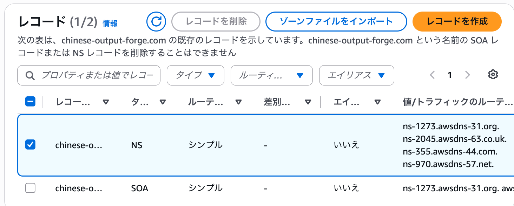

これは、**Route
53でこのホストゾーンを管理するために用意されたネームサーバー**である。

ただし、Route
53でホストゾーンを作成しただけでは、実際のドメインのネームサーバーが自動的にRoute
53へ切り替わるわけではない。

現在`chinese-output-forge.com`がどのネームサーバーによって管理されているのかを確認する。

以下の`dig`コマンドを実行する。

``` bash
dig chinese-output-forge.com NS +short
```

-   `dig`：DNSへ問い合わせを行うコマンド
-   `chinese-output-forge.com`：確認するドメイン
-   `NS`：NSレコード（ネームサーバー）を確認
-   `+short`：詳細情報を省略して結果のみ表示

実行結果は以下のようになった。

``` text
sh-5.2$ dig chinese-output-forge.com NS +short
ns-rs2.gmoserver.jp.
ns-rs1.gmoserver.jp.
sh-5.2$
```

Route
53ではAWSのネームサーバーが割り当てられているが、実際のドメインを確認すると、

``` text
ns-rs1.gmoserver.jp
ns-rs2.gmoserver.jp
```

となっている。

つまり、現在は以下の状態である。

``` text
Route 53
└─ chinese-output-forge.comのHosted Zoneを作成済み
   └─ Route 53のネームサーバーも割り当て済み

しかし

chinese-output-forge.com
└─ 現在指定されているネームサーバー
   ├─ ns-rs1.gmoserver.jp
   └─ ns-rs2.gmoserver.jp
```

したがって、**Route
53側にはDNSを管理する準備ができているものの、実際のドメインはまだお名前.com（GMO）側のネームサーバーを使用している**。

そこで、お名前.comの管理画面からネームサーバーを変更する。

# ネームサーバーを変更

お名前ドットコムにログインしネームサーバーの変更を選択

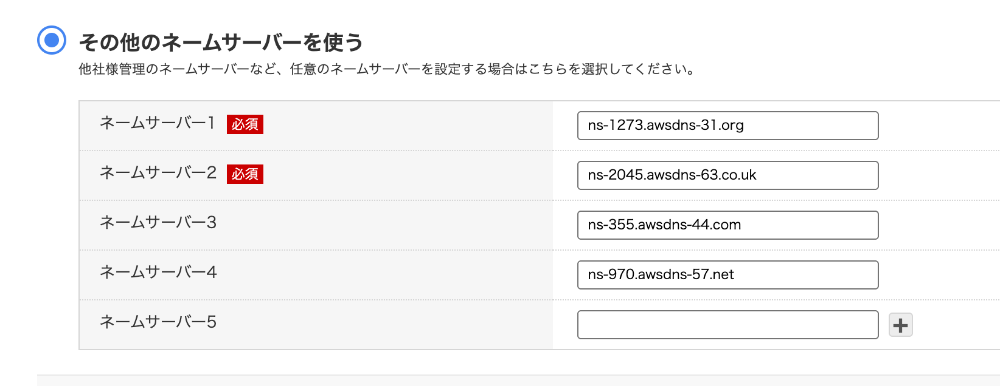

``` text
変更前

ns-rs1.gmoserver.jp
ns-rs2.gmoserver.jp

        ↓ 変更

変更後

ns-1273.awsdns-31.org
ns-2045.awsdns-63.co.uk
ns-355.awsdns-44.com
ns-970.awsdns-57.net
```

これによって、

``` text
chinese-output-forge.com
        ↓
Route 53のネームサーバー
        ↓
Route 53 Hosted Zone
        ↓
DNSレコード
```

という構成になり、`chinese-output-forge.com`のDNSをRoute
53で管理できるようになる。

ネームサーバー変更後、設定が反映されたことを再度`dig`で確認する。

``` bash
dig chinese-output-forge.com NS +short
```

ここでRoute 53の4つのネームサーバーが返ってくれば、**お名前.comからRoute
53へのネームサーバーの切り替えが完了したことを確認できる**。

    sh-5.2$ dig chinese-output-forge.com NS +short
    ns-355.awsdns-44.com.
    ns-970.awsdns-57.net.
    ns-1273.awsdns-31.org.
    ns-2045.awsdns-63.co.uk.
    sh-5.2$ 

# Aレコードの作成（ALBをRoute 53のAliasレコードのターゲットに設定）

ネームサーバーをRoute
53へ変更したことで、`chinese-output-forge.com`のDNSレコードをRoute
53で管理できるようになった。

次に、

``` text
chinese-output-forge.com
```

へアクセスしたときに、Chinese Output
Forgeで使用しているALBへトラフィックが送られるようにDNSレコードを設定する。

今回の構成では、EC2はPrivate
Subnetに配置されており、インターネットからEC2へ直接アクセスする構成にはしていない。

外部からのアクセスはPublic
Subnetに配置されたALBが受け取り、ALBからPrivate
Subnet内のEC2へ振り分ける。

``` text
インターネット
      ↓
chinese-output-forge.com
      ↓
   Route 53
      ↓
     ALB
   ↙     ↘
 EC2     EC2
```

そのため、Route
53からEC2へ直接ルーティングするのではなく、**ALBを接続先として設定する**。

## Aレコードを作成

以下からレコードの作成画面を開く。

``` text
Route 53
→ ホストゾーン
→ chinese-output-forge.com
→ レコードを作成
```

以下のように設定する。

``` text
レコード名：
空欄
→ chinese-output-forge.com自体を対象とする

レコードタイプ：
A

エイリアス：
ON

トラフィックのルーティング先：
Application Load BalancerとClassic Load Balancerへのエイリアス

リージョン：
アジアパシフィック（東京）

ALB：
dualstack.awseb--AWSEB-DmLPBs02Ky6b-820283635...

ルーティングポリシー：
シンプルルーティング

ターゲットのヘルスを評価：
はい
```

これによって、`chinese-output-forge.com`へのアクセスがRoute
53からElastic Beanstalk環境のALBへ送られるようになる。

``` text
ブラウザ
   ↓
chinese-output-forge.com
   ↓
Route 53
   ↓
Aレコード（Alias）
   ↓
ALB
   ↓
EC2 × 2
```

レコード作成後、

``` text
http://chinese-output-forge.com
```

へアクセスし、Chinese Output Forgeが正常に表示されることを確認する。

なお、現時点ではALBにHTTP（80）のリスナーのみを設定しているため、`https://chinese-output-forge.com`ではまだアクセスできない。

HTTPSでアクセスできるようにするには、今後ACMでSSL/TLS証明書を発行し、ALBにHTTPS（443）のリスナーを設定する必要がある。

# 実行

ブラウザから、

`chinese-output-forge.com`

にアクセスする。

そのままアクセスすると、ブラウザでは以下のように表示され、アクセスすることができなかった。

`This site can’t be reached`

しかし、URLを明示的にHTTPに変更して、

`http://chinese-output-forge.com`

へアクセスすると、Chinese Output
Forgeのトップページを正常に表示することができた。

これは、現時点のALBには**HTTP（80番ポート）のリスナーは設定されているが、HTTPS（443番ポート）のリスナーが設定されていないため**である。

現在の構成は以下のようになっている。

    http://chinese-output-forge.com
                ↓
             Route 53
                ↓
         Aレコード（Alias）
                ↓
               ALB
          HTTP : 80
                ↓
             EC2 × 2

一方、HTTPSについてはまだ以下の経路が構築されていない。

    https://chinese-output-forge.com
                ↓
           HTTPS : 443
                ↓
        SSL/TLS証明書が必要
                ↓
               ALB

ブラウザではドメイン名だけを入力した場合にHTTPSでのアクセスが試みられることがあるため、HTTPSに対応していない現在の状態ではアクセスに失敗した。

一方、`http://chinese-output-forge.com`を明示的に指定すると正常にトップページが表示された。

したがって、今回設定した、

    Route 53
        ↓
    Aレコード（Alias）
        ↓
       ALB
        ↓
     EC2 × 2

というルーティング自体は正常に機能していることが確認できた。

よって、現在の段階で**「Route 53 → ALB → EC2」の動作確認は完了**とする。

HTTPSについては、今後ACM（AWS Certificate
Manager）でSSL/TLS証明書を発行し、ALBにHTTPS（443番ポート）のリスナーを追加することで対応する。

# AWS Certificate Manager（ACM）でSSL/TLS証明書を発行

現状はHTTP通信でしかアプリを使えない状態なので、 AWS Certificate
Manager（ACM）を利用してHTTPS通信可能にする。

ACMでドメインの証明書を発行し、ALBに設定することで、

`https://chinese-output-forge.com`

のようにHTTPSで安全にアクセスできるようになる。

    ブラウザ
        ↓
    HTTPS（443）
        ↓
    ALB
    └─ ACMのSSL/TLS証明書を使用
        ↓
    EC2

## ACMでSSL証明書を作成

マネジメントコンソール → Certificate Manager → 証明書のリクエスト
リクエストのタイプ選択で、\[パブリック証明書のリクエスト\]を選択 →
\[証明書のリクエスト\]

ドメイン名: `chinese-output-forge.com` エクスポートを許可しない
検証方法: DNS キーアルゴリズム: RSA2048

リクエスト後、「Route53でレコードを作成」を選択し、レコードを作成を押せばRoute
53のHosted Zoneに、ACMが指定したDNS検証用CNAMEレコードが自動作成される。

## ALBのHTTPSリスナーを追加

HTTPのリスナーしか設定していない状態のALBにHTTPSのリスナーを追加する。
その際に先ほど作成したSSL証明書を利用することになる。

\[EC2\] → \[ロードバランサー\] →
表示されたロードバランサー一覧から以前作成した\[awseb--AWSEB-DmLPBs02Ky6b\]を選択

ページ下部に表示されたALBの詳細情報の \[リスナー\]タブ →
\[リスナーの追加\]

プロトコル: HTTPS 事前ルーティングアクション: なし
アクションのルーティング: ターゲットグループへ転送 ターゲットグループ:
awseb-AWSEB-5VN9HORGZWNL
セキュリティポリシー：ELBSecurityPolicy-TLS13-1-2-Res-PQ-2025-09
証明書の取得先：ACMから(chinese-output-forge.com)

## セキュリティグループ修正

https://chinese-output-forge.com
にアクセスしてみると、タイムアウトになる。

原因は、ALBにつけているセキュリティグループが
HTTPS接続を許可していないため到達不可能になっている。

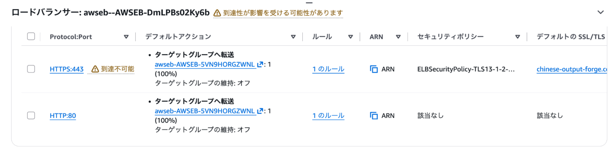

そこでALBのセキュリティグループの設定を修正する。

EC2 → ロードバランサー → awseb--AWSEB-DmLPBs02Ky6b → セキュリティ →
セキュリティグループ → インバウンドルール

このALBのセキュリティグループには現時点ではHTTP 80しかない。

インバウンドルールの追加で HTTPS Anywhere
IPv4　0.0.0.0/0でルールを保存する

HTTPS:443 到達不可能が消え、ブラウザでhttps://chinese-output-forge.com
にアクセスすることが可能となった。

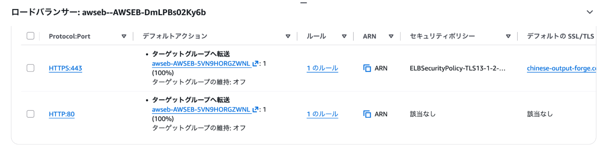

# 12. **CloudWatch / SNS**

AWS上でアプリケーションを運用する場合、システムが正常に稼働しているかを継続的に監視し、異常が発生した場合にすぐ気付ける仕組みが必要になる。

今回は、**Amazon CloudWatch**と**Amazon
SNS**を利用して、AWSリソースの監視とメール通知の仕組みを構築する。

## アラームの作成

CloudWatch → アラーム → アラームの作成 → メトリクス EC2を選択

## 設定値

i-0bb5977be49a76999 (Chinese-output-forge-env)　CPUUtilization 期間1分
しきい値 60% 通知はアラーム状態 トピック名: chinese-output-forge-alerts
アラーム名: chinese-output-forge-high-cpu-01 i-0d39b0bfb53bd20f8
(Chinese-output-forge-env)　CPUUtilization 期間1分 しきい値 60%
通知はアラーム状態 トピック名: chinese-output-forge-alerts アラーム名:
chinese-output-forge-high-cpu-02
(いっぺんに2つは選択できないので1つずつやる)

## 確認のメール

直後にAWSから

    You have chosen to subscribe to the topic:
    arn:aws:sns:ap-northeast-1:XXXXXXXXXX:chinese-output-forge-alerts

    To confirm this subscription, click or visit the link below (If this was in error no action is necessary):
    Confirm subscription

のようなメールが来るので、Confirm
subscriptionのリンクをクリックしてActiveにする

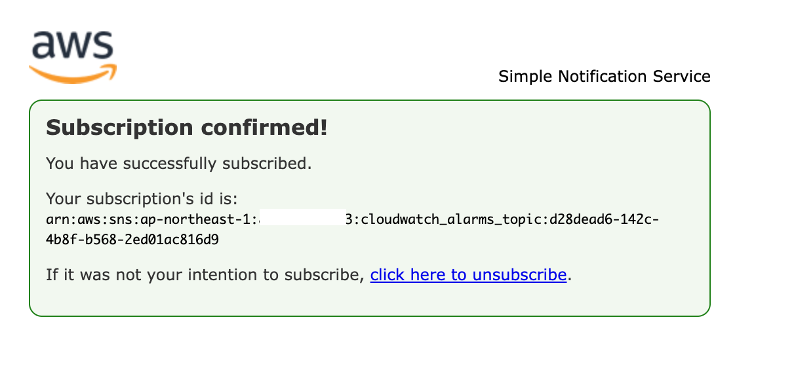

結果、CloudWatchのアラームに今作ったものが反映されるようになった

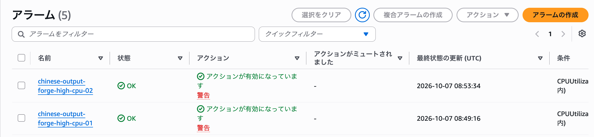

SNSにあくせすし、トピックを確認しても今作成したトピックを確認することができた。

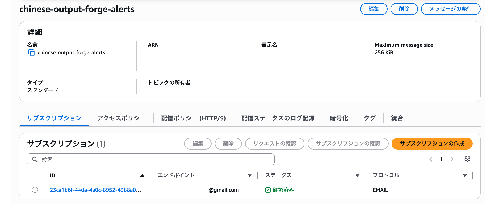

## CPU負荷による通知テスト

CloudWatch AlarmとAmazon
SNSによる通知が正常に動作するか確認するため、EC2に意図的にCPU負荷をかける。

今回作成したCloudWatch
Alarmは、EC2の`CPUUtilization`が60%以上になった場合に`ALARM`状態となり、Amazon
SNSを経由してメール通知を送信するように設定している。

以下の流れで動作確認を行う。

    EC2にCPU負荷をかける
            ↓
    CPUUtilizationが60%以上になる
            ↓
    CloudWatch Alarm
    OK → ALARM
            ↓
    Amazon SNS
            ↓
    メール通知

### EC2に接続

AWSコンソールから以下の順に進む。

    EC2
    → インスタンス
    → Chinese-output-forge-envの監視対象インスタンスを選択
    → 接続
    → Session Manager
    → 接続

今回は2台のEC2のうち、`chinese-output-forge-high-cpu-01`で監視しているインスタンスに接続する。

### CPU負荷を発生させる

まず、EC2のvCPU数を確認する。

``` bash
nproc
```

今回は以下のように表示された。

``` text
2
```

2 vCPUであることを確認したため、以下のコマンドを2回実行する。

``` bash
yes > /dev/null &
```

## 確認

CPU使用率を確認するため、EC2上で以下を実行する。

``` bash
top
```

### CPU使用率の確認

以下のように表示された。

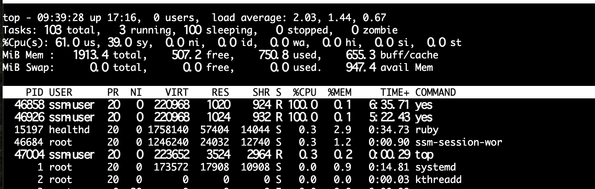

2つの`yes`プロセスがそれぞれ約100%のCPUを使用しており、CPU全体の`idle`もほぼ0%となっている。

狙いどおり、EC2のCPUに高い負荷がかかっていることを確認できた。

### CloudWatch Alarmの確認

CloudWatchのアラーム画面を確認する。

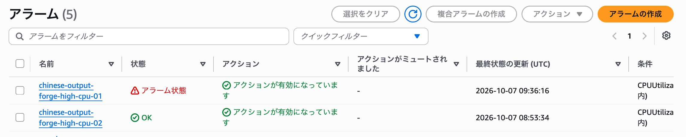 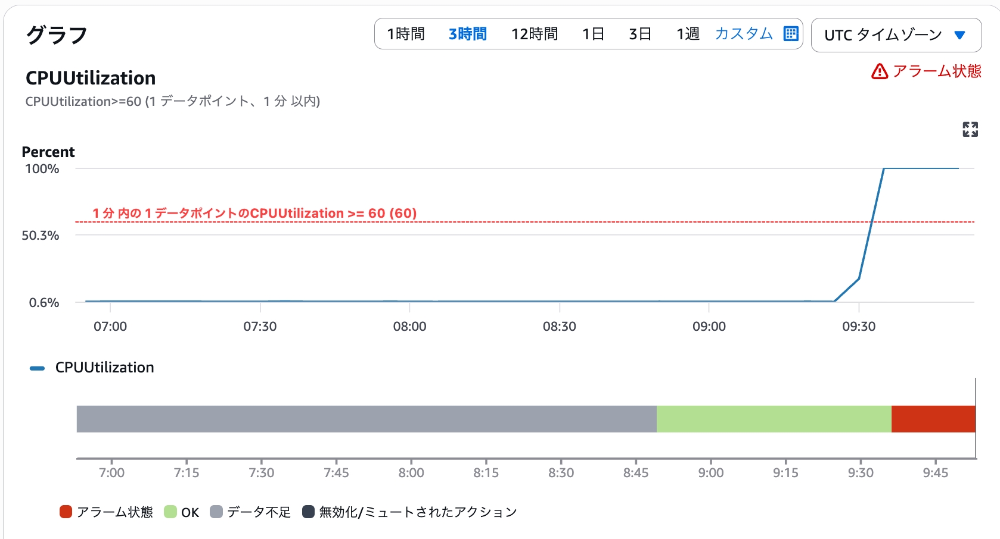

`chinese-output-forge-high-cpu-01`が、

``` text
OK → ALARM
```

へ遷移し、状態が「アラーム状態」になっていることを確認できた。

一方、CPU負荷をかけていないもう1台のEC2に設定したアラームは`OK`のままとなっている。

これにより、CPU負荷をかけたEC2の`CPUUtilization`をCloudWatchが検知していることを確認できた。

### Amazon SNSによるメール通知の確認

続いて、Amazon SNSに登録したメールアドレスを確認する。

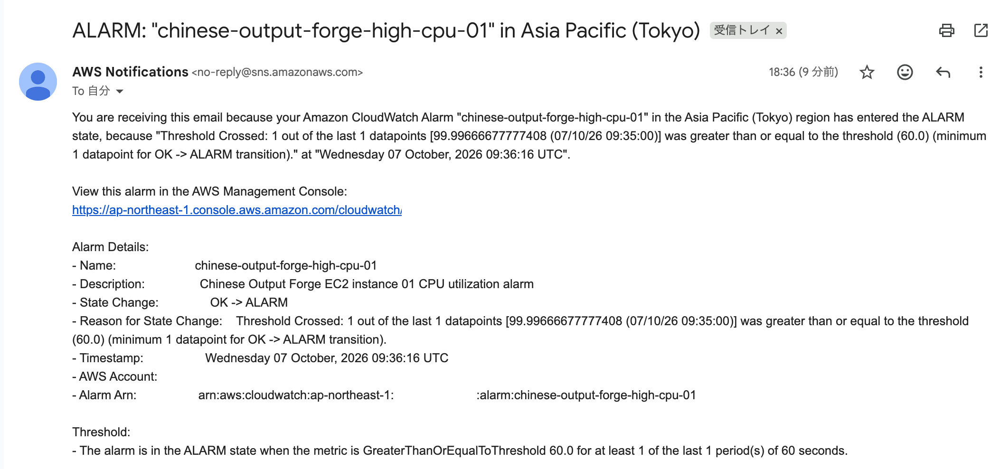

CloudWatch Alarmからメール通知が届いており、メール本文から、

``` text
CPUUtilization：約100%
しきい値：60%
状態：OK → ALARM
```

となったことを確認できた。

つまり、CPU使用率が設定したしきい値である60%以上になったことをCloudWatchが検知し、CloudWatch
Alarmが`ALARM`状態へ遷移したことで、Amazon
SNSを経由してメール通知が送信されたことが分かる。

以上により、

    CloudWatchによるEC2の監視
            ↓
    CloudWatch Alarmによる異常検知
            ↓
    Amazon SNSによるメール通知

までの一連の監視・通知処理が正常に動作することを確認できた。

## CPU負荷の解除

動作確認が完了したため、CPU負荷を発生させるために実行していた`yes`プロセスを停止する。

まず、現在実行されている`yes`プロセスを確認する。

``` bash
ps aux | grep yes
```

### 出力結果

以下のように表示された。

``` text
ssm-user   46858 99.2  0.0 220968  1020 pts/0    R    09:32  23:56 yes
ssm-user   46926 99.3  0.0 220968  1024 pts/0    R    09:34  22:43 yes
ssm-user   47764  0.0  0.1 221820  2284 pts/0    S+   09:56   0:00 grep yes
```

CPU負荷を発生させている`yes`プロセスは以下の2つ。

``` text
PID 46858
PID 46926
```

それぞれCPUを約99%使用していることも確認できる。

なお、

``` text
grep yes
```

の行は、今回実行した`grep yes`コマンド自身が検索結果に含まれているだけなので、停止する必要はない。

### `yes`プロセスを停止

確認したPIDを指定して、2つの`yes`プロセスを停止する。

``` bash
kill -9 46858
kill -9 46926
```

### 停止確認

再度、以下を実行する。

``` bash
ps aux | grep yes
```

結果は以下のようになった。

``` text
ssm-user   47908  0.0  0.1 221820  2316 pts/0    S+   10:00   0:00 grep yes
```

先ほど存在していた、

``` text
46858 ... yes
46926 ... yes
```

の2つのプロセスが表示されなくなっている。

残っている`grep yes`は、確認のために実行した`grep`コマンド自身である。

したがって、CPU負荷を発生させていた2つの`yes`プロセスが正常に停止し、CPU負荷が解除されたことを確認できた。

### CloudWatchも確認

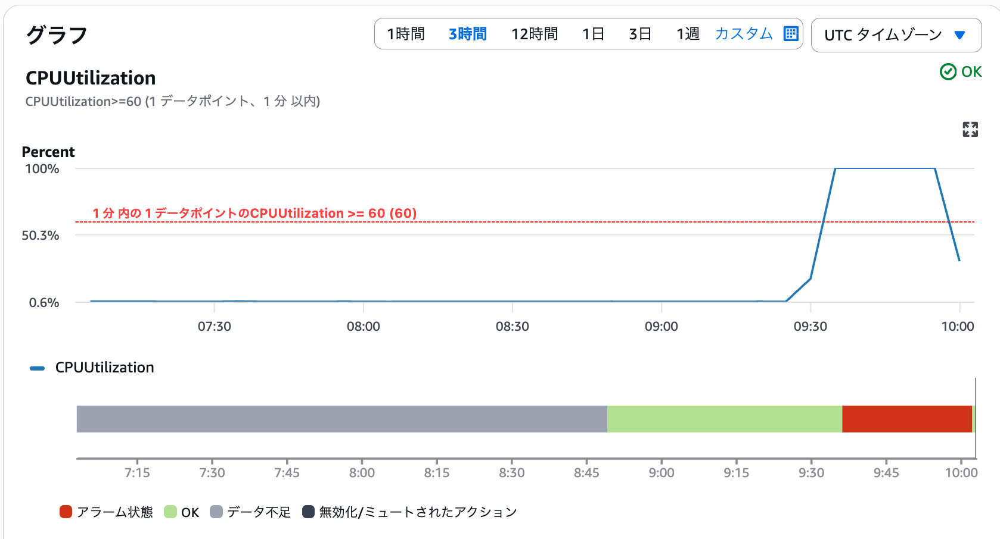

CPU使用率が60%を切っていることが確認できた


## 公開前の確認事項

- Route 53でのドメイン登録失敗について、元ログには失敗の詳細なエラー文や原因は記録されていない。原因を断定しない。
- 独自ドメインのDNS変更後の確認に使った`dig`の実行環境は、元ログではシェル表示があるのみで明確でない。
- ALBのHTTPSリスナーを追加した後、セキュリティグループで443番ポートを許可するまでタイムアウトした事実を残す。原因は当時確認したセキュリティグループの設定に基づく。
- CloudWatchアラームの評価期間・データポイント数・統計方法は元ログに明記されていないため補完しない。
- SNSの購読確認メール、アラーム通知メール等のスクリーンショットに個人メールアドレスやアカウントIDが表示されていないか、公開前に画像を確認する。
- `kill -9`は元ログで実行したコマンドとして記載したものであり、一般的な停止方法として推奨する意図はない。
