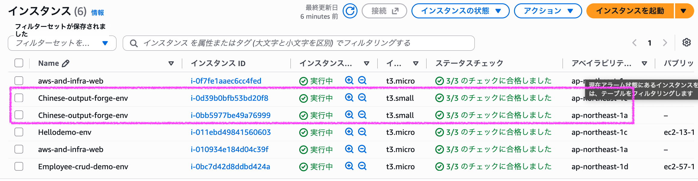
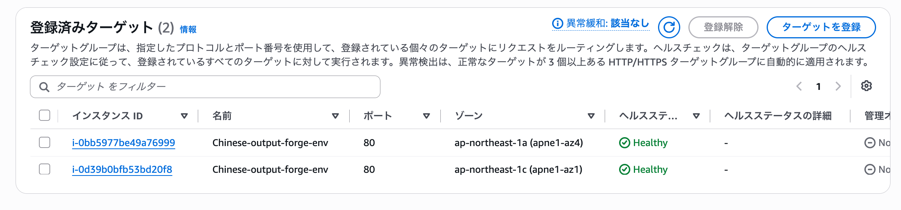
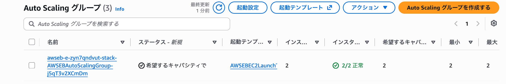
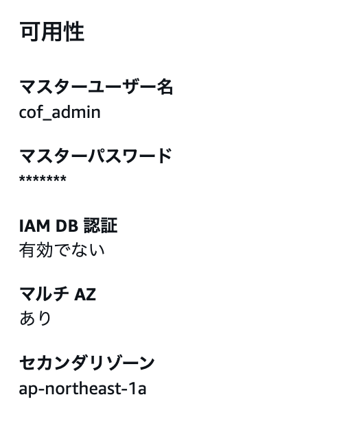

# 031-06 AWS高可用性構成⑥｜構築した高可用性環境の動作確認（実装ログ）

## 1. 最終確認の対象

Elastic Beanstalk、ALB、EC2、RDS、Route 53、CloudWatch、Amazon SNSを構築したため、各サービスの設定と通信をまとめて確認した。この章では新たなAWSリソースは作成しない。

確認対象は以下のとおり。

- 独自ドメインからALB経由でアプリケーションにアクセスできること
- EC2が2台稼働し、Elastic Beanstalk環境に所属していること
- ALBのTarget Groupで両方のEC2が`Healthy`であること
- Auto Scaling Groupが2台を維持する設定であること
- EC2からRDSのTCP 5432番ポートに接続できること
- RDSがMulti-AZ構成であること
- NAT Gatewayとルートテーブルが設定され、EC2からHTTPS通信できること
- CloudWatch AlarmからSNS経由で通知できること

## 2. Route 53・ALB経由のアクセス

以下のURLに実際にアクセスし、ALBを経由してアプリケーションを表示できることを確認した。

```text
https://chinese-output-forge.com
  → Route 53 Aレコード（Alias）
  → ALB（HTTPS:443、ACM証明書）
  → Target Group
  → EC2
```

**結果：アクセス成功。** 独自ドメイン・HTTPSの設定過程は031-05に記録した。

## 3. EC2の稼働状態とElastic Beanstalkへの所属

AWSマネジメントコンソールで以下を開いた。

```text
EC2 → インスタンス → インスタンス
```

2台のEC2について、インスタンス状態が「実行中」であり、ステータスチェックに合格していることを確認した。



さらに2台のタグを確認したところ、両方に次の値が設定されていた。

```text
elasticbeanstalk:environment-name = Chinese-output-forge-env
elasticbeanstalk:environment-id   = e-zyn7qndvut
```

両方が同じAuto Scaling Groupに所属していることも確認した。

**結果：2台ともChinese Output ForgeのElastic Beanstalk環境に属し、稼働していた。**

## 4. ALB Target Groupのヘルスチェック

```text
EC2 → ターゲットグループ → Chinese Output ForgeのTarget Group → ターゲット
```

登録済みターゲットを確認した。

| 対象 | Availability Zone | ヘルスステータス |
| --- | --- | --- |
| EC2① | `ap-northeast-1a` | `Healthy` |
| EC2② | `ap-northeast-1c` | `Healthy` |



**結果：2台とも`Healthy`であり、ALBの転送先として利用できる状態だった。**

## 5. Auto Scaling Groupの台数設定

```text
EC2 → Auto Scaling グループ → Chinese Output ForgeのAuto Scaling Group
```

確認結果は以下のとおり。

| 項目 | 確認値 |
| --- | --- |
| 現在のインスタンス数 | `2` |
| インスタンスヘルス | `2/2 正常` |
| 希望するキャパシティ | `2` |
| 最小キャパシティ | `2` |
| 最大キャパシティ | `2` |



**結果：設定上の必要台数と実際の稼働台数が一致していた。** なお、この確認は設定・稼働状態の確認であり、実際にインスタンスを停止して自動補充を試す障害試験ではない。

## 6. EC2からRDSへの接続

AWSマネジメントコンソールで次の順に操作し、Session ManagerでEC2に接続した。

```text
EC2 → インスタンス → Chinese Output ForgeのEC2を選択
→ 接続 → セッションマネージャー → 接続
```

接続後のプロンプト：

```text
sh-5.2$
```

RDSのPostgreSQLポートに到達できるか、次のコマンドを実行した。

```bash
timeout 5 bash -c 'cat < /dev/null > /dev/tcp/chinese-output-forge-db.c32cwi4eqr3d.ap-northeast-1.rds.amazonaws.com/5432' && echo "Connection succeeded" || echo "Connection failed"
```

出力：

```text
Connection succeeded
```

**結果：EC2からRDSのTCP 5432番ポートへ接続できた。** また、Spring BootアプリケーションからRDS上のデータを利用する機能も動作していた。上記のコマンド単体で確認したのはTCP接続であり、SQL実行の成否ではない。

## 7. RDS Multi-AZの設定確認

```text
RDS → データベース → chinese-output-forge-db → 設定
```

「可用性」の欄を確認した。

```text
マルチ AZ：あり
セカンダリゾーン：ap-northeast-1a
```



**結果：RDSがMulti-AZ構成であることを確認した。** 元ログではセカンダリゾーンが`ap-northeast-1a`と表示されている。フェイルオーバーを実際に発生させる試験は、この最終確認には記録されていない。

## 8. NAT GatewayとPrivate App Subnetの外向き通信

### 8.1 NAT Gatewayの状態

```text
VPC → NAT ゲートウェイ
```

| NAT Gateway | 状態 |
| --- | --- |
| `chinese-output-forge-nat-gateway-1a` | `Available` |
| `chinese-output-forge-nat-gateway-1c` | `Available` |

**結果：両方とも`Available`だった。**

### 8.2 ルートテーブルの設定

Private App Subnetに関連付けられたルートテーブルを確認した。

**1a側**

```text
ルートテーブル：chinese-output-forge-private-app-route-1a
送信先：0.0.0.0/0
ターゲット：nat-0f6e6cbf475766542
ステータス：アクティブ
対応するNAT Gateway：chinese-output-forge-nat-gateway-1a
```

**1c側**

```text
ルートテーブル：chinese-output-forge-private-app-route-1c
送信先：0.0.0.0/0
ターゲット：nat-027eedc8b9ad83b0e
ステータス：アクティブ
対応するNAT Gateway：chinese-output-forge-nat-gateway-1c
```

**結果：各Private App Subnetのデフォルトルートが同じAZ側のNAT Gatewayを向いており、アクティブだった。**

### 8.3 EC2から外部へのHTTPS通信

Session ManagerでEC2に接続し、以下を実行した。

```bash
curl -I https://aws.amazon.com
```

出力に以下を確認した。

```text
HTTP/2 200
```

**結果：確認に使用したEC2から外部HTTPSサイトへ通信できた。** 元ログには、2台それぞれで同じコマンドを実行したという記録はない。

## 9. CloudWatch / Amazon SNSの監視通知

031-05の構築時に、EC2でCPU負荷を発生させる試験を実施済み。

```text
EC2のCPU使用率上昇
→ CloudWatch AlarmがALARMへ遷移
→ Amazon SNSへ通知
→ 登録したメールアドレスで通知メールを受信
```

**結果：アラームとメール通知が動作した。** 負荷発生・解除のコマンド、プロセス確認および通知結果の詳細は031-05に記録しているため、ここでは最終確認結果のみを再掲する。

## 10. 最終確認結果

| 確認項目 | 結果 |
| --- | --- |
| 独自ドメイン・HTTPSアクセス | 成功 |
| EC2 2台の稼働・Elastic Beanstalk所属 | 確認済み |
| ALB Target Group | 2台とも`Healthy` |
| Auto Scaling Group | Desired / Min / Max = `2`、稼働2台 |
| EC2 → RDS（TCP 5432） | `Connection succeeded` |
| RDS Multi-AZ | `あり` |
| NAT Gateway | 1a・1cとも`Available` |
| Private App Subnetのルート | 両AZともNAT Gateway向け・アクティブ |
| EC2から外部HTTPS通信 | `HTTP/2 200` |
| CloudWatch / SNS | ALARM遷移とメール受信を確認済み |

以上をもって、Chinese Output Forgeの**高可用性構成の構築および記録された範囲での動作確認を完了**とする。

なお、今回の確認は各リソースの設定・稼働・接続状態の確認が中心であり、AZ障害やRDSフェイルオーバーを実際に発生させた耐障害試験の記録ではない。

次の**032**では、この高可用性構成を踏まえて低コスト構成へ変更する。低コスト化の実装内容は本章には含めない。
