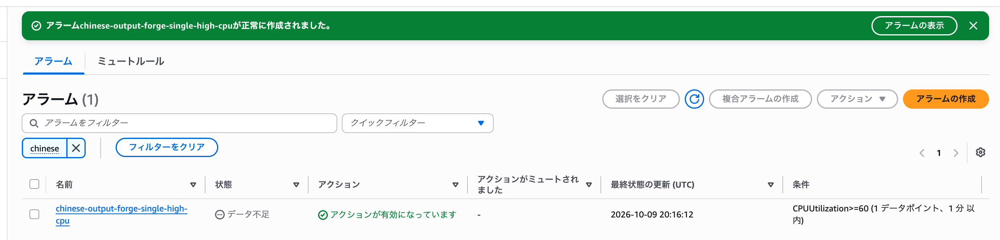

# 032-04 AWS低コスト構成④｜CloudWatch・SNSによる監視環境の再構築（実装ログ）

第032-03章では、Route 53の切り替えとSingle Instance環境でのHTTPS通信を設定した。本章では、新しいEC2を対象とするCloudWatch Alarmを作成し、既存のSNSトピックを通知先に設定する。

---

## Single Instance環境用のCloudWatch Alarmを作成

旧Load Balanced環境では、各EC2インスタンスのCPU使用率をCloudWatch Alarmで監視していた。

Single Instance環境への移行により監視対象のEC2インスタンスが変更されたため、現行のSingle Instance環境のEC2を対象とするCloudWatch Alarmを新たに作成する。

### アラームの作成

アラーム → すべてのアラーム →「アラームの作成」

選択経路は、
EC2
↓
インスタンス別メトリクス
↓
i-07abccf0b144c2760
↓
CPUUtilization

基本的な設定値は旧環境のものを踏襲する

| 設定項目 | 設定値 |
|---|---|
| 名前空間 | AWS/EC2 |
| メトリクス | CPUUtilization |
| 対象 | Chinese-output-forge-single-env |
| InstanceId | `i-07abccf0b144c2760` |
| 統計 | 平均値 |
| 期間 | 1分 |
| しきい値の種類 | 静的 |
| 条件 | 以上（>=） |
| しきい値 | 60% |
| アラームを実行するデータポイント | 1 / 1 |
| 欠落データの処理 | 欠落データを見つかりませんとして処理 |
| 評価ウィンドウ | デフォルト（スライディングウィンドウ） |
| 通知トリガー | アラーム状態 |
| SNSトピック | `chinese-output-forge-alerts` |
| Lambdaアクション | なし |
| Auto Scalingアクション | なし |
| アラーム名 | chinese-output-forge-single-high-cpu |
---

### SNS通知先を確認

今回は既存のSNSトピック `chinese-output-forge-alerts` を使用する。

すでにメールアドレスのサブスクリプションは確認済みのため、
新たな確認メール（Confirm subscription）は送信されない。

CloudWatch Alarmの通知先として `chinese-output-forge-alerts` が設定されていることを確認する。

### 動作確認について

CloudWatch Alarm作成後は、通常であればEC2に意図的にCPU負荷をかけ、

    EC2のCPU使用率を上昇
            ↓
    CloudWatchがCPUUtilizationを監視
            ↓
    CPU使用率が60%以上
            ↓
    CloudWatch AlarmがOK → ALARMへ遷移
            ↓
    Amazon SNSからメール通知

という一連の監視・通知処理が正常に動作することを確認する。

ただし、この動作確認については、旧Load Balanced環境でCloudWatch Alarmを作成した際にすでに実施している。

その際、`yes`コマンドを使用してEC2のCPU使用率を意図的に上昇させ、以下を確認済みである。

- CloudWatchでCPU使用率の上昇を検知できること
- CPU使用率が60%以上になるとCloudWatch Alarmが`ALARM`状態へ遷移すること
- Amazon SNSを経由して登録済みのメールアドレスへ通知が届くこと
- CPU負荷を解除するとCPU使用率が正常な状態へ戻ること

今回作成したSingle Instance環境用のCloudWatch Alarmも同じ監視・通知の仕組みを使用しているため、CPU負荷を発生させる動作確認は割愛する。

---
