# 032-05 AWS低コスト構成⑤｜旧Elastic Beanstalk環境と不要なAWSリソースの削除（実装ログ）

## はじめに

前回の032-04では、新しいSingle Instance環境のEC2を監視するCloudWatch Alarmを設定した。本章では、独自ドメインから新環境へHTTPSでアクセスできることを確認した後、移行時のロールバック用に残していた旧Load Balanced環境と、不要になったAWSリソースを整理する。

## 1. 削除順序を決める

旧Elastic Beanstalk環境は、EC2だけでなくAuto Scaling Group、ALB、Target Groupなどを管理している。個別のEC2やALBを先に手動削除するのではなく、次の順序で作業する。

1. 旧Elastic Beanstalk環境を終了する。
2. Elastic Beanstalkが管理していたリソースの削除状況を確認する。
3. Elastic Beanstalkの管理外に残った不要なリソースを削除する。

現在稼働している`Chinese-output-forge-single-env`は削除対象に含めない。

## 2. 旧Elastic Beanstalk環境を終了する

Elastic Beanstalk → Environments → `Chinese-output-forge-env`を選択する。終了するのは旧Load Balanced環境であり、`Chinese-output-forge-single-env`は維持する。

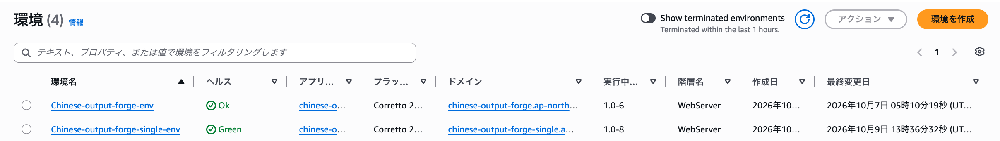

終了の確認画面で操作を進める。

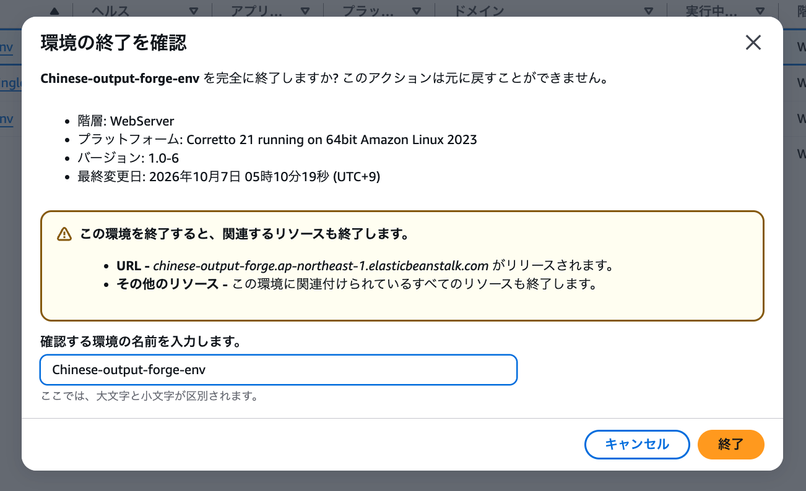

終了処理が開始された。

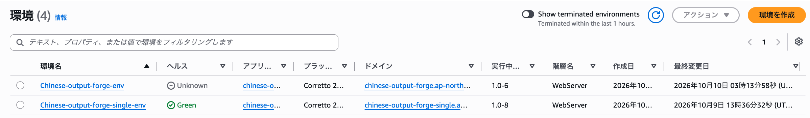

数分後、旧環境が一覧から消えたことを確認した。

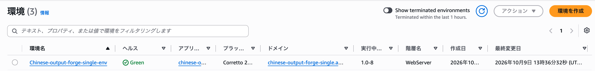

## 3. Elastic Beanstalk管理リソースの削除結果を確認する

### EC2インスタンス

EC2 → インスタンスで、旧環境のEC2が2台とも終了していることを確認した。

- 旧`Chinese-output-forge-env`（`ap-northeast-1a`）：終了済み
- 旧`Chinese-output-forge-env`（`ap-northeast-1c`）：終了済み
- 現`Chinese-output-forge-single-env`（`ap-northeast-1a`、`t3.small`）：実行中

現環境のElastic IPは`13.193.140.206`である。

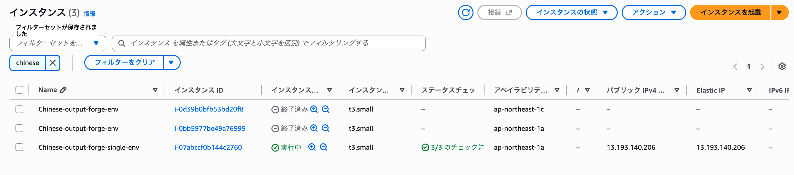

### ALBとTarget Group

EC2 → ロードバランサーで、旧環境のALBが自動削除されたことを確認した。

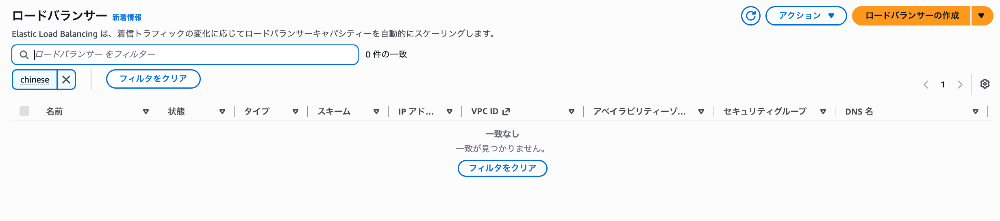

EC2 → ターゲットグループでは「0件の一致」と表示され、旧環境のTarget Groupも残っていなかった。

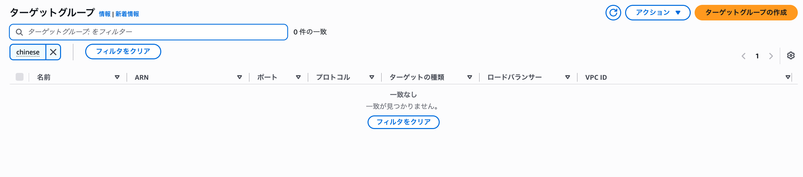

### Auto Scaling Group

EC2 → Auto Scaling → Auto Scalingグループを確認した。

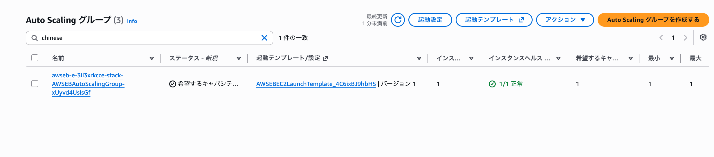

残っているAuto Scaling Groupは、現在のSingle Instance環境のものである。画面ではインスタンス数・希望キャパシティ・最小・最大がいずれも`1`、インスタンスヘルスが`1/1 正常`となっていた。

**Single Instance環境でも、Elastic Beanstalkが1台のEC2を管理するためのAuto Scaling Groupは残る。** 旧環境のAuto Scaling Groupとは異なるため削除しない。

ここまでで、旧環境のEC2×2、ALB、Target Group、旧Auto Scaling Groupが終了・削除されたことを確認した。

## 4. NAT GatewayとElastic IPを削除する

### NAT Gatewayの参照先を確認する

旧構成のPrivate App Subnetからのインターネット通信に使用していたNAT Gatewayは次の2つである。

- `nat-0f6e6cbf475766542`（1a）
- `nat-027eedc8b9ad83b0e`（1c）

VPC → NATゲートウェイで対象を確認した。

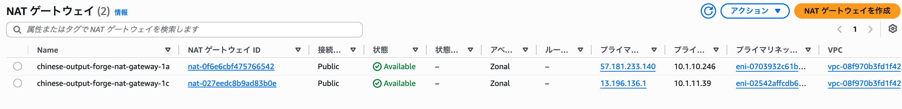

削除前に、旧Private App用ルートテーブルのデフォルトルートを確認した。

- `chinese-output-forge-private-app-route-1a` → `nat-0f6e6cbf475766542`
- `chinese-output-forge-private-app-route-1c` → `nat-027eedc8b9ad83b0e`

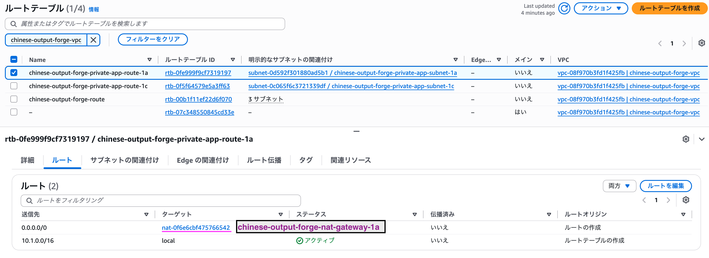
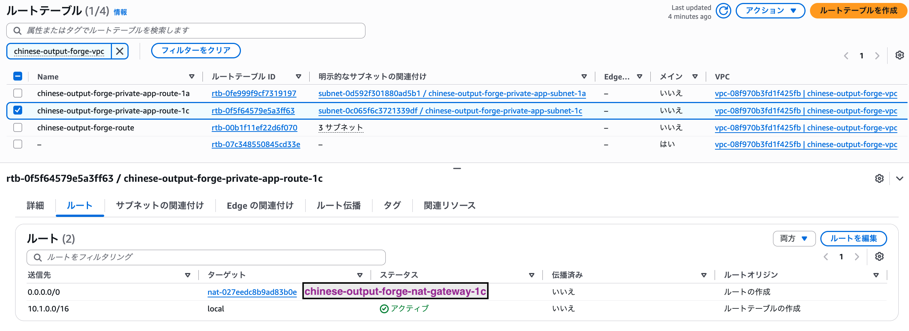

旧EC2はすでに終了しており、新EC2はPublic Subnet `10.1.12.0/24`からInternet Gateway経由で通信するため、この2つのNAT Gatewayは不要となった。

### NAT Gatewayを削除する

VPC → NATゲートウェイ → アクション → NATゲートウェイを削除、の順に操作した。

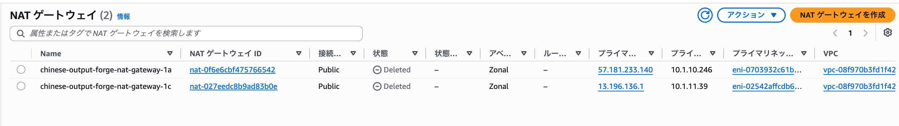

両方とも`Deleted`になったことを確認した。

### NAT Gateway用Elastic IPを解放する

EC2 → Elastic IPで、旧NAT Gateway用の以下のIPアドレスが未関連付けになっていることを確認した。

- `57.181.233.140`（旧NAT Gateway 1a）
- `13.196.136.1`（旧NAT Gateway 1c）

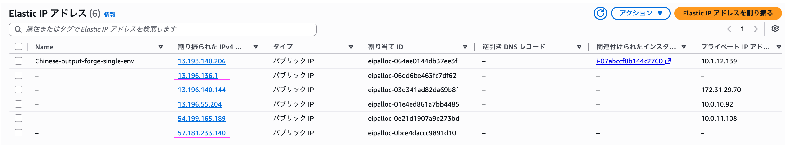

この2つを解放した。**現Single Instance環境のElastic IP `13.193.140.206`は解放しない。**

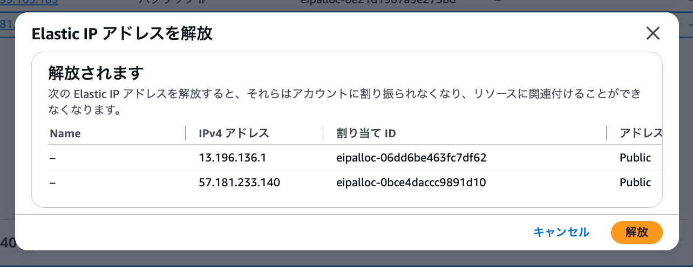
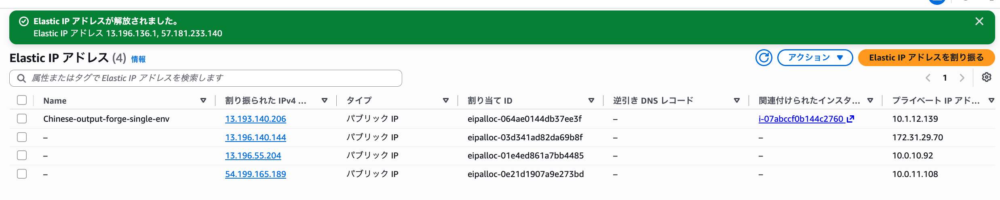

## 5. 旧Private App Subnetとルートテーブルを削除する

### 旧Private App Subnet

VPC → サブネットで、旧EC2用の以下の2つを確認した。

- `chinese-output-forge-private-app-subnet-1a`（`10.1.20.0/24`）
- `chinese-output-forge-private-app-subnet-1c`（`10.1.21.0/24`）

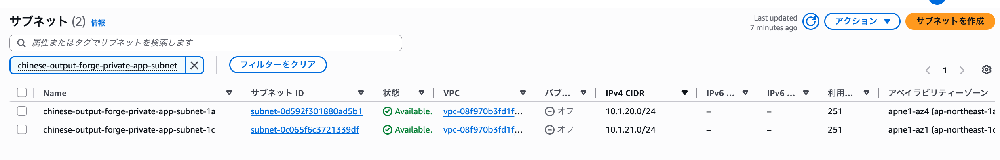

アクション → サブネットを削除、から2つを削除した。

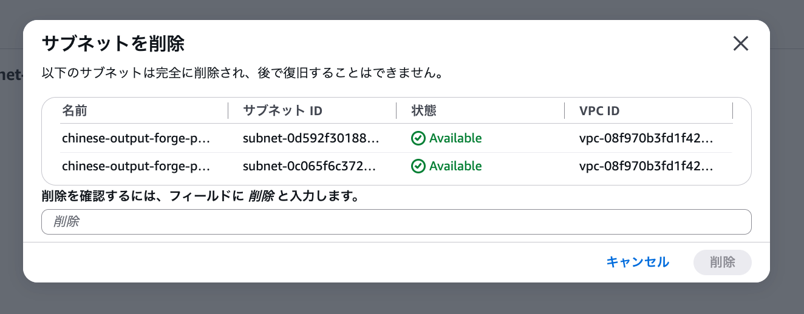
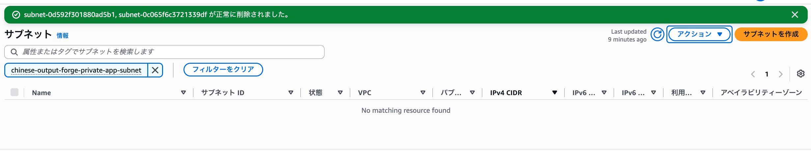

### 旧Private App用ルートテーブル

続いて、以下のルートテーブルを削除した。

- `chinese-output-forge-private-app-route-1a`（`rtb-0fe999f9cf7319197`）
- `chinese-output-forge-private-app-route-1c`（`rtb-0f5f64579e5a3ff63`）

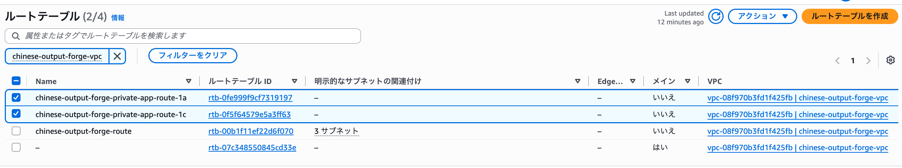
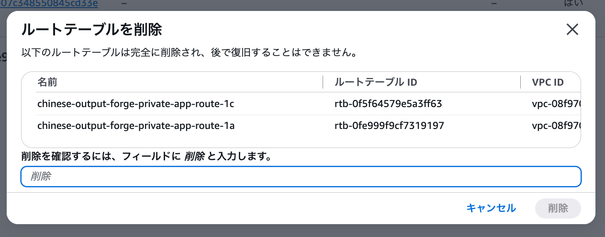
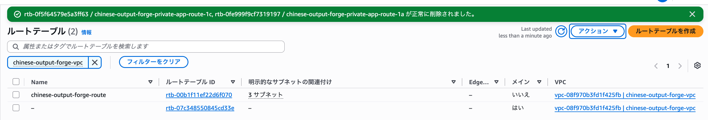

削除後、VPC内に残ったルートテーブルは、現構成で使用する`chinese-output-forge-route`と、VPCのメインルートテーブルの2つだった。

## 6. 旧Security Groupを整理する

### RDS側の旧EC2許可ルールを削除する

旧EC2のSecurity Groupを削除する前に、RDSのSecurity Group `chinese-output-forge-rds-sg`（`sg-0ec636bd0f8f64310`）から、旧EC2への参照を外す。

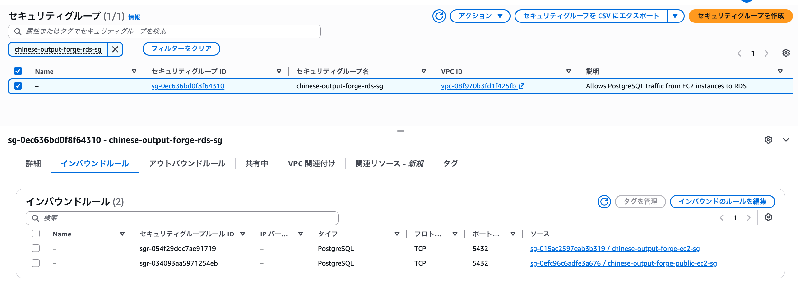

PostgreSQL（TCP 5432）のインバウンドルールのうち、次のように変更した。

- **削除**：旧EC2 SG `sg-015ac2597eab3b319`
- **維持**：現EC2 SG `sg-0efc96c6adfe3a676`

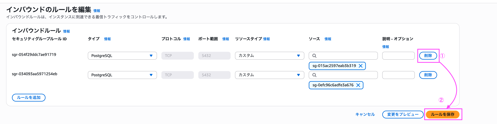
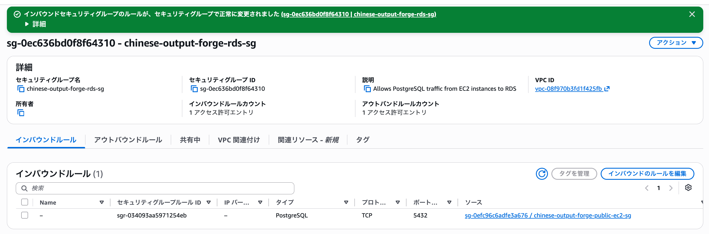

変更後、RDSのインバウンドルールは2件から1件になり、現Single Instance環境からのPostgreSQL接続だけが許可された。

### 旧Security Groupを削除する

EC2 → セキュリティグループで用途を確認した。

| Security Group | 用途 | 対応 |
|---|---|---|
| `chinese-output-forge-alb-sg` (`sg-0a2cd5a38d025feac`) | 旧ALB | 削除 |
| `chinese-output-forge-ec2-sg` (`sg-015ac2597eab3b319`) | 旧Load Balanced EC2 | 削除 |
| `chinese-output-forge-public-ec2-sg` (`sg-0efc96c6adfe3a676`) | 現Single Instance EC2 | 維持 |
| `chinese-output-forge-rds-sg` (`sg-0ec636bd0f8f64310`) | 現RDS | 維持 |
| `awseb-e-...-AWSEBSecurit...` (`sg-0e67908978bc8dec1`) | 現Single InstanceのEB管理用 | 維持 |

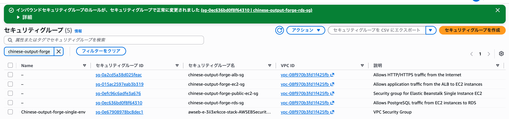

旧ALB用と旧EC2用の2つのSecurity Groupを削除した。

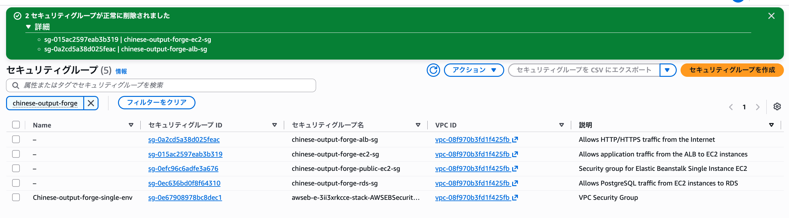

## 7. 旧CloudWatch Alarmを削除する

CloudWatch → アラーム → すべてのアラームを開いた。

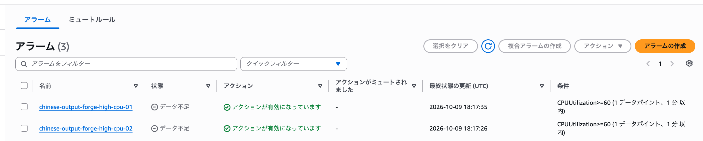

旧EC2を監視していた次の2つは、いずれも「データ不足」と表示されていた。

- `chinese-output-forge-high-cpu-01`
- `chinese-output-forge-high-cpu-02`

旧EC2の終了によりCPU使用率の新しいデータが届かなくなった状態と整合するため、この2つを削除した。現Single Instance用のアラームは維持する。

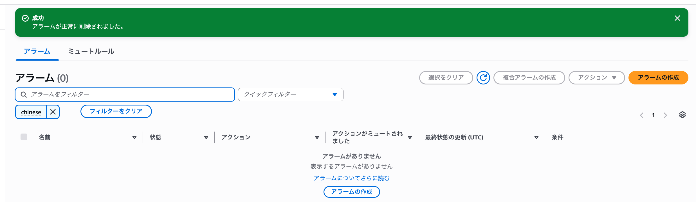

## 8. 不要になったACM証明書とRoute 53レコードを削除する

### ACM証明書

旧環境ではALBでHTTPSを終端し、ACM証明書を使用していた。現環境ではEC2上のnginxとLet's Encrypt証明書を使用している。

ACM → 証明書 → `chinese-output-forge.com`を開き、旧証明書（ARN末尾`db2784f5-78dc-426b-a830-ee26dbb49780`）の使用状況を確認した。

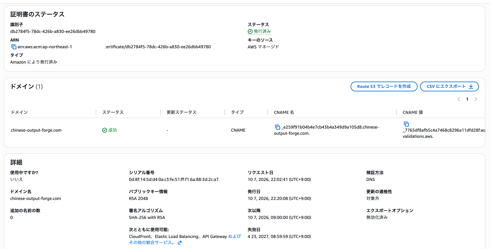

「使用中ですか？：いいえ」と表示されていたため、旧ACM証明書を削除した。

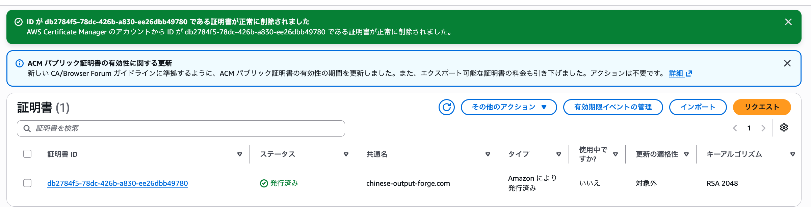

### Route 53のDNS検証用CNAME

Route 53 → ホストゾーン → `chinese-output-forge.com`を開いた。

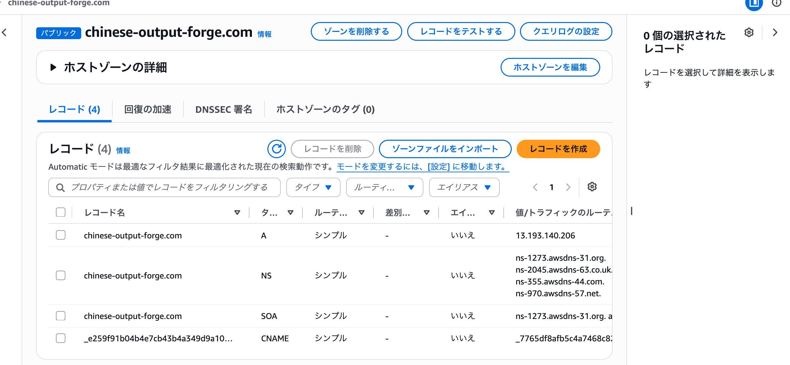

削除済みACM証明書のDNS検証用CNAME（`_e259f91b...`）を削除した。以下のレコードは維持する。

- `chinese-output-forge.com`のAレコード（`13.193.140.206`）
- NSレコード
- SOAレコード

## 9. 旧Public Subnetを削除する

旧Load Balanced環境で使用していた次のPublic Subnetを削除した。

- `chinese-output-forge-public-subnet-1a`（`10.1.10.0/24`）
- `chinese-output-forge-public-subnet-1c`（`10.1.11.0/24`）

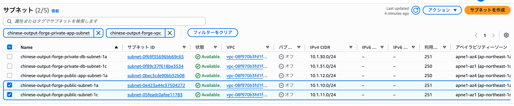
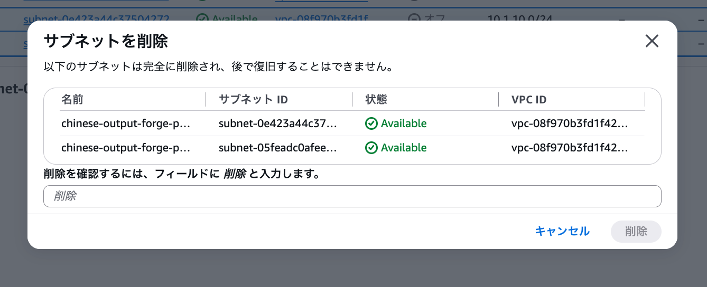
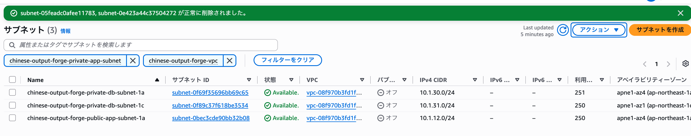

## 10. VPC全体の最終確認

不要な旧リソースを整理した後、以下が残っていることを確認した。

| リソース | 最終状態 |
|---|---|
| Elastic Beanstalk | Single Instance環境 |
| EC2 | 1台 |
| Elastic IP | Single Instance用を維持 |
| Public App Subnet | 1つ |
| Private DB Subnet | 2つ |
| RDS | Single-AZ |
| Internet Gateway | 1つ |
| Route Table | 現行構成用とVPCメイン |
| Security Group | 現EC2用・RDS用・EB管理用 |
| Route 53 | 独自ドメインのAレコード → 現EC2のElastic IP |
| CloudWatch Alarm | 現EC2を監視 |
| Amazon SNS | アラーム通知に使用 |

旧Load Balanced環境で使用していた不要なリソースが残っていないことを確認した。

次の032-06では、RDSのAvailability Zoneの変更と低コスト構成の最終確認を行う。
