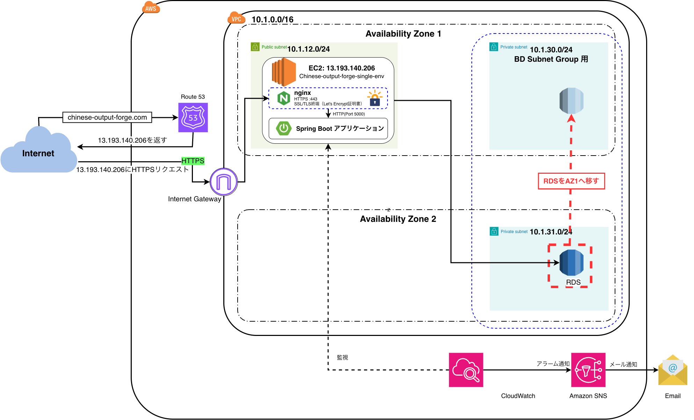
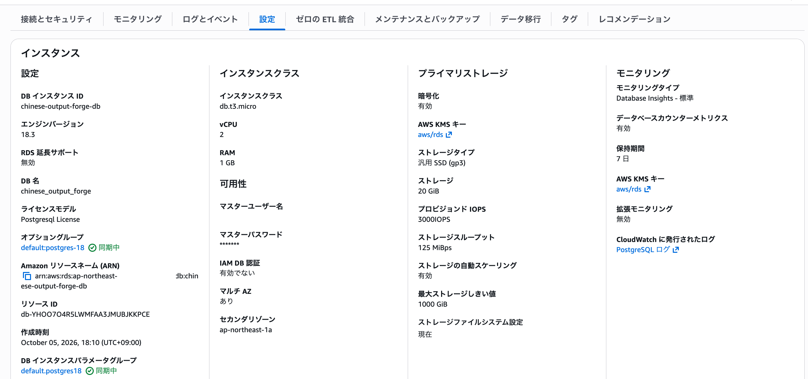
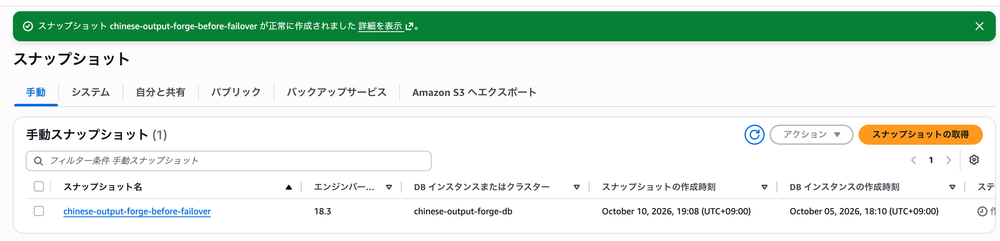
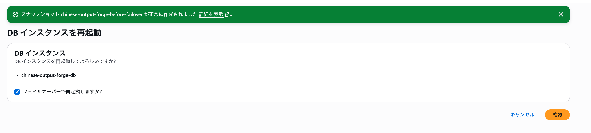
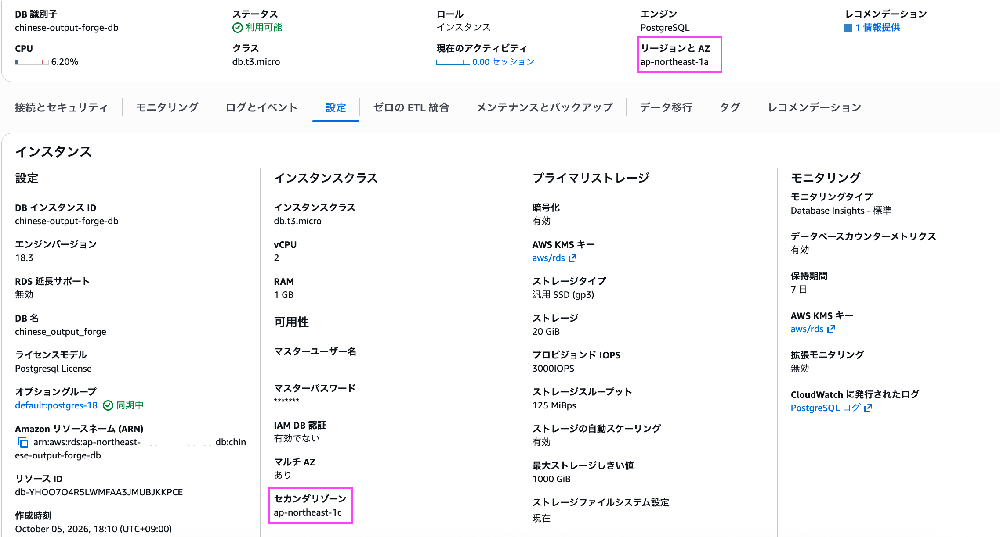
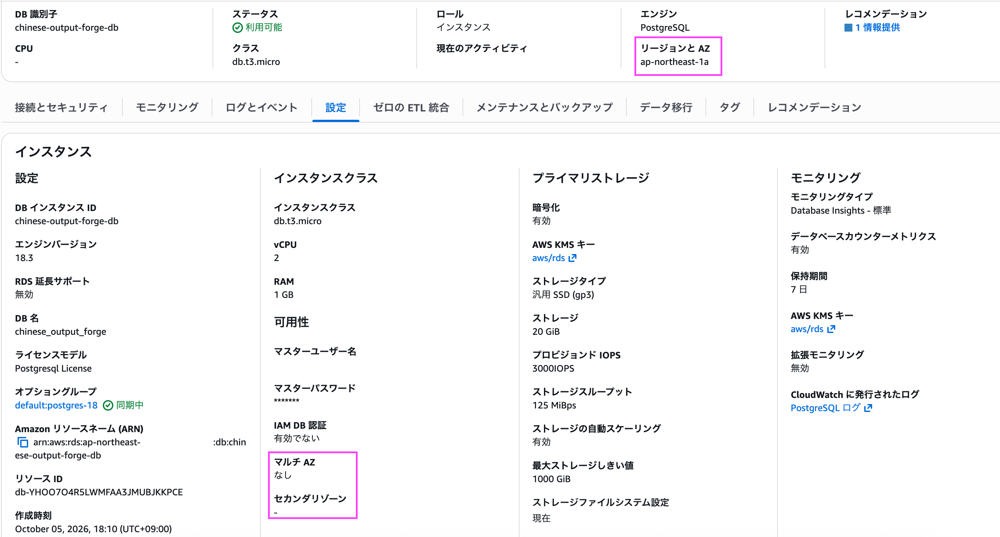

# 032-06 AWS低コスト構成⑥｜RDSのAvailability Zone変更と最終動作確認（実装ログ）

## はじめに

前回の032-05では、旧Load Balanced環境と不要になったAWSリソースを整理した。本章では、Single-AZ化後に`ap-northeast-1c`へ残っていたRDSを、Elastic BeanstalkのEC2と同じ`ap-northeast-1a`へ配置し直す。作業前のスナップショット取得、Multi-AZ化と強制フェイルオーバー、Single-AZへの再変更を記録し、最後にアプリケーションの動作を確認する。

## 1. RDSのAvailability Zoneを変更する

当初のMulti-AZ構成では、`ap-northeast-1a`側をプライマリ、`ap-northeast-1c`側をスタンバイとして使用することを想定していた。

しかし、実際には`ap-northeast-1c`側がプライマリとなっていたため、RDSをSingle-AZ構成へ変更した際に`ap-northeast-1c`側のRDSが残った。

その結果、現在は以下のようにElastic BeanstalkのEC2とRDSが異なるAvailability Zoneに配置されている。

```text
ap-northeast-1a
└─ EC2（Single Instance）

ap-northeast-1c
└─ RDS（Single-AZ）
```


EC2とRDSが異なるAvailability Zoneに配置されていても、同一VPC内で通信できるため、アプリケーションの動作自体に問題はない。

ただし、今回の低コスト構成ではEC2・RDSともに単一のインスタンスで運用しているため、RDSをEC2と同じ`ap-northeast-1a`へ戻すことにする。



最終的に以下の構成を目指す。

```text
ap-northeast-1a
├─ EC2（Single Instance）
└─ RDS（Single-AZ）

ap-northeast-1c
└─ Private DB Subnet（DB Subnet Group用）
```

#### やり方

Single-AZのRDSでは管理画面から配置先のAvailability Zoneを直接変更できなかった。

そこで各種技術ブログを参考にしてみると、
一時的にMulti-AZ構成へ変更し、フェイルオーバーによってプライマリを`ap-northeast-1a`へ切り替えた後、再びSingle-AZ構成へ戻す
という手法が使えるようだ。

フェイルオーバーとは、稼働中のシステムに障害が発生した場合などに、**処理を待機系のシステムへ切り替える仕組み**のこと。

RDSのMulti-AZ構成では、異なるAvailability Zoneに以下のDBインスタンスが配置される。
- プライマリ：通常時に使用するDB
- スタンバイ：プライマリに問題が発生した場合に備える待機系DB

フェイルオーバーが発生すると、**スタンバイ側が新しいプライマリに切り替わる**。
今回、この仕組みを利用してRDSのプライマリを`ap-northeast-1c`から`ap-northeast-1a`へ切り替える。

また、AWS公式ドキュメントにも以下のような記述がある

```
 [フェイルオーバーし再起動しますか?] を選択し、別の AZ へのフェイルオーバーを強制的に実行します。
```

つまり、Multi-AZ構成では**意図的にフェイルオーバーを発生させ、スタンバイ側のAvailability Zoneへプライマリを切り替えることができる**。

今回はこの仕組みを利用し、

1. RDSを一時的にMulti-AZ構成へ変更する
2. `ap-northeast-1a`側にスタンバイが作成されたことを確認する
3. 強制的にフェイルオーバーを発生させる
4. `ap-northeast-1a`側がプライマリになったことを確認する
5. RDSを再びSingle-AZ構成へ戻す

という手順で、RDSを`ap-northeast-1c`から`ap-northeast-1a`へ移動させる。

参考文献
https://dev.classmethod.jp/articles/rds-singleaz-change-az/
https://docs.aws.amazon.com/ja_jp/AmazonRDS/latest/UserGuide/USER_RebootInstance.html?utm_source=chatgpt.com

#### 1. RDSを一時的にMulti-AZ構成へ変更する

RDS → データベース → `chinese-output-forge-db` → 「変更」

「可用性と耐久性」→「マルチAZ配置」で、

**「スタンバイインスタンスを作成する」**

を選択する。

これにより、現在`ap-northeast-1c`で稼働しているプライマリとは別のAvailability Zoneに、スタンバイDBインスタンスが作成される。

その他の設定は変更せず、「続行」をクリックする。

#### 2. `ap-northeast-1a`側にスタンバイが作成されたことを確認する

設定変更後数分待つと変更が反映されMulti-AZ化ができた。




#### 3. 強制的にフェイルオーバーを発生させる

次に、強制的にフェイルオーバーを発生させ、`ap-northeast-1a`側のスタンバイを新しいプライマリへ切り替える。

RDS → データベース → `chinese-output-forge-db` →「アクション」→「再起動」

「フェイルオーバーし再起動」を選択して再起動する。

フェイルオーバー中はRDSへの接続が一時的に切断されるため、処理が完了するまで待つ。

完了後、`ap-northeast-1a`がプライマリになっていることを確認する。

##### 事前準備：RDSのスナップショットを取得する

フェイルオーバーを実行する前に、万が一に備えて現在のRDSの手動スナップショットを取得しておく。

RDS → データベース → `chinese-output-forge-db` →「アクション」→「スナップショットの取得」

スナップショット名を以下のように設定する。

```text
chinese-output-forge-before-failover
```

「スナップショットの取得」をクリックする。

RDS → スナップショットから、作成したスナップショットのステータスが「利用可能」になったことを確認してからフェイルオーバーを実行する。

手動スナップショットは自動的には削除されないため、今回の作業が完了し、RDSが正常に動作していることを確認した後、不要であれば削除する。




##### フェイルオーバー発生

RDS → データベース → chinese-output-forge-db →「アクション」→「再起動」

再起動画面では、**「フェイルオーバーし再起動」**を有効にする。これによって現在の ap-northeast-1c のプライマリから、ap-northeast-1a のスタンバイへのフェイルオーバーを強制する。



#### 4. `ap-northeast-1a`側がプライマリになったことを確認する

再起動を実行したら、RDSが再び「利用可能」になった後、まず ap-northeast-1a がプライマリになったことを確認する。



フェイルオーバー前
1c：プライマリ
1a：スタンバイ

        ↓ 強制フェイルオーバー

現在
1a：プライマリ ← 目的達成
1c：スタンバイ

という一番重要な切り替えは成功した。

#### 5. RDSを再びSingle-AZ構成へ戻す

RDS → データベース → chinese-output-forge-db →「変更」
へ進み、「可用性と耐久性」の マルチAZ配置 を、
「スタンバイインスタンスを作成しないでください」
へ変更

しばらく待つ



画像から、
- リージョンとAZ：ap-northeast-1a
- マルチAZ：なし
- セカンダリゾーン：なし
- ステータス：利用可能
を確認できます。
つまり最終的に、
ap-northeast-1a
├─ EC2（Elastic Beanstalk Single Instance）
└─ RDS（Single-AZ）

ap-northeast-1c
└─ Private DB Subnet（DB Subnet Group用）

となった。

これで、当初気になっていたEC2は1a、RDSは1cというズレも解消された。

##### DBを使う機能（問題の追加・削除など）の確認

RDSのAvailability Zone変更後もアプリケーションから正常にDBへ接続できることを確認する。

`https://chinese-output-forge.com`へアクセスし、問題の追加・削除など、DBへの読み書きを伴う機能を実行した。

すべて問題なく動作することを確認した。

これにより、

- EC2：`ap-northeast-1a`
- RDS：`ap-northeast-1a`
- RDS：Single-AZ

という構成への変更が完了した。


---

## 2. アプリケーションの最終確認

ブラウザから以下へアクセスする。

```text
https://chinese-output-forge.com
```

HTTPSでアプリケーションへ正常にアクセスでき、主要な機能についても正常に動作することを確認した。

また、Elastic Beanstalkのヘルスが`Green`となっており、RDSも正常に稼働していることを確認した。

以上で、

```text
Elastic Beanstalk Load Balanced環境
        ↓
Elastic Beanstalk Single Instance環境

RDS Multi-AZ
        ↓
RDS Single-AZ
```

への低コスト構成への移行と、旧環境で使用していたAWSリソースの整理が完了した。

これで、今回予定していたAWS環境の変更はすべて完了となる。

今後も実際に使用しながら、細かな修正や機能追加、運用面の改善などを少しずつ行っていく予定である。

一方で、当初予定していた主要機能の実装からAWSへのデプロイ、独自ドメイン・HTTPS対応、監視設定、低コスト構成への移行まで一通り完了した。

そのため、ここで`Chinese Output Forge`のアプリケーション実装についてはいったん一区切りとする。

---
