# 032 Chinese Output ForgeをAWSへデプロイする（低コスト構成）

第31章では高可用性構成でのAWSデプロイと動作確認を行った。本章では、実際の運用規模とランニングコストを考慮し、RDSのSingle-AZ化、Elastic BeanstalkのSingle Instance環境への移行、独自ドメイン・HTTPSの切り替え、監視設定および旧リソースの整理を行う。

## 低コスト構成への変更

ここまで、Chinese Output ForgeをAWS上に高可用性構成でデプロイし、各AWSリソースが正常に動作することを確認した。

一方、Chinese Output Forgeは現時点では個人開発のWebアプリケーションであり、高可用性を維持するための構成はランニングコストが大きくなる。

そこで、高可用性構成での構築・動作確認で得た内容を踏まえ、今後の運用では可用性とコストのバランスを考慮した低コスト構成へ変更する。

このセクションでは、高可用性構成と低コスト構成の違いを整理したうえで、AWSリソースの構成を変更する。

## 高可用性バージョンの概要

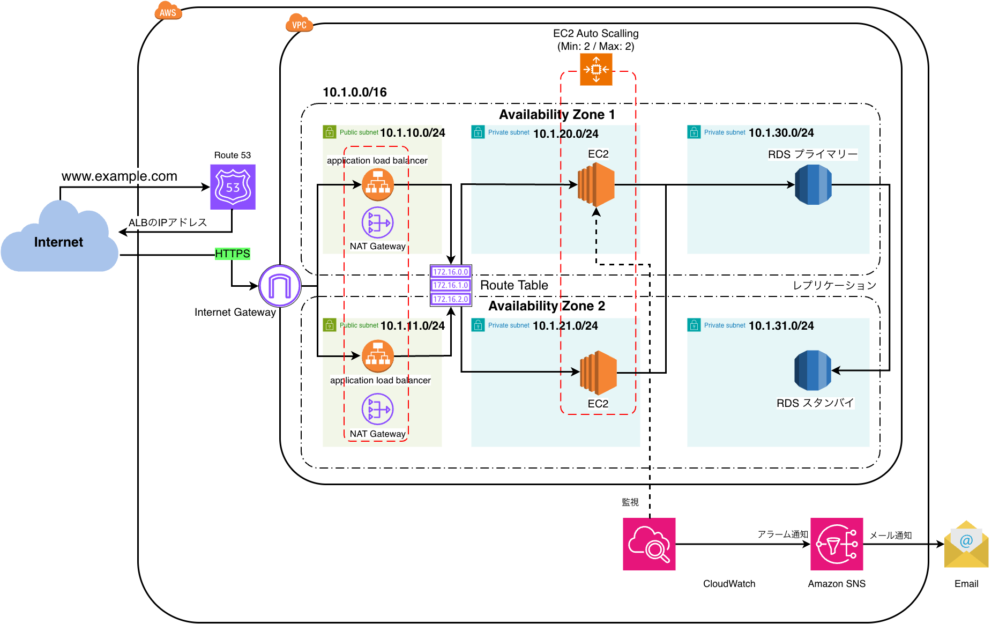

高可用性バージョンでは、障害発生時にもWebアプリケーションを継続して利用できるよう、複数のAvailability Zone（AZ）にAWSリソースを分散して配置した。

主な構成は以下のとおり。

- ALBを2つのPublic Subnetに配置
- EC2を2つのPrivate Subnetに配置
- Auto Scaling GroupによりEC2を2台維持
- NAT Gatewayを各AZのPublic Subnetに配置
- RDSをMulti-AZ構成とし、PrimaryとStandbyを異なるAZに配置
- Route 53からALBへルーティング
- CloudWatchでEC2を監視し、アラーム発生時はSNSを経由してメール通知

この構成では、EC2やRDS、Availability Zoneの一部に障害が発生した場合でもサービスを継続しやすい。

一方で、ALB、複数台のEC2、NAT Gateway、RDS Multi-AZなどを常時稼働させる必要があるため、個人開発のWebアプリケーションとしてはランニングコストが大きくなる。

## 低コストバージョンの概要

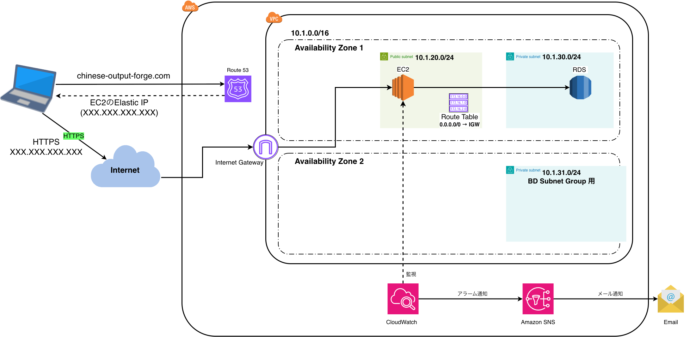

低コストバージョンでは、高可用性バージョンで使用していた冗長構成を縮小し、Chinese Output Forgeの運用に必要な最低限のAWSリソースを使用する。

EC2は1台のみとし、Internet Gatewayを利用してインターネットと直接通信できるようPublic Subnetに配置する。

EC2にはElastic IPを関連付け、Route 53のAレコードからこのElastic IPを参照する。

RDSについてもMulti-AZ構成からSingle-AZ構成へ変更し、Standby DBを廃止する。

ただし、RDSのDB Subnet Groupでは複数のAvailability Zoneのサブネットを使用するため、AZ2のPrivate Subnet `10.1.31.0/24` は残す。

また、EC2をPublic Subnetに配置することで、EC2からInternet Gatewayを経由して直接インターネットへアクセスできるため、NAT Gatewayも廃止する。

CloudWatch、SNSによる監視・メール通知については、低コスト構成でも引き続き使用する。

最終的な構成図は以下のようになる


## 高可用性バージョンとの違い

### ALBが不要

高可用性バージョンでは、ALBを使用して複数のEC2へリクエストを振り分けていた。

低コストバージョンではEC2を1台のみ使用するため、リクエストを複数のEC2へ振り分ける必要がない。

そのため、ALBを廃止する。

### EC2はPrivate SubnetからPublic Subnetへ移動

高可用性バージョンでは、EC2をPrivate Subnetに配置し、インターネットからEC2へ直接アクセスできない構成としていた。

低コストバージョンではALBを廃止するため、インターネットからEC2へ直接アクセスできる必要がある。

そのため、EC2をPublic Subnet `10.1.20.0/24` に配置する。

Public Subnetに関連付けるRoute Tableには、Internet Gatewayへのデフォルトルートを設定する。

    10.1.0.0/16 → local
    0.0.0.0/0   → Internet Gateway

### EC2は2台から1台に減らし、EC2用Subnetも2つから1つに減らす

高可用性バージョンでは、異なるAvailability ZoneにEC2を1台ずつ配置していた。

    AZ1
    10.1.20.0/24 → EC2

    AZ2
    10.1.21.0/24 → EC2

低コストバージョンではEC2を1台のみ使用する。

    AZ1
    10.1.20.0/24 → EC2

そのため、AZ2に存在していたEC2用Subnet `10.1.21.0/24` は不要になる。

### EC2にElastic IPを関連付ける

ALBを廃止するため、EC2がインターネットから直接アクセスを受け付ける。

EC2には固定されたPublic IPv4アドレスとしてElastic IPを関連付ける。

これにより、EC2を停止・起動した場合でも、Route 53から参照するIPアドレスを固定できる。

### Route 53はEC2に関連付けたElastic IPを参照する

高可用性バージョンでは、Route 53からALBへルーティングしていた。

    chinese-output-forge.com
        ↓
    Route 53
        ↓
    ALB
        ↓
    EC2

低コストバージョンではALBを廃止するため、Route 53のAレコードからEC2に関連付けたElastic IPを参照する。

    chinese-output-forge.com
        ↓
    Route 53
        ↓
    EC2のElastic IP

Route 53はDNSによる名前解決を行うものであり、実際のHTTPS通信がRoute 53を経由するわけではない。

名前解決後、クライアントは取得したElastic IPに対してHTTPS通信を行う。

    Client
        ↓
    Internet
        ↓
    Internet Gateway
        ↓
    EC2

### Auto Scalingを廃止

高可用性バージョンでは、Auto Scaling Groupを使用してEC2を2台維持していた。

低コストバージョンではEC2を1台のみ使用するため、Auto Scaling Groupを廃止する。

これによりEC2の自動復旧・台数維持といった高可用性機能は使用しない。

### RDSをMulti-AZからSingle-AZへ変更

高可用性バージョンでは、RDSをMulti-AZ構成としていた。

    AZ1
    10.1.30.0/24
    RDS Primary
        ↓
    レプリケーション
        ↓
    AZ2
    10.1.31.0/24
    RDS Standby

低コストバージョンではSingle-AZ構成へ変更し、Standby DBを廃止する。

    AZ1
    10.1.30.0/24
    RDS

ただし、RDSのDB Subnet Groupには異なるAvailability Zoneのサブネットを含めるため、AZ2のPrivate Subnet `10.1.31.0/24` は削除せず、DB Subnet Group用として残す。

そのため、低コストバージョンでは `10.1.31.0/24` にRDSは常時配置されない。

### NAT Gatewayを廃止

高可用性バージョンではEC2をPrivate Subnetに配置していたため、EC2からインターネットへアクセスする際にNAT Gatewayを使用していた。

    EC2
    （Private Subnet）
        ↓
    NAT Gateway
        ↓
    Internet Gateway
        ↓
    Internet

低コストバージョンではEC2をPublic Subnetに配置し、EC2自身にElastic IPを関連付ける。

そのため、EC2はInternet Gatewayを経由して直接インターネットと通信できる。

    EC2
    （Public Subnet）
        ↓
    Internet Gateway
        ↓
    Internet

したがって、NAT Gatewayは不要となる。

---

## 低コスト構成への変更手順

### 0. 現在の高可用性環境の設定を棚卸しする

### 1. RDSをMulti-AZからSingle-AZへ変更

- RDSをMulti-AZからSingle-AZへ変更する
- Standbyを廃止する

### 2. 新しいEC2をPublic Subnetに作成

- Public Subnet `10.1.20.0/24` にEC2を1台作成する
- Public SubnetにPublic用Route Tableを関連付ける

    `0.0.0.0/0 → Internet Gateway`

- Spring Bootアプリケーションをデプロイする
- RDSへの接続を設定する
- Security Groupを設定する
- この時点では既存のALB・EC2は削除せず残しておく

### 3. Elastic IPをEC2に関連付け

- Elastic IPを確保する
- 新しいEC2にElastic IPを関連付ける
- EC2のPublic IPv4アドレスを固定する
- Elastic IPを使用してEC2へ到達できることを確認する

### 4. EC2側でHTTPSを構築

- ALBで行っていたTLS終端をEC2側へ移行する
- Nginx + Let's Encryptなどを利用してHTTPS通信を構築する
- EC2のSecurity Groupに必要なInbound Ruleを設定する
- 独自ドメインへの切り替え前にHTTPS通信に必要な設定を確認する

### 5. Route 53の参照先をALBからElastic IPへ変更

`chinese-output-forge.com` のRoute 53レコードを変更する。

変更前：

    chinese-output-forge.com
            ↓
        Route 53
            ↓
           ALB
            ↓
           EC2

変更後：

    chinese-output-forge.com
            ↓
        Route 53
            ↓
       Elastic IP
            ↓
           EC2

- Route 53のAレコードからEC2のElastic IPを参照する
- DNSの切り替え後、独自ドメインからEC2へアクセスできることを確認する
- `https://chinese-output-forge.com` で正常にアクセスできることを確認する

### 6. アプリケーションの動作確認

低コスト構成への切り替え後、Chinese Output Forgeの主要機能を確認する。

- ログイン
- DBからのデータ読み込み
- DBへのデータ書き込み
- 問題演習
- AI生成
- RDS接続
- HTTPS通信
- EC2からインターネットへの通信
- CloudWatchによる監視
- SNSによるメール通知

ここまで正常に動作することを確認してから、旧環境のAWSリソースを削除する。

### 7. ALBを削除

- Route 53がEC2のElastic IPを参照していることを確認する
- 独自ドメインから新しいEC2へアクセスできることを確認する
- 不要になったALBを削除する
- ALB用Security Groupが不要であれば削除する

### 8. Auto Scaling Groupを削除

- 旧EC2を管理しているAuto Scaling Groupを確認する
- Auto Scaling Groupを削除する
- EC2の終了設定に注意する

### 9. 旧EC2と不要なEC2用Subnetを整理

- AZ2側の旧EC2を削除する
- その他の不要な旧EC2を削除する
- 不要になったEC2用Subnet `10.1.21.0/24` を削除する
- DB Subnet Groupで使用する `10.1.31.0/24` は削除しない

### 10. NAT Gatewayを削除

- 新EC2がPublic Subnetに配置されていることを確認する
- Elastic IPが新EC2に関連付けられていることを確認する
- EC2からInternet Gateway経由でインターネットへアクセスできることを確認する
- 不要になったNAT Gatewayを削除する
- NAT Gatewayで使用していたElastic IPが不要であれば解放する
- 不要になった旧Public SubnetやRoute Tableを整理する

### 11. 最終確認

低コスト構成への変更が完了していることを確認する。

- Route 53 → EC2のElastic IP
- Internet → Internet Gateway → EC2
- HTTPS → EC2
- EC2 → RDS
- EC2 → Internet
- CloudWatch → SNS → Email
- RDSがSingle-AZ
- EC2が1台
- ALBなし
- Auto Scaling Groupなし
- NAT Gatewayなし

最終的な通信経路は以下となる。

    Client
       │
       │ DNS問い合わせ
       ↓
    Route 53
       │
       │ Elastic IPを返す
       ↓
    Client
       │
       │ HTTPS
       ↓
    Internet
       │
       ↓
    Internet Gateway
       │
       ↓
    EC2（Public Subnet）
       │
       ↓
    RDS（Private Subnet）

## 現行AWS構成の棚卸し・可視化

低コスト構成への変更を行う前に、現在の高可用性構成で使用しているAWSリソースとその設定を整理する。

今回の変更では、ALBやNAT Gateway、Auto Scalingの廃止、EC2のPublic Subnetへの移動、RDSのSingle-AZ化など、複数のAWSリソースにまたがる変更を行う。

各リソースはSecurity GroupやSubnet、Route Tableなどを通じて相互に関連しているため、個別に設定を変更すると、現在の通信経路や依存関係が分からなくなる可能性がある。

そこで、変更作業を開始する前に、EC2、ALB、NAT Gateway、RDS、Subnet、Route Table、Security Group、Route 53などの現在の設定を棚卸しし、表として可視化する。

これにより、高可用性構成から低コスト構成へ変更する際に、

- 変更する設定
- そのまま維持する設定
- 不要となり削除するリソース・設定

を明確にしたうえで作業を進める。

### サブネット・ルートテーブル

| Subnet | AZ | 現在 | 配置リソース | Route Table | デフォルトルート | 低コスト版 |
|---|---|---|---|---|---|---|
| 10.1.10.0/24 | AZ1 | Public | ALB, NAT GW | Public RT | `0.0.0.0/0 → IGW` | 不要候補 |
| 10.1.11.0/24 | AZ2 | Public | ALB, NAT GW | Public RT | `0.0.0.0/0 → IGW` | 不要候補 |
| 10.1.20.0/24 | AZ1 | Private | EC2 | Private RT | `0.0.0.0/0 → NAT GW` | **Publicへ変更・EC2** |
| 10.1.21.0/24 | AZ2 | Private | EC2 | Private RT | `0.0.0.0/0 → NAT GW` | **削除** |
| 10.1.30.0/24 | AZ1 | Private | RDS | DB RT | local | **残す** |
| 10.1.31.0/24 | AZ2 | Private | RDS Standby | DB RT | local | **残す（DB Subnet Group用）** |

### Security Group

| SG | 使用リソース | Inbound | Source | Outbound | Destination | 低コスト版 |
|---|---|---|---|---|---|---|
| ALB-SG | ALB | 443 | `0.0.0.0/0` | App Port | EC2-SG | 削除 |
| EC2-SG | EC2 | App Port | ALB-SG | All等 | `0.0.0.0/0` | **変更必要** |
| RDS-SG | RDS | 3306等 | EC2-SG | - | - | 基本残す |

EC2側のInboundを設計し直す。

### AWSリソース一覧

| リソース | 高可用性版 | 低コスト版 | 作業 |
|---|---|---|---|
| Route 53 | ALB参照 | Elastic IP参照 | 変更 |
| ALB | あり | なし | **削除** |
| EC2 | 2台 | 1台 | **縮小** |
| Auto Scaling | Min 2 / Max 2 | なし | **削除** |
| Elastic IP | NAT GW等 | EC2 | **EC2用を用意** |
| NAT Gateway | 2 | 0 | **削除** |
| RDS | Multi-AZ | Single-AZ | **変更** |
| CloudWatch | あり | あり | 継続 |
| SNS | あり | あり | 継続 |

### EC2 / Spring Bootの環境設定

| 項目 | 現在 | 低コスト版 | 変更要否 |
|---|---|---|---|
| Spring Profile | prod | prod | なし |
| RDS endpoint | 現在のEndpoint | 原則同じか確認 | 要確認 |
| DB username | Parameter/環境変数 | 同様 | 要確認 |
| DB password | Parameter/環境変数 | 同様 | 要確認 |
| `SPRING_PROFILES_ACTIVE` | prod | prod | なし |
| HTTPS | ALBで終端 | EC2側 | **変更** |
| Application port | 例: 5000/8080 | 同様 | 要確認 |
| IAM Role | 現在のRole | 必要権限のみ | 要確認 |

# 1. RDSをMulti-AZからSingle-AZへ変更

現在のRDSはMulti-AZ構成となっており、Primaryとは異なるAZにStandbyが配置されている。

Multi-AZ構成では、Primaryに障害が発生した場合にStandbyへ自動的にフェイルオーバーできるため可用性が高い。一方で、Standby用のDBインスタンスも維持するため、Single-AZ構成と比較してコストが高くなる。

今回は個人開発環境のランニングコスト削減を優先するため、**RDSをMulti-AZからSingle-AZへ変更し、Standbyを廃止する。**

- RDSをMulti-AZからSingle-AZへ変更する(StandByの廃止)
- 変更後、DBへの接続とデータが正常であることを確認する

### RDSをMulti-AZからSingle-AZへ変更する

RDS → データベース → chinese-output-forge-db

ページ中央にある「可用性と耐久性」の、
マルチ AZ 配置
☑ スタンバイインスタンスを作成する (本稼働環境向けに推奨)
□ スタンバイインスタンスを作成しないでください
のチェックを切り替える。

↓

すぐに適用 にチェックし、DBインスタンスを変更する

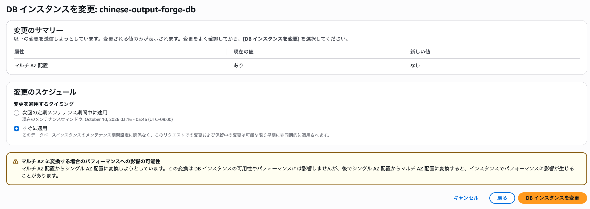

↓

変更を適用した後、RDSの「設定」タブから以下を確認する。

#### Single-AZへの変更を確認

変更を適用した後、RDSの「設定」タブから以下を確認する。

- ステータス：`利用可能`
- マルチAZ：`なし`
- リージョンとAZ：`ap-northeast-1c`

`マルチAZ：なし` となっているため、Multi-AZからSingle-AZへの変更が完了したことを確認できる。

また、Single-AZ化後のRDSは `ap-northeast-1c` に配置されている。

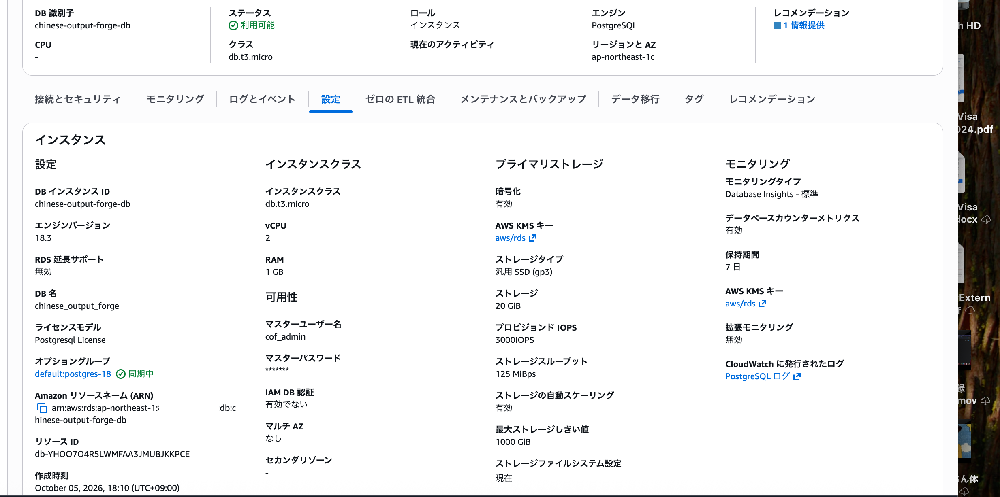

#### Single-AZ化後のRDS配置を確認

RDSが実際にどのPrivate DB Subnetに配置されているかを確認する。

EC2の「ネットワークインターフェイス」から、RDSで使用しているSecurity Group `chinese-output-forge-rds-sg` のIDで絞り込む。

確認結果、該当するネットワークインターフェイスは1件のみとなった。

- AZ：`ap-northeast-1c`
- Subnet ID：`subnet-0f89c37f618be3534`
- Security Group：`chinese-output-forge-rds-sg`

`subnet-0f89c37f618be3534` は、`chinese-output-forge-private-db-subnet-1c`（`10.1.31.0/24`）に対応している。

これにより、Single-AZ化後のRDSは `10.1.31.0/24`（1c）に配置されていることを確認できる。

また、`chinese-output-forge-rds-sg` を使用するネットワークインターフェイスはこの1件のみであるため、`10.1.30.0/24`（1a）側にはRDS用のネットワークインターフェイスが残っていないことも確認できる。

#### 当初の計画からの変更

当初の低コスト構成では、以下の構成を予定していた。

- `10.1.30.0/24`（1a）：Single-AZ RDSを配置
- `10.1.31.0/24`（1c）：DB Subnet Group維持のための予備サブネット

しかし、Multi-AZからSingle-AZへ変更した結果、RDSは `ap-northeast-1c` 側に残った。

そのため、実際の構成に合わせてサブネットの役割を以下のように変更する。

- `10.1.31.0/24`（1c）：Single-AZ RDSを配置するPrivate DB Subnet
- `10.1.30.0/24`（1a）：RDSは配置せず、DB Subnet Group維持のために残す予備のPrivate DB Subnet

つまり、**RDSを配置するサブネットと予備として残すサブネットの役割を、当初の計画から1aと1cで入れ替える。**

### DBへの接続とデータが正常であることを確認する

Single-AZ化後も、アプリケーションからRDSへ正常に接続でき、既存データの読み書きに問題がないことを確認する。

確認項目は以下。

- `https://chinese-output-forge.com` にアクセスできる
- ログインできる
- DBから取得したデータ（問題一覧など）が正常に表示される
- DBへの書き込み（問題の追加）ができる
- 再読み込み後も追加したデータが保持されている

#### ログインできることを確認

正常にログインできることを確認した。

#### DBから取得したデータが表示されることを確認

問題一覧など、DBから取得したデータが正常に表示されることを確認した。

#### DBへの書き込みを確認

新しい問題を追加し、DBへの書き込みが正常に行われることを確認した。

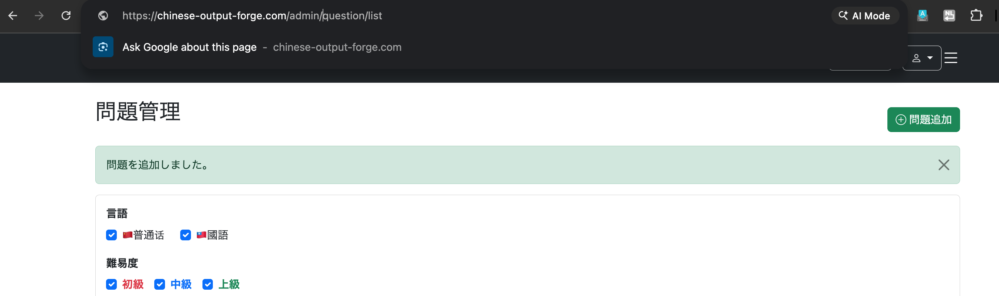

#### データが保持されていることを確認

画面を再読み込みし、追加した問題が引き続き表示されることを確認した。

以上から、**Single-AZ化後もRDSへの接続およびデータの読み書きが正常に行われていることを確認できた。**

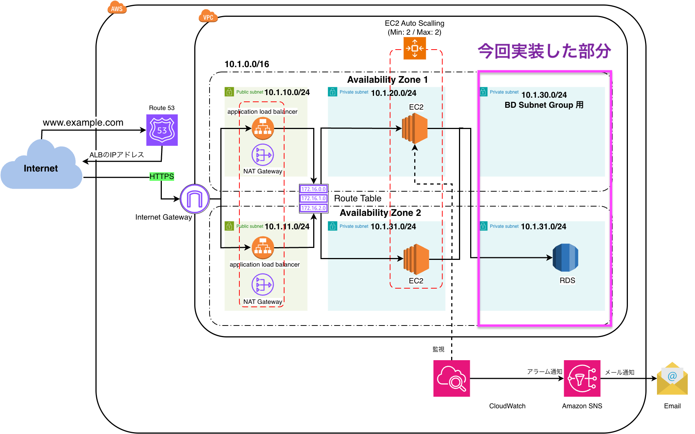

---

# 2. Elastic BeanstalkをSingle Instance構成へ移行

現在のElastic Beanstalk環境は、Private App Subnetに配置された複数のEC2とALBを使用するLoad Balanced構成となっている。また、EC2からインターネットへの通信にはNAT Gatewayを使用している。

低コスト構成では、**Elastic Beanstalkは引き続き利用しながら、Load Balanced構成からSingle Instance構成へ移行する。**

Single Instance構成では、Elastic Beanstalkが管理するEC2をPublic Subnetに1台配置し、ALBやNAT Gatewayを使用しない構成とする。

ただし、現在の `10.1.20.0/24` と `10.1.21.0/24` には既存環境のEC2が配置されているため、移行中にこれらのサブネットをPublic Subnetへ変更しない。

まずVPC内の未使用CIDRに新しいPublic Subnetを作成し、そのSubnetを使用する新しいElastic BeanstalkのSingle Instance環境を構築する。

新しい環境でSpring BootアプリケーションやRDS接続が正常に動作することを確認するまでは、既存のLoad Balanced環境を残し、新旧環境を並行して稼働させる。

ここで目指す構成

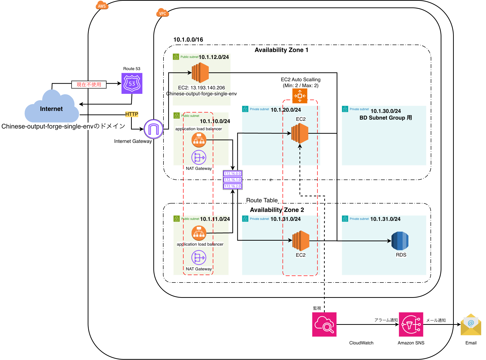

### 未使用CIDRに新しいPublic Subnetを作成する

VPC → サブネット → サブネットを作成

VPC：chinese-output-forge-vpc
サブネット名：chinese-output-forge-public-app-subnet-1a
AZ：ap-northeast-1a
IPv4 CIDR：10.1.12.0/24

を設定

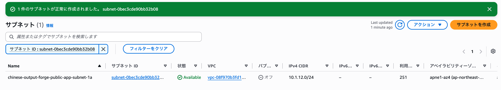


### Public SubnetにPublic用Route Tableを関連付ける
  - `0.0.0.0/0 → Internet Gateway`

既存の 10.1.10.0/24 と 10.1.11.0/24 が使っているPublic用Route Tableを流用

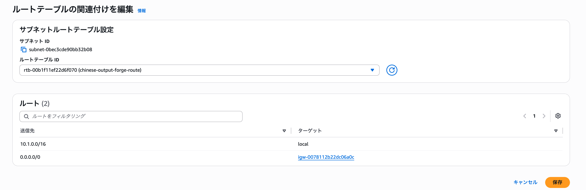


### Elastic BeanstalkでSingle Instance環境を作成する

低コスト構成ではElastic Beanstalkを引き続き利用しながら、ALBと複数のEC2を使用するLoad Balanced構成から、EC2を1台だけ使用するSingle Instance構成へ移行する。

既存環境を直接変更すると、設定変更中にアプリケーションへアクセスできなくなる可能性があるため、現在のElastic Beanstalk環境はそのまま稼働させ、新しいSingle Instance環境を別途作成する。

新しい環境では、先ほど作成したPublic Subnet `10.1.12.0/24` にElastic Beanstalk管理のEC2を配置する。

新環境でSpring Bootアプリケーションの起動、RDSへの接続、データの読み書きなどを確認した後、Route 53を新環境へ切り替える。

Elastic Beanstalk → 環境 →「新しい環境の作成」

アプリケーション名: Chinese-output-forge
環境名: Chinese-output-forge-single-env
ドメイン名プレフィックス(任意): chinese-output-forge-single
環境の説明(任意): Single Instance environment for low-cost architecture
バージョンラベル: 1.0-8(1.0-7がなぜか使えなかった)

環境プロパティ:
APP_BASE_URL=http://chinese-output-forge.ap-northeast-1.elasticbeanstalk.com
DB_URL=jdbc:postgresql://chinese-output-forge-db.c32cwi4eqr3d.ap-northeast-1.rds.amazonaws.com:5432/chinese_output_forge
SERVER_PORT=5000
SPRING_PROFILES_ACTIVE=prod

`APP_BASE_URL` は現時点では旧環境のElastic Beanstalk URLと同じ値を設定する。
新しいSingle Instance環境の動作確認が完了し、Route 53を新環境へ切り替えるまでは旧環境を本番環境として維持するため、この段階では変更しない。
最終的に新環境への切り替えが完了した後、`APP_BASE_URL` を独自ドメイン `https://chinese-output-forge.com` に変更する。

サービスロール: chinese-output-forge-elasticbeanstalk-service-role
EC2インスタンスプロファイル: chinese-output-forge-ec2-role

ここは既存のものをそのまま使う。
役割は、

Elastic Beanstalk
   │
   ├─ サービスロール
   │   chinese-output-forge-elasticbeanstalk-service-role
   │   → Beanstalk自身がAWSリソースを管理するため
   │
   └─ EC2インスタンスプロファイル
       chinese-output-forge-ec2-role
       → Beanstalkが作成するEC2に付与
       → SSMやParameter Store等へのアクセス

である。
スケーリング - 環境タイプ: 単一インスタンス
EC2 キーペア: chinese-output-forge-ssh-key
インスタンスタイプ: t3.small
VPC: chinese-output-forge-vpc
サブネット: 10.1.12.0/24(chinese-output-forge-public-app-subnet-1a)
セキュリティグループ: chinese-output-forge-public-ec2-sg(新規作成)

#### 新しいセキュリティグループを作成
セキュリティグループ名: chinese-output-forge-public-ec2-sg
説明: Security group for Elastic Beanstalk Single Instance EC2
VPC: chinese-output-forge

インバウンドルール:
HTTP 80 Anywhere IPv4
SSH 22 マイIP

アウトバウンドルール: すべてのトラフィック

#### SSH接続元をマイIPに制限する
SSHのインバウンドルールでは、接続元を `0.0.0.0/0` とせず、**マイIP**を指定する。
マイIPとは、現在使用しているインターネット回線のグローバルIPアドレスである。`/32` を指定することで、そのIPアドレスからのSSH接続のみを許可できる。
そのため、自宅のインターネット回線を使用している場合は自宅からSSH接続できるが、外出先のWi-Fiなど別の回線を使用するとグローバルIPアドレスが変わるため、そのままではSSH接続できない。
なお、高可用性構成の実装時にSession ManagerからEC2へ接続できるようIAM Roleを設定しているため、自宅以外から接続する場合はSession Managerを使用する。

- SSH：`TCP 22 / マイIP（xxx.xxx.xxx.xxx/32）`
- HTTP：`TCP 80 / 0.0.0.0/0`

#### 作成

数分待つと環境が正常に起動された

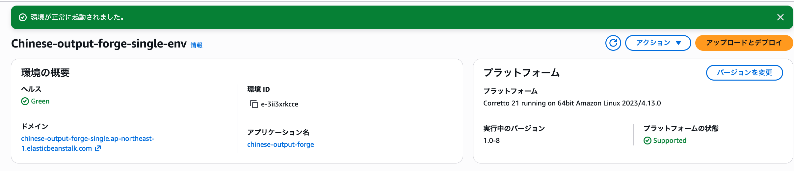

またElastic IPを確認すると、

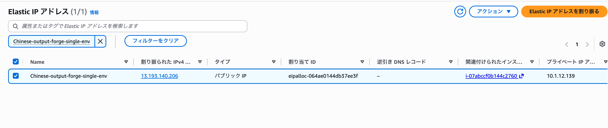

となっている。これが今回 Elastic BeanstalkのSingle Instance環境によって自動的に割り当てられたElastic IP である。

構成は現在こうなっている。
Internet
   │
Internet Gateway
   │
   ▼
Public Subnet
10.1.12.0/24
   │
   ▼
EC2
Chinese-output-forge-single-env
   │
   └─ Elastic IP
      13.193.140.206

なので、Elastic IPを手動で確保・関連付けする作業は必要ない。

---

# 3. Single Instance環境のネットワークと動作を確認

Elastic BeanstalkによるSingle Instance環境の作成が完了したため、新しい環境でSpring Bootアプリケーションが正常に起動していることを確認する。

今回のEC2はElastic Beanstalkによって作成・管理されており、アプリケーションのJARファイルも環境作成時にデプロイしているため、EC2へ接続してJavaのインストールやSpring Bootアプリケーションの手動配置を行う必要はない。

まずElastic Beanstalkから新環境のURLへアクセスし、Spring Bootアプリケーションが起動していることを確認する。

その後、新しいEC2からRDSへ接続できるようSecurity Groupを設定し、ログインや問題一覧の表示、データの追加など、RDSへの読み書きを伴う機能が正常に動作することを確認する。

この段階では既存のLoad Balanced環境は削除せず、新しいSingle Instance環境の動作確認が完了するまで並行して稼働させる。

#### 確認(失敗)

新ドメイン: http://chinese-output-forge-single.ap-northeast-1.elasticbeanstalk.com/にアクセス
↓
502 Bad Gateway　が出る

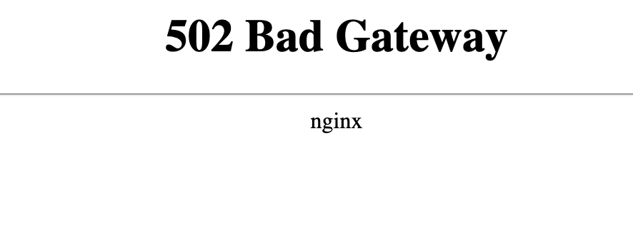

#### ログを確認

`Chinese-output-forge-single-env` のログをダウンロードし、Spring Bootアプリケーションが正常に起動しているか確認する。

Elastic Beanstalk → `Chinese-output-forge-single-env` → ログ → ログをリクエスト

取得した `web.stdout.log` を確認すると、Spring Boot 3.5.11がJava 21で起動し、`prod` プロファイルが有効になっていることを確認できた。

また、Tomcatもポート5000で初期化されている。

しかし、その後RDSへの接続時に以下のエラーが発生していた。

```text
The connection attempt failed.
```

さらにログを確認すると、接続がタイムアウトしている。

```text
Caused by: java.net.SocketTimeoutException: Connect timed out
```

Spring BootからRDSへ接続できないためアプリケーションの起動に失敗し、その結果nginxから `502 Bad Gateway` が返されていることが分かった。

新しいSingle Instance環境のEC2では新しいSecurity Groupを使用しているが、RDS側のSecurity GroupではまだこのSecurity Groupからの接続を許可していない。

そのため、RDSのSecurity Groupに新しいEC2からのPostgreSQL接続を許可するルールを追加する。

#### RDSのSecurity Groupに新しいEC2からの接続を許可する

セキュリティグループchinese-output-forge-rds-sgのインバウンドルールに、

タイプ：PostgreSQL
プロトコル：TCP
ポート：5432
ソース：新Single Instance EC2のSecurity Group
        sg-0efc96c6adfe3a676

を追加する(既存のソースsg-015ac2597eab3b319 / chinese-output-forge-ec2-sgは削除しないでおく)

セキュリティグループで正常に変更された。


#### 再度確認

新ドメイン：

`http://chinese-output-forge-single.ap-northeast-1.elasticbeanstalk.com/`

にアクセスする。

正常にアプリケーションが表示され、アクセスに成功した。

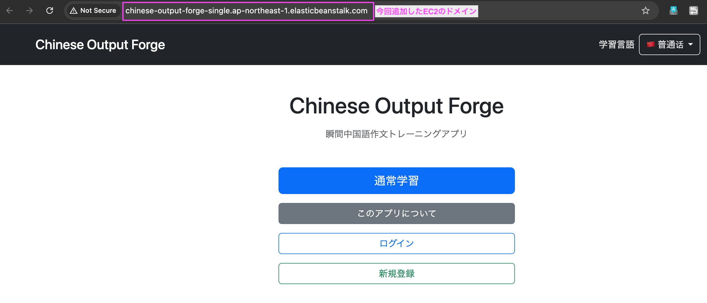

#### RDSへのデータ追加・削除を確認する

続いて、RDSへの書き込みが正常に行われることを確認するため、新しい問題を追加する。

問題が正常に追加され、画面にも反映された。


さらに、追加した問題を削除し、削除処理も正常に行われることを確認した。


以上から、新しいElastic BeanstalkのSingle Instance環境でSpring Bootアプリケーションが正常に起動し、RDSへの接続およびデータの読み書きも正常に行われていることを確認できた。

これにより、新しいSingle Instance環境が移行先として正常に動作することを確認できた。


なお、この時点では既存のLoad Balanced環境はまだ削除せず、新旧環境を並行して稼働させている。


---

# 4. Route 53をSingle Instance環境へ切り替える

新しいSingle Instance環境でSpring BootアプリケーションおよびRDSへの接続が正常に動作することを確認できたため、独自ドメイン `chinese-output-forge.com` の接続先を新しい環境へ切り替える。

この時点では新しいSingle Instance環境のHTTPS設定はまだ行っていないため、まずHTTPで独自ドメインから新環境へアクセスできることを確認する。

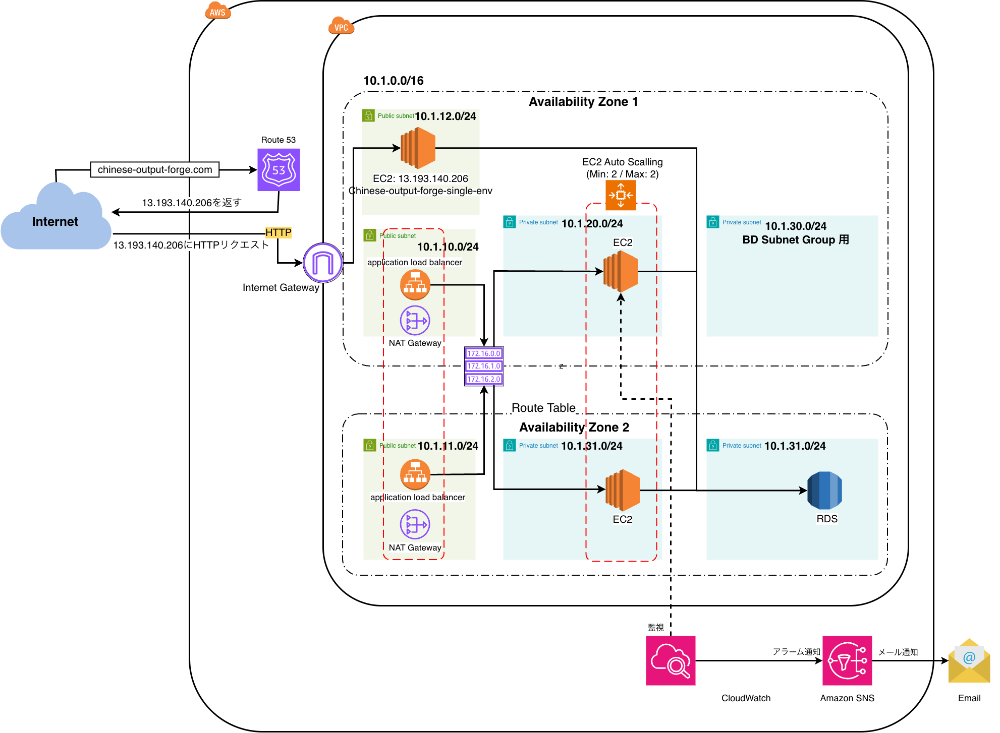

なお、切り替え後に問題が発生した場合に旧環境へ戻せるよう、既存のLoad Balanced環境はまだ削除しない。


### 現在のRoute 53の設定を確認する

Route 53 → ホストゾーン → `chinese-output-forge.com`

を開き、現在のAレコードを確認する。

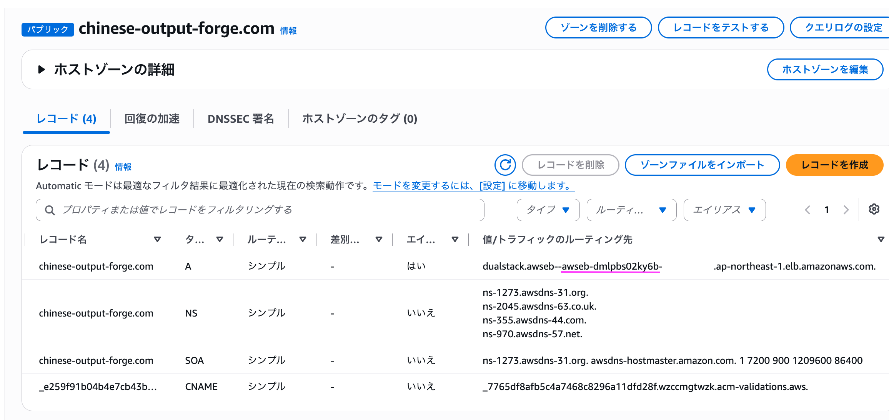

現在のRoute 53のAレコードは、以下のように設定されている。

- レコード名：`chinese-output-forge.com`
- レコードタイプ：`A`
- ルーティングポリシー：シンプル
- エイリアス：有効
- ルーティング先：既存のElastic Beanstalk環境で使用しているApplication Load Balancer（ALB）

ルーティング先として設定されているALBを確認すると、既存のElastic BeanstalkのLoad Balanced環境で使用しているALBであることが分かる。

このALBはInternet-facingとして構成され、`ap-northeast-1a` と `ap-northeast-1c` の2つのAvailability Zoneを使用している。

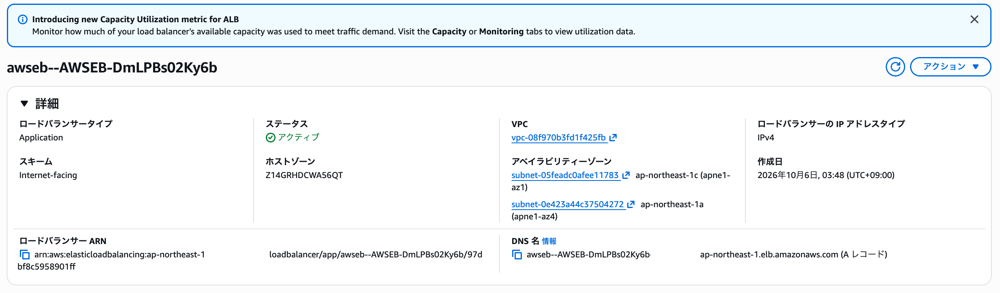

したがって、現在の独自ドメインへの通信経路は以下となっている。

`chinese-output-forge.com`

↓ Route 53

既存ALB

↓

既存のElastic Beanstalk環境のEC2

これからRoute 53のAレコードを変更し、`chinese-output-forge.com` の接続先を新しいSingle Instance環境へ切り替える。

なお、切り替え後に問題が発生した場合に旧環境へ戻せるよう、この時点では既存のALBおよびLoad Balanced環境は削除しない。

また、NSレコード、SOAレコード、ACM証明書検証用のCNAMEレコードについては変更しない。

### Route 53のAレコードを新しいSingle Instance環境へ切り替える

新しいSingle Instance環境には、Elastic BeanstalkによってElastic IP `13.193.140.206` が割り当てられている。

そのため、現在既存ALBを参照している `chinese-output-forge.com` のAレコードを、新しいSingle Instance環境のElastic IPへ変更する。

Route 53 → ホストゾーン → `chinese-output-forge.com`

から既存のAレコードを選択し、「レコードを編集」を開く。

現在はALBへのAliasレコードとなっているため、以下のように変更する。

- レコード名：`chinese-output-forge.com`
- レコードタイプ：`A`
- エイリアス：無効
- 値：`13.193.140.206`
- TTL：300秒
- ルーティングポリシー：シンプル

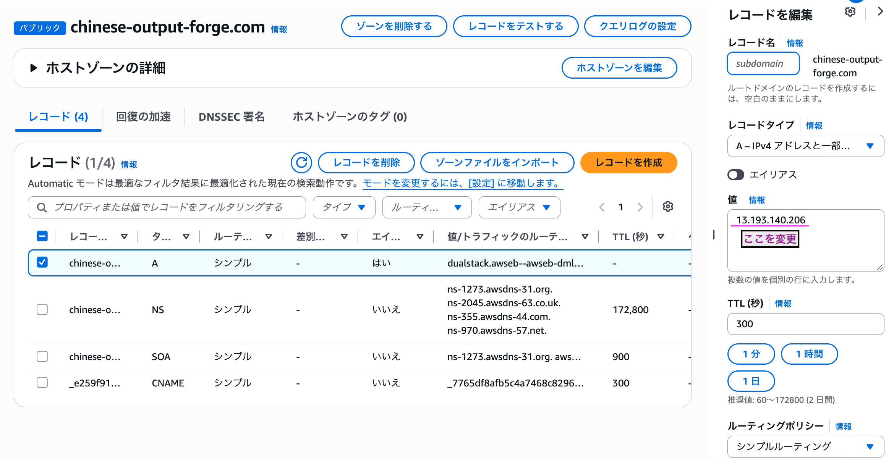

変更前：

`chinese-output-forge.com`

↓ Route 53（Alias）

既存ALB

↓

既存EC2


変更後：

`chinese-output-forge.com`

↓ Route 53（Aレコード）

Elastic IP `13.193.140.206`

↓

新しいSingle Instance環境のEC2

この時点ではHTTPSの設定はまだ行っていないため、Route 53の変更後はまず `http://chinese-output-forge.com` へアクセスし、新しいSingle Instance環境へ正常に接続できることを確認する。

なお、問題が発生した場合に元の構成へ戻せるよう、既存のLoad Balanced環境およびALBはまだ削除しない。


### 独自ドメインから新しいSingle Instance環境へのアクセスを確認する

Route 53のAレコードを変更した後、以下のURLへアクセスする。

`http://chinese-output-forge.com`

新しいSingle Instance環境のSpring Bootアプリケーションが正常に表示されることを確認する。


これにより、Route 53のAレコードが新しいElastic IP `13.193.140.206` を参照し、独自ドメインから新しいSingle Instance環境へ通信できていることを確認できる。


現在の通信経路は以下となる。

`chinese-output-forge.com`

↓ Route 53

Elastic IP `13.193.140.206`

↓

新しいSingle Instance環境のEC2

なお、この時点ではHTTPSの設定はまだ行っていないため、HTTPで動作確認を行う。


---

# 5. Single Instance環境でHTTPS通信を設定

Route 53のAレコードを変更し、独自ドメイン `chinese-output-forge.com` から新しいSingle Instance環境へHTTPでアクセスできることを確認した。

しかし、現在はHTTP通信のみであり、ブラウザとEC2間の通信は暗号化されていない。

以前のLoad Balanced環境では、ALBにSSL/TLS証明書を設定し、ALBでHTTPS通信を終端していた。

一方、新しいSingle Instance環境ではALBを使用しないため、これまでとは異なる方法でHTTPS通信を確立する必要がある。

最終的な構図

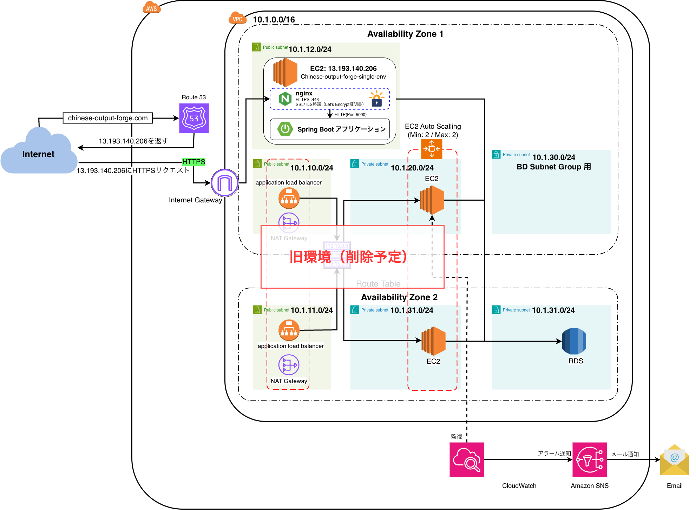

今回はAWS公式ドキュメントの「インスタンスでのHTTPS終端の設定」に沿って、Single Instance環境でHTTPS通信を有効にする。

参考：

- [AWS公式：Elastic Beanstalk環境のHTTPSの設定](https://docs.aws.amazon.com/ja_jp/elasticbeanstalk/latest/dg/configuring-https.html)
- [AWS公式：インスタンスでのHTTPS終端の設定](https://docs.aws.amazon.com/ja_jp/elasticbeanstalk/latest/dg/https-singleinstance.html)

### 実装の順番

AWS公式ドキュメント「インスタンスでのHTTPS終端の設定」に沿う。
実装にあたっては、AWS公式ドキュメントに記載されている設定と、今回の環境で追加対応が必要な作業を区別して進める。

#### 1. SSL/TLS証明書と秘密鍵を用意する【補足作業】

HTTPS通信に必要なSSL/TLS証明書と秘密鍵を用意する。

AWS公式ドキュメントのJava SE向け設定例では、証明書と秘密鍵を使用することが前提となっているが、その取得方法までは具体的に説明されていない。

今回は無料のLet's Encryptを利用して証明書を取得する。

#### 2. Elastic BeanstalkのHTTPS設定ファイルを作成する【AWS公式】

Elastic Beanstalkの設定ファイルを使用して、EC2インスタンスでHTTPS通信を終端するための設定を行う。

公式ドキュメントのJava SE向け手順を参考に、証明書と秘密鍵の配置、およびHTTPS通信を受け付けるための設定を追加する。

なお、現在の環境はAmazon Linux 2023を使用しているため、設定ファイルの配置方法などは現在のプラットフォームに対応させる。

#### 3. セキュリティグループで443番ポートを許可する【AWS公式】

HTTPS通信を受け付けるため、EC2インスタンスのセキュリティグループでTCP 443番ポートを開放する。

AWS公式ドキュメントでは、`.ebextensions` の設定ファイルを使用して、セキュリティグループにインバウンドルールを追加する方法が紹介されている。

#### 4. Elastic Beanstalkへ再デプロイする【実装作業】

HTTPS設定を追加したアプリケーションをElastic Beanstalkへ再デプロイする。

デプロイ後、設定が正常に反映され、アプリケーションが起動することを確認する。

#### 5. HTTPS通信を確認する【動作確認】

ブラウザから以下のURLへアクセスする。

`https://chinese-output-forge.com`

SSL/TLS証明書が正常に認識され、HTTPS通信でSpring Bootアプリケーションへアクセスできることを確認する。

#### 6. 証明書の安全な管理と自動更新を設定する【AWS公式＋補足作業】

AWS公式ドキュメントでは、秘密鍵をソースコード管理に含めず、Amazon S3などに安全に保存する方法が案内されている。

また、Let's Encryptの証明書には有効期限があるため、継続してHTTPS通信を利用できるよう、自動更新の仕組みを追加する。

証明書の自動更新については、AWS公式のHTTPS設定手順とは別に対応する。

参考：

- [AWS公式：インスタンスでのHTTPS終端の設定](https://docs.aws.amazon.com/ja_jp/elasticbeanstalk/latest/dg/https-singleinstance.html)
- [AWS公式：Java SEを実行するEC2インスタンスでHTTPSを終了する](https://docs.aws.amazon.com/ja_jp/elasticbeanstalk/latest/dg/https-singleinstance-java.html)

### 1. SSL/TLS証明書と秘密鍵を用意する

#### どうやってSSL/TLS証明書を用意するか

### SSL/TLS証明書の発行方法を選択する

Single Instance環境ではALBを使用しないため、EC2インスタンス上で利用できるSSL/TLS証明書を用意する必要がある。

今回は以下の2つの方法を比較する。

##### ACMでエクスポート可能なSSL/TLS証明書を発行

AWS Certificate Manager（ACM）を使用して、エクスポート可能なパブリック証明書を発行する方法。

2025年6月から、ACMで発行したパブリック証明書をエクスポートし、EC2上で利用できるようになった。

**特徴**

- AWSのサービスであるACMを利用して証明書を発行・管理できる。
- 証明書、証明書チェーン、秘密鍵をエクスポートしてEC2に配置できる。
- 証明書の発行時に「エクスポートを許可」を有効にする必要がある。
- 通常のドメイン証明書は発行時に15ドル、更新時にも15ドルの費用が発生する。
- ACM側で証明書が更新されても、EC2への再配置は自動では行われないため、別途仕組みを用意する必要がある。

参考文献：

[ACMの証明書をエクスポートしてEC2で使う](https://qiita.com/teshima_daichi/items/8a2bf99de53f238f48b6)

##### Let’s Encryptで発行

Let's Encryptは、無料でSSL/TLS証明書を発行できる認証局である。

Certbotというツールを使用することで、EC2上で証明書を取得できる。

**特徴**

- SSL/TLS証明書を無料で発行できる。
- ACMを使用せずに、EC2上で証明書を取得・管理できる。
- Certbotを使用して証明書の取得や更新を行える。
- 証明書の有効期間が短いため、定期的な更新が必要となる。
- cronなどを利用して証明書の更新を自動化できる。
- 証明書を使用するWebサーバー側の設定が必要となる。

参考文献：

[やさしいLet’s EncryptでSSL証明書を発行する方法](https://oji-cloud.net/2020/09/29/post-5570/)

##### 今回採用する方法

今回は、**Let's Encryptを使用してSSL/TLS証明書を発行する。**

今回の構成変更は、Elastic BeanstalkのLoad Balanced環境からSingle Instance環境へ移行し、AWSの運用コストを削減することが目的である。

ACMのエクスポート可能な証明書は有料である一方、Let's Encryptでは無料で証明書を発行できる。

そのため、今回はLet's EncryptとCertbotを使用し、証明書の取得・設定・更新を行う。

### Let’s EncryptでSSL証明書を発行する

#### 証明書を発行する前に

以下の点を確認する。

##### SSL/TLS 証明書に使用する独自ドメインが取得済みである

chinese-output-forge.comを取得しているのでクリア

##### 証明書を発行するEC2 のインバウンドに80,443ポートが許可されている

現在、EC2のセキュリティグループではHTTP（80番ポート）を許可している。
HTTPS通信を利用できるようにするため、HTTPS（443番ポート）についてもインバウンドルールを追加する。

確認すると、セキュリティグループchinese-output-forge-public-ec2-sgのインバウンドルールにまだHTTPSが含まれていなかった。
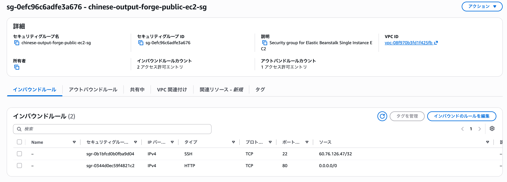

HTTPSもインバウンドルールに追加した。

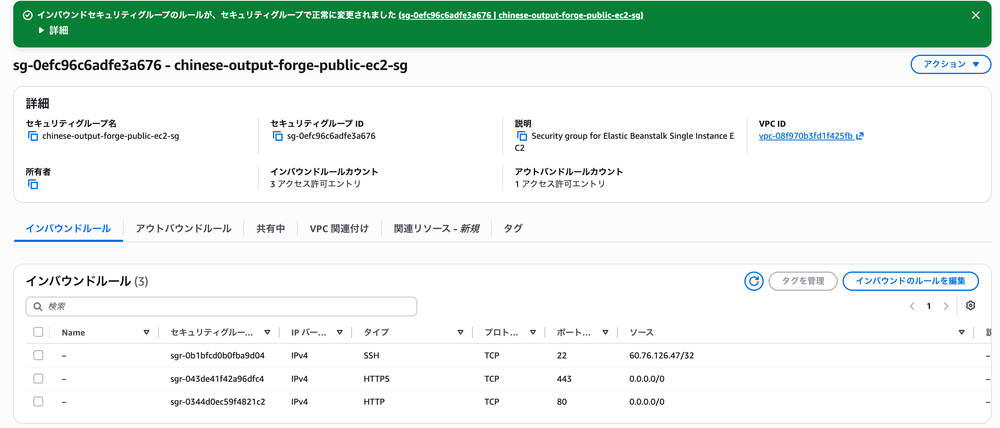

##### メールアドレスの準備

Let's Encryptで証明書を発行する際には、Certbotでメールアドレスを入力する。
証明書の有効期限などに関する通知に使用されるため、受信可能なメールアドレスを準備する。

#### Let’s Encrypt のCertbotクライアントをインストール

Let's EncryptからSSL/TLS証明書を取得するため、EC2にCertbotをインストールする。

##### Certbotとは

Certbotとは、**Let's EncryptのSSL/TLS証明書を取得・更新するためのクライアントツール**である。

Certbotを利用することで、ドメインの所有確認を行い、Let's EncryptからSSL/TLS証明書を取得できる。

また、Let's Encryptの証明書には有効期限があるため、Certbotは証明書の更新にも利用される。

今回の構成では、`chinese-output-forge.com` のSSL/TLS証明書を取得するためにCertbotをEC2へインストールする。

##### Certbotのインストール前準備

まず、Certbotのインストールに必要なパッケージをインストールする。
CertbotはPythonで作られたツールであるため、実行環境としてPython 3が必要となる。

ここでは以下のパッケージをインストールする。

- `python3`：Certbotを実行するためのPython 3
- `augeas-libs`：設定ファイルを解析・編集するためのライブラリ
- `pip`：Pythonのパッケージをインストール・管理するためのツール

```bash
sudo dnf install -y python3 augeas-libs pip
```

次に、Pythonの仮想環境を `/opt/certbot/` に作成する。

```bash
sudo python3 -m venv /opt/certbot/
```

作成した仮想環境内のpipを最新版へ更新する。

```bash
sudo /opt/certbot/bin/pip install --upgrade pip
```

続いて、仮想環境内にCertbotをインストールする。

```bash
sudo /opt/certbot/bin/pip install certbot
```

`/usr/bin/` にCertbotへのシンボリックリンクを作成し、`certbot` コマンドとして実行できるようにする。

```bash
sudo ln -s /opt/certbot/bin/certbot /usr/bin/certbot
```

> `/usr/bin/` への書き込みには管理者権限が必要なため、`sudo` を付けて実行する。

Certbotが正常にインストールされたことを確認する。

```bash
certbot --version
```

以下のようにバージョンが表示されたため、Certbotのインストールが完了したことを確認できた。

```text
certbot 4.2.0
```

##### Webサーバーを停止する

証明書を発行する前に、現在起動しているWebサーバーを停止する。

今回のElastic Beanstalk環境ではnginxを使用しているため、まずnginxが起動していることを確認する。

```bash
sudo systemctl status nginx
```

`active (running)` であることを確認したら、nginxを停止する。

```bash
sudo systemctl stop nginx
```

停止後、再度状態を確認する。

```bash
sudo systemctl status nginx
```

`inactive (dead)` となっていれば、nginxの停止は完了している。

nginxを停止すると、一時的にWebサイトへアクセスできない状態となる。


##### Certbotを実行してSSL/TLS証明書を取得する

Certbotのインストールが完了したら、スタンドアロンモードでCertbotを実行してSSL/TLS証明書を取得する。

スタンドアロンモードでは、Certbot自身が一時的にWebサーバーを起動してドメインの認証を行うため、事前にnginxを停止して80番ポートを空けておく。

```bash
sudo systemctl stop nginx
```

続いて、Certbotをスタンドアロンモードで実行する。

```bash
sudo certbot certonly --standalone
```

コマンドを実行すると、対話形式で必要な情報の入力を求められる。

1. **証明書に関する通知を受け取るメールアドレス**
   - 受信可能なメールアドレスを入力する。

2. **Let's Encryptの利用規約への同意**
   - `Y` を入力して同意する。

3. **メールアドレス情報を共有するか**
   - 今回は `N` を入力する。

4. **証明書を発行するドメイン名**
   - 今回は以下を入力する。

```text
chinese-output-forge.com
```

証明書の取得に成功すると、以下のように表示される。

```text
Successfully received certificate.
```

取得した証明書は、以下のディレクトリに保存される。

```text
/etc/letsencrypt/live/chinese-output-forge.com/
```

主に使用するファイルは以下となる。

- `fullchain.pem`：サーバー証明書と中間証明書を含む証明書チェーン
- `privkey.pem`：証明書に対応する秘密鍵

##### nginxにSSL/TLS証明書を設定する

取得した証明書を使用して、nginxが443番ポートでHTTPS通信を受け付けられるように設定する。

設定では主に以下を指定する。

```nginx
server {
    listen 443 ssl;
    server_name chinese-output-forge.com;

    ssl_certificate /etc/letsencrypt/live/chinese-output-forge.com/fullchain.pem;
    ssl_certificate_key /etc/letsencrypt/live/chinese-output-forge.com/privkey.pem;

    ...
}
```

ただし、今回のnginxはElastic Beanstalkによって管理されている。

そのため、既存のnginx設定ファイルを直接書き換えるのではなく、Elastic Beanstalkの仕組みに合わせてHTTPS設定を追加する。

##### nginxを起動する

HTTPSの設定が完了したら、nginxを起動する。

```bash
sudo systemctl start nginx
```

その後、以下へアクセスしてHTTPS通信が正常に行われることを確認する。

```text
https://chinese-output-forge.com
```

確認できた


##### nginxの設定ファイルを確認する

###### どこに設定ファイルがあるのか

nginxの設定ファイルは環境によって異なる。

今回のElastic Beanstalk環境では、メインの設定ファイルとして以下が使用されている。

```text
/etc/nginx/nginx.conf
```

また、このファイルから別の設定ファイルを読み込む構成になっている。

###### 引用サイトでは `/etc/nginx/conf.d/default.conf` が設定ファイルだったが？

引用サイトでは、Webサイトの設定が以下に記述されているため、このファイルにHTTPSの設定を追加している。

```text
/etc/nginx/conf.d/default.conf
```

一方、今回のElastic Beanstalk環境では `default.conf` は使用されておらず、nginxの設定構成が異なる。

そのため、引用サイトと同じファイルをそのまま編集するのではなく、実際に使用されているnginxの設定を確認する。

###### どうやって設定ファイルを探すのか

以下のコマンドを実行する。

```bash
sudo nginx -T
```

`nginx -T` を実行すると、現在nginxが読み込んでいる設定ファイルと、その設定内容を確認できる。

###### なにがあればそこが設定ファイルだとわかるのか

`nginx -T` を実行すると、nginxが現在使用している設定を確認できる。

今回の出力では、最初に以下が表示された。

```text
nginx: the configuration file /etc/nginx/nginx.conf syntax is ok
nginx: configuration file /etc/nginx/nginx.conf test is successful
# configuration file /etc/nginx/nginx.conf:
```

この出力から、nginxがメインの設定ファイルとして以下を使用していることが分かる。

```text
/etc/nginx/nginx.conf
```

さらに、この `nginx.conf` の中には以下の記述がある。

```nginx
include conf.d/*.conf;
```

`include` は、別の設定ファイルを読み込むための命令である。

つまり今回のnginxは、

1. `/etc/nginx/nginx.conf` を読み込む
2. そこから `/etc/nginx/conf.d/*.conf` も読み込む

という構成になっている。

そのため、`/etc/nginx/conf.d/` にHTTPS用の `.conf` ファイルを作成すれば、その内容もnginxの設定として読み込ませることができる。

今回は以下を新しく作成する。

```text
/etc/nginx/conf.d/https.conf
```

##### SSL/TLS証明書をnginxに設定する

###### /etc/nginx/conf.d/https.confの作成

Let's Encryptで取得したSSL/TLS証明書をnginxに設定し、443番ポートでHTTPS通信を受け付けられるようにする。

以下のコマンドで、HTTPS用のnginx設定ファイルを新規作成する。

```bash
sudo vi /etc/nginx/conf.d/https.conf
```

以下の内容を記述する。

```nginx
server {
    listen 443 ssl;
    server_name chinese-output-forge.com;

    ssl_certificate /etc/letsencrypt/live/chinese-output-forge.com/fullchain.pem;
    ssl_certificate_key /etc/letsencrypt/live/chinese-output-forge.com/privkey.pem;

    ssl_session_timeout 5m;
    ssl_protocols TLSv1.2 TLSv1.3;
    ssl_prefer_server_ciphers on;

    location / {
        proxy_pass http://localhost:5000;
        proxy_set_header Connection "";
        proxy_http_version 1.1;
        proxy_set_header Host $host;
        proxy_set_header X-Real-IP $remote_addr;
        proxy_set_header X-Forwarded-For $proxy_add_x_forwarded_for;
        proxy_set_header X-Forwarded-Proto https;
    }
}
```

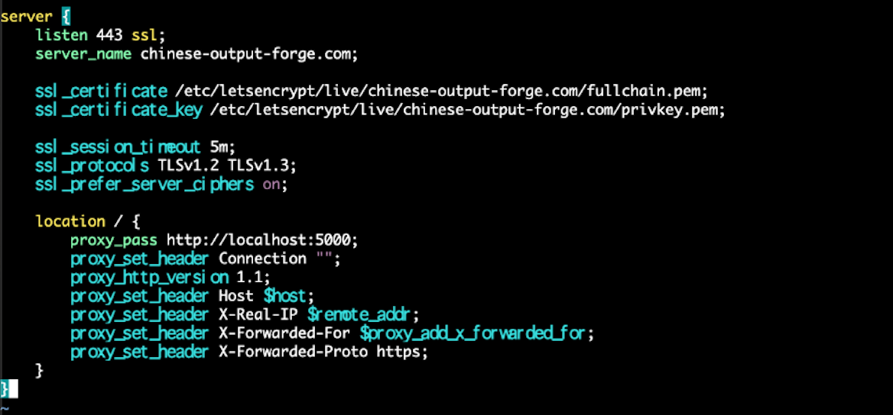

主な設定内容は以下の通り。

- `listen 443 ssl`
  - 443番ポートでHTTPS通信を受け付ける
- `server_name chinese-output-forge.com`
  - HTTPS通信の対象となるドメインを指定
- `ssl_certificate`
  - Let's Encryptで取得したSSL/TLS証明書を指定
- `ssl_certificate_key`
  - 証明書に対応する秘密鍵を指定
- `proxy_pass http://localhost:5000`
  - nginxが受け取ったリクエストを、5000番ポートで動作しているSpring Bootへ転送する
- `X-Forwarded-Proto https`
  - 元のリクエストがHTTPSであったことをSpring Boot側へ伝える

記述後、以下の操作で保存して終了する。

```text
Esc → :wq → Enter
```

設定方法については、Let's EncryptおよびCertbotの導入手順として以下の記事を参考にした。

https://softwarenote.info/p3954/

nginxの設定内容については、Elastic BeanstalkのJava SE環境でHTTPSを終端するAWS公式ドキュメントを参考にし、今回のドメイン名、Let's Encryptの証明書パス、Spring Bootのポート番号など、自分の環境に合わせて変更した。

https://docs.aws.amazon.com/elasticbeanstalk/latest/dg/https-singleinstance-java.html

##### 設定の確認

sudo systemctl reload nginx
で再読み込み

sudo systemctl status nginx
で active (running) になっていることを確認

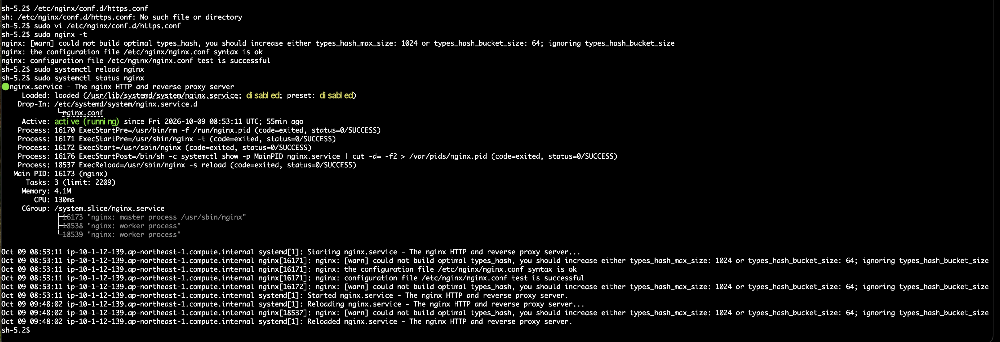

nginxの再読み込みまで正常に完了した。

現時点では、
443 → nginx（Let's Encrypt証明書でTLS終端）→ localhost:5000 → Spring Boot
という設定がnginxに反映されている。

#### ブラウザで確認

ブラウザでhttps://chinese-output-forge.comにアクセス

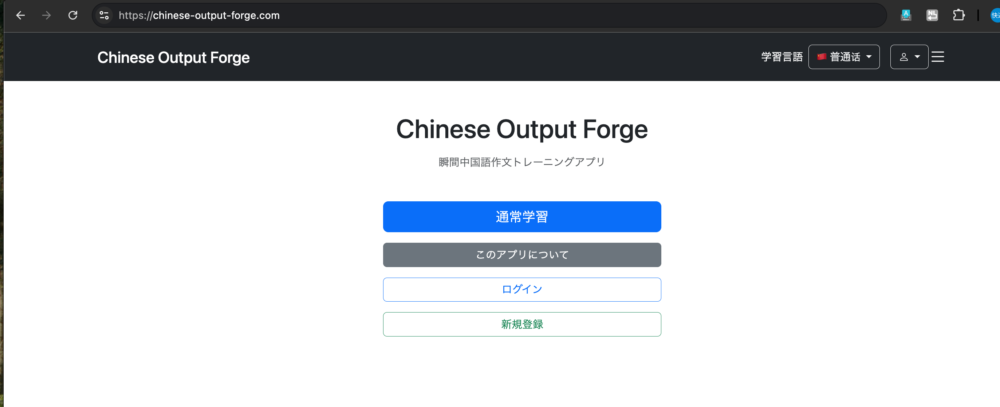

HTTPSで正常にアプリケーションへアクセスできることを確認した。
これでいまの構成図はこうなる


---

# 6. Single Instance環境用のCloudWatch Alarmを作成

旧Load Balanced環境では、各EC2インスタンスのCPU使用率をCloudWatch Alarmで監視していた。

Single Instance環境への移行により監視対象のEC2インスタンスが変更されたため、現行のSingle Instance環境のEC2を対象とするCloudWatch Alarmを新たに作成する。

### アラームの作成

アラーム → すべてのアラーム →「アラームの作成」

選択経路は、
EC2
↓
インスタンス別メトリクス
↓
i-07abccf0b144c2760
↓
CPUUtilization

基本的な設定値は旧環境のものを踏襲する

| 設定項目 | 設定値 |
|---|---|
| 名前空間 | AWS/EC2 |
| メトリクス | CPUUtilization |
| 対象 | Chinese-output-forge-single-env |
| InstanceId | `i-07abccf0b144c2760` |
| 統計 | 平均値 |
| 期間 | 1分 |
| しきい値の種類 | 静的 |
| 条件 | 以上（>=） |
| しきい値 | 60% |
| アラームを実行するデータポイント | 1 / 1 |
| 欠落データの処理 | 欠落データを見つかりませんとして処理 |
| 評価ウィンドウ | デフォルト（スライディングウィンドウ） |
| 通知トリガー | アラーム状態 |
| SNSトピック | `chinese-output-forge-alerts` |
| Lambdaアクション | なし |
| Auto Scalingアクション | なし |
| アラーム名 | chinese-output-forge-single-high-cpu |
---


### SNS通知先を確認

今回は既存のSNSトピック `chinese-output-forge-alerts` を使用する。

すでにメールアドレスのサブスクリプションは確認済みのため、
新たな確認メール（Confirm subscription）は送信されない。

CloudWatch Alarmの通知先として `chinese-output-forge-alerts` が設定されていることを確認する。

### 動作確認について

CloudWatch Alarm作成後は、通常であればEC2に意図的にCPU負荷をかけ、

    EC2のCPU使用率を上昇
            ↓
    CloudWatchがCPUUtilizationを監視
            ↓
    CPU使用率が60%以上
            ↓
    CloudWatch AlarmがOK → ALARMへ遷移
            ↓
    Amazon SNSからメール通知

という一連の監視・通知処理が正常に動作することを確認する。

ただし、この動作確認については、旧Load Balanced環境でCloudWatch Alarmを作成した際にすでに実施している。

その際、`yes`コマンドを使用してEC2のCPU使用率を意図的に上昇させ、以下を確認済みである。

- CloudWatchでCPU使用率の上昇を検知できること
- CPU使用率が60%以上になるとCloudWatch Alarmが`ALARM`状態へ遷移すること
- Amazon SNSを経由して登録済みのメールアドレスへ通知が届くこと
- CPU負荷を解除するとCPU使用率が正常な状態へ戻ること

今回作成したSingle Instance環境用のCloudWatch Alarmも同じ監視・通知の仕組みを使用しているため、CPU負荷を発生させる動作確認は割愛する。

---

# 7. 旧環境を削除

新しいSingle Instance環境への切り替えが完了し、独自ドメインからHTTPSで正常にアクセスできることを確認した。

旧Load Balanced環境は移行時のロールバック用として残していたが、新しい環境が正常に動作していることを確認できたため、旧Elastic Beanstalk環境を削除する。

今回の構成なら、依存関係の大きいものから順番に消す。
依存関係の大きいものとは、他のAWSリソースをまとめて管理している、より上位のリソースである。

たとえば旧Elastic Beanstalk環境は、単なるEC2ではなく、
Elastic Beanstalk環境
        │
        ├─ Auto Scaling Group
        │      ├─ EC2（AZ1）
        │      └─ EC2（AZ2）
        │
        ├─ ALB
        │    └─ Target Group
        │
        └─ Security Group など

という複数のリソースを使って環境を構成している。

そのため、

EC2を手動削除
↓
ALBを手動削除
↓
Auto Scaling Groupを削除
↓
最後にElastic Beanstalk環境を終了

とするのではなく、

Elastic Beanstalk環境を終了
↓
Elastic Beanstalkに管理下のリソースを削除させる
↓
残った不要なリソースを確認して整理

という順序で進める。

この方が個々のリソースを手動で削除する必要がなく、Elastic Beanstalkの管理状態を壊すことも避けられる。

簡単に言えば、**まずElastic Beanstalkが管理している旧環境を終了し、その後、Elastic Beanstalk環境の外に残っている不要なリソースを順番に削除する**。
である。

### 旧Elastic Beanstalk Load Balanced環境を終了

Elastic Beanstalk → Environments → Chinese-output-forge-env

終了対象は上の Chinese-output-forge-env、残すのは下の Chinese-output-forge-single-env


削除するか確認があるのでそのまま進める


削除が始まる


数分後環境が消えた


### 旧EB環境と一緒に何が自動削除されたか確認する

#### インスタンス

EC2 → インスタンスを開き、
旧Load Balanced環境のEC2 × 2が終了し、新Single Instance環境のEC2だけが稼働しているか
を確認

画像を見ると旧Load Balanced環境の2台が、
- Chinese-output-forge-env / ap-northeast-1c → 終了済み
- Chinese-output-forge-env / ap-northeast-1a → 終了済み
になっている。


一方、現在の本番である
- Chinese-output-forge-single-env
- ap-northeast-1a
- t3.small
- Elastic IP 13.193.140.206
は実行中である。
つまり、
旧EB環境を終了
  ↓
旧EC2 × 2もEBによって終了
  ↓
新Single Instance EC2には影響なし

が確認できた。

#### ALBを確認

EC2 → ロードバランサーを開く


Chinese-output-forge-env のElastic Beanstalkが使用していたALBは、旧EB環境の終了に伴って自動削除されている。

#### Target Groupを確認

EC2 → ターゲットグループを開く


「0件の一致」 なので、旧 Chinese-output-forge-env に関連するTarget GroupもEB環境終了時に自動削除されたと判断できる

#### Auto Scaling グループを確認

EC2 → Auto Scaling → Auto Scaling グループを開く


ここに残っている1件は、旧Load Balanced環境のAuto Scaling Groupではなく、現在のSingle Instance環境のもの

根拠は画面上で、
- インスタンス数：1
- 希望するキャパシティ：1
- 最小：1
- 最大：1
- インスタンスヘルス：1/1 正常
となっていることである。

重要なのは、
・Elastic BeanstalkのSingle Instance環境でもAuto Scaling Group自体は使われる
・ただし、1台固定（min=1 / max=1）で管理される
なのでこれは削除してはならない

逆に言えば、旧Load Balanced環境のAuto Scaling Groupはもう残っていないということである。

#### 現状

旧Load Balanced環境
├─ EC2 × 2          → 終了済み
├─ ALB              → 削除済み
├─ Target Group     → 削除済み
└─ 旧Auto Scaling   → 削除済み

新Single Instance環境
├─ EC2 × 1          → 稼働中
└─ Auto Scaling     → 1台固定で稼働中 ← 画面のこれ

と考えてよい。
これで旧EB環境に直接管理されていた主要リソースの削除確認は完了である。

### EB管理外に作ったリソースの整理

#### NAT Gatewayの整理

旧構成では、Private App SubnetにいたEC2がインターネットへ出るために、AZごとにNAT Gatewayを置いていた。

旧構成

Private App Subnet 1a → NAT Gateway 1a → Internet
Private App Subnet 1c → NAT Gateway 1c → Internet

現在はSingle Instance EC2が Public Subnet 10.1.12.0/24 にあり、Internet Gatewayへ直接出られるため、このアプリ用のNAT Gatewayは不要である。
対象は以前確認したこの2つ。
- nat-0f6e6cbf475766542（ap-northeast-1a）
- nat-027eedc8b9ad83b0e（ap-northeast-1c）
まず VPC → NAT ゲートウェイ を開いて、現在の一覧を確認する


どちらも chinese-output-forge 用で、旧構成のPublic Subnet 10.1.10.0/24 / 10.1.11.0/24 側に配置していたNAT Gatewayで、この2つが今回削除対象のNAT Gatewayである。

##### 削除前に確認

旧Private App用ルートテーブルがこの2つを参照していることを確認しておく

VPC → ルートテーブル を開いて、
- chinese-output-forge-private-app-route-1a
- chinese-output-forge-private-app-route-1c
の 0.0.0.0/0 のターゲットを確認


対応関係が完全に一致している。
- chinese-output-forge-private-app-route-1a
  - 0.0.0.0/0
  - → nat-0f6e6cbf475766542
  - → chinese-output-forge-nat-gateway-1a
- chinese-output-forge-private-app-route-1c
  - 0.0.0.0/0
  - → nat-027eedc8b9ad83b0e
  - → chinese-output-forge-nat-gateway-1c
つまり旧構成は、
Private App Subnet 1a
  ↓
private-app-route-1a
  ↓
NAT Gateway 1a
  ↓
Internet

Private App Subnet 1c
  ↓
private-app-route-1c
  ↓
NAT Gateway 1c
  ↓
Internet

だったことが確認できた。

旧Private App SubnetにいたEC2 × 2はすでに終了しており、現在のSingle Instance EC2は別のPublic Subnet 10.1.12.0/24 を使用している。したがって、この2つのNAT Gatewayは今回のアプリでは不要であるので削除していい。

##### NAT Gatewayの削除

VPC → NAT ゲートウェイ を開いてアクションからNATゲートウェイを削除する。


画面上で両方とも Deleted になっており、NAT Gateway × 2の削除が完了した

#### NAT Gateway用Elastic IPの解放

EC2 → ネットワーク＆セキュリティ → Elastic IP を開き、
- 57.181.233.140 ← 旧NAT Gateway 1a用
- 13.196.136.1 ← 旧NAT Gateway 1c用
を確認する。この2つが未関連付けのElastic IPとして残っていれば解放する。


NAT Gatewayで使っていた2つのElastic IPは現在どちらも、**関連付け先が「－」**になっている。
したがって、この2つは解放してOK


Elastic IPの解放も完了した


#### 旧Private App Subnetの整理

次は、
- chinese-output-forge-private-app-subnet-1a（10.1.20.0/24）
- chinese-output-forge-private-app-subnet-1c（10.1.21.0/24）
を削除する

これらは旧EC2を配置していたサブネットで、旧EC2はすでに終了済みである。

VPC → サブネットを開いて、この2つの現在の状態を確認


どちらも旧Load Balanced環境でEC2を配置していた Private App Subnet で、今回の新構成では不要。
この2つを選択して、
アクション → サブネットを削除
へ進む。


旧Private App Subnet × 2の削除が完了した。

#### Private App用ルートテーブル × 2

chinese-output-forge-private-app-route-1a- rtb-0fe999f9cf7319197

chinese-output-forge-private-app-route-1c- rtb-0f5f64579e5a3ff63

も削除対象になる。
VPC → ルートテーブルへ戻って、この2つを確認する。


この2つを選択して、
アクション → ルートテーブルを削除


旧Private App用ルートテーブル × 2の削除が完了した

現在 chinese-output-forge-vpc に残っているルートテーブルは2つだけ。
- chinese-output-forge-route → 現在も使用中なので残す
- 名前なし・メイン = はい → VPCのメインルートテーブルなので残す

#### 旧環境用Security Groupの整理

##### RDSのSecurity Groupの整理

最初にSGそのものを削除するのではなく、まず RDSのSecurity Groupに残っている旧EC2 SGへの許可ルールを外す。

対象は以前の構成では、
- RDS SG：chinese-output-forge-rds-sg
- SG ID：sg-0ec636bd0f8f64310
- PostgreSQL 5432
- 旧EC2 SG：sg-015ac2597eab3b319
- 新Single Instance SG：sg-0efc96c6adfe3a676
であった。

現在は、
旧EC2 SG ──5432──→ RDS   ← 不要
新EC2 SG ──5432──→ RDS   ← 必要

という状態のはずである。

EC2 → セキュリティグループ → chinese-output-forge-rds-sg → インバウンドルール
を開いて、現在のルールを確認する


削除する：sg-015ac2597eab3b319 / chinese-output-forge-ec2-sg- PostgreSQL / TCP / 5432
- 旧Load Balanced環境のEC2用

残す：sg-0efc96c6adfe3a676 / chinese-output-forge-public-ec2-sg- PostgreSQL / TCP / 5432
- 現在のSingle Instance用


RDSのインバウンドルールが 2件 → 1件 になり、残っているのは、
- PostgreSQL
- TCP
- 5432
- ソース：sg-0efc96c6adfe3a676 / chinese-output-forge-public-ec2-sg
となった。

#### 旧Security Groupを削除

EC2 → セキュリティグループ に戻って、旧環境関連のSGを確認


| Security Group | 用途 | 対応 |
|---|---|---|
| `chinese-output-forge-alb-sg` (`sg-0a2cd5a38d025feac`) | 旧ALB用 | **削除** |
| `chinese-output-forge-ec2-sg` (`sg-015ac2597eab3b319`) | 旧Load Balanced環境のEC2用 | **削除** |
| `chinese-output-forge-public-ec2-sg` (`sg-0efc96c6adfe3a676`) | 現Single Instance用 | **残す** |
| `chinese-output-forge-rds-sg` (`sg-0ec636bd0f8f64310`) | 現RDS用 | **残す** |
| `awseb-e-...-AWSEBSecurit...` (`sg-0e67908978bc8dec1`) | 現Single InstanceをEBが管理するためのSG | **残す** |

最後の awseb-... は、Name が Chinese-output-forge-single-env になっているので、旧環境の残骸ではありません。現在のEB環境が使っているものである。

したがって、今削除するのはこの2つだけ。
- sg-0a2cd5a38d025feac — chinese-output-forge-alb-sg
- sg-015ac2597eab3b319 — chinese-output-forge-ec2-sg


これで旧環境関連はかなり片付いた。
旧Load Balanced EB環境        → 削除
旧EC2 × 2                     → 終了
旧ALB / Target Group / ASG    → 削除
NAT Gateway × 2               → 削除
NAT用Elastic IP × 2           → 解放
Private App Subnet × 2        → 削除
Private App Route Table × 2   → 削除
旧ALB SG / 旧EC2 SG           → 削除
RDS SGの旧EC2許可             → 削除

#### CloudWatch Alarmの整理

CloudWatch → アラーム → すべてのアラーム


chinese-output-forge の2つがどちらも 「データ不足」 になっている。
- chinese-output-forge-high-cpu-01 → データ不足
- chinese-output-forge-high-cpu-02 → データ不足
これは監視対象だった旧EC2が終了したため、CPUUtilization の新しいデータが来なくなった状態と整合する。

今回は
chinese-output-forge-high-cpu-01 と chinese-output-forge-high-cpu-02 の2つを削除してOK


#### ACM 証明書の整理

旧Load Balanced環境では
HTTPS
 ↓
ALB
 ↓
ACM証明書

という構成が、現在は
HTTPS
 ↓
Single Instance EC2
 ↓
nginx
 ↓
Let's Encrypt証明書

になった。
旧ALBはすでにEB環境終了によって削除されているので、以前残していたACM証明書
chinese-output-forge.com
（ARN末尾 db2784f5-78dc-426b-a830-ee26dbb49780）
がもうどのリソースからも使用されていないか確認する。

AWS Certificate Manager（ACM）→ 証明書 → chinese-output-forge.com
を開いて、**「使用中」または「関連付けられたリソース」**を確認


この状態なら ACM証明書は削除して大丈夫である。
画像の「詳細」に、
使用中ですか？：いいえ

と表示されている。つまり、旧ALBを削除したことで、この証明書を利用しているAWSリソースはなくなっている。
現在のHTTPSはEC2上のnginx + Let's Encryptなので、このACM証明書には依存していない。
したがって、
ACM → この証明書を選択 → 削除
で進めてOK。


#### Route 53の整理

ACM証明書を削除したので、Route 53に残っている ACMのDNS検証用CNAMEレコード が不要になっている。

Route 53 → ホストゾーン → chinese-output-forge.com を開き、Route 53のレコード一覧を確認


| レコード | 対応 |
|---|---|
| `chinese-output-forge.com` / A / `13.193.140.206` | **残す** |
| `chinese-output-forge.com` / NS | **残す** |
| `chinese-output-forge.com` / SOA | **残す** |
| `_e259f91b...` / CNAME | **削除** |

一番下の _e259f91b... は、先ほど削除したACM証明書のDNS検証用CNAMEです。現在のHTTPSはLet's Encryptなので不要。
これを選択して 「レコードを削除」 でOK

#### 旧Public Subnetを削除

旧Load Balanced環境で使用していた以下のPublic Subnetは、現在のSingle Instance環境では使用しないため削除する。

- `chinese-output-forge-public-subnet-1a`（`10.1.10.0/24`）
- `chinese-output-forge-public-subnet-1c`（`10.1.11.0/24`）


#### VPC全体の最終確認

VPC内に残っているリソースを確認し、今回のSingle Instance構成で必要なものだけが残っていることを確認した。

主な構成は以下のとおり。

- Elastic Beanstalk：Single Instance環境
- EC2：1台
- Elastic IP：Single Instance用
- Public App Subnet：1つ
- Private DB Subnet：2つ
- RDS：Single-AZ
- Internet Gateway：1つ
- Route Table：現行構成で使用するもの
- Security Group：Single Instance用・RDS用・Elastic Beanstalk管理用
- Route 53：独自ドメインからSingle InstanceのElastic IPへルーティング
- CloudWatch Alarm：Single InstanceのEC2を監視
- Amazon SNS：CloudWatch Alarmからの通知に使用

旧Load Balanced環境で使用していた不要なリソースが残っていないことを確認した。

---

# 8. 【追加修正】RDSのAvailability Zoneを変更する

当初のMulti-AZ構成では、`ap-northeast-1a`側をプライマリ、`ap-northeast-1c`側をスタンバイとして使用することを想定していた。

しかし、実際には`ap-northeast-1c`側がプライマリとなっていたため、RDSをSingle-AZ構成へ変更した際に`ap-northeast-1c`側のRDSが残った。

その結果、現在は以下のようにElastic BeanstalkのEC2とRDSが異なるAvailability Zoneに配置されている。

```text
ap-northeast-1a
└─ EC2（Single Instance）

ap-northeast-1c
└─ RDS（Single-AZ）
```


EC2とRDSが異なるAvailability Zoneに配置されていても、同一VPC内で通信できるため、アプリケーションの動作自体に問題はない。

ただし、今回の低コスト構成ではEC2・RDSともに単一のインスタンスで運用しているため、RDSをEC2と同じ`ap-northeast-1a`へ戻すことにする。


最終的に以下の構成を目指す。

```text
ap-northeast-1a
├─ EC2（Single Instance）
└─ RDS（Single-AZ）

ap-northeast-1c
└─ Private DB Subnet（DB Subnet Group用）
```

### やり方

Single-AZのRDSでは管理画面から配置先のAvailability Zoneを直接変更できなかった。

そこで各種技術ブログを参考にしてみると、
一時的にMulti-AZ構成へ変更し、フェイルオーバーによってプライマリを`ap-northeast-1a`へ切り替えた後、再びSingle-AZ構成へ戻す
という手法が使えるようだ。

フェイルオーバーとは、稼働中のシステムに障害が発生した場合などに、**処理を待機系のシステムへ切り替える仕組み**のこと。

RDSのMulti-AZ構成では、異なるAvailability Zoneに以下のDBインスタンスが配置される。
- プライマリ：通常時に使用するDB
- スタンバイ：プライマリに問題が発生した場合に備える待機系DB

フェイルオーバーが発生すると、**スタンバイ側が新しいプライマリに切り替わる**。
今回、この仕組みを利用してRDSのプライマリを`ap-northeast-1c`から`ap-northeast-1a`へ切り替える。

また、AWS公式ドキュメントにも以下のような記述がある

```
 [フェイルオーバーし再起動しますか?] を選択し、別の AZ へのフェイルオーバーを強制的に実行します。
```

つまり、Multi-AZ構成では**意図的にフェイルオーバーを発生させ、スタンバイ側のAvailability Zoneへプライマリを切り替えることができる**。

今回はこの仕組みを利用し、

1. RDSを一時的にMulti-AZ構成へ変更する
2. `ap-northeast-1a`側にスタンバイが作成されたことを確認する
3. 強制的にフェイルオーバーを発生させる
4. `ap-northeast-1a`側がプライマリになったことを確認する
5. RDSを再びSingle-AZ構成へ戻す

という手順で、RDSを`ap-northeast-1c`から`ap-northeast-1a`へ移動させる。

参考文献
https://dev.classmethod.jp/articles/rds-singleaz-change-az/
https://docs.aws.amazon.com/ja_jp/AmazonRDS/latest/UserGuide/USER_RebootInstance.html?utm_source=chatgpt.com

### 1. RDSを一時的にMulti-AZ構成へ変更する

RDS → データベース → `chinese-output-forge-db` → 「変更」

「可用性と耐久性」→「マルチAZ配置」で、

**「スタンバイインスタンスを作成する」**

を選択する。

これにより、現在`ap-northeast-1c`で稼働しているプライマリとは別のAvailability Zoneに、スタンバイDBインスタンスが作成される。

その他の設定は変更せず、「続行」をクリックする。

### 2. `ap-northeast-1a`側にスタンバイが作成されたことを確認する

設定変更後数分待つと変更が反映されMulti-AZ化ができた。


### 3. 強制的にフェイルオーバーを発生させる

次に、強制的にフェイルオーバーを発生させ、`ap-northeast-1a`側のスタンバイを新しいプライマリへ切り替える。

RDS → データベース → `chinese-output-forge-db` →「アクション」→「再起動」

「フェイルオーバーし再起動」を選択して再起動する。

フェイルオーバー中はRDSへの接続が一時的に切断されるため、処理が完了するまで待つ。

完了後、`ap-northeast-1a`がプライマリになっていることを確認する。

#### 事前準備：RDSのスナップショットを取得する

フェイルオーバーを実行する前に、万が一に備えて現在のRDSの手動スナップショットを取得しておく。

RDS → データベース → `chinese-output-forge-db` →「アクション」→「スナップショットの取得」

スナップショット名を以下のように設定する。

```text
chinese-output-forge-before-failover
```

「スナップショットの取得」をクリックする。

RDS → スナップショットから、作成したスナップショットのステータスが「利用可能」になったことを確認してからフェイルオーバーを実行する。

手動スナップショットは自動的には削除されないため、今回の作業が完了し、RDSが正常に動作していることを確認した後、不要であれば削除する。


#### フェイルオーバー発生

RDS → データベース → chinese-output-forge-db →「アクション」→「再起動」

再起動画面では、**「フェイルオーバーし再起動」**を有効にする。これによって現在の ap-northeast-1c のプライマリから、ap-northeast-1a のスタンバイへのフェイルオーバーを強制する。


### 4. `ap-northeast-1a`側がプライマリになったことを確認する

再起動を実行したら、RDSが再び「利用可能」になった後、まず ap-northeast-1a がプライマリになったことを確認する。


フェイルオーバー前
1c：プライマリ
1a：スタンバイ

        ↓ 強制フェイルオーバー

現在
1a：プライマリ ← 目的達成
1c：スタンバイ

という一番重要な切り替えは成功した。

### 5. RDSを再びSingle-AZ構成へ戻す

RDS → データベース → chinese-output-forge-db →「変更」
へ進み、「可用性と耐久性」の マルチAZ配置 を、
「スタンバイインスタンスを作成しないでください」
へ変更

しばらく待つ


画像から、
- リージョンとAZ：ap-northeast-1a
- マルチAZ：なし
- セカンダリゾーン：なし
- ステータス：利用可能
を確認できます。
つまり最終的に、
ap-northeast-1a
├─ EC2（Elastic Beanstalk Single Instance）
└─ RDS（Single-AZ）

ap-northeast-1c
└─ Private DB Subnet（DB Subnet Group用）

となった。

これで、当初気になっていたEC2は1a、RDSは1cというズレも解消された。

#### DBを使う機能（問題の追加・削除など）の確認

RDSのAvailability Zone変更後もアプリケーションから正常にDBへ接続できることを確認する。

`https://chinese-output-forge.com`へアクセスし、問題の追加・削除など、DBへの読み書きを伴う機能を実行した。

すべて問題なく動作することを確認した。

これにより、

- EC2：`ap-northeast-1a`
- RDS：`ap-northeast-1a`
- RDS：Single-AZ

という構成への変更が完了した。


---

# 9. アプリケーションの最終確認

ブラウザから以下へアクセスする。

```text
https://chinese-output-forge.com
```

HTTPSでアプリケーションへ正常にアクセスでき、主要な機能についても正常に動作することを確認した。

また、Elastic Beanstalkのヘルスが`Green`となっており、RDSも正常に稼働していることを確認した。

以上で、

```text
Elastic Beanstalk Load Balanced環境
        ↓
Elastic Beanstalk Single Instance環境

RDS Multi-AZ
        ↓
RDS Single-AZ
```

への低コスト構成への移行と、旧環境で使用していたAWSリソースの整理が完了した。

これで、今回予定していたAWS環境の変更はすべて完了となる。

今後も実際に使用しながら、細かな修正や機能追加、運用面の改善などを少しずつ行っていく予定である。

一方で、当初予定していた主要機能の実装からAWSへのデプロイ、独自ドメイン・HTTPS対応、監視設定、低コスト構成への移行まで一通り完了した。

そのため、ここで`Chinese Output Forge`のアプリケーション実装についてはいったん一区切りとする。

---

# 追加実装1 - Amazon SESを使用したメール送信機能の実装

これまでメール送信機能では、開発・動作確認用のメールアドレスを送信元として使用していた。

しかし、本番環境として公開するにあたり、個人のメールアドレスを送信元として使用するのではなく、アプリケーション専用の送信元アドレスを使用することにした。

本アプリでは独自ドメインとして`chinese-output-forge.com`を使用しているため、Amazon SES（Amazon Simple Email Service）を利用し、以下のメールアドレスからメールを送信できるようにする。

```text
noreply@chinese-output-forge.com
```

Amazon SESではメールボックスそのものを作成するのではなく、ドメインを認証することで、そのドメインを使用したメールアドレスを送信元として利用できる。

そのため、今回は以下の構成へ変更する。

```text
Chinese Output Forge
        ↓
    Amazon SES
        ↓
noreply@chinese-output-forge.com
        ↓
   ユーザーへメール送信
```

この追加実装では、Amazon SESで`chinese-output-forge.com`のドメイン認証を行い、必要なDNSレコードをRoute 53へ設定する。

その後、Spring BootからAmazon SESを利用してメールを送信できるように設定し、本番環境から`noreply@chinese-output-forge.com`を送信元としたメールが正常に配信されることを確認する。


#### 参考文献

Amazon SESによる送信ドメインの認証、MAIL FROM、SPF、DKIM、DMARCについて、以下の記事を参考にした。

- [何もかもわからない人間によるAmazon SESメールのドメイン認証学習記録](https://qiita.com/ryo_one/items/c0135e43ca809e9f64f2)
  - Amazon SESを利用したメール送信におけるSMTP、DNS、SPF、DKIM、DMARCなどの基本的な仕組みを理解するために参照した。

- [AWS SESでのドメイン認証（SPF・DKIM・DMARC）設定のポイント](https://miraitranslate-tech.hatenablog.jp/entry/aws-ses-sender-domain-authentication)
  - Amazon SESにおける送信ドメインの認証と、SPF・DKIM・DMARCを使用したメール認証の構成を理解するために参照した。

- [エンベロープFromとは？ ヘッダFromとの違いや確認方法を解説](https://baremail.jp/blog/envelope-from)
  - ユーザーに表示されるHeader Fromと、SMTPによるメール配送で使用されるEnvelope From（MAIL FROM）の違いを理解するために参照した。

- [[SES入門] SPFを理解しよう！](https://qiita.com/K5K/items/dad9119d448d4d969fae)
  - SPFの仕組みと、Amazon SESにおけるMAIL FROMドメインとの関係を理解するために参照した。

- [Amazon SESとAmazon Route 53によるDKIM, SPF, DMARCの設定](https://tech.nri-net.com/entry/setting_up_dkim_spf_dmarc_amazon_ses_route_53)
  - Amazon SESとRoute 53を使用してDKIM・SPF・DMARCを設定する方法と、各メール認証方式の関係を理解するために参照した。

- [DMARCとは？仕組みやメリット・デメリット、設定方法を解説](https://cacco.co.jp/frauddetection/media/knowhow/8609/)
  - SPF・DKIMの認証結果を利用するDMARCの仕組みと、ドメインのなりすまし対策における役割を理解するために参照した。

---
