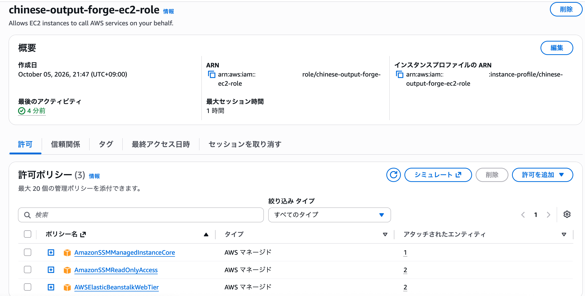
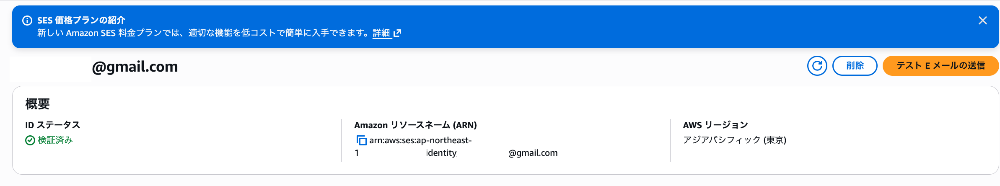
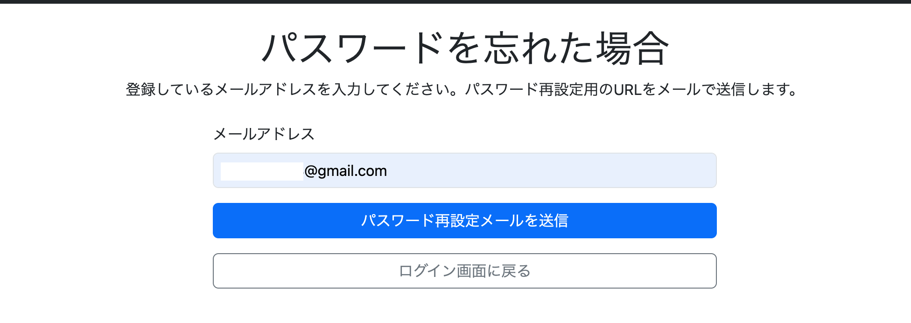
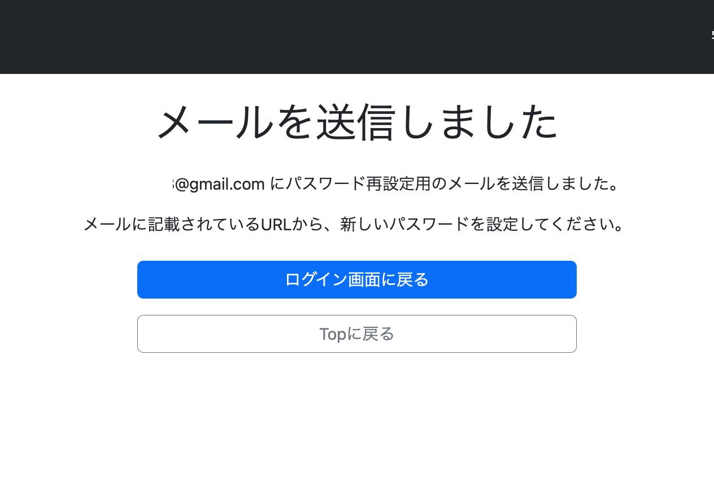
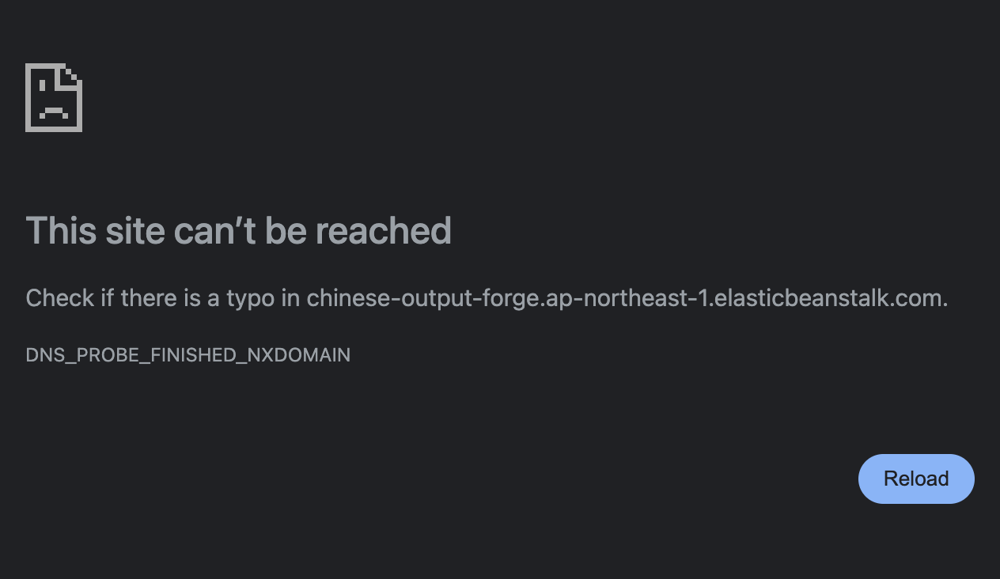
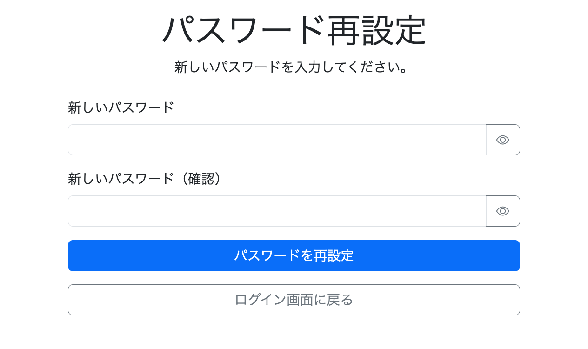

# 033-04 Amazon SESのIAM権限設定とメール送信の動作確認（実装ログ）

## はじめに

前回の033-03では、Spring Bootのメール送信処理を`JavaMailSender`からAWS SDK for Java 2.xの`SesV2Client`へ変更した。今回は、Elastic BeanstalkのEC2に付与されたIAMロールへSES送信権限を追加し、実際にパスワード再設定メールを送信して動作確認する。

なお、送信テスト中に発生したのは、**メール内のURLとNginxのHTTPS設定に関する問題**である。元ログには、この段階でIAMの`AccessDenied`が発生したという記録はない。

## 1. EC2のIAMロールを確認する

EC2コンソールで対象インスタンスを開き、［セキュリティ］からIAMロールを確認した。



使用中のロールは`chinese-output-forge-ec2-role`で、当初は以下のAWS管理ポリシーが付与されていた。

- `AmazonSSMManagedInstanceCore`
- `AmazonSSMReadOnlyAccess`
- `AWSElasticBeanstalkWebTier`

SESのメール送信権限は含まれていなかったため、既存ロールにインラインポリシーを追加した。

## 2. SES送信権限のインラインポリシーを追加する

ポリシー名は`SESSendEmailPolicy`とした。設定したJSONは以下のとおり。

```json
{
  "Version": "2012-10-17",
  "Statement": [
    {
      "Effect": "Allow",
      "Action": [
        "ses:SendEmail",
        "ses:SendRawEmail"
      ],
      "Resource": "*"
    }
  ]
}
```

これにより、EC2のIAMロールからAmazon SESのメール送信操作を実行できるようにした。`Resource`には元ログどおり`*`を指定している。送信元Identityなどに対象を絞る最小権限化は、この時点の作業としては記録されていない。

## 3. テスト用の送信先メールアドレスを検証する

送信テスト時点では、東京リージョンのSES本番アクセス申請は審査中で、サンドボックスの制限が適用されていた。そのため、テスト用のGmailアドレスをSESに登録し、受信した検証メールから認証した。



SES上のIDステータスが「検証済み」になったことを確認した。

## 4. パスワード再設定メールを送信する

ログイン画面から「パスワードを忘れた」を選択し、検証済みメールアドレスを入力して、パスワード再設定メールの送信操作を実行した。





メールに記載されたリンクを開いたところ、パスワード再設定ページへアクセスできなかった。



## 5. メール内URLの誤りを修正する

Elastic Beanstalkの環境変数`APP_BASE_URL`には、当初以下を設定していた。

```text
http://chinese-output-forge.ap-northeast-1.elasticbeanstalk.com
```

このURLはDNSで名前解決できず、ブラウザで`DNS_PROBE_FINISHED_NXDOMAIN`が発生した。

そこで、`APP_BASE_URL`を公開中の独自ドメインへ変更した。

```text
https://chinese-output-forge.com
```

これにより、パスワード再設定メールに記載するURLを修正した。

## 6. NginxのHTTPS設定を復旧する

URLの修正後、今度は`ERR_CONNECTION_REFUSED`が発生した。EC2のセキュリティグループでは443番ポートが許可されていたが、Nginxは80番ポートでしか待ち受けていなかった。

確認したところ、以前EC2上に作成した`/etc/nginx/conf.d/https.conf`が存在しなかった。元ログでは、再デプロイによる消失の可能性に触れているものの、直接の原因は特定していない。

まず、Let's Encryptの証明書と秘密鍵がEC2上に残っていることを確認し、HTTPS設定ファイルを再作成した。

```bash
sudo vi /etc/nginx/conf.d/https.conf
```

443番ポートでHTTPS通信を受け付け、Spring Bootが稼働する5000番ポートへ転送する設定を復元した。その後、構文検証と再読み込みを行った。

```bash
sudo nginx -t
sudo systemctl reload nginx
```

`nginx -t`では`test is successful`が表示された。続いて待ち受けポートを確認した。

```bash
sudo ss -lntp | grep -E ':80 |:443 '
```

Nginxが80番・443番の両方で`LISTEN`していることを確認した。

## 7. 修正後に再実行する

パスワード再設定メールを再送信し、新しいリンクからアクセスしたところ、パスワード再設定ページが正常に表示された。



この時点で、メールを利用したパスワード再設定フローのリンク先へアクセスできることを確認した。一方、会員登録完了メールの受信テスト結果については、元ログのこの節に明確な完了記録がないため、確認済みとは記載しない。

## まとめ

EC2の既存IAMロールにSES送信権限を追加し、検証済みアドレスを使用してパスワード再設定メールをテストした。送信後のリンクで発生した問題に対し、`APP_BASE_URL`を修正し、消失していたNginxのHTTPS設定を復旧した結果、再設定ページの表示を確認できた。

ただし、今回の`https.conf`の復旧はEC2上での手動操作だったため、次の033-05では**Elastic Beanstalkの再デプロイ後も設定が維持される構成**へ変更する。

## 参考文献

- [AWS公式：IAMによるSES送信権限](https://docs.aws.amazon.com/ja_jp/ses/latest/dg/control-user-access.html#iam-and-ses-examples-email-sending-actions)
- [IAM設定時に参照した記事](https://www.cloudbuilders.jp/articles/3481/)
- [SESで送信先アドレスを検証する際の参考記事](https://qiita.com/hengineer/items/1f32f66a18db19b9129f)
- [Stack Overflow：Elastic BeanstalkのNginx設定に関する議論](https://stackoverflow.com/questions/61580965/beanstalk-deployment-ignores-my-nginx-configuration-files-in-ebextensions)
