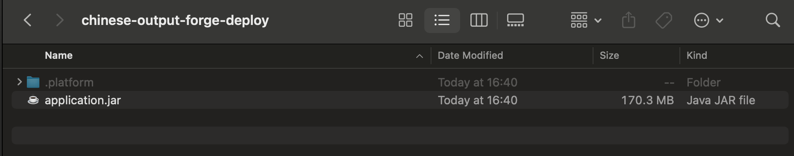

# 033-05 NginxのHTTPS設定ファイルの永続化（実装ログ）

## はじめに

前節のパスワード再設定機能の動作確認では、以前EC2上に手動で作成した`/etc/nginx/conf.d/https.conf`が消失し、HTTPS接続ができなくなっていた。設定ファイルを再作成して復旧したものの、Elastic Beanstalkへの再デプロイ時に同じ問題が発生するおそれがある。

そこで、HTTPS設定をSpring Bootプロジェクト側で管理し、Elastic Beanstalkへのデプロイ時に反映するよう変更した。本章では、**設定ファイルの追加、最初の確認での失敗、デプロイ用ZIPへの変更、動作確認**を記録する。

## 1. プロジェクトにNginx設定ファイルを追加する

AWS公式ドキュメントと同様の問題を扱った投稿を参考に、プロジェクトルート（`pom.xml`と同じ階層）へ`.platform/nginx/conf.d/https.conf`を作成した。

```text
chinese-output-forge/
├── .platform/
│   └── nginx/
│       └── conf.d/
│           └── https.conf
├── src/
├── pom.xml
└── ...
```

`https.conf`には、EC2上でHTTPS通信が動作していたときの設定を記述した。

```nginx
server {
    listen 443 ssl;
    server_name chinese-output-forge.com;

    ssl_certificate /etc/letsencrypt/live/chinese-output-forge.com/fullchain.pem;
    ssl_certificate_key /etc/letsencrypt/live/chinese-output-forge.com/privkey.pem;

    ssl_session_timeout 5m;
    ssl_protocols TLSv1.2 TLSv1.3;
    ssl_prefer_server_ciphers on;

    location / {
        proxy_pass http://localhost:5000;
        proxy_set_header Connection "";
        proxy_http_version 1.1;
        proxy_set_header Host $host;
        proxy_set_header X-Real-IP $remote_addr;
        proxy_set_header X-Forwarded-For $proxy_add_x_forwarded_for;
        proxy_set_header X-Forwarded-Proto https;
    }
}
```

この変更に対して、元ログには次のコミットメッセージが記録されている。

```bash
git commit -m "fix: persist Nginx HTTPS configuration for Elastic Beanstalk"
```

## 2. JAR内の設定ファイルを確認する（失敗）

最初は、作成した`https.conf`がMavenで生成したJARファイルに含まれているかを確認した。

```bash
for FILE in $(find target -name '*.jar'); do
    echo "$FILE"
    jar -tvf "$FILE" | grep 'https.conf'
done
```

実行結果にはJARファイル名`target/chinese-output-forge-0.0.1-SNAPSHOT.jar`だけが表示され、`https.conf`は検出されなかった。

### 原因と方針の変更

プロジェクトルートに置いた`.platform`ディレクトリは、通常のSpring Boot JAR生成対象には含まれない。また、Elastic Beanstalkが使用するNginx設定はJARの内部ではなく、**デプロイするソースバンドル内の所定の場所**に置く必要がある。

そこで、これまでのJAR単体アップロードをやめ、JARと`.platform`ディレクトリをまとめたZIPをデプロイする方針に変更した。

参考：[AWS公式：Java SEプラットフォーム](https://docs.aws.amazon.com/elasticbeanstalk/latest/dg/java-se-platform.html)、[AWS公式：リバースプロキシの設定](https://docs.aws.amazon.com/ja_jp/elasticbeanstalk/latest/dg/platforms-linux-extend.proxy.html)

## 3. デプロイ用ZIPファイルを作成する

ZIPの内部構成は次のようにした。

```text
chinese-output-forge-deploy.zip
├── application.jar
└── .platform/
    └── nginx/
        └── conf.d/
            └── https.conf
```

Mavenで生成したJARを`application.jar`という名前で用意し、`.platform`ディレクトリとともに一時フォルダ`/tmp/chinese-output-forge-deploy`へコピーした。



そのフォルダ内で次のコマンドを実行し、ZIPを作成した。

```bash
cd /tmp/chinese-output-forge-deploy
zip -r ~/Desktop/chinese-output-forge-deploy.zip application.jar .platform
```

## 4. ZIPの内容を確認する

作成したZIPの内容を次のコマンドで確認した。

```bash
unzip -Z ~/Desktop/chinese-output-forge-deploy.zip
```

元ログに記録された結果は次のとおり。

```text
Zip file size: 151549570 bytes, number of entries: 5
-rw-r--r--  3.0 unx 170346193 bx defN 26-Oct-14 16:40 application.jar
drwxr-xr-x  3.0 unx        0 bx stor 26-Oct-14 16:40 .platform/
drwxr-xr-x  3.0 unx        0 bx stor 26-Oct-14 16:40 .platform/nginx/
drwxr-xr-x  3.0 unx        0 bx stor 26-Oct-14 16:40 .platform/nginx/conf.d/
-rw-r--r--  3.0 unx      680 tx defN 26-Oct-14 16:40 .platform/nginx/conf.d/https.conf
5 files, 170346873 bytes uncompressed, 151548714 bytes compressed:  11.0%
```

確認できたのは、次の3点である。

- ZIP直下に`application.jar`が存在する。
- `.platform/nginx/conf.d/https.conf`が存在する。
- ZIP内に不要な親ディレクトリがない。

これにより、Elastic Beanstalkに渡すZIPの構成が意図どおりであることを確認した。

参考：[AWS公式：アプリケーションのソースバンドル](https://docs.aws.amazon.com/elasticbeanstalk/latest/dg/applications-sourcebundle.html)

## 5. Elastic Beanstalkへデプロイする

AWSマネジメントコンソールで対象のElastic Beanstalk環境を開き、「アップロードとデプロイ」から`chinese-output-forge-deploy.zip`を選択してデプロイした。

## 6. デプロイ後の動作確認

元ログでは、以下の3点を確認している。

1. `https://chinese-output-forge.com`に正常にアクセスできる。
2. パスワード再発行手続きでメールアドレスを入力すると、メール送信完了画面へ遷移する。
3. 受信メール内のURLを開くと、パスワード再発行ページへ遷移する。


**3点とも正常に動作した**と記録されている。また、アプリケーションのURL設定は次のとおりである。

```properties
APP_BASE_URL=https://chinese-output-forge.com
```

## まとめ

EC2上で手動作成していたNginxのHTTPS設定を、Spring Bootプロジェクト内の`.platform/nginx/conf.d/https.conf`で管理する形へ変更した。

当初はJARへの格納を確認したが、設定ファイルはJARの外部に置く必要があると分かったため、**JARとNginx設定ファイルを含むZIP形式でのデプロイ**へ切り替えた。デプロイ後はHTTPS接続とパスワード再設定機能の一連の動作を確認した。

なお、元ログで確認できるのは今回のデプロイ後の正常動作であり、将来のすべての再デプロイやLet's Encrypt証明書の自動更新まで検証したという記録ではない。

## 参考文献

- [AWS公式：Elastic Beanstalkのリバースプロキシ設定](https://docs.aws.amazon.com/ja_jp/elasticbeanstalk/latest/dg/platforms-linux-extend.proxy.html)
- [Stack Overflow：Elastic BeanstalkのNginx設定に関する議論](https://stackoverflow.com/questions/61580965/beanstalk-deployment-ignores-my-nginx-configuration-files-in-ebextensions)
- [JARの内容確認コマンドに関する参考記事](https://qiita.com/cotaro/items/329089e8da6d2fce030e)
- [AWS公式：Elastic Beanstalk Java SEプラットフォーム](https://docs.aws.amazon.com/elasticbeanstalk/latest/dg/java-se-platform.html)
- [AWS公式：Reverse proxy configuration（英語版）](https://docs.aws.amazon.com/us_en/elasticbeanstalk/latest/dg/platforms-linux-extend.proxy.html)
- [AWS公式：ソースバンドルの作成](https://docs.aws.amazon.com/elasticbeanstalk/latest/dg/applications-sourcebundle.html)
- [ZIP作成コマンドに関する参考記事](https://qiita.com/griffin3104/items/948e38aab62bbb0d0610)
- [ZIPの内容確認コマンドに関する参考記事](https://skume.net/entry/2023/01/20/050000#google_vignette)
