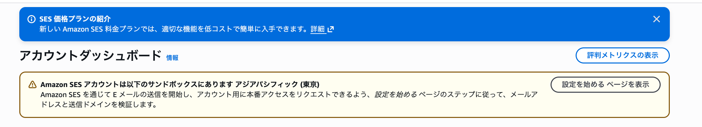
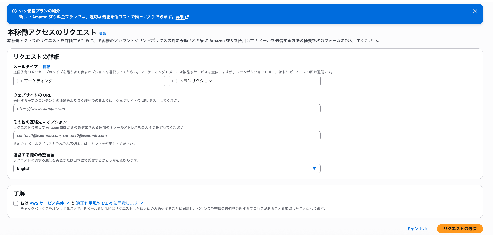
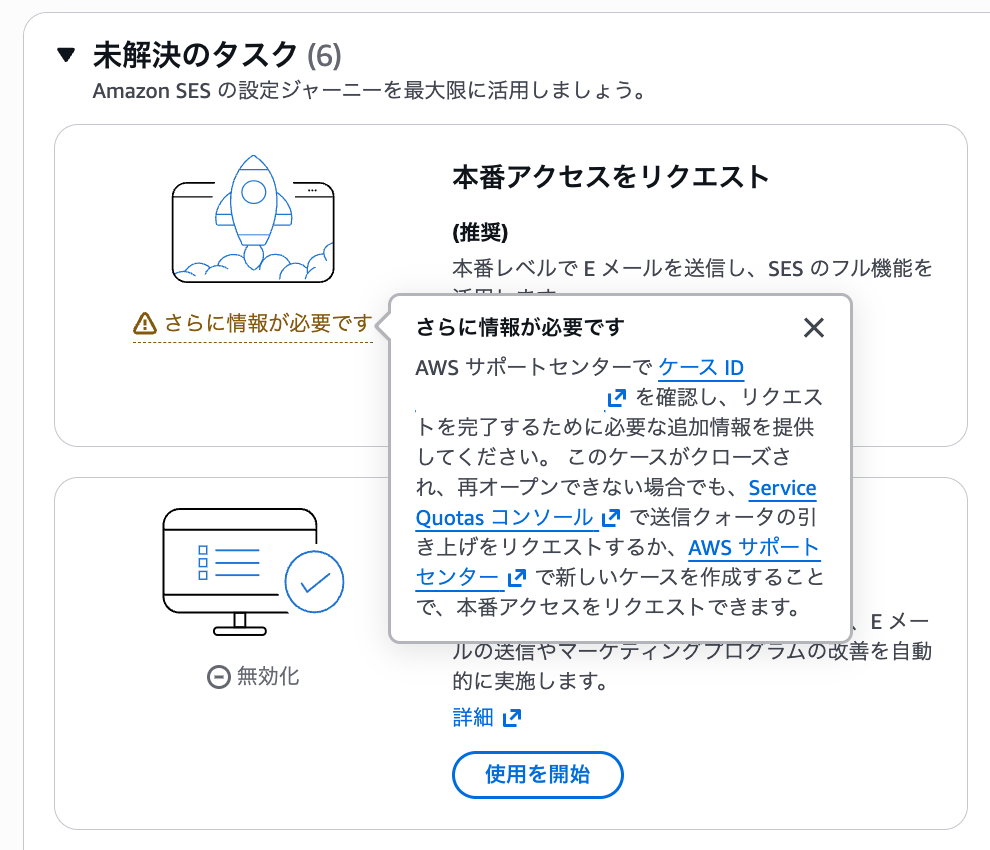
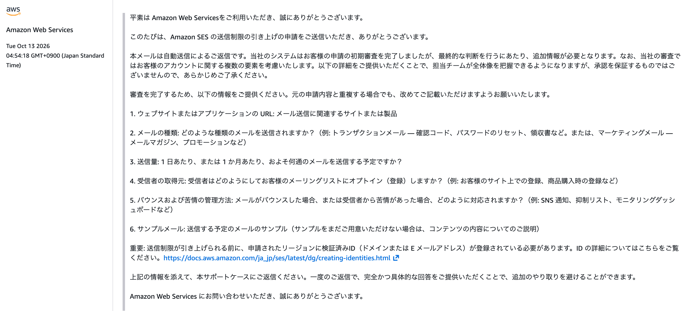

# 033 Amazon SESによる独自ドメインのメール送信環境構築とSpring Bootへの導入

前章までの作業により、Chinese Output ForgeをAWS上にデプロイし、独自ドメイン`chinese-output-forge.com`を使用してHTTPS通信でアクセスできる環境を構築した。

一方、アプリケーションのメール送信機能については、これまで開発・動作確認用のGmailアドレスを送信元として使用しており、本番環境向けのメール送信環境は整備されていなかった。

Chinese Output Forgeでは、会員登録完了時やパスワード再設定時にユーザーへメールを送信する必要がある。そのため、本番環境では独自ドメインを使用した送信元アドレス`noreply@chinese-output-forge.com`から、メールを送信できるようにする。

今回は、AWSが提供するメール配信サービスである**Amazon SES（Simple Email Service）**を導入する。

まず、Amazon SESに独自ドメインを登録し、Route 53でDNSレコードを設定することで、メール送信に必要なドメイン認証を行う。あわせて、SPF・DKIM・DMARCの仕組みを理解し、送信元ドメインのなりすまし対策に必要な設定を行う。

次に、Amazon SESのサンドボックス環境の制限を解除し、Spring BootアプリケーションからAWS SDKを使用してSES APIを呼び出す構成へ移行する。また、IAMによるメール送信権限の設定を行い、AWS上のアプリケーションから安全にメールを送信できるようにする。

最後に、実際のメール送信を確認するとともに、送信に失敗した場合の例外処理とユーザー向けエラーメッセージの表示を整備する。

これにより、Chinese Output Forgeのメール送信機能を、開発用のGmailを使用した構成から、**独自ドメインとAmazon SESを利用した本番環境向けの構成へ移行する。**

# 1. SESに送信ドメインを登録する

Chinese Output Forgeから`noreply@chinese-output-forge.com`を送信元としたメールを送信するため、Amazon SESに独自ドメインを登録する。

Amazon SES（Simple Email Service）は、AWSが提供するメール配信サービスである。

通常、アプリケーションからメールを送信するにはSMTPサーバーなどのメール配送基盤が必要になるが、SESを使用することで、自分でメールサーバーを構築・管理することなくメールを送信できる。

今回の構成は以下のとおりである。

```text
Chinese Output Forge
        ↓
Spring Boot
        ↓
Amazon SES
        ↓
インターネット上のメールサーバー
        ↓
ユーザーのメールボックス
```

ただし、SESを使用すれば任意のメールアドレスを自由に送信元として使用できるわけではない。

例えば、第三者が勝手に、

```text
noreply@chinese-output-forge.com
```

を送信元としてメールを配信できてしまうと、Chinese Output Forgeを装ったなりすましメールを送信できてしまう。

そのため、SESでは送信元として使用するメールアドレスやドメインを、本当にその利用者が管理していることを確認する仕組みが用意されている。

今回は既存の独自ドメイン`chinese-output-forge.com`をSESに登録する。すると、SESからドメイン確認用のDNSレコードが指定される。

このDNSレコードを`chinese-output-forge.com`を管理しているRoute 53のホストゾーンへ実際に登録し、SESがそのレコードの存在を確認することで、`chinese-output-forge.com`のDNSを管理できることを証明し、ドメイン認証を行う。

### SESの初期設定を行う

AWSマネジメントコンソールからAmazon SESを開く。


最終的な送信元アドレスは以下とするがここではまだ設定しない。

```text
noreply@chinese-output-forge.com
```

また、SESの初期設定ではメール配信に関する追加機能を選択できる。

今回はパスワード再設定などの少量のシステムメールを送信することが目的であるため、以下の機能は使用しない。

- Virtual Deliverability Manager
- エンゲージメントの追跡
- 最適化された共有配信
- 自動検証
- マネージド専用IP
- テナント管理


### 送信ドメインを設定する

次に、SESへ送信ドメインを登録する。

今回登録するドメインは以下である。

```text
chinese-output-forge.com
```

これは新しいドメインを取得する操作ではない。

すでにRoute 53で管理している`chinese-output-forge.com`を、SESからメールを送信する際に使用できるドメインとして登録する操作である。

SESでは、メールアドレス単位だけでなく、ドメイン単位で送信元を認証できる。

ドメイン認証が完了すれば、例えば以下のようなメールアドレスを送信元として使用できる。

```text
noreply@chinese-output-forge.com

support@chinese-output-forge.com

notification@chinese-output-forge.com
```

### カスタムMAIL FROMドメインを設定する

続いて、カスタムMAIL FROMドメインを設定する。

今回設定するドメインは以下である。

```text
mail.chinese-output-forge.com
```

MAIL FROMドメインを理解するには、まずメールの送信元がどのように扱われるのかを理解する必要がある。

#### Header FromとEnvelope Fromの違い

電子メールには、普段Gmailなどの画面で確認している送信元とは別に、メールサーバー同士がメールを配送するために使用する送信元が存在する。

つまり、メールには大きく分けて、

- メールを読むユーザーに対して「誰から送られてきたメールなのか」を示す情報
- メールサーバー同士が「どこから送られてきたメールなのか」を判断して配送するための情報

という2種類の送信元情報が存在する。

例えば、Chinese Output Forgeから以下のメールを送信するとする。

```text
From: noreply@chinese-output-forge.com
To: user@example.com
Subject: パスワード再設定
```

この`From`はメールのヘッダーに記載される送信元であり、**Header From**と呼ばれる。

```text
Header From
        ↓
noreply@chinese-output-forge.com
        ↓
Gmailなどでユーザーが確認する送信元
```

一方、実際にメールをインターネット上で配送するときには、送信側と受信側のメールサーバーがSMTPを使用して通信する。

その際には、メール本文に記載されている`From`とは別に、SMTPの`MAIL FROM`コマンドによって配送上の送信元が指定される。

例えば以下のような情報である。

```text
MAIL FROM:<bounce@example.com>
RCPT TO:<user@example.com>
DATA
```

この`MAIL FROM`で指定される送信元を**Envelope From**という。

したがって、1通のメールには概念的に以下の2つの送信元が存在する。

```text
ユーザーが見る送信元
        ↓
Header From
noreply@chinese-output-forge.com


メールサーバーが配送に使用する送信元
        ↓
Envelope From（MAIL FROM）
xxxxx@mail.chinese-output-forge.com
```

ここで初めて郵便に置き換えて考えると分かりやすい。

郵便では、封筒に書かれた差出人・宛先を郵便事業者が確認して配送し、封筒の中には実際に受取人が読む手紙が入っている。

電子メールもこれに似ている。

```text
郵便
────────────────────────
封筒の差出人・宛先
    ↓
配送のために使用

封筒の中の手紙
    ↓
受取人が読む


電子メール
────────────────────────
Envelope
    ↓
メールサーバーが配送に使用

Header + Body
    ↓
受信したユーザーが見る情報
```

この「封筒」に相当する配送情報から**Envelope From**という名前が付いている。

整理すると以下のようになる。

| 項目 | 役割 |
|---|---|
| Header From | メールのヘッダーに記載され、ユーザーが送信元として確認する |
| Envelope From | SMTPでメールサーバー同士が配送するときに使用する送信元 |
| MAIL FROM | Envelope Fromを指定するSMTPコマンド |
| MAIL FROMドメイン | Envelope Fromのメールアドレスのドメイン部分 |

今回のChinese Output Forgeでは、概念的に以下の構成になる。

```text
Header From
noreply@chinese-output-forge.com
        │
        └─ ユーザーに表示される送信元


Envelope From
xxxxx@mail.chinese-output-forge.com
        │
        └─ メール配送で使用される送信元
```

なお、Envelope Fromは通常のメール本文には表示されないが、受信後には`Return-Path`ヘッダーとして確認できる場合がある。

#### Envelope Fromが必要な理由

Envelope Fromの重要な役割の一つが、メールを正常に配送できなかった場合の処理である。

例えば、存在しないメールアドレスへメールを送信した場合を考える。

```text
Chinese Output Forge
        ↓
送信メールサーバー
        ↓
受信メールサーバー
        ↓
「この宛先は存在しない」
        ↓
配送失敗（Bounce）
```

このような配送失敗を**バウンス（Bounce）**という。

配送失敗を送信側へ返す必要がある場合、その返送先を判断するためにEnvelope Fromが使用される。

昔からメールを使用していると、存在しないメールアドレスへ送信した際などに、

```text
postmaster@...

MAILER-DAEMON
```

といった送信者から配送失敗通知が届くことがある。

これらはメール配送システムによって自動的に生成された通知である。

Amazon SESを使用する場合は、このようなバウンスについてもSES側で処理できる。

このように、**Header Fromは「人間に対して誰からのメールなのかを示す情報」、Envelope Fromは「メール配送システムが配送やエラー処理に使用する情報」**という違いがある。

#### なぜカスタムMAIL FROMドメインを設定するのか

Amazon SESでは、カスタムMAIL FROMドメインを設定しなくてもメールを送信できる。

その場合、Envelope FromにはSESが管理する`amazonses.com`配下のドメインが使用される。

```text
Header From
noreply@chinese-output-forge.com

Envelope From
xxxxx@SESが管理するドメイン
```

この状態でもSPF認証は成功するように設定されている。

しかし、Header FromとEnvelope Fromのドメインは異なる。

そこで、今回はカスタムMAIL FROMドメインとして、

```text
mail.chinese-output-forge.com
```

を設定する。

これにより、以下の構成となる。

```text
Header From
noreply@chinese-output-forge.com

Envelope From
xxxxx@mail.chinese-output-forge.com
```

両者は完全に同じドメインではないが、共通する組織ドメイン`chinese-output-forge.com`を持つ。

これは後述するDMARCのドメイン整合性（Alignment）に関係する。

DMARCの標準的なRelaxed Alignmentでは、Header FromとEnvelope Fromの組織ドメインが一致していれば、SPF側のドメイン整合性を満たすことができる。

したがって、カスタムMAIL FROMを設定することには、単に独自ドメインを使用するだけでなく、メール認証の整合性を確保する意味もある。(詳しくは後述)


### SESが発行したDNSレコードを確認する

送信ドメインとカスタムMAIL FROMドメインを設定すると、SESからDNSレコードが提示される。

今回設定する主なレコードは以下のとおりである。

| 用途 | レコードタイプ | 件数 |
|---|---|---:|
| DKIM | CNAME | 3 |
| カスタムMAIL FROM | MX | 1 |
| SPF | TXT | 1 |

DNSレコードとは、ドメインに関する情報をDNS上に登録するためのデータである。

例えば、Webサイトで使用するAレコードは、ドメイン名とIPv4アドレスを対応付ける。

一方、メールでは送信先のメールサーバーを指定したり、送信元を認証したりするために別のDNSレコードを使用する。

今回のSES設定では、特にSPFとDKIMが重要になる。

#### SPFとは

SPF（Sender Policy Framework）は、**実際にメールを送信してきたメールサーバーのIPアドレスが、そのドメインからメールを送信することを許可されているか**を受信側が確認する仕組みである。

ドメインの管理者は、メールの送信を許可するサーバーの情報をSPFポリシーとしてDNSに公開しておく。

今回、Envelope Fromには以下のドメインが使用される。

```text
mail.chinese-output-forge.com
```

そしてRoute 53には、このドメインについて以下のTXTレコードを登録している。

```text
レコード名：
mail.chinese-output-forge.com

タイプ：
TXT

値：
"v=spf1 include:amazonses.com ~all"
```

例えばAmazon SESからメールが送信され、Gmailなどの受信メールサーバーへ届いた場合を考える。

受信側はSMTP通信によって、実際に接続してメールを送ってきたサーバーのIPアドレスを把握している。

さらに、メールのEnvelope Fromから、

```text
xxxxx@mail.chinese-output-forge.com
              ↓
mail.chinese-output-forge.com
```

というMAIL FROMドメインを確認する。

受信側は、この`mail.chinese-output-forge.com`についてDNSのTXTレコードを問い合わせ、以下のSPFポリシーを取得する。

```text
v=spf1 include:amazonses.com ~all
```

それぞれの意味は以下のとおりである。

| 記述 | 意味 |
|---|---|
| `v=spf1` | SPFレコードのバージョン |
| `include:amazonses.com` | Amazon SES側のSPFポリシーも参照して、許可された送信元か判定する |
| `~all` | それ以外の送信元をSoftFailとして扱う |

ここで重要なのが`include:amazonses.com`である。

受信側は`mail.chinese-output-forge.com`のTXTレコードを確認するだけで終わるのではなく、`include`で指定されているAmazon SES側のSPF情報もDNSから参照する。

そして、**実際にメールを送ってきたサーバーのIPアドレスが、Amazon SES側のSPFポリシーによって許可されている送信元に該当するかを確認する。**

```text
Amazon SESの送信サーバー
        ↓
メールを送信
        ↓
受信メールサーバー
        │
        ├─ 実際の接続元IPアドレスを確認
        │
        └─ Envelope Fromを確認
                ↓
        mail.chinese-output-forge.com
                ↓
        DNSのTXTレコードを取得
                ↓
        v=spf1 include:amazonses.com ~all
                ↓
        amazonses.com側のSPF情報も参照
                ↓
        実際の接続元IPアドレスが
        許可された送信元か確認
                ↓
            SPF認証
```

実際にメールを送ってきたサーバーがAmazon SESの許可された送信元であれば、SPF認証は`PASS`となる。

一方、第三者が勝手に、

```text
xxxxx@mail.chinese-output-forge.com
```

をEnvelope Fromとして指定し、Amazon SESとは無関係なメールサーバーからメールを送信した場合を考える。

受信側が同じようにSPFを確認すると、そのメールサーバーのIPアドレスはAmazon SES側のSPFポリシーで許可された送信元に該当しない。

```text
第三者のメールサーバー
        ↓
mail.chinese-output-forge.comを名乗る
        ↓
受信メールサーバー
        ↓
実際の接続元IPアドレスを確認
        ↓
mail.chinese-output-forge.comの
SPFポリシーを確認
        ↓
include:amazonses.com
        ↓
Amazon SES側のSPF情報と照合
        ↓
このIPアドレスは許可されていない
        ↓
SPF認証に成功しない
```

つまり、今回Route 53へ登録した、

```text
mail.chinese-output-forge.com
        ↓
TXT
        ↓
v=spf1 include:amazonses.com ~all
```

という設定は、受信側に対して、

> **`mail.chinese-output-forge.com`をEnvelope Fromとしてメールを送信する場合、Amazon SES側のSPFポリシーで許可されている送信元を正規の送信元として扱う**

というルールをDNS上で公開していることになる。

`include:amazonses.com`を使用することで、Amazon SESがメール送信に使用するIPアドレスを自分で個別に列挙・管理する必要もなくなる。

なお、SPFが検証するのは主に**Envelope Fromのドメインと実際の送信元IPアドレスの関係**であり、ユーザーがGmailなどで目にするHeader Fromそのものを検証しているわけではない。

```text
SPF
────────────────────────────
Envelope From
mail.chinese-output-forge.com
        ＋
実際に接続してきた送信サーバーのIP
        ↓
DNSに公開されたSPFポリシーと照合
        ↓
このサーバーからの送信は許可されているか
        ↓
PASS / FAIL等を判定
```

このHeader FromとEnvelope Fromの違いは、後述するDMARCのAlignment（ドメイン整合性）を理解するうえでも重要になる。

#### DKIMとは

DKIM（DomainKeys Identified Mail）は、メールに電子署名を付けることで、送信元ドメインの認証とメールの改ざん検知を行う仕組みである。

DKIMでは公開鍵暗号方式を使用する。

送信側は秘密鍵を使用してメールに電子署名を付け、受信側は対応する公開鍵を取得して署名を検証する。

```text
Amazon SES
    ↓
秘密鍵を使用してメールに署名
    ↓
メール送信
    ↓
受信メールサーバー
    ↓
DNSから公開鍵を取得
    ↓
電子署名を検証
    ↓
DKIM認証
```

今回使用するEasy DKIMでは、署名に使用する秘密鍵と、検証に使用する公開鍵をAmazon SESが管理する。

そのため、自分でDKIM用の鍵を生成・管理する必要はない。

##### DKIM用のCNAMEレコード

Easy DKIMを設定すると、SESから3件のCNAMEレコードが指定される。

Route 53には、以下のような3つの異なるレコードを登録する。

```text
xxxx1._domainkey.chinese-output-forge.com
xxxx2._domainkey.chinese-output-forge.com
xxxx3._domainkey.chinese-output-forge.com
```

`xxxx1`、`xxxx2`、`xxxx3`の部分はそれぞれ異なる値であり、DKIMで使用する鍵を識別するための**セレクター**に対応している。

Easy DKIMでは、SESがDKIM鍵を管理し、鍵をローテーションできるように複数のDKIM用CNAMEレコードが指定される。

したがって、3つのレコードを1通のメールの検証ですべて同時に使用するわけではない。

例えば、SESがあるメールを`xxxx1`に対応する秘密鍵で署名した場合、メールに付与されるDKIM署名には、概念的に以下の情報が含まれる。

```text
DKIM-Signature:
    d=chinese-output-forge.com
    s=xxxx1
```

`d`はDKIM署名を行ったドメイン、`s`は使用した鍵を識別するセレクターを表す。

メールを受信したメールサーバーは、この2つの情報を使用して、

```text
セレクター + ._domainkey + ドメイン
```

という形式のDNS名を作成する。

今回の例では以下になる。

```text
xxxx1._domainkey.chinese-output-forge.com
```

つまり、Route 53に存在する3つのDKIM用レコードのうち、メールのDKIM署名で指定されたセレクターに対応するレコードが参照される。

##### CNAMEからSESが管理する公開鍵を取得する

Route 53に登録したDKIM用レコードはCNAMEレコードとなっている。

例えば以下のように設定されている。

```text
レコード名

xxxx1._domainkey.chinese-output-forge.com

        ↓ CNAME

値

xxxx1.dkim.amazonses.com
```

この2つは別々のCNAMEレコードではない。

1件のCNAMEレコードについて、

```text
名前：
xxxx1._domainkey.chinese-output-forge.com

値：
xxxx1.dkim.amazonses.com
```

という対応関係が設定されている。

`xxxx1._domainkey.chinese-output-forge.com`は、自分が管理している`chinese-output-forge.com`配下のDKIM用DNS名である。

一方、

```text
xxxx1.dkim.amazonses.com
```

はAmazonが管理している`amazonses.com`配下のDKIM用DNS名である。

今回使用しているEasy DKIMでは実際のDKIM鍵をAmazon SESが管理しているため、自分のRoute 53に公開鍵そのものを登録するのではなく、CNAMEを使用してSES側のDNS名を参照するように設定する。

メールを受信したサーバーが公開鍵を取得するまでの流れは以下のようになる。

```text
① SESがメールを送信

SES
    ↓
xxxx1に対応する秘密鍵でメールに署名
    ↓
DKIM-Signatureに以下の情報を含める

d=chinese-output-forge.com
s=xxxx1


② 受信メールサーバーがDKIM署名を確認

d=chinese-output-forge.com
s=xxxx1

    ↓

問い合わせるDNS名を作成

xxxx1._domainkey.chinese-output-forge.com


③ chinese-output-forge.comのDNSを確認

Route 53

xxxx1._domainkey.chinese-output-forge.com
    ↓ CNAME
xxxx1.dkim.amazonses.com


④ CNAMEの参照先を確認

Amazonが管理するDNS

xxxx1.dkim.amazonses.com
    ↓
DKIM公開鍵を取得


⑤ DKIM署名を検証

受信したメールのDKIM署名
        ＋
DNSから取得した公開鍵
        ↓
署名を検証
        ↓
DKIM認証
```

つまり、

```text
xxxx1._domainkey.chinese-output-forge.com
```

は、受信側が`chinese-output-forge.com`のDKIM公開鍵を探す際の**入口となるDNS名**である。

そして、そのCNAMEの参照先である、

```text
xxxx1.dkim.amazonses.com
```

は、**SESが管理するDKIM公開鍵へたどり着くためのDNS名**である。

受信側が最終的に必要としているのは`xxxx1.dkim.amazonses.com`という名前そのものではなく、そのDNS名を参照することで取得できる**DKIM公開鍵**である。

その公開鍵を使用して、受信したメールに付けられたDKIM署名を検証する。

このように、今回Route 53へ追加したCNAMEレコードには、

> `chinese-output-forge.com`のDKIM検証に必要な公開鍵については、Amazon SESが管理するDNSを参照する

という案内の役割がある。

また、このCNAMEレコードを自分が管理する`chinese-output-forge.com`のDNSへ登録しているため、受信側から見ても、`chinese-output-forge.com`側がAmazon SESのDKIM鍵を使用するようDNS上で設定していることを確認できる。

#### SPFとDKIMの違い

SPFとDKIMはどちらもメール認証の仕組みだが、検証する対象が異なる。

| 項目 | SPF | DKIM |
|---|---|---|
| 主な検証対象 | 送信サーバーのIPアドレス | メールの電子署名 |
| 使用するDNS情報 | TXTレコード | 公開鍵を参照するDNSレコード |
| 確認する内容 | 許可されたサーバーから送信されたか | 正当な署名が付いており、署名対象が改ざんされていないか |
| 今回の設定 | MAIL FROMドメインのTXT | SESが発行したCNAME |

SPFとDKIMは互いに代替するものではなく、異なる方法でメールの正当性を検証する。

#### MXレコード

SPF用のTXTレコードとあわせて、カスタムMAIL FROMドメイン`mail.chinese-output-forge.com`には以下のMXレコードも設定する。

```text
レコード名：
mail.chinese-output-forge.com

タイプ：
MX

値：
10 feedback-smtp.ap-northeast-1.amazonses.com
```

MX（Mail Exchange）レコードは、**そのドメイン宛てのメールをどのメールサーバーへ配送するか**をDNS上で指定するためのレコードである。

今回このMXレコードが必要になるのは、主にAmazon SESから送信したメールが配送できなかった場合に発生する**バウンス（配送失敗通知）をSES側で受け取るため**である。

例えば、SESから存在しないメールアドレスへメールを送信した場合を考える。

```text
Amazon SES
    ↓
メール送信
    ↓
受信側メールサーバー
    ↓
「このメールアドレスは存在しない」
    ↓
配送失敗
```

このとき、配送上の送信元であるEnvelope Fromには、カスタムMAIL FROMドメインを使用したアドレスが設定されている。

```text
xxxxx@mail.chinese-output-forge.com
```

配送失敗通知を返す側のメールサーバーは、このEnvelope Fromのドメインである、

```text
mail.chinese-output-forge.com
```

についてDNSのMXレコードを問い合わせる。

すると、今回設定した以下の情報が取得される。

```text
mail.chinese-output-forge.com
        ↓ MX
10 feedback-smtp.ap-northeast-1.amazonses.com
```

これは、

> **`mail.chinese-output-forge.com`宛てのメールは、Amazon SESが用意している`feedback-smtp.ap-northeast-1.amazonses.com`へ配送する**

という指定である。

そのため、配送失敗が発生した場合は以下のような流れになる。

```text
配送失敗
    ↓
Envelope Fromを確認

xxxxx@mail.chinese-output-forge.com
    ↓
mail.chinese-output-forge.comの
MXレコードをDNSで検索
    ↓
10 feedback-smtp.ap-northeast-1.amazonses.com
    ↓
Amazon SESへバウンスを返す
    ↓
SESがバウンスを処理
```

MXレコードの値に含まれる、

```text
feedback-smtp.ap-northeast-1.amazonses.com
```

はAmazon SES側のメールサーバーを示している。

また、先頭の`10`はMXレコードの**優先度**を表している。

```text
10 feedback-smtp.ap-northeast-1.amazonses.com
↑
MXの優先度
```

複数のMXレコードが存在する場合は、基本的に数値が小さいものほど優先して使用される。

今回のカスタムMAIL FROMドメインには、SPF用のTXTレコードとMXレコードの両方を設定しているが、それぞれ役割が異なる。

| レコード | 役割 |
|---|---|
| TXT（SPF） | `mail.chinese-output-forge.com`をEnvelope Fromとして送信してきたサーバーが、許可された送信元であるかを確認する |
| MX | `mail.chinese-output-forge.com`宛てに返されるバウンスなどを、Amazon SES側へ配送する |

したがって、今回の`mail.chinese-output-forge.com`には以下の2つの役割を持つDNSレコードが設定されている。

```text
mail.chinese-output-forge.com

├─ TXT（SPF）
│    ↓
│  Amazon SESからの送信が
│  許可されたものであるか検証するため
│
└─ MX
     ↓
   バウンスなどを
   Amazon SESへ返すため
```

SPFが**送信してきたサーバーを検証するための情報**であるのに対し、MXは**このドメイン宛てのメールをどこへ配送するかを示す情報**である。

---

### Route 53にMAIL FROM用のDNSレコードを追加する

いま解説したSESが発行した3種のDNSレコードをRoute 53へ登録する。

これにより、Route 53には以下のレコードが登録された。

```text
chinese-output-forge.com
│
├─ A
│   └─ Webアプリケーションの接続先
│
├─ NS
│   └─ 権威DNSサーバー
│
├─ SOA
│   └─ DNSゾーンの管理情報
│
├─ CNAME × 3
│   └─ DKIM
│
├─ MX
│   └─ カスタムMAIL FROM
│
└─ TXT
    └─ SPF
```

### SESによるドメイン認証を確認する

DNSレコードの登録後、SESへ戻ってドメインの認証状態を確認する。

登録直後のIDステータスは以下の状態だった。

```text
検証保留中
```

これはSESがまだ必要なDNSレコードを確認できていない状態である。

DNSレコードを登録しても、SESがその情報を検出するまでには時間がかかる場合がある。

今回のドメイン認証は以下の流れで行われる。

```text
SESに送信ドメインを登録
        ↓
SESがDKIM用CNAMEを発行
        ↓
Route 53にCNAMEを登録
        ↓
SESがDNSレコードを確認
        ↓
ドメインの所有権を検証
        ↓
IDステータス：検証済み
```

しばらく待ってからSESの画面を更新したところ、IDステータスが以下に変更された。

```text
検証済み
```

これにより、`chinese-output-forge.com`のSESにおけるドメイン認証が完了した。

今回登録したDNSレコードによって、独自ドメインを使用したメール送信に必要なDKIMとSPFの設定も行った。

ただし、ドメイン認証が完了したことと、アプリケーションから自由にメールを送信できることは別である。

SESのサンドボックス環境では送信先などに制限があるため、本番運用には別途本番アクセスの申請が必要になる。

また、今回はDMARCレコードをまだ登録していない。

そのため、次にDMARCの設定を行い、SPF・DKIMと組み合わせたメール認証の構成を完成させる。

---

# 2. DMARCを理解する

前節では、Amazon SESで`chinese-output-forge.com`を送信ドメインとして登録し、SPFとDKIMによるメール認証を設定した。

SPFでは、メールを実際に送信してきたサーバーが、そのドメインからのメール送信を許可されているかを確認する。

一方、DKIMでは、メールに付けられた電子署名を公開鍵で検証することで、正当な送信元から送信され、署名対象の内容が途中で改ざんされていないことを確認する。

しかし、SPFとDKIMを設定しただけでは、ユーザーがメール画面で確認するHeader Fromのドメインと、SPFやDKIMで認証されたドメインとの関係をどのように扱うかまでは定められていない。

そこで使用するのが**DMARC（Domain-based Message Authentication, Reporting and Conformance）**である。

DMARCはSPFやDKIMの認証結果を利用しながら、ユーザーに表示されるHeader Fromのドメインとの整合性（Alignment）を確認する仕組みである。

また、認証に失敗したメールを受信側でどのように扱うかについて、ドメイン管理者がポリシーをDNS上で公開できる。

今回の構成では、以下のようにSPF・DKIM・DMARCを組み合わせてメールの正当性を検証する。

```text
受信メール
    ↓
SPF
「許可された送信サーバーから来たか」
    ↓
DKIM
「正しい電子署名が付いているか」
    ↓
DMARC
「認証されたドメインと
 Header Fromのドメインに
 整合性があるか」
    ↓
DMARCポリシーに基づいて処理
```

今回はchinese-output-forge.comにDMARC用のTXTレコードを追加し、まずはメールを拒否・隔離しないp=noneのポリシーを設定する。

### DMARCとは

DMARC（Domain-based Message Authentication, Reporting and Conformance）は、SPFやDKIMによる認証結果を利用して、**ユーザーに表示されるHeader Fromのドメインが正当なものかを確認し、認証に失敗したメールを受信側でどのように扱うかをドメイン管理者が指定する仕組み**である。

DMARCが必要になる理由を理解するには、まずSPFだけではHeader Fromのなりすましを完全には防げないことを理解する必要がある。

例えば、攻撃者が以下のようなメールを送信したとする。

```text
Header From:
noreply@chinese-output-forge.com

Envelope From:
attacker@evil-example.com
```

ユーザーがGmailなどで確認する送信元はHeader Fromであるため、画面上では`noreply@chinese-output-forge.com`から送信されたメールのように見える。

一方、SPFが認証するのは基本的にEnvelope From側のドメインである。

この例では、

```text
Envelope From
attacker@evil-example.com
        ↓
evil-example.com
        ↓
evil-example.comのSPFレコードを確認
```

となる。

もし`evil-example.com`が攻撃者自身のドメインであり、攻撃者が自分のメールサーバーからの送信をSPFで正しく許可していれば、

```text
実際の送信元IP
        ↓
evil-example.comのSPFポリシーと照合
        ↓
許可されている
        ↓
SPF PASS
```

となる。

つまり、SPFが`PASS`したからといって、

```text
Header From:
noreply@chinese-output-forge.com
```

が本物であることまで証明されたわけではない。

SPFが証明しているのは、

> **実際にメールを送ってきたサーバーが、Envelope Fromで使用されているドメインからメールを送信することを許可されている**

ということである。

そのためSPFは、Envelope Fromそのものを偽装する攻撃に対しては有効である。

例えば攻撃者が、

```text
Envelope From:
xxxxx@mail.chinese-output-forge.com
```

と偽装して、自分のメールサーバーから送信した場合を考える。

`mail.chinese-output-forge.com`には以下のSPFポリシーを設定している。

```text
v=spf1 include:amazonses.com ~all
```

そのため受信側は、

```text
攻撃者のメールサーバー
        ↓
Envelope From
xxxxx@mail.chinese-output-forge.com
        ↓
mail.chinese-output-forge.comの
SPFレコードを確認
        ↓
Amazon SES側のSPF情報と照合
        ↓
攻撃者のIPは許可されていない
        ↓
SPF認証に成功しない
```

と判定できる。

しかし攻撃者がEnvelope Fromには自分の正規ドメインを使用し、Header Fromだけを`chinese-output-forge.com`に偽装すると、SPFだけではこのなりすましを判定できない。

そこでDMARCでは、**SPFやDKIMが単純に成功したかだけではなく、そこで認証されたドメインがHeader Fromのドメインと整合しているか**を確認する。

このドメインの整合性を**Alignment（アライメント）**という。

先ほどの攻撃者の例では、

```text
Header From
chinese-output-forge.com

        VS

SPFで認証された
Envelope Fromドメイン
evil-example.com

        ↓

ドメインが整合していない
```

となる。

DKIMについても同様である。

攻撃者が自分の`evil-example.com`を使用して正しいDKIM署名を付ければ、DKIMそのものは`PASS`する可能性がある。

```text
Header From
chinese-output-forge.com

DKIM署名
d=evil-example.com
        ↓
DKIM自体はPASS
```

しかしDMARCでは、DKIM署名で認証された`evil-example.com`とHeader Fromの`chinese-output-forge.com`とのAlignmentも確認する。

```text
Header From
chinese-output-forge.com

        VS

DKIMで認証されたドメイン
evil-example.com

        ↓

ドメインが整合していない
```

このようにDMARCは、

```text
SPF
「このIPはEnvelope Fromのドメインから
 メールを送信することを許可されているか」

DKIM
「このメールに付けられた
 電子署名は正しいか」

DMARC
「SPFやDKIMで認証されたドメインは、
 ユーザーに表示されるHeader Fromの
 ドメインと整合しているか」
```

という関係で、SPFとDKIMをHeader Fromのなりすまし対策へ結び付ける役割を持つ。

今回Chinese Output ForgeからAmazon SESを使用して正規のメールを送信する場合は、概念的に以下の構成となる。

```text
Header From
noreply@chinese-output-forge.com
        ↓
chinese-output-forge.com


SPF
Envelope From
xxxxx@mail.chinese-output-forge.com
        ↓
SPF PASS
        ↓
Header Fromと組織ドメインが一致


DKIM
d=chinese-output-forge.com
        ↓
DKIM PASS
        ↓
Header Fromとドメインが一致
```

そのため、正規のメールではDMARCのAlignmentを満たすことができる。

#### DMARCポリシー

DMARCには、認証に失敗したメールを受信側でどのように扱ってほしいかを、ドメイン管理者がDNS上で公開する仕組みもある。

主なポリシーは以下の3種類である。

| ポリシー | 意味 |
|---|---|
| `p=none` | DMARCに失敗しても、DMARCを理由とした隔離・拒否を要求しない |
| `p=quarantine` | DMARCに失敗したメールを迷惑メールなどとして隔離するよう要求する |
| `p=reject` | DMARCに失敗したメールを拒否するよう要求する |

ここでポリシーを決めるのはメールを送信してきた人物ではなく、**Header Fromで使用されているドメインの正当な管理者**である。

例えば`chinese-output-forge.com`のDNSに、

```text
_dmarc.chinese-output-forge.com

TXT

v=DMARC1; p=reject;
```

と設定した場合、`chinese-output-forge.com`をHeader Fromとして使用しているメールについて、受信側はこのDMARCポリシーを参照する。

したがって、攻撃者が、

```text
Header From:
noreply@chinese-output-forge.com
```

と偽装しても、攻撃者自身がDMARCポリシーを`none`に変更できるわけではない。

```text
攻撃者
    ↓
Header Fromを偽装

noreply@chinese-output-forge.com
    ↓
受信メールサーバー
    ↓
Header Fromのドメインを確認

chinese-output-forge.com
    ↓
DNSを確認

_dmarc.chinese-output-forge.com
    ↓
正当なドメイン管理者が設定した
DMARCポリシーを取得
    ↓
DMARC認証結果とポリシーに基づいて処理
```

この仕組みによって、ドメイン管理者は、

> **自分のドメインを名乗っているにもかかわらず、正しく認証できないメールを受信者へ届けないでほしい**

という方針を受信側へ示すことができる。

なお、DMARCを導入する際に、最初から`p=reject`を設定すると、設定漏れなどによって正規のメールまで拒否される可能性がある。

そのため、まず`p=none`で認証状況を確認し、問題がないことを確認したうえで`quarantine`や`reject`へ段階的に強化する方法がある。

今回のChinese Output Forgeでは、まず以下のDMARCポリシーを設定する。

```text
v=DMARC1; p=none;
```

したがって、今回の設定ではDMARC認証に失敗したメールについて、DMARCを理由とした隔離や拒否を受信側へ要求しない。

まずDMARCを導入した状態で運用を開始し、その後必要に応じてポリシーの強化を検討する。

---

### サンドボックス環境の解除

Amazon SESでは、新しく利用を開始したアカウントは、初期状態では**サンドボックス環境**に置かれる。

サンドボックス環境は、SESを利用した不正なメール送信や大量のスパム送信などを防ぐために設けられている制限付きの環境である。

サンドボックス環境では、メールの送信先がSESで検証済みのメールアドレスやドメインなどに制限されるため、不特定のユーザーへ自由にメールを送信することはできない。

ここまでの設定によって`chinese-output-forge.com`のドメイン認証は完了しているが、これはSESでこのドメインを送信元として使用できることが確認されたという意味であり、サンドボックス環境の制限が解除されたわけではない。

Chinese Output Forgeでは、パスワード再設定などのシステムメールを実際のユーザーへ送信する必要がある。

そのため、SESの**本番アクセス（Production access）**を申請し、サンドボックス環境の制限を解除する。

「設定を始める」から入る→「本番アクセスをリクエスト」


本番アクセス申請の内容を入力する。


Chinese Output Forgeの場合は、次のようにするのが適切である。
- メールタイプ： トランザクション
  - パスワード再設定など、ユーザーの操作を契機として送るシステムメールなのでこっち。
- ウェブサイトのURL： https://chinese-output-forge.com
  - 実際に公開済みのアプリのURLを記載する。
- その他の連絡先： 任意なので、特に必要なければ空欄で構わない。
- 連絡する際の希望言語： 日本語でよい。
- AWSサービス条件・AUPへの同意： 内容を確認して問題なければチェック。

「リクエストの送信」を押すと、本稼働アクセスのリクエストが正常に送信される。
これで本番アクセス申請は完了である。

現時点では、
SES：サンドボックス
        ↓
本稼働アクセスをリクエスト
        ↓
申請受付済み
        ↓
AWSによる審査 ← 今ここ
        ↓
承認
        ↓
サンドボックス解除

という状態で、画面の案内どおり、審査には最大24時間かかる場合があるので、ここは待つしかない。

#### 追加情報が必要になった

AWS側から通知があり、「どのようなメールを、誰に、どのような仕組みで送るのか」などを追加確認してきた。まず、表示されているケース ID をAWSサポートセンターで開いて、AWSから届いている質問を確認する



AWSサポートセンターを確認すると、本稼働アクセスの申請について初期審査は完了しているものの、最終的な判断を行うために追加情報が必要であることが分かった。



AWSからは、主に以下の情報について回答を求められた。

1. メール送信に関連するWebサイトまたはアプリケーションのURL
2. 送信するメールの種類
3. 1日または1か月あたりの送信量
4. メール受信者の取得方法
5. バウンスおよび苦情の管理方法
6. 実際に送信する予定のメールのサンプルまたは内容

そこで、Chinese Output Forgeの実際の利用方法に基づいて回答する。

WebサイトのURLには、現在公開している以下のURLを記載した。

```text
https://chinese-output-forge.com
```

送信するメールは、パスワード再設定など、ユーザー自身の操作を契機として送信される**トランザクションメールのみ**とした。

メールマガジンや広告、プロモーションなどのマーケティングメールを送信する予定はない。

また、個人開発の小規模なWebアプリケーションであるため、当初の送信量は1日あたり数通程度を想定している。

受信者については、Chinese Output Forgeへ自らアカウント登録したユーザーが登録したメールアドレスのみを使用する。外部から購入・取得したメールアドレスや第三者のメーリングリストは使用しない。

バウンスや苦情については、Amazon SESの機能を利用して送信状況を確認し、恒久的に配信できないメールアドレスや苦情が発生したメールアドレスへの不要な再送信を防止する。Amazon SESのアカウントレベルの抑制リストなどを利用して管理する方針とした。

送信するメールの例として、パスワード再設定メールについて説明した。

```text
件名：
パスワード再設定のご案内

内容：
Chinese Output Forgeでパスワード再設定のリクエストを
受け付けたことを通知し、パスワード再設定ページへの
リンクを案内する。

ユーザー自身がパスワード再設定を要求した場合にのみ送信する。
```

さらに、Amazon SESを使用するリージョンはアジアパシフィック（東京）であり、送信元として使用する`chinese-output-forge.com`は、すでに同リージョンのAmazon SESで検証済みであることも記載した。

以上の内容をAWSサポートケースから返信し、追加情報の提出を完了した。

この時点では本稼働アクセスはまだ承認されていないため、AWSによる再審査の結果を待つ。

−−−

### 承認された

---

# 3. DMARCをRoute 53へ設定する

DMARCの仕組みを確認したため、`chinese-output-forge.com`にDMARCポリシーを設定する。

DMARCポリシーはDNSのTXTレコードとして公開するため、`chinese-output-forge.com`を管理しているRoute 53のホストゾーンにDMARC用のTXTレコードを追加する。

今回は、まず`p=none`を設定し、DMARCに失敗したメールについて隔離や拒否を要求しない状態で運用を開始する。

### どのDMARCレコードを設定するか

SPFやDKIMでは、Amazon SESからDNSへ登録するためのレコードが提示されたため、その内容をRoute 53へ登録した。

一方、DMARCでは、ドメイン管理者がDMARCに失敗したメールをどのように扱うかというポリシーを決め、その内容をDNSのTXTレコードとして公開する。

そのため、Route 53へDMARCレコードを追加する前に、Chinese Output ForgeではどのようなDMARCポリシーを設定するかを決める。

今回のChinese Output Forgeでは、まず以下のDMARCレコードを設定するのが適切である。

| 項目 | 設定値 |
|---|---|
| レコード名 | `_dmarc.chinese-output-forge.com` |
| レコードタイプ | TXT |
| 値 | `v=DMARC1; p=none;` |
| TTL | 300秒 |

この設定値で「作成」を押すと、chinese-output-forge.com のレコードが正常に作成される。


### なぜ p=none にするのか？

AWS公式ドキュメントでは、DMARCの導入を段階的に進める方法が推奨されている。
1. p=none：DMARC認証の状況を確認する段階
2. p=quarantine：認証に失敗したメールの隔離を要求する段階
3. p=reject：認証に失敗したメールの拒否を要求する段階 AWS ドキュメント
Chinese Output Forgeでは、SPFとDKIMのDNS設定は完了しているが、実際に送信したメールがDMARC認証に成功することはまだ確認できていない。
そのため、最初からp=rejectを設定するのではなく、p=noneから開始する。

参考文献

https://qiita.com/zhao-xy/items/5223a402a3d8c05b4ed1

---

# 4. Spring BootからAmazon SESを使用してメールを送信する

ここまでの作業によって、Amazon SESで`chinese-output-forge.com`を送信ドメインとして使用するための設定が完了した。

次に、Chinese Output ForgeのSpring BootアプリケーションからAmazon SESを利用してメールを送信できるようにする。

これまでメール送信機能では開発・動作確認用のメールアドレスを送信元として使用していたが、本番環境では以下のアドレスを送信元として使用する。

```text
noreply@chinese-output-forge.com
```

まず現在のメール送信処理を確認し、Amazon SESを利用したメール送信へ変更するために必要な実装を整理する。

### 現在のメール送信処理

現在のChinese Output Forgeでは、Spring Mailの`JavaMailSender`を使用してメールを送信している。

`MailService`では、パスワード再設定メールと会員登録完了メールを作成し、`MimeMessageHelper`を使用して送信元、送信先、件名、本文を設定している。

現在は、どちらのメールについても送信元として開発・動作確認用のGmailアドレスを直接指定している。

```java
messageHelper.setFrom("liuniao790913@gmail.com");
```

現在のメール送信処理は、概念的には以下の構成となっている。

```text
MailService
    ↓
JavaMailSender
    ↓
SMTPサーバー
    ↓
メール送信
```

本番環境では、この送信元を`noreply@chinese-output-forge.com`へ変更し、Amazon SESを経由してメールを送信する構成へ変更する。

### Amazon SESからメールを送信する方法を決める

Amazon SESを使用してメールを送信する方法には、主に以下の2種類がある。

1. Amazon SES の SMTP インターフェイスを介して E メールを送信する方法
2. AWS SDKを使用してAmazon SES APIを呼び出す方法

どちらもAmazon SESからメールを送信できるが、アプリケーション側の実装方法や認証情報の管理方法が異なる。

#### ① SMTPインターフェースを使用する方法

現在のChinese Output Forgeでは、Spring Mailの`JavaMailSender`を使用して、SMTPサーバー経由でメールを送信している。

現在の`MailService`には、以下の`JavaMailSender`が定義されている。

```java
private final JavaMailSender mailSender;
```

そして、作成したメールを以下の処理で送信している。

```java
mailSender.send(message);
```

`JavaMailSender`は、SpringからSMTPサーバーへ接続し、メールを送信するための仕組みである。

Amazon SESもSMTPインターフェースを提供しているため、既存の`JavaMailSender`を維持したまま、SMTPの接続先をAmazon SESへ変更することができる。

このとき接続先として使用するのが**Amazon SES SMTPエンドポイント**である。

SMTPエンドポイントとは、アプリケーションがSMTPを使用してAmazon SESへ接続するための接続先アドレスである。

例えば、東京リージョン（`ap-northeast-1`）では、以下のようなSMTPエンドポイントが使用される。

```text
email-smtp.ap-northeast-1.amazonaws.com
```

そのため、SMTP方式を採用した場合の構成は以下のようになる。

```text
Spring Boot
    ↓
MailService
    ↓
JavaMailSender
    ↓
Amazon SES SMTPエンドポイント
    ↓
Amazon SES
    ↓
メール送信
```

この方法では、現在使用している`JavaMailSender`を引き続き使用できるため、`MailService`を大きく変更せずにAmazon SESへ移行できる。

一方、Amazon SESのSMTPインターフェースを利用するためには、主に以下の情報が必要となる。

```text
① SMTP認証情報
   ├─ SMTPユーザー名
   └─ SMTPパスワード

② SMTPエンドポイント
   └─ 例：email-smtp.ap-northeast-1.amazonaws.com

③ SMTPポート番号
   └─ 使用する接続方式に応じたポート番号
```

Spring BootからAmazon SESへSMTP接続するためには、これらの情報をアプリケーションから利用できるように設定する必要がある。

| 設定 | Spring Boot側で必要 | 秘密情報か |
|---|---|---|
| SMTPエンドポイント | 必要 | いいえ |
| SMTPポート番号 | 必要 | いいえ |
| SMTPユーザー名 | 必要 | **はい** |
| SMTPパスワード | 必要 | **はい** |

例えば、`application.properties`と環境変数を組み合わせる場合は、概念的には以下のような構成になる。

```text
application.properties
├─ host     → SESのSMTPエンドポイント
├─ port     → SMTPポート番号
├─ username → 環境変数などから取得
└─ password → 環境変数などから取得
```

SMTPエンドポイントやポート番号は秘密情報ではないため、`application.properties`に直接設定できる。

一方、SMTPユーザー名とSMTPパスワードは認証情報であるため、`application.properties`へ直接記述してGitで管理するのではなく、環境変数などを利用してアプリケーションから参照できるようにする必要がある。

また、従来のAmazon SESのSMTP認証情報を使用する方法では、IAMユーザーを作成し、そのIAMユーザーのアクセスキーを基にSES用のSMTP認証情報を生成する。

```text
IAMユーザー
    ↓
IAMユーザーのアクセスキー
    ↓
SES用SMTP認証情報を生成
    ├─ SMTPユーザー名
    └─ SMTPパスワード
            ↓
Spring Bootから利用
            ↓
JavaMailSender
            ↓
Amazon SES SMTP
```

ここで使用するSMTPユーザー名とSMTPパスワードは、EC2のIAMロールから取得する一時的な認証情報とは異なり、アプリケーション側で管理する必要がある長期的な認証情報となる。

そのためSMTP方式では、

- SES用のSMTP認証情報を発行する
- SMTP認証情報をSpring Bootから利用できるように設定する
- SMTP認証情報が漏洩しないよう安全に保管する
- 必要に応じて認証情報をローテーションする

といった認証情報の管理が必要になる。

参考文献
https://docs.aws.amazon.com/ja_jp/ses/latest/dg/send-using-smtp-programmatically.html
https://dev.classmethod.jp/articles/use-aws-api-between-postfix-and-amazon-ses/


#### ② AWS SDKを使用してAmazon SES APIを呼び出す方法

もう一つは、AWS SDK for Javaを使用してAmazon SES APIを直接呼び出す方法である。

AWS SDKは、Javaなどのプログラミング言語からAWSの各サービスを操作するためのライブラリである。

Amazon SESの場合、AWS SDK for Java 2.xの`SesV2Client`を使用することで、JavaのコードからSES APIを呼び出してメールを送信できる。

```text
Spring Boot
    ↓
MailService
    ↓
AWS SDK for Java
    ↓
Amazon SES API
    ↓
Amazon SES
    ↓
メール送信
```

この方法では、既存の`JavaMailSender`に依存したメール送信処理を、AWS SDKを使用する処理へ変更する必要がある。

しかし、AWS SDKにはAWSの認証情報を実行環境から自動的に取得する仕組みが用意されている。

例えば、EC2にIAMロールが設定されている場合、AWS SDKはそのIAMロールに基づく一時的な認証情報を取得し、AWSサービスへアクセスできる。

```text
EC2
    │
    └─ IAMロール
          │
          └─ SESへの送信権限
                  │
                  ↓
             AWS SDK
                  │
                  ↓
             Amazon SES
```

そのため、EC2のIAMロールにSESのメール送信権限を付与すれば、SMTP用のユーザー名やパスワードをアプリケーション側で別途管理する必要がない。

また、AWS SDKは一時的な認証情報の取得や更新も処理するため、アプリケーション側で認証情報の有効期限を管理する必要もない。

参考文献
- https://blog.engineer.adways.net/entry/2025/08/27/120000
  - Amazon SESのSMTP方式ではSMTP認証用のIAMユーザーと認証情報の管理が必要になる一方、SES API方式ではEC2にIAMロールを付与することで、SMTP認証用のIAMユーザーを作成せずにメールを送信できることを参考にした。

### 今回採用する方法

今回のChinese Output Forgeでは、**② AWS SDKを使用してAmazon SES APIを呼び出す方法**を採用する。

現在アプリケーションが稼働しているEC2にはIAMロールが設定されているため、このIAMロールにAmazon SESのメール送信権限を追加することで、SMTP認証用のIAMユーザーや長期的なSMTP認証情報を新たに作成・管理する必要がない。

既存の`JavaMailSender`を利用できるSMTP方式と比べると`MailService`の変更は必要になるが、AWS上で稼働する今回のアプリケーションでは、EC2のIAMロールを利用できるAWS SDK方式を採用することにした。

実装には**AWS SDK for Java 2.x**を使用し、`SesV2Client`からAmazon SES APIを呼び出してメールを送信する。

```text
Chinese Output Forge
（Spring Boot）
        ↓
AWS SDK for Java 2.x
（SesV2Client）
        ↓
EC2のIAMロール
        ↓
Amazon SES API
        ↓
メール送信
```


### 実装

#### EC2に設定されているIAMロールを確認する

- EC2コンソール → インスタンス → 対象EC2 → セキュリティ
- IAMロール名を確認する。


現在は3つのAWS管理ポリシーが付いている。
- AmazonSSMManagedInstanceCore
- AmazonSSMReadOnlyAccess
- AWSElasticBeanstalkWebTier

現時点ではSES送信用の権限は付いていない。
したがって、次にやることはこの既存ロールに、
chinese-output-forge-ec2-role
        │
        ├─ 既存：SSM関連
        ├─ 既存：Elastic Beanstalk WebTier
        │
        └─ 追加：SESメール送信権限

を追加することである。
#### 既存のIAMロールにSESの送信権限を追加する（インラインポリシー）

ポリシー名：`SESSendEmailPolicy`

```json
{
    "Version": "2012-10-17",
    "Statement": [
        {
            "Effect": "Allow",
            "Action": [
                "ses:SendEmail",
                "ses:SendRawEmail"
            ],
            "Resource": "*"
        }
    ]
}
```

各属性の意味は以下の通り。

- `Version`
  - IAMポリシーで使用する**ポリシー言語のバージョン**を指定する。
  - `"2012-10-17"`は現在一般的に使用されているバージョン。
  - ポリシーの作成日を表しているわけではない。

- `Statement`
  - **どのようなアクセスを許可・拒否するかを定義する部分**。
  - 複数のルールを記述できるため、配列`[]`になっている。

- `Effect`
  - `Statement`で指定した操作を**許可するか拒否するか**を指定する。
  - `"Allow"`は許可を意味する。
  - 反対に、明示的に拒否する場合は`"Deny"`を使用する。

- `Action`
  - **許可または拒否するAWSサービスの操作**を指定する。
  - `"ses:SendEmail"`は、Amazon SESを使用してメールを送信する操作を許可する。
  - `"ses:SendRawEmail"`は、MIME形式のメールを送信する操作を許可する。
  - 今回はSpring BootからAWS SDKの`SesV2Client`を使用してメールを送信するため、SESのメール送信権限を付与する。

- `Resource`
  - `Action`で指定した操作を**どのAWSリソースに対して許可するか**を指定する。
  - `"*"`は、対象となるすべてのリソースを意味する。
  - 今回は`"Resource": "*"`とすることで、特定のSES IdentityやConfiguration Setなどのリソースに限定せず、メール送信操作を許可する。
  - ただし、これはIAMによるリソースの制限を設けないという意味であり、SESの送信元Identityの検証要件やサンドボックス制限が解除されるわけではない。

このポリシーは、**Amazon SESを使用したメール送信に関する操作のみを許可する**。

SESの送信統計の取得、Identityの作成・削除、Configuration Setの管理などの管理操作は許可しない。

参考文献
https://docs.aws.amazon.com/ja_jp/ses/latest/dg/control-user-access.html#iam-and-ses-examples-email-sending-actions

https://www.cloudbuilders.jp/articles/3481/

##### `ses:SendEmail`とは

`ses:SendEmail`は、IAMポリシーで使用する**Amazon SESのメール送信アクション**である。

IAMポリシーの`Action`には、そのIAMロールに対して「どのAWSサービスの、どの操作を許可するか」を指定する。

`ses:SendEmail`は以下のように分解できる。

```text
ses : SendEmail
 ↑       ↑
 │       └─ 許可する操作：メールを送信する
 │
 └─ AWSサービス：Amazon SES
```

今回作成したIAMポリシーでは、

```json
"Effect": "Allow",
"Action": "ses:SendEmail"
```

とすることで、`chinese-output-forge-ec2-role`に対して、Amazon SESの`SendEmail`操作を実行する権限を付与している。

今後Spring Bootでは、AWS SDK for Java 2.xの`SesV2Client`を使用して`SendEmail` APIを呼び出す。

```text
Spring Boot
    ↓
SesV2Client.sendEmail(...)
    ↓
Amazon SESのSendEmail APIを呼び出す
    ↓
IAMによる権限の確認
    ↓
ses:SendEmail → Allow
    ↓
メール送信
```

つまり、`ses:SendEmail`自体がメールを送信する処理ではなく、**Amazon SESのメール送信処理を実行することをIAM上で許可するための権限**である。


#### Spring BootでAWS SDK for Java 2.xを使用できるように、pom.xmlを設定する

```text
git commit -m "feat: configure AWS SDK for SES v2 integration"
```
(######## SesV2ClientをBeanとして登録する
と同じcommit)

AWS SDK for Java 2.xは、JavaアプリケーションからAmazon SESやAmazon S3などのAWSサービスを操作するためのライブラリである。

Spring BootでAWS SDK for Java 2.xを使用するには、`pom.xml`にAWS SDKの依存関係を追加する必要がある。

今回はMavenを使用しているため、AWS SDKのBOM（Bill of Materials）を追加してバージョンを一元管理し、続いてAmazon SESを利用するためのモジュールを追加する。

##### dependencyManagementにAWS SDK for Java 2.xのBOMを追加する

<dependencyManagement>
    <dependencies>
        <dependency>
            <groupId>software.amazon.awssdk</groupId>
            <artifactId>bom</artifactId>
            <version>2.55.14</version>
            <type>pom</type>
            <scope>import</scope>
        </dependency>
    </dependencies>
</dependencyManagement>

###### BOMとは

BOM（Bill of Materials）は、複数のライブラリのバージョンを一元管理するための仕組みである。

AWS SDK for Java 2.xでは、Amazon SESやAmazon S3など、AWSサービスごとに異なるモジュールが用意されている。

`pom.xml`の`dependencyManagement`にBOMを追加すると、各モジュールのバージョンを個別に指定する必要がなくなり、BOMで指定したバージョンに統一できる。

なお、BOM自体はライブラリを追加するものではないため、実際に使用するAWSサービスのモジュールは`dependencies`に別途追加する必要がある。

##### dependenciesに使用するAWSサービスのSDKモジュールを追加する

<dependencies>
    <dependency>
        <groupId>software.amazon.awssdk</groupId>
        <artifactId>sesv2</artifactId>
    </dependency>
</dependencies>

groupId：AWS SDK for Java 2.xを指定する。AWS SDK for Java 2.x のグループID（groupId）は software.amazon.awssdkである。
artifactId：使用するAWSサービスのモジュールを指定する。今回はAmazon SES API v2のsesv2。かつてはaws-java-sdk-{サービス名} という記述だったがいまは {サービス名}だけでよい。
version：BOMでバージョンを管理しているため、指定不要。

参考文献
https://qiita.com/say87a/items/e5c341b4292ebc4f2026
https://style.potepan.com/articles/35409.html

##### Mavenの依存関係を更新する

pom.xmlに追加したAWS SDK for Java 2.xの依存関係をEclipseに反映する。
1. プロジェクトを右クリックする。
2. Maven → Update Project を選択する。
3. 対象プロジェクトにチェックが入っていることを確認する。
4. Force Update of Snapshots/Releases にチェックを入れる。
5. OK をクリックする。
これにより、Mavenが依存関係を更新し、AWS SDK for Java 2.xをプロジェクトで使用できるようになる。


#### MailServiceをAWS SDK for Java 2.xに対応させる

`pom.xml`への依存関係の追加が完了したため、次に既存の`MailService`を変更する。

AWS SDK for Java 2.xの`SesV2Client`を使用し、Amazon SES API v2を通じてメールを送信できるようにする。

メール送信時には、送信元・送信先のメールアドレス、件名、本文を`SendEmailRequest`に設定し、`sendEmail()`メソッドを呼び出す。

##### 公式の書き方を分解する

既存の`MailService`をAWS SDK for Java 2.xに対応させる前に、AWS公式サンプルの`SendEmail`クラスを確認する。

公式サンプルでは、`SesV2Client`を生成し、送信元・送信先メールアドレス、件名、本文を設定した後、Amazon SES API v2を通じてメールを送信している。

まずはコードを順番に分解し、各クラスやメソッドの役割、メール送信までの処理の流れを理解する。

その上で、公式サンプルの処理を既存の`MailService`に組み込む方法を検討する。

```java

import software.amazon.awssdk.regions.Region;
import software.amazon.awssdk.services.sesv2.model.Body;
import software.amazon.awssdk.services.sesv2.model.Content;
import software.amazon.awssdk.services.sesv2.model.Destination;
import software.amazon.awssdk.services.sesv2.model.EmailContent;
import software.amazon.awssdk.services.sesv2.model.Message;
import software.amazon.awssdk.services.sesv2.model.SendEmailRequest;
import software.amazon.awssdk.services.sesv2.model.SesV2Exception;
import software.amazon.awssdk.services.sesv2.SesV2Client;

/**
 * Before running this AWS SDK for Java (v2) example, set up your development
 * environment, including your credentials.
 * <p>
 * For more information, see the following documentation topic:
 * <p>
 * https://docs.aws.amazon.com/sdk-for-java/latest/developer-guide/get-started.html
 */

public class SendEmail {
    public static void main(String[] args) {
        final String usage = """
                             
                             Usage:
                                 <sender> <recipient> <subject>\s
                             
                             Where:
                                 sender - An email address that represents the sender.\s
                                 recipient - An email address that represents the recipient.\s
                                 subject - The subject line.\s
                             """;

        if (args.length != 3) {
            System.out.println(usage);
            System.exit(1);
        }

        String sender = args[0];
        String recipient = args[1];
        String subject = args[2];

        Region region = Region.US_EAST_1;
        SesV2Client sesv2Client = SesV2Client.builder()
                .region(region)
                .build();

        // The HTML body of the email.
        String bodyHTML = "<html>" + "<head></head>" + "<body>" + "<h1>Hello!</h1>"
                + "<p> See the list of customers.</p>" + "</body>" + "</html>";

        send(sesv2Client, sender, recipient, subject, bodyHTML);
    }

    public static void send(SesV2Client client,
                            String sender,
                            String recipient,
                            String subject,
                            String bodyHTML) {

        Destination destination = Destination.builder()
                .toAddresses(recipient)
                .build();

        Content content = Content.builder()
                .data(bodyHTML)
                .build();

        Content sub = Content.builder()
                .data(subject)
                .build();

        Body body = Body.builder()
                .html(content)
                .build();

        Message msg = Message.builder()
                .subject(sub)
                .body(body)
                .build();

        EmailContent emailContent = EmailContent.builder()
                .simple(msg)
                .build();

        SendEmailRequest emailRequest = SendEmailRequest.builder()
                .destination(destination)
                .content(emailContent)
                .fromEmailAddress(sender)
                .build();

        try {
            System.out.println("Attempting to send an email through Amazon SES "
                    + "using the AWS SDK for Java...");
            client.sendEmail(emailRequest);
            System.out.println("email was sent");

        } catch (SesV2Exception e) {
            System.err.println(e.awsErrorDetails().errorMessage());
            System.exit(1);
        }
    }
}


```

###### 大きく3つに分かれる

このクラスは、

main()：メール送信に必要な情報を準備する。
send()：メール送信リクエストを組み立てる。
client.sendEmail()：Amazon SESにメール送信を依頼する。

のパートから成る。

###### main()でやっていること

`main()`メソッドでは、メール送信に必要な情報を取得し、Amazon SES API v2を操作するためのクライアントを生成した後、`send()`メソッドを呼び出している。

**① main()メソッドの定義**

```java
public static void main(String[] args) {
```

- `main()`はJavaプログラムの実行開始地点。
- `String[] args`は、プログラム実行時に渡されたコマンドライン引数を受け取る配列。

**② 引数の数を確認する**

```java
final String usage = """
    Usage:
        <sender> <recipient> <subject>
    """;

if (args.length != 3) {
    System.out.println(usage);
    System.exit(1);
}
```

- `usage`には、プログラムの使い方を説明する文字列を格納する。
- `args.length != 3`で、引数が3つ指定されているか確認する。
- 3つでなければ`usage`を表示し、`System.exit(1)`でプログラムを異常終了させる。

**③ メール送信に必要な情報を取得する**

```java
String sender = args[0];
String recipient = args[1];
String subject = args[2];
```

コマンドライン引数から、メール送信に必要な情報を取得する。

- `sender`：送信元メールアドレス
- `recipient`：送信先メールアドレス
- `subject`：メールの件名

これらはすべて`main()`内のローカル変数であり、クラス変数ではない。

**④ AWSリージョンを指定する**

```java
Region region = Region.US_EAST_1;
```

- `Region`は、AWS SDKでリージョンを指定するためのクラス。
- `US_EAST_1`は米国東部（バージニア北部）リージョンを表す。
- 東京リージョンを使用する場合は`Region.AP_NORTHEAST_1`を指定する。

**⑤ Amazon SESのクライアントを生成する**

```java
SesV2Client sesv2Client = SesV2Client.builder()
        .region(region)
        .build();
```

Amazon SES API v2を操作するための`SesV2Client`オブジェクトを生成する。

- `SesV2Client.builder()`：クライアントの設定を組み立てるBuilderを取得する。
- `.region(region)`：クライアントが利用するAWSリージョンを設定する。
- `.build()`：設定に基づいて`SesV2Client`オブジェクトを生成する。

生成したクライアントは、ローカル変数`sesv2Client`に格納される。

なお、この時点ではメールは送信されていない。

**⑥ HTML形式のメール本文を定義する**

```java
String bodyHTML = "<html>" + "<head></head>" + "<body>" + "<h1>Hello!</h1>"
        + "<p> See the list of customers.</p>" + "</body>" + "</html>";
```

- `bodyHTML`にHTML形式のメール本文を格納する。
- `<h1>`は見出し、`<p>`は段落を表すHTMLタグ。

**⑦ send()メソッドを呼び出す**

```java
send(sesv2Client, sender, recipient, subject, bodyHTML);
```

準備した5つの値を引数として`send()`メソッドに渡す。

| 引数 | 渡す内容 |
|---|---|
| `sesv2Client` | Amazon SESのクライアント |
| `sender` | 送信元メールアドレス |
| `recipient` | 送信先メールアドレス |
| `subject` | メールの件名 |
| `bodyHTML` | HTML形式のメール本文 |

`send()`メソッドは、これらの情報を受け取り、メール送信リクエストを作成してAmazon SESに送信する。

###### send()でやっていること

###### send()でやっていること

`send()`メソッドでは、`main()`から受け取ったクライアントとメール情報を使用して、Amazon SES API v2に送信するリクエストを作成し、メールを送信している。

**① send()メソッドの定義**

```java
public static void send(SesV2Client client,
                        String sender,
                        String recipient,
                        String subject,
                        String bodyHTML) {
```

`main()`から渡された5つの引数を受け取る。

- `client`：Amazon SES API v2を操作するための`SesV2Client`
- `sender`：送信元メールアドレス
- `recipient`：送信先メールアドレス
- `subject`：メールの件名
- `bodyHTML`：HTML形式のメール本文

`static`メソッドなので、`SendEmail`クラスのインスタンスを生成せずに呼び出せる。

**② 送信先メールアドレスを設定する**

```java
Destination destination = Destination.builder()
        .toAddresses(recipient)
        .build();
```

`Destination`は、メールの送信先を表すクラス。

- `Destination.builder()`：送信先情報を組み立てるBuilderを取得する。
- `.toAddresses(recipient)`：To（宛先）に`recipient`を設定する。
- `.build()`：設定した送信先情報から`Destination`オブジェクトを生成する。

生成したオブジェクトをローカル変数`destination`に格納する。

**③ メール本文と件名を設定する**

```java
Content content = Content.builder()
        .data(bodyHTML)
        .build();

Content sub = Content.builder()
        .data(subject)
        .build();
```

`Content`は、メールの件名や本文などの文字列データを表すクラス。

- `Content.builder()`：`Content`を組み立てるBuilderを取得する。
- `.data(bodyHTML)`：HTML形式のメール本文を設定する。
- `.data(subject)`：メールの件名を設定する。
- `.build()`：設定した内容から`Content`オブジェクトを生成する。

`content`には本文、`sub`には件名を格納する。

**④ HTML形式のメール本文を作成する**

```java
Body body = Body.builder()
        .html(content)
        .build();
```

`Body`は、メール本文を表すクラス。

- `Body.builder()`：メール本文を組み立てるBuilderを取得する。
- `.html(content)`：③で作成した`Content`をHTML形式の本文として設定する。
- `.build()`：`Body`オブジェクトを生成する。

なお、プレーンテキスト形式の本文を設定する場合は`.text()`を使用する。

**⑤ 件名と本文をまとめる**

```java
Message msg = Message.builder()
        .subject(sub)
        .body(body)
        .build();
```

`Message`は、メールの件名と本文をまとめるクラス。

- `Message.builder()`：メールの内容を組み立てるBuilderを取得する。
- `.subject(sub)`：③で作成した件名を設定する。
- `.body(body)`：④で作成した本文を設定する。
- `.build()`：`Message`オブジェクトを生成する。

**⑥ メールの送信形式を設定する**

```java
EmailContent emailContent = EmailContent.builder()
        .simple(msg)
        .build();
```

`EmailContent`は、Amazon SESに送信するメールの内容と形式を表すクラス。

- `EmailContent.builder()`：メールの内容を組み立てるBuilderを取得する。
- `.simple(msg)`：⑤で作成した`Message`を、通常のメール形式として設定する。
- `.build()`：`EmailContent`オブジェクトを生成する。

`simple()`は、件名と本文を指定して送信する通常のメール形式を表す。

**⑦ メール送信リクエストを作成する**

```java
SendEmailRequest emailRequest = SendEmailRequest.builder()
        .destination(destination)
        .content(emailContent)
        .fromEmailAddress(sender)
        .build();
```

`SendEmailRequest`は、Amazon SESのメール送信APIに渡すリクエストを表すクラス。

- `SendEmailRequest.builder()`：送信リクエストを組み立てるBuilderを取得する。
- `.destination(destination)`：②で作成した送信先を設定する。
- `.content(emailContent)`：⑥で作成したメールの内容を設定する。
- `.fromEmailAddress(sender)`：送信元メールアドレスを設定する。
- `.build()`：`SendEmailRequest`オブジェクトを生成する。

ここまでの処理では、メール送信に必要な情報をオブジェクトとして組み立てているだけで、まだメールは送信されていない。

###### client.sendEmail()でやっていること

`send()`メソッド内で作成した`SendEmailRequest`を、AWS SDKが提供する`SesV2Client.sendEmail()`メソッドに渡し、Amazon SES API v2を通じてメール送信を依頼する。

```java
try {
    System.out.println("Attempting to send an email through Amazon SES "
            + "using the AWS SDK for Java...");
    client.sendEmail(emailRequest);
    System.out.println("email was sent");

} catch (SesV2Exception e) {
    System.err.println(e.awsErrorDetails().errorMessage());
    System.exit(1);
}
```

**① Amazon SESにメール送信を依頼する**

```java
client.sendEmail(emailRequest);
```

- `client`：`main()`で生成され、`send()`の引数として渡された`SesV2Client`オブジェクト。
- `sendEmail()`：AWS SDKが提供する、Amazon SES API v2のメール送信処理を実行するメソッド。
- `emailRequest`：送信元・送信先メールアドレス、件名、本文などをまとめた`SendEmailRequest`オブジェクト。

`sendEmail()`を呼び出すことで、AWS SDKがAmazon SESにリクエストを送信する。

**② 送信処理の結果をコンソールに表示する**

```java
System.out.println("Attempting to send an email through Amazon SES "
        + "using the AWS SDK for Java...");

client.sendEmail(emailRequest);

System.out.println("email was sent");
```

- 送信処理の実行前に、メール送信を試みる旨を表示する。
- `sendEmail()`が例外を発生させずに完了した場合、`email was sent`と表示する。

ただし、`sendEmail()`が正常に完了したことは、Amazon SESが送信リクエストを受け付けたことを意味し、宛先への配信完了を保証するものではない。

**③ エラーが発生した場合の処理**

```java
catch (SesV2Exception e) {
    System.err.println(e.awsErrorDetails().errorMessage());
    System.exit(1);
}
```

- `catch (SesV2Exception e)`：Amazon SES API v2の呼び出しで発生したサービス側のエラーを捕捉する。
- `e.awsErrorDetails().errorMessage()`：AWSから返されたエラーメッセージを取得する。
- `System.err.println()`：取得したエラーメッセージを標準エラー出力に表示する。
- `System.exit(1)`：プログラムを異常終了させる。

なお、`SesV2Exception`以外の例外は、この`catch`では捕捉されない。


##### 公式の書き方をService向けに書き換える

AWS公式サンプルの処理を理解したところで、既存の`MailService`で利用できるようにコードを書き換える。

公式サンプルは、`main()`メソッドから実行する独立したJavaプログラムとして作成されている。一方、Spring Bootでは、アプリケーション内の`Service`クラスからメール送信処理を実行するため、公式サンプルのコードをそのまま使用する必要はない。

そこで、以下の3つの処理を順番に確認し、不要な部分の削除やSpring Bootに合わせた変更を行う。

1. `main()`：メール送信に必要な情報の準備と`SesV2Client`の生成
2. `send()`：メール送信リクエストの組み立て
3. `client.sendEmail()`：Amazon SESへのメール送信依頼と例外処理

まずは`main()`から確認する。

###### main()

公式サンプルのmain()で行っていた処理を、既存のMailServiceに移す場合は、次のように整理できる。

公式サンプル	Serviceでの対応	理由
String usage	削除	コマンドライン引数の説明は不要
if (args.length != 3)	削除	コマンドライン引数を使用しない
String sender	変更	messageHelper.setFrom()で指定していた送信元アドレスを使用
String recipient	不要	既存の引数String emailを使用
String subject	不要	既存の変数を使用
Region region	新規追加	Amazon SESを利用するリージョンを指定
SesV2Client sesv2Client	新規追加	Amazon SES API v2を操作するクライアントを生成
String bodyHTML	不要	既存のString textを使用
send(...)	後で検討	既存のServiceのメソッド構成に合わせる

####### SesV2Clientをどこで生成するか

公式サンプルではmain()内で生成している。ChineseOutpuForgeではMailService内で生成する事もできるが、それだとメールを送信するたびに生成することになる。SpringのBeanとして登録すれば、基本的にアプリケーション内で同じインスタンスを再利用できる。

######## SesV2ClientをBeanとして登録する

```text
git commit -m "feat: configure AWS SDK for SES v2 integration"
```
(#### Spring BootでAWS SDK for Java 2.xを使用できるように、pom.xmlを設定する
と同じcommit) 


例えば、SesConfigという設定クラスを作成します。
@Configuration
public class SesConfig {

    @Bean
    public SesV2Client sesV2Client() {
        return SesV2Client.builder()
                .region(Region.AP_NORTHEAST_1)
                .build();
    }
}

######## MailServiceにDIする

@Service
@RequiredArgsConstructor
public class MailService {

    private final SesV2Client sesV2Client;

}

@RequiredArgsConstructorによってコンストラクタが生成され、Springが登録済みのSesV2Clientを注入する。
そのため、MailService内でSesV2Client.builder()を呼び出す必要はない。

####### どちらがいいのか

**今回は、`SesV2Client`をBeanとして登録し、`MailService`にDIする方法を採用する。**

理由は以下のとおり。

- **設定クラスの実装が比較的簡単であること**：新たに設定クラスを作成する必要はあるものの、記述するコードは少なく、実装の負担が小さい。
- **リージョンの指定だけでクライアントを生成できること**：AWS SDKが認証情報を自動取得できる環境であれば、基本的に`Region`を指定して`build()`を呼び出すだけでよく、複雑な設定を必要としない。
- **これまでのSpring Boot開発で慣れた方法であること**：BeanをSpringに管理させ、必要なクラスにDIする方法は、これまでのアプリケーション開発でも使用しており、理解・実装しやすい。
- **責務を分離できること**：クライアントの生成と管理を設定クラスに任せることで、`MailService`はメール送信処理に集中できる。

以上の理由から、今回は新たに設定クラスを作成して`SesV2Client`をBeanとして登録し、既存の`MailService`にDIする構成とする。

###### send()をService向けに書き換える

公式サンプルの`send()`では、Amazon SESに送信するための`SendEmailRequest`を組み立てている。

この処理は`MailService`でも必要なため、基本的な構造はそのまま使用し、以下の部分だけ変更する。

| 公式サンプル | MailServiceでの対応 |
|---|---|
| `public static void send(...)` | 既存のメソッドに統合するため削除 |
| `SesV2Client client` | DIした`sesV2Client`を使用 |
| `String sender` | 既存の送信元アドレスを使用 |
| `String recipient` | 既存の`email`を使用 |
| `String subject` | 既存の`subject`を使用 |
| `String bodyHTML` | 既存の`text`を使用 |
| `.html(content)` | `.text(content)`に変更 |

`Destination`、`Content`、`Body`、`Message`、`EmailContent`、`SendEmailRequest`の生成処理は、基本的に変更する必要がない。

つまり、**既存の変数への置き換えと、HTML形式からプレーンテキスト形式への変更が中心となる。**

###### client.sendEmail()

公式サンプルの`client.sendEmail()`は、作成した`SendEmailRequest`をAmazon SESに送信する処理であり、`MailService`でもそのまま利用できる。

変更する箇所は以下のとおり。

| 公式サンプル | MailServiceでの対応 |
|---|---|
| `client.sendEmail(emailRequest)` | DIした`sesV2Client.sendEmail(emailRequest)`に変更 |
| `System.out.println()` | 不要なため削除、またはログ出力に変更 |
| `catch (SesV2Exception e)` | 必要に応じてそのまま使用 |
| `System.err.println()` | ログ出力などに変更 |
| `System.exit(1)` | アプリケーション全体が終了するため削除し、適切な例外処理に変更 |

つまり、**メール送信を実行する`sendEmail()`自体は変更せず、Spring Bootに合わせてログ出力と例外処理を調整する。**


参考文献
https://qiita.com/bicep_sasa/items/618c8ec728677c625afa
https://docs.aws.amazon.com/ja_jp/sdk-for-java/latest/developer-guide/java_sesv2_code_examples.html

##### SesConfig.java

```java
@Configuration
public class SesConfig {

    @Bean
    SesV2Client sesV2Client() {
        return SesV2Client.builder()
                .region(Region.AP_NORTHEAST_1)
                .build();
    }
}
```

`SesV2Client`をSpringのBeanとして登録するための設定クラス。

- `@Configuration`：Springの設定クラスであることを示す。
- `@Bean`：メソッドの戻り値をSpringのBeanとして登録する。
- `SesV2Client.builder()`：Amazon SES API v2を操作するクライアントのBuilderを取得する。
- `.region(Region.AP_NORTHEAST_1)`：東京リージョンを指定する。
- `.build()`：設定に基づいて`SesV2Client`を生成する。

登録された`SesV2Client`は、デフォルトでシングルトンBeanとして管理されるため、メール送信のたびに生成する必要がない。

また、`MailService`にDIすることで、生成済みのクライアントを利用できる。

##### MailService

```text
git commit -m "refactor: migrate email sending from JavaMailSender to Amazon SES v2"
```

変更前

```java
	/**
	 * 指定したメールアドレスへパスワード再設定用メールを送信する。
	 * 再設定用トークンからURLを作成し、メール本文に設定する。
	 *
	 * @param email 送信先メールアドレス
	 * @param token パスワード再設定用トークン
	 */
	public void sendPasswordResetEmail(
	        String email,
	        String token) {

	    // パスワード再設定用URLを作成
	    String url = baseUrl
	            + "/reset-password?token="
	            + token;

	    // メールの件名と本文を作成
	    String subject = "【Chinese Output Forge】パスワード再設定のご案内";
	    String text =
	            "パスワード再設定のリクエストを受け付けました。\n\n"
	            + "以下のURLから新しいパスワードを設定してください。\n\n"
	            + url + "\n\n"
	            + "このURLの有効期限は1時間です。\n"
	            + "パスワード再設定をリクエストしていない場合は、このメールを無視してください。";

	    
	    // パスワード再設定用メールを作成
	    MimeMessage message = mailSender.createMimeMessage();
	    try {
	        // 送信先や件名などのメール情報を設定
	        MimeMessageHelper messageHelper = new MimeMessageHelper(message);
	        messageHelper.setFrom("liuniao790913@gmail.com");
	        messageHelper.setTo(email);
	        messageHelper.setText(text);
	        messageHelper.setSubject(subject);

	        // パスワード再設定用メールを送信
	        mailSender.send(message);

	    } catch (MessagingException e) {
	        // メール情報の設定に失敗した場合は例外をスロー
	        throw new MailSendException(
	                "メッセージの設定に失敗しました",
	                e);
	    }
	}
	
	/**
	 * 指定したメールアドレスへ会員登録完了メールを送信する。
	 * ログイン画面のURLを作成し、メール本文に設定する。
	 *
	 * @param email 送信先メールアドレス
	 * @param loginId 登録されたユーザーID
	 */
	public void sendSignupCompleteEmail(
	        String email,
	        String loginId) {

	    // ログイン画面のURLを作成
	    String url = baseUrl + "/login";

	    // メールの件名と本文を作成
	    String subject = "【Chinese Output Forge】会員登録完了のお知らせ";
	    String text =
	            "Chinese Output Forgeへの会員登録が完了しました。\n\n"
	            + "ユーザーID：" + loginId + "\n\n"
	            + "以下のURLからログインしてください。\n\n"
	            + url;

	    // 会員登録完了メールを作成
	    MimeMessage message = mailSender.createMimeMessage();
	    try {
	        // 送信先や件名などのメール情報を設定
	        MimeMessageHelper messageHelper = new MimeMessageHelper(message);
	        messageHelper.setFrom("liuniao790913@gmail.com");
	        messageHelper.setTo(email);
	        messageHelper.setText(text);
	        messageHelper.setSubject(subject);

	        // 会員登録完了メールを送信
	        mailSender.send(message);

	    } catch (MessagingException e) {
	        // メール情報の設定に失敗した場合は例外をスロー
	        throw new RuntimeException(
	                "メッセージの設定に失敗しました",
	                e);
	    }
	}
```

変更後

```java
@Service
@RequiredArgsConstructor
public class MailService {
	
	@Value("${app.base-url}")
	private String baseUrl;
	private final SesV2Client sesV2Client;
	
	/**
	 * 指定したメールアドレスへパスワード再設定用メールを送信する。
	 * 再設定用トークンからURLを作成し、メール本文に設定する。
	 *
	 * @param email 送信先メールアドレス
	 * @param token パスワード再設定用トークン
	 * @throws MailSendException メール送信に失敗した場合
	 */
    public void sendPasswordResetEmail(String email, String token) {

	    // パスワード再設定用URLを作成
	    String url = baseUrl
	            + "/reset-password?token="
	            + token;

	    // メールの件名と本文を作成
	    String subject = "【Chinese Output Forge】パスワード再設定のご案内";
	    String text =
	            "パスワード再設定のリクエストを受け付けました。\n\n"
	            + "以下のURLから新しいパスワードを設定してください。\n\n"
	            + url + "\n\n"
	            + "このURLの有効期限は1時間です。\n"
	            + "パスワード再設定をリクエストしていない場合は、このメールを無視してください。";


        send(email, subject, text);
    }
    
    /**
     * 指定したメールアドレスへ会員登録完了メールを送信する。
     * ログインIDとログイン画面のURLをメール本文に設定する。
     *
     * @param email 送信先メールアドレス
     * @param loginId 登録したユーザーのログインID
     * @throws MailSendException メール送信に失敗した場合
     */
    public void sendSignupCompleteEmail(String email, String loginId) {

	    // ログイン画面のURLを作成
	    String url = baseUrl + "/login";

	    // メールの件名と本文を作成
	    String subject = "【Chinese Output Forge】会員登録完了のお知らせ";
	    String text =
	            "Chinese Output Forgeへの会員登録が完了しました。\n\n"
	            + "ログインID：" + loginId + "\n\n"
	            + "以下のURLからログインしてください。\n\n"
	            + url;

        send(email, subject, text);
    }
	

	
    /**
     * Amazon SES API v2を使用してメールを送信する共通処理。
     * 送信先・件名・本文から送信リクエストを作成し、SESに送信する。
     *
     * @param email 送信先メールアドレス
     * @param subject メールの件名
     * @param text メールの本文
     * @throws MailSendException メール送信に失敗した場合
     */
    private void send(String email, String subject, String text) {

    	String sender = "noreply@chinese-output-forge.com";

        Destination destination = Destination.builder()
                .toAddresses(email)
                .build();

        Content content = Content.builder()
                .data(text)
                .build();

        Content sub = Content.builder()
                .data(subject)
                .build();

        Body body = Body.builder()
                .text(content)
                .build();

        Message msg = Message.builder()
                .subject(sub)
                .body(body)
                .build();

        EmailContent emailContent = EmailContent.builder()
                .simple(msg)
                .build();

        SendEmailRequest emailRequest = SendEmailRequest.builder()
                .destination(destination)
                .content(emailContent)
                .fromEmailAddress(sender)
                .build();

        try {
            sesV2Client.sendEmail(emailRequest);

        } catch (SdkException e) {
            throw new MailSendException(
                    "Amazon SESでのメール送信に失敗しました",
                    e);
        }
    }

```

##### MailService.javaの変更内容

既存の`MailService`を、Spring Bootの`JavaMailSender`からAWS SDK for Java 2.xの`SesV2Client`を使用する構成に変更した。

変更前は、`sendPasswordResetEmail()`と`sendSignupCompleteEmail()`のそれぞれで、`MimeMessage`の作成からメール送信までを行っていた。

変更後は、**2つのpublicメソッドを残し、メール送信に共通する処理を新たな`private send()`メソッドに集約した。**

**① JavaMailSenderからSesV2Clientへの変更**

変更前は、`JavaMailSender`をDIしてメールを送信していた。

```java
private final JavaMailSender mailSender;
```

変更後は、`SesConfig`でBeanとして登録した`SesV2Client`をDIする。

```java
private final SesV2Client sesV2Client;
```

これにより、`MailService`内でクライアントを生成する必要がなくなり、Amazon SES API v2を直接呼び出せるようになった。

**② 既存のpublicメソッドは維持する**

以下の2つのメソッドは、変更前と同じ役割で使用する。

- `sendPasswordResetEmail()`：パスワード再設定用URL、件名、本文を作成する。
- `sendSignupCompleteEmail()`：ログイン画面のURL、件名、本文を作成する。

変更前は、それぞれのメソッド内でメールの作成・送信まで行っていたが、変更後は必要な情報を準備し、共通の`send()`メソッドに渡す。

```java
send(email, subject, text);
```

これにより、既存の呼び出し元であるControllerやServiceのコードを変更せずに、メール送信方式だけを切り替えられる。

**③ 共通送信処理をprivate send()に分離する**

```java
private void send(String email, String subject, String text)
```

新たに`private send()`メソッドを作成し、Amazon SESへの送信処理を集約した。

- `email`：送信先メールアドレス
- `subject`：メールの件名
- `text`：メールの本文

`private`にしたのは、このメソッドを`MailService`内部だけで使用し、外部からはメールの種類に応じたpublicメソッドを呼び出す構成にするためである。

また、公式サンプルの`public static void send()`とは異なり、`static`を付けていない。これにより、DIされた`sesV2Client`をインスタンスフィールドとして利用できる。

**④ メールの作成・送信方法を変更する**

変更前は、`MimeMessageHelper`を使用して送信先・件名・本文などを設定し、`mailSender.send()`で送信していた。

変更後は、AWS SDKの`Destination`、`Content`、`Body`などを使用して`SendEmailRequest`を作成し、次のメソッドで送信する。

```java
sesV2Client.sendEmail(emailRequest);
```

また、送信元メールアドレスを個人のGmailアドレスから、Amazon SESで検証済みの独自ドメインを使用したアドレスに変更した。

```java
String sender = "noreply@chinese-output-forge.com";
```

**⑤ 例外処理を変更する**

変更前は、`MessagingException`を捕捉し、メール情報の設定に失敗した場合に`MailSendException`をスローしていた。

変更後は、AWS SDKの`SdkException`を捕捉する。

```java
try {
    sesV2Client.sendEmail(emailRequest);

} catch (SdkException e) {
    throw new MailSendException(
            "Amazon SESでのメール送信に失敗しました",
            e);
}
```

これにより、Amazon SESのサービス側のエラーやAWS SDKの通信エラーなどを、既存の独自例外`MailSendException`に変換して呼び出し元へ伝えられる。


#### メール送信をテストする

`MailService`をAmazon SES API v2に対応させたため、実際にメールを送信して動作を確認する。

Amazon SESの本番アクセスは申請済みだが、現在は審査中であり、東京リージョン（`ap-northeast-1`）ではサンドボックスの制限が適用されている。

そのため、**本番アクセスが承認されるまでは、検証済みのメールアドレスを送信先として使用する。**

まずはテスト用の送信先メールアドレスをAmazon SESで検証し、パスワード再設定メールと会員登録完了メールが正常に届くことを確認する。

##### テスト用の送信先メールアドレスを検証済みにする

現在、Amazon SESはサンドボックス内にあるため、原則として検証済みのメールアドレスにしか送信できない。

そのため、メール送信をテストする前に、**テスト用の送信先メールアドレスをAmazon SESに登録し、検証済みの状態にする。**

今回は、ChineseOutpuForgeに登録されているGmailアドレスを送信先として使用する。


Gmailに届いたAmazon SESの検証メールから認証を行い、IDステータスが「検証済み」になったことを確認した。

これにより、サンドボックス内でも、このメールアドレスを送信先として使用できるようになった。

参考文献
https://qiita.com/hengineer/items/1f32f66a18db19b9129f

##### Amazon SESを使用してメールを送信する

ログイン画面から「パスワードを忘れた」をクリックし、さきほどのメールアドレスを入力してパスワード変更のためのメールを受け取る手続きに進む


##### エラー

パスワード再設定メールに記載されたリンクを開いても、ページにアクセスできなかった。


##### 原因

原因は、**パスワード再設定メールに記載されたURLの誤り**と、**NginxのHTTPS設定ファイルの消失**の2つだった。

**1. パスワード再設定メールのURLが誤っていた**

Elastic Beanstalkの環境変数`APP_BASE_URL`には、当初以下のURLを設定していた。

```text
http://chinese-output-forge.ap-northeast-1.elasticbeanstalk.com
```

しかし、このURLはDNSで名前解決できず、ブラウザで`DNS_PROBE_FINISHED_NXDOMAIN`が発生していた。

**2. NginxのHTTPS設定ファイルが消失していた**

`APP_BASE_URL`を独自ドメインのHTTPS URLに変更したところ、今度は`ERR_CONNECTION_REFUSED`が発生した。

確認した結果、EC2のセキュリティグループでは443番ポートが許可されていたものの、Nginxは80番ポートでしか待ち受けていなかった。

以前作成した`/etc/nginx/conf.d/https.conf`を確認すると、ファイルが存在しなかった。

Elastic Beanstalkでは、デプロイ時にNginxの設定ファイルが上書きされる事例が報告されている。今回も再デプロイに伴って設定ファイルが消失した可能性があるが、直接の原因は確認できていない。

参考：[Stack Overflow：Beanstalk deployment ignores my nginx configuration files in .ebextensions](https://stackoverflow.com/questions/61580965/beanstalk-deployment-ignores-my-nginx-configuration-files-in-ebextensions)

##### 修正

**1. `APP_BASE_URL`の変更**

Elastic Beanstalkの環境変数`APP_BASE_URL`を、独自ドメインのHTTPS URLに変更した。

```text
https://chinese-output-forge.com
```

これにより、パスワード再設定メールに正しいURLが記載されるようになった。

**2. NginxのHTTPS設定を復旧**

まず、以前Let's Encryptで取得した証明書と秘密鍵がEC2上に残っていることを確認した。

続いて、消失していた設定ファイルを再作成した。

```bash
sudo vi /etc/nginx/conf.d/https.conf
```

以前と同様に、443番ポートでHTTPS通信を受け付け、受信したリクエストを5000番ポートで動作するSpring Bootアプリケーションへ転送する設定を記述した。

**3. Nginxの設定を反映**

設定ファイルの構文を検証した。

```bash
sudo nginx -t
```

`test is successful`と表示されたため、Nginxの設定を再読み込みした。

```bash
sudo systemctl reload nginx
```

最後に、以下のコマンドで待ち受けポートを確認した。

```bash
sudo ss -lntp | grep -E ':80 |:443 '
```

Nginxが80番と443番の両方で`LISTEN`していることを確認できた。

これにより、HTTPS通信を再び受け付けられる状態になった。

なお、今回復旧した`https.conf`はEC2上に直接作成したものであるため、今後のデプロイで再び消失しないよう、Elastic Beanstalkのデプロイ構成に組み込む必要がある。

##### 修正後 再実行

パスワード再設定メールを再送信し、新しいリンクからアクセスしたところ、パスワード再設定ページが正常に表示された。


---

# 5. 追加実装：NginxのHTTPS設定ファイルを永続化する

前述のパスワード再設定機能の動作確認において、以前EC2上に手動作成したNginxのHTTPS設定ファイル`/etc/nginx/conf.d/https.conf`が消失し、HTTPS通信ができなくなっていた。

設定ファイルを再作成することでHTTPS通信は復旧したが、このままではElastic Beanstalkへの再デプロイなどによって、同じ問題が再発する可能性がある。

Elastic BeanstalkではNginxの設定を管理しており、AWS公式ドキュメントでは、独自の設定ファイルをアプリケーションのソースバンドル内の`.platform/nginx/conf.d/`に配置する方法が案内されている。

そこで今回は、**HTTPS設定ファイル`https.conf`をSpring Bootプロジェクト内に配置し、Elastic Beanstalkへのデプロイ時に自動的に反映されるようにする。**

これにより、再デプロイのたびにEC2上で設定ファイルを手動作成する必要がない構成を目指す。

最初公式文献を参照しても意味がわからなかったのだが、英語の文献から同じような状況に陥った者の投稿を見つけ、そこに対策と公式ドキュメントへのリンクがあったのでこのやり方を試してみようと思う。

参考：

- [AWS公式：リバースプロキシの設定](https://docs.aws.amazon.com/ja_jp/elasticbeanstalk/latest/dg/platforms-linux-extend.proxy.html)
- [Stack Overflow：Beanstalk deployment ignores my nginx configuration files in .ebextensions](https://stackoverflow.com/questions/61580965/beanstalk-deployment-ignores-my-nginx-configuration-files-in-ebextensions)

## 修正

### .platform/nginx/conf.d/https.confを作成する

```text
git commit -m "fix: persist Nginx HTTPS configuration for Elastic Beanstalk"
```

Eclipseで、プロジェクトのルートディレクトリ（pom.xmlがある階層）に以下の構成を作成する

```
chinese-output-forge/
├── .platform/
│   └── nginx/
│       └── conf.d/
│           └── https.conf
├── src/
├── pom.xml
└── ...
```

### https.confには、以前EC2上で動作確認した設定をそのまま記述する。

```nginx
server {
    listen 443 ssl;
    server_name chinese-output-forge.com;

    ssl_certificate /etc/letsencrypt/live/chinese-output-forge.com/fullchain.pem;
    ssl_certificate_key /etc/letsencrypt/live/chinese-output-forge.com/privkey.pem;

    ssl_session_timeout 5m;
    ssl_protocols TLSv1.2 TLSv1.3;
    ssl_prefer_server_ciphers on;

    location / {
        proxy_pass http://localhost:5000;
        proxy_set_header Connection "";
        proxy_http_version 1.1;
        proxy_set_header Host $host;
        proxy_set_header X-Real-IP $remote_addr;
        proxy_set_header X-Forwarded-For $proxy_add_x_forwarded_for;
        proxy_set_header X-Forwarded-Proto https;
    }
}
```

コードの詳細については今チャプターセクション1の「## 1. SSL/TLS証明書と秘密鍵を用意する」に記載の
「/etc/nginx/conf.d/https.confの作成」を参照すること。

## 確認(失敗)

JARファイル内に今作成した設定ファイルが存在するか確認する。

```bash
for FILE in $(find target -name '*.jar'); do
    echo "$FILE"
    jar -tvf "$FILE" | grep 'https.conf'
done
```

↓
実行結果を見ると、
target/chinese-output-forge-0.0.1-SNAPSHOT.jar
というJARファイル名だけが表示され、grep 'https.conf'に一致するファイルは表示されない

つまり設定ファイルがない！

設定ファイルが存在するか確認するコマンドの参考文献
https://qiita.com/cotaro/items/329089e8da6d2fce030e

---

## 原因

### 1. `https.conf`はJARファイルの外部に配置する必要がある

今回作成した`https.conf`は、Spring Bootアプリケーションの実行に使用するファイルではなく、**NginxでHTTPS通信を有効にするための設定ファイル**である。

AWS公式ドキュメントでは、Elastic Beanstalkが必要とするファイルについて、次のように説明されている。

> Elastic Beanstalk doesn't parse your application's JAR file. Keep files that Elastic Beanstalk needs outside of the JAR file.

日本語訳：

「Elastic BeanstalkはアプリケーションのJARファイルの内部を解析しない。Elastic Beanstalkが必要とするファイルは、JARファイルの外部に配置すること。」

さらに、Nginxなどのプロキシ設定についても、次の記述がある。

> For advanced scenarios, you can include your own .conf files in your source bundle to extend Elastic Beanstalk's proxy configuration or overwrite it completely.

日本語訳：

「高度な設定が必要な場合は、独自の`.conf`ファイルをソースバンドルに含めることで、Elastic Beanstalkのプロキシ設定を拡張したり、完全に上書きしたりできる。」

したがって、今回の`https.conf`はJAR内部に格納するのではなく、**JARとは別のファイルとしてElastic Beanstalkに渡す必要がある。**

参考文献：

- [AWS公式：Using the Elastic Beanstalk Java SE platform](https://docs.aws.amazon.com/elasticbeanstalk/latest/dg/java-se-platform.html)

### 2. `https.conf`には指定された配置場所がある

AWS公式ドキュメントでは、Elastic BeanstalkのデフォルトのNginx設定を拡張する方法として、次のように説明されている。

> To extend the Elastic Beanstalk default nginx configuration, add .conf configuration files to a folder named .platform/nginx/conf.d/ in your application source bundle.

日本語訳：

「Elastic BeanstalkのデフォルトのNginx設定を拡張するには、アプリケーションのソースバンドル内の`.platform/nginx/conf.d/`というフォルダに、`.conf`設定ファイルを追加する。」

したがって、今回の`https.conf`は次の場所に配置する。

```text
.platform/
└── nginx/
    └── conf.d/
        └── https.conf
```

この配置により、Elastic Beanstalkがデプロイ時にNginxの追加設定として読み込むことができる。

参考文献：

- [AWS公式：Reverse proxy configuration](https://docs.aws.amazon.com/us_en/elasticbeanstalk/latest/dg/platforms-linux-extend.proxy.html)

### 3. JAR単体ではなく、JARと設定ファイルをまとめたZIPをアップロードできる

これまでは、Mavenで生成したJARファイルをElastic Beanstalkに直接アップロードしていた。

しかし、今回はJARに加えて`https.conf`もデプロイする必要がある。

AWS公式ドキュメントでは、Elastic Beanstalkにアップロードするソースバンドルについて、次のように説明されている。

> When you use the AWS Elastic Beanstalk console to deploy a new application or an application version, you'll need to upload the files for the application in a source bundle.

日本語訳：

「AWS Elastic Beanstalkコンソールを使用して新しいアプリケーションまたはアプリケーションバージョンをデプロイする場合、アプリケーションのファイルをソースバンドルとしてアップロードする必要がある。」

また、ソースバンドルには次の条件がある。

- 単一のZIPファイルまたはWARファイルであること。
- ファイルサイズが500MBを超えないこと。
- ZIP内部に余分な親フォルダや最上位ディレクトリを含めないこと（サブディレクトリは使用可能）。

つまり、**JAR単体だけでなく、JARとNginx設定ファイルをまとめたZIPファイルもアップロードできる。**

今回必要となるZIPファイルの構成は次のとおり。

```text
chinese-output-forge-deploy.zip
├── application.jar
└── .platform/
    └── nginx/
        └── conf.d/
            └── https.conf
```

- `application.jar`：Spring Bootアプリケーションの実行ファイル
- `.platform/nginx/conf.d/https.conf`：NginxのHTTPS設定ファイル

このようにJARと設定ファイルをZIPにまとめることで、Elastic Beanstalkに両方のファイルを渡せる。

参考文献：

- [AWS公式：Create an Elastic Beanstalk application source bundle](https://docs.aws.amazon.com/elasticbeanstalk/latest/dg/applications-sourcebundle.html)

### 結論

今回、Mavenで生成したJAR内に`https.conf`が存在しなかったのは、**プロジェクト直下の`.platform`フォルダが通常のJAR生成対象に含まれないため**である。

また、Elastic Beanstalkが必要とするNginx設定ファイルは、AWSの仕様に従ってJARの外部に配置する必要がある。

そのため、今後はJAR単体ではなく、**JARと`.platform/nginx/conf.d/https.conf`を含むZIPファイルを作成し、Elastic Beanstalkにアップロードする。**

---

## 修正

### ZIPを作成する

必要なファイルは次の2つ。

```text
chinese-output-forge/
├── .platform/
│   └── nginx/
│       └── conf.d/
│           └── https.conf
└── target/
    └── chinese-output-forge-0.0.1-SNAPSHOT.jar
```

これらをまとめて、次のZIPを作成する。

```text
chinese-output-forge-deploy.zip
├── application.jar
└── .platform/
    └── nginx/
        └── conf.d/
            └── https.conf
```

#### 一時的なフォルダにZIP化対象をコピー

/tmp/chinese-output-forge-deployというフォルダにapplication.jarと.platformをコピーする


#### ファイルをZIPにする

```bash
cd /tmp/chinese-output-forge-deploy
zip -r ~/Desktop/chinese-output-forge-deploy.zip application.jar .platform
```


コマンド	意味
cd /tmp/chinese-output-forge-deploy	JARと.platformがあるフォルダに移動
zip -r	指定したファイルとフォルダをZIPに圧縮
~/Desktop/chinese-output-forge-deploy.zip	ZIPの保存先（デスクトップ）
application.jar .platform	ZIPに含める対象

参考文献
https://qiita.com/griffin3104/items/948e38aab62bbb0d0610

#### ZIPの中身を確認する

ZIP作成が完了したら、次を実行

```bash
unzip -Z ~/Desktop/chinese-output-forge-deploy.zip
```

```
Zip file size: 151549570 bytes, number of entries: 5
-rw-r--r--  3.0 unx 170346193 bx defN 26-Oct-14 16:40 application.jar
drwxr-xr-x  3.0 unx        0 bx stor 26-Oct-14 16:40 .platform/
drwxr-xr-x  3.0 unx        0 bx stor 26-Oct-14 16:40 .platform/nginx/
drwxr-xr-x  3.0 unx        0 bx stor 26-Oct-14 16:40 .platform/nginx/conf.d/
-rw-r--r--  3.0 unx      680 tx defN 26-Oct-14 16:40 .platform/nginx/conf.d/https.conf
5 files, 170346873 bytes uncompressed, 151548714 bytes compressed:  11.0%
```

確認できた点は次の3つ
1. JARが格納されている — application.jarがZIP直下に存在する。
2. Nginx設定ファイルが格納されている — .platform/nginx/conf.d/https.confが存在する。
3. 余分な親フォルダがない — Elastic Beanstalkが要求するディレクトリ構成になっている(https://docs.aws.amazon.com/elasticbeanstalk/latest/dg/applications-sourcebundle.htmlにNot include a parent folder or top-level directory (subdirectories are fine)の記載あり)。

つまりZIPファイルは正しく作成できている。

ZIPの中身を確認するコマンドの参考文献
https://skume.net/entry/2023/01/20/050000#google_vignette

### Elastic Beanstalkへのデプロイ

AWSコンソールで、対象のElastic Beanstalk環境を開き、**「アップロードとデプロイ」**から次のファイルを選択する。
chinese-output-forge-deploy.zip

---

## 確認

ここで、以下の3点を確認する。

- `https://chinese-output-forge.com`に正常にアクセスできる。
- パスワード再発行手続きでメールアドレスを入力すると、メール送信完了画面に正常に遷移する。
- 届いたメールに記載されたURLをクリックすると、パスワード再発行ページに正常に遷移する。

以上の3点が確認できれば、**HTTPS通信が正常に機能し、パスワード再発行機能が一連の操作を通じて正常に動作していると判断できる。**


すべてクリアした。


APP_BASE_URL=https://chinese-output-forge.com

--- 

# 6. 追加実装：メール送信失敗時のエラーメッセージ表示

```text
git commit -m "feat: display error messages when email sending fails"
```

現在、Amazon SESを利用したパスワード再発行メールの送信処理では、メール送信に失敗した場合、`MailService`で`SdkException`を捕捉し、独自例外である`MailSendException`をスローするように実装している。

```java
        } catch (SdkException e) {
            throw new MailSendException(
                    "Amazon SESでのメール送信に失敗しました",
                    e);
        }
```

しかし、現状では、この例外が発生した際にユーザーへ適切なエラーメッセージを表示する処理が整備されていない。

そこで今回は、`MailSendException`が発生した場合に、ユーザーがメール送信の失敗を認識できるよう、画面にエラーメッセージを表示する処理を追加する。

なお、開発者向けの例外メッセージは原因の特定に役立つよう「Amazon SESでのメール送信に失敗しました」とし、ユーザー向けには内部のサービス名を含めず、「メールの送信に失敗しました。時間をおいて再度お試しください。」という分かりやすいメッセージを表示する。

## 修正対象となるクラス

メール送信処理は、会員登録完了時とパスワード再設定時の2か所から呼び出されている。

ただし、両者ではメール送信に失敗した場合の扱いが異なるため、それぞれの処理に応じた対応が必要となる。

- **会員登録Controller（`postSignup()`）**
  - `MailSendException`を捕捉する処理はすでに存在する。
  - 会員登録自体は成功扱いとし、メール送信に失敗したことをログイン画面に表示する処理を追加する。

- **パスワード再設定Controller（`postForgotPassword()`）**
  - `PasswordResetService`を経由してメール送信処理を呼び出している。
  - 現在は`MailSendException`を捕捉していないため、例外処理を追加する。
  - メール送信に失敗した場合は、送信完了画面へ遷移せず、メールアドレス入力画面にエラーメッセージを表示する。

これらの修正に伴い、各画面のThymeleafテンプレートとメッセージ定義ファイルにも必要な変更を加える。

なお、`MailService`および`PasswordResetService`は、既存の例外処理と例外伝播を利用するため、今回の修正対象には含めない。

## SingupController

現在の`postSignup()`には、すでに次の処理がある。

```java
} catch (MailSendException e) {
    // メール送信に失敗してもユーザー登録は成功扱いとする
    log.error(
            "会員登録完了メールの送信に失敗 loginId={}",
            form.getLoginId(),
            e);
}
```

`signupService.signup()`によるユーザー登録がすでに成功しているからこの設計は維持してよい。
ただし、メール送信に失敗したのに「登録完了メールを送信しました」と表示するのは不正確である。
そこで、送信に失敗した場合のみ、ログイン画面に警告メッセージを表示するようにする。

```java
} catch (MailSendException e) {
    // メール送信に失敗してもユーザー登録は成功扱いとする
    log.error(
            "会員登録完了メールの送信に失敗 loginId={}",
            form.getLoginId(),
            e);

    redirectAttributes.addFlashAttribute(
            "mailError",
            messageSource.getMessage(
                    "signup.error.mailSend",
                    null,
                    locale));
}
```

`messages.properties`には
「会員登録は完了しましたが、登録完了メールの送信に失敗しました。」のようなメッセージを登録する。
そうすれば、signupSuccessも設定されるため、ログイン画面では登録成功とメール送信失敗の両方を表示できる。

## PasswordResetController

こちらは処理の流れが異なる。

```text
postForgotPassword()
    ↓
PasswordResetService.createPasswordResetToken()
    ↓
MailService.sendPasswordResetEmail()
    ↓
Amazon SES
```

現在、`MailService`がMailSendExceptionをスローすると、その例外はPasswordResetServiceを経由してControllerまで伝わる。
しかし、postForgotPassword()には例外を捕捉する処理がない。
そのため、ControllerでMailSendExceptionを捕捉する処理を追加する。

現在の処理：

```java
// パスワードリセットトークンを作成してメールを送信
passwordResetService.createPasswordResetToken(
        form.getEmail(),
        locale);
```

次のように変更する。

```java
// パスワードリセットトークンを作成してメールを送信
try {
    passwordResetService.createPasswordResetToken(
            form.getEmail(),
            locale);

} catch (MailSendException e) {
    log.error("パスワード再設定メールの送信に失敗", e);

    model.addAttribute(
            "mailError",
            messageSource.getMessage(
                    "password.reset.error.mailSend",
                    null,
                    locale));

    return getForgotPassword(form, model);
}
```

`messages.properties`には「メールの送信に失敗しました。時間をおいて再度お試しください。」
のようなメッセージを登録する。これで、送信に失敗した場合、メール送信完了画面には遷移せず、入力画面を再表示できる。

## Thymeleaf側の表示(login.htmlおよびforgot-password.html)

ログイン画面およびパスワード再設定のメールアドレス入力画面に、次の要素を追加すればメールの送信失敗を通知できる。

```html
<div th:if="${mailError}"
     class="alert alert-danger"
     role="alert"
     th:text="${mailError}">
</div>
```

## messages.properties

日本語：

```properties
signup.error.mailSend=会員登録は完了しましたが、登録完了メールの送信に失敗しました。
password.reset.error.mailSend=メールの送信に失敗しました。時間をおいて再度お試しください。
```

簡体字中国語：

```properties
signup.error.mailSend=注册已完成，但注册成功通知邮件发送失败。
password.reset.error.mailSend=邮件发送失败，请稍后重试。
```

繁体字中国語：

```properties
signup.error.mailSend=註冊已完成，但註冊成功通知郵件發送失敗。
password.reset.error.mailSend=電子郵件發送失敗，請稍後再試。
```

## 動作確認・まとめ

今回の修正により、Amazon SESによるメール送信に失敗した場合でも、ユーザーに適切なエラーメッセージを表示できる構成とした。

会員登録時は、登録処理の成功を維持したままメール送信の失敗を通知し、パスワード再設定時は、送信完了画面へ遷移せず、メールアドレス入力画面にエラーメッセージを表示する。

また、Controllerの処理を確認し、`MailSendException`発生時の画面遷移とModelへの属性設定に問題がないことを確認した。Thymeleafの表示処理および各言語のメッセージ定義についても整合性を確認した。

なお、今回はAmazon SESの送信エラーを意図的に発生させる動作確認は行わず、実装内容の確認とMavenビルドによる検証をもって作業を完了する。実際の例外発生時の画面表示については、必要に応じて今後テストを追加する。


# 7. 第31〜33章の総括：AWSへのデプロイと本番環境の構築

第31章から第33章にかけて、ローカル環境で開発してきたChinese Output ForgeをAWS上にデプロイし、実際にインターネットから利用できる本番環境を構築した。

**第31章では、高可用性を重視したAWS環境を構築した。**

VPC、Subnet、Route Table、Internet Gateway、NAT Gatewayなどを使用してネットワークを構成し、Elastic Beanstalk、EC2、ALB、Auto Scaling、RDS Multi-AZを組み合わせた冗長構成を実現した。

また、Route 53による独自ドメインの設定、HTTPS通信、CloudWatchとAmazon SNSによる監視・通知を導入し、アプリケーションが正常に動作することを確認した。

**第32章では、高可用性構成から低コスト構成への移行を行った。**

Chinese Output Forgeは個人開発のWebアプリケーションであり、現時点では高可用性を維持するためのランニングコストを負担する必要性は低い。

そこで、RDSをMulti-AZからSingle-AZへ変更し、Elastic BeanstalkをLoad Balanced構成からSingle Instance構成へ移行した。

これに伴い、ALBやNAT Gatewayなどの不要となったリソースを整理し、EC2を1台とした構成へ変更した。また、独自ドメインからのアクセスやHTTPS通信、RDSとの接続など、移行後も主要機能が正常に動作することを確認した。

**第33章では、Amazon SESを利用したメール送信環境を構築した。**

Amazon SESに独自ドメイン`chinese-output-forge.com`を登録し、Route 53でSPF・DKIM・DMARCなどのDNS設定を行った。

さらに、Spring Bootのメール送信処理をAWS SDKによるAmazon SES APIの呼び出しへ変更し、IAMロールを使用してメール送信に必要な権限を付与した。

これにより、会員登録完了メールやパスワード再設定メールを、アプリケーション専用の`noreply@chinese-output-forge.com`から送信できるようになった。また、メール送信に失敗した場合の例外処理とユーザー向けエラーメッセージの表示も整備した。

---

今回のAWSへのデプロイでは、単にSpring Bootアプリケーションをクラウド上で動作させるだけでなく、**ネットワーク、セキュリティ、データベース、可用性、監視、HTTPS通信、DNS、メール認証など、本番環境を構成するさまざまな技術を実際に扱うことになった。**

特に、高可用性構成を一度構築したうえで低コスト構成へ移行したことにより、AWSの各リソースがどのような役割を持ち、構成を変更すると通信経路や運用コストにどのような影響が生じるのかを具体的に理解できた。

また、作業中には設定の不備や想定外の動作によって、原因の調査や設定の見直しが必要になる場面もあった。その都度、ログやAWSの設定画面、各サービスの仕様を確認しながら問題を解決することで、AWS上で稼働するアプリケーションの構成と動作について理解を深めることができた。

当初の目的であったChinese Output ForgeのAWSへのデプロイに加え、独自ドメインによるHTTPS公開、データベースの運用、監視・通知、メール送信機能まで一通り整備できたため、**これをもってChinese Output Forgeの初期開発とAWSへの本番デプロイを完了とする。**


