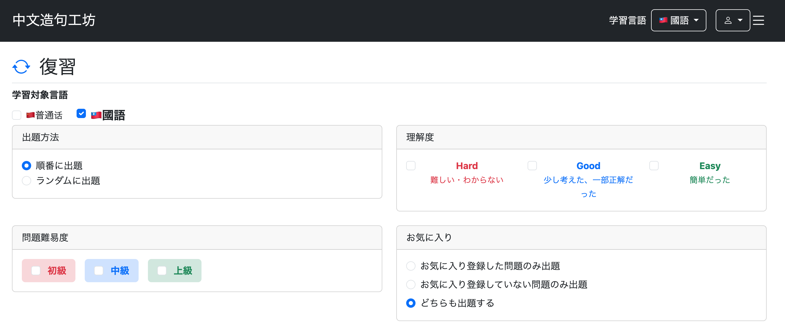
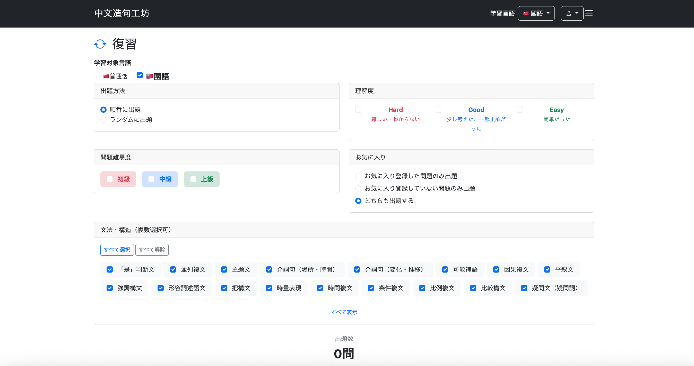
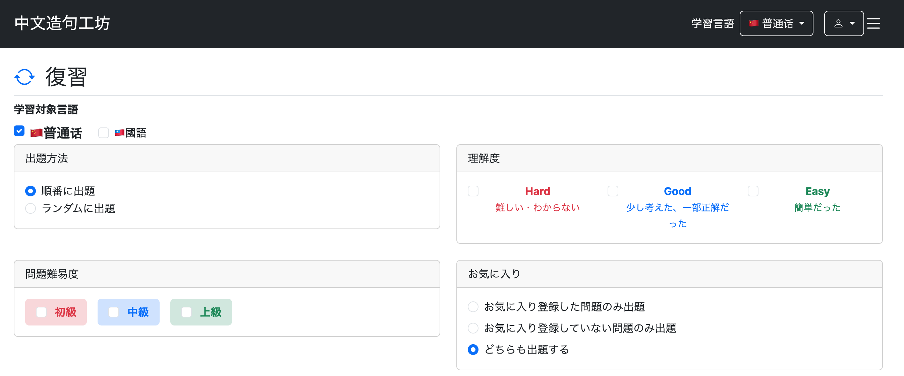
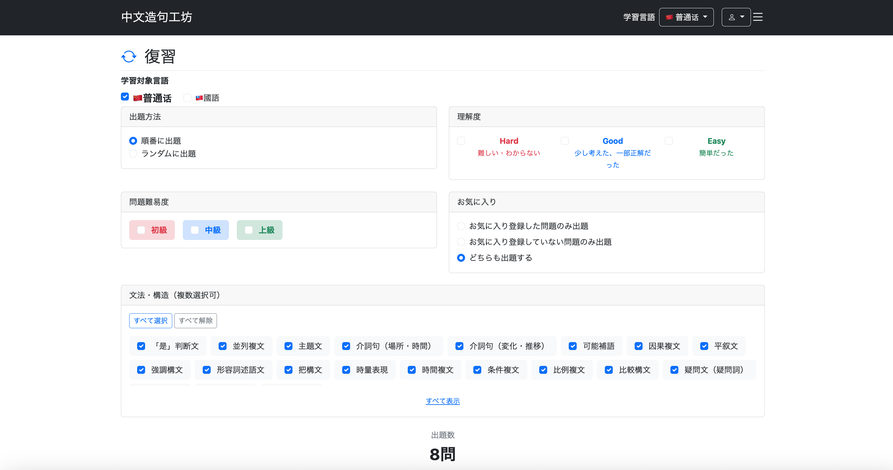
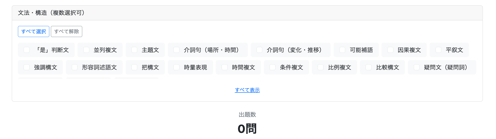
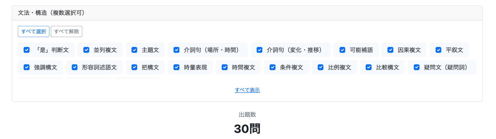

# 011 復習モードの実装 その3 - Structureによる出題条件の追加

復習モードに文法・構造（`Structure`）による絞り込みを追加する。当初は`Question.structure`の文字列を利用したが、文法の説明を表示する要件が生じたため、`Structure`のマスタ化、`Question`との関連付け、既存60問の移行も実施した。

本ログでは、当初の実装から設計変更までを振り返り、実装中に気づいたことや設計上の判断を整理する。

## 1. なぜStructureを復習条件に追加したのか

理解度・難易度・お気に入りに加え、可能補語や把構文などの文法・構造で復習問題を絞り込めるようにした。複数の構造を組み合わせて復習できるようチェックボックスを採用し、「すべて選択」「すべて解除」も設けた。

当初は`Question`の文字列カラムから一覧を取得していたが、後述するマスタ化に伴い取得元を変更した。

## 2. Structureが増えたときの画面表示をどうするか

Structureは当時20種類あり、全件表示すると復習メニューが縦に長くなるため、初期表示の高さを制限し、「すべて表示」で展開する構成にした。

```css
.structure-list {
    max-height: 100px;
    overflow: hidden;
}

.structure-list.expanded {
    max-height: none;
}
```

```javascript
const expanded = structureList.classList.toggle("expanded");
```

HTMLで対象要素を定義し、CSSで表示状態を定め、JavaScriptで`expanded`クラスを切り替える。

## 3. Structureを文字列のまま管理してよいのか

変更前の`Question`は、文法・構造名を文字列として直接保持していた。

```java
@Column(name = "structure", nullable = false)
private String structure;
```

この設計でも絞り込みは可能であり、当初は次のSQLで選択肢を取得した。

```sql
SELECT DISTINCT structure
FROM question
ORDER BY structure
```

しかし、「可能補語」「比例複文」などの名称だけでは学習者が意味を思い出せない場合がある。選択肢に説明を付けることを検討した結果、Structureを名称・説明を持つ独立したマスタデータとして管理する方針に変更した。

## 4. Structureを独立したデータとして扱うために

次のカラムを持つ`structure`テーブルを追加した。

| カラム | 用途 |
|---|---|
| `structure_id` | 主キー |
| `name` | 文法・構造名（重複不可） |
| `description_zh_cn` | 大陸普通話向けの説明 |
| `description_zh_tw` | 台湾華語向けの説明 |

```java
@Entity
@Table(name = "structure")
@Getter
@Setter
public class Structure {

    @Id
    @GeneratedValue(strategy = GenerationType.IDENTITY)
    @Column(name = "structure_id")
    private Long structureId;

    @Column(name = "name", nullable = false, unique = true)
    private String name;

    @Column(name = "description_zh_cn", nullable = false)
    private String descriptionZhCn;

    @Column(name = "description_zh_tw", nullable = false)
    private String descriptionZhTw;
}
```

同じ文法・構造が重複登録されないよう、`name`にUNIQUE制約を設けた。

説明を2種類に分けたのは、説明文に「因为～所以～／因為～所以～」など学習対象言語に応じた中国語表現を含めるためである。切り替え基準はサイトの表示言語ではなく、Sessionの`languageVariant`とした。

## 5. QuestionとStructureの関係をどう表現するか

`Question`側の文字列フィールドを、`Structure`への多対一の関連へ変更した。

```java
@ManyToOne
@JoinColumn(name = "structure_id", nullable = false)
private Structure structure;
```

1つのStructureには複数のQuestionが属するため、Question側は`@ManyToOne`となる。`@JoinColumn`はQuestionテーブルにある外部キーカラム`structure_id`を指定する。

## 6. 既存60問を壊さずにデータ構造を変更するには

既存Questionには`structure_id`が存在しないため、最初から`nullable = false`にせず、旧文字列カラムと新しい外部キーカラムを一時的に共存させた。

**移行時の一時的なEntity定義**

```java
@ManyToOne
@JoinColumn(name = "structure_id")
private Structure structure;
```

Structureマスタのデータを用意した後、旧カラムの文字列とマスタの名称を照合して外部キーを設定した。

```sql
UPDATE question q
SET structure_id = s.structure_id
FROM structure s
WHERE q.structure = s.name;
```

全60問の対応付けを確認してから旧カラムを削除した。

```sql
ALTER TABLE question
DROP COLUMN structure;
```

最後にEntityの`@JoinColumn(name = "structure_id", nullable = false)`へ変更した。DB側のNOT NULL制約も適用されていることを確認する必要がある。

**移行順序**：新カラム追加（NULL許可）→既存データの紐付け→移行結果確認→旧カラム削除→必須制約の適用。既存データを維持したままリレーションへ移行するための重要な手順だった。

## 7. マスタ化によってデータの取得方法はどう変わったか

マスタ化前は`QuestionRepository`から文字列をDISTINCTで取得していたが、変更後は`StructureRepository`から直接取得する。

```java
public List<Structure> findStructures() {
    return structureRepository.findAll();
}
```

HTMLのチェックボックスでは、表示には名称を使い、送信値にはIDを使う。

```html
<input type="checkbox"
       name="structureIds"
       th:value="${structure.structureId}">
<span th:text="${structure.name}"></span>
```

例えば「可能補語」を表示しつつ、検索条件としては対応する`structure_id`を送信する。

## 8. 件数取得と問題取得の条件を揃える必要性

復習メニューに表示する問題数と、開始時に取得する問題セットが一致するよう、件数取得クエリと問題取得クエリの両方に同じ条件を追加した。

```sql
AND q.structure_id IN (:structureIds)
```

今回はIDの一致だけを判定するため、SQL上で`structure`テーブルをJOINする必要はない。名称や説明などマスタ側の列を検索条件に利用する場合は別途JOINを検討する。

## 9. 文法名だけでは分かりにくい問題をどう解決するか

文法・構造の選択肢にBootstrapのTooltipを追加した。説明文はSessionの学習対象言語に応じて切り替える。

```html
data-bs-toggle="tooltip"
data-bs-placement="top"
th:data-bs-title="${session.languageVariant != null
                    && session.languageVariant.name() == 'TAIWAN'
                    ? structure.descriptionZhTw
                    : structure.descriptionZhCn}"
```

```javascript
const tooltipTriggerList =
    document.querySelectorAll('[data-bs-toggle="tooltip"]');

tooltipTriggerList.forEach(element => {
    new bootstrap.Tooltip(element);
});
```

```css
.tooltip-inner {
    max-width: 400px;
    padding: 12px 16px;
    font-size: 1rem;
    text-align: left;
}
```

HTMLで説明内容を設定し、JavaScriptでTooltipを初期化、CSSで読みやすさを調整した。

## 10. 設計変更は手戻りだったのか

今回の開発は、当初の文字列設計で復習メニューと問題取得を実装した後、Structureの説明表示を検討したことで、要件定義・DB・Entity・既存処理を見直すことになった。

設計変更は大きく2回あった。

1. `Question.structure`（文字列）を独立した`Structure`マスタへの参照に変更。
2. 説明を単一の`description`ではなく、普通話向けと台湾華語向けの2種類に変更。

要件定義の段階でStructureの利用方法を十分に想定できていなかった点は反省材料である。一方、実際に文法名を画面へ並べてみたからこそ、「名前だけでは分かりにくい」「説明が必要」という要求に気づけた。設計時に考えられたことと、実際に操作して初めて見えてきたことを分けて振り返る必要がある。

当時は既存問題が60問で関連機能も限定されていたため、変更を先送りせず、requirementsまで遡って修正した。後からStructureを利用する機能が増えてから変更するより、この段階で修正する方が影響範囲を抑えられると判断した。今回学んだのは、設計変更を一律に失敗と捉えるのではなく、**なぜ必要になったのか、いつ変更すべきかを判断すること**の重要性である。

---

# 追加修正：8月28日 — 学習対象言語による絞り込み

復習メニューに普通話・國語の複数選択を追加した。問題数取得と問題取得の両方に、次の条件を設定した。

```sql
AND q.language_variant IN (:languageVariants)
```

`=`ではなく`IN`を使用し、普通話のみ・國語のみ・両方を選択できるようにした。Controllerでは`List<LanguageVariant>`で受け取り、ServiceでDB比較用の文字列へ変換する。

```java
@RequestParam(name = "languageVariants", required = false)
List<LanguageVariant> languageVariants
```

復習メニューを開いたときはSessionに保存された現在の学習対象言語を初期選択とし、必要に応じて両方へ変更できるようにした。

```java
LanguageVariant languageVariant =
        (LanguageVariant) session.getAttribute("languageVariant");

if (languageVariant == null) {
    languageVariant = LanguageVariant.MAINLAND;
}

model.addAttribute(
        "selectedLanguageVariants",
        List.of(languageVariant)
);
```

### HTMLにチェックボックスを追加するだけでは不十分だった

復習対象問題数は`fetch()`で取得しているため、HTMLのチェックボックスを追加するだけではリクエストに反映されない。チェックされた値を`URLSearchParams`に追加した。

```javascript
document
    .querySelectorAll("input[name='languageVariants']:checked")
    .forEach(cb => {
        params.append("languageVariants", cb.value);
    });
```

また、件数再取得の対象となる検索条件のイベント監視にも`languageVariants`を追加した。

### NullPointerExceptionはなぜ発生したのか

実装途中で次のエラーが発生した。

```text
java.lang.NullPointerException:
Cannot invoke "java.util.List.iterator()"
because "languageVariants" is null
```

原因は、問題件数を取得するJavaScript側から`languageVariants`を送信していなかったことだった。`@RequestParam(required = false)`はパラメータがなくてもリクエストを受け付ける指定であり、必ず空のListになるわけではない。値が未送信の場合、今回のControllerでは`null`となり、Converterで走査した際に例外が発生した。

通常のフォーム送信ではチェックされた`name`付き入力が送信されるが、今回は`URLSearchParams`を手動で構築しているため、`params.append()`が必要だった。複数回追加すると、次のように同名のパラメータをSpring MVC側でListとして受け取れる。

```text
languageVariants=MAINLAND&languageVariants=TAIWAN
```

当初は検索結果が0件だったことも気になったが、`COUNT(*)`が0を返すこと自体はエラーではない。画面上の結果と例外の原因を混同せず、スタックトレースで例外発生箇所を追う重要性を再認識した。

### 修正後に確認できたこと

現在の学習対象言語が國語の場合、國語のみが初期選択され、対象問題数が0問と表示された。





普通話へ切り替えると、普通話が初期選択され、対象問題数が8問と表示された。





これにより、現在の学習対象言語を初期値としながら、復習メニューでは任意の言語を選択できるようになった。

---

# 追加修正：8月29日 — 無選択をどう扱うべきか

```bash
git commit -m "fix: apply all structures when review filter is empty"
```

難易度や理解度では無選択時に全件を対象としていたが、Structureだけはすべてのチェックを外すと無選択のままになっていた。そこで、`structureIds`が`null`または空の場合、全Structure IDへ置き換えるよう`ReviewService#countReviewQuestions()`を修正した。

```java
if (structureIds == null || structureIds.isEmpty()) {
    structureIds = structureRepository.findAllStructureIds();
}
```

この処理により、問題数取得でStructureを無選択にしても、すべて選択した場合と同じ件数を表示できた。実際の問題取得側でも同じ無選択時の扱いになることが重要である。

**修正前**



**修正後**



検索条件の操作方法が異なっていても、無選択時の意味を統一することで利用者が迷いにくくなる。

