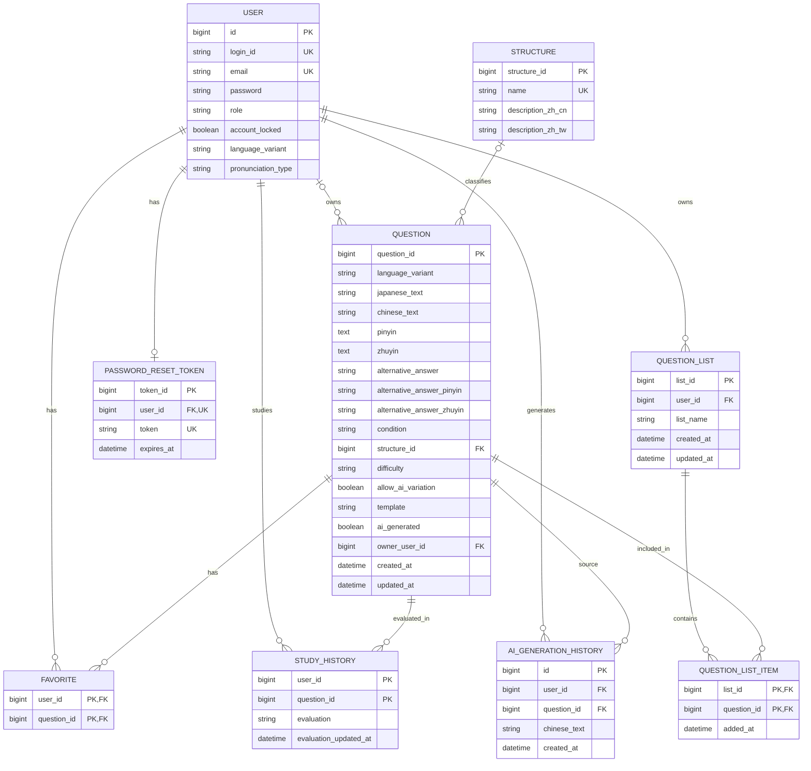

# ER図

Chinese Output Forgeの**現行データモデル**を示します。開発途中の設計変更については[データベース設計変更履歴](database-design-history.md)を参照してください。

## ER図

## 主要テーブル

| テーブル | 役割 |
| --- | --- |
| `users`（図中 `USER`） | 認証情報、権限、メールアドレス、学習言語・発音表記設定 |
| `question` | 通常問題、管理者所有の問題、保存されたAI生成問題を共通管理 |
| `structure` | 問題を分類する文法・構文と、その言語別説明 |
| `favorite` | ユーザーと問題の組み合わせによるお気に入り |
| `study_history` | ユーザーと問題ごとの理解度・更新日時 |
| `ai_generation_history` | 生成元問題とユーザーに紐づくAI生成履歴 |
| `password_reset_token` | ユーザーごとのパスワード再設定トークン |
| `question_list` | ユーザーが作成する問題リスト |
| `question_list_item` | 問題リストと問題の対応関係 |

## 主な設計判断

- **学習対象言語**：大陸普通話（`MAINLAND`）と台湾華語（`TAIWAN`）は、`question.language_variant`で区別します。テーブルは分離せず、問題データとしては別々に管理します。
- **ユーザー設定**：`users.language_variant`は現在の学習対象、`users.pronunciation_type`は拼音・注音などの表示方式を表し、問題側の言語分類とは区別します。
- **問題の所有権**：`question.owner_user_id`はNULLを許可します。AI生成問題だけでなく、ADMINが所有する通常問題も存在します。
- **AI生成問題**：ユーザーが保存した生成結果は独立テーブルではなく`question`に格納し、`ai_generated`で識別します。生成履歴の`ai_generation_history`とは目的が異なります。
- **複合主キー**：`favorite`と`study_history`は`(user_id, question_id)`、`question_list_item`は`(list_id, question_id)`を主キーとします。
- **構文分類**：`question.structure_id`はNULLを許可し、設定されている場合は`structure`を参照します。

## ER図の読み方と制約

- `USER`はDB上の`users`に対応します。
- `study_history`と`users`／`question`の線は**論理上の関連**です。確認したDBの外部キー制約一覧には、`study_history`の外部キーはありませんでした。図中の`user_id`・`question_id`にも`FK`を付けていません。
- `password_reset_token.user_id`にはUNIQUE制約があり、ユーザー1人につきトークンは最大1件です。
- 図はデータモデルの概観です。実際のNULL制約、型、外部キー、運用上の条件はDBスキーマを正とします。
